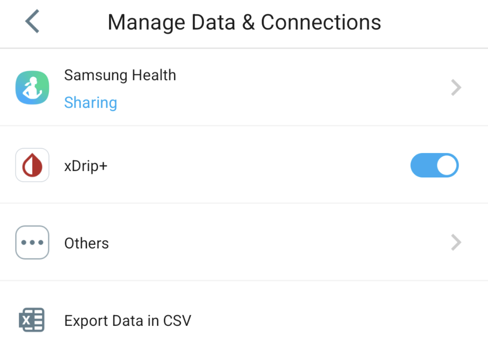

# CareSens

Есть разные способы использовать данные CareSens с **AAPS**:

- xDrip
- Juggluco

**Примечание:** для подключения к AAPS приложение для фолловеров Sens365 не нужно.

## 1. xDrip

1. Установите и настройте официальное приложение CareSens.
2. В приложении CareSens перейдите в settings -> Manage Data and Connections -> включите переключатель xDrip. При желании отключите подключения данных к CareLevo, DIA:CONN, CloudLoop и т. д. в разделе «others».

2. Установите xDrip: [xDrip](https://github.com/NightscoutFoundation/xDrip).
3. В xDrip перейдите в settings -> hardware data source и выберите `Companion App` как источник данных.
4. В **AAPS** выберите xDrip в [**Конфигурация → Источник ГК**](#Config-Builder-bg-source).

## 2. Juggluco

1. Установите приложение Juggluco.
2. В Juggluco откройте левое меню и выберите `Photo`
3. Отсканируйте QR-код на упаковке сенсора.
4. В левом меню -> settings -> exchange data проверьте, что xDrip broadcast включен.
5. В **AAPS** выберите xDrip в [**Конфигурация → Источник ГК**](#Config-Builder-bg-source).
