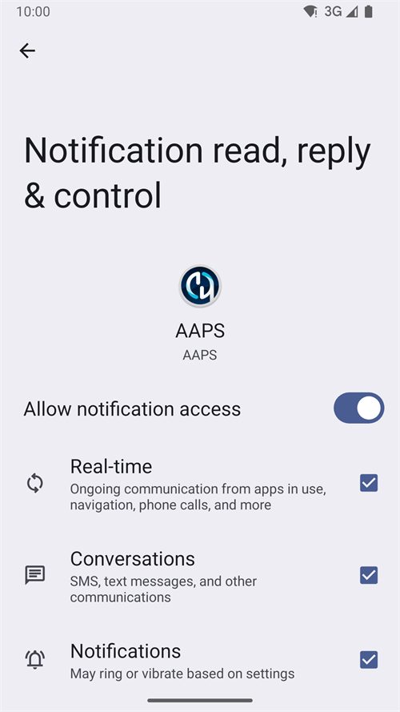

# Dexcom G6 и ONE

## Сначала основное

-   Следуйте общим рекомендациям по гигиене и установке сенсоров мониторинга CGM, изложенным [здесь](../CompatibleCgms/GeneralCGMRecommendation.md).

## Общие рекомендации по работе контура ИПЖ с помощью мониторингов G6 и ONE

- Новые передатчики называются Firefly (светлячок). Сенсоры не могут быть перезапущены без снятия передатчика, данные которого не могут быть сброшены, сенсоры также не генерируют необработанные данные.

- Если вы перезапускаете сенсоры, будьте готовы калибровать и следить за вариацией.

- "Предварительное замачивание" (установка сенсора намного раньше запуска в приложении) G6 с заводской калибровкой приведет к отклонениям в данных. Если вы все же делаете "предварительное погружение", то для получения лучших результатов вам, вероятно, придется калибровать сенсор.

Подробнее в [статье](https://www.diabettech.com/artificial-pancreas/diy-looping-and-cgm/) опубликованной Tim Street на сайте [www.diabettech.com](https://www.diabettech.com).

## If using G6 or ONE with xDrip

- If not already set up, download [xDrip](https://github.com/NightscoutFoundation/xDrip) and adjust its settings following the [xDrip settings page](../CompatibleCgms/xDrip.md).
- Select xDrip in [**Configuration → BG Source**](#Config-Builder-bg-source).
- Трансмиттеры Dexcom G6 и ONE могут одновременно подключаться к ресиверу Dexcom (или к помпе T:slim) и одному приложению на вашем телефоне.
- When using xDrip as receiver uninstall the Dexcom app first. **You cannot connect xDrip and Dexcom app with the transmitter at the same time!**
- If you need Clarity and want to profit from xDrip alarms use the [BYODA](#DexcomG6-if-using-g6-with-build-your-own-dexcom-app) (only G6) with local broadcast to xDrip.
- You can also use xDrip as a companion app of the official Dexcom app, but you might experience delays in BG readings. To read the Dexcom app notifications without xDrip, as a trusted data source, use the [Notification Reader](#DexcomG6-notification-reader).
- xDrip always uses the transmitter's [native algorithm](https://navid200.github.io/xDrip/docs/Native-Algorithm.html) with current transmitters; there is no reason to disable it. [Preemptive restarts](https://navid200.github.io/xDrip/docs/Preemptive-Restart.html) only function on old transmitters (firmware 1.6.5.25 or earlier), where they are needed to prevent the sensor stopping after 10 days; recent (Firefly) transmitters ignore them. See [Restart a sensor](https://navid200.github.io/xDrip/docs/Restart-G6-sensor.html) before attempting any restart.
- Everything related to the sensor and transmitter themselves is documented on the [xDrip Dexcom page](https://navid200.github.io/xDrip/docs/Dexcom_page.html).

(DexcomG6-if-using-g6-with-build-your-own-dexcom-app)=
## При использовании G6 с созданием собственного Dexcom приложения

```{admonition} Old app version
:class: warning
Dexcom BYODA is now a very old version of the app and cannot be updated.
```

-   [Build Your Own Dexcom App](https://docs.google.com/forms/d/e/1FAIpQLScD76G0Y-BlL4tZljaFkjlwuqhT83QlFM5v6ZEfO7gCU98iJQ/viewform?fbzx=2196386787609383750) (BYODA) supports local broadcast to AAPS and/or xDrip

-   Это приложение позволяет использовать Dexcom G6 с любым смартфоном Android.
-   Удалите оригинальное приложение Dexcom или модифицированное приложение Dexcom, если пользовались ими ранее (**не останавливайте** уже работающий сенсор)
-   Установите загруженное приложение
-   * Введите код сенсора и серийный номер трансмиттера в модифицированном приложении.
-   В настройках телефона перейдите к приложению > Dexcom G6> > разрешения >> дополнительные разрешения и нажмите 'Получать доступ к приложению Dexcom'.
-   After a short time BYODA should pick up the transmitter signal.

### Настройки для AAPS

-   Select **BYODA** in [**Configuration → BG Source**](#Config-Builder-bg-source).

-   If you don't receive any values select any other data source, then re-select **BYODA** to trigger the demand for permissions to establish the connection between AAPS and BYODA-broadcast.

### Settings for xDrip

-   Выберите '640G/Eversense' в качестве источника данных.
-   Command 'start sensor' must be performed in xDrip in order to receive values. Это не повлияет на сенсор контролируемый самостоятельно собранным приложением Dexcom.

(DexcomG6-notification-reader)=
## If using G6 or ONE with the Notification Reader

The official Dexcom G6 or ONE app stays connected to the transmitter. **AAPS** reads the glucose value directly from the notification of the Dexcom app, without any other app in between.

```{admonition} Trusted data source
:class: note
Readings from the Dexcom G6 and ONE apps are a [trusted BG data source](#GettingStarted-TrustedBGSource): SMBs can be allowed all the time.
```

Compared to BYODA or xDrip, the Notification Reader has limits:

- **No trend arrow** and **no backfill**: readings missed while the phone was off or out of range are lost.
- Each reading gets the time the notification appeared, not the exact time of the sensor reading.
- Only values between 40 and 405 mg/dL (2.2 and 22.5 mmol/L) are read. "LOW" and "HIGH" are not read.

### Set up the Dexcom app

-   Keep the Dexcom app installed and connected to the transmitter.
-   Make sure the Dexcom app shows the current glucose value in its notification. Its notifications must stay visible: do not silence or hide them.
-   Use the same glucose units (mg/dL or mmol/L) in the Dexcom app as in **AAPS**. Otherwise **AAPS** cannot read the value.

### Конфигурация в AAPS

-   Select **Notification Reader** in [**Configuration → BG Source**](#Config-Builder-bg-source) and confirm the switch.

    

-   Back on the main screen, **AAPS** shows **Permissions Required**. Next to **Notification Access**, tap **Grant**.

    

-   Android opens its notification access list (its name depends on your Android version, for example *Notification read, reply & control*). Select **AAPS**, turn on **Allow notification access** and confirm with **Allow**.

    

    Android warns that **AAPS** could read all your notifications. **AAPS** only reads the notifications of supported CGM apps and ignores all others.

    

-   If **Allow notification access** is greyed out (*Controlled by Restricted Setting*), Android blocks it because **AAPS** was not installed from the Play Store. Open the **AAPS** app info (long press the **AAPS** icon > **App info**), tap the three dots menu at the top right and select **Allow restricted settings**. Then go back to the notification access screen and allow it.
-   Readings appear in **AAPS** when the Dexcom app shows a new value.

```{warning}
If the Dexcom app notification shows more than one glucose number, or none, **AAPS** skips that notification.
```


(DexcomG6-troubleshooting-g6)=
## Устранение неполадок с G6 и ONE

### Устранение неполадок, связанных с Dexcom G6/ONE

-   Прокрутите до **Устранения неполадок** [сюда](https://navid200.github.io/xDrip/docs/Dexcom_page.html).

### Устранение неполадок - общее

Устранение общих неполадок мониторинга можно найти [здесь](#general-cgm-troubleshooting).

### Установка нового трансмиттера на работающий сенсор

Если вы меняете трансмиттер во время работы сенсора, вы можете попробовать снять его, не повредив платформу сенсора. [Здесь](https://navid200.github.io/xDrip/docs/Remove-transmitter.html) можно просмотреть видео. Если вы выберете [данное решение](https://youtu.be/tx-kTsrkNUM) не допустите [повреждения контактов сенсора полоской](https://navid200.github.io/xDrip/docs/Petroleum-jelly-in-Dexcom-G6-Sensor.html).
