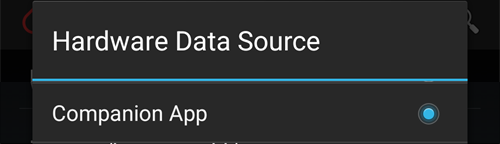
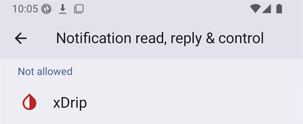
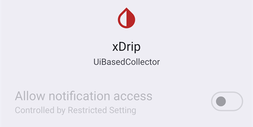
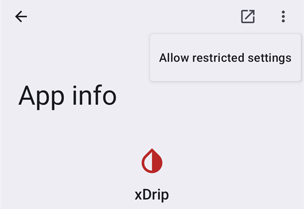
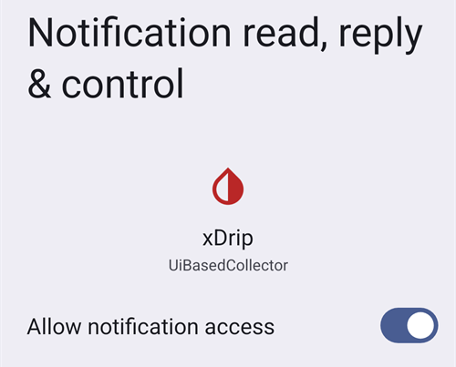
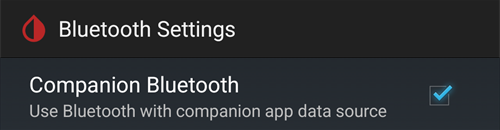

# Dexcom G7, ONE+ и Stelo


## Основательно и перспективно

Стоит отметить, что системы G7, ONE+ и Stelo, в отличие от G6, не сглаживают значения – ни в приложении, ни в ресивере. Подробнее об этом [здесь](https://www.dexcom.com/en-us/faqs/why-does-past-cgm-data-look-different-from-past-data-on-receiver-and-follow-app).

```{admonition} Smoothing method 
Изучите, какие [Способы сглаживания](../CompatibleCgms/SmoothingBloodGlucoseData.md) рекомендуется использовать для Dexcom G7/ONE+/Stelo
```

## 1. xDrip (прямое подключение к G7, ONE+ или Stelo)

- xDrip сам подключается к сенсору: удалите приложение Dexcom, так как к сенсору может подключиться только одно приложение. Чтобы оставить приложение Dexcom, используйте вместо этого [xDrip Companion App](#DexcomG7-xdrip-companion-app).
- Следуйте инструкциям здесь: [xDrip G7, ONE+ и Stelo](https://navid200.github.io/xDrip/docs/Dexcom/G7.html). Нужна свежая версия xDrip – минимальную версию см. на странице по ссылке.
- Выберите xDrip в [**Конфигурация → Источник ГК**](#Config-Builder-bg-source).

- Настройте xDrip согласно пояснениям на странице [Настройки xDrip](../CompatibleCgms/xDrip.md).

## 2. Самостоятельно собранное приложение Dexcom (только G7)

```{admonition} Old app version
:class: warning
Dexcom BYODA — это уже очень старая версия приложения, и ее нельзя обновить. Недоступно для ONE+ и Stelo.
```

-   [Build Your Own Dexcom App](https://docs.google.com/forms/d/e/1FAIpQLScD76G0Y-BlL4tZljaFkjlwuqhT83QlFM5v6ZEfO7gCU98iJQ/viewform?fbzx=2196386787609383750) (BYODA) поддерживает локальную трансляцию данных в AAPS

-   Это приложение позволяет использовать Dexcom G7 с любым смартфоном Android.
-   Uninstall the original Dexcom app
-   Установите загруженное приложение
-   Введите код сенсора в измененном приложении
-   Через короткое время BYODA должно поймать сигнал сенсора.

(DexcomG7-xdrip-companion-app)=

## 3. xDrip Companion App (G7, ONE+ и Stelo)

Официальное приложение Dexcom остается подключенным к сенсору. xDrip читает значения глюкозы из уведомлений приложения Dexcom и отправляет их в **AAPS**.

```{admonition} Not a trusted data source
:class: note
**AAPS** не считает xDrip в режиме Companion App [доверенным источником данных ГК](#GettingStarted-TrustedBGSource): SMB разрешены не всегда.

Чтобы читать уведомления приложения Dexcom без xDrip, как доверенный источник данных, используйте [Чтение уведомлений](#DexcomG7-notification-reader).
```

### Чтение уведомлений приложения Dexcom

- Оставьте приложение Dexcom установленным и подключенным к сенсору. Его уведомления должны оставаться видимыми: не отключайте их звук и не скрывайте их.
- Скачайте и установите [xDrip](https://github.com/NightscoutFoundation/xDrip). Используйте в xDrip те же единицы глюкозы, что и в приложении Dexcom.
- В xDrip перейдите в **Settings** > **Hardware Data Source** и выберите **Companion App**.

  

- xDrip запрашивает разрешение на чтение уведомлений. Нажмите **OK**, затем выберите **xDrip** в списке и включите **Разрешить доступ к уведомлениям**.

  

- Если **Разрешить доступ к уведомлениям** неактивно (*Управляется настройкой с ограниченным доступом*), Android блокирует его, потому что xDrip установлен не из Play Маркета:

  

  Откройте сведения о приложении xDrip (долгое нажатие на значок xDrip > **О приложении**), нажмите меню из трех точек вверху справа и выберите **Разрешить настройки с ограниченным доступом**. Затем вернитесь на экран доступа к уведомлениям и разрешите доступ.

  

  

- Показания появляются в xDrip, когда приложение Dexcom показывает новое значение. Если ничего не появляется, возможно, нужно запустить сенсор в xDrip: на настоящий сенсор это не влияет. В этом режиме Stelo дает показание каждые 15 минут.

### Companion Bluetooth (G7)

Когда приложение Dexcom подключено к сенсору G7, xDrip может также слушать показания, которые сенсор отправляет приложению Dexcom по Bluetooth. xDrip не выполняет сопряжение с сенсором, и вводить код сенсора не нужно: управление остается за приложением Dexcom.

С **Companion Bluetooth** xDrip получает от сенсора точное время и тренд каждого показания, а не время появления уведомления, и заполняет пропуски, когда телефон был вне зоны связи (backfill).

- В xDrip перейдите в **Settings** > **Less common settings** > **Bluetooth Settings** и включите **Companion Bluetooth**.

  

- Это работает не на всех телефонах и не во всех версиях Android. Если видите проблемы, отключите эту функцию.
- Если старый сенсор Dexcom все еще есть в списке Bluetooth телефона, xDrip может слушать не тот сенсор: в Android **Настройки** > **Подключенные устройства** забудьте сенсоры, которыми вы больше не пользуетесь.
- Companion Bluetooth создан для G7. С ONE+ и Stelo используйте уведомления.

### Конфигурация в AAPS

- Выберите xDrip в [**Конфигурация → Источник ГК**](#Config-Builder-bg-source).
- Настройте xDrip согласно пояснениям на странице [Настройки xDrip](../CompatibleCgms/xDrip.md).

## 4. Juggluco (G7 и ONE+)

Требуется версия 9.0 и выше

- Отключите приложение, ранее подключенное к датчику: удалите приложение или выполните «Остановить принудительно» Отключите разрешение «Устройства поблизости» в настройках приложения. Ограничьте использование батареи в приложении.

- Забудьте сенсор в настройках Bluetooth: в настройках Android найдите сенсор среди сопряженных устройств и выберите «Удалить» (Forget). Названия датчиков Dexcom G7 начинаются с DXCM.

- Избегайте вмешательства других датчиков: Держите старые сенсоры Dexcom вне диапазона Bluetooth.

- Подключите датчик G7 к Juggluco: Откройте Juggluco → Левое меню → Фото. Сканируйте матрицу штрих-кода на аппликаторе сенсора G7. Дайте Juggluco до 5 минут, чтобы найти сенсор.

- Требования к сопряжению: Согласитесь с подключением датчика к Juggluco. Убедитесь, что экран не заблокирован во время подключения. Если сопряжение не удалось, подождите 5 минут и повторите попытку.

- Исключение: Часы на Wear OS могут сопрягаться без нажатия кнопки подтверждения.

(DexcomG7-notification-reader)=

## 5. Чтение уведомлений (G7, ONE+ и Stelo)

Официальное приложение Dexcom остается подключенным к сенсору. **AAPS** читает значение глюкозы прямо из уведомления приложения Dexcom, без других приложений между ними.

```{admonition} Trusted data source
:class: note
Показания из приложений Dexcom G7, ONE+ и Stelo – это [доверенный источник данных ГК](#GettingStarted-TrustedBGSource): SMB можно разрешить всегда.
```

По сравнению с другими способами на этой странице у Чтения уведомлений есть ограничения:

- **Нет стрелки тренда** и **нет дозагрузки пропусков**: показания, пропущенные, когда телефон был выключен или вне зоны связи, теряются.
- Каждое показание получает время появления уведомления, а не точное время измерения сенсора.
- Читаются только значения от 40 до 405 мг/дл (от 2,2 до 22,5 ммоль/л). «LOW» и «HIGH» не читаются.
- Stelo дает показание каждые 15 минут.

### Настройка приложения Dexcom

- Оставьте приложение Dexcom установленным и подключенным к сенсору.
- Убедитесь, что приложение Dexcom показывает текущее значение глюкозы в своем уведомлении. Его уведомления должны оставаться видимыми: не отключайте их звук и не скрывайте их.
- Используйте в приложении Dexcom те же единицы глюкозы (мг/дл или ммоль/л), что и в **AAPS**. Иначе **AAPS** не сможет прочитать значение.

### Конфигурация в AAPS

- Выберите **Чтение уведомлений** в [**Конфигурация → Источник ГК**](#Config-Builder-bg-source) и подтвердите переключение.

  

- Вернувшись на главный экран, **AAPS** покажет **Требуются разрешения**. Рядом с **Доступ к уведомлениям** нажмите **Предоставить**.

  

- Android откроет свой список доступа к уведомлениям (его название зависит от версии Android, например *Чтение уведомлений, ответ на них и управление ими*). Выберите **AAPS**, включите **Разрешить доступ к уведомлениям** и подтвердите кнопкой **Разрешить**.

  

  Android предупредит, что **AAPS** сможет читать все ваши уведомления. **AAPS** читает только уведомления поддерживаемых приложений CGM и игнорирует все остальные.

  

- Если **Разрешить доступ к уведомлениям** неактивно (*Управляется настройкой с ограниченным доступом*, Controlled by Restricted Setting), Android блокирует это, потому что **AAPS** установлен не из Play Маркета. Откройте сведения о приложении **AAPS** (долгое нажатие на значок **AAPS** > **О приложении**), нажмите меню из трех точек вверху справа и выберите **Разрешить настройки с ограниченным доступом**. Затем вернитесь на экран доступа к уведомлениям и разрешите доступ.
- Показания появляются в **AAPS**, когда приложение Dexcom показывает новое значение.

```{warning}
Если в уведомлении приложения Dexcom больше одного значения глюкозы или их нет вовсе, **AAPS** пропускает это уведомление.
```
