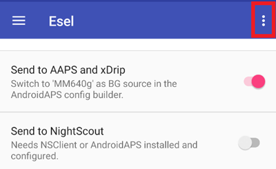
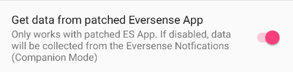

# Eversense

Есть четыре разных способа получать показания Eversense:

- Режим спутника ESEL
- Режим модифицированного приложения ESEL
- Приложение-компаньон xDrip
- Чтение уведомлений (встроено в **AAPS**)

## ESEL

Скачайте и установите [приложение ESEL](https://github.com/BernhardRo/Esel/tree/master/apk), следуя этим [инструкциям](https://github.com/BernhardRo/Esel?tab=readme-ov-file#esel).

- В ESEL откройте меню с тремя точками (⋮) вверху справа и выберите **Settings** (то же есть в меню ☰). В настройках:
  - Включите "Транслировать в AAPS и xDrip"
  - **Отключите** "Отправлять в Nightscout"
  - Поскольку данные ГК из Eversense могут быть зашумленными, рекомендуется включить "Сглаживать данные" в ESEL.



### Режим спутника

Считывает данные из уведомлений Eversense (работает со стандартным приложением Eversense начиная с ESEL версии 3.0.1).

1. Используйте официальное приложение Eversense из Google Play Store
   - Необязательно, но желательно для обратного заполнения пропущенных данных: войти в учетную запись Eversense
   - В Синхронизации, включить автосинхронизацию
2. Конфигурация ESEL:
   - Отключить настройку «Получать данные из модифицированного приложения Eversense»
   - Для обратного заполнения: включите «Заполнять недостающие данные из eversensedms.com»
   - В качестве адреса электронной почты и пароля предоставьте ваши данные для входа в систему Eversense
3. Выберите «MM640g» как источник ГК в [**Конфигурация → Источник ГК**](#Config-Builder-bg-source).

### Модифицированное приложение Eversense

 Требует модифицированную версию приложения Eversense (работает полностью без интернета, в том числе обратное заполнение данных).

1. Удалите приложение Eversense (Предупреждение: локальные данные истории (старше 1 недели) будут потеряны!)

2. Установите [модифицированное приложение Eversense ](https://cr4ck3d3v3r53n53.club) и используйте его в соответствии с инструкцией поставщика

   - Запустите приложение Eversense, войдите в систему, подключитесь к трансмиттеру и используйте его так же, как и обычное приложение.

3. Конфигурация ESEL:

   - Включить настройку «Получать данные из модифицированного приложения Eversense»




Если вы впервые запускаете ESEL со свежей установкой Eversense, первые значения могут появиться в xDrip только через 15 мин!

4. Выберите «MM640g» как источник ГК в [**Конфигурация → Источник ГК**](#Config-Builder-bg-source).

## xDrip

xDrip может читать уведомления приложения производителя, так же как ESEL. При этом обратное заполнение недоступно.

- Скачайте и установите xDrip: [xDrip](https://github.com/NightscoutFoundation/xDrip)
- В xDrip в качестве источника данных нужно выбрать «Companion App».
- Выберите xDrip в [**Конфигурация → Источник ГК**](#Config-Builder-bg-source).
- Настройте xDrip согласно пояснениям на странице [Настройки xDrip](../CompatibleCgms/xDrip.md).
- Включите [экспоненциальное сглаживание](../CompatibleCgms/SmoothingBloodGlucoseData.md) в AAPS.

## Чтение уведомлений

**AAPS** может читать значения глюкозы прямо из уведомлений официального приложения Eversense, без других приложений между ними. При этом обратное заполнение недоступно.

This works with the **Eversense 365** app, both the US version and the version for other countries.

- Выберите **Чтение уведомлений** в [**Конфигурация → Источник ГК**](#Config-Builder-bg-source) и предоставьте **AAPS** доступ к уведомлениям, когда появится запрос.
- Проверьте, что приложение Eversense показывает текущее значение глюкозы в своем уведомлении.

```{warning}
Частота чтения значений ГК не всегда 5 минут, могут возникнуть дубликаты.
```