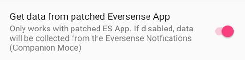

# Eversense

There are four different methods to access the readings from Eversense:

- Режим спутника ESEL
- Режим модифицированного приложения ESEL
- xDrip companion app
- Notification Reader (built into **AAPS**)

## ESEL

Скачайте и установите приложение [ESEL app](https://github.com/BernhardRo/Esel/tree/master/apk), следуя этим [инструкциям](https://github.com/BernhardRo/Esel?tab=readme-ov-file#esel).

- In ESEL, open the three dots menu (⋮) at the top right and select **Settings** (also available from the ☰ menu). In the settings:
  - Включите "Транслировать в AAPS и xDrip"
  - **Отключите** "Отправлять в Nightscout"
  - Поскольку данные ГК из Eversense могут быть зашумленными, рекомендуется включить "Сглаживать данные" в ESEL.


### Режим спутника

Считывает данные из уведомлений Eversense (работает со стандартным приложением Eversense начиная с ESEL версии 3.0.1).

1. Используйте официальное приложение Eversense из Google Play Store
   - Необязательно, но желательно для обратного заполнения пропущенных данных: войти в учетную запись Eversense
   - В Синхронизации, включить автосинхронизацию
2. Конфигурация ESEL:
   - Отключить настройку «Получать данные из модифицированного приложения Eversense»
   - Для обратного заполнения: включите «Заполнять недостающие данные из eversensedms.com»
   - В качестве адреса электронной почты и пароля предоставьте ваши данные для входа в систему Eversense
3. Set "MM640g" as BG source in [**Configuration → BG Source**](#Config-Builder-bg-source).

### Модифицированное приложение Eversense

 Требует патч-версию приложения Eversense (работает полностью в автономном режиме, в том числе и для обратного заполнения данных режиме).

1. Удалите приложения Eversense (Предупреждение: локальные данные истории (старше 1 недели) будут потеряны!)

2. Установите [модифицированное приложение Eversense ](https://cr4ck3d3v3r53n53.club) и используйте его в соответствии с инструкцией поставщика

   - Запустите приложение Eversense, войдите в систему, подключитесь к трансмиттеру и используйте его так же, как и обычное приложение.

3. Конфигурация ESEL:

   - Включить настройку «Получать данные из модифицированного приложения Eversense»




If you run ESEL with a fresh installation of Eversense for the first time, it can take up to 15min until your first values appear in xDrip!

4. Set "MM640g" as BG source in [**Configuration → BG Source**](#Config-Builder-bg-source).

## xDrip

xDrip can read notifications from the vendor app, like ESEL does. При этом обратное заполнение недоступно.

- Download and install xDrip: [xDrip](https://github.com/NightscoutFoundation/xDrip)
- As data source in xDrip “Companion App” must be selected.
- Select xDrip in [**Configuration → BG Source**](#Config-Builder-bg-source).
- Adjust the xDrip settings according to the explanations on the xDrip settings page [xDrip settings](../CompatibleCgms/xDrip.md).
- Включите [экспоненциальное сглаживание](../CompatibleCgms/SmoothingBloodGlucoseData.md) в AAPS.

## Notification Reader

**AAPS** can read the glucose values directly from the notifications posted by the official Eversense app, without any other app in between. При этом обратное заполнение недоступно.

- Select **Notification Reader** in [**Configuration → BG Source**](#Config-Builder-bg-source) and grant **AAPS** access to notifications when asked.
- Make sure the Eversense app shows the current glucose value in its notification.

```{warning}
Частота чтения значений BG не всегда 5 минут, могут возникнуть дубликаты.
```