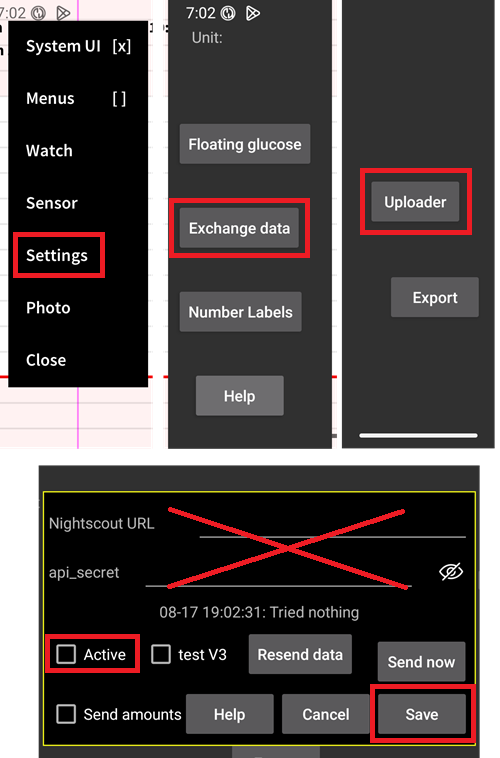
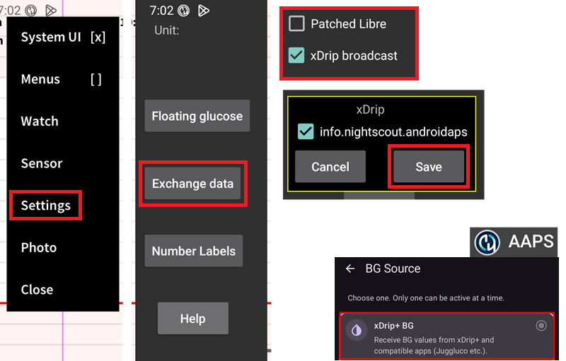
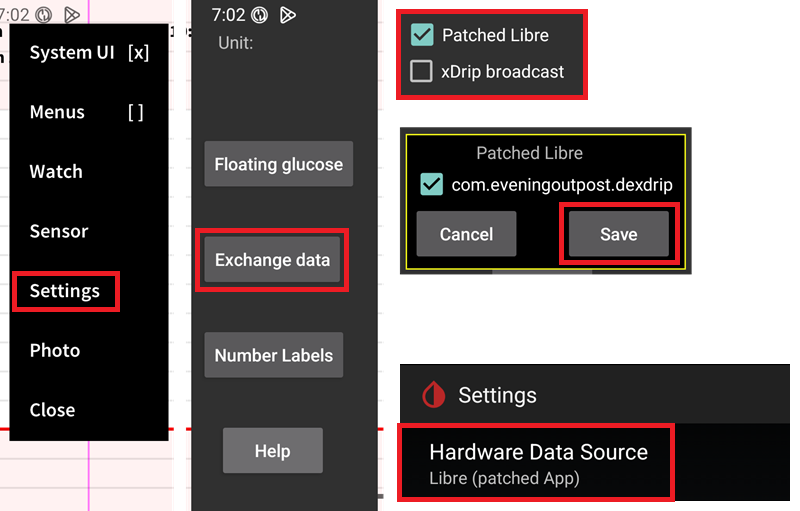

# Настройки Juggluco

Загрузите [Juggluco](https://www.juggluco.nl/Juggluco/download.html), если он еще не настроен.

Для подключения датчика следуйте [инструкциям](https://www.juggluco.nl/Jugglucohelp/introhelp.html).

## Основные настройки для всех систем CGM

### Отключите выгрузку в Nightscout

Не разрешайте другим приложениям загружать данные (ГК и терапию) в Nightscout.

Отключите в Juggluco любой активный загрузчик в Nightscout.

(juggluco-to-aaps)=

## Из Juggluco в AAPS

Juggluco может передавать гликемию непосредственно в AAPS, что позволяет всегда использовать SMB, если вы используете [доверенный датчик](#GettingStarted-TrustedBGSource).

При использовании датчика Libre 2/2+/3/3+ гликемия будет отправляться в AAPS ежеминутно, однако это не приведет к ежеминутным же расчетам.

В Juggluco поставьте галочку у xDrip broadcast (не ставьте у Patched Libre), проставьте галочку у пакета androidaps и сохраните выбор. Выберите в AAPS источник ГК xDrip.

Примените достаточное [сглаживание](./SmoothingBloodGlucoseData.md) в AAPS.

(juggluco-to-xdrip)=

## Juggluco to xDrip

Juggluco может передавать гликемию в xDrip, а xDrip затем передает ее в AAPS.

В Juggluco поставьте галочку у Patched Libre (не ставьте у xDrip broadcast), проставьте галочку у пакета dexdrip и сохраните выбор. Выберите в AAPS источник ГК xDrip.

При необходимости примените достаточное [сглаживание](./SmoothingBloodGlucoseData.md) в AAPS. При использовании сенсора Libre 2/2+/3/3+ xDrip усредняет ежеминутные значения до 5-минутных и [также сглаживает](#libre2-value-smoothing-raw-values) их.

