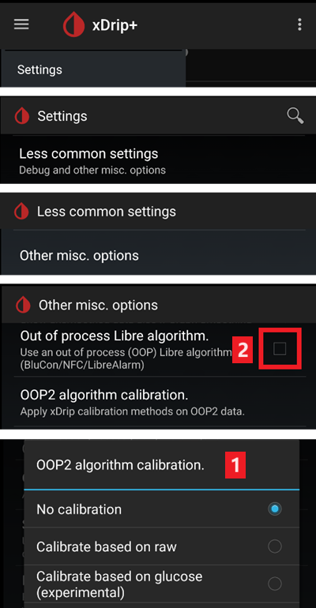
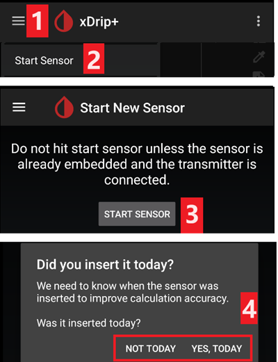
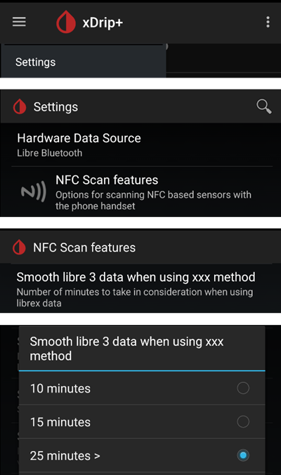
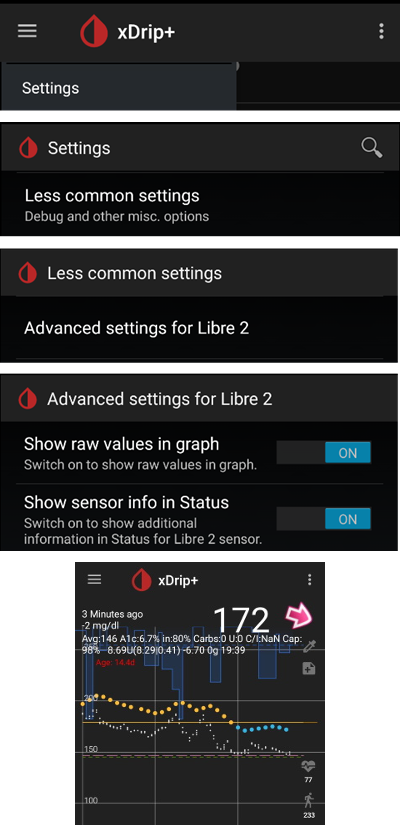

# Freestyle Libre 2 и 2+

Датчик Freestyle Libre 2 теперь является полноценным непрерывным мониторингом даже с официальным приложением. Тем не менее, LibreLink не в состоянии отправлять данные в AAPS. Для взаимодействия Libre 2 с AAPS существует несколько решений.

## 1. Использовать трансмиттер Bluetooth и алгоритм OOP

Bluetooth трансмиттеры могут быть использованы с датчиками Libre 2 (EU) и 2+ (EU) при использовании приложения с алгоритмом вне процесса (OOP). Вы можете получать значения ГК каждые 5 минут, как с [Libre 1](./Libre1.md).

Убедитесь, что мост (трансмиттер) и приложение, которые вы хотите использовать, совместимы с вашим сенсором и xDrip.

Libre2 OOP (находится [здесь](#Libre2_OOP2)) создает те же значения ГК, что и оригинальный ридер или приложение. Во избежание скачков, AAPS с Libre2 производит сглаживание в пределах от 10 до 25 минут. См. ниже [Сглаживание данных & необработанные данные](#libre2-value-smoothing-raw-values). Алгоритм программы генерирует данные каждые 5 минут со сглаживанием по среднему значению за последние 5 минут. Поэтому значения ГК не выглядят гладкими, а совпадают с показаниями оригинального устройства считывания и быстрее следуют "реальным". Если вы хотите использовать замкнутый цикл с OOP, включите все настройки сглаживания в xDrip.

Есть несколько веских причин пользоваться передатчиком Bluetooth:

-   Можно выбрать разные стратегии калибровки OOP2 (1): получать значения как у ридера («no calibration»), калибровать сенсор как Libre 1 («calibrate based on raw») или калибровать значения, похожие на значения ридера («calibrate based on glucose»).  
  Оставьте OOP1 выключенным (2).

    → Сэндвич-меню → Настройки →Менее распространенные настройки → Другие разные настройки. Варианты



-   Libre2 может работать 14,5 дней как и Libre1
-   Полностью поддерживается восстановление данных за прошедшие 8 часов

Замечание: Трансмиттер можно использовать параллельно с приложением LibreLink.

### Запустите сенсор

- → Сэндвич-меню (1) → Запустить сенсор (2) → Запустить сенсор (3) → Ответ "Не сегодня" (4).



На самом деле эта команда физически не запускает сенсор Libre2 и никак с ним не взаимодействует. Это нужно только для того, чтобы сообщить xDrip, что новый сенсор передает значения ГК. Если возможно, введите два значения, измеренных глюкометром, для начальной калибровки. Теперь значения ГК должны появляться в xDrip каждые 5 минут. Пропущенные значения, например из-за того, что вы были далеко от телефона, не будут восстановлены.

После замены сенсора xDrip автоматически обнаружит новый сенсор и удалит все данные калибровки. После активации можно проверить ГК глюкометром и выполнить новую начальную калибровку.

### Настройка AAPS (только для замкнутого цикла)

-   В **AAPS** откройте **меню** (☰) в левом верхнем углу, перейдите в **Конфигурация** > **Источник ГК** и выберите **xDrip+**


-   Если AAPS не получает значения ГК, когда телефон в режиме полета, используйте «Identify receiver», как описано на [странице настроек xDrip](#xdrip-identify-receiver).

## 2. Использовать прямое подключение xDrip

```{admonition} Libre 2 EU only
:class: warning
xDrip не поддерживает прямое подключение к Libre 2 для США и Австралии (US и AUS).
Только модели Libre 2 и 2+ **для рынка ЕС**.
```

- Чтобы настроить xDrip, следуйте [этим инструкциям](./Libre2MinimalL00per.md), так как исходная документация ссылается на устаревшую версию OOP2.
- Следуйте инструкциям по настройке на [странице настроек xDrip](../CompatibleCgms/xDrip.md).

-   Выберите xDrip+ в [Конфигурация > Источник ГК](#Config-Builder-bg-source).

(libre2-value-smoothing-raw-values)=

### Сглаживание данных & необработанные данные

Технически текущее значение ГК передается в xDrip каждую минуту. По умолчанию фильтр средневзвешенного значения вычисляет сглаженное значение за последние 25 минут. Этот период можно изменить в меню функций сканирования NFC.

→ Сэндвич-меню → Настройки →Функция сканирования NFC→ Сглаживать данные libre 3 при использовании метода xxx



Это обязательно для цикла. Кривые выглядят гладкими, и результаты работы цикла великолепны. Необработанные значения, на которых основаны оповещения, колеблются немного сильнее, но совпадают со значениями, которые показывает ридер. Кроме того, необработанные значения можно показывать на графике xDrip, чтобы вовремя реагировать на быстрые изменения. Включите Less Common Settings (Менее распространенные настройки) \> Advanced Settings for Libre2 \> "show Raw values" и "show Sensors Infos". После этого необработанные значения будут дополнительно показаны маленькими белыми точками, а в системном меню будет доступна дополнительная информация о сенсоре.

Необработанные данные очень полезны при быстрых изменениях ГК. Даже если точки скачут сильнее, по ним тенденцию видно гораздо лучше, чем по сглаженной линии, и так проще принимать правильные решения о терапии.

→ Сэндвич-меню → Настройки →Менее распространенные настройки → Advanced settings for Libre 2 (дополнительные настройки для Libre 2)




#### Калибровка

Libre2 можно калибровать **со смещением от -40 мг/дл до +20 мг/дл \[от -2,2 ммоль/л до +1,1 ммоль/л\]** (сдвиг, intercept). Угловой коэффициент не изменяется. Проверьте ГК глюкометром после установки нового сенсора, учитывая, что в первые 12 часов после установки данные могут быть неточными. Поскольку показатели ГК могут сильно отличаться, проверяйте каждые 24 часа и при необходимости калибруйте. Если через несколько дней показания сенсора совсем неверные, его следует заменить.

## 3. Использовать Diabox

- Установите [Diabox](https://t.me/s/DiaboxApp). В Настройках, Интеграция, включите "Делиться данными с другими приложениями".


- Выберите xDrip+ в [Конфигурация > Источник ГК](#Config-Builder-bg-source).

## 4. Использовать Juggluco

Смотри [здесь](./Juggluco.md).
