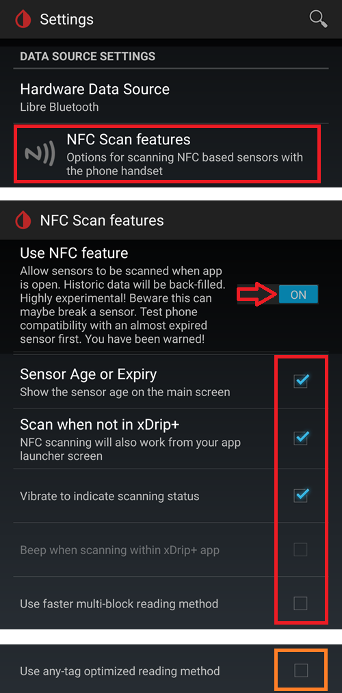
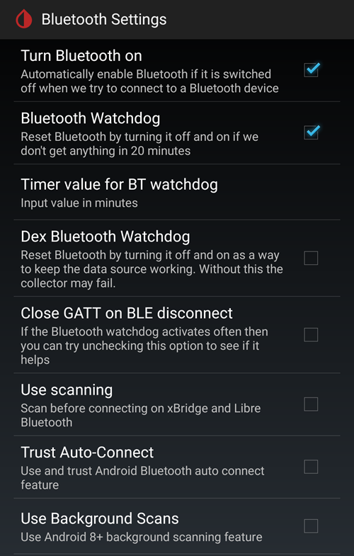
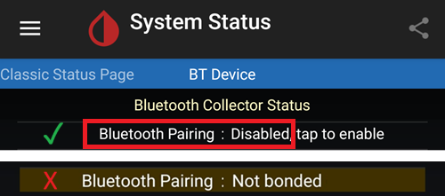

# Как настроить FSL 2 и OOP2 для прямого подключения по Bluetooth в xDrip

Перенесено с [MinimalL00per](https://www.minimallooper.com/post/how-to-setup-freestyle-libre-2-and-oop2-to-use-a-native-Bluetooth-connection-in-xdrip) в markdown и **переработано/обновлено**: 25 августа 2025, psonnera

Список определений находится в конце этого документа. Если вам незнакомы какие-либо термины или сокращения, *[перейдите ниже](#minimallooper-definitions)* за пояснениями.

 

## Configuration

### Оборудование

- *FSL2 и 2+* **ПРИМЕЧАНИЕ: версии для США, Канады, Новой Зеландии и Австралии НЕ поддерживаются**

**(НЕОБЯЗАТЕЛЬНО) Ридер** (не совместим с FSL2+)

- Ридер 1 (с обновленной прошивкой)

- Ридер 2

*ПРИМЕЧАНИЕ: если вы планируете использовать ридер в этой схеме, вы ДОЛЖНЫ ЗАПУСТИТЬ сенсор СНАЧАЛА РИДЕРОМ. Если этого не сделать, вы не сможете получать показания активированного сенсора с помощью ридера. После прогрева сенсора можно получать показания в приложении LL или в xDrip.*

### Программы

**OOP** - Out of Process Algorithm, внешнее приложение Android (APK), которое помогает получать сырые данные сенсора и определять по ним значения глюкозы крови. xDrip отправляет собранные сырые данные FSL2 по BT в OOP, а в xDrip возвращаются значения глюкозы крови.

- **OOP2**

  - **Работает только с европейскими сенсорами FSL2/2+**

  - Закрытый исходный код (нет на GitHub)

  - Его задача - расшифровать зашифрованные сырые данные сенсора и вернуть их в xDrip. Затем xDrip может работать либо с сырыми данными, которые требуют калибровки, либо показывать значения глюкозы, похожие на значения ридера 1.

[***xDrip***](https://jamorham.github.io/)

- [*Nightly*](https://github.com/NightscoutFoundation/xDrip/releases) - последний исходный код, собирается каждую ночь. Не полностью протестирован

- [*Stable*](https://xdrip-plus-updates.appspot.com/stable/xdrip-plus-latest.apk) - последний стабильный протестированный выпуск.

- **ПРИМЕЧАНИЕ: новым сенсорам нужна обновленная версия приложения OOP2, поэтому рекомендуется использовать как минимум последнюю стабильную (Stable) версию xDrip, подходящую к последней версии OOP2.**

 

## Порядок действий

- *Сначала скачайте и установите приложения ниже*
- *Удалите приложения, которые могут мешать*
- *Как запустить сенсор FSL2 в режиме прямого Bluetooth с помощью LL и xDrip
  - [*Шаг 1: установка и настройка приложений*](#minimallooper-step1)
  - [*Шаг 2: настройка xDrip*](#minimallooper-step2)
  - [*Шаг 3: установите сенсор на тело*](#minimallooper-step3)
  - [*Шаг 4: откройте приложение LL и запустите сенсор самым первым NFC-сканированием*](#minimallooper-step4)
  - [*Шаг 5: откройте xDrip и отсканируйте сенсор FSL2 по NFC*](#minimallooper-step5)
  - [*Шаг 6: запустите новый сенсор в xDrip*](#minimallooper-step6)
  - [*Шаг 7: подождите 60 секунд и снова отсканируйте сенсор по NFC*](#minimallooper-step7)
  - [*Шаг 8: сбор данных от 3 до 15 минут*](#minimallooper-step8)
  - [*Шаг 9: проверьте, что сенсор подключен и передает данные*](#minimallooper-step9)

- *[Примечания](#minimallooper-notes)*
- *[Преимущества](#minimallooper-advantages)*
- *[Недостатки](#minimallooper-disadvantages)*
- <u>*\[Устранение неполадок\](#minimallooper-troubleshooting)*</u>

## Перед началом

Настоятельно рекомендуется выполнять эту процедуру с **новым сенсором**. Есть сообщения, что подключиться можно и к уже работающему сенсору (***см. [ниже](#minimallooper-started-sensor)***), но очень вероятно, что приложение LL или ридер создаст новый закрытый общий ключ для связи во время подключения. Это значит, что после привязки xDrip не знает новый ключ и не сможет связаться с сенсором. Подключение к работающему сенсору вы выполняете на свой риск, лучше ближе к концу срока службы сенсора.

### Сначала скачайте и установите приложения ниже

(Libre2_OOP2)=

- **OOP2** - версии OOP2 можно найти здесь:

  (*Примечание: для доступа по ссылке нужно войти в аккаунт Google.*)

*[oop2.apk](https://drive.google.com/file/d/1106h2s12b3Ev9gKCTU2G75q8h9ChHjcz/view?usp=sharing)* - OOP2_21_09_25 (05d1989) **2025.09.21** (последняя версия)

- **xDrip** - **<u>последнюю версию</u>** (минимальная версия 2025.09.26) можно найти здесь:

[*xDrip.apk*](https://github.com/NightscoutFoundation/xDrip/releases)

(minimallooper-started-sensor)=

### Что делать, если сенсор уже запущен? Можно ли все равно получать показания в xDrip? ДА!

Многие спрашивали, можно ли использовать этот способ с уже активным сенсором, и я могу уверенно ответить **ДА**: можно подключить уже работающий сенсор.

1.  **СНАЧАЛА** убедитесь, что вы внесли изменения в конфигурацию и настройки xDrip, а также установили и настроили OOP2, как показано ниже.

2.  **ЗАТЕМ** перейдите к *Шагу 5* и **УБЕДИТЕСЬ**, что вы принудительно остановили LL перед началом. Затем выполните процедуру до конца.

*ПРИМЕЧАНИЕ: вы не сможете использовать активированный сенсор FSL2 с ридером FSLReader, ЕСЛИ он не был сначала запущен ридером FSLReader. Если он БЫЛ сначала запущен ридером FSLReader, то вы сможете **сканировать** сенсор и получать показания ОДНОВРЕМЕННО с сенсора и в приложениях, таких как LL и xDrip.*

## Как запустить сенсор FSL2 в режиме прямого Bluetooth с помощью LL и xDrip

*ПРИМЕЧАНИЕ: если на снимках экрана есть настройки, которые не выделены РАМКОЙ и НЕ ОТМЕЧЕНЫ (то есть отключены), ОСТАВЬТЕ ИХ ОТКЛЮЧЕННЫМИ. Снимки экрана показывают рабочую конфигурацию для ВСЕХ показанных настроек. Если после того, как сенсор заработал, вы хотите поэкспериментировать с включением и выключением других функций, можете делать это на свой риск.*

(minimallooper-step1)=

### Шаг 1: установка и настройка приложений

**Установите и настройте OOP2** и проверьте, что оно работает, просто открыв приложение.


**Настройки**

- *Use service* **on**

- *Use foreground service* **on**

- *Timer Duration* **5 minutes**

  - Измените на **1 sec**, если результаты приходят недостаточно быстро (на снимке экрана ниже показана эта настройка).

**Версия 2: 93e5cac-2020.12.08 (последняя версия)**


**Установите xDrip**, минимальная версия: последний выпуск. Подробная документация по установке и настройке xDrip находится [*здесь*](../CompatibleCgms/xDrip.md).

(minimallooper-step2)=

### Шаг 2: настройка xDrip

**Hardware Data Source**: Libre Bluetooth


**NFC Scan features**: *настройки, которые не упомянуты, считаются выключенными.*

- *Use NFC feature*: **on**
- *Sensor Age or Expiry*: **on**
- *Scan when not in xDrip*: **on**
- *Use Any-tag optimized reading method*: **off**, но попробуйте **on**, если сканирование не получается



- *Starting Bluetooth connection with FSL2 sensor*: **Always connect to libre2 sensors**


- *Smooth libre 3 data when using xxx method*: оставьте значение по умолчанию. Увеличьте значение для сенсоров с шумными данными, уменьшите для стабильных.


**Less Common Settings -\> Bluetooth Settings** (*эти настройки важны и могут зависеть от вашего телефона и конфигурации*)

- *Turn Bluetooth on*: **on**
- *Trust Auto-Connect*: **on**
- *Use Background Scans*: **on**
- *Always discover services*: **on**

xDrip можно настроить с помощью QR-кода ниже. Его нужно отсканировать (или загрузить изображение) в xDrip -> Auto Configure.

```{admonition} QR Code
:class: dropdown


```


После сканирования QR-кода выше, если у вас телефон Samsung (это полезно и для многих китайских марок), отсканируйте другой QR-код ниже, чтобы изменить настройки для более надежного соединения:

- *Trust Auto-Connect*: **off**
- *Use Background Scans*: **off**

```{admonition} QR Code
:class: dropdown


```



**Advanced settings for FSL2** (*необязательно, но полезно*)

- *show Raw values in Graph*: **on**

- *show Sensor info in Status*: **on**


**Extra Logging Settings** (*нужно для отладки, если что-то работает неправильно*)

- *Extra tags for logging*: введите это значение

`BgReading:d,jamorham librereceiver:v,LibreOOPAlgorithm:v,jamorham nsemulator:v,DexCollectionService:v`


(minimallooper-OOPsettings)=

**Less Common Settings -\> Other misc options**

> **Настройки для конфигурации с OOP2**

- *Out of process Libre algorithm*: **OFF**

(*ДЛЯ OOP2 ЭТА НАСТРОЙКА ДОЛЖНА БЫТЬ **OFF**, ИНАЧЕ ВЫ НЕ БУДЕТЕ ПОЛУЧАТЬ ПОКАЗАНИЯ!*)


(minimallooper-step3)=

### Шаг 3: установите сенсор на тело

(minimallooper-step4)=

### Шаг 4: откройте приложение LL и запустите сенсор самым первым NFC-сканированием

Откройте приложение LL, отсканируйте только что установленный сенсор, затем закройте и отключите или удалите приложение LL. **Прежде чем продолжить и запустить сенсор в xDrip, все равно нужно подождать, пока сенсор прогреется все 60 минут**. Не доверяйте показаниям до этого момента: сенсор еще проходит внутреннюю калибровку, и значения сильно скачут.

#### Шаг 4a (НЕОБЯЗАТЕЛЬНО, использование FSLReader):

**Запустите сенсор FSL2 (не 2+) самым первым NFC-сканированием ридером FSLReader**

Если вы хотите считывать значения сенсора FSL2 и ридером **FSLReader**, и приложением LL или xDrip, то **нужно СНАЧАЛА отсканировать только что установленный сенсор FSL2 ридером FSL Reader.** После окончания прогрева сенсора можно сканировать показания приложением LL или xDrip.

*ПРИМЕЧАНИЕ: приложение LL нужно только для САМОГО ПЕРВОГО NFC-сканирования после установки сенсора. Оно отправляет сигнал запуска прогрева, после этого приложение НУЖНО отключить (настройки приложения -\> остановить) или удалить. Можно использовать модифицированное приложение 2.3 или официальные версии, разницы нет. Главное - не допустить работы приложения LL, когда xDrip пытается начать привязку к сенсору по BT, так как приложение LL нарушает связь и мешает повторному подключению по Bluetooth.*

*Есть сообщения, что достаточно просто отключить **разрешение на доступ к местоположению** для приложения LL в системных настройках Android, чтобы оно не мешало подключению. Несколько пользователей сообщили, что это работает. И все же **я рекомендую отключить или удалить приложение**, но вы можете попробовать этот способ, если хотите поэкспериментировать.*

(minimallooper-step5)=

### Шаг 5: откройте xDrip и отсканируйте сенсор FSL2 по NFC

(*Напоминание! Убедитесь, что LL отключено (доступ к местоположению выключен) или удалено И что вы подождали все 60 минут, пока сенсор прогреется и пройдет внутреннюю калибровку.*)

**Отсканируйте по NFC** сенсор FSL2 с помощью xDrip. Это отправляет сенсору сигнал включить сопряжение по Bluetooth, чтобы начать процесс привязки. При успешном NFC-сканировании сенсора FSL 2 внизу главного экрана xDrip ненадолго появится уведомление **Scanning**, а затем уведомление **Scanned OK!**.


(minimallooper-step6)=

### Шаг 6: запустите новый сенсор в xDrip

На **главном экране xDrip** нажмите **сэндвич-меню** в левом верхнем углу. Затем выберите **Start Sensor**.

На экране **Start New Sensor** нажмите **Start Sensor**. Появится вопрос **Did you insert it today?** (Вы установили его сегодня?). Ответьте, нажав **NOT TODAY**.


*ПРИМЕЧАНИЕ: если вы случайно нажали "YES, TODAY", то нужно выбрать "stop sensor" в главном меню xDrip, а затем "start sensor", снова выполнив шаг 5.*

(minimallooper-step7)=

### Шаг 7: подождите 60 секунд и снова отсканируйте сенсор по NFC

Второе NFC-сканирование нужно, чтобы **ДОБАВИТЬ** сенсор как Bluetooth-устройство, с которого xDrip будет получать показания. После завершения вы увидите уведомление **NEW SENSOR STARTED**.


Требуется подождать 60 секунд, потому что во время этого процесса сенсор нельзя сканировать чаще одного раза в минуту. Если отсканировать сенсор слишком рано, на главном экране xDrip появится предупреждение **Not so quickly, wait 60 seconds**.


Откройте журнал событий xDrip (event logs) и проверьте, что сенсор правильно сопряжен с xDrip.


(minimallooper-step8)=

### Шаг 8: сбор данных от 3 до 15 минут

За 3–15 минут собирается достаточно данных, чтобы показать первые значения. *Если к этому времени показаний все еще нет, иногда помогает перезагрузка телефона.*

Если у вас телефон Samsung (или многих китайских марок) и есть проблемы с получением данных, отсканируйте QR-код ниже в xDrip -> Auto Configure.

```{admonition} QR Code
:class: dropdown


```

Он изменит настройки Bluetooth в xDrip на следующие:

- *Trust Auto-Connect*: **off**
- *Use Background Scans*: **off**

(minimallooper-step9)=

### Шаг 9: проверьте, что сенсор подключен и передает данные

Нажмите сэндвич-меню в левом верхнем углу главного экрана xDrip и выберите **System Status**. На экране System Status в поле активного устройства **Bluetooth Device:** показано Bluetooth-имя FSL2 в формате **ABB___XXXXXXXXXXX**, где XXX - серийный номер сенсора. В поле **Connection Status** показано **Connected**, а в поле **Sensor Start:** - время запуска сенсора.


На экране **BT Device** (смахните влево) можно проверить другие сведения о подключении сенсора, а также использовать этот экран для поиска проблем с подключением. Ниже приведен список полей и их назначение, чтобы помочь при поиске проблем с подключением.

*ПРИМЕЧАНИЕ: **<u>НЕ ТРОГАЙТЕ</u> И НЕ МЕНЯЙТЕ Bluetooth Pairing с <u>Disabled</u>** в этом окне. Иначе будет попытка прямого сопряжения, она не удастся (Not bonded), и вам придется начать процесс заново с шага 5.*



- **Phone Service State:** время последнего BT-соединения телефона с сенсором (должно быть меньше 5 минут назад)
- **Bluetooth Device:** показывает текущее состояние соединения (**Connected** или **Disconnected**)
- **Device Mac Address**: аппаратный идентификатор сенсора
- **Bluetooth Pairing**: должно быть **<u>Disabled, tap to enable</u>**. Будьте осторожны и НЕ нажимайте сюда. Если вы нажали случайно, нажимайте снова, пока не вернется значение «отключено» (disabled).
- **Slowest wake up**: можно не обращать внимания. xDrip не ждет показаний все время: он начинает ожидать их через определенное время (обычно 5 минут). Если в это время данные не пришли, вы увидите "Woke up early": это значит, что xDrip ожидал данные, но их нет. Slowest wake up - самая большая задержка перед обычным получением данных.
- **Next Wake up**: должно быть 5 минут


(minimallooper-notes)=

### Примечания

- **NFC-сканирование в LL ПОСЛЕ завершения привязки/сопряжения в xDrip**: NFC-сканирование выполнять можно, но сначала должна быть завершена привязка/сопряжение с xDrip. Всегда смотрите в xDrip, не подходит ли время 5-минутного показания (например, 4 минуты назад). Если почти 5 минут, дождитесь нового показания по BT и только потом выполняйте NFC-сканирование. Если попасть в неудачный момент, это нарушит BT-процесс в xDrip, и показания по BT не будут получены. Повторная привязка и передача могут занять время, а иногда LL может «перехватить» BT-соединение с сенсором. Однако между этими показаниями по BT у меня не было проблем, когда я выполнял NFC-сканирование и сразу после этого отключал приложение. Я не уверен, нужно ли отключать LL каждый раз, но я отключаю его на всякий случай.

- **Что происходит?** При установке Bluetooth-соединения создается закрытый общий ключ, который нужен для связи между сенсором и запрашивающим приложением/устройством. Очень вероятно, что приложение LL или ридер создаст новый закрытый общий ключ для связи во время подключения. Это значит, что после привязки xDrip не знает новый ключ и не сможет связаться с сенсором.

  - Несколько пользователей сообщили, что приложение LL можно снова запустить после успешного запуска сенсора и получения показаний в xDrip. В разрешениях Android для приложения LL нужно просто отключить **Allow Location** (доступ к местоположению). После этого вы сможете использовать приложение LL и xDrip одновременно. Я рекомендую не выбирать приложение по умолчанию для NFC-сканирования, а каждый раз выбирать, какое приложение будет считывать сенсор. Также НЕ ЗАБУДЬТЕ при следующей замене сенсора остановить приложение LL после первого NFC-сканирования нового сенсора для прогрева. Когда сенсор настроен и xDrip получает показания, можно снова запустить приложение LL.

&nbsp;

- **Перезагрузка телефона**: после перезагрузки, а также после отключения или остановки приложения, НЕ ЗАБУДЬТЕ проверить, что приложение LL НЕ запущено. Я советую проверить перезагрузкой, не запускается ли LL снова автоматически. Это можно посмотреть в настройках приложения LL в разделе приложений Android на вашем телефоне. Если оно все еще включено, отключите приложение LL снова; возможно, единственный способ избежать этого - удалить приложение LL. Это нужно, чтобы LL случайно не перехватил привязку BT. Также после перезагрузки снова понадобятся те же 3–15 минут, чтобы получить показания сенсора по BT. Будьте терпеливы и учитывайте это, если перезагружаете телефон незадолго до того, как вам понадобится значение ГК для болюса, еды и т. п.

&nbsp;

- **Настройки оптимизации батареи**: обязательно ИСКЛЮЧИТЕ эти приложения из оптимизации батареи на телефоне

  - xDrip

  - OOP 2

  - LL

  - AAPS / ИПЖ

&nbsp;

- **Режим полета:** бывают ситуации, когда нужно включить режим полета (например, в самолете ;-) или ночью, если вы не хотите, чтобы рядом с головой работали Wi-Fi и мобильная связь телефона), и включение режима полета может вызвать проблемы со связью по Bluetooth. Если включить на телефоне режим полета, а затем включить Bluetooth, показания глюкозы крови будут потеряны. Единственное решение - перезапустить сборщик данных в xdrip+ -\> System Status -\> Classic Status Page. После перезапуска сборщика данных показания глюкозы крови снова появились.

 

(minimallooper-advantages)=

### Преимущества

- **Модифицированное приложение LL больше не нужно** Чтобы получать значения от сенсора FSL2, модифицированная версия приложения LL больше не нужна. Модифицированное приложение LL использовать можно, но официальные версии приложения LL выполняют первое инициализирующее NFC-сканирование так же, как модифицированное приложение. Для инициализирующего NFC-сканирования при запуске сенсора разницы нет.

&nbsp;

- **3rd party NFC scanning device no longer required** 3rd party NFC scanning devices such as (Miaomiao or Blucon) are no longer needed *(but can still be used)* to collect readings as the sensor alone can deliver them now via Bluetooth. Меньше оборудования - меньше того, что может сломаться, меньше устройств для зарядки и более простая схема.

&nbsp;

- **Вы все равно сможете сканировать показания по NFC ридером FSL2 (версия 1 с обновленной прошивкой или версия 2), ЕСЛИ сенсор FSL2 был СНАЧАЛА запущен ридером FSL Reader.** Отдельный ридер FSL2 можно использовать для сканирования показаний активного сенсора и после того, как сенсор привязан по Bluetooth к xDrip.

  - Вы **ДОЛЖНЫ** запустить сенсор самым первым NFC-сканированием, которое начинает прогрев сенсора, **СНАЧАЛА ридером FSL Reader**. После этого другие приложения тоже смогут получать показания с уже активированного сенсора по NFC.
- Насколько я понимаю, сенсор FSL2 (пока он не установил соединение и не пытается его установить) всегда сообщает о своем присутствии (и доступности) по BLE ровно каждые 2 минуты (это видно любому Bluetooth-устройству, которое умеет искать Bluetooth-устройства). Устройство, которое первым ответит на это сообщение, выигрывает гонку и становится *единственным* устройством, которому разрешено подключаться к сенсору и считывать его, так как при подключении через NFC-сканирование создается закрытый общий ключ для расшифровки связи с FSL 2. После этого сенсор недоступен для других устройств, у которых нет этого закрытого общего ключа, даже если они тоже пытаются подключиться. Похоже, что ридер FSL 2 всегда выигрывает эту гонку, кто бы ни был «соперником».

&nbsp;

- **Минимум устройств** Моей целью всегда было свести к минимуму число медицинских устройств на теле. FSL2 вместе с системой Omnipod позволил достичь этой цели. Это еще важнее, когда я путешествую (и на короткие, и на длинные расстояния), потому что становится меньше вещей и замен для них, и в багаже остается больше места для других вещей. Надеюсь, в будущем появится патч-помпа, у которой будет только сменный резервуар, а электроника и мотор будут многоразовой частью. Это уменьшит количество отходов и упаковки при смене места катетера, и в чемодане снова будет больше места для других вещей.

&nbsp;

- **Больше нет часовых пропусков при замене сенсора** Так как другой сенсор можно запустить приложением LL первым NFC-сканированием, текущий сенсор может в это время продолжать работать и передавать показания по Bluetooth. Через 20 минут можно получать показания с нового сенсора, но лучше подождать 1 час, чтобы сенсор прошел внутреннюю калибровку. Это значит, что вы можете остановить текущий сенсор и запустить новый (после того как он был установлен и прогрет с помощью NFC-сканирования в LL час назад), и через 3–15 минут у вас будут первые калибровки и показания.

&nbsp;

(minimallooper-disadvantages)=

### Недостатки

- **Перезагрузка телефона:** так как после перезагрузки телефона процесс Bluetooth должен начаться заново, сначала нужно вручную отключить приложение LL (если вы его не удалили) и терпеливо ждать первых показаний (3–15 мин). Поэтому перезагружайте телефон так, чтобы это не пришлось на важные моменты, например корректирующие болюсы, еду или перекусы.

&nbsp;

- **LL и xDrip нельзя запускать одновременно для получения показаний по Bluetooth**. LL всегда будет пытаться «перехватить» Bluetooth-соединение с сенсором и привязку. Если это произойдет, вы останетесь с LL до конца срока службы сенсора. Поэтому одновременная работа этих приложений получается не всегда. Как я пишу ниже, можно включить приложение LL и выполнить NFC-сканирование, чтобы получить показание в LL (если нужно сравнить значения, получить историю для себя или отчеты для эндокринолога), но отключите его сразу после получения показания и не делайте этого в пределах минуты до того, как xDrip получит свое показание по Bluetooth. Я не уверен, как при этом работает ридер FSL2, но проверю это позже.
- Несколько пользователей сообщили, что приложение LL можно снова запустить после успешного запуска сенсора и получения показаний в xDrip. В разрешениях Android для приложения LL нужно просто отключить **Allow Location** (доступ к местоположению). После этого вы сможете использовать приложение LL и xDrip одновременно. Я рекомендую не выбирать приложение по умолчанию для NFC-сканирования, а каждый раз выбирать, какое приложение будет считывать сенсор. Также НЕ ЗАБУДЬТЕ при следующей замене сенсора остановить приложение LL после первого NFC-сканирования нового сенсора для прогрева. Когда сенсор настроен и xDrip получает показания, можно снова запустить приложение LL.

&nbsp;

- **Сторонние NFC-сканеры все еще можно использовать**. Да, я указал это как недостаток, но хотел также отметить: если с сенсором что-то пойдет не так и LL захватит над ним контроль, вы всегда можете вернуться к NFC-сканеру на сенсоре, чтобы получать показания в xDrip. You can also use this device instead of a direct Bluetooth connection if you are more comfortable with a setup consisting of a 3rd party NFC scanning device (Miaomiao, Blucon). Иногда некоторые телефоны плохо работают с прямой Bluetooth-привязкой сенсора и получением данных. Эти устройства можно использовать как запасной вариант или постоянно, в любом случае у вас есть такая возможность.
- Если вы планируете использовать **FSL Reader** как NFC-сканер для получения показаний, вы ДОЛЖНЫ запустить сенсор FSL2 **САМЫМ ПЕРВЫМ NFC-сканированием** для прогрева **СНАЧАЛА РИДЕРОМ**.

&nbsp;

- **Данные не загружаются в LV автоматически** Так как у приложения LL нет постоянного Bluetooth-соединения (LL не должно работать одновременно с xDrip, когда сенсор уже передает показания по Bluetooth), оно не получает показания от сенсора автоматически. Это значит, что данные глюкозы крови не загружаются автоматически в LV и, соответственно, на другие телефоны с LL. Я отношу это к недостаткам, так как знаю, что многие родители полагаются на эту функцию, а также тем, кто вынужден использовать отчеты LV для своего врача. Вы все равно можете открыть приложение LL и сканировать сенсор каждые 8 часов, чтобы перенести в LL сохраненные в сенсоре данные (3 раза в день, не реже чем каждые 8 часов, но, скорее всего, понадобится больше сканирований, чтобы получить данные за все 24 часа), однако это опять же ручной процесс.

&nbsp;

(minimallooper-definitions)=

### Definitions

- **BT** - Bluetooth

- **BLE** - Bluetooth Low Energy

- **FSL** - FreeStyle Libre
  - **Libre 1 (FSL1)** - только NFC. Первая версия сенсора

  - **Libre 2 (FSL2)** - Bluetooth и NFC. Вторая версия сенсора.

  - **Libre 3 (FSL3)** - Bluetooth и NFC. Третья, более компактная версия сенсора. Не поддерживается OOP2 (см. Juggluco).

- **LL** - LibreLink, **приложение** для запуска сенсора первым NFC-сканированием

- **LV** - LibreView, облачный сервис для передачи данных вашему эндокринологу (можно использовать Tidepool или Nightscout)

- **MM** - MiaoMiao, название и производитель стороннего NFC-сканера, который передает показания в xDrip по Bluetooth.

- **NFC** - Near Field Communication (связь ближнего поля): физическое действие, при котором вы подносите NFC-антенну телефона близко к сенсору, чтобы получить показание. Это часто называют «сканированием сенсора» или «NFC-сканированием». Этот процесс совсем не использует Bluetooth.

- **OOP1** - Out of Process Algorithm версии 1, стороннее приложение, которое получает сырые значения (переданные сенсором в xDrip по Bluetooth или NFC-сканированием), обрабатывает их по алгоритму (очень похожему на аппаратный алгоритм чипа сенсора) и возвращает в xDrip откалиброванное значение глюкозы (калибровка алгоритмом OOP1, а не собственными калибровками xDrip), чтобы xDrip его показал или при необходимости дополнительно обработал своей калибровкой (по крови из пальца).

- **OOP2** - Out of Process Algorithm версии 2, стороннее приложение, которое получает зашифрованные данные от сенсора FSL 2 (по Bluetooth или NFC-сканированием) и расшифровывает их. После расшифровки данные отправляются в xDrip.

 

(minimallooper-troubleshooting)=

### Устранение неполадок

#### Не удается отсканировать сенсор по NFC

- Убедитесь, что NFC на телефоне включен в настройках Android.
- NFC-модуль телефона должен поддерживать метки **ISO 15693**. С некоторыми телефонами Cubot работать очень трудно.
- Найдите в документации к телефону, где находится NFC-антенна. Поднесите телефон к сенсору и держите 10 секунд: NFC-считывание в xDrip занимает больше времени, чем в приложении производителя или в ридере.
- Попробуйте закрыть xDrip перед сканированием сенсора.
- Убедитесь, что никакое другое приложение не пытается считать сенсор (при сканировании может появиться выбор приложений: выберите xDrip, но не двигайте телефон).
- Попробуйте все сочетания настроек NFC в xDrip *Use faster multi-block reading method* и *Use Any-tag optimized reading method*, учитывая, что NFC-сканирование обычно надежнее, когда обе эти настройки **off**.

#### Зависает на сборе первых показаний

*Примечание: FSL 2 не считается надежным источником данных, если калибруется вручную.*

Установите стратегию [калибровки OOP2](#minimallooper-OOPsettings) на "No calibration", пока все не заработает.

Потом вы сможете решить, калибровать или нет.


#### Сенсор определяется как FSL1


Убедитесь, что у вас последние версии xDrip и OOP2.

#### Не удается подключиться к сенсору

- Проверьте, что OOP1 отключен (см. [здесь](#minimallooper-OOPsettings))


- Проверьте, что телефон не переводит OOP2 в спящий режим из-за приложений и настроек экономии батареи
- Проверьте, что Google Play Защита отключена, так как она останавливает OOP2
- Вы изменили Bluetooth Pairing в System Status? Нажмите еще раз, чтобы вернуть значение **<u>Disabled</u>**


#### Пропущенные показания

Убедитесь, что OOP2 показывает значения, отличные от 0 или -1; иначе это может значить, что сенсор выходит из строя (пример ниже в ммоль/л).


Если возраст сенсора не увеличивается, это тоже может говорить о проблемах с сенсором. Это значит, что xDrip получил значение, но отбросил его как недопустимое (ошибка сенсора).


#### Сопряжение с сенсором заново с самого начала

1. Меню xDrip -> Stop sensor (это не остановит FSL2, а только переведет xDrip в состояние «не запущен»)
2. Меню xDrip -> System status -> Forget device
3. Отсканируйте сенсор по NFC в xDrip. Подождите не меньше одной минуты
4. Меню xDrip -> Start sensor. Подождите не меньше одной минуты
5. Отсканируйте сенсор по NFC в xDrip несколько раз, каждый раз выжидая не меньше одной минуты между сканированиями.
