# How to setup FSL 2 and OOP2 to use a native Bluetooth connection in xDrip

Transferred from [MinimalL00per](https://www.minimallooper.com/post/how-to-setup-freestyle-libre-2-and-oop2-to-use-a-native-Bluetooth-connection-in-xdrip) to markdown and **revised/updated**: Aug 25, 2025 psonnera

Список определений находится в конце этого документа. Если вам незнакомы какие-либо термины или сокращения, *[перейдите ниже](#minimallooper-definitions)* за пояснениями.

 

## Configuration

### Оборудование

- *FSL2 и 2+* **ПРИМЕЧАНИЕ: версии для США, Канады, Новой Зеландии и Австралии НЕ поддерживаются**

**(НЕОБЯЗАТЕЛЬНО) Ридер** (не совместим с FSL2+)

- Ридер 1 (с обновленной прошивкой)

- Ридер 2

*ПРИМЕЧАНИЕ: если вы планируете использовать ридер в этой схеме, вы ДОЛЖНЫ ЗАПУСТИТЬ сенсор СНАЧАЛА РИДЕРОМ. Если этого не сделать, вы не сможете получать показания активированного сенсора с помощью ридера. After the sensor has warmed up, you can then take readings from the LL application or xDrip.*

### Программы

**OOP** - Out of Process Algorithm, внешнее приложение Android (APK), которое помогает получать сырые данные сенсора и определять по ним значения глюкозы крови. xDrip sends gathered FSL2 BT raw data to OOP and blood glucose values are returned to xDrip.

- **OOP2**

  - **Работает только с европейскими сенсорами FSL2/2+**

  - Закрытый исходный код (нет на GitHub)

  - Purpose is to decrypt the encrypted raw sensor values and return them to xDrip. Then xDrip can be used with either raw data, requiring calibration, or provide glucose values similar to the Reader 1.

[***xDrip***](https://jamorham.github.io/)

- [*Nightly*](https://github.com/NightscoutFoundation/xDrip/releases) - последний исходный код, собирается каждую ночь. Не полностью протестирован

- [*Stable*](https://xdrip-plus-updates.appspot.com/stable/xdrip-plus-latest.apk) - последний стабильный протестированный выпуск.

- **NOTE: new sensors require an updated OOP2 app, for this it is recommended to use at least the latest xDrip release (Stable) version, matching the latest OOP2.**

 

## Порядок действий

- *Сначала скачайте и установите приложения ниже*
- *Удалите приложения, которые могут мешать*
- *How to Start a FSL2 Sensor in Bluetooth Native mode using LL and xDrip
  - [*Шаг 1: установка и настройка приложений*](#minimallooper-step1)
  - [*Step 2: xDrip Settings Configuration*](#minimallooper-step2)
  - [*Шаг 3: установите сенсор на тело*](#minimallooper-step3)
  - [*Шаг 4: откройте приложение LL и запустите сенсор самым первым NFC-сканированием*](#minimallooper-step4)
  - [*Step 5: Open xDrip and NFC SCAN the FSL2 sensor*](#minimallooper-step5)
  - [*Step 6: Start the new sensor in xDrip*](#minimallooper-step6)
  - [*Шаг 7: подождите 60 секунд и снова отсканируйте сенсор по NFC*](#minimallooper-step7)
  - [*Шаг 8: сбор данных от 3 до 15 минут*](#minimallooper-step8)
  - [*Шаг 9: проверьте, что сенсор подключен и передает данные*](#minimallooper-step9)

- *[Примечания](#minimallooper-notes)*
- *[Преимущества](#minimallooper-advantages)*
- *[Недостатки](#minimallooper-disadvantages)*
- <u>*\[Устранение неполадок\](#minimallooper-troubleshooting)*</u>

## Перед началом

Настоятельно рекомендуется выполнять эту процедуру с **новым сенсором**. Есть сообщения, что подключиться можно и к уже работающему сенсору (***см. [ниже](#minimallooper-started-sensor)***), но очень вероятно, что приложение LL или ридер создаст новый закрытый общий ключ для связи во время подключения. This means that after bonding, xDrip is not aware of the new key and will not be able to communicate with the sensor. Подключение к работающему сенсору вы выполняете на свой риск, лучше ближе к концу срока службы сенсора.

### Сначала скачайте и установите приложения ниже

(Libre2_OOP2)=

- **OOP2** - версии OOP2 можно найти здесь:

  (*Примечание: для доступа по ссылке нужно войти в аккаунт Google.*)

*[oop2.apk](https://drive.google.com/file/d/1106h2s12b3Ev9gKCTU2G75q8h9ChHjcz/view?usp=sharing)* - OOP2_21_09_25 (05d1989) **2025.09.21** (последняя версия)

- **xDrip** - **<u>latest version</u>** (minimum version 2025.09.26) can be found at:

[*xDrip.apk*](https://github.com/NightscoutFoundation/xDrip/releases)

(minimallooper-started-sensor)=

### Что делать, если сенсор уже запущен? Can I still get readings in xDrip? ДА!

Многие спрашивали, можно ли использовать этот способ с уже активным сенсором, и я могу уверенно ответить **ДА**: можно подключить уже работающий сенсор.

1.  **FIRST**, make sure you have made the configuration changes and settings to xDrip and installed and configured OOP2 as shown below.

2.  **ЗАТЕМ** перейдите к *Шагу 5* и **УБЕДИТЕСЬ**, что вы принудительно остановили LL перед началом. Затем выполните процедуру до конца.

*ПРИМЕЧАНИЕ: вы не сможете использовать активированный сенсор FSL2 с ридером FSLReader, ЕСЛИ он не был сначала запущен ридером FSLReader. If it WAS started with the FSLReader first, then you will be able to **scan** the sensor and retrieve readings from BOTH the sensor and apps like LL and xDrip.*

## How to Start a FSL2 Sensor in Bluetooth Native mode using LL and xDrip

*ПРИМЕЧАНИЕ: если на снимках экрана есть настройки, которые не выделены РАМКОЙ и НЕ ОТМЕЧЕНЫ (то есть отключены), ОСТАВЬТЕ ИХ ОТКЛЮЧЕННЫМИ. Снимки экрана показывают рабочую конфигурацию для ВСЕХ показанных настроек. If you want to experiment turning other features on/off after you have a working sensor, you are free to do so at your own risk.*

(minimallooper-step1)=

### Шаг 1: установка и настройка приложений

**Установите и настройте OOP2** и проверьте, что оно работает, просто открыв приложение.


**Настройки**

- *Use service* **on**

- *Use foreground service* **on**

- *Timer Duration* **5 minutes**

  - Change to **1 sec** if you are not getting results fast enough (the screenshot below shows this setting).

**Версия 2: 93e5cac-2020.12.08 (последняя версия)**

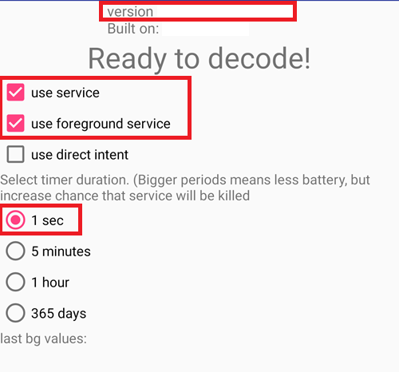

**Install xDrip** minimum version: latest release. Further documentation on xDrip installation and setup can be found [*here*](../CompatibleCgms/xDrip.md).

(minimallooper-step2)=

### Step 2: xDrip Settings Configuration

**Hardware Data Source**: Libre Bluetooth

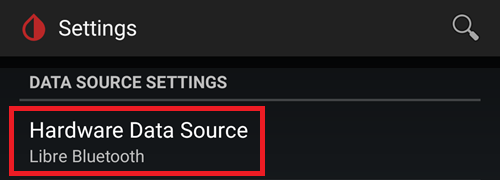

**NFC Scan features**: *настройки, которые не упомянуты, считаются выключенными.*

- *Use NFC feature*: **on**
- *Sensor Age or Expiry*: **on**
- *Scan when not in xDrip*: **on**
- *Use Any-tag optimized reading method*: **off**, но попробуйте **on**, если сканирование не получается


- *Starting Bluetooth connection with FSL2 sensor*: **Always connect to libre2 sensors**

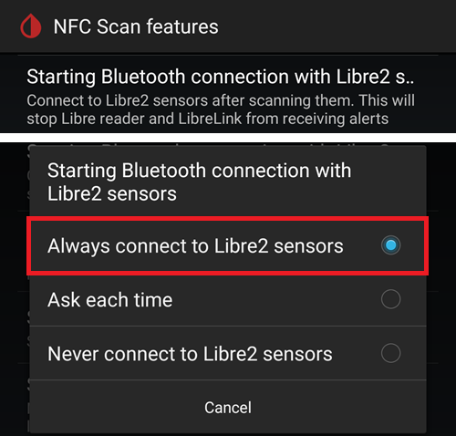

- *Smooth libre 3 data when using xxx method*: оставьте значение по умолчанию. Увеличьте значение для сенсоров с шумными данными, уменьшите для стабильных.

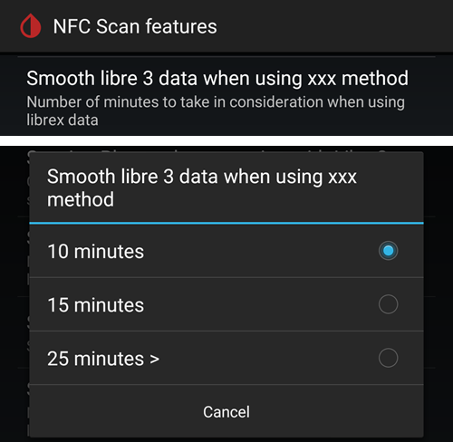

**Less Common Settings -\> Bluetooth Settings** (*эти настройки важны и могут зависеть от вашего телефона и конфигурации*)

- *Turn Bluetooth on*: **on**
- *Trust Auto-Connect*: **on**
- *Use Background Scans*: **on**
- *Always discover services*: **on**

You can setup xDrip using the QR code below. You need to scan it (or load the picture) in xDrip -> Auto Configure.

```{admonition} QR Code
:class: dropdown

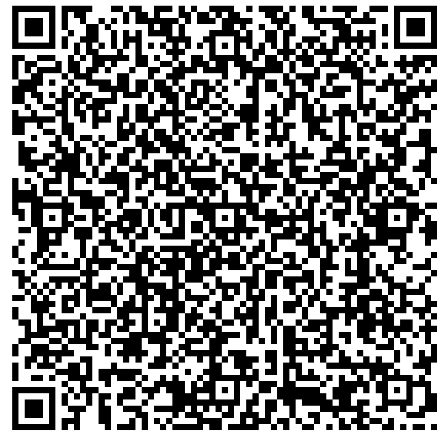
```

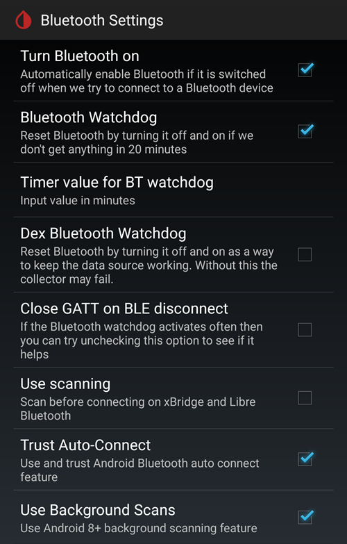

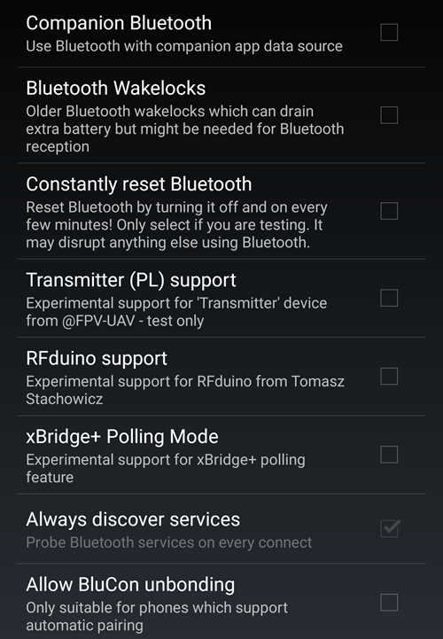

После сканирования QR-кода выше, если у вас телефон Samsung (это полезно и для многих китайских марок), отсканируйте другой QR-код ниже, чтобы изменить настройки для более надежного соединения:

- *Trust Auto-Connect*: **off**
- *Use Background Scans*: **off**

```{admonition} QR Code
:class: dropdown

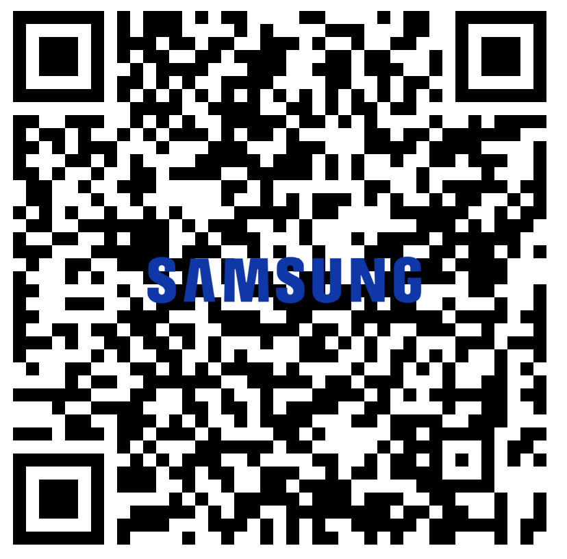
```


**Advanced settings for FSL2** (*необязательно, но полезно*)

- *show Raw values in Graph*: **on**

- *show Sensor info in Status*: **on**

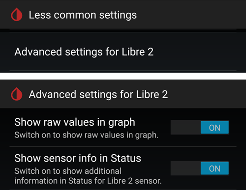

**Extra Logging Settings** (*нужно для отладки, если что-то работает неправильно*)

- *Extra tags for logging*: введите это значение

`BgReading:d,jamorham librereceiver:v,LibreOOPAlgorithm:v,jamorham nsemulator:v,DexCollectionService:v`

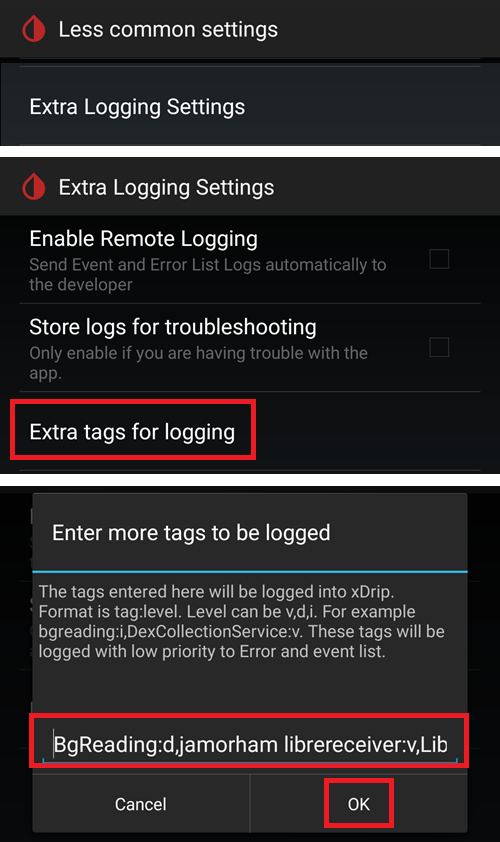

(minimallooper-OOPsettings)=

**Less Common Settings -\> Other misc options**

> **Настройки для конфигурации с OOP2**

- *Out of process Libre algorithm*: **OFF**

(*ДЛЯ OOP2 ЭТА НАСТРОЙКА ДОЛЖНА БЫТЬ **OFF**, ИНАЧЕ ВЫ НЕ БУДЕТЕ ПОЛУЧАТЬ ПОКАЗАНИЯ!*)

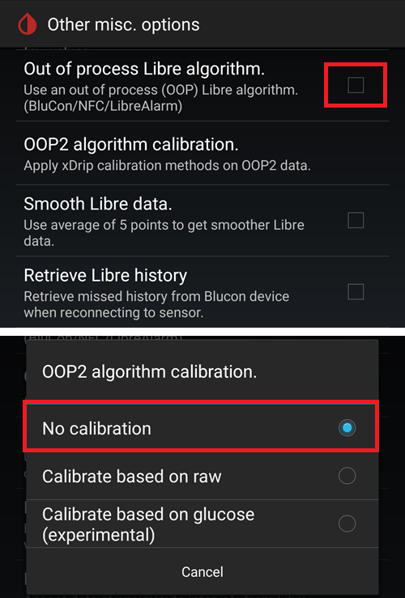

(minimallooper-step3)=

### Шаг 3: установите сенсор на тело

(minimallooper-step4)=

### Шаг 4: откройте приложение LL и запустите сенсор самым первым NFC-сканированием

Откройте приложение LL, отсканируйте только что установленный сенсор, затем закройте и отключите или удалите приложение LL. **You still need to wait for the sensor to warm-up the full 60 minutes before proceeding and starting the sensor in xDrip**. Не доверяйте показаниям до этого момента: сенсор еще проходит внутреннюю калибровку, и значения сильно скачут.

#### Step 4a (OPTIONAL, Use FSLReader):

**Запустите сенсор FSL2 (не 2+) самым первым NFC-сканированием ридером FSLReader**

If you want to be able to use the **FSLReader** as well as the LL app or xDrip to read values from the FSL2 sensor, then **you will need to scan the newly inserted FSL2 sensor with the FSL Reader FIRST.** After the sensor warmup is complete you can then use the LL app or xDrip to scan readings.

*ПРИМЕЧАНИЕ: приложение LL нужно только для САМОГО ПЕРВОГО NFC-сканирования после установки сенсора. Оно отправляет сигнал запуска прогрева, после этого приложение НУЖНО отключить (настройки приложения -\> остановить) или удалить. Можно использовать модифицированное приложение 2.3 или официальные версии, разницы нет. The main thing is to prevent the LL app from running when xDrip is trying to start the BT bonding process with the sensor as the LL app interferes with the Bluetooth reconnection process by disrupting communication.*

*Есть сообщения, что достаточно просто отключить **разрешение на доступ к местоположению** для приложения LL в системных настройках Android, чтобы оно не мешало подключению. Несколько пользователей сообщили, что это работает. И все же **я рекомендую отключить или удалить приложение**, но вы можете попробовать этот способ, если хотите поэкспериментировать.*

(minimallooper-step5)=

### Step 5: Open xDrip and NFC SCAN the FSL2 sensor

(*Напоминание! Убедитесь, что LL отключено (доступ к местоположению выключен) или удалено И что вы подождали все 60 минут, пока сенсор прогреется и пройдет внутреннюю калибровку.*)

**NFC SCAN** the FSL2 sensor with xDrip. Это отправляет сенсору сигнал включить сопряжение по Bluetooth, чтобы начать процесс привязки. A small notification will appear briefly on the bottom of the xDrip Overview screen with the text **Scanning** followed by the notification **Scanned OK!** upon a successful NFC scan of the FSL 2 sensor.

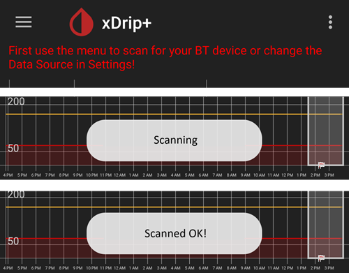

(minimallooper-step6)=

### Step 6: Start the new sensor in xDrip

In the **xDrip Overview screen** press the **hamburger menu** in the upper left corner. Затем выберите **Start Sensor**.

На экране **Start New Sensor** нажмите **Start Sensor**. Появится вопрос **Did you insert it today?** (Вы установили его сегодня?). Ответьте, нажав **NOT TODAY**.

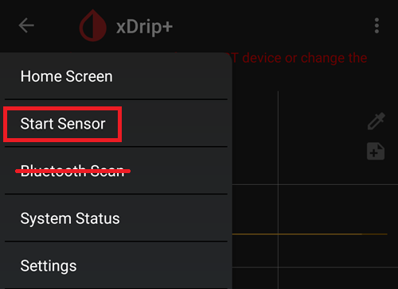

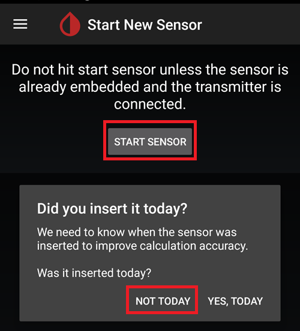

*NOTE: If you accidentally clicked "YES, TODAY" then you will need to "stop sensor" from the xDrip main menu followed by "start sensor" by proceeding with Step 5 again.*

(minimallooper-step7)=

### Шаг 7: подождите 60 секунд и снова отсканируйте сенсор по NFC

A second NFC scan is needed in order to **ADD** the sensor as the Bluetooth device that xDrip will use to retrieve the readings. После завершения вы увидите уведомление **NEW SENSOR STARTED**.

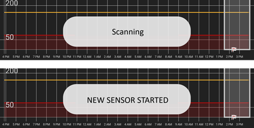

Требуется подождать 60 секунд, потому что во время этого процесса сенсор нельзя сканировать чаще одного раза в минуту. Если отсканировать сенсор слишком рано, на главном экране xDrip появится предупреждение **Not so quickly, wait 60 seconds**.

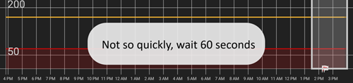

Open xDrip event logs and check the sensor paired correctly with xDrip.

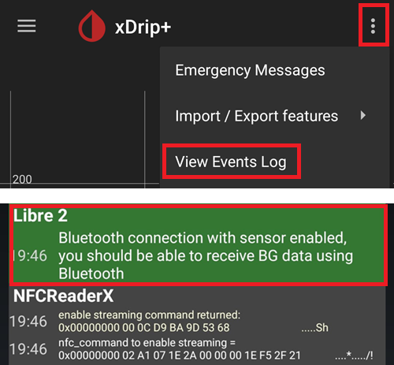

(minimallooper-step8)=

### Шаг 8: сбор данных от 3 до 15 минут

За 3–15 минут собирается достаточно данных, чтобы показать первые значения. *Если к этому времени показаний все еще нет, иногда помогает перезагрузка телефона.*

If you use a Samsung (or many Chinese brand phones) and have issues receiving data, scan the QR code below, in xDrip -> Auto Configure.

```{admonition} QR Code
:class: dropdown


```

It will change xDrip Bluetooth settings to:

- *Trust Auto-Connect*: **off**
- *Use Background Scans*: **off**

(minimallooper-step9)=

### Шаг 9: проверьте, что сенсор подключен и передает данные

Press the Hamburger menu in the upper left of the xDrip Overview screen and select **System Status**. На экране System Status в поле активного устройства **Bluetooth Device:** показано Bluetooth-имя FSL2 в формате **ABB___XXXXXXXXXXX**, где XXX - серийный номер сенсора. The **Connection Status** field displays **Connected** and the **Sensor Start:** field displays the time the sensor was started.

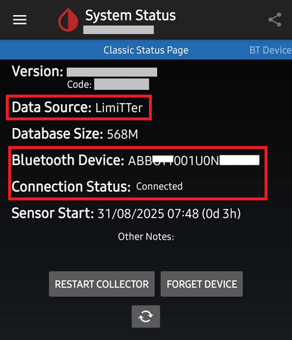

На экране **BT Device** (смахните влево) можно проверить другие сведения о подключении сенсора, а также использовать этот экран для поиска проблем с подключением. Ниже приведен список полей и их назначение, чтобы помочь при поиске проблем с подключением.

*ПРИМЕЧАНИЕ: **<u>НЕ ТРОГАЙТЕ</u> И НЕ МЕНЯЙТЕ Bluetooth Pairing с <u>Disabled</u>** в этом окне. Иначе будет попытка прямого сопряжения, она не удастся (Not bonded), и вам придется начать процесс заново с шага 5.*


- **Phone Service State:** время последнего BT-соединения телефона с сенсором (должно быть меньше 5 минут назад)
- **Bluetooth Device:** показывает текущее состояние соединения (**Connected** или **Disconnected**)
- **Device Mac Address**: аппаратный идентификатор сенсора
- **Bluetooth Pairing**: This should be **<u>Disabled, tap to enable</u>**. Будьте осторожны и НЕ нажимайте сюда. Если вы нажали случайно, нажимайте снова, пока не вернется значение «отключено» (disabled).
- **Slowest wake up**: можно не обращать внимания. xDrip doesn't spend its time waiting for readings: it will start expecting them after a certain time (traditionally 5 minutes). If no data arrives at that time, you'll see "Woke up early" meaning xDrip was expecting data to be ready but there's none. Slowest wake up - самая большая задержка перед обычным получением данных.
- **Next Wake up**: должно быть 5 минут

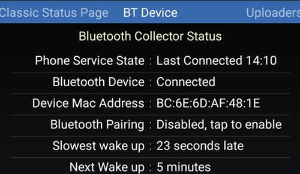

(minimallooper-notes)=

### Примечания

- **Using LL NFC Scans AFTER bonding/pairing in xDrip is completed**: You can conduct NFC scans but the bonding/pairing process with xDrip needs to be completed first. Always look at xDrip and see if it is close to the 5 minute reading (i.e. 4 minutes ago), if it is near 5 min, wait for the new BT reading to come in and then conduct the NFC scan. If you catch it at the wrong time it will disturb the BT process in xDrip and not receive BT readings, which can take a while to re-bond and transmit again and sometimes a sensor BT connection can be “stolen” by LL. Однако между этими показаниями по BT у меня не было проблем, когда я выполнял NFC-сканирование и сразу после этого отключал приложение. Я не уверен, нужно ли отключать LL каждый раз, но я отключаю его на всякий случай.

- **What is going on?** When a Bluetooth connection is made a private shared key is created that is needed to allow communication between the sensor and the calling application/device. Очень вероятно, что приложение LL или ридер создаст новый закрытый общий ключ для связи во время подключения. This means that after bonding, xDrip is not aware of the new key and will not be able to communicate with the sensor.

  - Several users have reported that the LL app can be restarted after successfully starting the sensor and receiving readings in xDrip. В разрешениях Android для приложения LL нужно просто отключить **Allow Location** (доступ к местоположению). Once this is done you should be able to use the LL app and xDrip simultaneously. Я рекомендую не выбирать приложение по умолчанию для NFC-сканирования, а каждый раз выбирать, какое приложение будет считывать сенсор. Также НЕ ЗАБУДЬТЕ при следующей замене сенсора остановить приложение LL после первого NFC-сканирования нового сенсора для прогрева. After the sensor is configured and receiving readings in xDrip you can then start the LL app again.

&nbsp;

- **Перезагрузка телефона**: после перезагрузки, а также после отключения или остановки приложения, НЕ ЗАБУДЬТЕ проверить, что приложение LL НЕ запущено. Я советую проверить перезагрузкой, не запускается ли LL снова автоматически. Это можно посмотреть в настройках приложения LL в разделе приложений Android на вашем телефоне. Если оно все еще включено, отключите приложение LL снова; возможно, единственный способ избежать этого - удалить приложение LL. Это нужно, чтобы LL случайно не перехватил привязку BT. Также после перезагрузки снова понадобятся те же 3–15 минут, чтобы получить показания сенсора по BT. Будьте терпеливы и учитывайте это, если перезагружаете телефон незадолго до того, как вам понадобится значение ГК для болюса, еды и т. п.

&nbsp;

- **Настройки оптимизации батареи**: обязательно ИСКЛЮЧИТЕ эти приложения из оптимизации батареи на телефоне

  - xDrip

  - OOP 2

  - LL

  - AAPS / ИПЖ

&nbsp;

- **Using Flight Mode:** There are some situations which call for turning on flight mode (when taking a flight ;-), sleeping at night and you do not wish to have Wi-Fi or Mobile connection signals operating with your phone in close range of your head) and this can cause issues with the Bluetooth communication during activation of Flight mode. Если включить на телефоне режим полета, а затем включить Bluetooth, показания глюкозы крови будут потеряны. Единственное решение - перезапустить сборщик данных в xdrip+ -\> System Status -\> Classic Status Page. После перезапуска сборщика данных показания глюкозы крови снова появились.

 

(minimallooper-advantages)=

### Преимущества

- **Модифицированное приложение LL больше не нужно** Чтобы получать значения от сенсора FSL2, модифицированная версия приложения LL больше не нужна. Модифицированное приложение LL использовать можно, но официальные версии приложения LL выполняют первое инициализирующее NFC-сканирование так же, как модифицированное приложение. Для инициализирующего NFC-сканирования при запуске сенсора разницы нет.

&nbsp;

- **Сторонний NFC-сканер больше не нужен** Сторонние NFC-сканеры (например, Miaomiao, Bubble или Blucon) больше не нужны для получения показаний *(но их все еще можно использовать)*, так как сенсор теперь сам передает их по Bluetooth. Меньше оборудования - меньше того, что может сломаться, меньше устройств для зарядки и более простая схема.

&nbsp;

- **You will still be able to NFC scan readings with the FSL2 Reader (version 1 with updated FW or version 2) WHEN the FSL2 sensor has been started with the FSL Reader FIRST.** The FSL2 standalone reader can still be used to scan readings on the active sensor once it is bonded via Bluetooth to xDrip.

  - You **MUST** start the sensor with the very first NFC scan to initiate sensor warmup **with the FSL Reader FIRST**. После этого другие приложения тоже смогут получать показания с уже активированного сенсора по NFC.
- Насколько я понимаю, сенсор FSL2 (пока он не установил соединение и не пытается его установить) всегда сообщает о своем присутствии (и доступности) по BLE ровно каждые 2 минуты (это видно любому Bluetooth-устройству, которое умеет искать Bluetooth-устройства). Устройство, которое первым ответит на это сообщение, выигрывает гонку и становится *единственным* устройством, которому разрешено подключаться к сенсору и считывать его, так как при подключении через NFC-сканирование создается закрытый общий ключ для расшифровки связи с FSL 2. После этого сенсор недоступен для других устройств, у которых нет этого закрытого общего ключа, даже если они тоже пытаются подключиться. Похоже, что ридер FSL 2 всегда выигрывает эту гонку, кто бы ни был «соперником».

&nbsp;

- **Минимум устройств** Моей целью всегда было свести к минимуму число медицинских устройств на теле. FSL2 вместе с системой Omnipod позволил достичь этой цели. Это еще важнее, когда я путешествую (и на короткие, и на длинные расстояния), потому что становится меньше вещей и замен для них, и в багаже остается больше места для других вещей. Надеюсь, в будущем появится патч-помпа, у которой будет только сменный резервуар, а электроника и мотор будут многоразовой частью. Это уменьшит количество отходов и упаковки при смене места катетера, и в чемодане снова будет больше места для других вещей.

&nbsp;

- **Больше нет часовых пропусков при замене сенсора** Так как другой сенсор можно запустить приложением LL первым NFC-сканированием, текущий сенсор может в это время продолжать работать и передавать показания по Bluetooth. Через 20 минут можно получать показания с нового сенсора, но лучше подождать 1 час, чтобы сенсор прошел внутреннюю калибровку. Это значит, что вы можете остановить текущий сенсор и запустить новый (после того как он был установлен и прогрет с помощью NFC-сканирования в LL час назад), и через 3–15 минут у вас будут первые калибровки и показания.

&nbsp;

(minimallooper-disadvantages)=

### Недостатки

- **Перезагрузка телефона:** так как после перезагрузки телефона процесс Bluetooth должен начаться заново, сначала нужно вручную отключить приложение LL (если вы его не удалили) и терпеливо ждать первых показаний (3–15 мин). Поэтому перезагружайте телефон так, чтобы это не пришлось на важные моменты, например корректирующие болюсы, еду или перекусы.

&nbsp;

- **You can't run LL and xDrip in parallel together for Bluetooth readings**. LL всегда будет пытаться «перехватить» Bluetooth-соединение с сенсором и привязку. Если это произойдет, вы останетесь с LL до конца срока службы сенсора. Поэтому одновременная работа этих приложений получается не всегда. As I mention below, you can enable the LL app and do an NFC scan to get the LL reading (if you need to compare, want to retrieve history for yourself or endocrinologist reports) however you should disable it as soon as you have your reading and not try to attempt this within a minute of when xDrip is going to retrieve its Bluetooth reading. Я не уверен, как при этом работает ридер FSL2, но проверю это позже.
- Several users have reported that the LL app can be restarted after successfully starting the sensor and receiving readings in xDrip. В разрешениях Android для приложения LL нужно просто отключить **Allow Location** (доступ к местоположению). Once this is done you should be able to use the LL app and xDrip simultaneously. Я рекомендую не выбирать приложение по умолчанию для NFC-сканирования, а каждый раз выбирать, какое приложение будет считывать сенсор. Также НЕ ЗАБУДЬТЕ при следующей замене сенсора остановить приложение LL после первого NFC-сканирования нового сенсора для прогрева. After the sensor is configured and receiving readings in xDrip you can then start the LL app again.

&nbsp;

- **Сторонние NFC-сканеры все еще можно использовать**. Yes, I listed this as a disadvantage but I also wanted to point out that if something goes wrong with the sensor and LL captures control of it, you can always fall back to placing an NFC scanning device on the sensor to get readings in xDrip. Вы также можете использовать такое устройство вместо прямого Bluetooth-соединения, если вам удобнее схема со сторонним NFC-сканером (Miaomiao, Bubble, Blucon). Иногда некоторые телефоны плохо работают с прямой Bluetooth-привязкой сенсора и получением данных. Эти устройства можно использовать как запасной вариант или постоянно, в любом случае у вас есть такая возможность.
- If you are planning on using the **FSL Reader** as an NFC scanning device to take readings, you MUST start the FSL2 sensor with the **VERY FIRST NFC scan** to warm up the sensor with the **READER FIRST**.

&nbsp;

- **LV data will not be uploaded automatically** Since the LL app does not have a constant Bluetooth connection (because LL should not be running simultaneously with xDrip once the sensor is actively sending Bluetooth readings) then it is not receiving readings automatically from the sensor. Это значит, что данные глюкозы крови не загружаются автоматически в LV и, соответственно, на другие телефоны с LL. Я отношу это к недостаткам, так как знаю, что многие родители полагаются на эту функцию, а также тем, кто вынужден использовать отчеты LV для своего врача. Вы все равно можете открыть приложение LL и сканировать сенсор каждые 8 часов, чтобы перенести в LL сохраненные в сенсоре данные (3 раза в день, не реже чем каждые 8 часов, но, скорее всего, понадобится больше сканирований, чтобы получить данные за все 24 часа), однако это опять же ручной процесс.

&nbsp;

(minimallooper-definitions)=

### Definitions

- **BT** - Bluetooth

- **BLE** - Bluetooth Low Energy

- **FSL** - FreeStyle Libre
  - **Libre 1 (FSL1)** - только NFC. Первая версия сенсора

  - **Libre 2 (FSL2)** - Bluetooth and NFC. Вторая версия сенсора.

  - **Libre 3 (FSL3)** - Bluetooth и NFC. Третья, более компактная версия сенсора. Не поддерживается OOP2 (см. Juggluco).

- **LL** - LibreLink, **приложение** для запуска сенсора первым NFC-сканированием

- **LV** - LibreView, облачный сервис для передачи данных вашему эндокринологу (можно использовать Tidepool или Nightscout)

- **MM** - MiaoMiao, name and manufacturer of a 3rd party NFC scanning device that delivers readings via Bluetooth to xDrip.

- **NFC** - Near Field Communication (связь ближнего поля): физическое действие, при котором вы подносите NFC-антенну телефона близко к сенсору, чтобы получить показание. Это часто называют «сканированием сенсора» или «NFC-сканированием». Этот процесс совсем не использует Bluetooth.

- **OOP1** - Out of Process Algorithm version 1, the 3rd party app that receives raw values (delivered to xDrip from the sensor by Bluetooth or NFC scan) and then uses an algorithm (very similar to the hardware algorithm on the sensor chip) to process the raw values and returns a calibrated (by the OOP1 algorithm, not by xDrip’s native calibrations) blood sugar back to xDrip to either display or be further processed with xDrip’s calibration (with a finger pick blood calibration) if needed.

- **OOP2** - Out of Process Algorithm version 2, the 3rd party app that receives encrypted data delivered from the FSL 2 sensor (by Bluetooth or NFC scan) and then decrypts the encrypted data. Once decrypted, the data is then sent to xDrip.

 

(minimallooper-troubleshooting)=

### Устранение неполадок

#### Не удается отсканировать сенсор по NFC

- Убедитесь, что NFC на телефоне включен в настройках Android.
- NFC-модуль телефона должен поддерживать метки **ISO 15693**. С некоторыми телефонами Cubot работать очень трудно.
- Look into your phone documentation to identify the NFC antenna position. Bring it to the sensor and stay on it for 10 seconds: xDrip NFC reading takes longer than the vendor app or the reader.
- Try to close xDrip before scanning the sensor.
- Make sure no other app wants to read the sensor (you might see a selection with different app choices when scanning: select xDrip but don't move the phone).
- Try all combinations of xDrip NFC settings *Use faster multi-block reading method* and *Use Any-tag optimized reading method* knowing that NFC scans are usually more reliable with both these options **off**.

#### Зависает на сборе первых показаний

*Примечание: FSL 2 не считается надежным источником данных, если калибруется вручную.*

Установите стратегию [калибровки OOP2](#minimallooper-OOPsettings) на "No calibration", пока все не заработает.

Потом вы сможете решить, калибровать или нет.

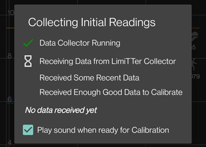

#### Сенсор определяется как FSL1

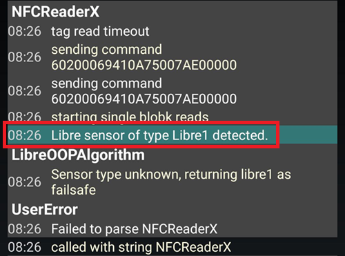

Make sure you are running the latest versions of xDrip and OOP2.

#### Не удается подключиться к сенсору

- Проверьте, что OOP1 отключен (см. [здесь](#minimallooper-OOPsettings))

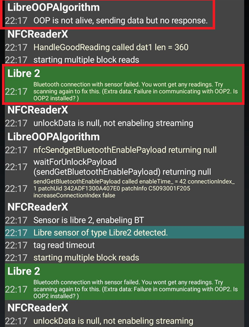

- Проверьте, что телефон не переводит OOP2 в спящий режим из-за приложений и настроек экономии батареи
- Проверьте, что Google Play Защита отключена, так как она останавливает OOP2
- Вы изменили Bluetooth Pairing в System Status? Нажмите еще раз, чтобы вернуть значение **<u>Disabled</u>**


#### Пропущенные показания

Make sure OOP2 shows values that are not 0 or -1, it might be a sign your sensor is failing (example below in mmol/L).

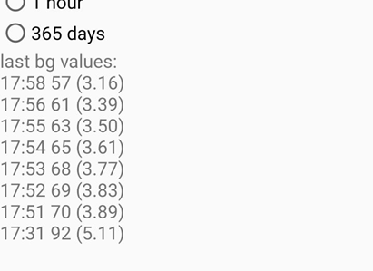

Если возраст сенсора не увеличивается, это тоже может говорить о проблемах с сенсором. This means xDrip received a value, but discarded it as it was not acceptable (sensor error).

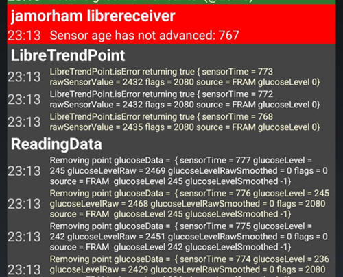

#### Сопряжение с сенсором заново с самого начала

1. xDrip menu -> Stop sensor (it won't stop the FSL2, just change xDrip state to not started)
2. xDrip menu -> System status -> Forget device
3. Scan the sensor with xDrip NFC. Подождите не меньше одной минуты
4. xDrip menu -> Start sensor. Подождите не меньше одной минуты
5. Scan the sensor with xDrip NFC, a few times, always waiting at least one minute between two scans.
