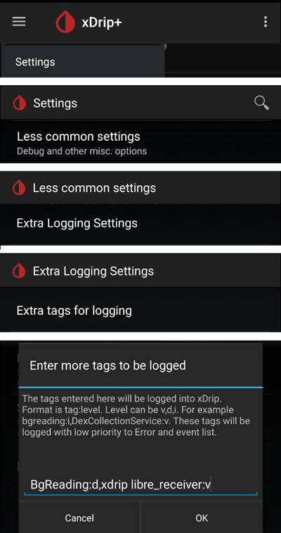
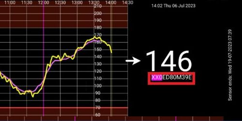
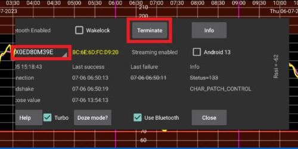

# **Freestyle Libre 3** и 3+

Libre 3 Freestyle (FSL3) требует уникальной настройки для получения ГК в AAPS. Есть два возможных способа получения ГК с Freestyle Libre 3 (FSL3) в AAPS.

Ниже приведены способы достижения этой цели с при помощи приложения Juggluco. Он использует Juggluco, чтобы получать с сенсора необработанные данные с интервалом 1 минута, которые затем передаются в xDrip или AAPS. Новые сенсоры можно запустить с помощью приложения Libre 3 или непосредственно в Juggluco. В инструкции ниже показан процесс запуска сенсора в приложении Juggluco. Если сенсор был запущен в системе с учетной записи Libreview, то также можно переключаться между приложениями Juggluco и Libre 3 в качестве приемника.

При запуске сенсора в приложении Libre 3 Juggluco также может передавать данные LibreView для обмена с медицинскими учреждениями.

В xDrip сенсор можно калибровать в диапазоне от -40 мг/дл до +20 мг/дл (от -2,2 ммоль/л до +1,1 ммоль/л), чтобы компенсировать разницу между показаниями глюкометра и сенсора.

## Способ 1: использовать ежеминутные показания напрямую
**AAPS** рассчитан на показания каждые 5 минут. Поэтому использование ежеминутных показаний имеет определенные ограничения.

Подробности [здесь](#juggluco-to-aaps).

## Способ 2: привести ежеминутные показания к 5-минутным через xDrip+
Этот способ использует Juggluco, чтобы получать с сенсора необработанные данные с интервалом 1 минута. Затем они передаются в xDrip, сглаживаются там в данные с интервалом 5 минут и передаются в AAPS.

### Шаг 1: Настройка Juggluco
Скачайте и установите приложение Juggluco [отсюда](https://www.juggluco.nl/Juggluco/download.html). Следуйте [этой](https://www.juggluco.nl/Juggluco/libre3/) инструкции

Убедитесь, что вы отправляете значения ГК в xDrip: в настройках Juggluco можно включить отправку значений ГК в другие приложения. Juggluco может отправлять три типа таких трансляций (broadcast): **Patched Libre broadcast** изначально использовалась модифицированным приложением LibreLink и может отправлять значения ГК в xDrip.

### Шаг 2: Настройка xDrip

Значения ГК получает приложение xDrip на смартфоне.

- Если xDrip еще не настроен, скачайте [xDrip](https://github.com/NightscoutFoundation/xDrip) и следуйте инструкциям на [странице настроек xDrip](../CompatibleCgms/xDrip.md).
- В xDrip выберите "Libre2 (patched app)" в качестве источника данных.
- При необходимости введите "BgReading:d,xdrip libre_receiver:v" в разделе Менее распространенные настройки → Дополнительные настройки журналирования → Дополнительные теги для добавления в журнал. Это позволит записывать дополнительные сообщения об ошибках для устранения неисправностей.

- Технически текущее значение ГК передается в xDrip каждую минуту. По умолчанию фильтр средневзвешенного значения вычисляет сглаженное значение за последние 25 минут. Этот период можно изменить в меню функций сканирования NFC.

  → Сэндвич-меню → Настройки →Функция сканирования NFC→ Сглаживать данные libre 3 при использовании метода xxx

  

### Шаг 3: Запуск сенсора в xDrip

В xDrip запустите сенсор через «Запустить сенсор» (Start Sensor) и «Не сегодня» (not today). Нет необходимости прикладывать мобильный телефон к сенсору. На самом деле "Запуск сенсора" физически не запускает сенсор Libre3 и не начинает взаимодействие с ним. Это нужно только для того, чтобы сообщить xDrip, что новый сенсор передает значения ГК. Если возможно, введите два значения, измеренных глюкометром, для начальной калибровки. Теперь значения ГК должны появляться в xDrip каждые 5 минут. Пропущенные данные, например из-за того, что вы были далеко от телефона, не будут восстановлены.

Подождите не менее 15-20 минут, если данных нет.

После замены сенсора xDrip автоматически обнаружит новый сенсор и удалит все данные калибровки. После активации можно проверить ГК глюкометром и выполнить новую начальную калибровку.

### Шаг 4: Настройка AAPS

- Изучите [это](#juggluco-to-xdrip) и возвращайтесь.

- Если **AAPS** не получает значения ГК, когда телефон в режиме полета, используйте «Identify receiver»
- Выключите сглаживание (это уже сделано в xDrip)

## Последующие замены сенсора

1. Откройте Juggluco и посмотрите серийный номер текущего сенсора

2. Теперь просто сканируйте новый сенсор с помощью NFC телефона. Juggluco покажет уведомление, если процесс запущен успешно.
3. Когда вы готовы деактивировать старый сенсор, откройте меню Juggluco, щелкнув в любом месте в левом верхнем углу экрана.
4. Выберите закончившийся датчик и нажмите "Прервать".

Note: When two sensors are active Juggluco will send the most recent value from either sensor to xDrip. Если сенсоры откалиброваны по-разному и показывают разные значения ГК, в xDrip могут поступать скачущие значения ГК. Если вы остановите неправильный сенсор, то сможете снова активировать его, просто просканировав сенсор.

## Переключение сенсора между Libre 3 и Juggluco

Если сенсор был запущен в системе с учетной записи Libreview, то также можно переключаться между приложениями Juggluco и Libre 3 в качестве приемника. Для этого требуются следующие шаги:

1. Установите приложение Libre 3 из Google Play
2. Настройте приложение Libre 3 с помощью учетной записи Libreview, которой активирован сенсор.
3. В настройках Android принудительно остановите Juggluco.
4. В меню Libre 3 нажмите кнопку "Запустить сенсор", выберите "Да", "Далее" и отсканируйте сенсор.
5. Через несколько минут данные ГК должны быть видны в приложении Libre 3.

Чтобы перейти с приложения Libre 3 на Juggluco, нужно принудительно остановить Libre 3 через настройки Android и перейти к Шагу 1 & 2.

(libre3-experiences-and-troubling)=
## Опыт и устранение неполадок

### Устранение неполадок Libre3 -> Подключение Juggluco

- Убедитесь, что используете текущую версию приложения Juggluco
- Проверьте настройки в соответствии с этой инструкцией
- Иногда вам придется принудительно остановить приложение Libre 3 и/или Juggluco и перезапустить его/их.
- Отключите Bluetooth и снова включите его
- Подождите некоторое время или попробуйте закрыть Juggluco
- Более старые версии Juggluco (ниже 2.9.6) не посылают последующие данные с сенсора Libre3 на подключенные устройства (например, Juggluco на WearOS). Может потребоваться нажать кнопку «Повторно отправить данные» в модифицированном приложении Libre3 (из меню Juggluco).

### Дальнейшая помощь

Оригинальная инструкция: [jkaltes website](https://www.juggluco.nl/Juggluco/libre3/)

Дополнительный репозиторий GitHub: [ссылка на GitHub](https://github.com/maheini/FreeStyle-Libre-3-patch)
