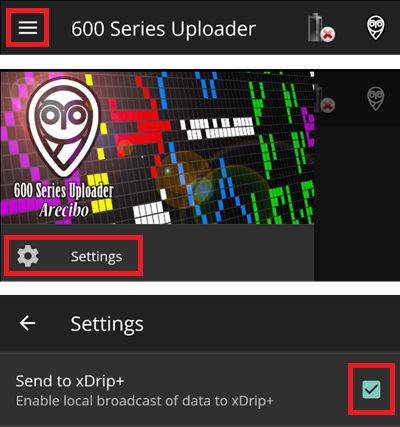

# MM640g или MM630g

-   Если это еще не сделано, скачайте  [600SeriesAndroidUploader](https://pazaan.github.io/600SeriesAndroidUploader/) следуйте инструкциям на [Nightscout](https://nightscout.github.io/uploader/setup/?h=uploader#medtronic-600-series-with-uploader).
-   В 600 Series Uploader перейдите в Settings > Send to xDrip и выберите ON (поставьте галочку).

-   Выберите MM640g в [**Конфигурация → Источник ГК**](#Config-Builder-bg-source).

