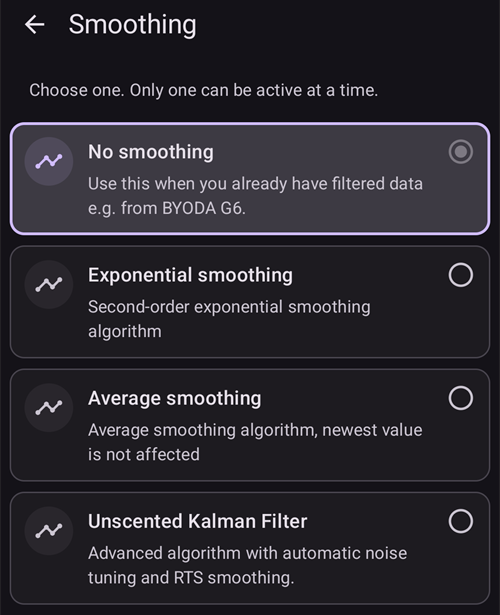

# Сглаживание данных гликемии

Если данные **СК** скачут/являются шумными, **AAPS** может дозировать инсулин неверно, что приведет к высокому или низкому СК. If you observe errors or experience jumpy data with your CGM it is important to disable the loop until the problem is resolved. В зависимости от НМГ, такие проблемы могут возникнуть из-за конфигурации НМГ в **AAPS** (как описано ниже); или из-за некорректной работы сенсора (что может потребовать его замену).

## Smoothing data within AAPS

**AAPS** offers the option to smooth the data within **AAPS** rather than within the CGM app. Open the **menu** (☰), select [**Configuration**](../SettingUpAaps/ConfigBuilder.md), then **Smoothing**. There are four options, and only one can be active at a time: **No smoothing**, **Exponential smoothing**, **Average smoothing** and **Unscented Kalman Filter**.

### Простое экспоненциальное сглаживание

Рекомендуется начинать с этой опции, так как она наиболее агрессивна в устранении шумов и перезаписывает самое последнее значение. Тем не менее, изучите таблицу ниже для дополнительных рекомендации.

### Среднее сглаживание

Этот вариант схож с ретроспективным сглаживанием, который ранее был реализован на некоторых платформах мониторинга CGM. Оно более реактивно к новым изменениям и поэтому более подвержено неправильному реагированию на зашумленные данные CGM.

### Без сглаживания

Используйте данную опцию только в случае хорошего сглаживания данных вашим источником СК перед их отправкой в **AAPS**.

### Unscented Kalman Filter (UKF)

This option uses a statistical model to continuously estimate your true glucose value and its rate of change from the incoming (possibly noisy) readings, automatically adapting to how noisy your sensor currently is. It also detects and rejects sudden outlier readings. It is a more advanced alternative to Exponential and Average smoothing, useful if you want the smoothing to adjust itself to your sensor's changing noise level rather than using a fixed method.

(smoothing-xdrip-dexcom-g6)=

## Предложения использовать сглаживание

You can also change the smoothing method automatically, for example depending on the sensor age, with the **Change smoothing** [Automation action](#automations-automation-action).

|               |   Экспоненциальное    |    Среднее     | Без сглаживания |
| ------------- |:---------------------:|:--------------:|:---------------:|
| G5/G6/ONE     | При зашумлении данных |                |  Рекомендуемое  |
| G7/ONE+/Stelo | При зашумлении данных | Если стабильно |                 |

Датчики Libre часто шумят и могут потребовать сглаживания. When using xDrip direct connection, or the patched app data source (receiving from another app, Juggluco included), [smoothing is already done inside the app](#libre2-value-smoothing-raw-values).

| Датчик/ Источник данных |  Juggluco  | xDrip direct | xDrip bridge | xDrip patched app |
| ----------------------- |:----------:|:------------:|:------------:|:-----------------:|
| Libre 1/14 дней/Pro     | недоступно |  недоступно  |   Среднее    |    недоступно     |
| Libre 2/2+ (EU)         |  Среднее   | Отсутствует  |   Среднее    |    Отсутствует    |
| Libre 2/2+/3/3+         |  Среднее   |  недоступно  |  недоступно  |    Отсутствует    |
