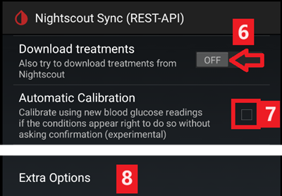
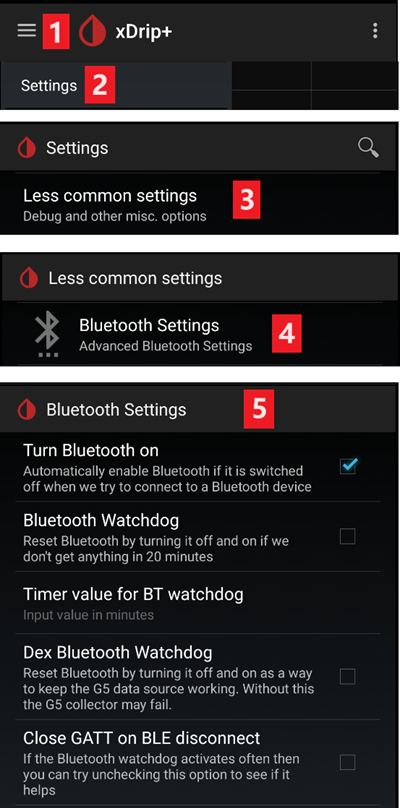

# xDrip settings

If not already set up, download and install the latest xDrip release from the [xDrip releases page](https://github.com/NightscoutFoundation/xDrip/releases).

Disable battery optimization and allow background activity for the xDrip app.

## Основные настройки для всех систем мониторинга

### Отключите выгрузку в Nightscout

You shouldn't let any other app upload data (blood glucose and treatments) to Nightscout.

→ Hamburger Menu (1) → Settings (2) → Cloud Upload (3) → Nightscout Sync (REST-API) (4) → Switch **OFF** `Enabled` (5)

#### Отключите автоматическую калибровку и терапию

Make sure `Automatic Calibration` (7) is deactivated. If the checkbox for `Automatic Calibration` is checked, activate `Download treatments` (6) once, then remove the checkbox for `Automatic Calibration` and deactivate `Download treatments` again.

Tap `Extra Options`(8)

    {admonition} Safety warning
    :class: warning
    You must deactivate "Upload treatments" from xDrip, otherwise treatments can be doubled in AAPS leading to false COB and IOB.

Deactivate `Upload treatments`(9) and make sure you will **NOT** use `Back-fill data` (11).

Option `Alert on failures` should also be deactivated (10). Otherwise you will get an alarm every 5 minutes in case Wi-Fi/mobile network issues or if the server is not available.

### **Настройки интеграций с приложениями** (Трансляция)

If you use AAPS, you must activate broadcasting in xDrip's Inter-App settings so the data is forwarded to AAPS.

→ Hamburger Menu (1) → Settings (2) → Inter-app settings (3) → Broadcast locally **ON** (4)

In order for the values to be identical in AAPS with respect to xDrip, you should activate `Send the displayed glucose value` (5).

Enable Compatible Broadcast (6).

If you have also activated `Accept treatments` in xDrip and `Enable broadcasts to xDrip` in AAPS xDrip plugin, then xDrip will receive insulin, carbs and basal rate information from AAPS.

If you enable `Accept Calibrations`, xDrip will use the calibrations from AAPS. Be careful when you use this feature with Dexcom sensors: read [this](https://navid200.github.io/xDrip/docs/Calibrate-G6.html) first.

Remember to disable Import Sounds to avoid xDrip making a ringtone every time AAPS sends a basal/profile change.

(xdrip-identify-receiver)=

#### Установить получателя

- If you discover problems with local broadcast (AAPS not receiving BG values from xDrip) go to → Hamburger Menu (1) Settings (2) → Inter-app settings (3) → Identify receiver (7) and enter `info.nightscout.androidaps` for AAPS build (if you are using PumpControl build, please enter `info.nightscout.aapspumpcontrol` instead!!).
- Внимание: Автокоррекция, как правило, меняет i на прописную букву. **Используйте только строчные буквы** при вводе `info.nightscout.androidaps` (или `info.nightscout.aapspumpcontrol` для PumpControl). Capital I would prevent the App from receiving BG values from xDrip.
    
    

## Use AAPS to calibrate in xDrip

- If you want to be able to use AAPS to calibrate then in xDrip go to Settings → Interapp Compatibility → Accept Calibrations and select ON. 
- Другие варианты см. в Настройках → Менее распространенные настройки → Расширенная калибровка/Дополнительные параметры калибровки.

## Dexcom sensors

Everything related to the Dexcom sensor and transmitter themselves (starting, stopping, replacing, calibrating, troubleshooting) is documented and kept up to date in the [xDrip Dexcom documentation](https://navid200.github.io/xDrip/docs/Dexcom_page.html). Follow those instructions for the sensor; the settings connecting xDrip to **AAPS** (described above on this page) are the only AAPS-specific part.

### Dexcom G6 и ONE

- Set up xDrip following the [recommended settings](https://navid200.github.io/xDrip/docs/G6-Recommended-Settings.html).
- Трансмиттеры Dexcom G6 и ONE могут одновременно подключаться к ресиверу Dexcom (или к помпе T:slim) и одному приложению на вашем телефоне.
- When using xDrip as receiver uninstall the Dexcom app first. **You cannot connect xDrip and the Dexcom app with the transmitter at the same time!**
- If you need Clarity and want to profit from xDrip features, use the [Build Your Own Dexcom App](#DexcomG6-if-using-g6-with-build-your-own-dexcom-app) with local broadcast to xDrip, or use xDrip as a Companion app receiving notifications from the official Dexcom app (with possible delays in BG readings).

#### Sensor restarts

- xDrip always uses the transmitter's [native algorithm](https://navid200.github.io/xDrip/docs/Native-Algorithm.html) with current transmitters; there is no reason to disable it.
- [Preemptive restarts](https://navid200.github.io/xDrip/docs/Preemptive-Restart.html) only function on old transmitters (firmware 1.6.5.25 or earlier), where they are needed to prevent the sensor stopping after 10 days. Recent (Firefly) transmitters ignore them.
- Restarting a sensor on a Firefly transmitter requires [removing the transmitter](https://navid200.github.io/xDrip/docs/Remove-transmitter.html) and readings can be significantly in error after the restart, which is dangerous when looping: read [Restart a sensor](https://navid200.github.io/xDrip/docs/Restart-G6-sensor.html) in full and [calibrate carefully](https://navid200.github.io/xDrip/docs/Calibrate-after-G6Restart.html).

(xdrip-connect-g6-transmitter-for-the-first-time)=

#### Start, stop and replace sensors

Follow the instructions:

- [Start a G6 or ONE transmitter](https://navid200.github.io/xDrip/docs/Starting-G6.html)
- [Stop and start a G6 or ONE sensor](https://navid200.github.io/xDrip/docs/Dexcom/StartG6Sensor.html)
- [Remove the transmitter from a sensor](https://navid200.github.io/xDrip/docs/Remove-transmitter.html)
- [Transmitter lifetime](https://navid200.github.io/xDrip/docs/Transmitter-lifetime.html) can only be extended ([hard reset](https://navid200.github.io/xDrip/docs/Hard-Reset.html)) on rebatteried or modified transmitters, not on Firefly.

(xdrip-replace-transmitter)=

#### Replace a transmitter

- Turn the original Dexcom receiver off (if used) and do not turn it back on before xDrip shows readings.
- Forget the device in xDrip (System Status → Forget Device) AND in the smartphone's Bluetooth settings (shown as DexcomXX where XX are the last two digits of the transmitter serial number).
- Keep the old transmitter out of Bluetooth range to prevent reconnection.
- Then follow [Start a G6 or ONE transmitter](https://navid200.github.io/xDrip/docs/Starting-G6.html).

### Dexcom G7, ONE+ and Stelo

- Follow the [G7, ONE+ and Stelo instructions](https://navid200.github.io/xDrip/docs/Dexcom/G7.html) (a recent xDrip release is required — see the linked page).
- See also the [Dexcom G7, ONE+ and Stelo page](../CompatibleCgms/DexcomG7.md) for the available setups with **AAPS**.

(xdrip-troubleshooting-dexcom-g5-g6-and-xdrip)=

### Troubleshooting Dexcom and xDrip

- [G6/ONE connectivity troubleshooting](https://navid200.github.io/xDrip/docs/Connectivity-troubleshoot.html)
- [G7/ONE+/Stelo troubleshooting](https://navid200.github.io/xDrip/docs/Dexcom/G7_Troubleshooting.html)
- [Problem when starting a new sensor](https://navid200.github.io/xDrip/docs/Dexcom/SensorFailedStart.html)
- Full list: see **Troubleshooting** on the [xDrip Dexcom page](https://navid200.github.io/xDrip/docs/Dexcom_page.html).

## Libre 1

- Setup your NFC to Bluetooth bridge in xDrip
    
    → Сэндвич-меню (1) → Настройки (2) →Менее распространенные настройки (3) → Настройки Bluetooth (4)

- В настройках Bluetooth установите флажки точно так же, как на экране ниже (5)
    
    - Отключите режим перезапуска watchdog, так как он сбрасывает Bluetooth телефона и прерывает связь с помпой.
    
    

- Можно попробовать включить следующие настройки (7)
    
    - Использовать сканирование
    - Доверять автоподключению
    - Использовать фоновые сканирования

- Если при этом теряется соединение с мостом или возникают трудности с восстановлением соединения, **ОТКЛЮЧИТЕ ИХ** (8).
    
    

- Оставьте все остальные параметры отключенными, если только не знаете, почему хотите их включить.
    
    

### Уровень батареи Libre smart reader

- Уровень заряда батареи таких мостов, как Miao Miao и Bubble (но не Blucon), отображается в AAPS.
- Подробности можно найти на странице [снимков экрана](#screens-sensor-level-battery).

### Подключите трансмиттер Libre и запустите сенсор

- Если сенсор нуждается в этом (Libre 2 EU и Libre 1 US), установите новейший алгоритм out-of-process .

- Your sensor must be already started using the vendor app or the reader (xDrip cannot start or stop Libre sensors).

- Установите источник данных на Libre Bluetooth.
    
    → Сэндвич-меню (1) → Настройки (2) → Выберите Libre Bluetooth в качестве аппаратного Источника данных (3)
    
    

- Сканируйте Bluetooth и подключите мост.
    
    → сэндвич-меню (1) → Сканировать Bluetooth (2) → Скан (3)
    
    - If xDrip can't find the bridge, make sure it's not connected to the vendor app. Put it in charge and reset it.
    
    

- Start the sensor in xDrip.
    
        {admonition} Предостережение безопасности::class: предупреждение
        Не используйте данные сенсора до окончания часового прогрева: значения могут быть чрезвычайно высокими и вызвать неверные решения AAPS.
        .
    
    → Сэндвич-меню (1) → Запустить сенсор (2) → Запустить сенсор (3) → Введите точное время запуска ридером или оригинальным приложением. Если запускали не сегодня, выберите "Не сегодня" (4).

(xdrip-libre2-patched-app)=

## Модифицированное приложение Libre 2

- Установите источник данных на Libre (patched app).
    
    → Сэндвич-меню (1) → Настройки (2) → Выберите Libre (patched app) в качестве аппаратного Источника данных (3)
    
    

- Можно добавить `Bg Reading:d,vdrip libre_receiver:v` в разделе Менее распространенные настройки-> Дополнительные настройки журнала->Дополнительные теги для ведения журнала. Это позволит записывать сообщения об ошибках для устранения неисправностей.

