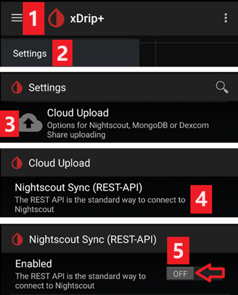
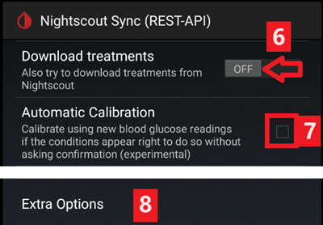
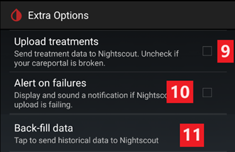
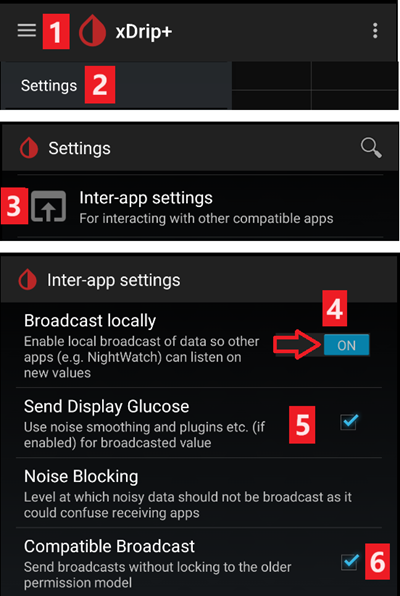
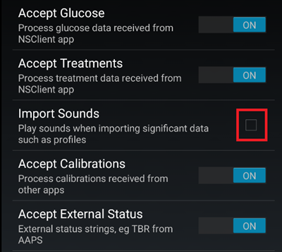
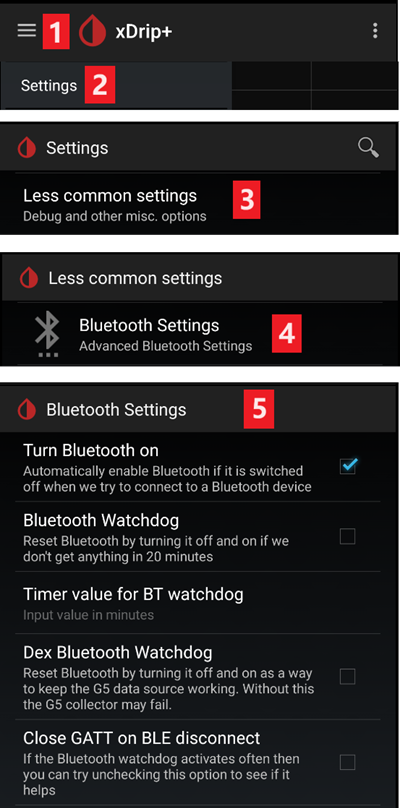
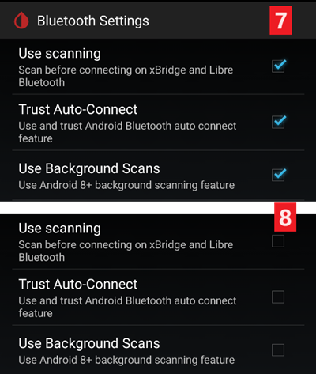
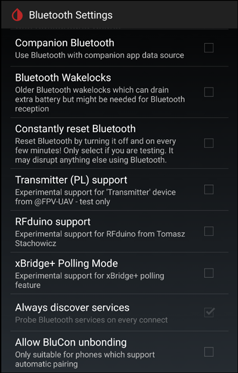
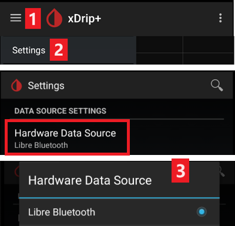
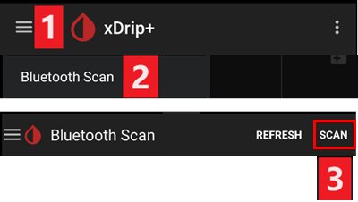

# Настройки xDrip

Если xDrip еще не установлен, скачайте и установите последний выпуск xDrip со [страницы выпусков xDrip](https://github.com/NightscoutFoundation/xDrip/releases).

Отключите оптимизацию батареи и разрешите работу в фоне для приложения xDrip.

## Основные настройки для всех систем мониторинга

### Отключите выгрузку в Nightscout

Не разрешайте другим приложениям загружать данные (ГК и терапию) в Nightscout.

→ Сэндвич-меню (1) → Настройки (2) → Cloud Upload (3) → Nightscout Sync (REST-API) (4) → Выключите (**OFF**) `Enabled` (5)

#### Отключите автоматическую калибровку и терапию

Убедитесь, что `Automatic Calibration` (7) отключена. Если флажок `Automatic Calibration` установлен, один раз включите `Download treatments` (6), затем снимите флажок `Automatic Calibration` и снова отключите `Download treatments`.

Нажмите `Extra Options`(8)

    {admonition} Предупреждение о безопасности
    :class: warning
    Обязательно отключите "Upload treatments" в xDrip, иначе терапия в AAPS может дублироваться, и COB и IOB будут неверными.

Отключите `Upload treatments`(9) и убедитесь, что вы **НЕ** будете использовать `Back-fill data` (11).

Настройку `Alert on failures` тоже нужно отключить (10). Иначе вы будете получать сигнал тревоги каждые 5 минут при проблемах с Wi-Fi или мобильной сетью или если сервер недоступен.

### **Настройки интеграций с приложениями** (Трансляция)

Если вы используете AAPS, обязательно включите трансляцию в настройках Inter-App в xDrip, чтобы данные передавались в AAPS.

→ Hamburger Menu (1) → Settings (2) → Inter-app settings (3) → Broadcast locally **ON** (4)

Чтобы значения в AAPS совпадали со значениями в xDrip, включите `Send the displayed glucose value` (5).

Enable Compatible Broadcast (6).

Если вы также включили `Accept treatments` в xDrip и `Enable broadcasts to xDrip` в модуле xDrip в AAPS, то xDrip будет получать от AAPS данные об инсулине, углеводах и базальной скорости.

Если включить `Accept Calibrations`, xDrip будет использовать калибровки из AAPS. Be careful when you use this feature with Dexcom sensors: read [this](https://navid200.github.io/xDrip/docs/Calibrate-G6.html) first.

Не забудьте отключить Import Sounds, чтобы xDrip не проигрывал мелодию каждый раз, когда AAPS отправляет изменение базала или профиля.

(xdrip-identify-receiver)=

#### Установить получателя

- Если есть проблемы с локальной трансляцией (AAPS не получает значения ГК из xDrip), перейдите → Сэндвич-меню (1) → Настройки (2) → Настройки интеграций с приложениями (3) → Identify receiver (7) и введите `info.nightscout.androidaps` для сборки AAPS (если вы используете сборку PumpControl, введите вместо этого `info.nightscout.aapspumpcontrol`!!).
- Внимание: Автокоррекция, как правило, меняет i на прописную букву. **Используйте только строчные буквы** при вводе `info.nightscout.androidaps` (или `info.nightscout.aapspumpcontrol` для PumpControl). Capital I would prevent the App from receiving BG values from xDrip.
    
    

## Use AAPS to calibrate in xDrip

- Если вы хотите калибровать xDrip через AAPS, то в xDrip перейдите в Settings → Interapp Compatibility → Accept Calibrations и выберите ON. 
- Другие варианты см. в Настройках → Менее распространенные настройки → Расширенная калибровка/Дополнительные параметры калибровки.

## Dexcom sensors

Все, что касается самого сенсора и трансмиттера Dexcom (запуск, остановка, замена, калибровка, устранение неполадок), описано и поддерживается в актуальном состоянии в [документации xDrip по Dexcom](https://navid200.github.io/xDrip/docs/Dexcom_page.html). Для сенсора следуйте этим инструкциям; настройки подключения xDrip к **AAPS** (описаны выше на этой странице) - единственная часть, которая относится к AAPS.

### Dexcom G6 и ONE

- Настройте xDrip по [рекомендуемым настройкам](https://navid200.github.io/xDrip/docs/G6-Recommended-Settings.html).
- Трансмиттеры Dexcom G6 и ONE могут одновременно подключаться к ресиверу Dexcom (или к помпе T:slim) и одному приложению на вашем телефоне.
- Если вы используете xDrip как приемник, сначала удалите приложение Dexcom. **Нельзя одновременно подключить к трансмиттеру xDrip и приложение Dexcom!**
- Если вам нужен Clarity и вы хотите пользоваться функциями xDrip, используйте [Build Your Own Dexcom App](#DexcomG6-if-using-g6-with-build-your-own-dexcom-app) с локальной трансляцией в xDrip или используйте xDrip как Companion app, которое получает уведомления от официального приложения Dexcom (возможны задержки показаний ГК).

#### Перезапуск сенсора

- С современными трансмиттерами xDrip всегда использует [родной алгоритм](https://navid200.github.io/xDrip/docs/Native-Algorithm.html) трансмиттера (native); отключать его нет причин.
- [Упреждающий перезапуск](https://navid200.github.io/xDrip/docs/Preemptive-Restart.html) работает только на старых трансмиттерах (прошивка 1.6.5.25 или старше), где он нужен, чтобы сенсор не остановился через 10 дней. Новые трансмиттеры (Firefly) его игнорируют.
- Для перезапуска сенсора на трансмиттере Firefly нужно [снять трансмиттер](https://navid200.github.io/xDrip/docs/Remove-transmitter.html), и после перезапуска показания могут быть сильно неточными, что опасно при работе замкнутого цикла: полностью прочитайте [Перезапуск сенсора](https://navid200.github.io/xDrip/docs/Restart-G6-sensor.html) и [тщательно откалибруйте](https://navid200.github.io/xDrip/docs/Calibrate-after-G6Restart.html).

(xdrip-connect-g6-transmitter-for-the-first-time)=

#### Запуск, остановка и замена сенсоров

Follow the instructions:

- [Запуск трансмиттера G6 или ONE](https://navid200.github.io/xDrip/docs/Starting-G6.html)
- [Остановка и запуск сенсора G6 или ONE](https://navid200.github.io/xDrip/docs/Dexcom/StartG6Sensor.html)
- [Снятие трансмиттера с сенсора](https://navid200.github.io/xDrip/docs/Remove-transmitter.html)
- [Срок службы трансмиттера](https://navid200.github.io/xDrip/docs/Transmitter-lifetime.html) можно продлить ([полный сброс](https://navid200.github.io/xDrip/docs/Hard-Reset.html)) только на трансмиттерах с замененной батареей или модифицированных, но не на Firefly.

(xdrip-replace-transmitter)=

#### Замена трансмиттера

- Выключите оригинальный приемник Dexcom (если он используется) и не включайте его снова, пока xDrip не начнет показывать данные.
- Удалите устройство в xDrip (System Status → Forget Device) И в настройках Bluetooth смартфона (оно отображается как DexcomXX, где XX - две последние цифры серийного номера трансмиттера).
- Держите старый трансмиттер вне зоны действия Bluetooth, чтобы он не подключился снова.
- Затем выполните [Запуск трансмиттера G6 или ONE](https://navid200.github.io/xDrip/docs/Starting-G6.html).

### Dexcom G7, ONE+ и Stelo

- Следуйте [инструкциям для G7, ONE+ и Stelo](https://navid200.github.io/xDrip/docs/Dexcom/G7.html) (нужен свежий выпуск xDrip - см. страницу по ссылке).
- Доступные варианты настройки с **AAPS** см. также на странице [Dexcom G7, ONE+ и Stelo](../CompatibleCgms/DexcomG7.md).

(xdrip-troubleshooting-dexcom-g5-g6-and-xdrip)=

### Устранение неполадок Dexcom и xDrip

- [Устранение проблем со связью G6/ONE](https://navid200.github.io/xDrip/docs/Connectivity-troubleshoot.html)
- [Устранение неполадок G7/ONE+/Stelo](https://navid200.github.io/xDrip/docs/Dexcom/G7_Troubleshooting.html)
- [Проблема при запуске нового сенсора](https://navid200.github.io/xDrip/docs/Dexcom/SensorFailedStart.html)
- Полный список: см. **Troubleshooting** на [странице xDrip по Dexcom](https://navid200.github.io/xDrip/docs/Dexcom_page.html).

## Libre 1

- Setup your NFC to Bluetooth bridge in xDrip
    
    → Сэндвич-меню (1) → Настройки (2) →Менее распространенные настройки (3) → Настройки Bluetooth (4)

- В настройках Bluetooth установите флажки точно так же, как на экране ниже (5)
    
    - Отключите режим перезапуска watchdog, так как он сбрасывает Bluetooth телефона и прерывает связь с помпой.
    
    

- Можно попробовать включить следующие настройки (7)
    
    - Использовать сканирование
    - Доверять автоподключению
    - Использовать фоновые сканирования

- Если при этом теряется соединение с мостом или возникают трудности с восстановлением соединения, **ОТКЛЮЧИТЕ ИХ** (8).
    
    

- Оставьте все остальные параметры отключенными, если только не знаете, почему хотите их включить.
    
    

### Уровень батареи Libre smart reader

- Battery level of bridges such as MiaoMiao can be displayed in AAPS (not Blucon).
- Подробности можно найти на странице [снимков экрана](#screens-sensor-level-battery).

### Подключите трансмиттер Libre и запустите сенсор

- Если сенсор нуждается в этом (Libre 2 EU и Libre 1 US), установите новейший алгоритм out-of-process .

- Сенсор должен быть уже запущен приложением производителя или ридером (xDrip не может запускать и останавливать сенсоры Libre).

- Установите источник данных на Libre Bluetooth.
    
    → Сэндвич-меню (1) → Настройки (2) → Выберите Libre Bluetooth в качестве аппаратного Источника данных (3)
    
    

- Сканируйте Bluetooth и подключите мост.
    
    → сэндвич-меню (1) → Сканировать Bluetooth (2) → Скан (3)
    
    - Если xDrip не находит мост, убедитесь, что он не подключен к приложению производителя. Поставьте его на зарядку и сбросьте.
    
    

- Start the sensor in xDrip.
    
        {admonition} Предупреждение о безопасности
        :class: warning
        Не используйте данные сенсора до окончания часового прогрева: значения могут быть очень высокими и привести к неверным решениям AAPS.
    
    → Сэндвич-меню (1) → Запустить сенсор (2) → Запустить сенсор (3) → Введите точное время запуска ридером или оригинальным приложением. Если запускали не сегодня, выберите "Не сегодня" (4).

(xdrip-libre2-patched-app)=

## Модифицированное приложение Libre 2

- Установите источник данных на Libre (patched app).
    
    → Сэндвич-меню (1) → Настройки (2) → Выберите Libre (patched app) в качестве аппаратного Источника данных (3)
    
    

- Можно добавить `BgReading:d,xdrip libre_receiver:v` в разделе Less Common Settings->Extra Logging Settings->Extra tags for logging. Это позволит записывать сообщения об ошибках для устранения неисправностей.

