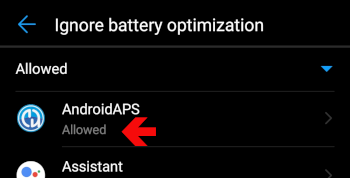
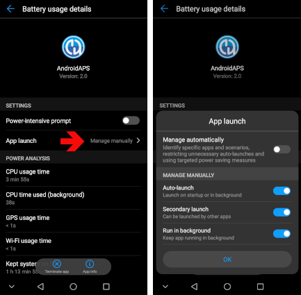
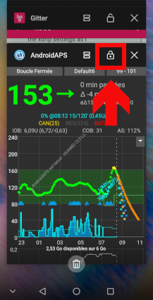

# Как настроить телефон Huawei

**Для каких телефонов эта страница:** телефоны Huawei с **EMUI 12 – EMUI 15**. Все они основаны на Android 12 – это минимальная версия для текущей версии **AAPS**. На телефоне с более старой версией EMUI можно использовать только [более старую версию AAPS](#maintenance-android-version-aaps-version).

```{admonition} Телефоны с HarmonyOS NEXT / HarmonyOS 5 :class: warning

Новые телефоны Huawei, которые продаются в Китае, работают на HarmonyOS NEXT (HarmonyOS 5 и выше). Эта система больше не Android, и на ней нельзя запустить **AAPS**. ```

Телефоны Huawei очень агрессивно закрывают приложения, работающие в фоне. Примените все настройки ниже к **AAPS** и к приложению CGM (например, xDrip+ или Juggluco), иначе цикл и показания глюкозы могут останавливаться, когда экран выключен.

Названия меню могут немного отличаться на разных моделях. Если вы не можете найти настройку, введите ее название в строке поиска вверху экрана **Настройки**.

Снимки экрана ниже сделаны в более старой версии EMUI. Настройки в EMUI 12–15 такие же.

## Игнорировать оптимизацию батареи

1. Откройте **Настройки > Приложения > Приложения**.
2. Нажмите меню **⋮** в правом верхнем углу и выберите **Специальный доступ > Оптимизация батареи** (Battery optimization).
3. Нажмите стрелку вверху списка и выберите **Все приложения**.
4. Выберите **AAPS** и выберите **Запретить** (Don't allow). Huawei больше не будет оптимизировать приложения из этого списка.
5. Повторите то же для приложения CGM.



## Запуск приложений: разрешить работу в фоне

1. Откройте **Настройки > Батарея > Запуск приложений** (или **Настройки > Приложения > Приложения >** выберите приложение **> Батарея > Запуск приложений**).
2. Найдите **AAPS** и выключите **Автоматическое управление**.
3. В окне **Ручное управление** включите все три параметра: 
    - **Автозапуск**
    - **Косвенный запуск** (Secondary launch – приложение могут запускать другие приложения)
    - **Работа в фоновом режиме**
4. Повторите то же для приложения CGM.



## Закрепление AAPS в списке недавних приложений

Закрепленные приложения не закрываются, когда вы очищаете список недавних приложений.

1. Откройте список недавних приложений.
2. Проведите вниз по карточке **AAPS**. На карточке появится значок замка.
3. Сделайте то же для приложения CGM.



## Режим энергосбережения

Держите **Режим энергосбережения** и **Ультра энергосбережение** (Ultra power saving) выключенными (**Настройки > Батарея**). Они закрывают фоновые приложения независимо от настроек выше.

## Если AAPS все равно останавливается в фоне

Другие решения для Huawei смотрите на сайте [Don't kill my app](https://dontkillmyapp.com/huawei).

## Телефоны Honor

Honor теперь отдельный бренд, и его телефоны работают на MagicOS, а не на EMUI. Настройки работы в фоне очень похожи: найдите **Запуск приложений** в настройках батареи приложения, выключите **Автоматическое управление** и разрешите все три параметра, затем уберите приложение из оптимизации батареи.