# Accu-Chek Combo

**Настоящее ПО является частью самодеятельной разработки, а не готовым программным продуктом. От ВАС потребуется прочитать, изучить и понять систему и то, как ей пользоваться. Она не контролирует диабет за вас, но позволит улучшить компенсацию и качество жизни, если вы готовы уделить ей достаточно времени. Не бросайтесь в систему сломя голову, дайте себе время на изучение. Только вы несете ответственность за то, что делаете.**

```{admonition} Accu-Chek Combo is being phased out
:class: note

Roche уходит с рынка инсулиновых помп, чтобы сосредоточить свое направление диабета на CGM Accu-Chek SmartGuide. Компания сообщила о прекращении продаж помп Accu-Chek Combo и Accu-Chek Insight; выпуск оставшейся микропомпы Accu-Chek Solo тоже постепенно прекращается (последние поставки в Германии — в конце 2025 года). Изменения вводятся по регионам, начиная с Германии; ожидается, что затем последуют другие европейские рынки. Если вы пользуетесь этой помпой, заранее спланируйте переход на поддерживаемую помпу.
```

```{contents} Table of contents
:depth: 1
:local: true
```

## Возможности работы с AAPS

* Связывается с **AAPS** через встроенный Bluetooth телефона, без дополнительного устройства связи.
* Automatic DST and timezone handling.

## Требования к аппаратному и программному обеспечению

* Помпа Roche Accu-Chek Combo (любая версия прошивки, работают все).
* Устройство Smartpix или Realtyme с приложением "360" для конфигурирования помпы под свои параметры. (Roche по запросу бесплатно высылает своим клиентам устройства Smartpix и программу для настройки.)
* Совместимый телефон с Android 12 или новее. Подробнее см [примечания к версиям](#maintenance-android-version-aaps-version).
* Приложение **AAPS**, установленное на ваш телефон.

Некоторые телефоны работают лучше, чем другие, в зависимости от качества поддержки Bluetooth и от того, имеют ли они дополнительный, агрессивный алгоритм экономии энергии. Список телефонов можно найти в документе [телефоны для AAPS](#Phones-list-of-tested-phones). Пожалуйста, имейте в виду, что это не полный список и отражает личный опыт пользователей. Вам предлагается также делиться результатами вашего опыта и тем самым помогать другим (все подобные проекты основаны на идеологии бескорыстной помощи).

(combov2-before-you-begin)=
## Подготовка к работе

**БЕЗОПАСНОСТЬ ПРЕЖДЕ ВСЕГО** - не пытайтесь выполнять эти действия в среде, где нет возможности сделать исправление ошибки. Держите под рукой устройство Smartpix / Realtyme наряду с конфигурационным ПО 360. Планируйте потратить около часа на настройку и на проверку, что все работает правильно.

Помните о следующих ограничениях:

* Пролонгированный болюс и многоволновый болюс сейчас не поддерживаются (вместо них можно применять [Растянутые углеводы (eCarbs)](../DailyLifeWithAaps/ExtendedCarbs.md)).
* Поддерживается только один базальный профиль (первый).
* Самая низкая базальная скорость в вашем **Профиле** — 0,05 ед/ч. **AAPS** не принимает **Профиль** с более низкой скоростью. Combo округляет базальные скорости до своих шагов (0,01 ед/ч ниже 1 ед/ч, 0,05 ед/ч до 10 ед/ч, 0,1 ед/ч выше). **AAPS** использует скорости, которые помпа подает на самом деле.
* Временные базальные скорости ограничены 500% от текущей базальной скорости. **AAPS** учитывает это ограничение.
* Если активный профиль на помпе не профиль № 1, цикл отключается. Так продолжается, пока профиль № 1 не станет активным; когда это сделано, при следующем подключении AAPS (само через некоторое время или потому, что вы нажали **Обновить** на экране помпы Accu-Chek Combo) заметит, что текущий профиль — № 1, и снова включит цикл.
* Если алгоритм цикла запрашивает отмену текущей временной скорости базала (TBR), Combo на 15 минут установит ВБС (TBR) в 90% или 110%. Это происходит потому, что отмена TBR вызывает оповещение помпы, - вибрации, которые невозможно отключить.
* Стабильность соединения по bluetooth различна в разных телефонах и может вызвать оповещение "помпа недоступна" когда соединение разорвано. Если возникла эта ошибка, убедитесь, что Bluetooth включен, нажмите **Обновить** на экране помпы (**Управление** > **Помпа**), чтобы проверить, не была ли это временная проблема, и если соединение все равно не устанавливается, перезагрузите телефон — обычно это помогает.
* Есть и другая проблема, при которой перезагрузка не помогает: нужно нажать кнопку на помпе (это перезапускает стек Bluetooth помпы), и только тогда помпа снова принимает подключения от телефона.
* Следует избегать программирования временного базала TBR на помпе, так как контроль над TBR задается алгоритмом AAPS. Обнаружение нового временного базала TBR на помпе может занять до 20 минут, а его действие принимается в расчет алгоритмом AAPS с момента обнаружения, так что в худшем случае TBR не будет учтен как активный инсулин IOB в течении 20 минут.

Сейчас драйвер поддерживает следующие языки на Combo. (Это не относится к языку AAPS - речь идет о языке, показываемом на ЖК экране Combo.)

* Английский
* Испанский
* Французский
* Итальянский
* Русский
* Турецкий
* Польский
* Чешский
* Венгерский
* Словацкий
* Румынский
* Хорватский
* Голландский
* Греческий
* Финский
* Норвежский
* Португальский
* Шведский
* Датский
* Немецкий
* Словенский
* Литовский

**Важно**: если на помпе установлен язык, которого нет в этом списке, свяжитесь с разработчиками и установите на помпе язык из этого списка. В противном случае драйвер не будет работать должным образом.

## Настройка телефона

Важно убедиться, что все оптимизации батареи выключены. AAPS автоматически определяет наличие таких оптимизаций и через свой интерфейс предлагает их отключить. Но, на современных телефонах Android, Bluetooth _сам_ является приложением (системным приложением). И, обычно, это "Приложение Bluetooth" по умолчанию запускается _с включенной оптимизацией заряда батареи_. В результате Bluetooth может не отвечать, когда телефон пытается экономить электроэнергию, потому что он отключает приложение Bluetooth. Это означает, что в системных настройках приложения Bluetooth также необходимо отключить оптимизацию батареи. К сожалению, это системное приложение Bluetooth в разных телефонах определяется по-разному. На стоковом Android, перейдите в Настройки -> Приложения -> Просмотреть все N приложений (N = количество приложений на вашем телефоне). Затем откройте меню в верхнем правом углу, нажмите на "Системные Приложения" или "Показать системные приложения" или "Все приложения". Теперь в новом расширенном списке приложений найдите приложение Bluetooth. Выберите его и на вкладке "Информация о приложении", нажмите "Батарея". Там, отключите оптимизацию батареи (иногда называется "использование батареи").

## Настройка Combo

* Настройте помпу, используя Конфигурационное программное обеспечение Accu-Chek 360. Если у вас нет этой программы, обратитесь в службу поддержки Акку-Чек. Обычно они высылают диск с программой "360° Pump Configuration Software" и устройство инфракрасной связи SmartPix зарегистрированным пользователям (устройство Realtyme также годится для этих целей).

  - **Необходимые настройки** (отмечены зеленым в скриншотах):

     * Установите/оставьте конфигурацию меню как "Стандартная", в результате будут показаны только поддерживаемые меню/действия на помпе и уберутся неподдерживаемые (пролонгированный/многоволновый болюс, множественные скорости базала), которые ограничивают функционал помпы в безопасном режиме AAPS.
     * Убедитесь, что _Краткие сведения - текст_ установлен на "КРАТКИЕ СВЕДЕНИЯ" (без кавычек, в разделе _Параметры инсулиновой помпы_).
     * Установите _Максимум корректировки_ временной скорости базала TBR на 500%
     * Отключите _Сигнал окончания временного базала_
     * Установите _приращение длительности_ временного базала на 15 мин
     * Включите Bluetooth

  - **Рекомендуемые настройки** (отмечены синим цветом на снимках с экрана)

     * Установите сигнал оповещения о малом количестве инсулина в картридже на величину по своему усмотрению
     * Настройте максимальную величину болюса в соответствии с требованиями вашей терапии, но имея в виду защиту от ошибок в программном обеспечении
     * Аналогичным образом настройте максимальную продолжительность временного базала TBR на безопасный уровень. Установите эту величину по крайней мере на 3 часа, так как опция отключения помпы задает нулевой базал на 3 часа.
     * Включите блокировку клавиш помпы для предотвращения случайной подачи болюса, особенно если вы пользовались помпой раньше и имели привычку подавать быстрый болюс.
     * Задайте таймаут отключения экрана и меню минимум на 5,5 и 5 соответственно. Это позволяет AAPS быстрее восстановиться после ошибок и уменьшает количество вибраций во время таких ошибок

  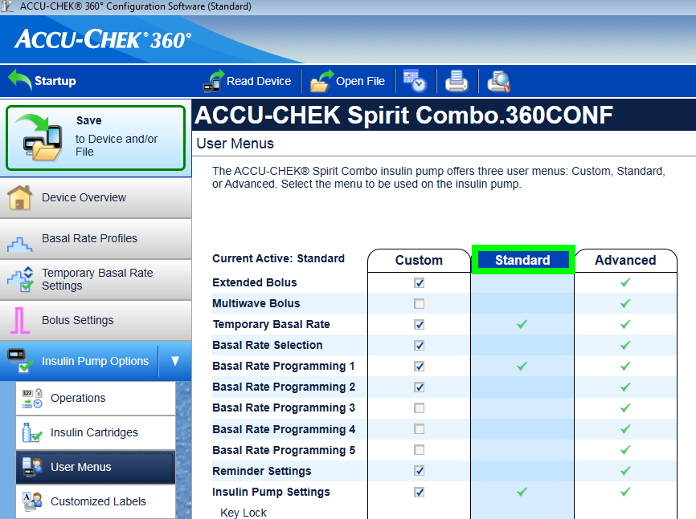

  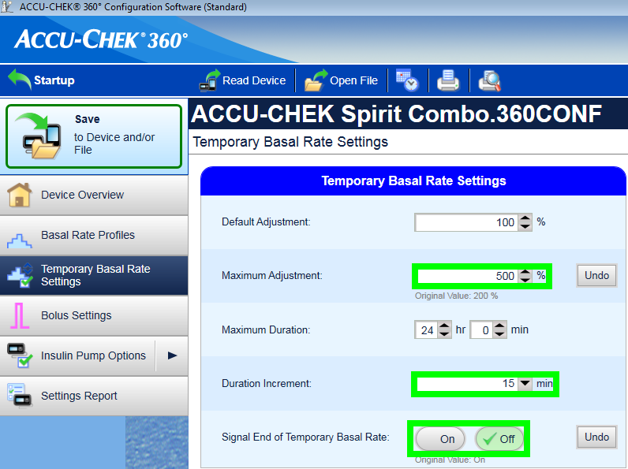

  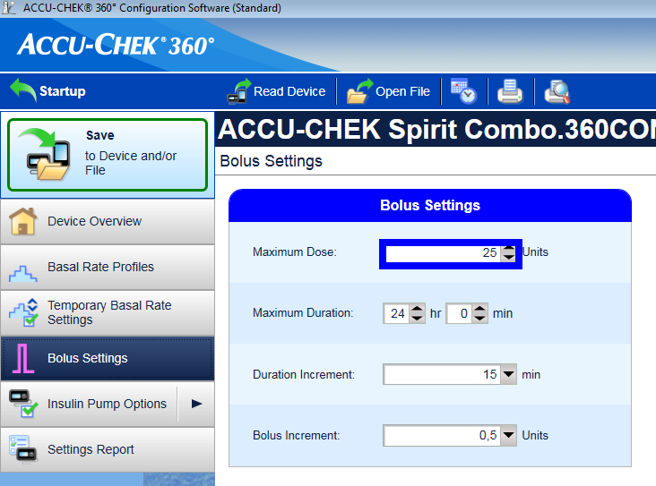

  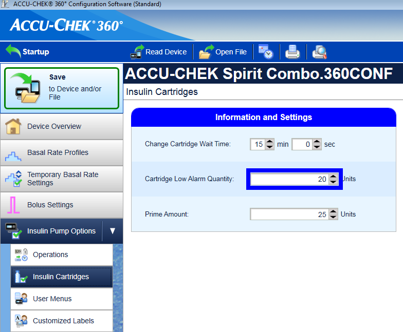

## Активация драйвера и сопряжение с Combo

* Откройте **меню** (☰) в левом верхнем углу, перейдите в [**Конфигурация** > **Помпа**](../SettingUpAaps/ConfigBuilder.md) и выберите **Accu-Chek Combo**.

  

  После выбора на карточке **Accu-Chek Combo** есть две кнопки: **Настройки** и **Открыть модуль**:

  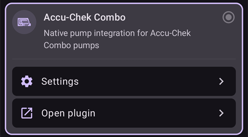

  **Настройки** открывают настройки драйвера Accu-Chek Combo (см. [Настройки](#combov2-preferences) ниже):

  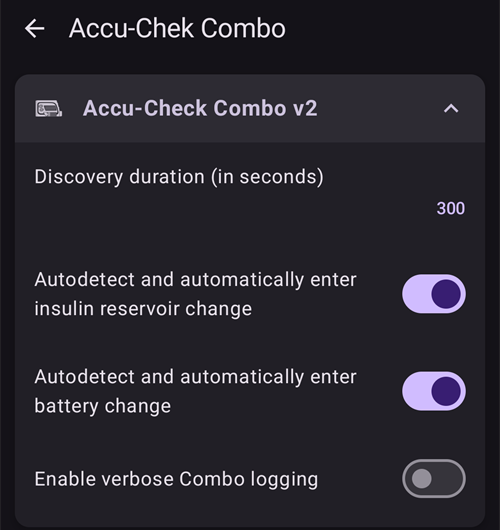

  **Открыть модуль** (или **Управление** > **Помпа**) открывает экран помпы Accu-Chek Combo. Пока сопряжения с помпой нет, на нем показано **Нет сопряжения с помпой**:

  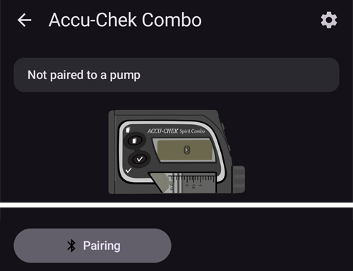

* На экране помпы нажмите **Сопряжение**. Откроется экран **Сопряжение с помпой**. Выполните шаги, показанные на экране, затем нажмите **Начните сопряжение**. Когда Android попросит разрешение сделать телефон видимым для других устройств Bluetooth, нажмите **Разрешить**. Через некоторое время Combo покажет на своем экране 10-значный PIN-код сопряжения, и **AAPS** запросит его. Введите этот PIN-код в поле **10-значный PIN-код**.

  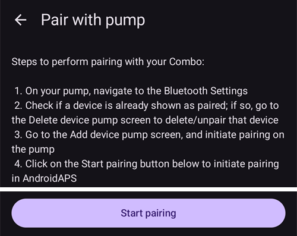

  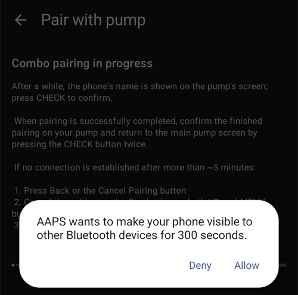

  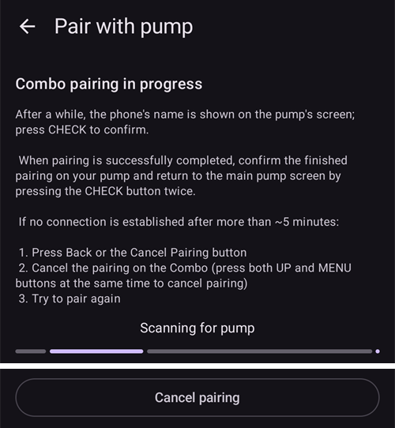

  Следующие изображения взяты из более старой версии **AAPS**. Шаги и тексты те же, но экраны выглядят немного иначе.

  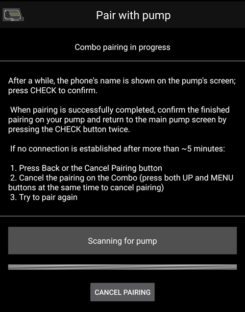

  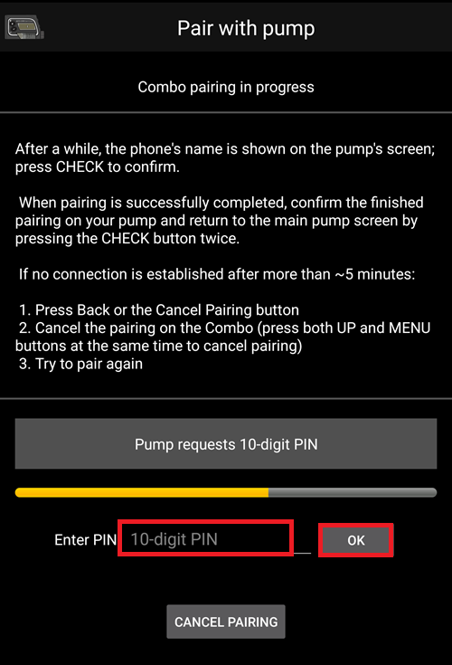

  

* Если PIN-код введен неправильно, **AAPS** показывает **PIN-код не принят. Проверьте наличие опечаток. Если ошибка повторится, отмените сопряжение и повторите процесс.**

  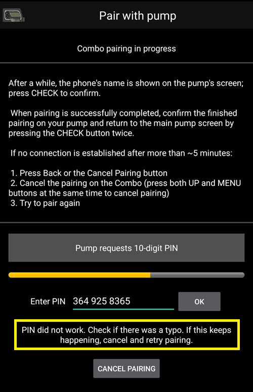

* Когда появится **Сопряжение с Combo завершено успешно**, нажмите **OK**. Вы вернетесь на экран помпы, который теперь показывает статус помпы (см. [Содержимое экрана помпы Accu-Chek Combo](#combov2-tab-contents) ниже). Кнопка **Сопряжение** заменяется кнопкой **Разорвать сопряжение**.

* Чтобы проверить настройки (для безопасности помпа должна быть **отсоединена** от катетера!), задайте в AAPS временный базал (TBR) 500% на 15 мин и подайте болюс. После этого в логах помпы появится работающий TBR и болюс. AAPS должен также показать активный TBR и поданный болюс.

* На Combo рекомендуется включить блокировку клавиш для предотвращения подачи болюса, особенно если при прежнем пользовании была привычной "подача быстрого болюса".

## Замечания по сопряжению

Помпа Accu-Chek Combo была разработана до появления Bluetooth 4.0, и лишь спустя год после выпуска первой версии Android. Поэтому ее способ сопряжения с другими устройствами не полностью совместим с тем, как это делается на современных устройствах Android. Чтобы полностью решить эту проблему, AAPS потребовались бы системные разрешения, которые доступны только для системных приложений. Они устанавливаются производителями телефонов, пользователи не могут устанавливать системные приложения.

Поэтому сопряжение никогда не будет на 100% без проблем. В частности, во время сопряжения, диалог на ввод Bluetooth-кода может появиться лишь ненадолго и автоматически исчезнуть. Иногда он остается на экране и запрашивает 4-значный PIN-код. (Не путать с 10-значным кодом сопряжения Combo.) Не вводите ничего, просто нажмите Отмена. Если сопряжение не продолжается, следуйте инструкциям на экране и повторите попытку подключения.

(combov2-tab-contents)=
## Содержимое экрана помпы Accu-Chek Combo

Чтобы открыть экран помпы, перейдите в **Управление** > **Помпа**. После сопряжения с помпой на нем показана следующая информация (пункты перечислены сверху вниз):

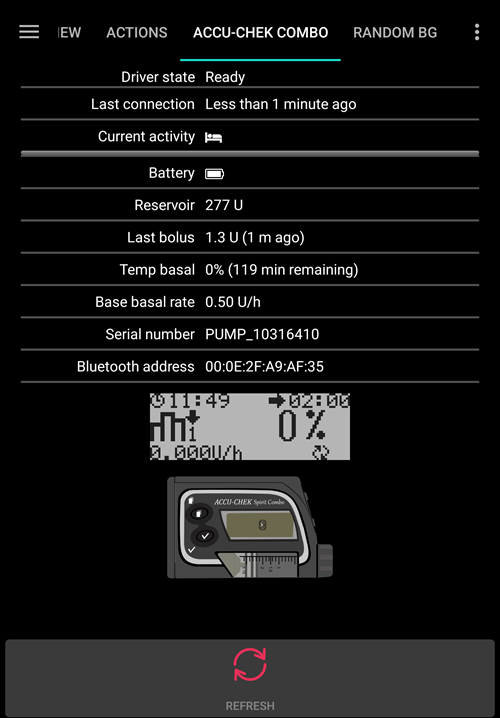

1. **Статус драйвера помпы**: драйвер может находиться в одном из следующих состояний:
   - **Разъединено**: соединения по Bluetooth нет; драйвер почти всегда находится в этом состоянии и подключается к помпе только при необходимости — это экономит энергию
   - **Connecting**
   - **Проверка помпы**: помпа подключена, но драйвер сейчас выполняет проверки безопасности, чтобы убедиться, что все в порядке и данные актуальны
   - **Помпа готова**: драйвер готов принимать команды от AAPS
   - **Помпа остановлена**: помпа приостановлена (на Combo показано как «стоп»)
   - Описание выполняемой команды, например **Установка базального профиля** или **Обновление статуса помпы**
   - **Ошибка**: произошла ошибка; соединение прервано, все выполняемые команды отменены
2. **Прошлое соединение**: сколько минут назад драйвер успешно подключился к Combo; если прошло больше 30 минут, этот пункт показан красным цветом
3. **Батарея**: уровень заряда батареи; Combo сообщает только **Полностью заряжена**, **Низкий заряд** или **Разряжена** и не дает более точных данных (например, в процентах), поэтому здесь показаны только эти три уровня
4. **Reservoir**: How many IU are currently in the Combo's reservoir
5. **Предыдущий болюс**: сколько минут назад был подан последний болюс; если после запуска AAPS болюс еще не подавался, этот пункт не показан
6. **ВБС**: сведения о текущем временном базале; если активного временного базала нет, этот пункт не показан
7. **Базовая величина базала**: текущая базовая базальная скорость («базовая» означает базальную скорость без влияния активного временного базала (TBR) на коэффициент базальной скорости)
8. **Serial number**: Combo serial number as indicated by the pump (this corresponds to the serial number shown on the back of the Combo)
9. **Адрес Bluetooth**: 6-байтовый адрес Bluetooth помпы Combo в формате `XX:XX:XX:XX:XX:XX`

Пока драйвер что-то делает (например, устанавливает базальный профиль), под списком есть поле с описанием текущего действия и тонкой полосой прогресса.

Combo может управляться при помощи Bluetooth в режиме _удаленного терминала_ или в режиме _команд_. Режим удаленного терминала соответствует "режиму дистанционного управления" глюкометра Combo, который имитирует ЖК-дисплей и четыре кнопки помпы. Некоторые команды драйвер должен выполнять в этом режиме так как они не имеют аналога в командном режиме. Последний режим работает быстрее, но, как уже говорилось, его сфера применения ограничена. Когда активен режим удаленного терминала, текущий экран удаленного терминала показан в поле прямо над рисунком Combo. Однако при переключении драйвера в командный режим это поле остается пустым.

(Вы на это не влияете; драйвер сам решает, какой режим использовать. Это только пояснение, чтобы вы знали, почему иногда в этом поле видны кадры экрана Combo.)

Внизу есть следующие кнопки:

- **Обновить**: сразу запускает обновление статуса помпы. Она также нужна, чтобы сообщить AAPS, что обнаруженная ранее ошибка устранена и AAPS может снова проверить, что все в порядке (подробнее ниже в [разделе об оповещениях](#combov2-alerts)). Нажать ее можно, только когда драйвер разъединен, приостановлен или находится в состоянии ошибки.
- **Разорвать сопряжение**: разрывает сопряжение Combo с **AAPS** и Android после того, как вы подтвердите **Вы действительно хотите удалить сопряжение с помпой?**. Если сопряжения с помпой нет, вместо этой кнопки показана кнопка **Сопряжение**.

(combov2-preferences)=
## Настройки

Для драйвера Combo есть следующие настройки (**Конфигурация** > **Помпа** > **Accu-Chek Combo** > **Настройки** или значок настроек (шестеренка) на экране помпы). Пункты перечислены сверху вниз:

1. **Время обнаружения (в секундах)**: при сопряжении драйвер делает телефон видимым для помпы. Параметр определяет, сколько длится функция обнаружения. По умолчанию выбран максимум (300 секунд = 5 минут). Android не позволяет, чтобы обнаружение длилось бессрочно, поэтому следует задать продолжительность.
2. **Автоматически определять и вносить запись о замене резервуара инсулина**: если включено, драйвер сам вносит запись «замена резервуара», которую вы обычно вносите сами через **Управление** > **Прайм/заполнение**. [Подробнее это объясняется ниже](#combov2-autodetections).
3. **Автоматически определять и вносить запись о замене батареи**: если включено, драйвер сам вносит запись «замена батареи», которую вы обычно вносите сами через **Управление** > **Замена батареи помпы**. [Подробнее это объясняется ниже](#combov2-autodetections).
4. **Включить подробное журналирование Combo**: драйвер записывает в журнал намного больше данных. **ПРЕДУПРЕЖДЕНИЕ**: Включайте только если об этом вас попросил разработчик. Иначе это может засорить журналы **AAPS** и сделать их менее полезными.

Сопряжение и разрыв сопряжения выполняются на экране помпы, а не в настройках (см. выше).

(combov2-autodetections)=
## Автоматическое определение и внесение записей о замене батареи и резервуара инсулина

Драйвер способен обнаружить замену батареи и резервуара через отслеживание уровней батареи и резервуара. Если при последнем обновлении Combo определила уровень батареи как низкий, а теперь, во время обновления статуса помпы, уровень заряда аккумулятора отображается как обычный, то драйвер делает вывод, что пользователь произвел замену аккумулятора. Эта же логика используется и для определения уровня резервуара: если в данный момент он больше чем прежде, то это интерпретируется как замена резервуара.

Это работает только в том случае, когда аккумулятор или резервуар заменяются, когда их уровни показаны как низкие _а_ аккумулятор и резервуар заполнены.

Это автоматическое определение можно отключить в [настройках](#combov2-preferences) драйвера.

(combov2-alerts)=
## Оповещения (предупреждения и ошибки) и как они обрабатываются

Combo показывает оповещения как экраны удаленного терминала. Предупреждения показываются с кодом «Wx» (x — цифра) и коротким описанием. В качестве примера можно привести "W7", "TBR OVER". Сходным образом показываются ошибки, но с кодом "Ex".

Некоторые предупреждения автоматически сбрасываются драйвером. К ним относятся:

- W1 "reservoir low" : драйвер превращает его в предупреждение «низкий уровень в резервуаре», которое показано на главном экране AAPS
- W2 "battery low" : драйвер превращает его в предупреждение «низкий заряд батареи», которое показано на главном экране AAPS
- W3, W6, W7, W8 : все это информационные сообщения, поэтому драйвер безопасно удаляет их

Другие предупреждения - _не_ удаляются автоматически. Кроме того, ошибки _никогда_ не закрываются автоматически. Они обрабатываются одинаково, заставляя драйвера создавать диалог оповещения поверх интерфейса AAPS, а также приводит к прекращению выполнения любой текущей команды. Затем драйвер переходит в состояние «ошибка» (см. [содержимое экрана помпы Accu-Chek Combo выше](#combov2-tab-contents)). Это состояние не допускает выполнения команд. Пользователь должен устранить ошибку на помпе; например, при ошибке окклюзии может потребоваться замена катетера. Когда пользователь устранил ошибку, нормальную работу можно возобновить, нажав **Обновить** на экране помпы Accu-Chek Combo. Затем драйвер подключается к Combo и обновляет ее статус, проверяет, отображается ли ошибка на экране, и т. д. Также, драйвер автоматически обновляет статус помпы через некоторое время, поэтому ручное нажатие кнопки не является обязательным.

Подача болюса - отдельный случай. Это делается в командном режиме Combo, который не сообщает посреди болюса о появлении оповещения. Как следствие, драйвер не может автоматически убрать предупреждения _во время_ подачи болюса. Это означает, что, к сожалению, помпа будет издавать сигнал до завершения подачи болюса. Наиболее распространенным предупреждением во время подачи болюса обычно является W1 "низкий уровень инсулина в резервуаре". **Не** сбрасывайте предупреждения Combo вручную на самой помпе во время болюса. Вы рискуете прервать болюс. Драйвер сам разберется с оповещением по завершении подачи болюса.

Оповещения в отсутствие подключения драйвера к Combo не будут замечены драйвером. Combo не умеет автоматически передавать оповещения на телефон; соединение всегда инициируется телефоном. Как следствие, оповещение не прекратится до соединения драйвера с помпой. Можно нажать **Обновить** на экране помпы, чтобы запустить соединение и дать драйверу обработать оповещение сразу (а не ждать, пока AAPS само решит подключиться).

**ВАЖНО** Если происходит ошибка или появляется оповещение из числа тех, что не убираются автоматически, драйвер входит в состояние ошибки. В этом случае цикл **БЛОКИРУЕТСЯ** до изменения статуса помпы! Цикл разблокируется после обновления статуса помпы (нажатием **Обновить** или автоматическим обновлением драйвера), если ошибка больше не показана.

## Осторожность при работе с Combo

* Имейте в виду, вы имеете дело не с коммерческим продуктом; на начальном этапе пользователю следует отслеживать и понимать логику, ограничения и возможные ошибки системы. Настоятельно рекомендуем не пользоваться системой, если нет полного понимания принципов ее работы.
* Из-за особенностей функциональности дистанционного управления, на Combo, по сравнению с другими помпами, медленно работают некоторые операции (особенно установка базального профиля). Это ограничение Combo не может быть преодолено.
* Не устанавливайте и не отменяйте временный базал TBR на помпе. Алгоритм AAPS берет на себя контроль над временным базалом, он не будет работать надежно при иных решениях, поскольку начало подачи временного базала, заданного пользователем на помпе, невозможно определить.
* Не нажимайте никаких кнопок на помпе во время обмена данными между AAPS и помпой (пока помпа подключена к AAPS, на ее экране показан логотип Bluetooth). Если все же такое происходит, Bluetooth-соединение прерывается. Делайте это только если есть проблемы с установкой связи (См. выше раздел [Подготовка к работе](#combov2-before-you-begin)).
* Не нажимайте никакие кнопки во время подачи болюса. В частности, не пытайтесь убрать оповещения, нажимая кнопки. См. [раздел об оповещениях](#combov2-alerts) где дано подробное разъяснение причин.

## Контрольный список на случай, если не удается установить соединение с Combo

Драйвер делает все возможное, чтобы подключиться к Combo, и использует особые приемы для максимальной надежности. Тем не менее, иногда соединение не устанавливается. Вот некоторые шаги для исправления такой ситуации.

1. Нажмите кнопку на Combo. Иногда Bluetooth на Combo перестает отвечать и не принимает подключения. Нажав кнопку на Combo и вызвав изображение на LCD экране, вы добьетесь перезапуска Bluetooth-модуля помпы. Чаще всего это единственный шаг, необходимый для исправления проблем с подключением.
2. Перезагрузите телефон. Это может потребоваться, если возникает проблема со стеком Bluetooth самого телефона.
3. Если крышечка батарейного отсека Combo старая, подумайте о ее замене. Старые крышечки батарейного отсека могут вызвать проблемы с питанием Combo, которые влияют на Bluetooth.
4. Если соединение все же не устанавливается, попробуйте разъединить, а затем переподключить помпу.

(combov2-tips-for-basic-usage)=
## Советы по повседневному использованию

### How to ensure smooth operations

* Всегда **носите смартфон с собой**, ночью оставляйте его рядом с кроватью. Во сне помпа может оказаться за вами или под вами, поэтому лучше всего положить телефон повыше (на полку или тумбочку).
* Always make sure that the pump battery is as full as possible. Советы по батарее см. в разделе о батарее.
* По возможности управляйте помпой только через приложение AAPS. Для этого включите на помпе блокировку клавиш: **PUMP SETTINGS / KEY LOCK / ON**. Only when changing the battery or the cartridge, it is necessary to use the pump's keys.


### Pump not reachable. What to do?

#### Activate pump unreachable alarm
* В **AAPS** нажмите значок **Настройки** (шестеренка) в правом верхнем углу главного экрана, перейдите в **Локальные оповещения**, включите **Оповещать в случае недоступности помпы** и установите **Порог недоступности помпы** на **31** минуту.
* This will give you enough time to not trigger the alarm when leaving the room while your phone is left on the desk, but informs you if the pump cannot be reached for a time that exceeds the duration of a temporary basal rate.

#### Restore reachability of the pump

* Когда AAPS сообщает, что **помпа недоступна**, сначала снимите блокировку клавиш и **нажмите любую кнопку на помпе** (например, «вниз»). Как только экран помпы погаснет, нажмите **Обновить** на экране помпы Accu-Chek Combo (**Управление** > **Помпа**). Mostly then the communication works again.
* If that does not help, reboot your smartphone. После перезапуска AAPS снова запустится и установит новое соединение с помпой.

* The tests with different smartphones have shown that certain smartphones trigger the "pump unreachable" error more often than others. Успешно проверенные смартфоны см. на странице [Телефоны](#Phones-list-of-tested-phones).

#### Root causes and consequences of frequent communication errors
* На телефонах с **малым объемом памяти** (или с **агрессивными настройками энергосбережения**) AAPS часто закрывается системой. Это видно по тому, что при открытии AAPS кнопки терапии (панель быстрого запуска) на главном экране не показаны, потому что система еще инициализируется. This can trigger "pump unreachable alarms" at startup. В поле **Прошлое соединение** на экране помпы (**Управление** > **Помпа**) можно посмотреть, когда AAPS в последний раз связывался с помпой.

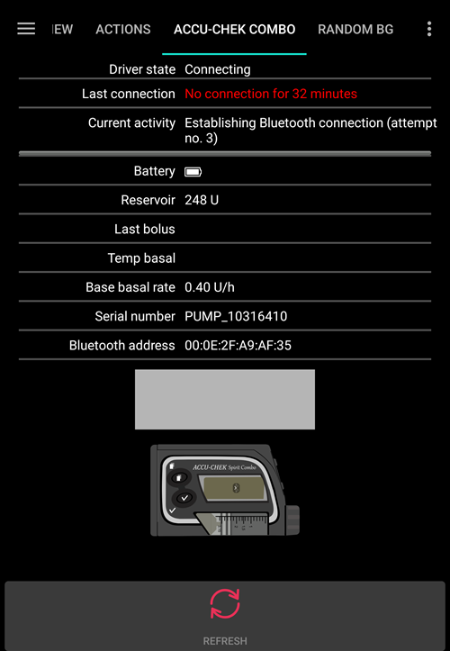

* This error can drain the pump's battery faster because the basal profile is read from the pump when the app is restarted.
* It also increases the likelihood of causing the error that causes the pump to reject all incoming connections until a button on the pump is pressed.

### Cancellation of temporary basal rate fails
* Иногда AAPS не может автоматически сбросить оповещение **TBR CANCELED**. Тогда нужно либо нажать **Обновить** на экране помпы Accu-Chek Combo, либо подтвердить сигнал на самой помпе.

### Pump battery considerations

#### Changing the battery
* After a **low battery** alarm, the battery should be changed as soon as possible to always have enough energy for a reliable Bluetooth communication with the smartphone, even if the phone is within a wider distance of the pump.
* Even after a **low battery** alarm, the battery might be used for a significant amount of time. However, it is recommended to always have a fresh battery with you after a "low battery" alarm rang.
* Перед заменой батареи нажмите на значок **Замкнутый цикл** на главном экране и выберите **Приостановить цикл** на 1 час.
* Подождите, пока телефон свяжется с помпой и логотип Bluetooth на помпе исчезнет.

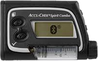

* Снимите блокировку клавиш на помпе, переведите помпу в режим остановки, подтвердите оповещение об отмене временного базала (если оно появится) и быстро замените батарею.
* После замены батареи не нужно заново устанавливать часы помпы: AAPS автоматически обновляет дату и время помпы.
* Затем снова переведите помпу в рабочий режим и выберите **Возобновить**, нажав на значок **ЗЦ остановлен** на главном экране.
* AAPS will re-set a necessary temporary basal rate with the arrival of the next blood sugar value.

(Accu-Chek-Combo-Tips-for-Basic-usage-battery-type-and-causes-of-short-battery-life)=
#### Battery type and causes of short battery life
* Поскольку интенсивная связь по Bluetooth потребляет много энергии, используйте только **качественные батареи**, например Energizer Ultimate Lithium, батареи Power One из «большого» сервисного набора Accu-Chek, или, если вы выбираете аккумулятор, аккумуляторы Eneloop.

 

Ranges for typical life time of the different battery types are as follows:
* **Energizer Ultimate Lithium**: 4 to 7 weeks
* **Power One Alkaline** (Varta) из сервисного набора: от 2 до 4 недель
* Аккумуляторы **Eneloop** (BK-3MCCE): от 1 до 3 недель

If your battery life is significantly shorter than the ranges given above, please check the following possible causes:
* There are some variants of the screw-on battery cap of the Combo pump, which partially short circuit the batteries and drain them quickly. The caps without this problem can be recognized by the golden metal contacts.
* Если часы помпы не «переживают» быструю замену батареи, скорее всего, сломан конденсатор, который поддерживает ход часов при кратком отключении питания. В этом случае может помочь замена помпы у Roche, что не составляет проблемы в течение гарантийного срока.
* Аппаратное и программное обеспечение смартфона (операционная система Android и стек Bluetooth) также влияет на срок работы батареи помпы, хотя точные факторы пока до конца не известны. If you have the opportunity, try another smartphone and compare battery lifetimes.

### Extended bolus, multiwave bolus
The OpenAPS algorithm does not support a parallel extended bolus or multiwave bolus. But a similar treatment can be achieved by the following alternatives:
* Используйте **растянутые углеводы (eCarbs)** при вводе углеводов или в мастере болюса: введите углеводы всей еды и время, за которое, по вашему ожиданию, углеводы поступят в кровь в виде глюкозы. Система будет рассчитывать небольшие порции углеводов, равномерно распределенные на всю длительность, и алгоритм будет подавать соответствующий инсулин, все время следя за общим ростом или снижением уровня ГК. For a multiwave bolus approach, you can also combine a smaller immediate bolus with e-carbs.
* Перед едой установите временную цель **Ожидаемый прием пищи** 80 мг/дл (4,4 ммоль/л) на несколько часов (нажмите на цель на главном экране или выберите **Управление** > **Временная цель**). Длительность должна быть такой же, как интервал, который вы выбрали бы для пролонгированного болюса. This will keep your target lower than usual and therefore increase the amount of insulin delivered.
* Затем используйте **Мастер болюса**, чтобы ввести все углеводы еды, но не применяйте сразу предложенные им значения. Если нужен болюс, похожий на многоволновый, уменьшите дозу инсулина. Depending on the meal, the algorithm now has to deliver additional SMBs or higher temporary basal rates to counteract the increase in blood sugar. Здесь нужно очень осторожно подбирать ограничения безопасности для базала (Max U/h, Maximum basal IOB) и при необходимости временно их менять.

* Не используйте пролонгированный или многоволновый болюс прямо на помпе. Драйвер их не поддерживает (см. [Подготовка к работе](#combov2-before-you-begin)); если многоволновый болюс все же подан на помпе, **AAPS** записывает его из истории помпы как обычный болюс плюс пролонгированный болюс, поэтому он учитывается в IOB. Пролонгированный болюс не работает в режиме замкнутого цикла (подробнее см. [эту страницу](#extended-bolus-and-why-they-wont-work-in-closed-loop-environment)).

### Alarms at bolus delivery
* После каждого болюса драйвер читает историю болюсов помпы. Это механизм безопасности для правильного расчета активного инсулина (IOB), даже когда болюс подан прямо с помпы.
* Если перед болюсом в истории помпы есть болюс, о котором **AAPS** не знал (например, болюс, поданный прямо на помпе), запрошенный болюс **не подается**, потому что он был рассчитан без этого инсулина. **AAPS** показывает **В истории помпы есть болюс, о котором AAPS не знал. Запрошенный болюс не подан...** Проверьте историю болюсов на помпе и ваш IOB. Если болюс все еще нужен, рассчитайте его заново. Это также относится к случаю, когда неизвестный болюс найден при новом подключении.
* Если болюс подан, но в истории помпы были и другие болюсы, о которых **AAPS** не знал, они сейчас записываются, и **AAPS** просит вас проверить IOB перед следующим болюсом.
* Если соединение с помпой потеряно **во время** болюса, **AAPS** не записывает 0 ед: он показывает, сколько помпа успела подать, и предупреждает, что помпа может еще подать остаток. **Не подавайте болюс повторно.** **AAPS** прочитает фактическое количество из истории помпы при следующем подключении.
* Если соединение потеряно, пока **AAPS** отправляет болюс, неизвестно, получила ли его помпа. Перед следующим болюсом проверьте историю болюсов на помпе.
* Если **AAPS** не может подтвердить, что болюс подан, он показывает **Подача болюса не состоялась. Похоже, болюс не был подан. Чтобы удостовериться, проверьте помпу во избежание двойного болюса и повторите подачу.** Болюсы никогда не повторяются автоматически.

## Куда обращаться за помощью

Драйвер Combo разрабатывается сообществом на **добровольной** основе. Прежде чем просить о помощи:

1. **Прочитайте** нужный раздел этой документации, чтобы понять, как должна работать функция.
2. **Спросите** в канале *#AAPS* в [Discord](https://discord.gg/4fQUWHZ4Mw) или в одном из других [каналов сообщества](../GettingHelp/WhereCanIGetHelp.md).
3. **Сообщите об ошибке**: поищите среди [существующих issues](https://github.com/nightscout/AndroidAPS/issues); если вашей проблемы там нет, откройте [новый issue](https://github.com/nightscout/AndroidAPS/issues) и приложите [файлы журналов](../GettingHelp/AccessingLogFiles.md).

Когда просите о помощи, укажите марку и модель телефона, версию Android, версию **AAPS** и простое, понятное описание проблемы (что изменилось, когда все работало в последний раз).
