# Accu-Chek Insight

**Это программное обеспечение - часть алгоритма самостоятельно настраиваемой ИПЖ; она не является коммерческим продуктом, но требует, чтобы вы прочитали, узнали и поняли, как ей пользоваться. Она не будет управлять диабетом за вас, но позволит улучшить компенсацию диабета и качество жизни, если вы готовы уделить ей нужное время. Не торопитесь, дайте себе время на изучение. Только вы несете ответственность за то, что делаете с этой системой.**

```{admonition} Accu-Chek Insight уходит с рынка :class: note

Roche уходит с рынка инсулиновых помп, чтобы сосредоточить свои продукты для диабета на CGM Accu-Chek SmartGuide. Компания сообщила о прекращении продаж помп Accu-Chek Combo и Accu-Chek Insight; выпуск оставшейся микропомпы Accu-Chek Solo тоже постепенно прекращается (последние поставки в Германии — в конце 2025 года). Изменения вводятся по регионам, начиная с Германии; ожидается, что затем последуют другие европейские рынки. Поддержка Insight уже отмечена как завершенная (см. [Помпы, которые больше не продаются](./Future-possible-Pump-Drivers.md)). Если вы пользуетесь этой помпой, заранее спланируйте переход на поддерживаемую помпу.

    <br />```{note}
    До того как в **AAPS** появился собственный драйвер Insight, помпой Insight управляли через отдельное приложение [SightRemote](https://github.com/TebbeUbben/SightRemote). SightRemote больше не нужен и не поддерживается: если он у вас еще установлен с тех времен, удалите его и пользуйтесь актуальной версией **AAPS**.
    

```{contents} Содержание :depth: 1 :local: true

    <br />## Возможности помпы с AAPS
    
    * Связывается с **AAPS** через встроенный Bluetooth телефона, без дополнительного устройства связи.
    * Automatic DST and timezone handling.
    
    ## Требования к оборудованию и программному обеспечению
    
    * Помпа Roche Accu-Chek Insight (любая прошивка, все работают)
    
    Примечание: AAPS всегда записывает данные в **первый профиль базальной скорости в помпе**.
    
    * Телефон Android с Android 12 или новее (см. [Телефоны](../Getting-Started/Phones.md))
    * Приложение AAPS, установленное на телефоне
    
    ## Настройка
    
    * Помпа Insight должна быть подключена только к одному устройству одновременно. Если вы раньше пользовались пультом Insight (глюкометром), удалите глюкометр из списка сопряженных устройств помпы: **Меню** > **Настройки** > **Связь** > **Удалить устройство**.
    
       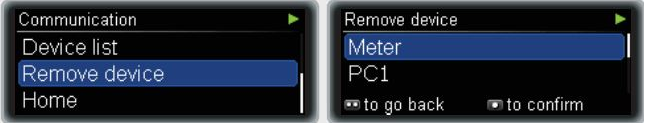
    
    * В [Конфигурация > Помпа](#Config-Builder-pump) выберите карточку **Accu-Chek Insight**. Активной может быть только одна помпа.
    
       
    
       Когда модуль выбран, на карточке **Accu-Chek Insight** появляются две кнопки: **Настройки** и **Открыть модуль**:
    
       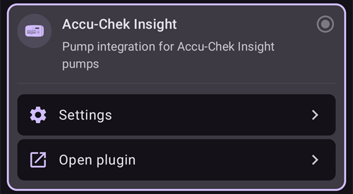
    
       **Настройки** открывает настройки драйвера Accu-Chek Insight (см. [Настройки в AAPS](#Accu-Chek-Insight-Pump-settings-in-aaps)).
    
       **Открыть модуль** (или **Управление → Помпа**) открывает экран помпы Accu-Chek Insight. До сопряжения с помпой он выглядит так:
    
       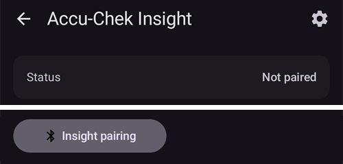
    
    (accu-chek-insight-pairing)=
    ### Сопряжение
    
    * На экране помпы нажмите **Сопряжение с Insight**. Откроется мастер сопряжения и начнет искать Bluetooth-устройства поблизости (верхняя часть рисунка ниже).
    * На помпе Insight откройте **Меню** > **Настройки** > **Связь** > **Добавить устройство**. Помпа покажет следующий экран (нижняя часть рисунка ниже) с серийным номером помпы.
    
       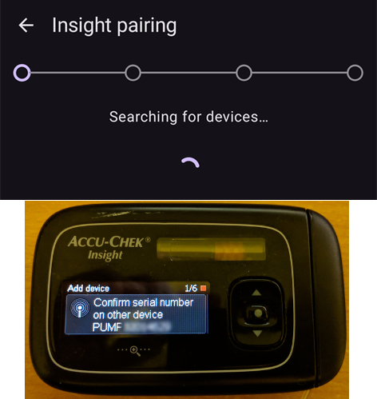
    
    * Вернитесь к телефону и нажмите на серийный номер помпы в списке Bluetooth-устройств. Если Android попросит подтвердить сопряжение, нажмите **Подключить** (Pair).
    
       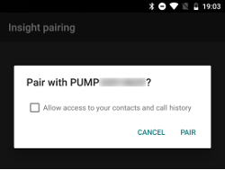
    
    * Помпа и телефон покажут код. Проверьте, что коды на обоих устройствах совпадают. Подтвердите на помпе и нажмите **Да** на телефоне. (Нажмите **Нет**, если коды не совпадают.)
    
       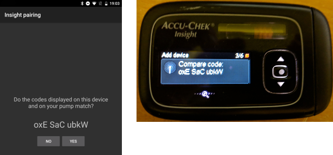
    
    * Телефон покажет **Сопряжение выполнено**. Нажмите **Выйти**, чтобы вернуться на экран помпы.
    
       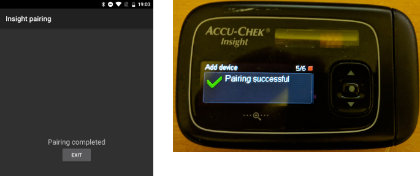
    
    * Чтобы проверить, что всё в порядке, посмотрите на экран помпы (**Управление → Помпа**). После сопряжения на нем видна информация о помпе, например **Серийный номер**, **Дата изготовления**, **Версия ПО** и **Адрес Bluetooth**.
    
       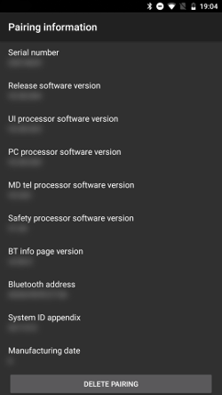
    
       ```{admonition} Старый снимок экрана
       :class: note
       Кроме верхней части первого рисунка, снимки экрана сопряжения выше сделаны в более ранней версии **AAPS** и в **AAPS** 4 могут выглядеть иначе.
       ```
    
    * Чтобы удалить сопряжение, нажмите **Разъединение** на экране помпы и подтвердите **Сбросить информацию о сопряжении?**. После этого снова появится кнопка **Сопряжение с Insight**.
    
    Примечание: постоянного соединения между помпой и телефоном нет. **AAPS** подключается только при необходимости (например, чтобы установить временную базальную скорость, ввести болюс или прочитать историю помпы). Иначе батареи телефона и помпы разряжались бы слишком быстро.
    
    (Accu-Chek-Insight-Pump-settings-in-aaps)=
    ## Настройки в AAPS
    
    Откройте настройки кнопкой **Настройки** на карточке **Accu-Chek Insight** в **Конфигурация** > **Помпа** или значком шестеренки в правом верхнем углу экрана помпы.
    
    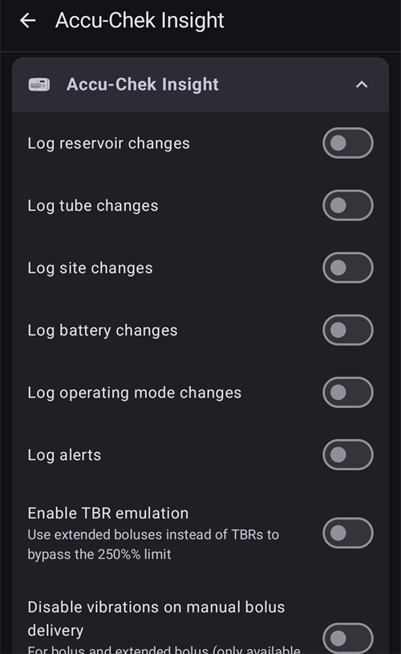
    
    В настройках Insight в **AAPS** можно включить следующие параметры:
    
    * **Отслеживать замену резервуара**: автоматически записывает замену картриджа с инсулином, когда вы меняете картридж в помпе.
    
    * **Журнал замены трубки катетера**: добавляет запись в базу данных **AAPS**, когда вы запускаете на помпе программу «заполнение трубки».
    
    * **Журнал изменений места установки**: добавляет запись в базу данных **AAPS**, когда вы запускаете на помпе программу «заполнение канюли». **Примечание: смена места катетера также сбрасывает Autosens.**
    
    * **Журнал замен батареи**: записывает замену батареи, когда вы вставляете в помпу новую батарею.
    
    * **Журнал изменений режима работы**: добавляет запись в базу данных **AAPS** каждый раз, когда вы запускаете, останавливаете или приостанавливаете помпу.
    
    * **Журнал оповещений**: добавляет запись в базу данных **AAPS** каждый раз, когда помпа выдает оповещение (кроме напоминаний, а также отмены болюса и временного базала: они не записываются).
    
    * **Включить эмуляцию TBR**: помпа Insight может устанавливать временную базальную скорость (TBR) только до 250%. Чтобы обойти это ограничение, при запросе TBR больше 250% эмуляция TBR дает помпе команду подать дополнительный инсулин пролонгированным болюсом.
    
      **Примечание: используйте только один пролонгированный болюс за раз. Несколько пролонгированных болюсов одновременно могут вызвать ошибки.**
    
    * **Отключение вибраций при ручном болюсе**: помпа Insight не вибрирует, когда подает ручной болюс (или пролонгированный болюс). Доступно только для Insight с прошивкой 3.x.
    
    * **Отключение вибрации при автоматическом болюсе**: помпа Insight не вибрирует, когда подает автоматический болюс (SMB или временный базал с эмуляцией TBR). Доступно только для Insight с прошивкой 3.x.
    
    * **Мин. продолжительность восстановления [s]** и **Макс. продолжительность восстановления [s]**: сколько **AAPS** ждет перед новой попыткой после неудачной попытки соединения. Можно выбрать от 0 до 20 секунд. Если есть проблемы с соединением, выберите более долгое время ожидания.
        <br><br>Example for min. длительности восстановления = 5 и макс. длительности восстановления = 20
        <br><br>нет соединения -> ждать <b>5</b> сек.
          <br>  повтор -> нет соединения -> ждать <b>6</b> сек.
          <br>  повтор -> нет соединения -> ждать <b>7</b> сек.
          <br>  повтор -> нет соединения -> ждать <b>8</b> сек.
          <br>...
          <br>повтор -> нет соединения -> ждать <b>20</b> сек.
          <br>повтор -> нет соединения -> ждать <b>20</b> сек.
          <br>...
    
    * **Задержка разъединения [s]**: сколько секунд **AAPS** ждет перед отключением от помпы после завершения операции. You can choose from 0 to 15 seconds. Значение по умолчанию — 5 секунд.
    
    За периоды, когда помпа была остановлена, **AAPS** записывает временную базальную скорость 0%.
    
    ### Экран помпы
    
    Экран помпы Accu-Chek Insight (**Управление → Помпа**) показывает текущее состояние помпы, например **Статус**, **Прошлое соединение**, **Режим работы**, **батарея**, **Уровень резервуара**, суммарные суточные дозы за сегодня (**Суммарный суточный болюс TDD**, **Суммарный суточный Базал TDD**), базальные скорости и последний болюс. После сопряжения на нем есть такие кнопки:
    
    * **Обновить**: обновляет состояние помпы.
    * **Включить уведомление об окончании временной скорости базала TBR (настройка помпы)** / **Отключить уведомление об окончании временной скорости базала TBR (настройка помпы)**: стандартная помпа Insight подает сигнал, когда TBR заканчивается. Эта кнопка включает или выключает этот сигнал без программы для настройки помпы.
    * **Разъединение**: удаляет сопряжение с помпой (см. [Сопряжение](#accu-chek-insight-pairing)).
    
    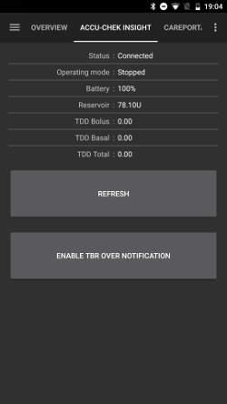
    
    ```{admonition} Старый снимок экрана
    :class: note
    Снимок экрана выше сделан в более ранней версии **AAPS**. В **AAPS** 4 экран помпы выглядит иначе, и на нем также есть кнопка **Разъединение**.
    

## Настройки помпы

Настройте сигналы в помпе следующим образом:

* Меню > Настройки > Параметры устройства > Параметры режима > Тихий > Сигнал > Звук
* Меню > Настройки > Параметры устройства > Параметры режима > Тихий > Громкость > 0 (удалить все полоски)
* Меню > настройка режимов > режим сигнала > тихий

Это уберет звук всех оповещений помпы и позволит AAPS решать, какой сигнал является актуальным для вас. Если AAPS не распознает сигнал, то его громкость увеличится (сначала гудок, затем вибрация).

(Accu-Chek-Insight-Pump-vibration)=

### Вибрация

В зависимости от версии прошивки помпа Insight кратко вибрирует при каждой подаче болюса (например, когда AAPS подает SMB или когда эмуляция TBR подает пролонгированный болюс).

* Прошивка 1.х: нет вибрации конструктивно.
* Прошивка 2.х: вибрация не может быть отключена.
* Прошивка 3.х: AAPS подает болюс беззвучно.

Версию прошивки можно найти через меню.

## Замена батареи

При работе в цикле батарея Insight работает от 10 до 14 дней, максимум 20 дней. Пользователи, сообщающие об этом, используют литиевые батареи Energizer.

В помпе Insight есть небольшой внутренний аккумулятор для поддержания таких важных функций, как часы, которые продолжают работать при замене батарей помпы. Если смена батареи занимает слишком много времени, то в этой внутренней батарее может кончиться заряд, время на часах будет сброшено, и вам будет предложено ввести новое время и дату после установки новой батарейки. Если это произойдет, все записи в AAPS до замены батареи больше не будут включены в расчеты, так как правильное время не может быть определено.

(Accu-Chek-Insight-Pump-insight-specific-errors)=

## Специфические ошибки помпы Insight

### Пролонгированный болюс

Используйте только один пролонгированный болюс за раз, так как несколько пролонгированных болюсов одновременно могут вызвать ошибки.

### Таймаут

Иногда помпа Insight не отвечает, пока **AAPS** устанавливает соединение. Тогда **AAPS** показывает уведомление «Тайм-аут сопряжения - сбросьте bluetooth».

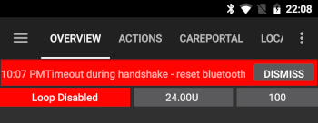

В этом случае выключите Bluetooth на помпе И на телефоне примерно на 10 секунд, затем снова включите.

## Пересечение часовых поясов с помпой Insight

Информацию о пересечении часовых поясов см. в разделе [Пересечение часовых поясов с помпами](#timezone-traveling-insight).

## Куда обращаться за помощью

Драйвер Insight разрабатывает сообщество на **добровольной** основе. Прежде чем просить о помощи:

1. **Прочитайте** нужный раздел этой документации, чтобы убедиться, как должна работать функция.
2. **Спросите** в канале *#AAPS* на [Discord](https://discord.gg/4fQUWHZ4Mw) или в одном из других [каналов сообщества](../GettingHelp/WhereCanIGetHelp.md).
3. **Сообщите об ошибке**: сначала поищите среди [существующих issues](https://github.com/nightscout/AndroidAPS/issues); если вашей проблемы там нет, откройте [новый issue](https://github.com/nightscout/AndroidAPS/issues) и приложите [файлы журналов](../GettingHelp/AccessingLogFiles.md).

Когда просите о помощи, укажите марку и модель телефона, версию Android, версию **AAPS** и простое понятное описание проблемы (что изменилось, когда всё работало в последний раз).