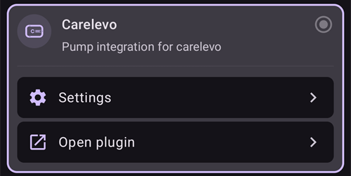
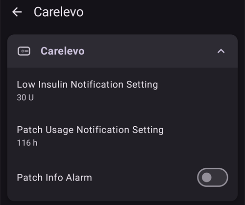
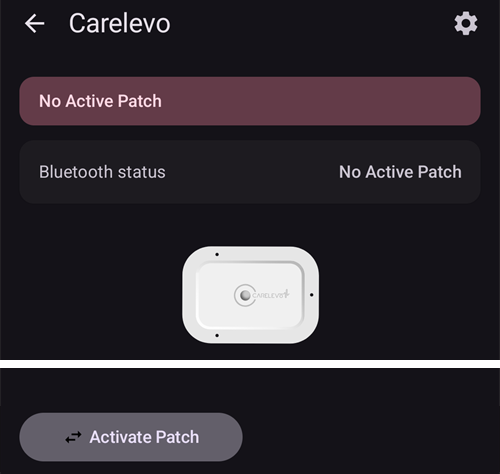

# CareLevo

CareLevo – это беструбочная патч-помпа производства CareMedi. Каждый патч вмещает до 300 ед инсулина, его носят до 7 дней (168 часов). Он связывается с **AAPS** через Bluetooth вашего телефона, без дополнительного устройства.

```{admonition} New driver
:class: warning
Драйвер CareLevo – новый в **AAPS**. Прочитайте всю эту страницу, прежде чем активировать первый патч, и держите под рукой инструкцию по применению самой помпы.
```

Наименьшая доза, которую может ввести патч, – 0,05 ед. Задайте базальные скорости в **Профиле** не меньше 0,05 ед/ч с шагом 0,05 ед/ч, иначе инсулин, который ожидает **Профиль**, и инсулин, который вводит патч, будут немного различаться. **AAPS** использует те базальные скорости, которые принял патч.

```{contents} Table of contents
:depth: 1
:local: true
```

## Возможности работы с AAPS

* Связывается с **AAPS** через встроенный Bluetooth телефона, без дополнительного устройства связи.
* Болюс с шагом 0,05 ед.
* Базальные скорости от 0,05 ед/ч до 15 ед/ч с шагом 0,05 ед/ч, с базальными сегментами по 30 минут.
* Временные базальные скорости задаются как абсолютная скорость, до 12 часов.
* Пролонгированный болюс до 8 часов.
* Переход на летнее/зимнее время и смену часового пояса нужно обрабатывать вручную. Патч уведомляет вас о смене часового пояса.

## Pump Setup

1. Откройте **меню** (☰) в левом верхнем углу главного экрана **AAPS** и выберите **Конфигурация**.
1. Выберите **Carelevo** в разделе «Помпа».
1. Нажмите кнопку «Назад», чтобы вернуться на главный экран.



## Настройки

Откройте экран помпы через **Управление → Помпа** (или **Конфигурация → Помпа → Открыть модуль**).

Откройте настройки CareLevo, нажав на значок **Настройки** (шестеренка) в правом верхнем углу. Доступны три настройки:



### Настройка уведомления о низком уровне инсулина

Патч уведомляет вас, когда остаток инсулина в резервуаре доходит до выбранного количества. Можно задать от 20 ед до 50 ед с шагом 5 ед. По умолчанию 30 ед. Независимо от этой настройки патч подает критический сигнал тревоги и останавливает введение инсулина, когда остается меньше 10 ед.

### Настройка уведомления о времени использования патча

Патч уведомляет вас, когда его носят выбранное количество часов, чтобы вы могли запланировать замену. Можно задать от 24 до 167 часов. По умолчанию 116 часов.

### Информационный сигнал патча

Если эта настройка включена, патч подает звуковой сигнал, когда начинается и когда заканчивается болюс, пролонгированный болюс или временный базал. По умолчанию выключено.

## Экран помпы



На экране помпы показаны **Статус Bluetooth** (Нет активного патча, Отключено или Подключено), **Серийный номер** патча, его **Время активации** и **Окончание срока**, текущая **Базальная скорость** и **Временная базальная скорость**, **Остаток инсулина** (осталось / заполнено), **Оставшееся время патча** и **Всего введено инсулина**.

Кнопки зависят от состояния патча:

* **Активировать патч**: начинает активацию нового патча, см. ниже.
* **Инструкция по инсулину**: показывает двенадцать шагов заполнения патча инсулином.
* **Приостановить введение** / **Возобновить введение**: приостанавливает и снова запускает подачу инсулина, см. ниже.
* **Утилизировать патч**: останавливает текущий патч, чтобы можно было активировать новый.

## Активация патча

Перед началом убедитесь, что в **AAPS** активен **Профиль** и что Bluetooth включен. После включения патч нужно активировать за ограниченное время; если время истекло, патч подает сигнал тревоги **Время установки патча истекло**, и его нельзя использовать.

Нажмите **Активировать патч** на экране помпы и следуйте шагам. Отменить можно в любой момент до введения иглы; введенные вами данные будут удалены.

### Выберите инсулин

Подтвердите инсулин, который вы используете. Для патча нужен инсулин быстрого действия U-100.

### Заполните патч инсулином

Заполните патч количеством от 50 до 300 ед, учитывая, как долго вы будете его носить. Нажмите **Инструкция по инсулину**, если вам нужна инструкция по заполнению. Затем нажмите на количество заполнения и выберите количество, которое вы залили; **AAPS** использует его, чтобы показывать остаток инсулина.

### Подключите патч

1. Достаньте патч из блистера и снимите колпачок с иглы.
1. Нажмите кнопку питания патча дольше одной секунды. После звукового сигнала нажмите **Найти патч**.
1. Если найден правильный патч, нажмите **Подтвердить**. Если нет, нажмите **Повторить поиск**.

### Safety check

Когда патч подключен, нажмите **Проверка безопасности**. Патч проверяет себя и выполняет заполнение (прайм). Проверьте, что на кончике иглы появилась капля инсулина. Если капли не видно, нажмите **Повторить**. Когда проверка закончится, нажмите **Далее**.

### Место и установка патча

1. Выберите место, где вы будете носить патч.
1. Тщательно очистите место спиртовой салфеткой.
1. Снимите защитную пленку и приклейте патч к коже отмеченной точкой вверх.
1. Когда патч приклеен, нажмите **Далее**.

### Введите иглу

1. Поверните защитный колпачок по направлению стрелки и снимите его.
1. Нажмите кнопку аппликатора до упора и удерживайте ее 10 секунд. Когда игла введена, раздается звуковой сигнал.
1. Снимите аппликатор и нажмите **Подтвердить введение**.

Если ввести иглу не удалось, **AAPS** сообщает, сколько попыток осталось. Когда попыток не осталось, патч подает сигнал тревоги **Ошибка введения иглы**, и его нужно заменить.

Подача инсулина начинается сразу после подтверждения введения иглы.

## Сообщения о болюсе

Если патч отказывается вводить болюс, **AAPS** сообщает причину. Например, *Болюс не может быть введен. Доступный болюс: 2,8 ед* означает, что сейчас патч может ввести только это количество.

Если вы останавливаете болюс, а патч не подтверждает остановку, **AAPS** ждет окончания болюса и записывает количество, которое сообщает патч. Если болюс не был записан (например, потому что его остановили во время введения), **AAPS** добавляет его из общего количества патча и просит вас проверить IOB, прежде чем пробовать снова.

## Приостановка и возобновление подачи инсулина

Нажмите **Приостановить введение** на экране помпы и выберите, на сколько приостановить подачу: от 30 минут до 4 часов с шагом 30 минут. Подача не возобновляется сама: когда пауза закончится, патч подает оповещение **Начать подачу инсулина**. Нажмите **Возобновить введение** на экране помпы или **Начать подачу инсулина** в оповещении и подтвердите.

## Утилизация патча

Нажмите **Утилизировать патч** на экране помпы и подтвердите. Подача инсулина останавливается, и патч больше нельзя использовать. Снимите патч с тела и активируйте новый.

Если критический сигнал тревоги остановил патч, сигнал тревоги предлагает вместо этого **Деактивировать патч**. Нажатие на эту кнопку утилизирует патч так же.

If the patch cannot be reached, you can still discard it. **AAPS** removes it and stops counting its temp basal and extended bolus, but the patch itself was not told to stop. **AAPS** warns you: *The patch could not be reached. It was removed from AAPS but not stopped, and it may still give insulin. Take it off.* Take the patch off your body straight away.

(carelevo-alarms-and-notifications)=

## Сигналы тревоги и уведомления

Патч сообщает о событиях трех уровней. Все они показываются как уведомления **AAPS**.

### Критические сигналы тревоги

Подача инсулина остановлена. Действуйте сейчас:

* **Мало инсулина**: осталось меньше 10 ед. Деактивируйте патч и замените его.
* **Срок патча истек**: патч достиг конца срока службы. Деактивируйте патч и замените его.
* **Низкий заряд батареи**: утилизируйте патч и замените его.
* **Высокая/низкая температура**: перейдите в место с подходящей температурой, от 40 ℉ до 99 ℉ (от 4,4 ℃ до 37,2 ℃).
* **Автоотключение**: патч остановился, потому что оповещение об автоотключении было проигнорировано. Нажмите **Начать подачу инсулина**, чтобы снова запустить подачу базала.
* **Время установки патча истекло**, **Ошибка самодиагностики**, **Ошибка патча**, **Окклюзия** и **Ошибка введения иглы**: деактивируйте патч и замените его.

### Alerts

Подача инсулина продолжается, но что-то требует вашего внимания:

* **Мало инсулина**: в резервуаре осталось количество, заданное в **Настройка уведомления о низком уровне инсулина**. Приготовьтесь заменить патч.
* **Срок патча скоро истечет** и **Срок работы патча истек**: замените патч.
* **Низкий заряд батареи**: приготовьтесь заменить патч.
* **Высокая/низкая температура**: подача приостановлена, пока температура патча снова не будет от 40 ℉ до 99 ℉ (от 4,4 ℃ до 37,2 ℃).
* **Автоотключение**: нажмите **OK**. Если оповещение проигнорировать, оно переходит в критический сигнал тревоги, и подача останавливается.
* **Активация патча не завершена**: нажмите **OK**, чтобы завершить активацию.
* **Начать подачу инсулина**: заданная вами пауза закончилась. Нажмите **Начать подачу инсулина**, чтобы возобновить подачу.
* **Включите Bluetooth** и **BLE не подключен**: телефон не может связаться с патчем. Включите Bluetooth или проверьте подключение патча.

### Уведомления

Только для информации: **Мало инсулина**, **Уведомление о времени использования патча** (прошло время, заданное в **Настройка уведомления о времени использования патча**), **Уведомление о проверке патча**, **Смена часового пояса** и **Проверьте ГК** (через заданное время после болюса).

Патч также сообщает, когда его собственная функция приостановки на низкой ГК (**LGS**) начинает или заканчивает работу. **AAPS** не использует эту функцию; цикл сам справляется с низкой ГК.

## Куда обращаться за помощью

Сообщайте о проблемах с драйвером CareLevo на [странице issues AAPS на GitHub](https://github.com/nightscout/AndroidAPS/issues) или в каналах сообщества AAPS, см. [Где получить помощь?](../GettingHelp/WhereCanIGetHelp.md).
