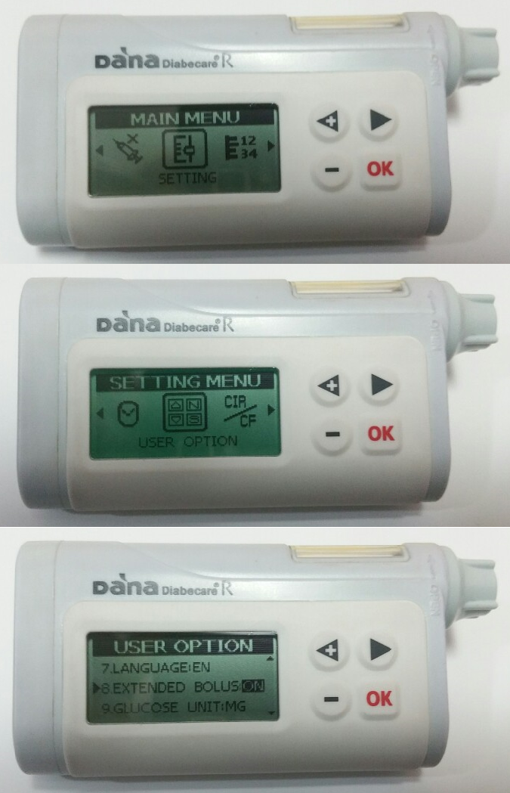

# DanaR

*Эти инструкции предназначены для настройки приложения AAPS и помпы DanaR. Если у вас помпа DanaRS, появившаяся в продаже в 2017 году, перейдите на страницу [DanaRS](./DanaRS-Insulin-Pump.md).*

## Возможности работы с AAPS

* Связывается с **AAPS** через встроенный Bluetooth телефона, без дополнительного устройства связи.
* Смена часового пояса и переход на летнее/зимнее время не требуют особых действий, так как помпа не использует собственную историю.

## Настройка

* В помпе войдите в главное меню > параметры > пользовательские настройки
* Включите «8. Пролонгированный болюс"

* Перейдите в главное меню > параметры > обнаружение
* В настройках телефона откройте Bluetooth, найдите устройства поблизости, выберите серийный номер своей DanaR и введите пароль (пароль сопряжения 0000). Если DanaR не отображается при сканировании, перезапустите телефон, выньте батарею DanaR, вставьте ее обратно и повторите эти два шага.

* В **AAPS** откройте **меню** (☰) в левом верхнем углу, перейдите в **Конфигурация** > **Помпа** и выберите свой тип DanaR (**DanaR**, **DanaR Корея** или **DanaRv2**).
  
  

* Откройте экран помпы: нажмите **Открыть модуль** на карточке DanaR (или перейдите в **Управление** > **Помпа**).

* Нажмите **Сопряжение**. На экране сопряжения: 
  * Введите пароль помпы в поле **Пароль помпы** (пароль по умолчанию 1234).
  * В разделе **Выберите сопряженное устройство** нажмите на серийный номер своей DanaR. Если список пуст, нажмите **Открыть настройки Bluetooth** и сначала выполните сопряжение помпы с телефоном (см. шаг выше). Когда вы вернетесь в **AAPS**, помпа появится в списке. Если ее там нет, нажмите значок обновления.
  * Нажмите **Сопряжение**. **AAPS** подключится к помпе и проверит пароль.
* Чтобы изменить настройки драйвера, нажмите **Настройки** на карточке DanaR в **Конфигурация** > **Помпа**: 
  * **Скорость болюса** (DanaR и DanaRv2): изменить скорость болюса по умолчанию (12 с/ед, 30 с/ед или 60 с/ед).
  * **Для величин >200% пользуйтесь пролонгированным болюсом** (DanaR и DanaR Корея): включите, если хотите, чтобы **AAPS** мог устанавливать базальную скорость выше 200%. Учтите, что тогда вы не сможете использовать цикл с высокими временными базалами, пока используете пролонгированные болюсы для еды.
* Установите шаг базала в 0.01 ед/ч
* Установите на помпе шаг болюса 0,1 ед. **AAPS** считывает шаг болюса с помпы и использует его для каждого болюса.
* Активируйте пролонгированные болюсы на помпе

## Пересечение часовых поясов с помпой Dana R

Информацию о пересечении часовых поясов см. в разделе [Пересечение часовых поясов с помпами](#timezone-traveling-danarv2-danars).

## Куда обращаться за помощью

Драйвер DanaR разрабатывает сообщество на **добровольной** основе. Прежде чем просить о помощи:

1. **Прочитайте** нужный раздел этой документации, чтобы убедиться, как должна работать функция.
2. **Спросите** в канале *#AAPS* на [Discord](https://discord.gg/4fQUWHZ4Mw) или в одном из других [каналов сообщества](../GettingHelp/WhereCanIGetHelp.md).
3. **Сообщите об ошибке**: сначала поищите среди [существующих issues](https://github.com/nightscout/AndroidAPS/issues); если вашей проблемы там нет, откройте [новый issue](https://github.com/nightscout/AndroidAPS/issues) и приложите [файлы журналов](../GettingHelp/AccessingLogFiles.md).

Когда просите о помощи, укажите марку и модель телефона, версию Android, версию **AAPS** и простое понятное описание проблемы (что изменилось, когда всё работало в последний раз).