# DanaRS, Dana-i и Dana-i2

*Эти инструкции нужны для настройки приложения и помпы, если у вас DanaRS выпуска 2017 года или новее, Dana-i или Dana-i2. Если у вас оригинальная помпа DanaR, перейдите на страницу [DanaR](./DanaR-Insulin-Pump.md).*

**Dana-i2 можно использовать начиная с версии AAPS 4.0.** Она использует тот же драйвер **Dana-i/RS**, что и Dana-i.

* В помпе DanaRS/i/i2 приложение использует «BASAL A». Имеющиеся данные будут перезаписаны.

    {contents} Содержание
    :depth: 1
    :local: true

## Возможности работы с AAPS

* Связывается с **AAPS** через встроенный Bluetooth телефона, без дополнительного устройства связи.
* Переход на летнее/зимнее время и смену часового пояса нужно выполнять вручную (см. [Смена часового пояса](#timezone-traveling-danarv2-danars)).

(DanaRS-Insulin-Pump-pairing-pump)=

## Сопряжение с помпой

* Откройте **меню** (☰) в левом верхнем углу главного экрана **AAPS** и выберите **Конфигурация**.
* Нажмите **Помпа** и выберите **Dana-i/RS**.
    
    
    
    После выбора на карточке **Dana-i/RS** есть две кнопки: **Настройки** и **Открыть модуль**:
    
    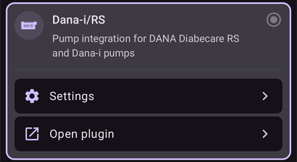
    
    **Настройки** открывает настройки драйвера Dana-i/RS:
    
    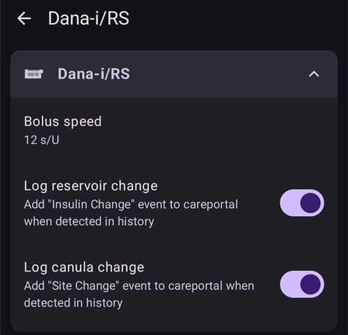
    
    **Открыть модуль** (или **Управление** > **Помпа**) открывает экран помпы Dana-i/RS. Пока помпа не сопряжена, он выглядит так:
    
    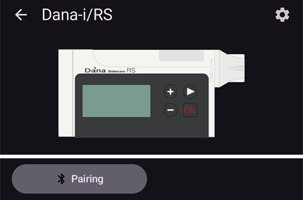

* На экране помпы нажмите **Сопряжение**. **AAPS** ищет помпы поблизости.

* Нажмите на свою помпу в списке.
    
    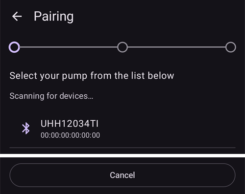

* **Сопряжение нужно подтвердить на помпе!** Это работает так же, как другие сопряжения по Bluetooth, которые вы, возможно, знаете (например, смартфон и аудиосистема автомобиля).
    
    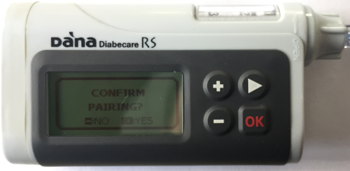

* Следуйте процессу сопряжения на основе типа и прошивки вашей помпы:
    
    * Для DanaRS v1 **AAPS** запрашивает **Пароль для помпы (только v1)**. Введите пароль помпы (см. [Пароль по умолчанию](#DanaRS-Insulin-Pump-default-password)).
    * Для DanaRS v3 **AAPS** просит нажать OK на помпе и ввести 2 последовательности цифр и букв, которые показаны на помпе. Чтобы дисплей помпы не погас, нажимайте кнопку минус, пока не закончите. Затем нажмите **Готово**.
    * Для Dana-i и Dana-i2 появляется стандартный диалог сопряжения Android. Введите 6-значное число, показанное на помпе.

* Когда появится **Сопряжение успешно!**, нажмите **Готово**.
    
    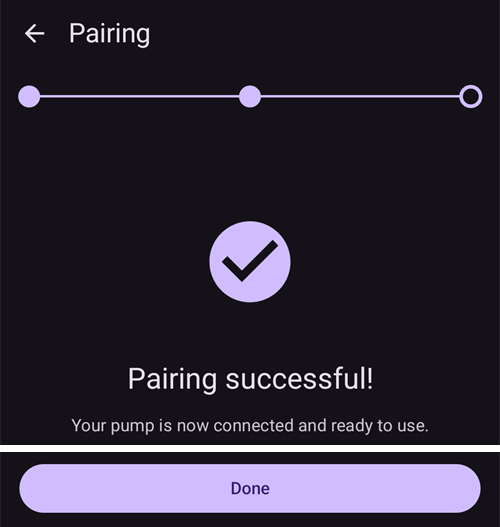
    
    Вы снова на экране помпы, где теперь показано состояние вашей помпы.
    
    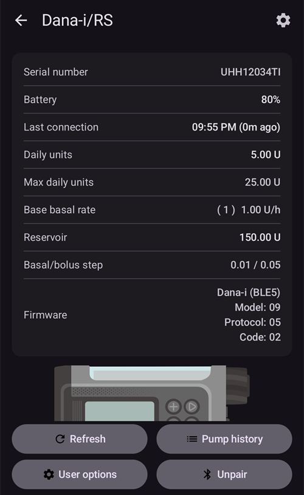

* В **Настройках** выберите **Скорость болюса**, чтобы изменить скорость болюса по умолчанию (12 с/ед, 30 с/ед или 60 с/ед).

* Установите шаг базала на помпе в 0.01 ед./ч с помощью меню Doctors (см. руководство пользователя помпы).
* Установите шаг болюса на помпе 0,05 ед с помощью меню Doctors (см. руководство пользователя помпы). **AAPS** читает шаг базала и шаг болюса из помпы и использует их для каждого болюса, поэтому болюс всегда соответствует шагу, установленному на помпе. Экран помпы показывает их в строке **Шаг Базала/болюса**.
* Активируйте пролонгированные болюсы на помпе

### Параметры, которые есть только у некоторых моделей

* **Автоблокировка**: на Dana-i2 на экране **Параметры пользователя** (на экране помпы, **Управление** > **Помпа**) есть переключатель **Автоблокировка** для настройки автоблокировки помпы. После изменения нажмите **Сохранить параметры в помпе**.
* **Упрощенный режим**: на моделях помп с упрощенным меню экран помпы показывает строку **Упрощенный режим** со значением **Вкл.** или **Выкл.**
* Если Dana-i2 отказывается вводить болюс, **AAPS** показывает причину, например *Помпа не заполнена*, *В резервуаре недостаточно инсулина* или *В помпе включен режим Easy sleep*.

(DanaRS-Insulin-Pump-default-password)=

### Пароль по умолчанию

* Для DanaRS с прошивкой v1 и v2 пароль по умолчанию 1234.
* Для DanaRS с прошивкой v3 или Dana-i пароль по умолчанию зависит от даты изготовления и вычисляется как MMDD, где MM – месяц, а DD – день изготовления помпы (например, '0124' означает месяц 01 и день 24).
    
    * В разделе MAIN MENU выберите REVIEW, затем откройте SHIPPING INFORMATION из подменю
    * Цифра 3 – это дата изготовления. 
    * Для v3/i этот пароль используется только для блокировки меню на помпе. Он не используется для коммуникации и нет необходимости вводить его в AAPS.

(DanaRS-Insulin-Pump-change-password-on-pump)=

## Смена пароля на помпе

* Нажмите кнопку OK на помпе
* В главном меню выберите "OPTION" (двигайтесь вправо, нажав кнопку со стрелкой несколько раз)
    
    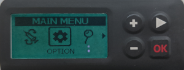

* В меню опций выберите "USER OPTION"
    
    

* При помощи кнопки со стрелкой переместитесь вниз до "11. пароль "
    
    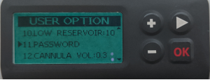

* Нажмите OK, чтобы ввести старый пароль.

* Введите **старый пароль** (пароль по умолчанию см. [выше](#DanaRS-Insulin-Pump-default-password)) и нажмите OK
    
    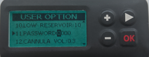

* Если указан неправильный пароль, то сообщение о сбое не выдается!

* Установите **новый пароль** (меняйте цифры с помощью кнопки + & - кнопки/Перемещайтесь вправо кнопкой со стрелкой).
    
    

* Подтвердите кнопкой ОК.

* Нажмите OK, чтобы сохранить настройки.
    
    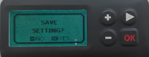

* Переместитесь вниз до "14. EXIT" и нажмите OK, чтобы выйти.
    
    

(DanaRS-Insulin-Pump-dana-rs-specific-errors)=

## Специфические ошибки Dana RS

### Ошибка во время подачи инсулина

В случае, если связь между AAPS и Dana RS теряется во время подачи болюса (например вы отошли от телефона когда дана RS подает инсулин) вы увидите сообщение и услышите сигнал.

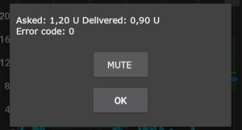

* В большинстве случаев это просто проблема связи и нужное количество инсулина все равно подается.
* Проверьте в журнале помпы, что был введен правильный болюс. Это можно сделать на самой помпе или в **AAPS** на экране помпы (**Управление** > **Помпа**) > **Журнал помпы** > **Болюсы**.
* Если хотите, удалите запись об ошибке в [терапии](#screens-bolus-carbs).
* Реальное количество считывается и записывается при следующем подключении. Чтобы сделать это сразу, нажмите **Обновить** на экране помпы или просто дождитесь следующего подключения.

## Отдельное замечание при смене телефона

При переходе на новый телефон требуются следующие действия:

* Выполните [Экспорт настроек](../Maintenance/ExportImportSettings.md) на вашем старом телефоне
* Перенести настройки со старого на новый телефон

### DanaRS v1

* **Вручную выполните сопряжение** Dana RS с новым телефоном
* Если при импорте отметить **Также заменить настройки помпы**, настройки подключения к помпе тоже импортируются, и AAPS на новом телефоне уже будет «знать» помпу и поэтому не начнет поиск по Bluetooth. Поэтому новый телефон и помпу нужно сопрячь вручную.
* Установите AAPS на новом телефоне.
* [Импортируйте настройки](../Maintenance/ExportImportSettings.md) на новом телефоне

### DanaRS v3, Dana-i, Dana-i2

* Начните сопряжение, как описано [выше](#DanaRS-Insulin-Pump-pairing-pump).
* Иногда сначала нужно удалить информацию о сопряжении в **AAPS**. На экране помпы (**Управление** > **Помпа**) нажмите **Разорвать сопряжение** и подтвердите **Сбросить информацию о сопряжении?**. Затем снова нажмите **Сопряжение**.

## Смена часового пояса с помпами DanaRS, Dana-i и Dana-i2

Информацию о пересечении часовых поясов см. в разделе [Пересечение часовых поясов с помпами](#timezone-traveling-danarv2-danars).

## Куда обращаться за помощью

Драйвер DanaRS/Dana-i/Dana-i2 разрабатывает сообщество на **добровольной** основе. Прежде чем просить о помощи:

1. **Прочитайте** нужный раздел этой документации, чтобы убедиться, как должна работать функция.
2. **Спросите** в канале *#AAPS* на [Discord](https://discord.gg/4fQUWHZ4Mw) или в одном из других [каналов сообщества](../GettingHelp/WhereCanIGetHelp.md).
3. **Сообщите об ошибке**: сначала поищите среди [существующих issues](https://github.com/nightscout/AndroidAPS/issues); если вашей проблемы там нет, откройте [новый issue](https://github.com/nightscout/AndroidAPS/issues) и приложите [файлы журналов](../GettingHelp/AccessingLogFiles.md).

Когда просите о помощи, укажите марку и модель телефона, версию Android, версию **AAPS** и простое понятное описание проблемы (что изменилось, когда всё работало в последний раз).