# Diaconn G8

```{contents} Table of contents
:depth: 1
:local: true
```

## Возможности работы с AAPS

* Связывается с **AAPS** через встроенный Bluetooth телефона, без дополнительного устройства связи.
* Переход на летнее/зимнее время и смену часового пояса нужно обрабатывать вручную.

## Bluetooth-сопряжение

- Нажмите **меню** (☰) в левом верхнем углу.


- Нажмите **Конфигурация** > **Помпа** и выберите **Diaconn G8**.


После выбора на карточке **Diaconn G8** появятся две кнопки, **Настройки** и **Открыть модуль**:

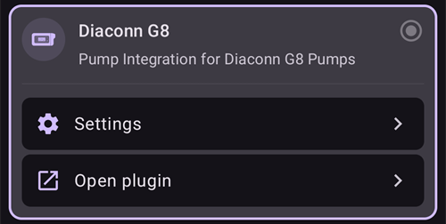

**Настройки** открывает настройки драйвера Diaconn G8 (см. [Настройка параметров помпы G8 Diaconn](#diaconn-g8-insulin-pump-option-setting) ниже).

**Открыть модуль** (или **Управление** > **Помпа**) открывает экран помпы Diaconn G8. Пока помпа не сопряжена, он выглядит так:

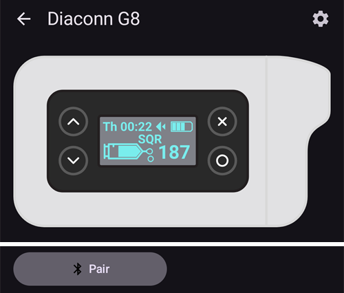


```{admonition} Older screenshot
:class: note
Скриншот выше сделан в более ранней версии **AAPS**. В **AAPS** 4 сопряжение начинается с кнопки **Выполнить сопряжение** на экране помпы; настройки **Выбранная помпа** больше нет.
```

- На экране помпы нажмите **Выполнить сопряжение**. Откроется экран **Сопряжение с помпой Diaconn**, и **AAPS** начнет искать помпы поблизости.
- Когда номер модели вашей помпы появится в списке, нажмите на него (например, **DIACONN-65010**).

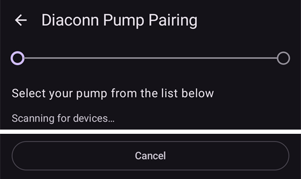

- Есть два варианта проверки номера модели:

1. Последние 5 цифр номера SN на задней панели помпы.
2. Нажмите на кнопку O > Информация > BLE > Последние 5 цифр.

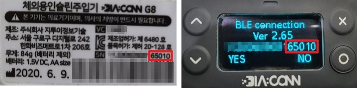

- После выбора помпы появится окно с запросом PIN-кода. Введите PIN-код, который показан на помпе, чтобы завершить подключение.

 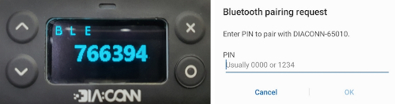

- Когда появится **Сопряжение успешно!**, нажмите **OK**, чтобы вернуться на экран помпы.

## Проверка статуса помпы и синхронизация журнала

- Когда помпа подключена, откройте экран помпы (**Управление** > **Помпа**). Там показано состояние помпы (батарея, резервуар, последнее подключение, последний болюс, базальная скорость и другое).
- Нажмите **Обновить**, чтобы подключиться к помпе, обновить состояние и синхронизировать журналы.
- Нажмите **Журнал помпы**, чтобы увидеть историю, прочитанную из помпы.

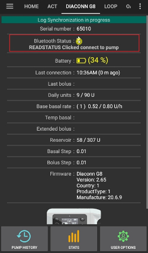

```{admonition} Older screenshot
:class: note
Скриншот выше сделан в более ранней версии **AAPS**. В **AAPS** 4 состояние помпы показано на экране помпы (**Управление** > **Помпа**) и синхронизируется кнопкой **Обновить**.
```

(diaconn-g8-bluetooth-troubleshooting)=

## Устранение неполадок Bluetooth-соединения

**Что делать в случае нестабильного подключения Bluetooth к помпе.**

### Способ 1) Перезапустите AAPS, затем снова проверьте помпу

- Нажмите **меню** (☰) в левом верхнем углу.
- Нажмите **Выход** внизу меню.


- Снова запустите **AAPS** и проверьте подключение к помпе.

### Способ 2) Если первый способ не помог, отключите Bluetooth и подключите снова.

- Нажмите и удерживайте кнопку Bluetooth в верхней части примерно 3 секунды.

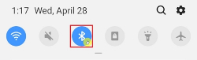

- Нажмите кнопку настроек на сопряженной помпе Diaconn G8.

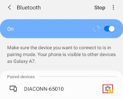

- Разъединение.

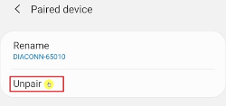

- В **AAPS** откройте экран помпы (**Управление** > **Помпа**), нажмите **Разорвать сопряжение** и подтвердите **Сбросить информацию о сопряжении?**.
- Повторите процесс подключения к Bluetooth помпы (см. выше).

## Дополнительная информация

(diaconn-g8-insulin-pump-option-setting)=

### Настройка параметров помпы G8 Diaconn

- **Конфигурация** > **Помпа** > **Diaconn G8** > **Настройки**
- Или на экране помпы (**Управление** > **Помпа**) нажмите значок настроек (шестеренку) в правом верхнем углу.

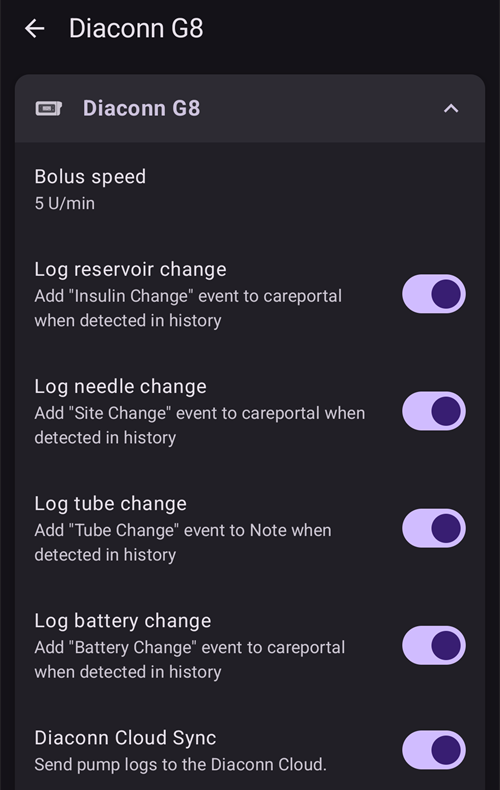

- **Скорость болюса** задает, как быстро помпа вводит болюс.
- Если включен параметр **Отслеживать замену резервуара**, при событии «Замена инсулина» данные автоматически загружаются в портал терапии.
- Если включен параметр **Отслеживать замену катетера помпы в журнале**, при событии «Смена места катетера» данные автоматически загружаются в портал терапии.
- Если включен параметр **Внести запись о замене катетера**, при событии «Замена трубки» данные автоматически добавляются как примечание.
- Если включен параметр **Отслеживать замены батареи**, при событии «Замена батареи» данные автоматически загружаются в портал терапии. Замену батареи можно также записать вручную: **Управление** > **Замена батареи помпы**. (Примечание: При замене батареи следует остановить все текущие инъекции.)
- **Синхронизация с Diaconn Cloud** отправляет журналы помпы в Diaconn Cloud.

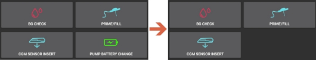

```{admonition} Older screenshot
:class: note
Скриншот выше сделан в более ранней версии **AAPS**. В **AAPS** 4 замена батареи записывается через **Управление** > **Замена батареи помпы**; вкладки **Действия** больше нет.
```

### Функция пролонгированного (расширенного) болюса

- Если вы пользуетесь пролонгированным болюсом, замкнутый цикл будет деактивирован.
- Почему пролонгированный болюс не работает в замкнутом цикле, подробно описано [на этой странице](#extended-bolus-and-why-they-wont-work-in-closed-loop-environment).

## Куда обращаться за помощью

Драйвер Diaconn G8 разрабатывает сообщество на **добровольной** основе. Прежде чем просить о помощи:

1. **Прочитайте** нужный раздел этой документации, чтобы понять, как должна работать функция.
2. **Спросите** в канале *#AAPS* в [Discord](https://discord.gg/4fQUWHZ4Mw) или в одном из других [каналов сообщества](../GettingHelp/WhereCanIGetHelp.md).
3. **Сообщите об ошибке**: поищите среди [существующих issues](https://github.com/nightscout/AndroidAPS/issues); если вашей проблемы там нет, откройте [новый issue](https://github.com/nightscout/AndroidAPS/issues) и приложите [файлы журналов](../GettingHelp/AccessingLogFiles.md).

Когда просите о помощи, укажите марку и модель телефона, версию Android, версию **AAPS** и простое, понятное описание проблемы (что изменилось, когда все работало в последний раз).
