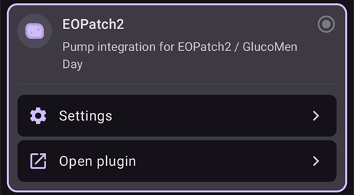
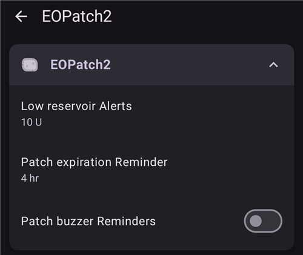
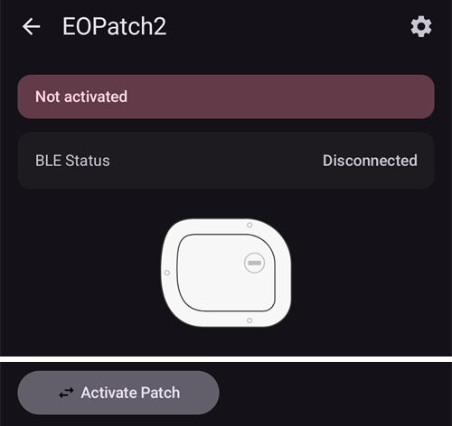
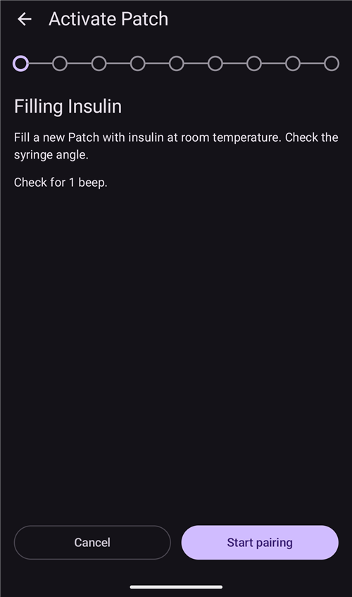

# EOPatch2

Для патча нужен быстродействующий инсулин U-100, например NovoRapid или Humalog. Используйте быстродействующий инсулин, который вам назначил врач.

Самая маленькая доза, которую может ввести патч, – 0,05 ед. Задайте каждую базальную скорость в вашем **Профиле** не ниже 0,05 ед/ч, с шагом 0,05 ед/ч. Иначе **AAPS** округляет каждую скорость до ближайших 0,05 ед/ч (но никогда не до 0) и использует скорости, которые патч вводит на самом деле, поэтому суммарное количество инсулина за сутки немного отличается от вашего **Профиля**. Так же и болюсы должны быть не меньше 0,05 ед.

```{contents} Table of contents
:depth: 1
:local: true
```

## Возможности работы с AAPS

* Связывается с **AAPS** через встроенный Bluetooth телефона, без дополнительного устройства связи.
* Переход на летнее/зимнее время и смену часового пояса нужно обрабатывать вручную.

## Настройка помпы

1. Откройте **меню** (☰) в левом верхнем углу главного экрана **AAPS** и выберите **Конфигурация**.
1. В разделе **Помпа** выберите **EOPatch2**.
1. Нажмите кнопку «Назад», чтобы вернуться на главный экран.

 

После выбора на карточке **EOPatch2** появятся две кнопки: **Настройки** и **Открыть модуль**:



## Настройки

Открыть настройки EOPatch2 можно двумя способами:

* нажмите **Настройки** на карточке **EOPatch2** в разделе **Конфигурация** или
* откройте экран помпы (**Управление** → **Помпа**) и нажмите значок шестеренки в правом верхнем углу.

Есть три настройки:



### Оповещения о низком уровне инсулина в резервуаре

Предупреждение появляется, когда инсулина в патче остается столько или меньше. Можно задать значение от 10 до 50 ед с шагом 5 ед. По умолчанию – 10 ед.

### Напоминание об истечении срока патча

Напоминает, сколько времени осталось до окончания срока работы текущего патча. Можно задать значение от 1 до 24 часов с шагом 1 час. По умолчанию – 4 часа.

### Patch buzzer Reminders

Если эта настройка включена, патч подает звуковой сигнал, когда начинается и когда заканчивается болюс, пролонгированный болюс или временный базал. На обычный базал она не влияет. По умолчанию выключено.

## Активация нового патча

### Откройте мастер активации

Откройте экран помпы через **Управление** → **Помпа** (или нажмите **Открыть модуль** на карточке **EOPatch2** в разделе **Конфигурация**). Если активного патча нет, на экране написано **Не активирован**, а внизу есть кнопка **Активировать Patch**.

Нажмите **Активировать Patch**, чтобы запустить мастер.



Мастер проведет вас через каждый шаг. Ряд точек вверху показывает, сколько вы уже прошли.

```{note}
Если вы еще ни разу не активировали **Профиль** в **AAPS**, мастер сначала покажет страницу **Требуется профиль**. Выберите нужный профиль и нажмите **Активировать профиль**.
```

### Filling Insulin

Введите иглу шприца в порт заполнения инсулином на патче. Медленно нажимайте на поршень, чтобы заполнить патч. Когда в патче будет больше 80 ед, он один раз подаст звуковой сигнал и запустится.

Когда услышите сигнал, нажмите **Начните сопряжение**.



```{warning}
- Не поворачивайте рычаг введения иглы, пока мастер не скажет это сделать. Если повернуть его слишком рано, это может вызвать серьезные проблемы при заполнении или при проверке безопасности.
- Патч вмещает от 80 до 200 ед. Если залить меньше 80 ед, патч не работает.
- Достаньте инсулин из холодильника за 15–30 минут до заполнения, чтобы он нагрелся до комнатной температуры. Температура инсулина должна быть не ниже 10 °C.
```

### Patch pairing

Теперь **AAPS** пытается автоматически выполнить сопряжение с патчем. Во время сопряжения появятся два запроса Android на сопряжение по Bluetooth. В первом нажмите **OK**. Во втором, где показан код доступа, снова нажмите **OK**.

```{warning}
- Во время сопряжения держите патч и телефон на расстоянии не более 30 см друг от друга.
- После запуска патч подает звуковой сигнал каждые 3 минуты, пока сопряжение не завершится.
- Активацию патча нужно завершить в течение 60 минут после его запуска. Если это не удалось, выбросьте патч.
```

  

```{admonition} Older screenshot
:class: note
Два снимка экрана сопряжения по Bluetooth сделаны в более ранней версии **AAPS**: экран **AAPS** за запросом Android на сопряжение в **AAPS** 4 выглядит иначе.
```

### Выбор инсулина

Выберите инсулин, которым вы заполнили патч, и нажмите **Далее**. После активации **AAPS** выполняет переключение профиля с этим инсулином.

### Prepare for attaching the Patch

Снимите с патча защитную пленку клейкой основы, затем нажмите **Далее**.

Если игла выступает наружу, или патч мокрый, грязный, или его клейкая основа загнулась, нажмите вместо этого **Сбросить** и используйте новый патч.


### Место установки

Этот шаг появляется, только если в настройках мест установки включен параметр **Места установки помпы**. Нажмите на схеме тела место, куда вы прикрепите патч, и нажмите **Далее** или нажмите **Пропустить**.

### Attaching the Patch

Инсулин нужно вводить в место, где под кожей есть жировая ткань, но мало нервов и кровеносных сосудов. Хорошо подходят живот, плечо или бедро. Очистите и высушите место, затем прикрепите патч к коже.

Проверьте место введения, затем нажмите **Запустите проверку безопасности**.

```{warning}
- Равномерно прижмите края клейкой основы патча, чтобы весь патч плотно прилегал к коже.
- Если патч приклеен не полностью, между патчем и кожей может попасть воздух. Это ослабляет клейкую основу и водостойкость патча.
```


### Safety check

Проверка безопасности длится около 30 секунд. Когда она закончится, патч один раз подаст звуковой сигнал. Если проверка не удалась, нажмите **Повторить**.

```{warning}
Для безопасного использования не поворачивайте рычаг введения иглы, пока проверка безопасности не завершена.
```

 

```{admonition} Older screenshot
:class: note
Снимки экрана от шага **Подготовьтесь к установке Patch'а** до шага **Проверка безопасности** сделаны в более ранней версии **AAPS** и в **AAPS** 4 могут выглядеть иначе.
```

### Введение иглы

Крепко держите патч. Поверните рычаг введения иглы вверх более чем на 100°, чтобы ввести иглу. Когда игла введена правильно, патч один раз подает звуковой сигнал. Затем продолжайте поворачивать рычаг до конца, чтобы снять его. Нажмите **Далее**.

```{caution}
Если перейти к следующему шагу, не услышав сигнала, появится **Ошибка ввода иглы**. Проверьте, был ли сигнал, и нажмите **Повторить**. Если ошибка не исчезает, нажмите **Сбросить**, чтобы деактивировать патч.
```

### Patch activation completed

Последняя страница подтверждает, что патч активен и что он напомнит вам о приближении окончания срока работы. Нажмите **Готово**, чтобы вернуться на экран помпы.

## Удаление патча

Заменяйте патч, когда в нем мало инсулина, когда истек его срок или если он неисправен. Мы рекомендуем использовать каждый патч не дольше 84 часов после его запуска.

1. Откройте экран помпы (**Управление** → **Помпа**). Пока патч активен, нажмите **Завершить пользование Patch'ем**.
1. На странице **Завершить пользование Patch'ем** показаны оставшееся время и оставшийся в патче инсулин. Нажмите **Завершить пользование Patch'ем**.
1. Появится окно с запросом подтверждения. Снова нажмите **Завершить пользование Patch'ем**.
1. Когда патч деактивирован, мастер показывает **Пользование Patch'ем завершено.** Снимите патч с тела и нажмите **Подтвердить**.

После этого мастер сразу переходит к активации нового патча (см. выше). Если вы хотите остановиться здесь, нажмите стрелку «Назад».

Пока активного патча нет, **AAPS** показывает помпу как приостановленную и записывает временный базал 0 ед/ч, поэтому базальный инсулин не учитывается в IOB, пока не будет активирован следующий патч.

   

```{admonition} Older screenshot
:class: note
Снимки экрана выше сделаны в более ранней версии **AAPS**. В **AAPS** 4 экран помпы открывается через **Управление** → **Помпа**, а кнопка на нем называется **Завершить пользование Patch'ем**.
```

```{admonition} If the patch does not respond
:class: warning
Если **AAPS** не может связаться с патчем, может появиться страница о том, как выключить сигнал патча вручную: снимите патч с тела, отклейте клейкую основу и с помощью скрепки сильно нажмите в отверстие рядом с портом заполнения инсулином.

На странице **Завершить пользование Patch'ем** также есть кнопка **Принудительный сброс**. Она только удаляет патч из **AAPS** и не отправляет на патч никаких команд. Патч продолжает вводить инсулин, пока не разрядится его батарея или пока вы не выключите его вручную. Используйте ее, только если обычное завершение не удалось, и снимите патч с тела.
```

## Приостановка и возобновление подачи инсулина

Приостановка подачи инсулина также отменяет пролонгированный болюс и временный базал, если они идут. Когда вы возобновляете подачу, они **не** запускаются снова. Пока подача инсулина приостановлена, патч подает звуковой сигнал каждые 15 минут.

### Приостановка подачи инсулина

1. Откройте экран помпы (**Управление** → **Помпа**) и нажмите **Приостановить помпу**.
1. Появится окно с объяснением, что будет приостановлено. Нажмите **Подтвердить**.
1. В окне **Время приостановки базала** выберите, на сколько приостановить подачу: 30 мин, 1 ч, 1 ч 30 мин или 2 ч. Нажмите **Подтвердить**.

Подача инсулина приостанавливается на выбранное время.

  

```{admonition} Older screenshot
:class: note
Снимки экрана выше сделаны в более ранней версии **AAPS**. В **AAPS** 4 экран помпы открывается через **Управление** → **Помпа**, а кнопка на нем называется **Приостановить помпу**.
```

### Возобновление подачи инсулина

1. Откройте экран помпы (**Управление** → **Помпа**) и нажмите **Возобновить работу помпы**.
1. В окне **Возобновить подачу инсулина** нажмите **Подтвердить**.

 

```{admonition} Older screenshot
:class: note
Снимки экрана выше сделаны в более ранней версии **AAPS**. В **AAPS** 4 экран помпы открывается через **Управление** → **Помпа**, а кнопка на нем называется **Возобновить работу помпы**.
```

```{warning}
Когда время приостановки заканчивается, **AAPS** показывает предупреждение **Приостановка подачи инсулина завершена**. Подача инсулина **не** возобновится, пока вы ее не подтвердите. Если вы этого не сделаете, у вас может развиться гипергликемия.
```

(eopatch2-alarms-and-warnings)=

## Сигналы тревоги и предупреждения

### Сигналы оповещения

Сигналы тревоги предназначены для срочных ситуаций с наивысшим приоритетом, и в них нужно сразу действовать. **AAPS** подает сигнал тревоги, который звучит, пока вы его не подтвердите, и показывает сообщение в виде уведомления на **главном экране**. Сигнал тревоги означает, что с используемым патчем есть проблема. Во многих случаях патч нужно выбросить и заменить новым.

Когда вы нажимаете **Подтвердить** в уведомлении, **AAPS** обрабатывает сигнал тревоги. Для большинства сигналов тревоги это деактивирует патч. Для сигнала тревоги **Неверная температура** кнопка называется **Повторить**.

 

```{admonition} Older screenshot
:class: note
Снимки экрана сигналов тревоги сделаны в более ранней версии **AAPS** и в **AAPS** 4 могут выглядеть иначе.
```

Ниже описаны разные сигналы тревоги.

| Оповещение                | Описание                                                                                                                                                         |
| ------------------------- | ---------------------------------------------------------------------------------------------------------------------------------------------------------------- |
| Резервуар пуст            | В патче закончился инсулин.                                                                                                                                      |
| Срок действия патча истек | Срок использования патча закончился, и он больше не может вводить инсулин.                                                                                       |
| Закупорка                 | Похоже, путь подачи инсулина в патче заблокирован.                                                                                                               |
| Ошибка самотестирования   | Патч обнаружил непредвиденную ошибку во время самотестирования после запуска.                                                                                    |
| Неверная температура      | Температура патча вне нормального рабочего диапазона во время активации или использования. Переместите патч в место с подходящей температурой (от 4,4 до 37 °C). |
| Ошибка ввода иглы         | Игла была введена неправильно во время активации. Проверьте, что край патча для введения иглы и рычаг введения иглы находятся на одной прямой.                   |
| Ошибка батареи патча      | Внутренняя батарея патча почти разрядилась, и патч выключится.                                                                                                   |
| Ошибка активации патча    | Патч не был полностью активирован в течение 60 минут после запуска.                                                                                              |
| Ошибка патча              | Патч обнаружил непредвиденную ошибку во время активации или использования.                                                                                       |

### Предупреждения

Предупреждения предназначены для ситуаций со средним или низким приоритетом. Предупреждение появляется как уведомление на **главном экране**.


```{admonition} Older screenshot
:class: note
Этот снимок экрана сделан в более ранней версии **AAPS**: в **AAPS** 4 предупреждение появляется на главном экране, который выглядит иначе.
```

Ниже описаны разные предупреждения.

| Внимание                               | Описание                                                                                                                               |
| -------------------------------------- | -------------------------------------------------------------------------------------------------------------------------------------- |
| Приостановка подачи инсулина завершена | Выбранное вами время приостановки закончилось. Нажмите **Возобновить работу помпы** в уведомлении, чтобы снова начать подачу инсулина. |
| Мало инсулина в резервуаре             | Количество инсулина в патче меньше значения, заданного в **Оповещения о низком уровне инсулина в резервуаре**.                         |
| Срок действия патча истек              | Срок использования патча закончился.                                                                                                   |
| Срок работы патча истекает             | Патч нужно выбросить в течение 1 часа.                                                                                                 |
| Неполная активация патча               | Активация патча была прервана более чем на 3 минуты после сопряжения. Откройте экран помпы и завершите активацию патча.                |
| Низкий заряд батареи                   | Низкий заряд батареи патча.                                                                                                            |

## Куда обращаться за помощью

Разработкой драйвера EOPatch2 занимается сообщество на **добровольной** основе. Прежде чем просить о помощи:

1. **Прочитайте** нужный раздел этой документации, чтобы понять, как должна работать функция.
2. **Спросите** в канале *#AAPS* в [Discord](https://discord.gg/4fQUWHZ4Mw) или в одном из других [каналов сообщества](../GettingHelp/WhereCanIGetHelp.md).
3. **Сообщите об ошибке**: поищите среди [существующих issues](https://github.com/nightscout/AndroidAPS/issues); если вашей проблемы там нет, откройте [новый issue](https://github.com/nightscout/AndroidAPS/issues) и приложите [файлы журналов](../GettingHelp/AccessingLogFiles.md).

Когда просите о помощи, укажите марку и модель телефона, версию Android, версию **AAPS** и простое, понятное описание проблемы (что изменилось, когда все работало в последний раз).
