# Equil

Эта инструкция описывает настройку инсулиновой помпы Equil.

```{contents} Table of contents
:depth: 1
:local: true
```

## Возможности работы с AAPS

* Патч-помпа без трубки, которая связывается с **AAPS** через встроенный Bluetooth телефона, без дополнительного устройства связи.
* **AAPS** treats the Equil as a patch pump with a 200 U reservoir: the main screen shows the patch pump status lights. Filling the reservoir, priming and changing the battery are done in the pump wizards, so **Pump battery change** is not offered.
* **Prime/Fill** is offered, in the **Manage** sheet, in QuickLaunch and in the expanded status panel on the main screen. Use it only while the pump is **off its base plate**, so the insulin goes into the air: like every prime, it is not counted in IOB, so a prime while the pump is attached gives insulin the loop does not know about.
* Пока помпа приостановлена или остановлена, **AAPS** записывает временный базал 0 ед/ч, поэтому базальный инсулин не учитывается в IOB.
* Переход на летнее/зимнее время и смену часового пояса нужно обрабатывать вручную.

## Требования к аппаратному и программному обеспечению
* **Совместимое оборудование Equil**

  Сейчас поддерживаются Equil 5.3 и 5.4.

* **AAPS** собран и установлен по инструкции [Сборка AAPS](../SettingUpAaps/BuildingAaps.md)

## Настройка

### Выберите помпу Equil

Откройте **меню** (☰) в левом верхнем углу, выберите **[Конфигурация](#Config-Builder-pump)** и в разделе **Помпа** выберите **Equil**.

После выбора на карточке **Equil** появляются две кнопки: **Настройки** и **Открыть модуль**:

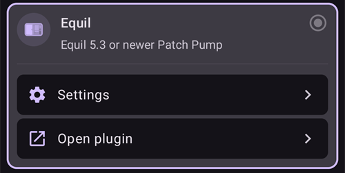

**Открыть модуль** (или **Управление** → **Помпа**) открывает экран помпы Equil. Пока помпа не сопряжена, он выглядит так:

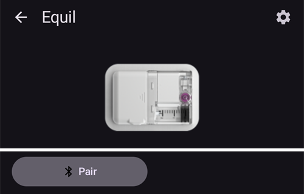

### Настройки

Откройте настройки Equil кнопкой **Настройки** на карточке **Equil** или значком шестеренки в правом верхнем углу экрана помпы.

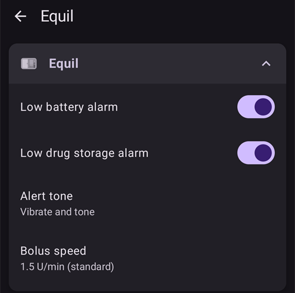

* **Оповещение о низком заряде батареи**: предупреждает, когда заряд батареи помпы низкий.
* **Оповещение о низком запасе инсулина**: предупреждает, когда в резервуаре мало инсулина.
* **Сигнал Оповещения**: как помпа вас оповещает: **Отключить звук**, **Только вибрация**, **Только звук** или **Вибрация и звук**.
* **Скорость ввода болюса**: как быстро вводится болюс: **1,5 ед/мин (стандартно)**, **3 ед/мин**, **6 ед/мин** или **12 ед/мин**. При более быстром болюсе может быть больше сигналов об окклюзии.

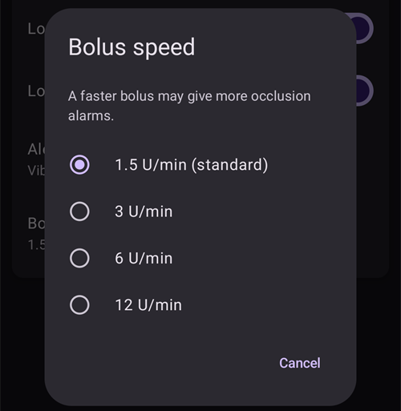

```{admonition} Max basal and max bolus on the patch
:class: note
Сам патч отклоняет любую базальную скорость выше максимума, который **AAPS** записывает в него. **AAPS** берет большее из двух значений: вашей [настройки](../SettingUpAaps/Preferences.md) **максимального базала** и самой высокой часовой базальной скорости в вашем **профиле**. Поэтому патч всегда принимает ваш профиль и временные базалы, которые запрашивает цикл. **AAPS** также отправляет в патч ваш максимально допустимый болюс.

Когда вы меняете **максимальный базал** или **максимальный болюс**, **AAPS** автоматически отправляет новые значения в патч. Они также отправляются при каждом переключении профиля. На самом патче ничего настраивать не нужно.
```

### Сопряжение помпы

На экране помпы нажмите **Выполнить сопряжение**. Мастер проведет вас через каждый шаг. Ряд точек вверху показывает, сколько вы уже прошли.

Если Android спросит, может ли **AAPS** находить устройства поблизости и подключаться к ним, нажмите **Разрешить**. Это нужно **AAPS**, чтобы найти помпу.

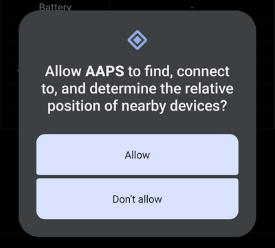

Мастер состоит из следующих шагов. Нажмите **Далее**, чтобы продолжить, или **Отменить**, чтобы выйти из мастера.

1. **Нужен профиль**: показывается, только если вы ни разу не активировали **профиль** в **AAPS**. Выберите нужный профиль и нажмите **Активировать профиль**.
1. **Собрать помпу**: соедините помпу, заполненный резервуар и заряженную батарею.

   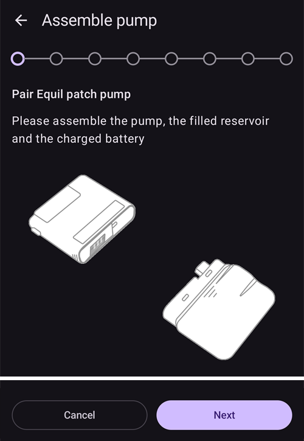

1. **Найти помпу**: **AAPS** ищет помпы Equil поблизости. Выберите свою помпу из списка.

   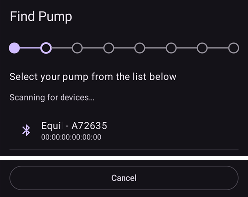
1. **Подключить устройство**: вы можете ввести пароль сопряжения в поле **Установите пароль сопряжения**. Он должен состоять из 4 символов из набора `ABCDEF0123456789`. Нажмите **Выполнить сопряжение**.

   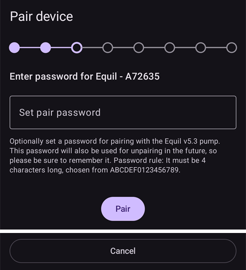

1. **Укажите инсулин**: показывается, только если у вас настроено больше одного инсулина. Выберите инсулин, который находится в резервуаре.
1. **Заполнение**: помпа **не** должна стоять на базовой пластине. Нажмите **Прайм / Заполнение** и заполняйте резервуар, пока на кончике иглы не появится капля инсулина. Нажмите **Далее**.

   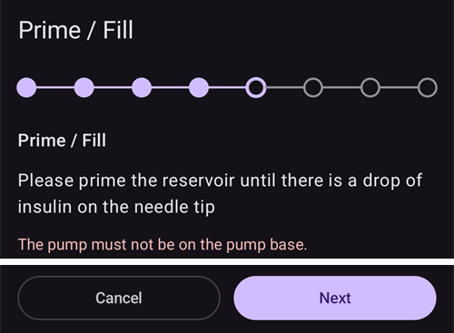
1. **Места установки**: показывается, только если в настройках мест установки включен параметр **Места установки помпы**. Нажмите на место, куда вы прикрепите помпу, или нажмите **Пропустить**.
1. **Прикрепить помпу**: прикрепите помпу к базовой пластине.

   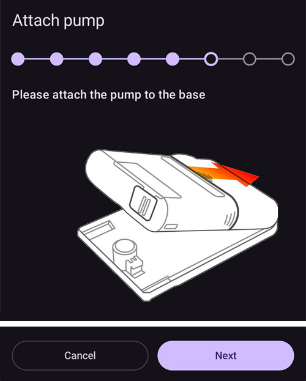
1. **Заполнить канюлю**: когда помпа стоит на базовой пластине, нажмите **Выгнать воздух**, чтобы удалить воздух из катетера. Нажмите **Далее**.

   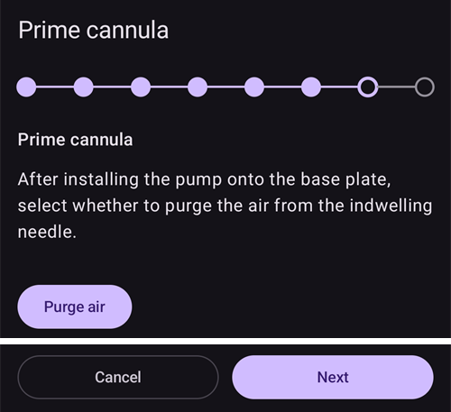

1. **Подтвердить**: установите помпу на тело и нажмите **Готово**.

   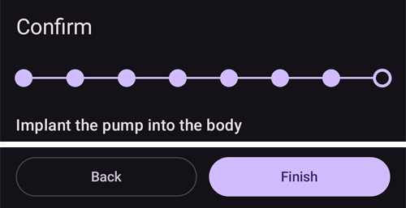

```{warning}
Если вы задали свой пароль сопряжения (рекомендуется для вашей безопасности), сохраните его в надежном месте. Пароль сохраняется в помпе. Помпа запрашивает его при каждом новом сопряжении, пока вы правильно не разорвете сопряжение в **AAPS**. До этого помпу также нельзя использовать с оригинальным пультом управления (PDA).
```

### Экран помпы после сопряжения

Когда сопряжение с помпой выполнено, на экране помпы есть следующие кнопки:

* **Обновить**: сразу считывает состояние и историю помпы.
* **Останов** / **Возобновить ввод**: остановить или снова запустить подачу инсулина.
* **Замена резервуара**: проводит вас через снятие помпы, установку нового резервуара (и, если нужно, новой батареи), заполнение и повторное прикрепление. Первый шаг спрашивает: *Вы также установите новый инфузионный набор (базовую пластину и катетер)?*
  * **Да, новый инфузионный набор**: вы выбираете место установки, катетер заполняется, а **AAPS** записывает замену инсулина и замену катетера.
  * **Нет, только резервуар или батарея**: катетер не заполняется, а **AAPS** записывает только замену инсулина.

  После замены резервуара уровень батареи показывается как **-**, пока **AAPS** снова не считает его из помпы.

  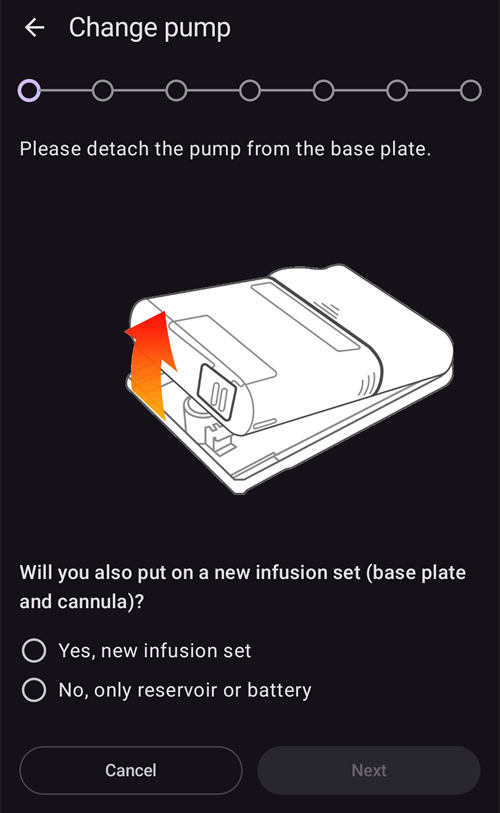

* **История**: показывает события, записанные помпой.
* **Разъединить устройство**: проводит вас через снятие помпы и разрыв сопряжения с **AAPS**. Это останавливает подачу инсулина, возвращает поршень помпы в нижнее положение и удаляет сопряжение.

### Сигналы оповещения

* Сигнал о низком запасе инсулина звучит один раз на каждом уровне (10 ед, 5 ед и 2 ед) и когда резервуар пуст. Сигнал о низком заряде батареи звучит один раз при 10% и один раз при 5%. Каждый уровень вызывает сигнал только один раз до следующей замены резервуара.
* Сигналы и остановки помпы также записываются как оповещения в терапии со временем, когда помпа их зарегистрировала. Так вы позже увидите, когда и почему помпа остановилась.
* Если резервуар опустеет во время болюса, **AAPS** запишет только инсулин, введенный до этого момента, и сообщит вам оба количества.

## Куда обращаться за помощью

Разработку драйвера Equil ведет сообщество на **добровольной** основе. Прежде чем просить о помощи:

1. **Прочитайте** нужный раздел этой документации, чтобы понять, как должна работать функция.
2. **Спросите** в канале *#AAPS* в [Discord](https://discord.gg/4fQUWHZ4Mw) или в одном из других [каналов сообщества](../GettingHelp/WhereCanIGetHelp.md).
3. **Сообщите об ошибке**: поищите среди [существующих issues](https://github.com/nightscout/AndroidAPS/issues); если вашей проблемы там нет, откройте [новый issue](https://github.com/nightscout/AndroidAPS/issues) и приложите [файлы журналов](../GettingHelp/AccessingLogFiles.md).

Когда просите о помощи, укажите марку и модель телефона, версию Android, версию **AAPS** и простое, понятное описание проблемы (что изменилось, когда все работало в последний раз).
