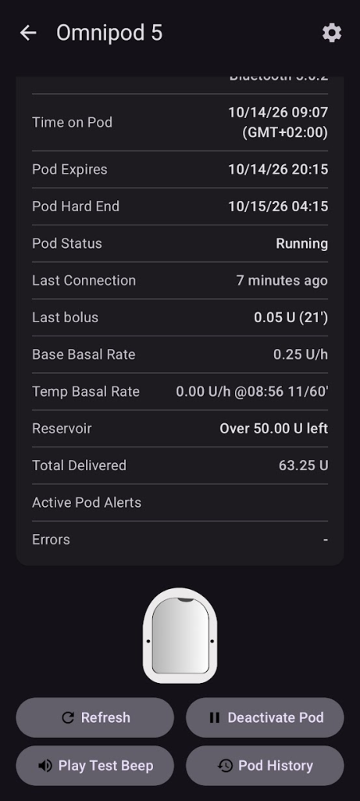
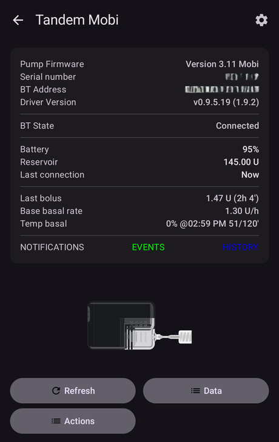

# Вероятные будущие драйверы для помп

Это список некоторых помп на рынке, статус их поддержки в других системах замкнутого цикла и их статус в AAPS. В конце есть информация о том, что нужно помпе, чтобы ее можно было использовать в замкнутом цикле.

    {contents} Содержание
    :depth: 1
    :local: true

## Помпы на этапе интеграции в AAPS

**Скоро:** драйверы для этих помп находятся в разработке и уже работают в тестовых сборках.

Omnipod 5 ([Домашняя страница](https://www.omnipod.com/))

See [Omnipod 5](../CompatiblePumps/Omnipod5.md) for how the driver in development works.

Tandem: t:Mobi ([Домашняя страница](https://www.tandemdiabetes.com/))

## Помпы, способные к работе в качестве компонента ИПЖ

### Kaleido ([Домашняя страница](https://www.hellokaleido.com/))

**Статус для цикла:** помпа – кандидат для замкнутого цикла, но протокол пока неизвестен. Производитель не заинтересован в открытом коде.

**Требования к оборудованию для AAPS:** Никаких. Похоже, у нее есть Bluetooth.

### Tandem: t:slim X3 ([Домашняя страница](https://www.tandemdiabetes.com/about-us/pipeline))

**Статус для цикла:** возможный кандидат для замкнутого цикла в будущем. Есть надежда, что t:slim X3 позволит полностью управлять помпой с телефона, и тогда AAPS сможет ее поддерживать, но сроки и функции пока неизвестны.

**Требования к оборудованию для AAPS:** Никаких. Ожидается, что у нее будет Bluetooth.

**Комментарии:** еще не выпущена. Похоже, в планах Tandem t:slim X3 снова и снова отходит на второй план в пользу t:Mobi (включая версию без трубки) и Sigi (их патч-помпы).

### Twiist ([Домашняя страница](https://www.twiist.com/))

**Статус для цикла:** кандидат для замкнутого цикла.

**Требования к оборудованию для AAPS:** Никаких. У нее есть Bluetooth.

### Инсулиновая помпа Willсare ([ Домашняя страница ](http://shinmyungmedi.com/en/))

**Статус для цикла:** пока помпа не является кандидатом для замкнутого цикла, но сотрудники компании связались с нами и заинтересованы в том, чтобы сделать ее пригодной для цикла (похоже, ей не хватает только команд получения/установки профиля).

**Требования к оборудованию для AAPS:** Никаких. Похоже, у нее есть Bluetooth.

** Комментарии: ** Поскольку компания заинтересована в интеграции с AAPS, они могут сами предпринять необходимые действия.

### Ypsopump ([Домашняя страница](https://www.ypsomed.com/))

**Статус для цикла:** кандидат для замкнутого цикла. Сообщество выполнило обратную разработку протокола Bluetooth этой помпы, поэтому связь с ней в принципе возможна.

**Требования к оборудованию для AAPS:** Никаких. У нее есть Bluetooth.

**Комментарии:** Ypsopump защищает свою связь по Bluetooth сложным шифрованием стороннего поставщика. Работа с ним технически сложна, поэтому создать и поддерживать надежный драйвер трудно. Готового к работе драйвера AAPS пока нет.

## Помпы, снятые с производства (компании больше не работают)

### Animas Vibe

### Animas Ping

### Cellnovo

### Accu-Chek Insight

**Комментарии:** поддержка прекращена в марте 2025 года.

## Помпы, неспособные к работе в качестве компонента ИПЖ

### Medtronic Bluetooth

**Комментарии:** Medtronic [отказался](https://www.tidepool.org/blog/tidepool-loop-partner-update-ace-pumps).

### Tandem: t:slim X2 ([Домашняя страница](https://www.tandemdiabetes.com/))

**Комментарии:** протокол Bluetooth Tandem прошел обратную разработку, но на t:slim X2 можно вводить только болюсы – подачей базала управлять нельзя, – поэтому ее нельзя безопасно использовать в замкнутом цикле. Вряд ли это изменится, если только Tandem не разрешит полностью управлять X2 с телефона. Скорее это появится в t:slim X3.

### Accu-Chek Solo

**Комментарии:** сообществу пока не удалось установить связь с помпой Solo.

## Требования к пригодности помп для ИПЖ

**Предварительные условия**

- Помпа должна поддерживать дистанционное управление. (Bluetooth, радиосвязь и т. п.)
- Протокол взломан/документирован/и т. д.

**Минимальные требования**

- Устанавливать временную скорость базала
- Получать сведения о состоянии
- Отменять временную базальную скорость

**Для oref1(SMB) или болюсов:**

- Настраивать ввод болюса

**Желательно иметь**

- Отмену болюса
- Получать профиль базала (почти требование)
- Устанавливать профиль базала (хорошо иметь)
- Чтение истории 

**Другое (не обязательно, но желательно)**

- Настраивать пролонгированный болюс
- Отменять пролонгированный болюс
- Чтение истории
- Чтение суммарной суточной дозы инсулина TDD

### Поддержка других помп

Если вы хотите узнать статус других помп, свяжитесь с нами в Discord.