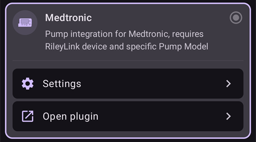
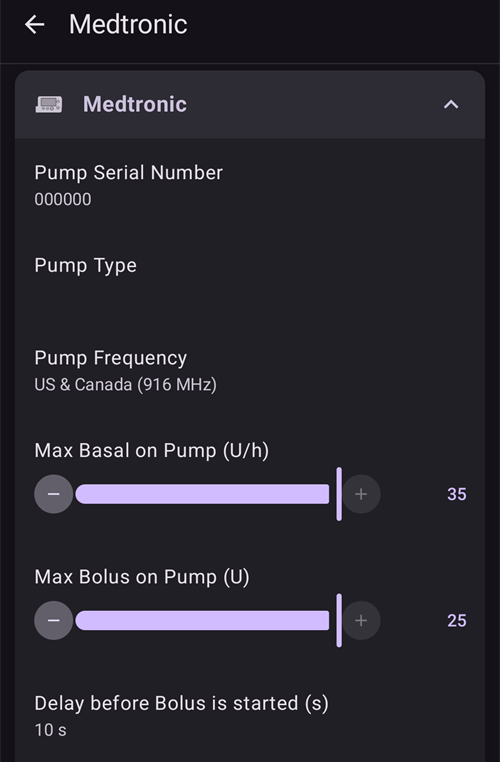
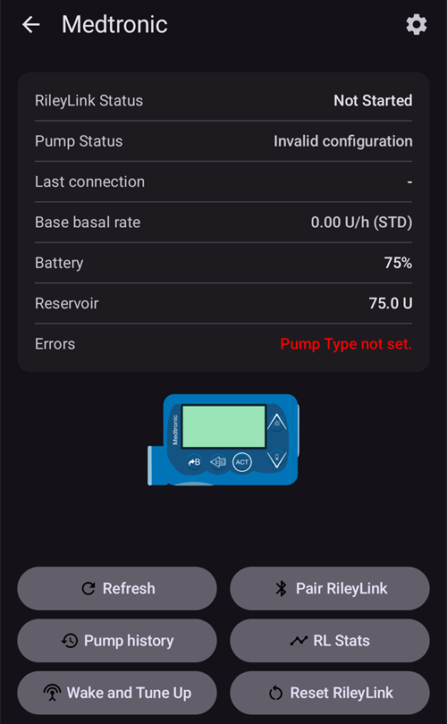
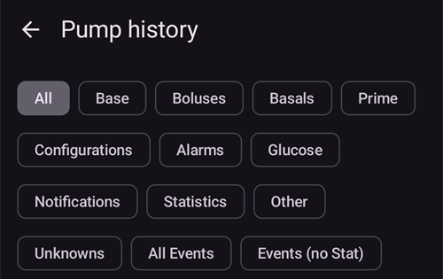
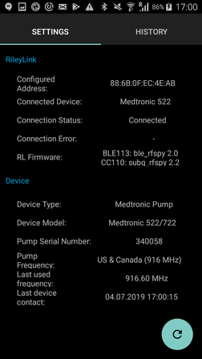
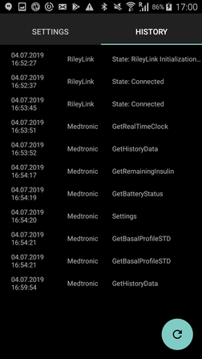
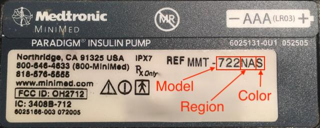

# Помпы Medtronic

Драйвер не работает с новыми моделями, включая все модели, заканчивающиеся на G (530G, 600-серия [630G, 640G, 670G], серия 700-серия [770G, 780G] и т. д.).

Для работы с AAPS подходят следующие комбинации моделей и прошивок:

- 512/712 (любая версия прошивки)
- 515/715 (любая версия прошивки)
- 522/722 (любая версия прошивки)
- 523/723 (прошивка 2.4A или ниже)
- 554/754 версия ЕС (прошивка 2.6A или ниже)
- 554/754 Канадская версия (прошивка 2.7A или ниже)

Проверьте прошивку в соответствии с инструкциями в [OpenAPS документы](https://openaps.readthedocs.io/en/latest/docs/Gear%20Up/pump.html#how-to-check-pump-firmware-check-for-absence-of-pc-connect) и [LoopDocs](https://loopkit.github.io/loopdocs/build/step3/#medtronic-pump-firmware).

    {contents} Содержание
    :depth: 1
    :local: true

## Возможности работы с AAPS

* Для связи с **AAPS** нужно устройство, совместимое с RileyLink.
* Automatic DST and timezone handling.

## Требования к аппаратному и программному обеспечению

- **Телефон:** Драйвер Medtronic должен работать с любым телефоном на Android, поддерживающим Bluetooth-соединения. **ВАЖНО: Исполнение Bluetooth разное у разных производителей телефонов, поэтому разные модели телефонов ведут себя по-разному. Например, некоторые телефоны по-разному включают/отключают Bluetooth. Это может повлиять на опыт пользователя, когда AAPS необходимо переподключиться к устройству типа Rileylink.**
- **Устройство, совместимое с RileyLink:** телефоны Android не могут связываться с помпами Medtronic без отдельного устройства, которое обеспечивает связь. Это устройство соединяется с телефоном через Bluetooth и с помпой через совместимое радио соединение. Первое подобное устройство называлось Rileylink, но в настоящее время доступны и другие варианты с дополнительным функционалом.
    
    - Rileylink можно заказать на [getrileylink.org](https://getrileylink.org/product/rileylink916)
    - Orangelink можно заказать на [getrileylink.org](https://getrileylink.org/product/orangelink)
    - Emalink (несколько вариантов модели) доступно на сайте [github.com](https://github.com/sks01/EmaLink)
    - Gnarl (требуется немного самостоятельной работы) подробности на [github.com](https://github.com/ecc1/gnarl)

Сравнительную таблицу разных устройств, совместимых с RileyLink, можно найти на [getrileylink.org](https://getrileylink.org/rileylink-compatible-hardware-comparison-chart)

(MedtronicPump-configuration-of-the-pump)=

## Настройка помпы

Для удаленной отправки команд на помпу необходимо настроить следующие параметры. Шаги, необходимые для каждого изменения на Medtronic 715 показаны в скобках для каждого параметра. Точные шаги могут слегка отличаться в зависимости от типа помпы и/или версии прошивки.

- **Включите удаленный режим на помпе** (на помпе нажмите Act и перейдите в Utilities (Утилиты) -> Remote Options (Опции удаленного режима), выберите On (Вкл.), а на следующем экране выберите Add ID (Добавить ID) и добавьте любой случайный идентификатор, например 111111). Для того чтобы помпа ожидала удаленной связи, в списке удаленных соединений должен быть по крайней мере один идентификатор.
- **Задайте Max Basal** (на помпе нажмите Act, перейдите в Basal и выберите Max Basal Rate). Например, если задать это значение в четыре раза больше вашей максимальной стандартной базальной скорости, можно будет устанавливать временную базальную скорость 400%. Максимальное допустимое значение помпы составляет 34,9 ед. в час.
- **Задайте Max Bolus** (на помпе нажмите Act, перейдите в Bolus и выберите Max Bolus). Это самый большой болюс, который примет помпа. Максимальное разрешенное значение помпы составляет 25 ед.
- **Задайте профиль как STD (стандартный) **. (На помпе нажмите ACT, перейдите в Базал, а затем Select Patterns (выбрать рисунок профиля). Помпе понадобится только один профиль, а AAPS будет управлять различными профилями на телефоне. Другие профили не требуются.
- **Установить тип временной скорости базала Basal Rate type** (На помпе нажмите ACT и перейдите в Basal и затем Temp Basal Type). Выберите Absolute Абсолютный (не в процентах).

## Конфигурация помп Medtronic и телефона /AAPS

- **Не подключайте устройство, совместимое с RileyLink, к меню Bluetooth на телефоне.** Привязка через меню Bluetooth телефона не позволит AAPS видеть совместимое устройство Rileylink при выполнении дальнейших инструкций.
- Отключите автоматический поворот экрана на телефоне. На некоторых устройствах автоматическая вращение экрана приводит к перезапуску сессий Bluetooth, что может вызвать проблемы с помпой Medtronic. 
- Существует два способа настройки помпы Medtronic в AAPS:

1. Использовать мастер установки при первой установке приложения
2. В **Конфигурация** > **Помпа** выберите **Medtronic**
    
    
    
    После выбора на карточке **Medtronic** появляются две кнопки: **Настройки** и **Открыть модуль**:
    
    
    
    **Настройки** открывает настройки драйвера Medtronic:
    
    
    
    **Открыть модуль** (или **Управление** > **Помпа**) открывает экран помпы Medtronic. Пока помпа не сопряжена, он выглядит так:
    
    

При настройке помпы Medtronic в мастере установки может оказаться, что вы не можете завершить настройку из-за проблем с Bluetooth (например, не удается подключиться к помпе). В этом случае следует выбрать виртуальную помпу, и перейти к опции 2.

При настройке AAPS для работы с помпой Medtronic нужно задать в **Настройки** следующие пункты (см. рисунок с настройками выше):

- **Серийный номер помпы**: Находится на задней панели помпы и начинается с SN. Вводите только 6 показанных цифр без букв (например, 123456).
- **Pump Type**: Используемая модель помпы (например, 522). 
- **Частота помпы**: Есть два варианта, в зависимости от региона рынка. Если вы не уверены, какой вариант выбрать, посмотрите [Часто задаваемые вопросы](#MedtronicPump-faq): 
    - для США и Канады используется частота 916 МГц
    - для всего остального мира используется частота 868 МГц
- **Макс. базал на помпе (ед/ч)**: должен совпадать с настройкой на помпе (см. «Настройка помпы» выше). Опять же эта настройка должна быть тщательно подобрана, так как определяет, какую базу можно задать для AAPS. То есть установить максимальную величину временного базала. Например, установка этого значения в четыре раза выше максимальной стандартной скорости позволит задавать временную скорость базала на 400%. Максимальное допустимое значение помпы составляет 34,9 ед. в час.
- **Макс. Болюс на помпе (ед.)**(в течение часа): Должен соответствовать параметрам помпы (см. Конфигурация помпы выше). Эта настройка должна быть тщательно подобрана, так как определяет, насколько большим может быть болюс, подаваемый с AAPS.
- **Задержка перед подачей болюса (ов)**: Количество секунд перед тем, как команда фактически передается на помпу. Этот период времени позволяет пользователю отменить болюс в случае, если команда подана по ошибке. Невозможно отменить болюс, который выполняется через AAPS. Единственный способ отменить уже начатый болюс - это приостановить помпу вручную, а затем возобновить ее работу.
- **Кодировка Medtronic**: определяет, где выполняется кодирование Medtronic (аппаратно или программно). Выбор аппаратной кодировки (то есть кодировки, определяемой устройством Rileylink) предпочтительнее, так как приводит к меньшему количеству отправляемых данных. Выбор программной кодировки (т.е. осуществляемой AAPS) может помочь в случае частых отключений. Эта настройка игнорируется, если на устройствах Rileylink установлена прошивка версии 0.x.
- **Тип батареи **: Чтобы правильно определить оставшийся уровень заряда батареи, следует выбрать тип используемой батареи AAA. Если выбрано значение, отличное от простого вида, AAPS будет показывать рассчитанный оставшийся заряд батареи в процентах и вольтах. Доступны следующие варианты:
    
    - Не выбрано (Простой вид)
    - Щелочная (Подробный вид)
    - Литиевая (Подробный вид)
    - NiZn (Подробный вид)
    - Никель-металлогидридная (Подробный вид)
- **Использовать сканирование**: включает сканирование Bluetooth перед подключением к устройствам, совместимым с RileyLink. Это должно повысить надежность подключения к устройству.

- **Показать уровень батареи от OrangeLink/EmaLink/DiaLink**: эта функция поддерживается только на новых устройствах, например EmaLink или OrangeLink. Значение показывается как **Батарея RileyLink** на экране помпы Medtronic.
- **Установить нейтральные временные базалы**: по умолчанию помпы Medtronic подают звуковой сигнал в начале каждого часа, если активна временная базальная скорость. Включение этой опции может уменьшить количество звуковых сигналов: временный базал прерывается при смене часа, чтобы подавить сигнал.

(pairing-your-rileylink-compatible-device)=

### Сопряжение устройства, совместимого с RileyLink

Сопряжение устройства, совместимого с RileyLink, выполняется на экране помпы Medtronic, а не в меню Bluetooth телефона:

- Откройте экран помпы (**Управление** > **Помпа** или **Открыть модуль** на карточке Medtronic в **Конфигурация** > **Помпа**).
- Нажмите **Привязать RileyLink**. **AAPS** ищет ближайшие устройства, совместимые с RileyLink.
- Нажмите на ваше устройство в списке. Когда появится сообщение **RileyLink успешно привязан**, нажмите **OK**.

## Экран помпы Medtronic

Чтобы открыть экран помпы Medtronic, перейдите в **Управление** > **Помпа**. На экране помпы показана информация о текущем состоянии помпы и некоторые действия, специфичные для Medtronic (см. рисунок экрана помпы выше).

- **Статус RileyLink Status**: Текущий статус подключения телефона к устройству, совместимому с RileyLink. Здесь всегда должно быть Connected (подключено). Любой другой статус требует вмешательства пользователя. 
- **Батарея RileyLink Battery**: Текущий уровень заряда батареи устройства EmaLink или OrangeLink. Показывается, только если в настройках Medtronic включено **Показать уровень батареи от OrangeLink/EmaLink/DiaLink**.
- **Статус помпы**: Статус соединения с помпой. Так как помпа не будет соединена постоянно, здесь в основном показывается пиктограмма сна. Существуют другие возможные статусы, например «Пробуждение», когда AAPS пытается выдать команду или другие возможные команды, такие как «Получить время помпы», "Установить TBR" и т. д.
- **Батарея**: показывает состояние батареи на основе значения, выбранного в **Тип батареи (по мощности)** в настройках Medtronic.
- **Прошлое соединение**: сколько времени прошло с последнего успешного соединения с помпой.
- **Предыдущий болюс**: сколько времени прошло с последнего успешно введенного болюса.
- ** Базовая скорость базала**: Основная скорость, с которой подается база на помпе в этот час.
- **Врем базал Temp basal**: Временный базал в настоящее время, может быть и 0 единиц в час.
- ** Резервуар **: Сколько инсулина находится в картридже (обновляется по крайней мере каждый час).
- **Errors ошибки**: строка ошибки, если есть проблемы (в основном показывает, есть ли ошибка в конфигурации).

Внизу экрана есть следующие кнопки:

- **Обновить** для обновления текущего статуса помпы. Ей следует пользоваться только в случае, когда соединение отсутствовало в течение длительного периода, так как потребует полного обновления данных (получение истории, установка времени, получение профиля, получение статуса батареи и т. д.).
- **Привязать RileyLink**: находит устройство, совместимое с RileyLink, и выполняет сопряжение с ним (см. [выше](#pairing-your-rileylink-compatible-device)).
- **Журнал помпы**: показывает историю помпы (см. [ниже](#MedtronicPump-pump-history)).
- **Статистика RL**: показывает статистику RL (см. [ниже](#MedtronicPump-rl-status-rileylink-status)).
- **Пробуждение и настройка** и **Сбросить RileyLink**: см. [Действия](#medtronic-actions) ниже.
- **Очистить блок болюса**: показывается только короткое время после болюса, пока **AAPS** ждет, когда помпа закончит его вводить. Нажатие на нее прекращает это ожидание.

(MedtronicPump-pump-history)=

## Журнал помпы

Хронология помпы извлекается каждые 5 минут и сохраняется в памяти. Сохраняются только предыдущие 24 часа истории. Это удобный способ посмотреть, как работала помпа, если это нужно. Сохраняются только записи, важные для AAPS; функции настройки, которые не имеют значения, не сохраняются.

Чтобы открыть его, нажмите **Журнал помпы** на экране помпы. По умолчанию выбрано **Все**. Нажмите одну из кнопок фильтра вверху (например, **Болюсы**, **Базалы** или **Оповещения**), чтобы показать записи только одного типа.

(MedtronicPump-rl-status-rileylink-status)=

## Состояние RL (Состояние RileyLink)

 

В диалоге состояния RL есть две вкладки:

- ** Параметры **: Показывает параметры RileyLink: Сконфигурированный адрес, Подключенное устройство, Состояние соединения, Ошибка соединения и Версия встроенного ПО (прошивки) RileyLink. Типом устройства всегда является Medtronic Pump, Модель - ваша версия модели, Серийный номер-сконфигурированный серийный номер, Частота помпы- Частота на которой работает связь помпы, Последняя частота-последняя используемая частота связи.
- ** История **: Показывает хронологию связи, элементы с RyleyLink показывают изменения состояния RileyLink, Medtronic показывает, какие команды были отправлены на помпу.

(medtronic-actions)=

## Действия

Когда используется драйвер Medtronic, на экране помпы (**Управление** > **Помпа**) доступны два дополнительных действия:

- ** Пробуждение и настройка **-Если вы видите, что AndroidAPS не связывался с помпой в течение какого-то времени (он должен связываться каждые 5 минут), вы можете нажать кнопку Настройка. AAPS попытается связаться с помпой, пробуя все возможные радиочастоты, используемые помпой. Если соединение будет успешным, найденная частота будет установлена по умолчанию. Пока идет настройка, статус RileyLink на экране помпы показывает это. Если настройка не удалась (например, потому что помпа была вне зоны связи), **AAPS** сам пробует снова примерно каждые 10 минут.
- **Сбросить RileyLink** - если вы сбросили устройство, совместимое с RileyLink, возможно, нужно использовать это действие, чтобы устройство можно было настроить заново (установить частоту, тип частоты, кодировку).

## Важные Примечания

### Особое внимание при конфигурации NS

AAPS использует серийный номер для синхронизации и серийный номер показывается в NS. Поскольку знание серийно номера старых помп Medtronic может быть использовано для дистанционного управления, следует позаботиться о мерах безопасности сайта NS. См. https://nightscout.github.io/nightscout/security/

### Пользователям OpenAPS

Пользователи OpenAPS должны иметь в виду, что AAPS с Medtronic использует совершенно иную методику, чем OpenAPS. При использовании AAPS основной способ взаимодействия с помпой — через телефон. При обычном использовании меню помпы, скорее всего, понадобится только при замене резервуара. Это отличается от OpenAPS, когда по крайней мере некоторые болюсы подаются через кнопки быстрого болюса. В том случае, если помпа используется для ручной подачи болюса, могут возникнуть проблемы, если AAPS пытается подать болюс одновременно с помпой. В таких случаях для предотвращения проблем существуют проверки, однако по возможности их следует избегать.

### Запись логов в файл

Если нужно найти неполадки в работе помпы Medtronic, нажмите значок меню в левом верхнем углу экрана, выберите «Обслуживание» и «Настройки журнала». Для устранения неполадок необходимо проверить Pump, PumpComm, PumpBTComm.

### Мониторинг Medtronic

Мониторинг Medtronic в настоящее время не поддерживается.

### Использование помпы вручную

Не следует выполнять болюсы или установку временного базала вручную с помпы. Эти команды должны отправляться через AAPS. В случае подачи команд вручную, между ними следует выдерживать не менее 3 минут, чтобы уменьшить риск возникновения проблем.

### Изменения часового пояса, сезонное время и путешествия с помпой Medtronic и AAPS

AAPS автоматически определит изменения часового пояса и обновит время помпы, когда телефон перейдет на новое время.

При поездке на восток вы добавляете часы к текущему времени (например, с GMT+0 на GMT+2), и это не вызывает проблем, так как перекрытия нет (например, один и тот же час не может быть дважды). Поездка на запад, однако, может вызвать проблемы, так как вы фактически возвращаетесь назад во времени, а это может привести к неверным данным IOB.

Разработчики знают о проблемах при поездке на запад, и работа над возможным решением продолжается. Подробнее см. здесь: https://github.com/andyrozman/RileyLinkAAPS/issues/145 На данный момент помните о существовании проблемы и тщательно следите за временем при пересечении часовых поясов.

### Является ли GNARL полностью совместимым устройством, совместимым с RileyLink?

Код GNARL полностью поддерживает все функции, используемые драйвером Medtronic в AAPS, что означает, что он полностью совместим. Важно учесть, что это потребует дополнительной работы: нужно найти совместимое оборудование и затем загрузить на него код GNARL.

** Примечание автора: ** Обратите внимание, что программное обеспечение GNARL по-прежнему экспериментально и недостаточно протестировано и не должно считаться таким же безопасным как RileyLink.

Часто задаваемые вопросы по помпе Medtronic

## Часто задаваемые вопросы

MedtronicPump -что делать при потере связи с rileylink и/или помпой

### Что делать, если я потерял связь с RileyLink и/или помпой?

Существует несколько вариантов решения проблем с подключением.

- Нажмите **Пробуждение и настройка** на экране помпы (**Управление** > **Помпа**), как описано выше.
- Отключите Bluetooth на вашем телефоне, подождите 10 секунд и включите его снова. Это заставит устройство Rileylink переподключиться к телефону.
- Выполните сброс устройства RileyLink. Затем нужно нажать **Сбросить RileyLink** на экране помпы (**Управление** > **Помпа**).
- Другие пользователи обнаружили, что восстановить подключения помогут следующие шаги, когда не помогли другие: 
    1. Перезагрузить телефон
    2. *Во время * перезагрузки перезапустите устройство Rileylink
    3. Откройте AAPS и дайте подключению восстановиться

### Как определить, на какой частоте работает помпа

На задней части помпы вы найдете строку, содержащую номер модели вместе со специальным 3-буквенным кодом. Первые две буквы определяют тип частоты и последняя определяет цвет. Возможны следующие значения частоты:

- NA - Северная Америка (при выборе частоты нужно выбрать "США & Канада (916 МГц)")
- CA - Канада (при выборе частоты нужно выбрать "США & Канада (916 МГц)")
- WW - весь мир (при выборе частоты нужно выбрать "Глобальная (868 МГц)")

(MedtronicPump-pump-unreachable)=

### Как исправить ошибку «Помпа недоступна»

Некоторые помпы Medtronic после обновления **AAPS** сообщают об ошибке «Помпа недоступна». Чтобы это исправить, измените тип кодировки:

1. Перейдите в **Конфигурация** > **Помпа** и нажмите **Настройки** на карточке **Medtronic**.
2. Установите для **Кодировка Medtronic** значение **Аппаратное кодирование 4b6b**.

## Куда обращаться за помощью

Драйвер Medtronic разрабатывает сообщество на **добровольной** основе. Прежде чем просить о помощи:

1. **Прочитайте** нужный раздел этой документации, чтобы убедиться, как должна работать функция.
2. **Спросите** в канале *#AAPS* на [Discord](https://discord.gg/4fQUWHZ4Mw) или в одном из других [каналов сообщества](../GettingHelp/WhereCanIGetHelp.md).
3. **Сообщите об ошибке**: сначала поищите среди [существующих issues](https://github.com/nightscout/AndroidAPS/issues); если вашей проблемы там нет, откройте [новый issue](https://github.com/nightscout/AndroidAPS/issues) и приложите [файлы журналов](../GettingHelp/AccessingLogFiles.md).

Когда просите о помощи, укажите марку и модель телефона, версию Android, версию **AAPS** и простое понятное описание проблемы (что изменилось, когда всё работало в последний раз).