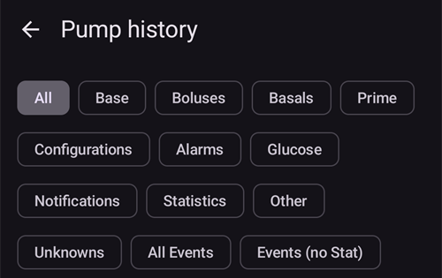

# Помпы Medtronic

Драйвер не работает с новыми моделями, включая все модели, заканчивающиеся на G (530G, 600-серия [630G, 640G, 670G], серия 700-серия [770G, 780G] и т. д.).

Для работы с AAPS подходят следующие комбинации моделей и прошивок:

- 512/712 (любая версия прошивки)
- 515/715 (любая версия прошивки)
- 522/722 (любая версия прошивки)
- 523/723 (прошивка 2.4 или ниже)
- 554/754 версия ЕС (прошивка 2.6A или ниже)
- 554/754 Канадская версия (прошивка 2.7A или ниже)

Проверьте прошивку в соответствии с инструкциями в [OpenAPS документы](https://openaps.readthedocs.io/en/latest/docs/Gear%20Up/pump.html#how-to-check-pump-firmware-check-for-absence-of-pc-connect) и [LoopDocs](https://loopkit.github.io/loopdocs/build/step3/#medtronic-pump-firmware).

    {contents} Table of contents
    :depth: 1
    :local: true

## Возможности работы с AAPS

* Requires a RileyLink-compatible device to communicate with **AAPS**.
* Automatic DST and timezone handling.

## Требования к аппаратному и программному обеспечению

- **Телефон:** Драйвер Medtronic должен работать с любым телефоном на Android, поддерживающим Bluetooth-соединения. **ВАЖНО: Исполнение Bluetooth разное у разных производителей телефонов, поэтому разные модели телефонов ведут себя по-разному. Например, некоторые телефоны по-разному. включают/отключают Bluetooth. Это может повлиять на опыт пользователя, когда AAPS необходимо переподключиться к устройству типа Rileylink.**
- **RileyLink Compatible Device:** Android phones cannot communicate to Medtronic pumps without a separate device to handle communications. Это устройство соединяется с телефоном через Bluetooth и с помпой через совместимое радио соединение. Первое подобное устройство называлось Rileylink, но в настоящее время доступны и другие варианты с дополнительным функционалом.
    
    - Rileylink можно заказать на [getrileylink.org](https://getrileylink.org/product/rileylink916)
    - Orangelink можно заказать на [getrileylink.org](https://getrileylink.org/product/orangelink)
    - Emalink (несколько вариантов модели) доступно на сайте [github.com](https://github.com/sks01/EmaLink)
    - Gnarl (требуется немного самостоятельной работы) подробности на [github.com](https://github.com/ecc1/gnarl)

A comparison chart for the various Rileylink compatible devices can be found at [getrileylink.org](https://getrileylink.org/rileylink-compatible-hardware-comparison-chart)

(MedtronicPump-configuration-of-the-pump)=

## Настройка помпы

Для удаленной отправки команд на помпу необходимо настроить следующие параметры. Шаги, необходимые для каждого изменения на Medtronic 715 показаны в скобках для каждого параметра. Точные шаги могут слегка отличаться в зависимости от типа помпы и/или версии прошивки.

- **Включить удаленный режим на помпе** (На помпе нажмите ACT\---Utilities (Утилиты) --> Remote Optiond (Опции удаленного режима), выберите "Вкл", и на следующем экране нажмите "Добавить ID" и добавьте любой случайный идентификатор, например 111111). Для того чтобы помпа ожидала удаленной связи, в списке удаленных соединений должен быть по крайней мере один идентификатор.
- **Set Max Basal** (On the pump press Act and go to Basal and then select Max Basal Rate) As an example setting this value to four times your maximum standard basal rate would allow a 400% Temporary Basal Rate. Максимальное допустимое значение помпы составляет 34,9 ед. в час.
- **Set Max Bolus** (On the pump press Act and go to Bolus and then select Max Bolus) This is the largest bolus that the pump will accept. Максимальное разрешенное значение помпы составляет 25 ед.
- **Задайте профиль как STD (стандартный) **. (На помпе нажмите ACT, перейдите в Базал, а затем Select Patterns (выбрать рисунок профиля). Помпе понадобится только один профиль, а AAPS будет управлять различными профилями на телефоне. Другие профили не требуются.
- **Установить тип временной скорости базала Basal Rate type** (На помпе нажмите ACT и перейдите в Basal и затем Temp Basal Type). Выберите Absolute Абсолютный (не в процентах).

## Конфигурация помп Medtronic и телефона /AAPS

- **Не подключайте устройство, совместимое с RileyLink, к меню Bluetooth на телефоне.** Привязка через меню Bluetooth телефона не позволит AAPS видеть совместимое устройство Rileylink при выполнении дальнейших инструкций.
- Отключите автоматический поворот экрана на телефоне. На некоторых устройствах автоматическая вращение экрана приводит к перезапуску сессий Bluetooth, что может вызвать проблемы с помпой Medtronic. 
- Существует два способа настройки помпы Medtronic в AAPS:

1. Использовать мастер установки при первой установке приложения
2. In **Configuration** > **Pump**, by selecting **Medtronic**
    
    
    
    Once it is selected, the **Medtronic** card shows two buttons, **Settings** and **Open plugin**:
    
    
    
    **Settings** opens the settings of the Medtronic driver:
    
    
    
    **Open plugin** (or **Manage** > **Pump**) opens the Medtronic pump screen. Before a pump is paired it looks like this:
    
    

When configuring your Medtronic pump with the setup wizard it is possible that you will be prevented from completing setup because of Bluetooth issues (e.g. you cannot successfully connect to the pump). В этом случае следует выбрать виртуальную помпу, и перейти к опции 2.

While setting up AAPS to work with your medtronic pump you need to set the following items in **Settings** (see the settings picture above):

- **Серийный номер помпы**: Находится на задней панели помпы и начинается с SN. You should only enter the 6 numbers shown without any alphabetic characters (e.g. 123456).
- **Pump Type**: Используемая модель помпы (например, 522). 
- **Частота помпы**: Есть два варианта, в зависимости от региона рынка. Please check the [FAQ](#MedtronicPump-faq) if you are unsure which option to select): 
    - for US & Canada, frequency used is 916 MHz
    - for Worldwide, frequency used is 868 MHz
- **Макс. базал на помпе (ед./ч.)**: Должен соответствоватьпараметрам помпs (см. Конфигурация помпы выше). Опять же эта настройка должна быть тщательно подобрана, так как определяет, какую базу можно задать для AAPS. То есть установить максимальную величину временного базала. Например, установка этого значения в четыре раза выше максимальной стандартной скорости позволит задавать временную скорость базала на 400%. Максимальное допустимое значение помпы составляет 34,9 ед. в час.
- **Макс. Болюс на помпе (ед.)**(в течение часа): Должен соответствовать параметрам помпы (см. Конфигурация помпы выше). Эта настройка должна быть тщательно подобрана, так как определяет, насколько большим может быть болюс, подаваемый с AAPS.
- **Задержка перед подачей болюса (ов)**: Количество секунд перед тем, как команда фактически передается на помпу. Этот период времени позволяет пользователю отменить болюс в случае, если команда подана по ошибке. Невозможно отменить болюс, который выполняется через AAPS. Единственный способ отменить уже начатый болюс - это приостановить помпу вручную, а затем возобновить ее работу.
- **Medtronic Encoding (кодировка Medtronic)**: Определяет, выполняется ли кодировка Medtronic. Выбор аппаратной кодировки (то есть кодировки, определяемой устройством Rileylink) предпочтительнее, так как приводит к меньшему количеству отправляемых данных. Выбор программной кодировки (т.е. осуществляемой AAPS) может помочь в случае частых отключений. Эта настройка игнорируется, если на устройствах Rileylink установлена прошивка версии 0.x.
- **Тип батареи **: Чтобы правильно определить оставшийся уровень заряда батареи, следует выбрать тип используемой батареи AAA. Если выбран вариант кроме простого, AAPS будет отображать оставшийся заряд батареи в процентах. Доступны следующие варианты:
    
    - Не выбрано (Простой вид)
    - Щелочная (Подробный вид)
    - Литиевая (Подробный вид)
    - NiZn (Подробный вид)
    - Никель-металлогидридная (Подробный вид)
- **Use Scanning**: Activates Bluetooth scanning before connecting with your Rileylink Compatible devices. Это должно повысить надежность подключения к устройству.

- **Show battery level reported by OrangeLink/EmaLink/DiaLink**: This feature is only supported on newer link devices such as the EmaLink or OrangeLink. The value is shown as **RileyLink Battery** on the Medtronic pump screen.
- **Set neutral temp basals**: By default Medtronic pumps beep on the hour when a temporary basal rate is active. Enabling this option can help reduce the number of beeps heard by interrupting a temporary basal at the hour change in order to suppress the beep.

(pairing-your-rileylink-compatible-device)=

### Pairing your RileyLink compatible device

Your RileyLink compatible device is paired from the Medtronic pump screen, not from the Bluetooth menu of your phone:

- Open the pump screen (**Manage** > **Pump**, or **Open plugin** on the Medtronic card in **Configuration** > **Pump**).
- Tap **Pair RileyLink**. **AAPS** scans for nearby RileyLink compatible devices.
- Tap your device in the list. When **RileyLink paired successfully** is shown, tap **OK**.

## Medtronic pump screen

To open the Medtronic pump screen, go to **Manage** > **Pump**. The pump screen displays the current pump status information along with some Medtronic specific actions (see the pump screen picture above).

- **Статус RileyLink Status**: Текущий статус подключения телефона к устройству, совместимому с RileyLink. Здесь всегда должно быть Connectel (сопряжено). Любой другой статус требует вмешательства пользователя. 
- **Батарея RileyLink Battery**: Текущий уровень заряда батареи устройства EmaLink или OrangeLink. Only shown if **Show battery level reported by OrangeLink/EmaLink/DiaLink** is enabled in the Medtronic settings.
- **Статус помпы**: Статус соединения с помпой. Так как помпа не будет соединена постоянно, здесь в основном показывается пиктограмма сна. Существуют другие возможные статусы, например «Пробуждение», когда AAPS пытается выдать команду или другие возможные команды, такие как «Получить время помпы», "Установить TBR" и т. д.
- **Battery**: Shows battery status based on the value chosen for **Battery Type (Power View)** in the Medtronic settings.
- **Last connection**: How long ago the last successful pump connection happened.
- **Last Bolus**: How long ago the last successful bolus was delivered.
- ** Базовая скорость базала**: Основная скорость, с которой подается база на помпе в этот час.
- **Врем базал Temp basal**: Временный базал в настоящее время, может быть и 0 единиц в час.
- ** Резервуар **: Сколько инсулина находится в картридже (обновляется по крайней мере каждый час).
- **Errors ошибки**: строка ошибки, если есть проблемы (в основном показывает, есть ли ошибка в конфигурации).

At the bottom of the screen there are these buttons:

- **Обновить** для обновления текущего статуса помпы. Ей следует пользоваться только в случае, когда соединение отсутствовало в течение длительного периода, так как потребует полного обновления данных (получение истории, установка времени, получение профиля, получение статуса батареи и т. д.).
- **Pair RileyLink**: Finds and pairs your RileyLink compatible device (see [above](#pairing-your-rileylink-compatible-device)).
- **Pump history**: Shows pump history (see [below](#MedtronicPump-pump-history)).
- **RL Stats**: Shows RL Stats (see [below](#MedtronicPump-rl-status-rileylink-status)).
- **Wake and Tune Up** and **Reset RileyLink**: See [Actions](#medtronic-actions) below.
- **Clear Bolus Block**: Only shown for a short time after a bolus, while **AAPS** waits for the pump to finish delivering it. Tapping it ends this wait.

(MedtronicPump-pump-history)=

## Журнал помпы

Хронология помпы извлекается каждые 5 минут и сохраняется в памяти. Сохраняются только предыдущие 24 часа истории. This allows for a convenient way to see pump behavior should that be required. The only items stored are those relevant to AAPS and will not include a configuration function that has no relevance.

Tap **Pump history** on the pump screen to open it. By default **All** is selected. Tap one of the filter buttons at the top (for example **Boluses**, **Basals** or **Alarms**) to show only one type of entry.

(MedtronicPump-rl-status-rileylink-status)=

## Состояние RL (Состояние RileyLink)

 

В диалоге состояния RL есть две вкладки:

- ** Параметры **: Показывает параметры RileyLink: Сконфигурированный адрес, Подключенное устройство, Состояние соединения, Ошибка соединения и Версия встроенного ПО (прошивки) RileyLink. Типом устройства всегда является Medtronic Pump, Модель - ваша версия модели, Серийный номер-сконфигурированный серийный номер, Частота помпы- Частота на которой работает связь помпы, Последняя частота-последняя используемая частота связи.
- ** История **: Показывает хронологию связи, элементы с RyleyLink показывают изменения состояния RileyLink, Medtronic показывает, какие команды были отправлены на помпу.

(medtronic-actions)=

## Действия

When the Medtronic driver is used, two additional actions are available on the pump screen (**Manage** > **Pump**):

- ** Пробуждение и настройка **-Если вы видите, что AndroidAPS не связывался с помпой в течение какого-то времени (он должен связываться каждые 5 минут), вы можете нажать кнопку Настройка. AAPS попытается связаться с помпой, пробуя все возможные радиочастоты, используемые помпой. In the event a successful connection is made the successful frequency will be set as the default. While the tune-up runs, the RileyLink status on the pump screen shows it. If a tune-up fails (for example because the pump was out of range), **AAPS** tries again by itself about every 10 minutes.
- **Reset RileyLink** - If you reset your RileyLink compatible device you may need to use this action so that device can be reconfigured (frequency set, frequency type set, encoding configured).

## Важные Примечания

### Особое внимание при конфигурации NS

AAPS использует серийный номер для синхронизации и серийный номер показывается в NS. Поскольку знание серийно номера старых помп Medtronic может быть использовано для дистанционного управления, следует позаботиться о мерах безопасности сайта NS. См. https://nightscout.github.io/nightscout/security/

### Пользователям OpenAPS

Пользователи OpenAPS должны иметь в виду, что AAPS с Medtronic использует совершенно иную методику, чем OpenAPS. Using AAPS the primary method of interacting with the pump is via your phone. In normal use cases it is likely that the only time it is required to use the pump menu is when changing reservoirs. Это отличается от OpenAPS, когда по крайней мере некоторые болюсы подаются через кнопки быстрого болюса. В том случае, если помпа используется для ручной подачи болюса, могут возникнуть проблемы, если AAPS пытается подать болюс одновременно с помпой. В таких случаях для предотвращения проблем существуют проверки, однако по возможности их следует избегать.

### Запись логов в файл

In the event you need to troubleshoot your Medtronic pump function select the menu icon in the upper left corner of the screen, select Maintenance and Log Settings. Для устранения неполадок необходимо проверить Pump, PumpComm, PumpBTComm.

### Мониторинг Medtronic

Мониторинг Medtronic в настоящее время не поддерживается.

### Использование помпы вручную

Не следует выполнять болюсы или установку временного базала вручную с помпы. Эти команды должны отправляться через AAPS. В случае подачи команд вручную, между ними следует выдерживать не менее 3 минут, чтобы уменьшить риск возникновения проблем.

### Изменения часового пояса, сезонное время и путешествия с помпой Medtronic и AAPS

AAPS автоматически определит изменения часового пояса и обновит время помпы, когда телефон перейдет на новое время.

Traveling east means you are going to be adding hours to the current time (ex. from GMT+0 to GMT+2), which will not result in any issues as there will be no overlap (e.g. it won't be possible to have the same hour twice). Traveling west, however, can result in issues as you are effectively going back in time, which can result in incorrect IOB data.

The issues seen when traveling west are known to the developers and work on a possible solution is ongoing. Дополнительную информацию см. на https://github.com/andyrozman/RileyLinkAAPS/issues/145. На данный момент помните о существовании проблемы и тщательно следите за временем при пересечении часовых поясов.

### Is a GNARL a fully compatible Rileylink compatible device?

Код GNARL полностью поддерживает все функции, используемые драйвером Medtronic в AAPS, что означает, что он полностью совместим. It is important to note that this will require additional work as you will have to source compatible hardware and then load the GNARL code on to the device.

** Примечание автора: ** Обратите внимание, что программное обеспечение GNARL по-прежнему экспериментально и недостаточно протестировано и не должно считаться таким же безопасным как RileyLink.

Часто задаваемые вопросы по помпе Medtronic

## Часто задаваемые вопросы

MedtronicPump -что делать при потере связи с rileylink и/или помпой

### What to do if I lose connection to RileyLink and/or pump?

Существует несколько вариантов решения проблем с подключением.

- Tap **Wake and Tune Up** on the pump screen (**Manage** > **Pump**) as detailed above.
- Отключите Bluetooth на вашем телефоне, подождите 10 секунд и включите его снова. Это заставит устройство Rileylink переподключиться к телефону.
- Выполните сброс устройства RileyLink. You must then tap **Reset RileyLink** on the pump screen (**Manage** > **Pump**).
- Другие пользователи обнаружили, что восстановить подключения помогут следующие шаги, когда не помогли другие: 
    1. Перезагрузить телефон
    2. *Во время * перезагрузки перезапустите устройство Rileylink
    3. Откройте AAPS и дайте подключению восстановиться

### Как определить, на какой частоте работает помпа

На задней части помпы вы найдете строку, содержащую номер модели вместе со специальным 3-буквенным кодом. Первые две буквы определяют тип частоты и последняя определяет цвет. Возможны следующие значения частоты:

- NA-Северная Америка (при выборе частоты необходимо выбрать "US & Canada (916 МГц)")
- CA-Канада (для выбора частоты необходимо выбрать "US & Canada (916 МГц)")
- WW - Worldwide (in frequency selection you need to select "Worldwide (868 MHz)")

(MedtronicPump-pump-unreachable)=

### How to fix the "pump unreachable" error

Some Medtronic pumps report a "pump unreachable" error after an **AAPS** update. To fix it, change the encoding type:

1. Go to **Configuration** > **Pump** and tap **Settings** on the **Medtronic** card.
2. Set **Medtronic Encoding** to **Hardware 4b6b Encoding**.

## Куда обращаться за помощью

Development of the Medtronic driver is done by the community on a **volunteer** basis. Before requesting help, please:

1. **Read** the relevant section of this documentation to confirm how the feature is meant to work.
2. **Ask** on the *#AAPS* channel on [Discord](https://discord.gg/4fQUWHZ4Mw), or in one of the other [community channels](../GettingHelp/WhereCanIGetHelp.md).
3. **Report a bug** by searching the [existing issues](https://github.com/nightscout/AndroidAPS/issues); if yours is not listed, open a [new issue](https://github.com/nightscout/AndroidAPS/issues) and attach your [log files](../GettingHelp/AccessingLogFiles.md).

When asking for help, include your phone make and model, Android version, **AAPS** version, and a plain-English description of the problem (what changed, when it last worked).