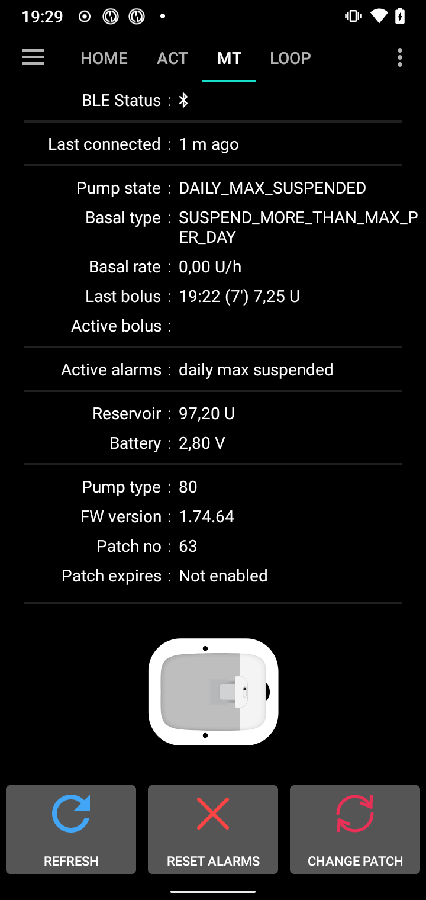

(medtrum-nano-300u)=
# Medtrum Nano 200U / 300U

Настройка инсулиновой помпы Medtrum. (на сайте производителя помпа именуется насосом, что в общем-то верно. Но мы будем следовать устоявшейся традиции и именовать ее помпой - прим. перев.).

```{contents} Table of contents
:depth: 1
:local: true
```

## Возможности работы с AAPS
* Поддерживаются все функции замкнутого цикла (SMB, TBR и т. д.)
* Автоматическое определение сезонного времени и часового пояса
* Пролонгированный болюс не поддерживается драйвером AAPS

## Требования к аппаратному и программному обеспечению
* **Совместимые помповые базы и патчи резервуаров**
    - В настоящее время поддерживается:
        - Medtrum TouchCare Nano 200U with pumpbase refs: **MD0201** and **MD8201**.
        - Medtrum TouchCare Nano 300Uс помповой базой модели: **MD8301**.
        - Если у вас есть неподдерживаемая модель и вы хотите пожертвовать аппаратное обеспечение или помощь в тестировании, пожалуйста, свяжитесь с нами через discord [здесь](https://discordapp.com/channels/629952586895851530/1076120802476441641).
* **AAPS built and installed** using the [Build APK](../SettingUpAaps/BuildingAaps.md) instructions.
* **Совместимый Android-телефон** с рабочим модулем BLE Bluetooth
    - См. AAPS [Примечания к выпуску](../Maintenance/ReleaseNotes.md)

## Подготовка к работе

**БЕЗОПАСНОСТЬ на первом месте** Не пытайтесь выполнять этот процесс в среде, где нет возможности исправить ошибку (дополнительные патчи, инсулин, устройства управления помпой обязательны).

**Пульт PDM и приложение Medtrum не будут работать с патчем, активированным при помощи AAPS** Прежде, возможно, вы уже пользовались этим устройством и приложением для отправки команд на помпу. В целях безопасности можно пользоваться только активированным патчем с устройством или приложением, которое использовалось для его активации.

*Это НЕ означает, что следует выбросить ваш пульт PDM. Рекомендуется хранить его в надежном месте в качестве резервной копии в случае возникновения чрезвычайных ситуаций, например, если ваш телефон потеряется или AAPS работает неправильно.*

**Помпа не перестанет доставлять инсулин, если она не подключена к AAPS** Скорости Базала запрограммированы на помпе, как указано в текущем активном профиле. Когда работает AAPS, он будет отправлять временные команды на изменение базала, каждая из которх устанавливает базал максимум на 120 минут. Если по каким-то причинам помпа не получаетновых команд (например, из-за потери связи с помпой из-за расстояния до телефона), то после окончания временной базальной скорости. помпа вернется к стандартному базалу, предустановленному на помпе.

**The AAPS Profile does not support a 30 minute basal rate time frame** If you are new to AAPS and are setting up your basal rate profile for the first time, please be aware that basal rates starting on a half-hour basis are not supported, and you will need to adjust your basal rate profile to start on the hour. Например, если ваша базальная скорость 1,1 ед., начинается в 09:30, длится 2 часа и заканчивается в 11:30, такие настройки работать не будут. You will need to change this 1.1 unit basal rate to a time range of either 9:00-11:00 or 10:00-12:00. Несмотря на то, что аппаратное обеспечение помпы Medtrum поддерживает профили с 30-минутными отрезками базальной скорости, AAPS в настоящее время не в состоянии учесть их с помощью своих алгоритмов.

**Скорость базала 0 ед/ч НЕ поддерживается в AAPS** Помпа Medtrum не поддерживает нулевую базальную скорость; AAPS использует множество базальных профилей для автоматической терапии и поэтому не может функционировать с нулевой базовой скоростью. The minimum profile basal rate is 0.05 U/h.

A temporary zero basal rate can be achieved through the "Disconnect pump" function or through a combination of Disable Loop/Temp Basal Rate or Suspend Loop/Temp Basal Rate.

## Setup

```{caution}
When you activate a patch with **AAPS**, you **MUST** turn off every other device that can talk to the Medtrum pump base, for example an active PDM or the Medtrum app.
```

### Шаг 1: Выберите помпу Medtrum

#### Вариант 1: При начальной установке

If you are installing **AAPS** for the first time, the **Setup Wizard** guides you through the setup. Select **Medtrum** when you reach the **Pump** step.

If in doubt, you can also select **Virtual Pump** and select **Medtrum** later, after setting up **AAPS** (see option 2).


#### Option 2: The Configuration screen

On an existing installation you can select the **Medtrum** pump in [Configuration > Pump](#Config-Builder-pump):

Open the top-left **menu** (☰), tap **Configuration** > **Pump**, and select the **Medtrum** card. Only one pump can be active at a time.


Once it is selected, the **Medtrum** card shows two buttons, **Settings** and **Open plugin**:


**Open plugin** (or **Manage → Pump**) opens the Medtrum pump screen. You use it to change patches and to see the pump status. Before a patch is activated it looks like this:


(medtrum-step-2)=
### Шаг 2: Изменение настроек Medtrum

Tap **Settings** on the **Medtrum** card in **Configuration** > **Pump**. You can also tap the gear icon in the top-right corner of the Medtrum pump screen. This opens the **Medtrum pump settings**:


```{note}
There is no **Serial Number** setting any more. **AAPS** finds your pump base with a Bluetooth scan the first time you activate a patch (see [Step 3](#medtrum-activate-patch)), and remembers its serial number. To use a different pump base, see [Unpair](#medtrum-unpair).
```

#### Alarm Settings

***По умолчанию: звуковой сигнал.***

This setting changes the way that the pump alerts you when there is a warning or error.

- **Beep**: the patch beeps on alarms and warnings.
- **Silent**: the patch does not alert you on alarms and warnings.

Note: In silent mode **AAPS** still sounds the alarm, depending on your phone's volume settings. If you do not respond to the alarm, the patch eventually beeps.

#### Уведомление об оповещениях помпы

***По умолчанию: включено.***

This setting changes the way **AAPS** shows notifications for non-critical pump warnings. When enabled, a notification is shown on the phone when a pump warning occurs, including:
- Низкий заряд батареи
- Low reservoir (20 units)
- Patch expires soon

We recommend leaving this enabled when the pump alarms are set to **Silent**. In either case these warnings are also shown on the Medtrum pump screen under [Active alarms](#medtrum-active-alarms).

(истечение срока действия medtrum)=
#### Окончание срока действия патча

***По умолчанию: включено.***

Этот параметр изменяет поведение патча. When enabled, the patch expires after 3 days and gives an audible warning if you have sound enabled. After 3 days and 8 hours the patch stops working.

If this setting is disabled, the patch does not warn you before it stops. With recent pump base firmware, a patch runs for 5 days at most.

#### Pump expiry warning [hours]

***По умолчанию: 72 часа.***

This setting changes the time of the expiration warning. When [Patch Expiration](#medtrum-patch-expiration) is enabled, **AAPS** shows a notification this many hours after activation.

#### Hourly Maximum Insulin [Units]

***По умолчанию: 25 ед.***

Эта настройка изменяет максимальное количество инсулина, которое может быть подано в течение одного часа. If this limit is exceeded, the patch suspends and gives an alarm. You can reset the alarm with the **Reset alarms** button on the pump screen, see [Reset alarms](#nano-reset-alarms).

Установите это значение на разумную величину вашей потребности.

#### Daily Maximum Insulin [Units]

***По умолчанию: 80 ед.***

Эта настройка изменяет максимальное количество инсулина, которое может быть подано в течение одного дня. If this limit is exceeded, the patch suspends and gives an alarm. You can reset the alarm with the **Reset alarms** button on the pump screen, see [Reset alarms](#nano-reset-alarms).

Установите это значение на разумную величину вашей потребности.

#### Scan on connection error

***По умолчанию: Выкл.***

Расположено в разделе **Дополнительные настройки**.

Only enable this if you have connection problems. When enabled, the driver scans for the pump again before trying to reconnect to it. Make sure the Location permission for **AAPS** is set to "Allow all the time".

### Step 2b: AAPS alert settings

These settings are not part of the Medtrum driver. Open them from the **Settings** (gear) icon in the top-right corner of the main screen. See [Settings](../SettingUpAaps/Preferences.md) for more.

#### BT Watchdog

Open **Settings** > **Pump**:


**BT Watchdog** switches off the phone's Bluetooth for one second if **AAPS** cannot connect to the pump. This may help on some phones where Bluetooth freezes.

Enable this setting if you often have connection problems with your pump.

#### Локальные оповещения

Open **Settings** > **Local alerts**:


##### Оповещать в случае недоступности помпы

***По умолчанию: включено.***

This setting is forced on when the Medtrum driver is enabled. It alerts you when the pump is unreachable. This can happen when the pump is out of range, or when it is not responding because of a faulty patch or pump base, for example when water leaks between the pump base and the patch.

В целях безопасности эта настройка не отключается.

##### Pump unreachable threshold

***Значение по умолчанию: 30 мин.***

This setting changes how long **AAPS** waits before alerting you that the pump is unreachable.

You can change this setting when using the Medtrum pump, but we recommend keeping it at 30 minutes for safety reasons.

(medtrum-activate-patch)=
### Шаг 3: Активировать патч

**Прежде чем продолжить:**
- Have your Medtrum pump base and a new reservoir patch ready.
- Turn off other devices that can talk to the Medtrum pump (PDM and Medtrum app).
- Ideally, make sure **AAPS** is set up and a [profile is activated](../DailyLifeWithAaps/ProfileSwitch-ProfilePercentage.md). If no profile is active, the activation starts with a **Profile required** step where you choose the profile to activate.

#### Start the activation

Open the [Medtrum pump screen](#nano-overview) (**Manage → Pump**) and tap **Change Patch**. If you have set up [settings protection](#Preferences-protection), you must enter your password or PIN first.

If a patch is already active, you are asked to deactivate it first, see [Deactivate patch](#nano-deactivate-patch).

The activation is a step-by-step wizard. Следуйте подсказкам при заполнении и активации нового патча. Tap **Cancel** at any step to stop.

```{important}
Only put the patch on your body and insert the cannula when the wizard tells you to (after priming is complete).
```

The first steps you see depend on your setup:

1. **Profile required**: only if no profile is active. Select the profile to apply, then continue.
2. **Find Pump**: only the first time, or after you used [Unpair](#medtrum-unpair). Connect the pump base to a fresh patch to power it on. **AAPS** scans for nearby Medtrum pump bases (their names start with `MT`). Tap yours in the list. **AAPS** saves its serial number, then goes straight to filling the patch.

   

3. **Activate Patch**: only when **AAPS** already knows your pump base. The screen says "No active patch. Press **Next** to begin the activation process." Make sure the pump base is **not** connected to the patch yet, then tap **Next**.


#### Connect and fill the patch


Connect the pump base to the patch, remove the residual air and fill the patch with insulin. A minimum of 70 units is needed for activation. The screen shows the reservoir level. Do not attach the patch to your body yet.

When the patch is detected and filled, the **Next** button appears. Tap it.

#### Select insulin

This step only appears if you have more than one insulin set up in **AAPS**. Select the insulin you are filling the patch with. **AAPS** applies a profile switch with this insulin after activation.

#### Первичное заполнение (прайм) катетера


Do **not** remove the safety lock. Half-press the needle button on the patch, then tap **Next** to start priming.


Wait for priming to complete.


When priming is complete, tap **Next** to continue.

#### Смена мест установки

This step only appears if you manage pump sites with [Site Rotation](#Aapsscreens-site-rotation) (setting **Manage pump site rotation**). Choose where you place the patch on your body, or skip this step.

#### Закрепление патча


Clean the skin and remove the stickers. Remove the safety lock, attach the patch to your body, and press the needle button to insert the cannula.

Tap **Next** to activate the patch.

#### Активация патча


**AAPS** activates the pump and sets the initial basal rate. Please wait. When activation is complete, the following screen appears:


```{admonition} Older screenshot
:class: note
Apart from **Find Pump**, the activation screenshots above are from an earlier **AAPS** version and may look different in **AAPS** 4.
```

It shows how many units are left in the patch. Tap **OK** to return to the pump screen.

```{tip}
After a new activation, [export your settings](../Maintenance/ExportImportSettings.md). This lets you recover this patch session later, for example on a new phone.
```

(nano-deactivate-patch)=

### Деактивация патча

To deactivate the active patch, open the [Medtrum pump screen](#nano-overview) (**Manage → Pump**) and tap **Change Patch**.


You are asked to confirm that you want to deactivate the current patch. **This cannot be undone.** Tap **Next** to deactivate, or **Cancel** to return to the pump screen.


If **AAPS** cannot deactivate the patch (for example because the pump base has already been removed from the patch), tap **Discard** to forget the current patch session. You can then activate a new patch.


When deactivation is complete, retract the needle and remove the patch from your body. Remove the pump base and dispose of the used patch. Tap **OK** to return to the pump screen, or **Next** to start activating a new patch.

(nano-resume-interrupted-activation)=

### Возобновить прерванную активацию

If a patch activation is interrupted, for example because the phone battery runs out, you can resume it. Open the [Medtrum pump screen](#nano-overview) (**Manage → Pump**) and tap **Change Patch**.


Tap **Next** to resume the activation. Tap **Discard** to reset the activation status, so you can activate a new patch.


```{admonition} Older screenshot
:class: note
The screenshots in **Deactivate patch** and **Resume interrupted activation** are from an earlier **AAPS** version and may look different in **AAPS** 4.
```

The driver reads the activation status from the pump. If this works, the wizard continues at the step where it stopped.

(nano-overview)=

## Pump screen

The Medtrum pump screen (**Manage → Pump**) shows the current status of the Medtrum patch. It also has buttons to change the patch, reset alarms and refresh the status. A banner at the top shows important states, for example **Patch not activated** or **Pump is suspended**.


The screen can show these rows. Some rows only appear when they have a value.

- **Last connection**: how long ago **AAPS** last connected to the pump.
- **Last bolus**: the last bolus that was delivered.
- **Battery**: the current battery voltage of the patch.
- **Reservoir**: the current reservoir level.
- **Serial number**: the serial number of your pump base.
- **Pump state**: the current state of the pump. For example **Active** (the patch is activated and running normally) or **Stopped** (the patch is not activated).
- **Base basal rate**: the basal rate from your profile that is running now.
- **Temp basal**: the temporary basal rate, if one is running.
- **Active bolus**: the bolus that is being delivered right now.
- **Active alarms**: see [below](#medtrum-active-alarms).
- **Pump type**: the model of your pump base.
- **FW version**: the firmware version of the pump base.
- **Patch no**: the sequence number of the activated patch. It goes up by one every time you activate a new patch.
- **Activation**: the date and time the patch was activated, and how long ago that was.
- **Patch expires**: the date and time when the patch expires. Shows **Not enabled** if [Patch Expiration](#medtrum-patch-expiration) is off.

(medtrum-active-alarms)=
### Active alarms

This row shows any alarms that are active right now, for example a low reservoir or an expiring patch.

### Refresh

This button refreshes the status of the patch. It is only available when a patch is active and **AAPS** is not connected to the pump at that moment.

### Change Patch

This button starts the wizard to change the patch. См [Активировать патч](#medtrum-activate-patch) для получения дополнительной информации.

(medtrum-unpair)=
### Unpair

This button only appears when **AAPS** knows a pump base. It clears the stored pump base serial number and disconnects. The next time you activate a patch, **AAPS** scans for a pump base again (the **Find Pump** step). Use this if you switch to a different pump base. Only do this when no patch is active.

(nano-reset-alarms)=

### Сбросить оповещения

The **Reset alarms** button only appears on the pump screen when the patch has suspended itself, for example after a maximum daily insulin alarm. Tap it to reset the alarms and resume insulin delivery.



```{admonition} Older screenshot
:class: note
The screenshot above is from an earlier **AAPS** version. In **AAPS** 4 the pump screen looks different, but the **Reset alarms** button works the same way.
```

## Смена телефона, экспорт/импорт настроек

When you switch to a new phone, do the following:
* [Export settings](../Maintenance/ExportImportSettings.md) on your old phone.
* Transfer the settings file from the old phone to the new phone, and import it into **AAPS**. Tick **Also replace pump settings** on the import screen, otherwise the patch session is not transferred to the new phone.

The imported settings file must be from the patch session you are using now, otherwise the patch will not connect (see [Tubeless pumps](#ExportImportSettings-tubeless-pumps)).

After a settings import, the driver syncs the history with the pump. This can take a while, depending on the age of the settings file. The progress ("Syncing records, ... left") is shown on the main screen:


(medtrum-nano-troubleshooting)=

## Устранение неполадок

### Проблемы подключения

If you have connection timeouts or other connection problems:
- In the Android app settings for **AAPS**, set the Location permission to "Allow all the time".
- Try enabling **Scan on connection error** (Medtrum settings > **Advanced Settings**) and **BT Watchdog** (**Settings** > **Pump**), see [Step 2](#medtrum-step-2).

### Bluetooth issues
For known issues with Bluetooth connections, dropouts of pump/pods, or activation and connection issues [Bluetooth Troubleshooting](../GettingHelp/BluetoothTroubleshooting.md)

### Активация прервана

If the activation is interrupted, for example by an empty phone battery or a phone crash, you can resume it. Tap **Change Patch** on the pump screen and follow the steps in [Resume interrupted activation](#nano-resume-interrupted-activation).

### Предотвращение сбоев в работе патча

Патч может совершить множество ошибок. Во избежание частых ошибок:
- Убедитесь, что помповая база правильно закреплена в патче и не видно никаких зазоров.
- При заполнении патча не применяйте чрезмерную силу к плунжеру. Не пытайтесь заполнять патч сверх максимума, применимого к вашей модели.

## Куда обращаться за помощью

Вся работа по совершенствованию драйвера Medtrum выполняется на основе **добровольности**; просим Вас помнить об этом и, прежде чем запрашивать помощь, придерживаться следующих рекомендаций:

-  **Уровень 0:** Прочитайте соответствующий раздел этой документации, чтобы удостовериться, что вы понимаете, как должна работать функция, с которой вы испытываете трудности.
-  **Уровень 1:** Если вы все еще сталкиваетесь с проблемами, которые вы не можете решить, изучая документацию, перейдите в канал *#Medtrum* на **Discord** с помощью [этой ссылки-приглашения](https://discord.gg/4fQUWHZ4Mw).
-  **Уровень 2:** Ищите среди существующих проблем, отмечена ли она в [Issues](https://github.com/nightscout/AAPS/issues) если она существует, подтвердите/комментарий/добавьте информацию о вашей проблеме. Если нет, создайте [новый вопрос](https://github.com/nightscout/AndroidAPS/issues) и приложите [свои лог-файлы](../GettingHelp/AccessingLogFiles.md).
-  **Будьте терпеливы - решения проблем часто требуют времени и терпения как от пользователей, так и от разработчиков.**