(medtrum-nano-300u)=
# Medtrum Nano 200U / 300U

Настройка инсулиновой помпы Medtrum. (на сайте производителя помпа именуется насосом, что в общем-то верно. Но мы будем следовать устоявшейся традиции и именовать ее помпой - прим. перев.).

```{contents} Table of contents
:depth: 1
:local: true
```

## Возможности работы с AAPS
* Поддерживаются все функции замкнутого цикла (SMB, TBR и т. д.)
* Автоматическое определение сезонного времени и часового пояса
* Пролонгированный болюс не поддерживается драйвером AAPS

## Требования к аппаратному и программному обеспечению
* **Совместимые помповые базы и патчи резервуаров**
    - В настоящее время поддерживается:
        - Medtrum TouchCare Nano 200U с помповой базой моделей: **MD0201** и **MD8201**.
        - Medtrum TouchCare 300U с помповой базой модели: **MD8301**.
        - Если у вас есть неподдерживаемая модель и вы хотите пожертвовать аппаратное обеспечение или помощь в тестировании, пожалуйста, свяжитесь с нами через discord [здесь](https://discordapp.com/channels/629952586895851530/1076120802476441641).
* **AAPS собран и установлен** по инструкции [Сборка AAPS](../SettingUpAaps/BuildingAaps.md).
* **Совместимый Android-телефон** с рабочим модулем BLE Bluetooth
    - См. [Примечания к изменениям в версиях](../Maintenance/ReleaseNotes.md) AAPS

## Подготовка к работе

**БЕЗОПАСНОСТЬ на первом месте** Не пытайтесь выполнять этот процесс в среде, где нет возможности исправить ошибку (дополнительные патчи, инсулин, устройства управления помпой обязательны).

**Пульт PDM и приложение Medtrum не будут работать с патчем, активированным при помощи AAPS.** Прежде, возможно, вы уже пользовались пультом PDM или приложением Medtrum для отправки команд на помпу. В целях безопасности можно пользоваться только активированным патчем с устройством или приложением, которое использовалось для его активации.

*Это НЕ означает, что следует выбросить ваш пульт PDM. Рекомендуется хранить его в надежном месте в качестве резервной копии в случае возникновения чрезвычайных ситуаций, например, если ваш телефон потеряется или AAPS работает неправильно.*

**Помпа не перестанет доставлять инсулин, если она не подключена к AAPS** Скорости Базала запрограммированы на помпе, как указано в текущем активном профиле. Когда работает AAPS, он будет отправлять команды временного базала, каждая из которых устанавливает базал максимум на 120 минут. Если по каким-то причинам помпа не получает новых команд (например, из-за потери связи с помпой из-за расстояния до телефона), то после окончания временной базальной скорости помпа вернется к стандартному базалу, предустановленному на помпе.

**Профиль AAPS не поддерживает базальные интервалы по 30 минут** Если вы новичок в AAPS и настраиваете свой базальный профиль впервые, учтите, что базальные скорости, которые начинаются в половине часа, не поддерживаются. Вам нужно изменить базальный профиль так, чтобы интервалы начинались в начале часа. Например, если ваша базальная скорость 1,1 ед., начинается в 09:30, длится 2 часа и заканчивается в 11:30, такие настройки работать не будут. You will need to change this 1.1 unit basal rate to a time range of either 9:00-11:00 or 10:00-12:00. Несмотря на то, что аппаратное обеспечение помпы Medtrum поддерживает профили с 30-минутными отрезками базальной скорости, AAPS в настоящее время не в состоянии учесть их с помощью своих алгоритмов.

**Скорость базала 0 ед/ч в профиле НЕ поддерживается в AAPS** Помпа Medtrum поддерживает нулевую базальную скорость, но AAPS использует кратные значения базальной скорости профиля для автоматической терапии и поэтому не может работать с нулевой базальной скоростью. Минимальная базальная скорость в профиле — 0,05 ед/ч.

A temporary zero basal rate can be achieved through the "Disconnect pump" function or through a combination of Disable Loop/Temp Basal Rate or Suspend Loop/Temp Basal Rate.

## Настройка

```{caution}
Когда вы активируете патч с помощью **AAPS**, вы **ДОЛЖНЫ** выключить все другие устройства, которые могут связываться с помповой базой Medtrum, например активный пульт PDM или приложение Medtrum.
```

### Шаг 1: Выберите помпу Medtrum

#### Вариант 1: При начальной установке

Если вы устанавливаете **AAPS** впервые, **Мастер установки** проведет вас через настройку. Выберите **Medtrum**, когда дойдете до шага **Помпа**.

Если сомневаетесь, вы можете также выбрать **Виртуальная помпа** и выбрать **Medtrum** позже, после настройки **AAPS** (см. вариант 2).


#### Вариант 2: экран «Конфигурация»

В уже установленном приложении вы можете выбрать помпу **Medtrum** в [Конфигурация > Помпа](#Config-Builder-pump):

Откройте **меню** (☰) слева вверху, нажмите **Конфигурация** > **Помпа** и выберите карточку **Medtrum**. Активной может быть только одна помпа.


После выбора на карточке **Medtrum** видны две кнопки: **Настройки** и **Открыть модуль**:

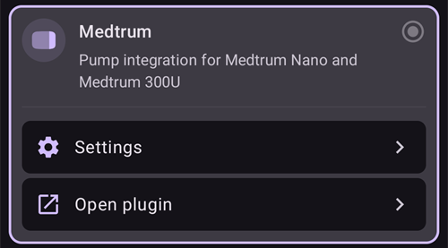

**Открыть модуль** (или **Управление → Помпа**) открывает экран помпы Medtrum. На нем вы меняете патчи и смотрите состояние помпы. До активации патча он выглядит так:

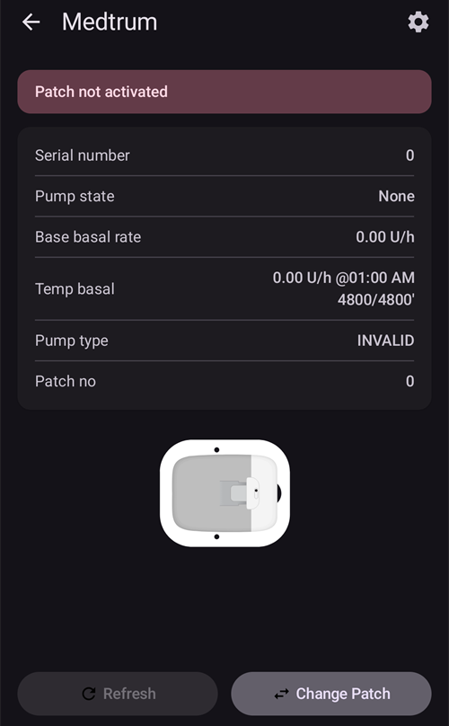

(medtrum-step-2)=
### Шаг 2: Изменение настроек Medtrum

Нажмите **Настройки** на карточке **Medtrum** в **Конфигурация** > **Помпа**. Вы также можете нажать значок шестеренки в правом верхнем углу экрана помпы Medtrum. Откроются **Настройки Medtrum**:

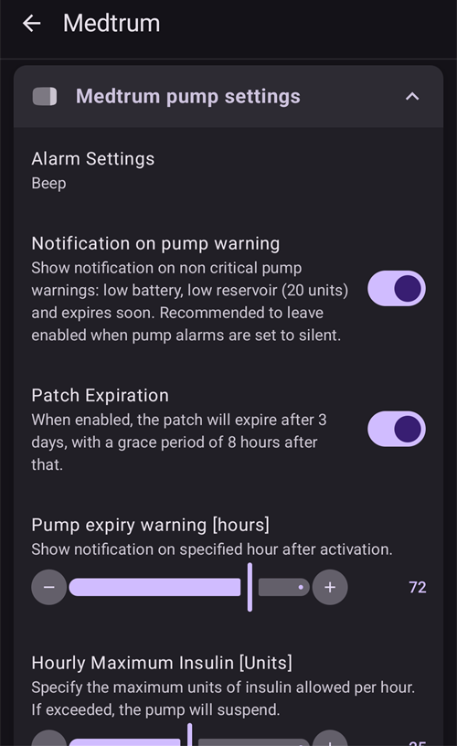

```{note}
Настройки **Серийный номер** больше нет. **AAPS** находит вашу помповую базу через поиск Bluetooth при первой активации патча (см. [Шаг 3](#medtrum-activate-patch)) и запоминает ее серийный номер. Чтобы использовать другую помповую базу, см. [Разорвать сопряжение](#medtrum-unpair).
```

#### Alarm Settings

***По умолчанию: звуковой сигнал.***

Эта настройка меняет то, как помпа оповещает вас о предупреждении или ошибке.

- **Звук**: патч подает звуковой сигнал при тревогах и предупреждениях.
- **Без звука**: патч не оповещает вас о тревогах и предупреждениях.

Примечание: в беззвучном режиме **AAPS** все равно подает сигнал тревоги, в зависимости от настроек громкости вашего телефона. Если вы не реагируете на тревогу, патч через некоторое время подаст звуковой сигнал.

#### Уведомление об оповещениях помпы

***По умолчанию: включено.***

Эта настройка меняет то, как **AAPS** показывает уведомления о некритических предупреждениях помпы. Если она включена, при предупреждении помпы на телефоне появляется уведомление, в том числе:
- Низкий заряд батареи
- Мало инсулина в резервуаре (20 единиц)
- Скоро истекает срок действия патча

Мы рекомендуем оставить ее включенной, если оповещения помпы установлены на **Без звука**. В любом случае эти предупреждения также видны на экране помпы Medtrum в строке [Активные оповещения](#medtrum-active-alarms).

(истечение срока действия medtrum)=
#### Окончание срока действия патча

***По умолчанию: включено.***

Этот параметр изменяет поведение патча. Если эта настройка включена, срок действия патча заканчивается через 3 дня, и он подает звуковое предупреждение, если звук включен. Через 3 дня и 8 часов патч перестает работать.

Если эта настройка выключена, патч не предупреждает вас перед остановкой. С новой прошивкой помповой базы патч работает не более 5 дней.

#### Pump expiry warning [hours]

***По умолчанию: 72 часа.***

Эта настройка меняет время предупреждения об окончании срока действия. Если [Окончание срока действия патча](#medtrum-patch-expiration) включено, **AAPS** показывает уведомление через это количество часов после активации.

#### Hourly Maximum Insulin [Units]

***По умолчанию: 25 ед.***

Эта настройка изменяет максимальное количество инсулина, которое может быть подано в течение одного часа. Если этот предел превышен, патч приостанавливает работу и подает сигнал тревоги. Вы можете сбросить тревогу кнопкой **Сбросить оповещения** на экране помпы, см. [Сбросить оповещения](#nano-reset-alarms).

Установите это значение на разумную величину вашей потребности.

#### Daily Maximum Insulin [Units]

***По умолчанию: 80 ед.***

Эта настройка изменяет максимальное количество инсулина, которое может быть подано в течение одного дня. Если этот предел превышен, патч приостанавливает работу и подает сигнал тревоги. Вы можете сбросить тревогу кнопкой **Сбросить оповещения** на экране помпы, см. [Сбросить оповещения](#nano-reset-alarms).

Установите это значение на разумную величину вашей потребности.

#### Сканировать при ошибке соединения

***По умолчанию: Выкл.***

Расположено в разделе **Дополнительные настройки**.

Включайте эту настройку, только если у вас есть проблемы со связью. Если она включена, драйвер снова ищет помпу перед попыткой повторного подключения к ней. Убедитесь, что разрешение «Местоположение» для **AAPS** установлено на «Разрешить в любом режиме».

### Шаг 2b: Настройки оповещений AAPS

Эти настройки не относятся к драйверу Medtrum. Откройте их значком **Настройки** (шестеренка) в правом верхнем углу главного экрана. Подробнее см. [Настройки](../SettingUpAaps/Preferences.md).

#### BT Watchdog

Откройте **Настройки** > **Помпа**:

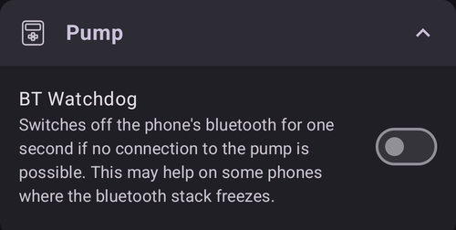

**BT Watchdog** выключает Bluetooth телефона на одну секунду, если **AAPS** не может подключиться к помпе. Это может помочь на некоторых телефонах, где Bluetooth зависает.

Включите эту настройку, если у вас часто бывают проблемы со связью с помпой.

#### Локальные оповещения

Откройте **Настройки** > **Локальные оповещения**:


##### Оповещать в случае недоступности помпы

***По умолчанию: включено.***

Эта настройка включается принудительно, когда включен драйвер Medtrum. Она оповещает вас, когда помпа недоступна. Это может случиться, когда помпа вне зоны связи или когда она не отвечает из-за неисправного патча или помповой базы, например, если между помповой базой и патчем попала вода.

В целях безопасности эта настройка не отключается.

##### Порог недоступности помпы

***Значение по умолчанию: 30 мин.***

Эта настройка меняет, сколько **AAPS** ждет, прежде чем оповестить вас о том, что помпа недоступна.

Вы можете изменить эту настройку при использовании помпы Medtrum, но в целях безопасности мы рекомендуем оставить 30 минут.

(medtrum-activate-patch)=
### Шаг 3: Активировать патч

**Прежде чем продолжить:**
- Подготовьте помповую базу Medtrum и новый патч с резервуаром.
- Выключите другие устройства, которые могут связываться с помпой Medtrum (пульт PDM и приложение Medtrum).
- В идеале убедитесь, что **AAPS** настроен и [профиль активирован](../DailyLifeWithAaps/ProfileSwitch-ProfilePercentage.md). Если активного профиля нет, активация начинается с шага **Требуется профиль**, где вы выбираете профиль для активации.

#### Начало активации

Откройте [экран помпы Medtrum](#nano-overview) (**Управление → Помпа**) и нажмите **Сменить патч**. Если вы настроили [защиту настроек](#Preferences-protection), сначала нужно ввести пароль или PIN-код.

Если патч уже активен, вас попросят сначала деактивировать его, см. [Деактивация патча](#nano-deactivate-patch).

Активация — это пошаговый мастер. Следуйте подсказкам при заполнении и активации нового патча. Нажмите **Отменить** на любом шаге, чтобы прервать ее.

```{important}
Наклеивайте патч на тело и вводите катетер только тогда, когда мастер вам это скажет (после завершения заправки).
```

Первые шаги, которые вы видите, зависят от ваших настроек:

1. **Требуется профиль**: только если нет активного профиля. Выберите профиль, который нужно применить, затем продолжите.
2. **Найти помпу**: только в первый раз или после того, как вы использовали [Разорвать сопряжение](#medtrum-unpair). Подключите помповую базу к новому патчу, чтобы включить ее. **AAPS** ищет помповые базы Medtrum поблизости (их имена начинаются с `MT`). Нажмите на свою в списке. **AAPS** сохраняет ее серийный номер и сразу переходит к заполнению патча.

   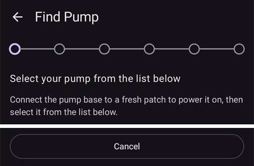

3. **Активировать патч**: только если **AAPS** уже знает вашу помповую базу. На экране написано: «Активный патч отсутствует. Нажмите **Далее** для начала процесса активации.» Убедитесь, что помповая база **еще не** подключена к патчу, затем нажмите **Далее**.

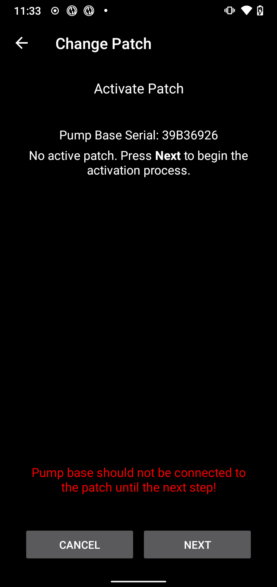

#### Подключение и заполнение патча

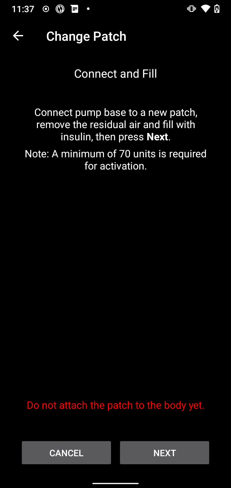

Подключите помповую базу к патчу, удалите остатки воздуха и заполните патч инсулином. Для активации нужно не менее 70 единиц. На экране виден уровень в резервуаре. Пока не наклеивайте патч на тело.

Когда патч обнаружен и заполнен, появляется кнопка **Далее**. Нажмите ее.

#### Выбор инсулина

Этот шаг появляется, только если в **AAPS** настроено больше одного инсулина. Выберите инсулин, которым вы заполняете патч. После активации **AAPS** выполняет переключение профиля с этим инсулином.

#### Заправка патча

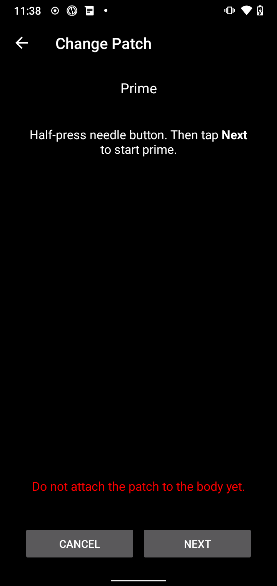

**Не** снимайте предохранитель. Слегка нажмите на кнопку иглы на патче, затем нажмите **Далее**, чтобы начать заправку.

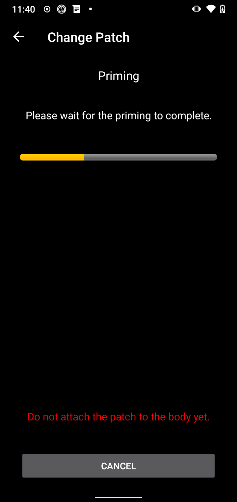

Дождитесь окончания заправки.

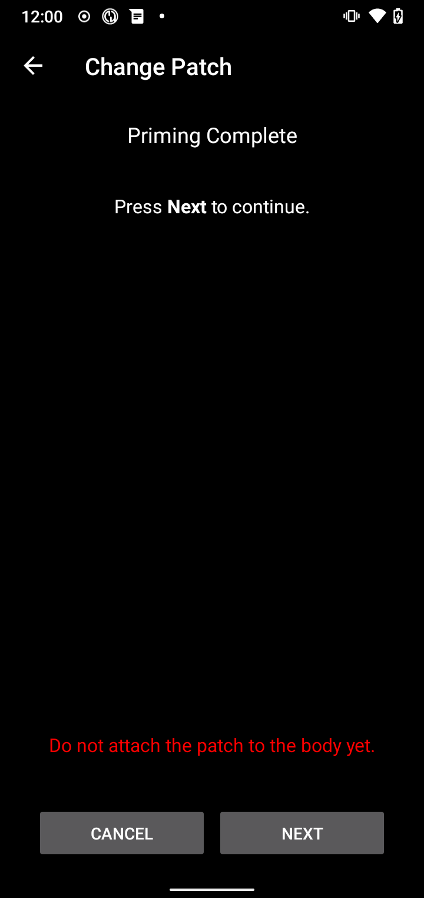

Когда заправка завершена, нажмите **Далее**, чтобы продолжить.

#### Смена мест установки

Этот шаг появляется, только если вы ведете места установки помпы с помощью [Места установки](#Aapsscreens-site-rotation) (настройка **Места установки помпы**). Выберите, где на теле вы разместите патч, или пропустите этот шаг.

#### Закрепление патча

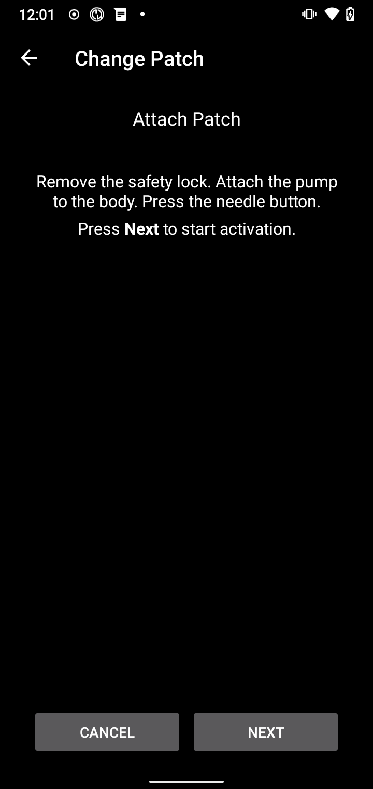

Очистите кожу и снимите защитные наклейки. Снимите предохранитель, наклейте патч на тело и нажмите кнопку иглы, чтобы ввести катетер.

Нажмите **Далее**, чтобы активировать патч.

#### Активация патча

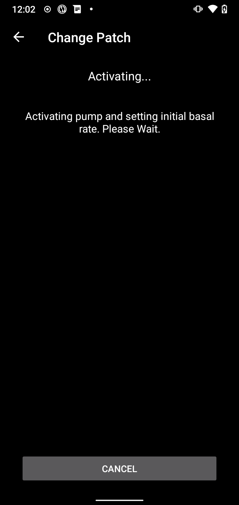

**AAPS** активирует помпу и устанавливает начальную базальную скорость. Подождите. Когда активация завершена, появляется следующий экран:

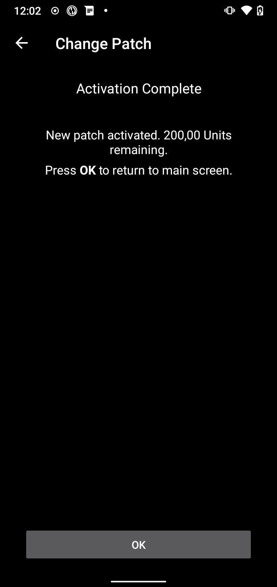

```{admonition} Older screenshot
:class: note
Кроме **Найти помпу**, снимки экранов активации выше сделаны в более ранней версии **AAPS** и в **AAPS** 4 могут выглядеть иначе.
```

На нем видно, сколько единиц осталось в патче. Нажмите **OK**, чтобы вернуться на экран помпы.

```{tip}
После новой активации [экспортируйте свои настройки](../Maintenance/ExportImportSettings.md). Так вы сможете позже восстановить эту сессию патча, например на новом телефоне.
```

(nano-deactivate-patch)=

### Деактивация патча

Чтобы деактивировать активный патч, откройте [экран помпы Medtrum](#nano-overview) (**Управление → Помпа**) и нажмите **Сменить патч**.


Вас попросят подтвердить, что вы хотите деактивировать текущий патч. **Это нельзя отменить.** Нажмите **Далее**, чтобы деактивировать, или **Отменить**, чтобы вернуться на экран помпы.


Если **AAPS** не может деактивировать патч (например, потому что помповая база уже отсоединена от патча), нажмите **Сбросить**, чтобы забыть текущую сессию патча. Затем вы можете активировать новый патч.

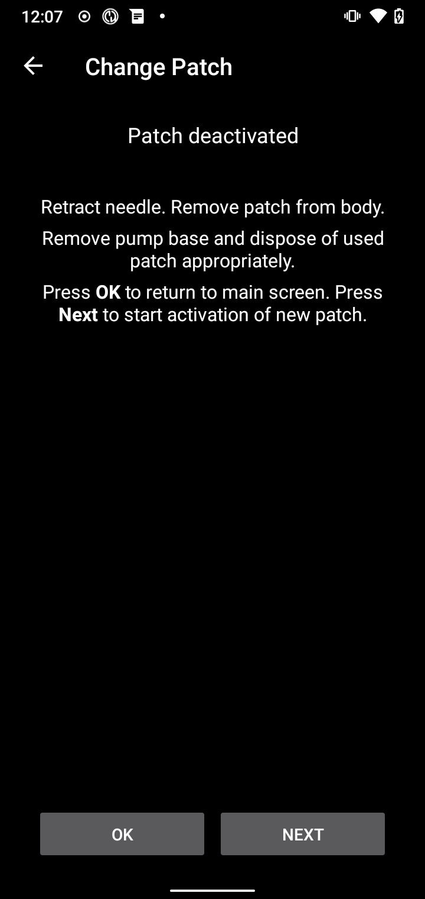

Когда деактивация завершена, извлеките иглу и снимите патч с тела. Отсоедините помповую базу и утилизируйте использованный патч. Нажмите **OK**, чтобы вернуться на экран помпы, или **Далее**, чтобы начать активацию нового патча.

(nano-resume-interrupted-activation)=

### Возобновить прерванную активацию

Если активация патча прервана, например потому что разрядилась батарея телефона, вы можете ее возобновить. Откройте [экран помпы Medtrum](#nano-overview) (**Управление → Помпа**) и нажмите **Сменить патч**.

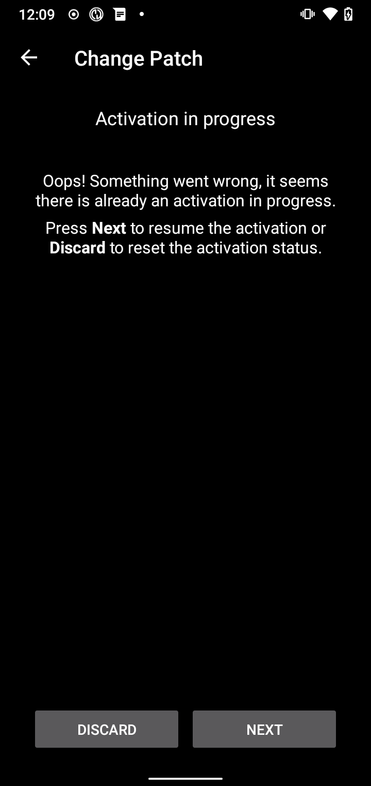

Нажмите **Далее**, чтобы возобновить активацию. Нажмите **Сбросить**, чтобы сбросить статус активации и активировать новый патч.

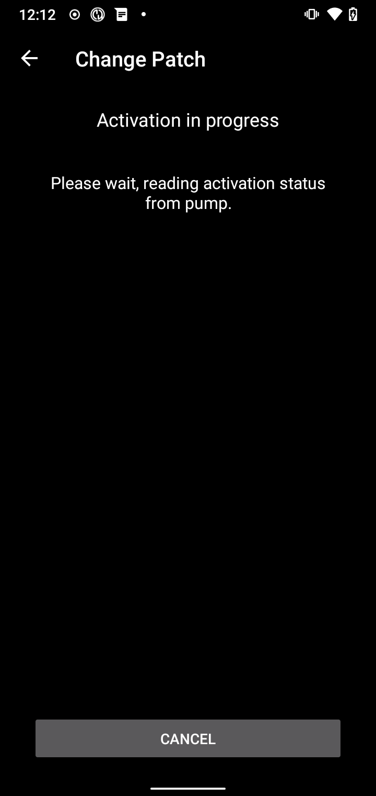

```{admonition} Older screenshot
:class: note
Снимки экранов в разделах **Деактивация патча** и **Возобновить прерванную активацию** сделаны в более ранней версии **AAPS** и в **AAPS** 4 могут выглядеть иначе.
```

Драйвер считывает статус активации с помпы. Если это получилось, мастер продолжает с того шага, на котором остановился.

(nano-overview)=

## Экран помпы

Экран помпы Medtrum (**Управление → Помпа**) показывает текущее состояние патча Medtrum. На нем также есть кнопки для смены патча, сброса оповещений и обновления статуса. Баннер вверху показывает важные состояния, например **Патч не активирован** или **Помпа приостановлена**.

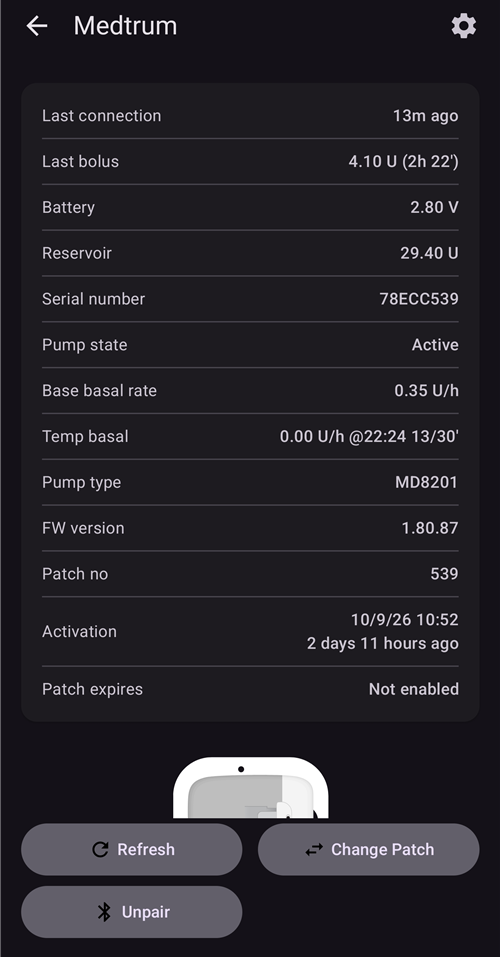

На экране могут быть такие строки. Некоторые строки появляются, только когда у них есть значение.

- **Прошлое соединение**: сколько времени назад **AAPS** последний раз подключался к помпе.
- **Предыдущий болюс**: последний введенный болюс.
- **Батарея**: текущее напряжение батареи патча.
- **Резервуар**: текущий уровень в резервуаре.
- **Серийный номер**: серийный номер вашей помповой базы.
- **Статус помпы**: текущее состояние помпы. Например, **Активна** (патч активирован и работает нормально) или **Остановлена** (патч не активирован).
- **Базовая величина базала**: базальная скорость из вашего профиля, которая действует сейчас.
- **ВБС**: временная базальная скорость, если она сейчас действует.
- **Активный болюс**: болюс, который вводится прямо сейчас.
- **Активные оповещения**: см. [ниже](#medtrum-active-alarms).
- **Тип помпы**: модель вашей помповой базы.
- **Версия ПО**: версия прошивки помповой базы.
- **Номер патча**: порядковый номер активированного патча. Он увеличивается на единицу каждый раз, когда вы активируете новый патч.
- **Активация**: дата и время активации патча и сколько времени прошло с тех пор.
- **Патч заканчивается**: дата и время окончания срока действия патча. Показывает **Не включено**, если [Окончание срока действия патча](#medtrum-patch-expiration) выключено.

(medtrum-active-alarms)=
### Active alarms

Эта строка показывает все оповещения, которые активны прямо сейчас, например мало инсулина в резервуаре или заканчивается срок действия патча.

### Refresh

Эта кнопка обновляет статус патча. Она доступна, только когда патч активен и **AAPS** в этот момент не подключен к помпе.

### Change Patch

Эта кнопка запускает мастер смены патча. См. [Активировать патч](#medtrum-activate-patch) для получения дополнительной информации.

(medtrum-unpair)=
### Разорвать сопряжение

Эта кнопка появляется, только когда **AAPS** знает помповую базу. Она удаляет сохраненный серийный номер помповой базы и разрывает соединение. При следующей активации патча **AAPS** снова ищет помповую базу (шаг **Найти помпу**). Используйте это, если переходите на другую помповую базу. Делайте это, только когда нет активного патча.

(nano-reset-alarms)=

### Сбросить оповещения

Кнопка **Сбросить оповещения** появляется на экране помпы, только когда патч приостановил сам себя, например после тревоги о превышении максимального количества инсулина в сутки. Нажмите ее, чтобы сбросить оповещения и возобновить подачу инсулина.

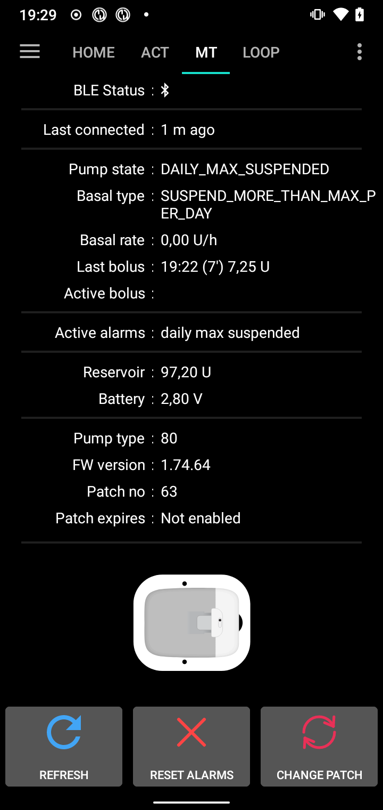

```{admonition} Older screenshot
:class: note
Скриншот выше сделан в более ранней версии **AAPS**. В **AAPS** 4 экран помпы выглядит иначе, но кнопка **Сбросить оповещения** работает так же.
```

## Смена телефона, экспорт/импорт настроек

При переходе на новый телефон сделайте следующее:
* [Export settings](../Maintenance/ExportImportSettings.md) on your old phone.
* Перенесите файл настроек со старого телефона на новый и импортируйте его в **AAPS**. Отметьте **Также заменить настройки помпы** на экране импорта, иначе сессия патча не будет перенесена на новый телефон.

Импортируемый файл настроек должен быть из той сессии патча, которую вы используете сейчас, иначе патч не подключится (см. [Помпы без трубки](#ExportImportSettings-tubeless-pumps)).

После импорта настроек драйвер синхронизирует историю с помпой. Это может занять некоторое время, в зависимости от возраста файла настроек. Ход синхронизации («Синхронизация записей, осталось ...») виден на главном экране:

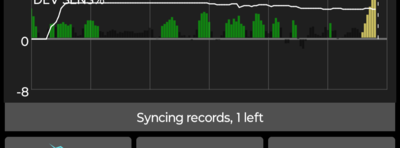

(medtrum-nano-troubleshooting)=

## Устранение неполадок

### Проблемы подключения

Если у вас бывают тайм-ауты соединения или другие проблемы со связью:
- В настройках Android для приложения **AAPS** установите разрешение «Местоположение» на «Разрешить в любом режиме».
- Попробуйте включить **Сканировать при ошибке соединения** (настройки Medtrum > **Дополнительные настройки**) и **BT Watchdog** (**Настройки** > **Помпа**), см. [Шаг 2](#medtrum-step-2).

### Проблемы с Bluetooth
Об известных проблемах с соединением Bluetooth, обрывах связи с помпой или Pod, а также о проблемах активации и соединения см. [Проблемы с Bluetooth](../GettingHelp/BluetoothTroubleshooting.md)

### Активация прервана

Если активация прервана, например из-за разряженной батареи телефона или сбоя телефона, вы можете ее возобновить. Нажмите **Сменить патч** на экране помпы и выполните шаги из раздела [Возобновить прерванную активацию](#nano-resume-interrupted-activation).

### Предотвращение сбоев в работе патча

Патч может выдавать разные ошибки. Во избежание частых ошибок:
- Убедитесь, что помповая база правильно закреплена в патче и не видно никаких зазоров.
- При заполнении патча не применяйте чрезмерную силу к плунжеру. Не пытайтесь заполнять патч сверх максимума, применимого к вашей модели.

## Куда обращаться за помощью

Вся работа по совершенствованию драйвера Medtrum выполняется на основе **добровольности**; просим Вас помнить об этом и, прежде чем запрашивать помощь, придерживаться следующих рекомендаций:

-  **Уровень 0:** Прочитайте соответствующий раздел этой документации, чтобы удостовериться, что вы понимаете, как должна работать функция, с которой вы испытываете трудности.
-  **Уровень 1:** Если вы все еще сталкиваетесь с проблемами, которые вы не можете решить, изучая документацию, перейдите в канал *#Medtrum* на **Discord** с помощью [этой ссылки-приглашения](https://discord.gg/4fQUWHZ4Mw).
-  **Уровень 2:** Поищите среди существующих проблем в [Issues](https://github.com/nightscout/AAPS/issues), не сообщали ли уже о вашей проблеме. Если она есть, подтвердите ее, оставьте комментарий или добавьте информацию о своей проблеме. Если нет, создайте [новый вопрос](https://github.com/nightscout/AndroidAPS/issues) и приложите [свои лог-файлы](../GettingHelp/AccessingLogFiles.md).
-  **Будьте терпеливы: большинство участников нашего сообщества — добровольцы, и решение проблем часто требует времени и терпения как от пользователей, так и от разработчиков.**