# Помпа Omnipod DASH

Эти инструкции предназначены для настройки помпы поколения **Omnipod DASH** **(НЕ Omnipod Eros)**. Драйвер DASH — проверенный способ работы в цикле с Omnipod.

```{contents} Table of contents
:depth: 1
:local: true
```

## Технические характеристики Omnipod DASH

Основные особенности **Omnipod DASH** («DASH»):

- Pod DASH можно узнать по **синему колпачку на игле** (у более старых Pod EROS колпачок прозрачный). Во всем остальном физические размеры Pod одинаковы.
- DASH не нужно отдельное устройство-мост для связи по BLE (НЕ нужны RileyLink, OrangeLink или EmaLink).
- Соединение Bluetooth с DASH используется только при отправке команды (например, болюса) и разрывается сразу после ее передачи.
- **AAPS** будет ждать, когда Pod станет доступен для отправки команд.
- При активации Pod **AAPS** найдет новый Pod DASH и подключится к нему.
- Ожидаемая дальность связи с телефоном: 5–10 метров (может отличаться у разных людей).

(omnipod-dash-constraints)=

## Известные ограничения и проблемы с Omnipod DASH в AAPS
- General advice is to run **AAPS** on Android 14 or 16. Android 15 has many reported [issues](https://github.com/nightscout/AndroidAPS/issues/3471) from the community. Однако если вы все же используете Android 15, вам, скорее всего, нужно будет включить **Привязка Bluetooth** (в разделе **Дополнительные настройки** [настроек Dash](#omnipod-dash-advanced-settings)), чтобы успешно активировать и использовать Pod. Подробнее о настройках привязки см. [Устранение неполадок](../GettingHelp/GeneralTroubleshooting.md).
- Переход на летнее/зимнее время и смена часового пояса не применяются автоматически. После перевода часов нужно обновить Pod вручную: нажмите **Обновить** на экране помпы DASH, затем нажмите **Установить время** (кнопка видна, когда часовые пояса Pod и телефона различаются) или выполните **переключение профиля** (см. [Смена часового пояса для Omnipod Dash](#timezone-traveling-with-pumps)).
- DASH поддерживает базальную скорость только с шагом 0,05 ед/ч. Если в вашем **профиле AAPS** задать базал с шагом 0,01, AAPS не покажет предупреждение, хотя Pod округлит скорость вверх до шага 0,05. Если открыть **Журнал Pod** на экране помпы DASH, там будет видно, что был установлен базал 0,05. Это также значит, что самая низкая базальная скорость, которую DASH допускает в **AAPS**, — 0,05 ед/ч.
- Файл настроек содержит активную сессию Pod. Экспортируйте настройки после каждой активации Pod и прочитайте раздел [Экспорт и импорт настроек](#omnipod-dash-export-import), прежде чем импортировать настройки.
- При установке нового базального профиля DASH приостанавливает подачу, прежде чем установить новый базальный **профиль**. Если связь прервалась или произошла ошибка, базальный профиль не запустится снова автоматически. Подробнее см. раздел [Возобновление подачи инсулина](#omnipod-dash-resuming-insulin-delivery).
- Если оповещения настроены и срок работы Pod подходит к концу, Pod будет подавать звуковые сигналы, пока оповещения не будут заглушены. Подробнее см. [Отключение звуковых оповещений Pod](#omnipod-dash-silencing-pod-alerts).
- Есть ряд известных проблем с Bluetooth, которые могут мешать активации Pod. Известные проблемы и их решения описаны на странице [Проблемы с Bluetooth](../GettingHelp/BluetoothTroubleshooting.md).

(hardware-software-requirements)=

(omnipod-dash-hardware-software-requirements)=
## Требования к аппаратному и программному обеспечению

- Omnipod DASH можно узнать по синему колпачку на игле.

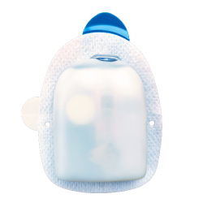

- **Совместимый телефон Android** с Bluetooth Low Energy (BLE) (подробнее см. [Телефоны](../Getting-Started/Phones.md)). Кроме того, следующая информация поможет учесть другие важные моменты для успешной активации и использования DASH на совместимом телефоне:
    -  Драйвер Omnipod Dash в **AAPS** связывается с Pod DASH по Bluetooth.  
      **AAPS** автоматически устанавливает новое соединение Bluetooth с Pod каждый раз, когда нужно отправить команду (например, болюс). После отправки команды соединение Bluetooth сразу разрывается.
       - **ПРИМЕЧАНИЕ:**
         - Соединение Bluetooth могут прерывать или нарушать другие устройства Bluetooth, подключенные к телефону с **AAPS**, например наушники и т. п. На некоторых моделях телефонов такие устройства могут вызывать ошибки соединения или проблемы с активацией Pod. При выборе телефона для Omnipod DASH полезно посмотреть список [проверенных конфигураций оборудования](https://docs.google.com/spreadsheets/u/1/d/e/2PACX-1vScCNaIguEZVTVFAgpv1kXHdsHl3fs6xT6RB2Z1CeVJ561AvvqGwxMhlmSHk4J056gMCAQE02sAWJvT/pubhtml?gid=683363241&single=true), где указаны рабочие сочетания.
         - Есть ряд известных проблем с Bluetooth, которые могут мешать активации Pod (советы по другим проблемам с Bluetooth см. в разделе [Устранение неполадок](#omnipod-dash-troubleshooting)), особенно в разделе [Проблемы, связанные с Bluetooth](#omnipod-dash-bluetooth-related-issues).
    - На телефоне должна быть **Android 12 или новее**, а **AAPS** должен быть собран и установлен по инструкции [**Сборка AAPS**](../SettingUpAaps/BuildingAaps.md). Всегда используйте последнюю выпущенную версию.
- Поддерживаемая [**система непрерывного мониторинга глюкозы (CGM)**](../Getting-Started/CompatiblesCgms.md)

Ниже описано, как начать новую сессию Pod с помощью **AAPS**. Лучше подождите, пока срок текущего Pod не подойдет к концу, так как вам нужно будет активировать новый Pod с помощью **AAPS**. Деактивированный Pod нельзя использовать или активировать снова: деактивация окончательна.

## Подготовка к работе

Убедитесь, что вы прочитали и поняли все это руководство, раздел **Прежде чем начать**, а также **[Ограничения и проблемы Omnipod и AAPS](#omnipod-dash-constraints)**, чтобы не столкнуться с известной проблемой.

### **БЕЗОПАСНОСТЬ ПРЕЖДЕ ВСЕГО** — вам **НЕ СЛЕДУЕТ** впервые подключать **AAPS** к Pod, если у вас нет под рукой всего перечисленного:
1. Запасные Pod (3 или больше)
2. Запасной инсулин и все нужное для инъекций (MDI)
3. Рабочий PDM Omnipod (на случай, если **AAPS** откажет)
4. Обязательно нужен поддерживаемый телефон! (См. [Требования к оборудованию и программам](#hardware-software-requirements))
5. Правильная версия AAPS, собранная и установленная

### После того как драйвер Dash в AAPS активирует ваш Pod, PDM Omnipod Dash станет не нужен.
- До использования **AAPS** вы или ваш опекун управляли Pod с помощью PDM Omnipod (или в некоторых регионах приложения для телефона), чтобы отправлять команды на DASH (например, болюс).
- DASH может работать только с одним устройством Bluetooth (например, PDM или телефоном), которое управляет им и отправляет команды.
- Устройство, которое успешно активировало Pod, с этого момента единственное, которому разрешено связываться с этим Pod. Это значит, что после активации DASH на вашем телефоне Android с помощью **AAPS** **вы больше не сможете использовать PDM с этим Pod!** Пока этот Pod активен, драйвер Dash в **AAPS** на вашем телефоне Android — новый PDM для вашего Pod.
- **НЕ выбрасывайте свой PDM!** Рекомендуем хранить его как резервное устройство на экстренный случай, например если вы потеряли телефон или **AAPS** работает неправильно.

### Ваш Pod **НЕ** прекратит подачу инсулина, если он не подключен к AAPS.
При активации в Pod программируются стандартные базальные скорости, как задано в текущем активном [**профиле**](../SettingUpAaps/YourAapsProfile.md).  
Пока **AAPS** работает, он отправляет команды изменения базальной скорости, которые действуют не более 120 минут.  
Если по какой-то причине Pod не получает новых команд (например, связь потеряна из-за расстояния между Pod ➜ телефоном), Pod автоматически возвращается к стандартным базальным скоростям, как задано в вашем [**профиле**](../SettingUpAaps/YourAapsProfile.md).

### Профили AAPS не поддерживают интервалы базальной скорости по 30 минут
Если вы только начинаете работу с **AAPS** и впервые настраиваете базальный [**профиль**](../SettingUpAaps/YourAapsProfile.md), учтите: базальные скорости, которые начинаются в середине часа (в :30), не поддерживаются. Например, если в PDM Omnipod у вас базальная скорость 1,1 единицы, которая начинается в 09:30 и длится 2 часа до 11:30, точно повторить такой базальный **профиль** в **AAPS** нельзя.  
Нужно перенести эту базальную скорость 1,1 единицы на интервал 9:00–11:00 или 10:00–12:00. Хотя оборудование DASH поддерживает шаг 30 минут в базальном **профиле**, **AAPS** эту функцию НЕ поддерживает.

### Базальные скорости 0 ед/ч в профиле в AAPS НЕ поддерживаются
DASH поддерживает нулевую базальную скорость, но **AAPS** использует кратные значения базальной скорости из **профиля** пользователя для автоматической терапии, поэтому не может работать с нулевой базальной скоростью.  
Вместо этого временную нулевую базальную скорость можно получить с помощью функции «Отключить помпу» или сочетанием «Деактивировать цикл / временный базал» или «Приостановить цикл / временный базал».  
**ПРИМЕЧАНИЕ:** Самая низкая базальная скорость, которую DASH допускает в **AAPS**, — 0,05 ед/ч.

## Выбор DASH в AAPS

Выбрать драйвер Omnipod DASH в **AAPS** можно **двумя** способами:

### Вариант 1: При начальной установке

Когда вы устанавливаете **AAPS** впервые, **Мастер установки** проводит вас через основные функции и требования к установке **AAPS**. Когда дойдете до шага **Помпа**, выберите **Omnipod Dash**.


Если вы еще не решили, можно пока выбрать **Виртуальная помпа**, а **Omnipod Dash** выбрать позже, после настройки **AAPS** (см. вариант 2).

(omnipod-dash-option-2-config-builder)=
### Вариант 2: экран «Конфигурация»

В уже установленном приложении помпу **Omnipod Dash** можно выбрать на экране **Конфигурация**:

1. Откройте **меню** (☰) в левом верхнем углу главного экрана и выберите **Конфигурация**.
2. Нажмите **Помпа** и выберите переключатель **Omnipod Dash** (*«Интеграция с помпой Omnipod Dash (новая модель с поддержкой Bluetooth, с синим колпачком на игле).»*).

3. После выбора на карточке **Omnipod Dash** видны две кнопки:
   - **Настройки** открывает [настройки Dash](#omnipod-dash-settings).
   - **Открыть модуль** открывает [экран помпы DASH](#omnipod-dash-tab).

   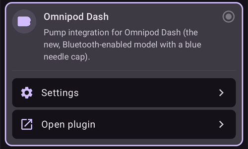

### Verification of Omnipod Driver Selection

Чтобы проверить, что выбран **Omnipod Dash**, откройте **Управление** (нижняя панель навигации главного экрана) и нажмите **Помпа**. Откроется экран помпы DASH, как показано в следующем разделе.

(omnipod-dash-tab)=

## Экран помпы DASH

На экране помпы DASH вы управляете своими Pod: активируете и деактивируете их, обновляете статус Pod, заглушаете оповещения и смотрите журнал Pod. Откройте его через **Управление** > **Помпа** или кнопкой **Открыть модуль** на карточке **Omnipod Dash** в **Конфигурация** > **Помпа**.

Так выглядит экран без активного Pod:


А так — экран с активным Pod:

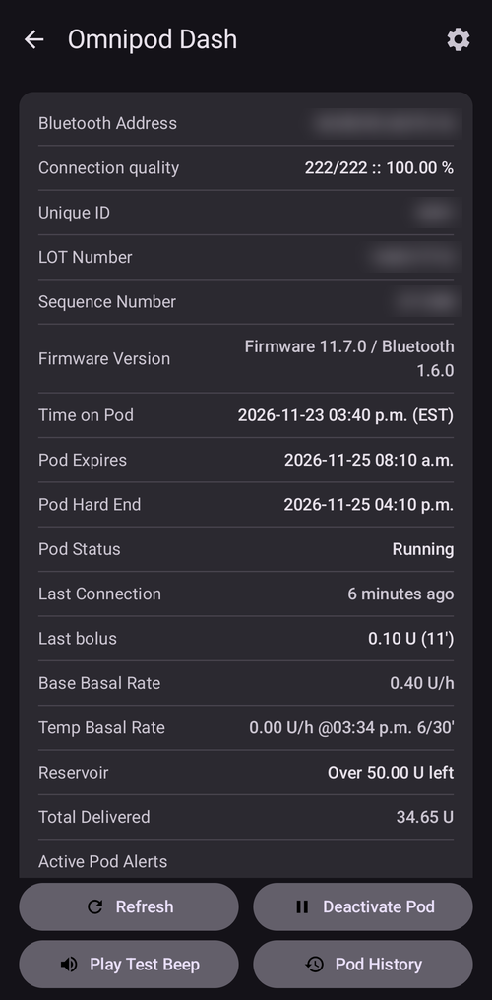

Значок **Настройки** (шестеренка) в правом верхнем углу открывает [настройки Dash](#omnipod-dash-settings).

***ПРИМЕЧАНИЕ:** Если в поле на экране помпы видно «(не подтверждено)», нажмите **Обновить**, чтобы обновить статус Pod.*

### Fields

- **Адрес Bluetooth:** адрес Bluetooth Pod.

- **Качество соединения:** насколько надежно **AAPS** соединяется с Pod. Показывается как *успешные соединения / все попытки соединения :: доля успешных*, например `412/420 :: 98.10 %`. После более чем 50 успешных соединений значение становится желтым ниже 90% и красным ниже 70%. Низкое значение указывает на проблему с Bluetooth (см. [Проблемы, связанные с Bluetooth](#omnipod-dash-bluetooth-related-issues)).

- **Статус подачи:** необработанный статус подачи, который сообщает Pod. Это поле видно только в сборках с режимом отладки.

- **Уникальный ID:** уникальный ID, который **AAPS** присвоил Pod при активации.

- **Номер партии:** номер производственной партии Pod.

- **Порядковый номер:** порядковый номер Pod.

- **Версия прошивки:** версии прошивки и Bluetooth в Pod.

- **Время на Pod:** текущее время на Pod и его часовой пояс. Текст становится красным, если часовой пояс Pod отличается от часового пояса телефона, и желтым, если время Pod отличается больше чем на 10 минут.

- **Срок действия Пода истекает:** дата и время окончания срока работы Pod (72 часа после активации). Текст становится желтым за 4 часа до этого времени. Он никогда не становится красным, так как Pod продолжает подавать инсулин и после этого.

- **Окончательная остановка Pod:** конец дополнительного периода Pod (8 часов после **Срок действия Пода истекает**, то есть максимальный срок работы Pod — 80 часов). Текст становится желтым, когда начинается дополнительный период (в момент **Срок действия Пода истекает**), и красным за 4 часа до окончательной остановки. Во время дополнительного периода также показано оставшееся время, например *(осталось 17 мин)*. При окончательной остановке Pod прекращает подачу инсулина, и его нужно заменить.

- **Статус помпы:** состояние Pod: **Нет активных Pod**, **Выполняется настройка**, **Выполняется**, **Приостановлено** или, после сбоя Pod, **ALARM**.

- **Прошлое соединение:** сколько времени прошло с последней связи **AAPS** с Pod.

  - *Moments ago* - less than 10 seconds ago.

  - *Менее минуты назад* — от 10 до 60 секунд назад.

  - *XX минут назад* — больше 1 минуты назад (и *X часов и XX минут назад* через час).

- **Прошлый болюс:** количество последнего болюса, отправленного на Pod, и сколько времени назад он был подан. Неподтвержденный болюс помечен «(не подтверждено)».

- **Базовая скорость базала:** базальная скорость, заданная на текущее время в вашем базальном **профиле**.

- **Временная базальная скорость:** временный базал (TBR), который работает сейчас, с временем начала и длительностью. Это поле видно, только пока работает временный базал.

- **Резервуар:** показывает *Осталось более 50 ед*, если в резервуаре больше 50 единиц. Ниже 50 единиц показано точное количество. Значение становится красным ниже 20 единиц.

- **Всего подано:** общее количество инсулина, поданного из резервуара. Сюда входит и инсулин, израсходованный на заполнение (прайм).

- **Активные оповещения помпы:** оповещения, которые сейчас активны на Pod, например *Срок работы Pod'а истекает* или *В резервуаре мало инсулина*.

- **Ошибки:** сбой Pod, если Pod вышел из строя. Показывается красным как *Ошибка Pod:*, затем код и название сбоя, например *Ошибка Pod: 020 ALARM_OCCLUDED*. Прошлые ошибки и более подробную информацию смотрите в [Журнал Pod](#omnipod-dash-view-pod-history) и в файлах журналов. См. [Сбои в работе Pod](#omnipod-dash-pod-failures).

- **Уведомление PDM:** показывается только после сбоя Pod. Оно показывает сбой так, как его показал бы PDM Omnipod: заголовок (например, *Обнаружена окклюзия*, *Резервуар пуст* или *Срок Pod истек*), что случилось (например, *Подача инсулина остановлена. Замените Pod.*) и код *Ref:*.

### Buttons

Кнопки внизу экрана помпы меняются в зависимости от состояния Pod. Показаны только кнопки, которые имеют смысл в данный момент.

- **Обновить:** запрашивает у Pod его текущий статус.
  - *Используйте эту кнопку, чтобы обновить статус Pod и убрать «(не подтверждено)» в полях.*
  - *Подробнее см. раздел [Устранение неполадок](#omnipod-dash-troubleshooting) ниже.*

- **Заглушить:** останавливает звуковые сигналы оповещений Pod (например, об окончании срока работы Pod или о низком уровне в резервуаре). Видна, только пока на Pod есть активное оповещение. См. [Отключение звуковых оповещений Pod](#omnipod-dash-silencing-pod-alerts).

- **Возобновить подачу:** возобновляет подачу инсулина на приостановленном Pod. Видна, только когда подача приостановлена. См. [Возобновление подачи инсулина](#omnipod-dash-resuming-insulin-delivery).

- **Установить время:** переводит Pod на часовой пояс телефона, снова отправляя ваш базальный **профиль**. Видна, только когда часовой пояс Pod отличается от часового пояса телефона.

- [**Активировать Pod**](#omnipod-dash-activate-pod): заполняет и активирует новый Pod. Видна, когда нет активного Pod.

- [**Деактивировать Pod**](#omnipod-dash-deactivate-pod): деактивирует активный Pod. Видна, как только Pod сопряжен с **AAPS**, а также когда активация остановилась на полпути (например, потому что Pod вышел из строя во время активации). **AAPS** просит подтверждения, прежде чем деактивировать Pod.

- **Воспроизвести тестовый звуковой сигнал:** Pod подает один тестовый звуковой сигнал.

- [**Журнал Pod**](#omnipod-dash-view-pod-history): показывает историю действий активного Pod.

- **Завершить пользование Pod'ом:** удаляет из **AAPS** Pod, активация которого не завершена. Видна, только когда активация Pod остановилась на полпути. **AAPS** просит подтверждения. После этого **AAPS** больше не может связаться с этим Pod: снимите его с тела.

(omnipod-dash-activate-pod)=

## Activate Pod

1. Откройте экран помпы DASH (**Управление** > **Помпа**) и нажмите **Активировать Pod**. Откроется мастер активации.

   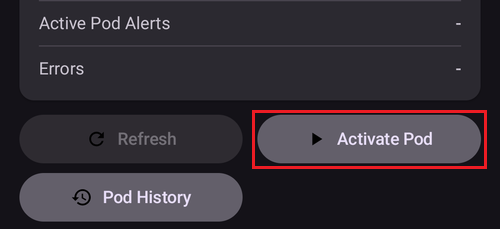

   ```{admonition} Older screenshot
   :class: note
   Скриншот выше сделан в более ранней версии **AAPS**. В **AAPS** 4 **Активировать Pod** — кнопка прямо на экране помпы DASH, а не в меню **Управление Pod**.
   ```

   Если вы еще ни разу не активировали **профиль** в **AAPS**, мастер сначала покажет шаг **Требуется профиль**: выберите профиль, который будет применен при активации, и продолжите.

2. Показан шаг **Заполнить Pod**. Заполните новый Pod инсулином на 3 дня, **не менее 80 единиц**. Дождитесь двух звуковых сигналов от Pod: они значат, что заполнено минимальное количество 80 единиц. Полностью опустошите шприц для заполнения, даже после двух звуковых сигналов. Пока не снимайте колпачок с иглы Pod.

   ***ПРИМЕЧАНИЕ:** Когда рассчитываете количество инсулина на 3 дня, помните, что на заполнение (прайм) Pod уходит примерно 3–10 единиц.*

   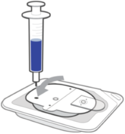

   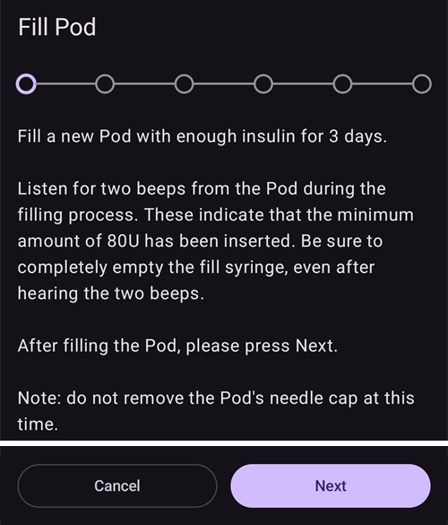

   Убедитесь, что новый Pod и телефон с **AAPS** находятся рядом друг с другом, и нажмите **Далее**.

3. Если вы используете в **AAPS** больше одного инсулина, показывается шаг **Укажите инсулин**. На нем показан инсулин **Сейчас активен**. Если вы заполнили Pod другим инсулином, нажмите **Изменить** и выберите его. Когда активация завершится, **AAPS** выполнит **переключение профиля** с этим инсулином. Нажмите **Далее**.

   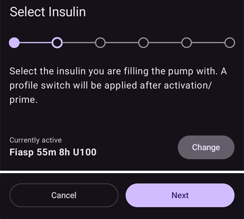

4. На шаге **Инициализировать Pod** **AAPS** выполняет сопряжение с новым Pod и заполняет его (прайм). Вы услышите щелчок, а затем серию тиканий, пока Pod заполняет сам себя. Когда это успешно закончится, появится кнопка **Далее**. Нажмите **Далее**.

   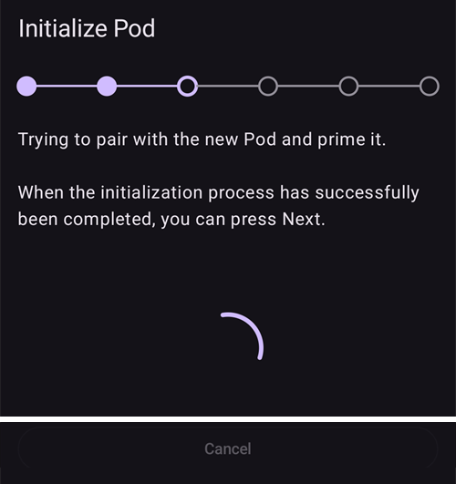    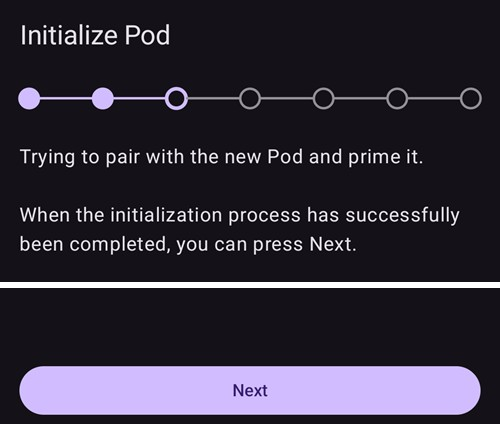

   ***ПРИМЕЧАНИЕ**: Если появится сообщение об ошибке, например _Ошибка сканирования_ или _«Не удалось найти доступный Pod для активации»_ (такое бывает), не паникуйте. Нажмите **Повторить**. В большинстве случаев после этого активация успешно продолжается.*

   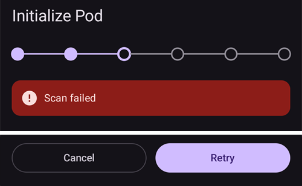

   Если Pod вышел из строя (например, потому что превышено время его активации), вместо **Повторить** показывается **Деактивировать Pod**. Используйте эту кнопку и начните заново с новым Pod.

   Если нажать **Отменить** до завершения активации, **AAPS** попросит подтвердить, что вы хотите выйти. Нажмите **OK**, чтобы выйти из мастера, или **Отменить**, чтобы остаться.

   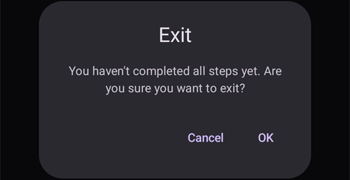

5. Если вы ведете учет мест установки помпы в **AAPS** (**Места установки помпы** в настройках [Места установки](#Aapsscreens-site-rotation)), показывается шаг **Место установки**. Выберите на схеме тела, куда вы установите Pod, и нажмите **Далее** или нажмите **Пропустить**.

   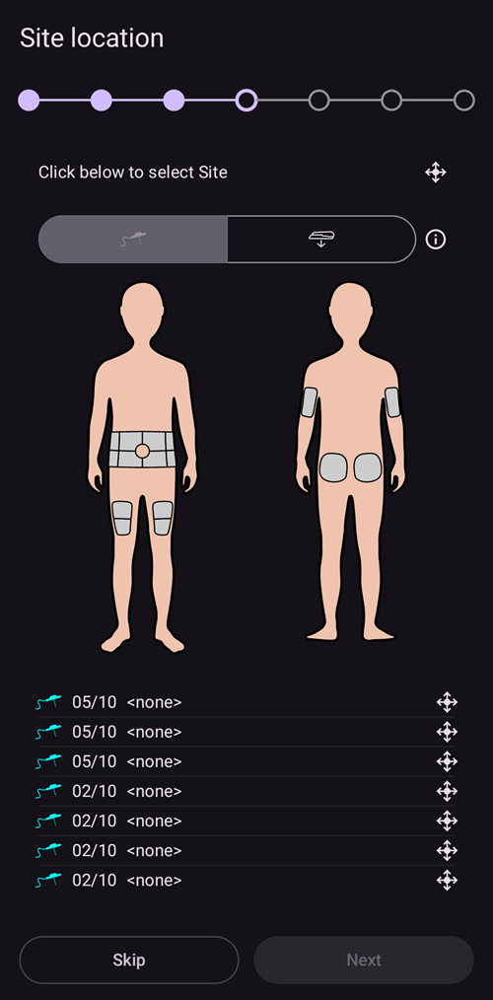

6. Затем подготовьте место инфузии для нового Pod. Вымойте руки, чтобы избежать риска инфекции. Очистите место инфузии водой с мылом или спиртовой салфеткой и дайте коже полностью высохнуть на воздухе, прежде чем продолжить. Если клейкий слой раздражает кожу, попробуйте защитную салфетку или защитный спрей.

   На шаге **Подключить Pod** снимите с Pod синий пластиковый колпачок с иглы. Если катетер или что-то другое выступает из Pod или Pod выглядит необычно, **ОСТАНОВИТЕСЬ**: нажмите **Отменить** и начните заново с новым Pod. Если все выглядит **нормально**, снимите белую бумажную защиту с клейкого слоя и приклейте Pod на выбранное место на теле.

   Когда закончите, нажмите **Далее**.

   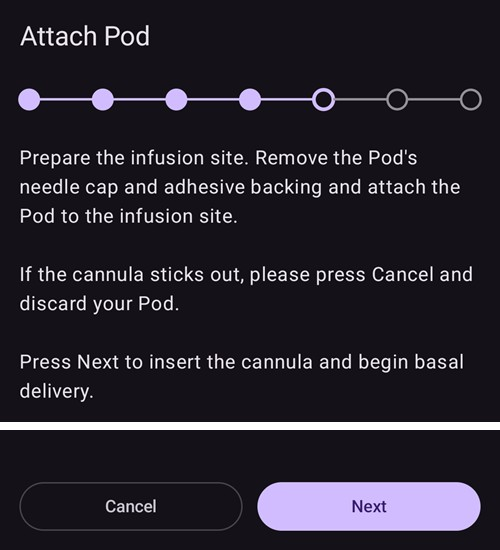

7. Появится диалог подтверждения: *При нажатии OK будет установлен катетер.* **Нажимайте OK, ТОЛЬКО когда вы готовы к установке катетера!**

   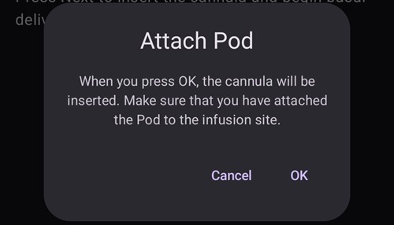

8. На шаге **Вставить катетер** **AAPS** задает ваш график базала, и Pod вводит катетер. Это может занять некоторое время (не более 1–2 минут). **Будьте терпеливы!**

   ***ПРИМЕЧАНИЕ:** Перед введением катетера полезно сжать кожу рядом с местом введения. Так игла входит мягче, и меньше риск окклюзий (закупорок).*

   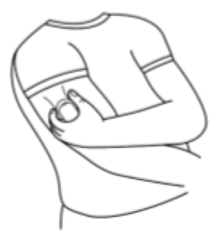    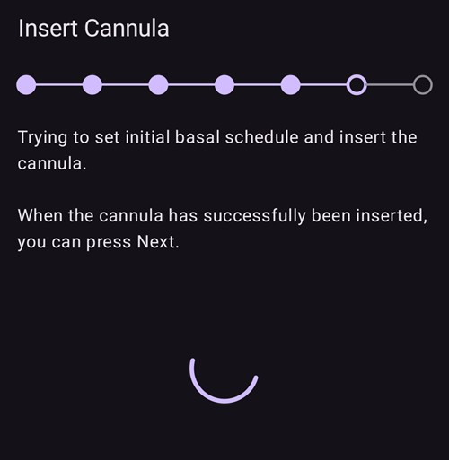

9. Когда катетер успешно введен, появится кнопка **Далее**. Нажмите **Далее**.

   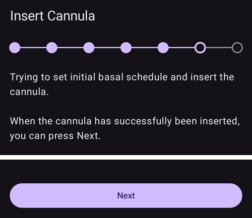

10. Показан шаг **Pod активирован**. Проверьте, что катетер введен правильно, и замените Pod, если вы думаете, что это не так.

    Нажмите **Готово**.

    Поздравляем! Вы начали новую сессию Pod.

    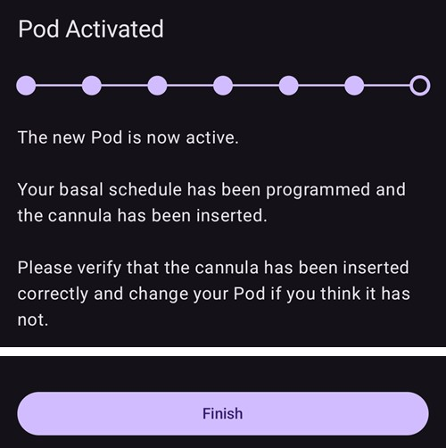

11. Вы снова на экране помпы DASH. Теперь на нем показана информация об активном Pod, в том числе текущая базальная скорость, уровень в резервуаре, поданный инсулин, ошибки и оповещения Pod. Вместо **Активировать Pod** теперь кнопка **Деактивировать Pod**: нельзя активировать другой Pod, не деактивировав сначала активный.

    ***ПРИМЕЧАНИЕ:** Подробнее о показанной информации см. [Экран помпы DASH](#omnipod-dash-tab).*

    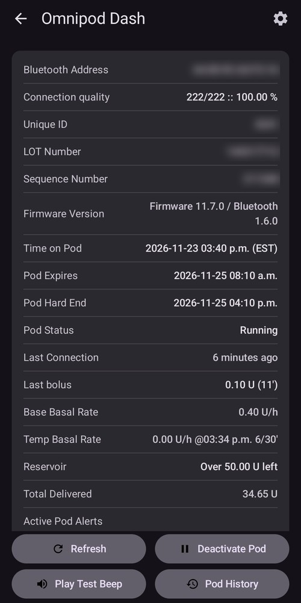

    ***ПРИМЕЧАНИЕ:** Рекомендуем экспортировать настройки ПОСЛЕ активации Pod. Экспортируйте настройки после каждой замены Pod и раз в месяц. Скопируйте файл экспортированных настроек в облачное хранилище (например, Google Диск) или в другое место вне телефона на случай, если вы потеряете телефон (см. [**Экспорт настроек**](../Maintenance/ExportImportSettings.md)).*

Если предыдущая активация остановилась после заполнения Pod, нажатие **Активировать Pod** продолжит с шага **Подключить Pod**.

(omnipod-dash-deactivate-pod)=

## Deactivate Pod

В обычных условиях Pod работает три дня (72 часа), плюс дополнительный период 8 часов после предупреждения об окончании срока работы Pod: всего 80 часов.

Чтобы деактивировать Pod (потому что закончился срок его работы или он вышел из строя):

1. Откройте экран помпы DASH (**Управление** > **Помпа**) и нажмите **Деактивировать Pod**.

   

2. На шаге **Деактивировать Pod** нажмите **Далее**. Диалог спрашивает: *Деактивированный Pod нельзя использовать снова. Деактивировать этот Pod сейчас?* Нажмите **OK**, чтобы начать деактивацию Pod, или **Отменить**, чтобы его оставить. Деактивация останавливает всю подачу инсулина, и ее нельзя отменить.

   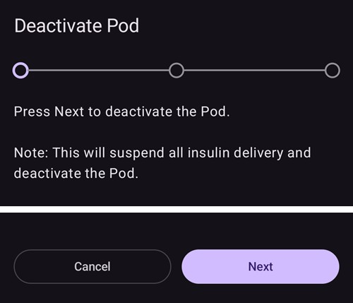

3. Пока **AAPS** деактивирует Pod, показывается шаг **Pod деактивируется**. Pod подает звуковой сигнал, подтверждая, что деактивация прошла успешно.

   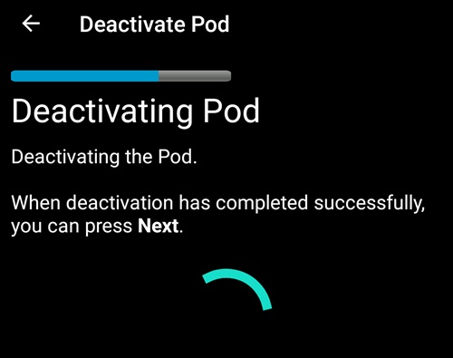

   ```{admonition} Older screenshot
   :class: note
   Скриншот выше сделан в более ранней версии **AAPS**. В **AAPS** 4 мастер показывает ход выполнения рядом точек вверху, а не полосой прогресса.
   ```

   Когда деактивация успешно завершится, появится кнопка **Далее**. Нажмите **Далее**.

   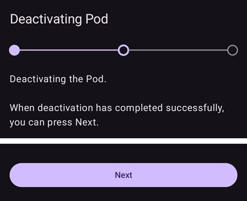

   Если деактивация не удалась, показываются сообщение об ошибке и кнопка **Завершить пользование Pod'ом**. Прежде чем ее использовать, прочитайте раздел [Сброс Pod](#omnipod-dash-discard-pod) ниже. Можно также нажать **Отменить** и попробовать **Деактивировать Pod** позже.

4. Показан шаг **Pod деактивирован**. Снимите Pod с тела и нажмите **Готово**.

   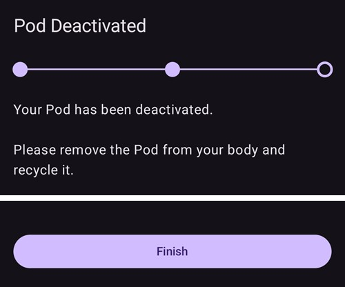

5. Вы снова на экране помпы DASH. Проверьте, что в поле **Статус помпы** указано **Нет активных Pod** и что кнопка **Активировать Pod** снова видна.

   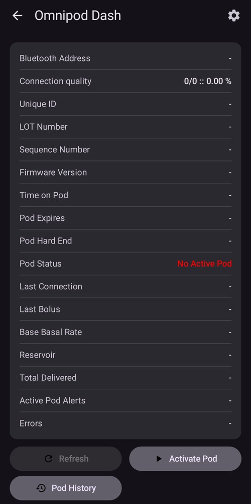

(omnipod-dash-discard-pod)=

### Сброс Pod

Сбрасывайте Pod, только если любая связь с ним постоянно не удается. Если **AAPS** еще может связаться с Pod, используйте вместо этого **Деактивировать Pod**.

- **AAPS** просит подтверждения, прежде чем сбросить Pod.
- После этого **AAPS** больше не может связаться с этим Pod.
- **Подача инсулина НЕ приостановлена**, так как Pod не был правильно деактивирован. **Снимите Pod с тела!**
- Шаг **Pod сброшен** подтверждает, что состояние Pod сброшено. Нажмите **Готово**. Теперь можно активировать новый Pod.

(omnipod-dash-resuming-insulin-delivery)=

## Resuming Insulin Delivery

**ПРИМЕЧАНИЕ**: Во время **переключения профиля**, как и при работе с PDM, **AAPS** должен приостановить подачу на Pod, прежде чем установить новый базальный **профиль**. Если связь прервется между командами приостановки и возобновления, подача может остаться приостановленной. Подробнее см. раздел [**Подача приостановлена**](#omnipod-dash-delivery-suspended) в разделе устранения неполадок.

Когда подача инсулина приостановлена, нужно дать Pod команду возобновить подачу. Когда команда успешно выполнена, Pod снова подает инсулин с базальной скоростью на текущее время из вашего активного базального **профиля**. Pod снова принимает команды болюса, **временного базала** и **SMB**.

1. Откройте экран помпы DASH и проверьте, что в поле **Статус помпы** указано **Приостановлено**. Нажмите **Возобновить подачу**, чтобы Pod возобновил обычную подачу инсулина.

   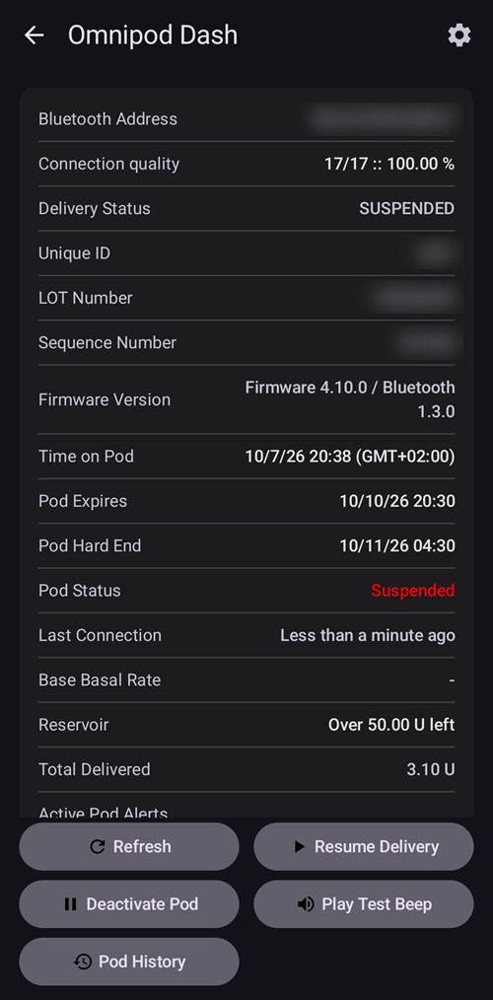

2. Если команда выполнена успешно, в поле **Статус помпы** указано **Выполняется**, а кнопка **Возобновить подачу** исчезает.

   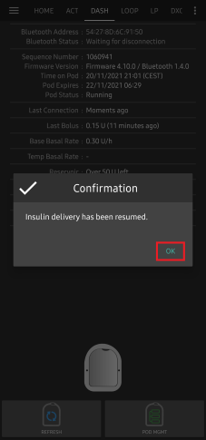

   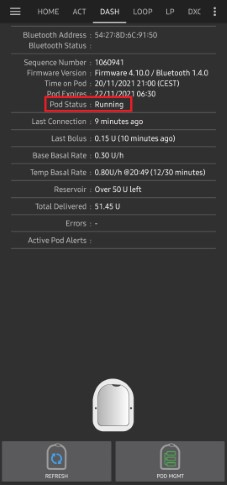

   ```{admonition} Older screenshot
   :class: note
   Скриншоты выше сделаны в более ранней версии **AAPS**, где показывался диалог подтверждения. В **AAPS** 4 результат видно на экране помпы DASH: в поле **Статус помпы** указано **Выполняется**, а кнопки **Возобновить подачу** больше нет.
   ```

   Если команда не удалась, **AAPS** показывает диалог предупреждения, который начинается с *Не удалось возобновить подачу*. Нажмите **Обновить** и попробуйте снова.

   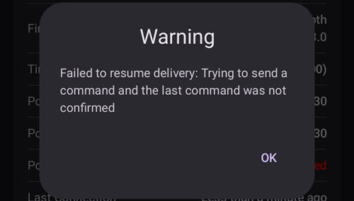

(omnipod-dash-silencing-pod-alerts)=

## Отключение звуковых оповещений пода

В этом разделе описано, как остановить звуковые сигналы Pod, когда срок его работы подходит к концу. Когда начинаются эти сигналы, зависит от настроек **Оповещения** (см. [Настройки Dash](#omnipod-dash-settings)):

- **Напомнить за… часов до окончания срока работы (72 часа):** за сколько часов до окончания 72-часового срока Pod начнет подавать сигналы.
- **Оповещение за... часов до выключения (80 часов):** за сколько часов до выключения на 80-м часу Pod снова подаст сигналы.

Максимальный срок работы Pod — 80 часов (3 дня и 8 часов). Однако производитель Pod рекомендует не использовать его дольше 72 часов (3 дней).

***ПРИМЕЧАНИЕ**: Кнопка **Заглушить** видна на экране помпы DASH, только пока на Pod есть активное оповещение, например об окончании срока работы Pod или о низком уровне в резервуаре. Если кнопки **Заглушить** нет, но вы слышите звуковые сигналы Pod, нажмите **Обновить**.*

1. Когда наступает время напоминания, Pod подает звуковые сигналы: срок его работы скоро закончится, и его нужно заменить. На экране помпы DASH в поле **Срок действия Пода истекает (1)** указано точное время окончания срока работы Pod (72 часа после активации). Текст становится желтым за 4 часа до этого времени. После него поле **Окончательная остановка Pod** становится желтым и показывает, сколько времени осталось до того, как Pod прекратит подачу инсулина. В поле **Активные оповещения помпы (2)** указано **Срок работы Pod'а истекает**, и видна кнопка **Заглушить (3)**.

   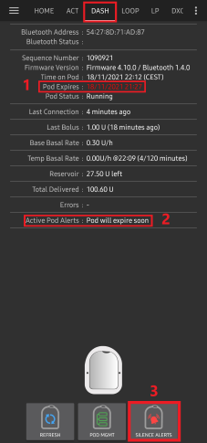

2. Нажмите **Заглушить**. **AAPS** отправляет на Pod команду остановить сигналы об окончании срока работы.

   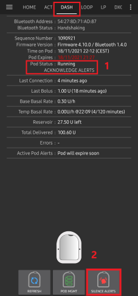

   ```{admonition} Older screenshot
   :class: note
   Скриншот выше сделан в более ранней версии **AAPS**, где этот экран был вкладкой **DASH**. В **AAPS** 4 кнопка **Заглушить** находится на экране помпы DASH (**Управление** > **Помпа**).
   ```

3. Когда оповещения заглушены, оповещение больше не показано в поле **Активные оповещения помпы**, кнопка **Заглушить** исчезает, и Pod перестает подавать сигналы об окончании срока работы.

   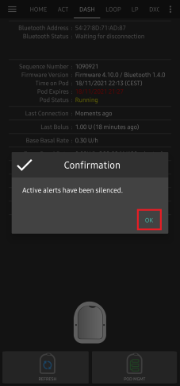

   ```{admonition} Older screenshot
   :class: note
   Скриншот выше сделан в более ранней версии **AAPS**, где показывался диалог подтверждения. В **AAPS** 4 результат видно на экране помпы DASH: оповещение исчезло из поля **Активные оповещения помпы**.
   ```

   Если команда не удалась, **AAPS** показывает диалог предупреждения, который начинается с *Не удалось заглушить оповещения*. Нажмите **Обновить** и попробуйте снова.

Оповещение о низком уровне в резервуаре работает так же. Когда количество инсулина в Pod снижается до значения **К-во единиц**, заданного в настройках **Оповещения**, Pod подает звуковые сигналы. В поле **Резервуар** указано оставшееся количество, в поле **Активные оповещения помпы** — **В резервуаре мало инсулина**, и видна кнопка **Заглушить**. Нажмите **Заглушить**, чтобы остановить сигналы, и запланируйте следующую замену Pod.

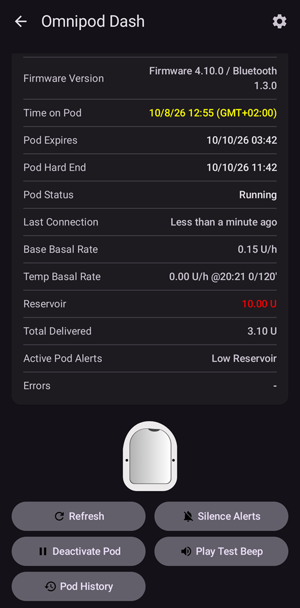

(omnipod-dash-view-pod-history)=

## View Pod History

В этом разделе описано, как посмотреть историю активного Pod и отфильтровать ее по типу действия. Журнал Pod показывает команды, отправленные на активный Pod, и их результаты за весь трехдневный (72–80 часов) срок его работы.

Полезно проверять болюсы, временные базалы и базальные команды, отправленные на Pod. Остальные категории помогают при устранении неполадок и показывают порядок событий, которые привели к сбою.

**ПРИМЕЧАНИЕ:** **Неподтвержденной может быть только последняя команда**. Новые команды *не отправляются*, пока **последняя «неподтвержденная» команда не станет «подтвержденной» или «отклоненной»**. Чтобы «исправить» неподтвержденную команду, нажмите **Обновить** на экране помпы DASH.

1. Откройте экран помпы DASH и нажмите **Журнал Pod**.

   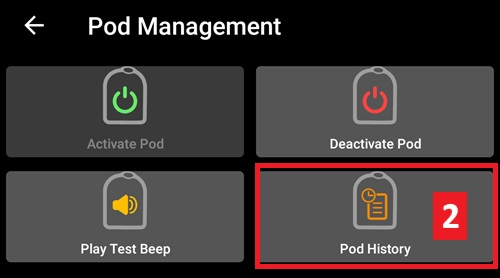

   ```{admonition} Older screenshot
   :class: note
   Скриншот выше сделан в более ранней версии **AAPS**. В **AAPS** 4 **Журнал Pod** — кнопка прямо на экране помпы DASH, а не в меню **Управление Pod**.
   ```

2. Экран **Журнал Pod** открывается с выбранным фильтром **Все**. На нем перечислены все команды со временем и результатом, сначала новые, сгруппированные по дням. Используйте кнопки фильтров вверху (например, **Болюсы** или **Базалы**), чтобы показать только один тип команд. Нажмите стрелку «Назад», чтобы вернуться на экран помпы DASH.

   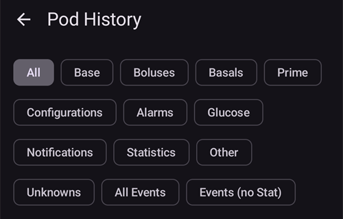 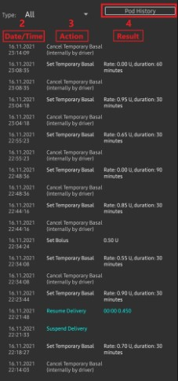

   ```{admonition} Older screenshot
   :class: note
   Второй скриншот выше сделан в более ранней версии **AAPS**, где тип команды выбирался из списка **Тип**. В **AAPS** 4 используются кнопки фильтров, показанные на первом скриншоте.
   ```

   Для болюсов после количества указан тип болюса, если это не обычный болюс, например *0,05 ед (SMB)* или *0,05 ед (Коррекция базала)*. Коррекция базала — очень маленький болюс (один импульс Pod, 0,05 ед), который драйвер отправляет сам; вы его не запрашивали.

   ```{admonition} Why basal corrections happen
   :class: note
   Pod подает базальный инсулин импульсами по 0,05 ед, время которых отсчитывают внутренние часы. Каждый раз, когда базальная скорость меняется (например, когда цикл устанавливает новый **временный базал**), Pod перезапускает эти часы, и импульс, к которому он шел, теряется. Так как цикл часто меняет базальную скорость, особенно ночью, Pod может в итоге подать меньше базального инсулина, чем ожидалось.

   **AAPS** сравнивает базальный инсулин, который Pod сообщает как поданный, с тем, что должно было быть подано. Когда недостача достигает половины импульса или больше, драйвер подает один дополнительный импульс как коррекцию базала, чтобы вы все же получили базальный инсулин, который запросили ваш профиль и цикл. Коррекция не отправляется, пока Pod приостановлен или пока работает нулевой **временный базал**.
   ```

(omnipod-dash-settings)=

## Настройки Dash

Открыть настройки драйвера Dash можно двумя способами:

- Нажмите значок **Настройки** (шестеренка) в правом верхнем углу [экрана помпы DASH](#omnipod-dash-tab).
- Откройте **меню** (☰) в левом верхнем углу главного экрана и выберите **Конфигурация** > **Помпа**. На карточке **Omnipod Dash** нажмите **Настройки**.

Настройки разделены на четыре раскрывающихся раздела: **Звуковые сигналы подтверждения**, **Оповещения**, **Уведомления** и **Дополнительные настройки**. Нажмите на раздел, чтобы открыть его:

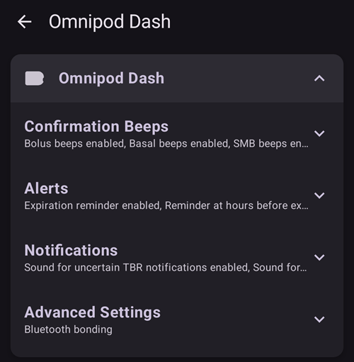

Большинство настроек — переключатели вкл/выкл.

### Confirmation Beeps

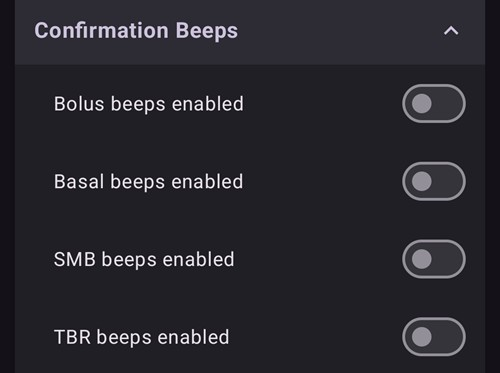

Звуковые сигналы Pod, подтверждающие подачу и изменения болюса, базала, SMB и временного базала.

**Звуковой сигнал болюса включен:**    Pod подает звуковой сигнал, когда подан болюс. По умолчанию включено.

**Звуковой сигнал базала включен:**    Pod подает звуковой сигнал, когда установлена новая базальная скорость или когда активная базальная скорость отменена или изменена. По умолчанию выключено.

**Звуковой сигнал микроболюса SMB включен:**  Pod подает звуковой сигнал, когда подан SMB. По умолчанию включено.

**Звуковой сигнал временного базала TBR включен:**  Pod подает звуковой сигнал, когда временный базал установлен или отменен. По умолчанию выключено.

### Alerts

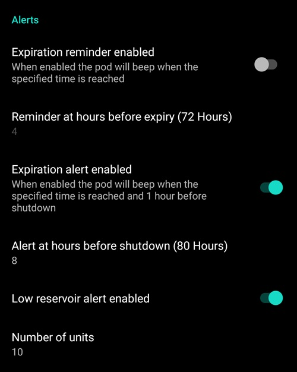

```{admonition} Older screenshot
:class: note
Скриншот выше сделан в более ранней версии **AAPS**. В **AAPS** 4 эти настройки находятся в раскрывающемся разделе **Оповещения**.
```

Оповещения Pod об окончании срока работы, выключении и низком уровне в резервуаре. Если вы меняете эти настройки, когда Pod активен, **AAPS** отправляет на Pod новые настройки оповещений.

***ПРИМЕЧАНИЕ:** Уведомление **AAPS** ВСЕГДА показывается для любого оповещения, как только **AAPS** связался с Pod после срабатывания оповещения. Если закрыть уведомление, оповещение Pod НЕ остановится. Чтобы остановить оповещение, откройте экран помпы DASH и нажмите **Заглушить**.*

**Включено напоминание об истечении срока действия:**    Если включено, Pod подает звуковые сигналы, когда наступает время напоминания. По умолчанию включено.

**Напомнить за… часов до окончания срока работы (72 часа):** за сколько часов до окончания 72-часового срока работы Pod начинается напоминание (от 1 до 24 часов; по умолчанию 4).

**Включено напоминание об истечении срока работы:**   Если включено, Pod подает звуковые сигналы, когда наступает время оповещения, и еще раз за 1 час до выключения. По умолчанию включено.

**Оповещение за... часов до выключения (80 часов):**  за сколько часов до выключения Pod на 80-м часу начинается оповещение (от 1 до 8 часов; по умолчанию 8).

**Предупреждение о низком уровне в резервуаре включено:**    Pod оповещает вас, когда количество инсулина в резервуаре снижается до значения **К-во единиц**. По умолчанию включено.

**К-во единиц:**    количество единиц, при котором срабатывает оповещение о низком уровне в резервуаре (от 5 до 50 единиц; по умолчанию 20).

### Notifications

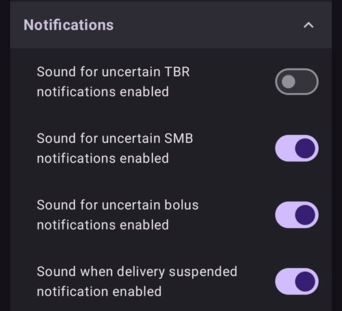

Выберите, будет ли **AAPS** воспроизводить звук с уведомлениями, когда неясно, был ли подан временный базал, SMB или болюс, и когда подача приостановлена.

***ПРИМЕЧАНИЕ:** Это только уведомления телефона; сам Pod звуковых сигналов не подает.*

**Звук для неопределенных уведомлений TBR включен:**  Воспроизводит звук с уведомлением, когда **AAPS** не уверен, был ли установлен временный базал.

**Включено звуковое оповещение о неподтвержденных SMB:**  Воспроизводит звук с уведомлением, когда **AAPS** не уверен, был ли подан SMB.

**Звук для неопределенных уведомлений болюса включен:**    Воспроизводит звук с уведомлением, когда **AAPS** не уверен, был ли подан болюс.

**Звук, когда включено предупреждение о приостановке подачи:**     Воспроизводит звук с уведомлением, когда подача инсулина приостановлена.

(omnipod-dash-advanced-settings)=

### Advanced Settings


**Привязка Bluetooth:**  связывает (привязывает) Pod с телефоном по Bluetooth. Пробуйте эту настройку, только если Pod не может держать стабильное соединение, например на Android 15 (см. [Известные ограничения и проблемы с Omnipod DASH в AAPS](#omnipod-dash-constraints)). Когда она включена, телефон показывает запросы на сопряжение, которые нужно принять. Оставьте ее выключенной, если Pod соединяется нормально. На версиях ниже Android 15 она ни на что не влияет. По умолчанию выключено.

## Возраст инсулина и катетера

[Строка статуса](#screens-sensor-level-battery) на главном экране показывает возраст инсулина и катетера. С Omnipod это работает немного иначе, чем с помпами с трубкой.

**AAPS** автоматически записывает смену катетера и замену инсулина при каждой активации Pod. Поэтому возраст **Инсулин** и **Катетер** сбрасывается на ноль после каждой замены Pod. Вам не нужно записывать их самостоятельно через **Прайм/заполнение**. Это потому, что Pod вводит катетер прямо в кожу там, где он приклеен: Omnipod не использует трубку.

Возраст **Батарея помпы** не показывается: батарея и резервуар для инсулина встроены в каждый Pod, а батарея всегда работает дольше самого Pod (максимум 80 часов).


```{admonition} Older screenshot
:class: note
Скриншот выше сделан в более ранней версии **AAPS**, где этот возраст показывался в разделе **Портал терапии** вкладки **Действия**. В **AAPS** 4 он показан в строке статуса на главном экране.
```

### Level

**Insulin Level**

Показанный уровень инсулина — это количество, которое сообщает Pod. Однако Pod сообщает точный уровень в резервуаре, только когда он ниже 50 единиц. До этого показывается *Осталось более 50 ед*. Сообщаемое количество неточное: когда Pod сообщает «пусто», в большинстве случаев в резервуаре еще остается несколько единиц инсулина.

Экран помпы DASH показывает уровень так:

  * **Осталось более 50 ед** — Pod сообщает, что в резервуаре больше 50 единиц.
  * **Ниже 50 единиц** — точное количество инсулина в резервуаре, как его сообщает Pod.

Additional note:
  * **SMS** — в ответах SMS возвращает значение или 50+U, если больше 50 единиц.
  * **Nightscout** — загружает в Nightscout значение 50, если больше 50 единиц (версия 14.07 и старше). Более новые версии сообщают значение 50+, если больше 50 единиц.

(omnipod-dash-troubleshooting)=

## Устранение неполадок

В этом разделе описаны частые известные проблемы и их решения при работе Omnipod DASH с AAPS. В документации есть также раздел [Устранение неполадок](../GettingHelp/GeneralTroubleshooting.md). Его стоит прочитать, так как он касается и некоторых проблем с Pod.

---

(omnipod-dash-bluetooth-related-issues)=

## Проблемы, связанные с Bluetooth

Об известных проблемах с соединением Bluetooth, обрывах связи с помпой или Pod, а также о проблемах активации и соединения см. [Проблемы с Bluetooth](../GettingHelp/BluetoothTroubleshooting.md)

---

(omnipod-dash-delivery-suspended)=

### Delivery suspended

  - Кнопки приостановки больше нет. Если вы хотите «приостановить» Pod, можно установить нулевой **временный базал** на x минут.
  - Во время **переключения профиля** DASH должен приостановить подачу, прежде чем установить новый базальный **профиль**. Если между двумя командами происходит обрыв связи, подача может быть приостановлена. Когда это происходит:
     - Подачи инсулина не будет, включая Базал, SMB, болюс и т. д.
     - Может быть уведомление о том, что одна из команд не подтверждена: это зависит от того, когда произошел сбой.
     - **AAPS** будет пытаться установить новый базальный профиль каждые 15 минут.
     - Если подача все еще приостановлена (возобновить подачу не удалось), **AAPS** каждые 15 минут показывает уведомление о том, что подача приостановлена.
     - Кнопка [**Возобновить подачу**](#omnipod-dash-resuming-insulin-delivery) видна на экране помпы DASH, если вы хотите возобновить подачу вручную.
     - Если **AAPS** не может сам возобновить подачу (это бывает, если Pod недоступен, звук выключен и т. д.), Pod начнет подавать 4 звуковых сигнала каждую минуту в течение 3 минут, а затем повторять их каждые 15 минут, если подача приостановлена дольше 20 минут.
  - Для неподтвержденных команд нажмите **Обновить** на экране помпы DASH, чтобы подтвердить или отклонить их.

*****ПРИМЕЧАНИЕ:** Если вы слышите звуковые сигналы Pod, не думайте, что подача продолжится, не проверив телефон: подача может остаться приостановленной, ***поэтому обязательно проверьте!******

---
(omnipod-dash-pod-failures)=

### Pod Failures

- Pod иногда выходят из строя по разным причинам, в том числе из-за аппаратных проблем самого Pod.
- Лучше не обращаться в Insulet с запросами о поддержке или замене, так как AAPS — не одобренный способ использования Pod.
- Список кодов ошибок, который поможет определить причину, можно [**найти здесь**](https://github.com/openaps/openomni/wiki/Fault-event-codes).

Когда Pod выходит из строя, он прекращает подачу инсулина и непрерывно подает звуковой сигнал. **AAPS** показывает на главном экране уведомление с кодом и названием сбоя и кодом *Ref:*, например *Ошибка Pod: 020 ALARM_OCCLUDED*. Нажмите **Закрыть**, чтобы закрыть уведомление. Звуковой сигнал Pod от этого не прекратится.

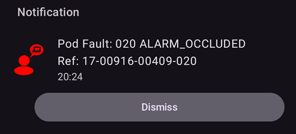

На экране помпы DASH в поле **Статус помпы** указано **ALARM**, в поле **Ошибки** — сбой Pod, а поле **Уведомление PDM** объясняет его, например *Обнаружена окклюзия. Подача инсулина остановлена. Замените Pod. Проверьте ГК*.

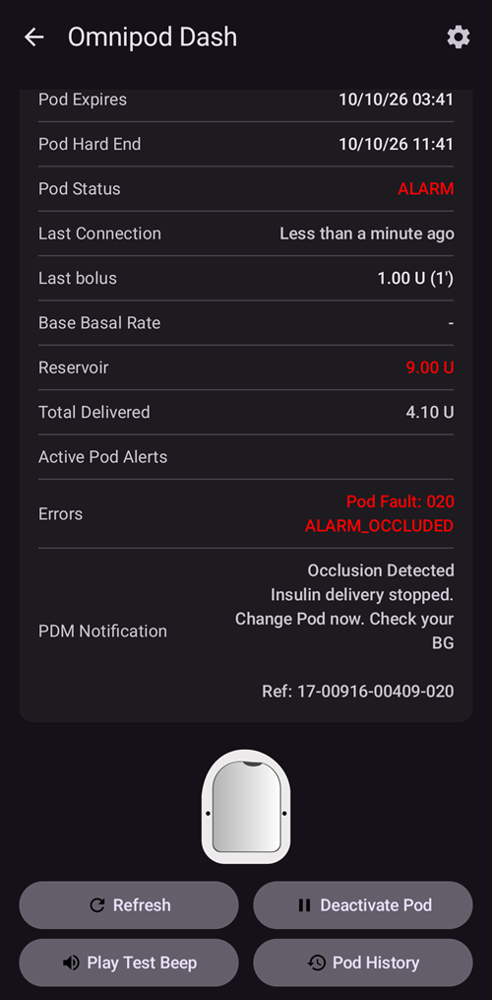

Вышедший из строя Pod нельзя использовать снова. Проверьте уровень глюкозы крови, затем [деактивируйте Pod](#omnipod-dash-deactivate-pod) и активируйте новый.

---
### Предотвращение сбоев Pod с ошибкой 49

Этот сбой связан с неверным состоянием Pod для команды или с ошибкой во время команды подачи инсулина. Это случай, когда драйвер и Pod по-разному видят текущее состояние. Тогда Pod (из-за встроенной меры безопасности) выдает неустранимую ошибку с кодом 49 (0x31), и все заканчивается так называемым «screamer»: долгим раздражающим звуковым сигналом, который можно остановить, только проколов отверстие в нужном месте на задней стороне Pod. The exact origin of a “49 pod failure” often is hard to trace. Это может случиться, например, после сбоев приложения, при использовании версии для разработчиков или после переустановки.

---

### Pump Unreachable Alerts

Если связь с Pod не удается установить в течение заданного времени, появится оповещение «Помпа недоступна». Оповещения о недоступности помпы можно настроить: нажмите значок **Настройки** (шестеренка) в правом верхнем углу главного экрана, затем выберите **Локальные оповещения** ➜ **Порог недоступности помпы**. Рекомендуемое значение — оповещение через **120** минут.

---
(omnipod-dash-export-import)=
### Экспорт и импорт настроек

Экспорт настроек **AAPS** позволяет восстановить все ваши настройки и цели, например после переустановки **AAPS** или на новом телефоне. **Экспортируйте настройки сразу после каждой активации Pod** и скопируйте файл в надежное место вне телефона (например, на Google Диск), чтобы можно было восстановить и активный Pod. См. [Создание и восстановление резервных копий](#ExportImportSettings-Settings-Export).

```{admonition} Importing settings can end your active Pod
:class: warning
На телефоне, который уже работает с Pod, оставьте **Также заменить настройки помпы** без отметки: сессия Pod сохранится, а импортируются только остальные настройки. Отмечайте этот пункт только на новом телефоне и с файлом, экспортированным во время Pod, который вы носите сейчас. См. [Помпы без трубки](#ExportImportSettings-tubeless-pumps).
```

Если импортированные настройки содержат Pod, который уже не активен, см. следующий раздел.

---
### Importing settings that contain Pod state from an inactive Pod

При импорте настроек с данными Pod, который уже не активен, AAPS попытается связаться с ним, и это, конечно, не получится. В этой ситуации нельзя активировать новый Pod.

Чтобы удалить старую сессию Pod:
1. На экране помпы DASH нажмите **Деактивировать Pod**. Деактивация, скорее всего, не удастся.
2. Когда она не удастся, нажмите **Завершить пользование Pod'ом** и подтвердите (см. [Сброс Pod](#omnipod-dash-discard-pod)).
3. После удаления старого Pod можно активировать новый.

### Общая ошибка: java.lang.IllegalStateException: Trying to set a Bluetooth Address to ***, but it is already set to ***.

Если вы получили эту ошибку при попытке инициализировать новый Pod, значит, **AAPS** не может это сделать, так как в конфигурации еще хранятся настройки старого Pod.

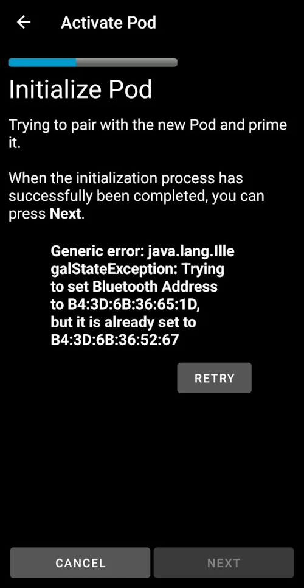

Это может случиться при восстановлении из резервной копии или если деактивация Pod не удалась.

Чтобы решить проблему, нажмите **Отменить** и выйдите из активации. На экране помпы DASH нажмите **Завершить пользование Pod'ом**, если эта кнопка видна. Иначе нажмите **Деактивировать Pod**, а если деактивация не удастся, нажмите **Завершить пользование Pod'ом** (см. [Сброс Pod](#omnipod-dash-discard-pod)).

Теперь вы сможете активировать новый Pod.

---
### Reinstalling AAPS

При удалении **AAPS** вы потеряете все настройки, цели и текущую сессию Pod. **Чтобы их восстановить, у вас должен быть недавно экспортированный файл настроек!**

Если Pod активен, используйте экспорт, сделанный во время текущей сессии Pod (см. [Экспорт и импорт настроек](#omnipod-dash-export-import)).

1. Экспортируйте настройки и сохраните копию в надежном месте (например, на Google Диске).
2. Удалите **AAPS** и перезагрузите телефон.
3. Установите новую версию **AAPS**.
4. Импортируйте настройки.
5. Проверьте все настройки (при желании снова импортируйте настройки).
6. Активируйте новый Pod.
7. Когда закончите: Экспортируйте текущие настройки.

---
### Updating AAPS to a newer version

In most cases there is no need to uninstall. You can do an “in-place” install by starting the installation for the new version. Это возможно и во время активной сессии Pod.

1. Экспортируйте настройки.
2. Установите новую версию **AAPS**.
3. Убедитесь, что установка прошла успешно
4. ВОЗОБНОВИТЕ подачу на Pod или активируйте новый Pod.
5. Когда закончите: Экспортируйте текущие настройки.

---
### Omnipod driver alerts

Драйвер Omnipod Dash показывает на **главном экране** разные особые оповещения. Большинство из них информационные, и их можно закрыть, но некоторые требуют от пользователя действия, чтобы устранить причину оповещения.

A summary of the main alerts that you may encounter is listed below:

- *Ошибка Pod: XXX NAME*, затем *Ref: ...*: Pod вышел из строя и прекратил подачу инсулина. Замените Pod. См. [Сбои в работе Pod](#omnipod-dash-pod-failures).
- *Нет активных Pod*: сессия Pod не найдена. Это уведомление появляется снова и снова, пока вы не активируете новый Pod. Когда Pod активирован, оно исчезает автоматически.
- *Введение инсулина приостановлено*: Pod приостановил подачу инсулина. См. [Возобновление подачи инсулина](#omnipod-dash-resuming-insulin-delivery).
- *Возможно, не удалось задать базальный профиль. Подача инсулина может быть приостановлена! Обновите вручную статус Pod на экране помпы и при необходимости возобновите подачу.* Возможно, не удалось задать базальный **профиль** на Pod. Нажмите **Обновить** на экране помпы DASH и нажмите **Возобновить подачу**, если эта кнопка видна.
- *Не удалось проверить, подан ли SMB (X ед). Обновите статус Pod, чтобы подтвердить или отклонить эту команду.* **AAPS** не удалось подтвердить, что **SMB** был подан. Нажмите **Обновить** на экране помпы DASH и проверьте поле **Прошлый болюс**.
- *Статус подачи болюса неясен. Обновите статус Pod, чтобы подтвердить или отклонить.* То же для обычного болюса: нажмите **Обновить** на экране помпы DASH.
- *Часовой пояс Pod отличается от часового пояса на телефоне. Базальная скорость неверна. Переключите профиль для исправления* См. примечание о переходе на летнее время и смене часового пояса в разделе [Известные ограничения и проблемы с Omnipod DASH в AAPS](#omnipod-dash-constraints).

(omnipod-dash-where-to-get-help-for-dash)=

## Куда обращаться за помощью

Вся разработка драйвера DASH выполняется сообществом на **добровольной** основе. Помните об этом и выполните следующие рекомендации, прежде чем просить о помощи:

-  **Уровень 0:** Прочитайте соответствующий раздел этой документации, чтобы удостовериться, что вы понимаете, как должна работать функция, с которой вы испытываете трудности.
-  **Уровень 1:** Если вы все еще сталкиваетесь с проблемами, которые не можете решить, изучая документацию, перейдите в канал *#AAPS* на **Discord** с помощью [этой ссылки-приглашения](https://discord.gg/4fQUWHZ4Mw). Есть также много групп в Facebook и других сетях, где тоже можно задать вопрос (см. [**Где получить помощь?**](../GettingHelp/WhereCanIGetHelp.md))
-  **Уровень 2:** Поищите среди существующих проблем ([Issues](https://github.com/nightscout/AndroidAPS/issues)), не сообщал ли кто-то уже о вашей проблеме. Если она есть, подтвердите ее, оставьте комментарий или добавьте информацию о своей проблеме. Если нет, создайте [новый вопрос](https://github.com/nightscout/AndroidAPS/issues) и приложите [свои лог-файлы](../GettingHelp/AccessingLogFiles.md).
-  **Будьте терпеливы: большинство участников нашего сообщества — добровольцы, и решение проблем часто требует времени и терпения как от пользователей, так и от разработчиков.**

Когда просите о помощи, подготовьте следующую информацию, чтобы участникам сообщества было проще разобраться в ваших вопросах и проблемах:
- Производитель и модель телефона Android
- Версия Android (например, 15 или 16)
  - Вы недавно обновляли версию Android?
- Версия **AAPS**, которую вы используете
- Простое описание проблемы, с учетом следующих вопросов
   - Раньше это работало?
   - Когда это работало, а когда нет?
   - Вы меняли настройки конфигурации или профиля?
   - Вы недавно выполняли сопряжение с новым устройством Bluetooth?
   - Вы обновляли или устанавливали новое приложение?
   - Как долго все работало, прежде чем перестало?
