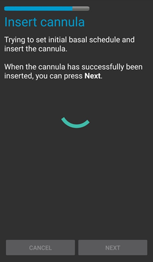
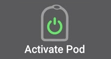
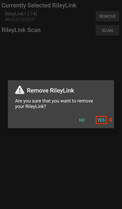

# Omnipod Eros

These instructions are for configuring the Omnipod Eros generation pump (**NOT Omnipod Dash**).

```{admonition} Omnipod Eros is being phased out
:class: note

The [Omnipod System](https://www.omnipod.com/current-podders/resources/omnipod-system) (the original Omnipod, comprising both the Personal Diabetes Manager (PDM) and the Pod) is being discontinued, and the end date varies by country. For example, it will no longer be available in Canada after 30 June 2026. If you rely on the Eros pump, plan ahead for a transition to a supported pump.
```

**Это программное обеспечение - часть алгоритма самостоятельно настраиваемой ИПЖ; она не является коммерческим продуктом, но требует, чтобы вы прочитали, узнали и поняли, как ей пользоваться. Только вы несете ответственность за то, что делаете.**

```{contents} Table of contents
:depth: 1
:local: true
```

## Требования к аппаратному и программному обеспечению

- **Устройство связи с Pod**

> Компонент, позволяющий AAPS общаться с подами Eros.
> 
> > -   Сайт [OrangeLink ](https://getrileylink.org/product/orangelink)
> > -  [433MHz RileyLink](https://getrileylink.org/product/rileylink433)
> > -   Сайт [Emalink](https://github.com/sks01/EmaLink) - [Контактная информация](mailto:getemalink@gmail.com)
> > -   DiaLink - [Контактная информация](mailto:Boshetyn@ukr.net)
> > -   [LoopLink сайт](https://www.getlooplink.org/) - [Контактная информация](https://jameswedding.substack.com/) - Непроверено

-   **Мобильный Телефон**

> Компонент, который будет работать с AAPS и отправлять команды управления устройству Pod.
> 
> > - Supported [Android phone](#Phones-list-of-tested-phones) with **AAPS** and related components set up.

-   **Устройство подачи инсулина**

> Компонент, который интерпретирует команды, полученные от коммуникационного устройства Pod, для AAPS.
> 
> > - Новый Omnipod (поколения Eros - **НЕ DASH**)

These instructions assume that you are starting a new pod session. If this is not the case, please be patient and start this process at your next pod change.

In this page, **RileyLink** means any of the pod communication devices listed above.

## Подготовка к работе

**БЕЗОПАСНОСТЬ на первом месте** Не пытайтесь выполнять этот процесс в среде, где нет возможности исправить ошибку (дополнительные поды, инсулин, устройства управления помпой обязательны).

**Ваш PDM Omnipod не будет работать после того, как драйвер Omnipod активирует ваш под**. Раньше вы использовали Omnipod PDM для отправки команд на Omnipod Eros. Под Omnipod Eros позволяет коммуникацию только с одним устройством. Устройство, которое успешно активирует под - единственное устройство, которому с этого момента будет разрешено с ним общаться. Это означает, что после активации пода с телефона через драйвер AAPS Eros, **вы больше не сможете пользоваться пультом PDM с этим подом**. Драйвер AAPS Omnipod с RileyLink теперь является вашим действующим PDM. *Это НЕ означает, что вы должны выкинуть PDM, рекомендуется хранить его в резерве и для чрезвычайных ситуаций, если ААПС работает неправильно.*

**Only one RileyLink at a time can communicate with a pod.** **AAPS** remembers one paired RileyLink. If you pair a different one, it replaces the previous one.

**Ваш Pod не будет отключится, когда RileyLink находится вне диапазона.** Когда RileyLink находится вне диапазона или сигнал заблокирован от связи с активным pod, ваш под будет продолжать давать базальный инсулин. После активации Pod базальный профиль, заданный в AAPS, будет запрограммирован в новый Pod. Если вы потеряете контакт с Pod, он обратится к этому базальному профилю. Вы не сможете выдавать новые команды до тех пор, пока RileyLink не вернется в диапазон и не восстановит соединение.

**30 -минутные профили базала НЕ поддерживаются в AAPS.** Если вы новичок в AAPS и устанавливаете базальный профиль впервые, имейте в виду, что получасовые базальные скорости не поддерживаются в AAPS, и следует настроить свой базальный профиль на часовые интервалы. Например, если ваша базальная скорость 1,1 ед., начинается в 09:30, длится 2 часа и заканчивается в 11:30, такие настройки работать не будут.  Следует изменить базал в 1,1 единицы на диапазон времени с 9:00 до 11:00 или с 10:00 до 12:00.  Несмотря на то, что расширение профиля базисной скорости в 30 минут поддерживается аппаратным обеспечением Omnipod, в настоящее время AAPS не в состоянии учесть их с помощью своих алгоритмов.

## Включение драйвера Eros в AAPS

Активировать драйвер Omnipod Dash в AAPS можно **двумя способами**:

### Вариант 1: Мастер настройки

After installing a new version of AAPS, the **Setup Wizard** starts automatically. If you have already exported your settings from a previous installation, you can import them in the wizard. For new installations, continue below.

Go through the [Setup Wizard](../SettingUpAaps/SetupWizard.md) until you reach the **Pump** step, then select **Omnipod Eros** (the description reads "Pump integration for Omnipod Eros").


The Setup Wizard does not pair your RileyLink. After finishing the wizard, open the Omnipod pump screen and pair it as described in the [RileyLink Setup section](#OmnipodEros-rileylink-setup).

**ИЛИ**

### Option 2: The Configuration screen

Open the top-left **menu** (☰) > **Configuration** > **Pump** and select the **radio button** of **Omnipod Eros**.

Once it is selected, the **Omnipod Eros** card shows two buttons, **Settings** and **Open plugin**:


**Settings** opens the settings of the Omnipod driver (see [Omnipod Settings](#OmnipodEros-omnipod-settings)):


**Open plugin** opens the Omnipod pump screen. You can also open it at any time from the main screen with **Manage** > **Pump**. This page calls it the **Omnipod pump screen**. Before a RileyLink is paired and a pod is activated, it looks like this:


### Verification of Omnipod Driver Selection

To verify that you have enabled the Omnipod driver, open **Manage** > **Pump** from the main screen. You should see the **Omnipod Eros** pump screen shown above. If you have not paired a RileyLink yet, **RileyLink Status** shows **Not Started** and **Pod Status** shows **No Active Pod**.

## Конфигурация Omnipod

All pod and RileyLink functions are buttons on the [Omnipod pump screen](#OmnipodEros-omnipod-pod-tab) (**Manage** > **Pump**). Some buttons only appear in certain situations, for example when a pod is active.

>  Обновление соединения и статуса Pod
> 
>  Управление подом (Активация, Деактивация, проверка звукового сигнала, журнал помпы)

```{admonition} Older screenshot
:class: note
The screenshots above are from an earlier **AAPS** version. In **AAPS** 4 there is no **POD MGMT** button or Pod Management menu: **Refresh** and all pod management actions are buttons on the Omnipod pump screen.
```

(OmnipodEros-rileylink-setup)=

### Настройка RileyLink

If you have already paired your RileyLink, continue to the [Activating a Pod section](#OmnipodEros-activating-a-pod) below.

*Note: A good visual indicator that the RileyLink is not connected is that the treatment buttons (QuickLaunch toolbar) on the main screen will be missing. Это произойдет примерно в течение первых 30 секунд после запуска AAPS, так как он активно подключается к RileyLink.*

1. Make sure that your RileyLink is fully charged and powered on.

2. Place the RileyLink [close to your phone](#OmnipodEros-optimal-omnipod-and-rileylink-positioning) (~30 cm away or less).

3. Open the Omnipod pump screen (**Manage** > **Pump**) and press **Pair RileyLink**.

4. The **Pair RileyLink** screen starts scanning for Bluetooth devices right away. Tap your RileyLink in the list of found devices.

   

5. When **RileyLink paired successfully** is shown with the name and address of your device, press **OK**.

6. Back on the Omnipod pump screen, check that **RileyLink Status** changes to **Connected**. **Pod Status** should show **No Active Pod**. If the RileyLink does not connect, press **Reset RileyLink**, or restart **AAPS**.

 

 


```{admonition} Older screenshot
:class: note
The six screenshots above (after step 6) are from an earlier **AAPS** version. In **AAPS** 4 you pair the RileyLink with the **Pair RileyLink** button on the Omnipod pump screen instead of **RileyLink Configuration** in the Omnipod settings, and scanning starts automatically.
```

```{note}
To switch to another RileyLink (for example a backup device), press **Pair RileyLink** again and select the new device. It replaces the one paired before. You do not need to remove the old device first.
```

(OmnipodEros-activating-a-pod)=

### Активация Pod

Before you can activate a pod, make sure your RileyLink is paired and **RileyLink Status** shows **Connected**. The **Activate Pod** button stays disabled until the RileyLink is ready.

*ПРЕДУПРЕЖДЕНИЕ: Коммуникация для активации Pod происходит на ограниченной дистанции, что вызвано мерами безопасности. Перед сопряжением радиосигнал Pod более слабый, однако после подключения связь будет работать при полной мощности сигнала. During these procedures, make sure that your pod is* [within close proximity](#OmnipodEros-optimal-omnipod-and-rileylink-positioning) *(~30 cm away or less) but not on top of or right next to the RileyLink.*

01. Open the Omnipod pump screen (**Manage** > **Pump**) and press **Activate Pod**.

    If you have never activated a profile, a **Profile required** step appears first. Select the profile to apply on activation.

    >   
    > 
    > ```{admonition} Older screenshot
    >     :class: note
    >     The screenshots above are from an earlier **AAPS** version. In **AAPS** 4 **Activate Pod** is a button on the Omnipod pump screen instead of in the **POD MGMT** menu.
    > ```

02. Появится экран **Заполнить Pod**. Fill a new pod with enough insulin for 3 days and listen for two beeps. They mean that the minimum amount of 80 units has been filled. Empty the fill syringe completely, even after hearing the two beeps. При подсчете общего количества инсулина на 3 дня, учитывайте, что первичное заполнение катетера Pod потребует 12-15 единиц инсулина. Do not remove the pod's needle cap yet.

    > 
    > 
    > Ensure the new pod and RileyLink are within close proximity of each other (~30cm or less) and press **Next**.

03. **Select Insulin** (only shown if you have more than one insulin configured): select the insulin you are filling the pod with and press **Next**. A profile switch with this insulin is applied after activation.

04. На экране **Инициализация Pod**, Pod начнет первичное заполнение ( вы услышите щелчок с серией последующих тикающих звуков пока заполняется под). Если RileyLink при активации находится вне диапазона, вы получите сообщение об ошибке **Нет ответа от Pod**. If this occurs, [move the RileyLink closer](#OmnipodEros-optimal-omnipod-and-rileylink-positioning) (~30 cm away or less) to but not on top of or right next to the Pod and press **Retry**.

    >  

05. When priming is successful, a green checkmark is shown and the **Next** button becomes enabled. Press **Next**.

    > 

06. **Site location** (only shown if **Manage pump site rotation** is enabled in [Site Rotation](#Aapsscreens-site-rotation)): select where you place the pod on your body and press **Next**.

07. The **Attach Pod** screen is displayed. Prepare the infusion site of the new pod. Remove the pod's plastic needle cap and white paper backing from the adhesive and apply the pod to your chosen site on your body. If the cannula sticks out, press **Cancel** and discard the pod. When finished, press **Next**.

    > 

08. A confirmation dialog appears: "When you press OK, the cannula will be inserted". **ONLY press OK if you are ready to deploy the cannula**.

    > 

09. On the **Insert Cannula** screen, it may take some time before the Omnipod responds and inserts the cannula (1-2 minutes maximum), so be patient.

    > Если RileyLink при активации находится вне диапазона, вы получите сообщение об ошибке **Нет ответа от Pod**. If this occurs, move the RileyLink closer (~30 cm away or less) to but not on top of or right next to the Pod and press **Retry**.
    > 
    > Если RileyLink находится вне диапазона Bluetooth или не имеет активного подключения к телефону, вы получите сообщение об ошибке **Нет ответа от RileyLink**. If this occurs, move the RileyLink closer to the phone and press **Retry**.
    > 
    > *ПРИМЕЧАНИЕ: Перед установкой катетера рекомендуется ущипнуть кожу рядом с местом ввода катетера. Это уменьшает болевые ощущения при вводе иглы и снижает шансы на развитие окклюзий.*
    > 
    > 
    > 
    >  

10. При успешном вводе катетера появляется зеленая галочка и активируется кнопка **Далее**. Press **Next**.

    > 

11. The **Pod Activated** screen is displayed. Check that the cannula has been inserted correctly, and change your pod if you think it has not. Press **Finish**. Поздравляем! Вы начали новую активную сессию Pod.

    >  
    > 
    > ```{admonition} Older screenshot
    >     :class: note
    >     The screenshots in steps 2 to 11 are from an earlier **AAPS** version and may look different in **AAPS** 4. The **Select Insulin** and **Site location** steps are not pictured.
    > ```

12. You are returned to the Omnipod pump screen. The **Activate Pod** button is replaced by **Deactivate Pod**, because you cannot activate another pod without deactivating the active one first.

    The pump screen now shows information about your active pod, including the current basal rate, reservoir level, insulin delivered, pod errors and alerts. For more details, see the [Omnipod pump screen](#OmnipodEros-omnipod-pod-tab) section.

     

    ```{admonition} Older screenshot
    :class: note
    The screenshots above are from an earlier **AAPS** version. In **AAPS** 4 there is no Pod Management menu: you return directly to the Omnipod pump screen, where **Deactivate Pod** replaces **Activate Pod**.
    ```

```{note}
If activation was interrupted after priming (for example the app was closed), press **Activate Pod** again. The wizard continues from the cannula insertion steps.
```

### Деактивация Pod

При нормальных условиях ожидаемое время жизни пода 3 дня (72 часа) и дополнительно 8 часов после предупреждения об истечении срока действия, в общей сложности 80 часов.

To deactivate a pod (either from expiration or from a pod failure):

1. Open the Omnipod pump screen (**Manage** > **Pump**) and press **Deactivate Pod**.

   >   
   > 
   > ```{admonition} Older screenshot
   >    :class: note
   >    The screenshots above are from an earlier **AAPS** version. In **AAPS** 4 **Deactivate Pod** is a button on the Omnipod pump screen instead of in the **POD MGMT** menu.
   > ```

2. On the **Deactivate Pod** screen, first make sure the RileyLink is in close proximity to the pod but not on top of or right next to the pod. Then press **Next**. A dialog asks *A deactivated Pod can not be used again. Deactivate this Pod now?* Press **OK** to start deactivating the pod, or **Cancel** to keep it. Deactivation suspends all insulin delivery and cannot be undone.

   > 

3. The **Deactivating Pod** screen appears, and you will receive a confirmation beep from the pod that deactivation was successful.

   > 
   > 
   > **IF deactivation fails** and you do not receive a confirmation beep, you may receive a **No response from RileyLink** or **No response from Pod** message. Press **Retry** to attempt deactivation again. If deactivation keeps failing, press **Discard Pod** and confirm. **AAPS** then forgets the pod. Insulin delivery has **not** been suspended, so remove the pod from your body. If your pod has a screaming alarm, you may need to silence it manually (using a pin or a paperclip), because **Discard Pod** does not silence it.
   > 
   > >   

4. A green checkmark appears when deactivation is successful. Press **Next** to display the **Pod Deactivated** screen. Теперь вы можете удалить свой pod так как активная сессия завершена.

   > 

5. Press **Finish** to return to the Omnipod pump screen.

   >  
   > 
   > ```{admonition} Older screenshot
   >    :class: note
   >    The screenshots in steps 2 to 5 are from an earlier **AAPS** version and may look different in **AAPS** 4.
   > ```

6. On the Omnipod pump screen, check that **RileyLink Status** shows **Connected** and **Pod Status** shows **No Active Pod**.

   >    
   > 
   > ```{admonition} Older screenshot
   >    :class: note
   >    The screenshots above are from an earlier **AAPS** version. In **AAPS** 4 **Finish** returns you directly to the Omnipod pump screen; there is no Pod Management menu or **Omnipod (POD)** tab.
   > ```

### Приостановка и возобновление подачи инсулина

The process below shows you how to suspend and resume insulin delivery.

*NOTE - if you do not see a **Suspend** button*, it is hidden by default. Enable **Show Suspend Delivery button in Omnipod tab** in the [Omnipod settings](#OmnipodEros-omnipod-settings) under **Other**.

#### Приостановка подачи инсулина

Используйте эту команду, чтобы перевести активный Pod в приостановленное состояние. В этом приостановленном состоянии Pod больше не подает инсулин. Эта команда имитирует функцию приостановки, которую подает оригинальный пульт Omnipod PDM на активный Pod.

1. Open the Omnipod pump screen (**Manage** > **Pump**) and press **Suspend**. The suspend command is sent through the RileyLink to the active pod.

2. When the pod has suspended all insulin delivery, **Pod Status** shows **Suspended** and the **Suspend** button is replaced by **Resume Delivery**.

   >  
   > 
   > 
   > 
   >  
   > 
   > ```{admonition} Older screenshot
   >    :class: note
   >    The screenshots above are from an earlier **AAPS** version. In **AAPS** 4 these steps take place on the Omnipod pump screen instead of the **Omnipod (POD)** tab, and the result is shown in **Pod Status**.
   > ```

If the command fails, a **Warning** dialog shows "Failed to suspend delivery" with the reason. Check the RileyLink connection and try again.

#### Resuming Insulin Delivery

Используйте эту команду, чтобы приостановленный Pod возобновил подачу инсулина. После успешной обработки команды, нормальная подача инсулина возобновится в соответствии с текущим активным профилем базала. Pod снова будет принимать команды на болюс, TBR и SMB.

1. Open the Omnipod pump screen and check that **Pod Status** shows **Suspended**. Press **Resume Delivery**.

2. When the command succeeds, **Pod Status** shows **Running** again and the **Resume Delivery** button disappears (the **Suspend** button is shown again if you have enabled it).

   >  
   > 
   > 
   > 
   >  
   > 
   > ```{admonition} Older screenshot
   >    :class: note
   >    The screenshots above are from an earlier **AAPS** version. In **AAPS** 4 these steps take place on the Omnipod pump screen instead of the **Omnipod (POD)** tab, and the result is shown in **Pod Status**.
   > ```

If the command fails, a **Warning** dialog shows "Failed to resume delivery" with the reason. Check the RileyLink connection and try again.

### Отключение звуковых оповещений пода

*NOTE - The **Silence Alerts** button is only shown on the Omnipod pump screen while the pod has an active alert (for example the pod expiration or low reservoir alert), and only if **Automatically silence Pod alerts** is disabled.*

The process below shows you how to silence pod beeps that start when the pod reaches the warning time before it expires. This warning time is set with **Alert at hours before shutdown (80 Hours)** in the Omnipod **Alerts** settings. Максимальная продолжительность работы Pod составляет 80 часов (3‑е суток + 8 часов), однако производитель (Insulet) рекомендует не превышать 72 часа (3‑х суток).

*NOTE - If you have enabled **Automatically silence Pod alerts** in the Omnipod **Alerts** settings, **AAPS** silences the alert automatically at the next communication with the pod, and you do NOT need to do it manually.*

1. When the warning time is reached, the pod beeps to tell you that it will soon expire and needs to be changed. On the Omnipod pump screen, **Pod Expires** shows the exact time the pod expires (72 hours after activation); it turns **yellow** 4 hours before. **Pod Hard End** shows when the pod stops delivering insulin. **Active Pod Alerts** shows **Pod will expire soon**, and the **Silence Alerts** button appears. **AAPS** also shows a notification about the upcoming pod expiration.

   >   
   > 
   > ```{admonition} Older screenshot
   >    :class: note
   >    The screenshots above are from an earlier **AAPS** version. In **AAPS** 4 the **ACK ALERTS** button is called **Silence Alerts** and is on the Omnipod pump screen.
   > ```

2. Press **Silence Alerts**. The RileyLink sends the command to the pod to stop the expiration warning beeps.

   >  
   > 
   > ```{admonition} Older screenshot
   >    :class: note
   >    The screenshot above is from an earlier **AAPS** version. In **AAPS** 4 the button is called **Silence Alerts**.
   > ```

3. When the alerts are silenced, the pod beeps twice. **Active Pod Alerts** no longer shows the warning, the **Silence Alerts** button disappears and the pod stops its expiration warning beeps.

   >  
   > 
   > ```{admonition} Older screenshot
   >    :class: note
   >    The screenshot above is from an earlier **AAPS** version. In **AAPS** 4 the result is shown on the Omnipod pump screen: the warning disappears from **Active Pod Alerts**.
   > ```

If the command fails (for example the RileyLink is out of range of the pod), a **Warning** dialog shows "Failed to silence alerts" with the reason. Move the RileyLink closer to the pod and try again.


```{admonition} Older screenshot
:class: note
The screenshot above is from an earlier **AAPS** version. In **AAPS** 4 the **Warning** dialog shows "Failed to silence alerts" with the reason.
```

(OmnipodEros-view-pod-history)=

### View Pod History

В этом разделе показано, как просмотреть историю активного пода и отфильтровать ее по различным категориям. Инструмент истории пода позволяет просматривать действия текущего активного пода за трое суток его жизни (72 - 80 часов).

Эта функция полезна для проверки болюсов, TBR, изменений базала, но без уверенности в завершении. Остальные категории полезны для решения проблем, а также для определения хода событий, приводящих к сбою.

*ПРИМЕЧАНИЕ:* В логах Pod появятся **Не подтверждено**, однако из-за характера таких сообщений невозможно опредилить их точность.

1. Open the Omnipod pump screen (**Manage** > **Pump**) and press **Pod History**.

   >   
   > 
   > ```{admonition} Older screenshot
   >    :class: note
   >    The screenshots above are from an earlier **AAPS** version. In **AAPS** 4 **Pod History** is a button on the Omnipod pump screen instead of in the **POD MGMT** menu.
   > ```

2. The **Pod History** screen lists all pod actions and their results, newest first, grouped by day. By default **All** is selected. Tap one of the filter buttons at the top to show only one category. Use the back arrow at the top left to return to the Omnipod pump screen.

   > 

   >  
   > 
   > ```{admonition} Older screenshot
   >    :class: note
   >    The second screenshot is from an earlier **AAPS** version and may look different in **AAPS** 4.
   > ```

### Просмотр настроек и журнала RileyLink

The **RileyLink Stats** screen shows the settings of your RileyLink and active pod, and the communication history of both. It has two tabs: **Settings** and **History**.

The **RileyLink Stats** button is hidden by default. To show it on the Omnipod pump screen, enable **Show RileyLink Stats button in Pod Management menu** in the [Omnipod settings](#OmnipodEros-omnipod-settings) under **Other**.

#### Восстановление передачи данных с устройства Bluetooth

If your pod communication device was out of Bluetooth range of your phone for a while, **RileyLink Status** may report **RileyLink unreachable** on the Omnipod pump screen. **AAPS** normally reconnects by itself when the device is back in range. If it does not:

1. Make sure the RileyLink is powered on, charged and close to your phone.

2. On the Omnipod pump screen, press **Reset RileyLink**. A message confirms **RileyLink configuration reset**. See the [Reset RileyLink notes](#OmnipodEros-reset-rileylink-config-notes) below.

3. Если **Соединение Bluetooth** не восстановится, попробуйте вручную **выключить** и затем **включить** функцию Bluetooth в телефоне.

4. If it still does not reconnect, press **Pair RileyLink** and select your RileyLink again.

5. After a successful reconnection, **RileyLink Status** shows **Connected**. You can also check **Connection Status** on the **Settings** tab of the **RileyLink Stats** screen. Поздравляем, теперь вы подключились к AAPS с настроенными устройствами!

 


```{admonition} Older screenshot
:class: note
The screenshots above are from an earlier **AAPS** version. In **AAPS** 4 you reconnect with **Reset RileyLink** or **Pair RileyLink** on the Omnipod pump screen instead of the refresh button on the RileyLink Settings screen.
```

#### Коммуникационное устройство Pod и активные настройки Pod

This screen shows information and status for both the currently paired pod communication device and the currently active Omnipod Eros pod. The information refreshes automatically.

1. Open the Omnipod pump screen (**Manage** > **Pump**) and press **RileyLink Stats**. The **Settings** tab shows your currently paired **RileyLink** and the active pod (**Device**).

   >   
   > 
   > ```{admonition} Older screenshot
   >    :class: note
   >    The screenshots above are from an earlier **AAPS** version. In **AAPS** 4 **RileyLink Stats** is a button on the Omnipod pump screen instead of in the **POD MGMT** menu.
   > ```

   > 

##### RileyLink fields

> - **Address:** MAC address of the paired pod communication device.
> - **Name:** Bluetooth name of the paired pod communication device.
> - **Battery Level:** The current battery level of the connected pod communication device. Only shown when **Show battery level reported by OrangeLink/EmaLink/DiaLink** is enabled.
> - **Статус соединения**: Текущий статус соединения Bluetooth с устройством коммуникации Pod.
> - **Connection Error:** If there is an error with the pod communication device Bluetooth connection, details are displayed here.
> - **Версия прошивки:** Текущая версия прошивки на подключенном устройстве связи.

##### Device fields - With an Active Pod

> - **Device Type:** The type of device communicating with the pod communication device (Omnipod (Eros)).
> - **Configured Device Model:** The model of the device configured to communicate with the pod communication device.
> - **Connected Device Model:** The model of the device currently communicating with the pod communication device.
> - **Pump Serial Number:** Serial number of the currently activated pod.
> - **Pump Frequency:** Radio frequency used to communicate with the pod.
> - **Last Used Frequency:** Last known radio frequency the pod used to communicate with the pod communication device.
> - **Последняя Контактная запись устройства:** Дата и время последнего контакта c устройством соединения.

(omnipod-eros-rileylink-i-active-pod-history)=
#### RileyLink и журнал активного Пода

This tab lists, newest first, each state or action of the RileyLink or the currently connected pod. The history is only available for the currently active pod. After a pod change, this history is erased and only events from the newly activated pod are recorded and shown.

1. Open the Omnipod pump screen (**Manage** > **Pump**), press **RileyLink Stats** and then tap the **History** tab.

   >   
   > 
   > ```{admonition} Older screenshot
   >    :class: note
   >    The screenshots above are from an earlier **AAPS** version. In **AAPS** 4 **RileyLink Stats** is a button on the Omnipod pump screen instead of in the **POD MGMT** menu.
   > ```

   > 

##### Fields

Each entry shows:

> - **Device:** The device to which the action or state refers.
> - **Time:** The time of the event.
> - **State or Action:** The state of the device or the action it performed.

(OmnipodEros-omnipod-pod-tab)=

## Omnipod pump screen

Below is an explanation of the status fields and buttons on the **Omnipod pump screen** (**Manage** > **Pump**, or **Configuration** > **Pump** > **Open plugin**).

The gear icon at the top right opens the [Omnipod settings](#OmnipodEros-omnipod-settings).

*NOTE: If any status field shows (uncertain), press **Refresh** to refresh the pod status and clear it.*


```{admonition} Older screenshot
:class: note
The screenshot above is from an earlier **AAPS** version, where this screen was the **Omnipod (POD)** tab. In **AAPS** 4 it is the Omnipod pump screen, and some field names and buttons differ.
```

### Fields

- **RileyLink Status:** Displays the current connection status of the RileyLink. Errors are shown in red.

- *Not Started* - no RileyLink is paired yet, or the connection has not started.
- *RileyLink unreachable* - pod communication device is either not within Bluetooth range of the phone, powered off or has a failure preventing Bluetooth communication.
- *RileyLink ready* - pod communication device is powered on and actively initializing the Bluetooth connection.
- *Подключено* - устройство связи включено, подключено и способно активно общаться через Bluetooth.

- **Unique ID:** Displays the address of the active pod.

- **LOT Number:** Displays the LOT number of the active pod.

- **Sequence Number:** Displays the serial number (TID) of the pod.

- **Версия прошивки:** Отображает версию прошивки активного POD.

- **Время на Pod:** Отображает текущее время на POD It is highlighted when it differs from the phone time by more than 5 minutes.

- **Pod Expires:** Displays the date and time when the active pod will expire. The text turns yellow in the last 4 hours before this time. It never turns red, because the pod keeps delivering insulin after it.

- **Pod Hard End:** Displays the end of the pod's grace period (8 hours after **Pod Expires**, for a maximum pod life of 80 hours). The text turns yellow when the grace period starts (at **Pod Expires**) and red in the last 4 hours before the hard end. During the grace period it also shows the time left, for example *(17m remaining)*. The pod stops delivering insulin at the hard end and must be changed.

- **Pod Status:** Displays the status of the active pod (for example **No Active Pod**, **Running** or **Suspended**).

- **Last Connection:** Displays the last time communication with the active pod was achieved. The text turns red when the [pump unreachable threshold](#OmnipodEros-troubleshooting) is exceeded.

- *Только что* - меньше 20 секунд назад.
- *Менее минуты назад* - более 20, но менее 60 секунд назад.
- *1 минуту назад* - более 60, но менее 120 секунд (2 мин)
- *XX минут назад* - более 2 минут назад, определяется величиной XX

- **Last Bolus:** Displays the dosage of the last bolus sent to the active pod and how long ago it was issued in parenthesis.

- **Base Basal Rate:** Displays the basal rate programmed for the current time from the basal rate profile.

- **Temp Basal Rate:** Only shown while a Temporary Basal Rate is running. Displays it in the following format:

- Единицы / час @ время начала TBR (отработаных минут / общее время TBR)
- *Пример:* 0.00ед./ч. @18:25 ( 90/120 мин.)

- **Reservoir:** Displays **Over 50 U left** when more than 50 units are left in the reservoir. Below this value the approximate number of units is displayed. The text turns red below the low reservoir threshold set in the [Alerts settings](#OmnipodEros-omnipod-settings).

- **Total Delivered:** Displays the total number of units of insulin delivered from the reservoir. *Обратите внимание, что это приблизительная величина, поскольку первичное заполнение POD не является точным процессом.*

- **Active Pod Alerts:** Reserved for currently running alerts on the active pod. Обычно используется при истечении срока действия pod последние 72 часа, а звуковые оповещения работают.

- **Errors:** Displays the last error encountered (shown in red). Изучите [Pod history](#OmnipodEros-view-pod-history), [RileyLink history](#omnipod-eros-rileylink-and-active-pod-history) и лог-файлы для подробной информации.

### Buttons

The buttons at the bottom of the pump screen change depending on the situation. Buttons that cannot be used right now are greyed out, for example while the RileyLink is not connected.

**Pod status buttons** (shown when a pod is active):

- **Refresh:** Sends a refresh command to the active pod to update its status. Use it to refresh the pod status and clear status fields that contain the text (uncertain). Дополнительную информацию см. в разделе [Устранение неполадок](#OmnipodEros-troubleshooting) ниже.

  

  ```{admonition} Older screenshot
  :class: note
  The screenshot above is from an earlier **AAPS** version. In **AAPS** 4 this is a text button named **Refresh** on the Omnipod pump screen.
  ```

- **Silence Alerts:** Silences the pod expiration and low reservoir beeps and notifications. Only shown when the pod has an active alert and **Automatically silence Pod alerts** is disabled. After the alerts are silenced, the button disappears.

  

  ```{admonition} Older screenshot
  :class: note
  The screenshot above is from an earlier **AAPS** version. In **AAPS** 4 this button is called **Silence Alerts**.
  ```

- **Set time:** Updates the time on the pod with the current time on your phone. Only shown when the time on the pod differs from the phone time by more than 5 minutes.

  

  ```{admonition} Older screenshot
  :class: note
  The screenshot above is from an earlier **AAPS** version. In **AAPS** 4 this is a text button named **Set time** on the Omnipod pump screen.
  ```

- **Suspend:** Suspends insulin delivery on the active pod. Only shown if enabled in the settings (**Show Suspend Delivery button in Omnipod tab**).

  

  ```{admonition} Older screenshot
  :class: note
  The screenshot above is from an earlier **AAPS** version. In **AAPS** 4 this is a text button named **Suspend** on the Omnipod pump screen.
  ```

- **Resume Delivery:** Resumes insulin delivery on the currently suspended, active pod. Only shown while the pod is suspended.

  

  ```{admonition} Older screenshot
  :class: note
  The screenshot above is from an earlier **AAPS** version. In **AAPS** 4 this is a text button named **Resume Delivery** on the Omnipod pump screen.
  ```

**Pod and RileyLink management buttons:**


```{admonition} Older screenshot
:class: note
The screenshot above is from an earlier **AAPS** version. In **AAPS** 4 there is no Pod Management menu: these actions are buttons directly on the Omnipod pump screen.
```

- **Activate Pod:** Primes and activates a new pod. Shown when no pod is active. It is enabled only when the RileyLink is connected.

  

  ```{admonition} Older screenshot
  :class: note
  The screenshot above is from an earlier **AAPS** version. In **AAPS** 4 **Activate Pod** is a button on the Omnipod pump screen instead of in the Pod Management menu.
  ```

- **Deactivate Pod:** Deactivates the currently active pod. Shown as soon as a pod is paired, also when an activation stopped part-way (for example because the pod failed during activation). It is enabled only when the RileyLink is connected. **AAPS** asks you to confirm before it deactivates the pod.

- Используйте эту команду, чтобы деактивировать под, издающий звуковое оповещение об окончании срока работы (ошибка 49).
- If deactivation fails, the deactivation wizard offers a **Discard Pod** option.

  

  ```{admonition} Older screenshot
  :class: note
  The screenshot above is from an earlier **AAPS** version. In **AAPS** 4 **Deactivate Pod** is a button on the Omnipod pump screen instead of in the Pod Management menu.
  ```

- **Play Test Beep:** Plays a single test beep on the pod when pressed. Shown when a pod is paired.

  

  ```{admonition} Older screenshot
  :class: note
  The screenshot above is from an earlier **AAPS** version. In **AAPS** 4 **Play Test Beep** is a button on the Omnipod pump screen instead of in the Pod Management menu.
  ```

- **Pod History:** Displays the active pod activity history. See [View Pod History](#OmnipodEros-view-pod-history).

  

  ```{admonition} Older screenshot
  :class: note
  The screenshot above is from an earlier **AAPS** version. In **AAPS** 4 **Pod History** is a button on the Omnipod pump screen instead of in the Pod Management menu.
  ```

- **Pair RileyLink:** Scans for your pod communication device and pairs it. See [RileyLink Setup](#OmnipodEros-rileylink-setup).

- **RileyLink Stats:** Opens the RileyLink Stats screen with two tabs. Only shown if enabled in the settings (**Show RileyLink Stats button in Pod Management menu**).

- **Настройки** - отображает информацию о RileyLink и настройках активного Pod
- **История** - отображает историю коммуникации RileyLink и Pod

  

  ```{admonition} Older screenshot
  :class: note
  The screenshot above is from an earlier **AAPS** version. In **AAPS** 4 **RileyLink Stats** is a button on the Omnipod pump screen instead of in the Pod Management menu.
  ```

- **Reset RileyLink:** Resets the configuration of the currently connected pod communication device. When communication is started, specific data is sent to and set in the RileyLink:

- Memory Registers are set
- Communication Protocols are set
- Tuned Radio Frequency is set
  > 
  > See [additional notes](#OmnipodEros-reset-rileylink-config-notes) below.

  

  ```{admonition} Older screenshot
  :class: note
  The screenshot above is from an earlier **AAPS** version. In **AAPS** 4 this button is called **Reset RileyLink** and is on the Omnipod pump screen.
  ```

- **Discard Pod:** Discards the pod state of an unresponsive pod, after a confirmation. Only shown when a pod has been started but not fully paired, as proper deactivation is no longer possible:

- **Pod не полностью сопряжен ** и поэтому игнорирует команды на деактивацию.
- A **pod is stuck** during the pairing process between steps.
- **Pod просто не сопрягается**
  > 
  > After you discard a pod, **AAPS** can no longer communicate with it. Remove the pod from your body.

  

  ```{admonition} Older screenshot
  :class: note
  The screenshot above is from an earlier **AAPS** version. In **AAPS** 4 **Discard Pod** is a button on the Omnipod pump screen instead of in the Pod Management menu.
  ```

(OmnipodEros-reset-rileylink-config-notes)=

#### *Reset RileyLink Notes*

- Эта функция в основном требуется когда не отвечает активное устройство связи и коммуникация зависла.
- If the pod communication device is turned off and then back on, press **Reset RileyLink** so that these communication parameters are set again in the pod communication device.
- Если это НЕ выполнено, то AAPS необходимо будет перезапустить после того, как перезагрузится устройство (Riley) передачи данных.
- This button **DOES NOT** need to be pressed when switching between different pod communication devices.

(OmnipodEros-omnipod-settings)=

## Настройки Omnipod

To open the Omnipod driver settings, either:

- press the gear icon at the top right of the Omnipod pump screen (**Manage** > **Pump**), or
- open the top-left **menu** (☰) > **Configuration** > **Pump** and press **Settings** on the **Omnipod Eros** card.


```{admonition} Older screenshot
:class: note
The screenshot above is from an earlier **AAPS** version. In **AAPS** 4 you open the settings with **Settings** on the **Omnipod Eros** card or the gear icon on the Omnipod pump screen, instead of the settings gear in **Configuration** or the 3-dot menu.
```

The settings are grouped as listed below. Tap a group to expand it. Most entries are switches you can enable or disable:


*ПРИМЕЧАНИЕ: Знак (\*) обозначает что выбрано значение по умолчанию.*

### RileyLink / РайлиЛинк

Settings for the pod communication device. You pair the device itself with the **Pair RileyLink** button on the pump screen (see [RileyLink Setup](#OmnipodEros-rileylink-setup)).

- **Use Scanning:** Scans before connecting to the OrangeLink. This can improve connections. It can also be used with other RileyLink clones if needed.

- **Show battery level reported by OrangeLink/EmaLink/DiaLink:** Reports the actual battery level of the OrangeLink/EmaLink/DiaLink. **Настоятельно рекомендуется** всем пользователям OrangeLink/EmaLink/DiaLink активировать эту настройку.

- НЕ работает с оригинальным RileyLink.
- Может не работать с альтернативами RileyLink.
- Включено - Отображает текущий уровень заряда для поддерживаемых устройств связи.
- Отключено - Отображает значение n/a.

- **Enable battery change logging in Actions:** Only available when the battery reporting setting above is enabled. Some pod communication devices can use regular batteries that you can change. With this setting enabled, you can record a **Pump Battery Change** [careportal entry](#aaps-screens-careportal) to note the change and reset the battery age.

### Confirmation Beeps

Provides confirmation beeps from the pod for bolus, basal, SMB, and TBR delivery and changes.

- **Звуковой сигнал болюса включен** Включить или отключить подтверждающие сигналы при подаче болюса.
- **Basal beeps enabled:** Enable or disable confirmation beeps when a new basal rate is set, active basal rate is canceled or current basal rate is changed.
- **Звуковой сигнал микроболюсов SMB включен** Включить или отключить подтверждающие сигналы при подаче микроболюсов.
- **Звуковой сигнал временного базала TBR включен** Включить или отключить подтверждающие сигналы при установке или отмене TBR.

### Alerts

Оповещения AAPS и Nightscout об истечении срока, выключении, низком резервуаре на основе заданных пороговых значений.

*Примечание: уведомления AAPS выдаются ВСЕГДА, для любого оповещения после связи с pod с момента срабатывания оповещения. Dismissing the notification will NOT silence the alert UNLESS **Automatically silence Pod alerts** is enabled. To silence the alert MANUALLY, open the Omnipod pump screen and press **Silence Alerts**.*

- **\*Expiration reminder enabled:** When enabled, the pod beeps when the time set below is reached.
- **Alert at hours before shutdown (80 Hours):** The number of hours before the pod shuts down (80 hours after activation) at which the expiration reminder is triggered (1 to 8 hours, default 8).
- **Предупреждение о низком уровне резервуара включено:** Включить или отключить оповещение, когда достигается нижний лимит определенный в поле Количество единиц емкости.
- **Number of units:** The number of units at which to trigger the pod low reservoir alert (5 to 50, default 20).
- **Automatically silence Pod alerts:** When enabled, a notification is still issued, but the alert is silenced automatically at the next communication with the pod after the alert started.

### Notifications

Выдает уведомления AAPS и звуковые оповещения, когда нет уверенности в успешных TBR, SMB, болюсах или приостановленных событиях.

*ПРИМЕЧАНИЕ: Это только уведомления, звуковые оповещения об ошибках не производится.*

- **\*Sound for uncertain TBR notifications enabled:** Enable or disable this setting to trigger an audible alert and visual notification when AAPS is uncertain if a TBR was successfully set.
- **Звук для неопределенных уведомлений SMB включен:** Включите или отключите этот параметр, чтобы вызвать звуковое оповещение и визуальное уведомление, когда AAPs неизвестно, был ли успешно подан микроболюс SMB.
- **Звук для неопределенных уведомлений о болюсах включен:** Включите или отключите этот параметр, чтобы вызвать звуковое оповещение и визуальное уведомление, когда AAPs неизвестно, был ли успешно подан болюс.

### Другое

Предоставляет расширенные настройки для содействия отладке.

- **Show Suspend Delivery button in Omnipod tab:** Hide or display the **Suspend** button on the Omnipod pump screen.
- **Show Pulse Log button in Pod Management menu:** This setting is still listed, but the current version of the pump screen has no **Pulse Log** button.

- **Show RileyLink Stats button in Pod Management menu:** Hide or display the **RileyLink Stats** button on the Omnipod pump screen.
- **\*DST/Time zone detection enabled:** Allows time zone changes to be automatically detected if the phone is used in an area where DST is observed.

### Переключение или удаление активного устройства связи с Pod (RileyLink)

With many alternative models to the original RileyLink available (such as OrangeLink or EmaLink), or the need to have multiple or backup versions of the same pod communication device, you may need to switch to another device.

To switch, open the Omnipod pump screen (**Manage** > **Pump**), press **Pair RileyLink** and select the new device, as described in [RileyLink Setup](#OmnipodEros-rileylink-setup). The new device replaces the previously paired one.

 


 

```{admonition} Older screenshot
:class: note
The screenshots above are from an earlier **AAPS** version. In **AAPS** 4 you add a device with **Pair RileyLink** on the Omnipod pump screen instead of **RileyLink Configuration** in the Omnipod settings, and scanning starts automatically.
```

There is no separate button to remove a paired device. If you stop using a RileyLink, simply pair the new one when you need it.





```{admonition} Older screenshot
:class: note
The screenshots above are from an earlier **AAPS** version. In **AAPS** 4 there is no **Remove** button: pairing a new RileyLink replaces the previous one.
```

## Status row and careportal

There are a few items that are specific to how the Omnipod pod differs from tube based pumps, especially after applying a new pod.

The **insulin** and **cannula** ages in the [status row](#screens-sensor-level-battery) of the main screen are **reset** to 0 days and 0 hours **after each pod change**. Это происходит из-за устройства и принципа работы Omnipod. **Батарея помпы** и **резервуар инсулина** в каждом поде свои. Так как Pod вводит катетер непосредственно в кожу на месте установки, в помпах Omnipod не применяется традиционная трубка. *Поэтому после замены пода значение каждой из этих величин автоматически сбрасывается на ноль***Возраст батареи помпы**не отображается поскольку он всегда больше срока работы пода (максимум 80 часов).


### Уровни

**Insulin Level**

Информация о количестве инсулина в Omnipod Eros не является точной. This is because it is not known exactly how much insulin was put in the pod, only that when the 2 beeps are triggered while filling the pod at least 80 units have been filled. Под может вместить максимум 200 единиц. Priming can also introduce variance as it is not an exact process. Учитывая оба этих фактора и был написан драйвер Omnipod, который дает максимально точное приближение к количеству остающегося в резервуаре инсулина.

> - **больше 50 единиц** - Pod сообщает о количестве более 50 единиц.
> - **Ниже 50 единиц** - Сообщает о приблизительно вычисленном количестве инсулина в резервуаре.
> - **SMS** - В SMS сообщается реальный остаток в ед. или 50+ед
> - **Nightscout** - при более чем 50 единиц в Nightscout выгружается значение 50 ед.(версия 14.07 и старше).  Более новые версии покажут 50 + когда более 50 единиц.

**Уровень заряда батареи**

Отчет об уровне заряда батареи - это настройка, которая может быть включена для отображения текущего уровня заряда таких устройств как OrangeLink, EmaLink или DiaLink.  Устройство RileyLink не может передавать данные об уровне заряда своей батареи.  Уровень заряда батареи указывается после каждой связи с POD, поэтому при зарядке может не наблюдаться линейное увеличение.  Ручное обновление состояния обновит текущий уровень заряда батареи.  При отключении поддерживаемого устройства связи с Pod показывается значение 0%.

> - **Устройство RileyLink НЕ может передавать данные об уровне заряда своей батареи**
> - **Настройка "Показать уровень заряда батареи OrangeLink/EmaLink/DiaLink" ДОЛЖНА быть включена в настройках Omnipod для передачи уровня заряда батареи**
> - **Уровень заряда передается ТОЛЬКО для устройств OrangeLink, EmaLink и DiaLink**
> - **Уровень заряда батареи МОЖЕТ работать для других устройств (за исключением RileyLink)**
> - **SMS** - Возвращает текущий уровень заряда батареи
> - **Nightscout** - Передается при наличии фактического уровня заряда аккумулятора

(OmnipodEros-troubleshooting)=

## Устранение неполадок

### Pod Failures

Pods fail occasionally due to a variety of issues, including hardware issues with the Pod itself. В Insulet с этим лучше не обращаться в, поскольку приложение AAPS пока не получила официального одобрения. Список ошибок можно найти [здесь](https://github.com/openaps/openomni/wiki/Fault-event-codes) для помощи в определении причины.

### Preventing error 49 pod failures

This failure is related to an incorrect pod state for a command or an error during an insulin delivery command. We recommend that you set Nightscout synchronization to *upload only*: keep all the "Receive ... from NS" options disabled in the synchronization settings of the Nightscout client (see [Nightscout](../SettingUpAaps/Nightscout.md)) to prevent possible failures.

### Pump Unreachable Alerts

We recommend setting pump unreachable alerts to **120 minutes**. Press the **Settings** (gear) icon at the top right of the main screen, select **Local alerts** > **Pump unreachable threshold** and set it to **120**.

(OmnipodEros-import-settings-from-previous-aaps)=
### Импорт настроек из предыдущих AAPS

```{admonition} Importing settings can end your active Pod
:class: warning
On the phone that is already running the Pod, leave **Also replace pump settings** unticked: the Pod session is kept and only the other settings are imported. Tick it only with a file exported during the Pod you are wearing now. See [Tubeless pumps](#ExportImportSettings-tubeless-pumps).
```

The safest way to reinstall **AAPS** is between two Pods:

1. Деактивируйте вашу сессию пода. Проверьте, что у вас нет активного сеанса Pod.
2. Экспортируйте ваши настройки и храните копию в надежном месте.
3. Удалите предыдущую версию AAPS и перезапустите телефон.
4. Установите новую версию AAPS и убедитесь, что у вас нет активной сессии Pod.
5. Импортируйте ваши настройки и активируйте новый код.

### Omnipod driver alerts

Please note that the Omnipod driver presents a variety of unique alerts on the **main screen**, most of them are informational and can be dismissed while some provide the user with an action to take to resolve the cause of the triggered alert. A summary of the main alerts that you may encounter is listed below:

#### Нет активных Pod

Активный сеанс Pod не обнаружен. Это предупреждение можно временно отклонить, нажав **УБРАТЬ**, но оно будет продолжать срабатывать до тех пор, пока не активирован новый Pod. После активации предупреждение автоматически заглушается.

#### Omnipod остановлен

Информационное оповещение, о том, что работа Pod приостановлена.

#### Настройка базального профиля не состоялась. Подача инсулина может быть приостановлена! Please manually refresh the Pod status from the Omnipod tab and resume delivery if needed.

Informational alert that the Pod basal profile setting has failed. Open the Omnipod pump screen and press **Refresh**, then **Resume Delivery** if needed.

#### Не удалось проверить, успешна ли подача болюса SMB. Если вы уверены, что болюс не подан, следует вручную удалить запись о СМБ из терапии.

Alert that the SMB bolus success could not be verified. Check the **Last Bolus** field on the Omnipod pump screen to see if the SMB succeeded. If it did not, remove the entry from the treatments.

#### Неопределено, если "задача bolus/TBR/SMB" завершена, пожалуйста, проверьте правильность выполнения.

Из-за специфики коммуникации RileyLink и Omnipod, могут возникнуть ситуации, когда отображается *не определено*, была ли успешно обработана команда. Было необходимо информировать пользователя об этой неопределенности.

Ниже приведены примеры, когда может быть получено такое уведомление.

- **Болюсы** - Невозможно автоматически подтвердить неопределенные болюсы. Уведомление сохраняется до следующего болюса, но команда на обновление статуса очистит сообщение. *По умолчанию для этого типа уведомлений предупреждения включены, так как пользователю необходимо их верифицировать.*
- **TBRs, Pod Statuses, Profile Switches, Time Changes** - команда на обновление вручную очистит эти сообщение.
- **Pod Time Deviation -** When the time on the pod and the time on your phone differ too much, it is difficult for the AAPS loop to function and make accurate predictions and dosage recommendations. If the time difference between the pod and the phone is more than 5 minutes, a **Set time** button appears on the Omnipod pump screen. Press **Set time** to synchronize the time on the pod with the time on the phone. If **Pod Status** shows **Suspended** afterwards, press **Resume Delivery** to continue normal pod operations.

## Рекомендации

(OmnipodEros-optimal-omnipod-and-rileylink-positioning)=

### Оптимальное расположение Omnipod и RileyLink

Антенна, используемая на RileyLink, для общения с Omnipod представляет собой спиралевидную антенну, работающую на частоте 433 МГц. Благодаря своим конструктивным особенностям она излучает многонаправленный сигнал, как трехмерный тор с осью z, представляющей вертикально стоящую антенну. Это означает, что для размещения RileyLink, особенно во время активации и деактивации, существуют оптимальные позиции.


> *(рис. 1. Схематическое изображение спиралевидной многонаправленной антенны*

Из соображений безопасности *активация* должна выполняться на расстоянии * ближе (~30 см или меньше)* чем другие операции, такие как введение болюса, установка TBR или просто обновление состояния Pod. В связи с характером передачи сигнала с антенны RileyLink, не рекомендуется размещать под поверх или слишком близко к RileyLink.

На рисунке ниже показан оптимальный способ размещения RileyLink в процессе активации и деактивации. В других позициях Pod также может быть активирована, но вы наилучшее положение показано на изображении ниже.

*Примечание: Если после оптимального позиционирования Pod и RileyLink не удается установить соединение, это может быть вызвано низким зарядом батареи, который уменьшает диапазон антенны RileyLink. Чтобы избежать этого, убедитесь, что RileyLink хорошо заряжен или подключен к зарядному кабелю во время этого процесса.*


## Куда обращаться за помощью

Вся работа по совершенствованию драйвера Omnipod выполняется на добровольной основе просим помнить об этом и, прежде чем запрашивать помощь, придерживаться следующих рекомендаций:

- **Уровень 0:** Прочитайте соответствующий раздел этой документации, чтобы удостовериться, что вы понимаете, как должна работать функция, с которой вы испытываете трудности.
- **Уровень 1:** Если вы все еще сталкиваетесь с проблемами, которые не можете решить, изучая документацию, перейдите в канал *#Aaps* на **Discord** с помощью [этой ссылки-приглашения](https://discord.gg/4fQUWHZ4Mw).
- **Уровень 2:** в существующих проблемах найдите аналогичный вопрос, если нет, задайте новый [ вопрос<](https://github.com/nightscout/AndroidAPS/issues) и приложите свои [лог-файлы](../GettingHelp/AccessingLogFiles.md).
- **Будьте терпеливы - решения проблем часто требуют времени и терпения как от пользователей, так и от разработчиков.**
