# Omnipod Eros

These instructions are for configuring the Omnipod Eros generation pump (**NOT Omnipod Dash**).

```{admonition} Omnipod Eros is being phased out
:class: note

[Система Omnipod](https://www.omnipod.com/current-podders/resources/omnipod-system) (оригинальный Omnipod: пульт PDM (Personal Diabetes Manager) и Pod) снимается с производства. Дата окончания зависит от страны. Например, в Канаде она будет недоступна после 30 июня 2026 года. Если вы пользуетесь помпой Eros, заранее спланируйте переход на поддерживаемую помпу.
```

**Это программное обеспечение - часть алгоритма самостоятельно настраиваемой ИПЖ; она не является коммерческим продуктом, но требует, чтобы вы прочитали, узнали и поняли, как ей пользоваться. Только вы несете ответственность за то, что делаете.**

```{contents} Table of contents
:depth: 1
:local: true
```

## Требования к аппаратному и программному обеспечению

- **Устройство связи с Pod**

> Компонент, позволяющий AAPS общаться с подами Eros.
> 
> > -   Сайт [OrangeLink ](https://getrileylink.org/product/orangelink)
> > -  [433MHz RileyLink](https://getrileylink.org/product/rileylink433)
> > -   Сайт [Emalink](https://github.com/sks01/EmaLink) - [Контактная информация](mailto:getemalink@gmail.com)
> > -   DiaLink - [Контактная информация](mailto:Boshetyn@ukr.net)
> > -   [LoopLink сайт](https://www.getlooplink.org/) - [Контактная информация](https://jameswedding.substack.com/) - Непроверено

-   **Мобильный Телефон**

> Компонент, который будет работать с AAPS и отправлять команды управления устройству Pod.
> 
> > - Поддерживаемый [телефон на Android](#Phones-list-of-tested-phones) с настроенным **AAPS** и связанными компонентами.

- 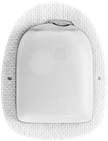  **Устройство подачи инсулина**

> Компонент, который выполняет команды, полученные от устройства связи с Pod и отправленные с телефона с AAPS.
> 
> > - Новый Omnipod (поколения Eros - **НЕ DASH**)

Эта инструкция предполагает, что вы начинаете новую сессию Pod. Если это не так, наберитесь терпения и начните этот процесс при следующей замене Pod.

На этой странице **RileyLink** означает любое из перечисленных выше устройств связи с Pod.

## Подготовка к работе

**БЕЗОПАСНОСТЬ на первом месте** Не пытайтесь выполнять этот процесс в среде, где нет возможности исправить ошибку (дополнительные поды, инсулин, устройства управления помпой обязательны).

**Ваш PDM Omnipod не будет работать после того, как драйвер Omnipod активирует ваш под**. Раньше вы использовали Omnipod PDM для отправки команд на Omnipod Eros. Под Omnipod Eros позволяет коммуникацию только с одним устройством. Устройство, которое успешно активирует под - единственное устройство, которому с этого момента будет разрешено с ним общаться. Это означает, что после активации пода с телефона через драйвер AAPS Eros, **вы больше не сможете пользоваться пультом PDM с этим подом**. Драйвер AAPS Omnipod с RileyLink теперь является вашим действующим PDM. *Это НЕ значит, что PDM нужно выбросить. Рекомендуется сохранить его как запасной вариант и на экстренный случай, если AAPS работает неправильно.*

**Только один RileyLink может одновременно связываться с Pod.** **AAPS** запоминает один привязанный RileyLink. Если вы привяжете другой, он заменит предыдущий.

**Ваш Pod не будет отключится, когда RileyLink находится вне диапазона.** Когда RileyLink находится вне диапазона или сигнал заблокирован от связи с активным pod, ваш под будет продолжать давать базальный инсулин. После активации Pod базальный профиль, заданный в AAPS, будет запрограммирован в новый Pod. Если вы потеряете контакт с Pod, он обратится к этому базальному профилю. Вы не сможете выдавать новые команды до тех пор, пока RileyLink не вернется в диапазон и не восстановит соединение.

**30 -минутные профили базала НЕ поддерживаются в AAPS.** Если вы новичок в AAPS и устанавливаете базальный профиль впервые, имейте в виду, что получасовые базальные скорости не поддерживаются в AAPS, и следует настроить свой базальный профиль на часовые интервалы. Например, если ваша базальная скорость 1,1 ед., начинается в 09:30, длится 2 часа и заканчивается в 11:30, такие настройки работать не будут.  Следует изменить базал в 1,1 единицы на диапазон времени с 9:00 до 11:00 или с 10:00 до 12:00.  Несмотря на то, что расширение профиля базисной скорости в 30 минут поддерживается аппаратным обеспечением Omnipod, в настоящее время AAPS не в состоянии учесть их с помощью своих алгоритмов.

## Включение драйвера Eros в AAPS

Активировать драйвер Omnipod Dash в AAPS можно **двумя способами**:

### Вариант 1: Мастер настройки

После установки новой версии AAPS **Мастер установки** запускается автоматически. Если вы уже экспортировали настройки из предыдущей установки, вы можете импортировать их в мастере. При новой установке продолжайте, как описано ниже.

Пройдите [Мастер установки AAPS](../SettingUpAaps/SetupWizard.md) до шага **Помпа**, затем выберите **Omnipod Eros** (описание начинается со слов «Интеграция с помпой Omnipod Eros»).


Мастер установки не выполняет привязку RileyLink. После завершения мастера откройте экран помпы Omnipod и привяжите RileyLink, как описано в [разделе «Настройка RileyLink»](#OmnipodEros-rileylink-setup).

**ИЛИ**

### Вариант 2: экран «Конфигурация»

Откройте **меню** (☰) в левом верхнем углу > **Конфигурация** > **Помпа** и выберите **переключатель** у **Omnipod Eros**.

После выбора на карточке **Omnipod Eros** появятся две кнопки: **Настройки** и **Открыть модуль**:

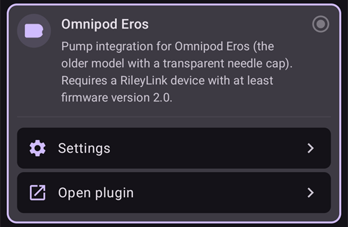

**Настройки** открывает настройки драйвера Omnipod (см. [Настройки Omnipod](#OmnipodEros-omnipod-settings)):

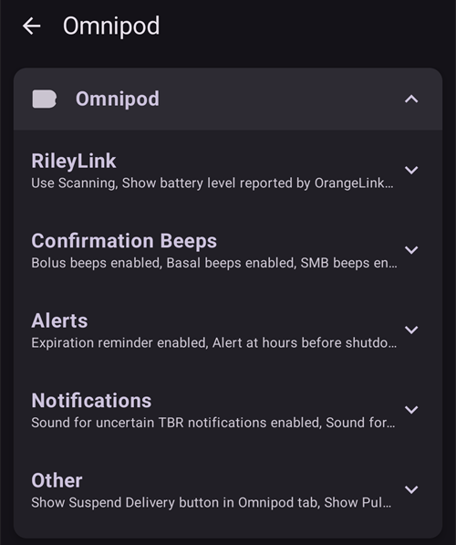

**Открыть модуль** открывает экран помпы Omnipod. Его также можно открыть в любой момент с главного экрана через **Управление** > **Помпа**. На этой странице он называется **экран помпы Omnipod**. До привязки RileyLink и активации Pod он выглядит так:

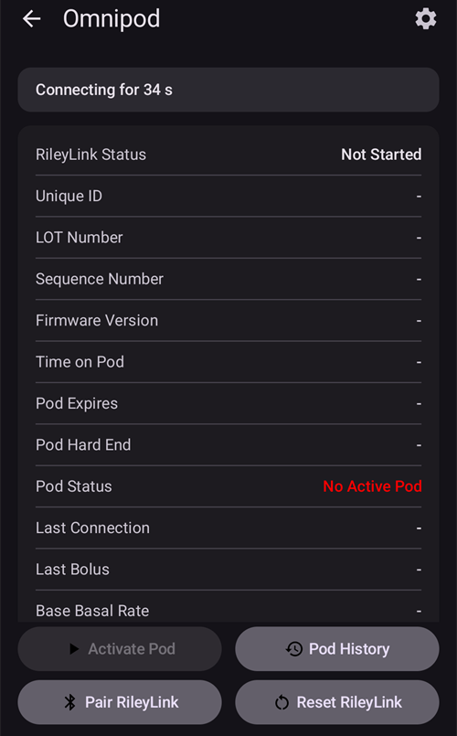

### Verification of Omnipod Driver Selection

Чтобы проверить, что драйвер Omnipod включен, откройте с главного экрана **Управление** > **Помпа**. Вы должны увидеть экран помпы **Omnipod Eros**, показанный выше. Если вы еще не привязали RileyLink, в поле **Статус RileyLink** будет **Не запущено**, а в поле **Статус помпы** будет **Нет активных Pod**.

## Конфигурация Omnipod

Все функции Pod и RileyLink — это кнопки на [экране помпы Omnipod](#OmnipodEros-omnipod-pod-tab) (**Управление** > **Помпа**). Некоторые кнопки появляются только в определенных ситуациях, например когда есть активный Pod.

>  Обновление соединения и статуса Pod
> 
> 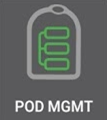 Управление подом (Активация, Деактивация, проверка звукового сигнала, журнал помпы)

```{admonition} Older screenshot
:class: note
Снимки экрана выше сделаны в более ранней версии **AAPS**. В **AAPS** 4 нет кнопки **POD MGMT** и меню управления Pod: **Обновить** и все действия управления Pod — это кнопки на экране помпы Omnipod.
```

(OmnipodEros-rileylink-setup)=

### Настройка RileyLink

Если вы уже привязали RileyLink, переходите к [разделу «Активация Pod»](#OmnipodEros-activating-a-pod) ниже.

*Примечание: хороший видимый признак того, что RileyLink не подключен, — на главном экране нет кнопок терапии (панели быстрого запуска). Это произойдет примерно в течение первых 30 секунд после запуска AAPS, так как он активно подключается к RileyLink.*

1. Убедитесь, что RileyLink полностью заряжен и включен.

2. Положите RileyLink [рядом с телефоном](#OmnipodEros-optimal-omnipod-and-rileylink-positioning) (на расстоянии ~30 см или ближе).

3. Откройте экран помпы Omnipod (**Управление** > **Помпа**) и нажмите **Привязать RileyLink**.

4. Экран **Привязать RileyLink** сразу начинает поиск устройств Bluetooth. Нажмите на свой RileyLink в списке найденных устройств.

   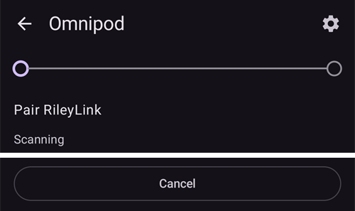

5. Когда появится **RileyLink успешно привязан** с именем и адресом вашего устройства, нажмите **OK**.

6. Вернитесь на экран помпы Omnipod и проверьте, что **Статус RileyLink** изменился на **Соединение установлено**. В поле **Статус помпы** должно быть **Нет активных Pod**. Если RileyLink не подключается, нажмите **Перезагрузить RileyLink** или перезапустите **AAPS**.

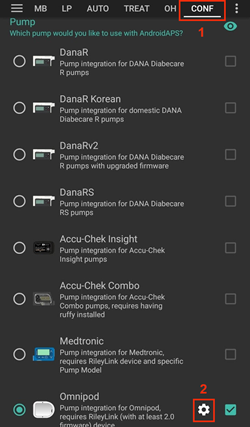 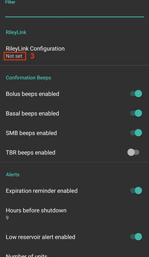

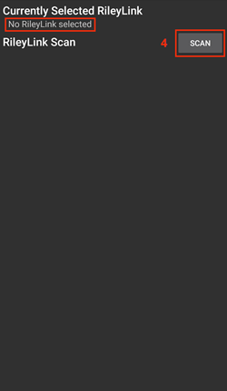 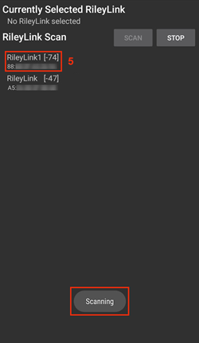

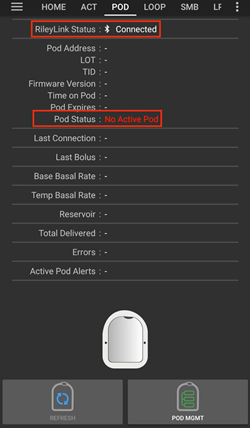


```{admonition} Older screenshot
:class: note
Шесть снимков экрана выше (после шага 6) сделаны в более ранней версии **AAPS**. В **AAPS** 4 RileyLink привязывается кнопкой **Привязать RileyLink** на экране помпы Omnipod, а не через **RileyLink Configuration** в настройках Omnipod, и поиск начинается автоматически.
```

```{note}
Чтобы перейти на другой RileyLink (например, на запасное устройство), снова нажмите **Привязать RileyLink** и выберите новое устройство. Оно заменит ранее привязанное. Удалять старое устройство заранее не нужно.
```

(OmnipodEros-activating-a-pod)=

### Активация Pod

Перед активацией Pod убедитесь, что RileyLink привязан, а в поле **Статус RileyLink** указано **Соединение установлено**. Кнопка **Активировать Pod** остается неактивной, пока RileyLink не готов.

*ПРЕДУПРЕЖДЕНИЕ: Коммуникация для активации Pod происходит на ограниченной дистанции, что вызвано мерами безопасности. Перед сопряжением радиосигнал Pod более слабый, однако после подключения связь будет работать при полной мощности сигнала. Во время этих процедур Pod должен находиться* [совсем рядом](#OmnipodEros-optimal-omnipod-and-rileylink-positioning) *(на расстоянии ~30 см или ближе), но не на RileyLink и не вплотную к нему.*

01. Откройте экран помпы Omnipod (**Управление** > **Помпа**) и нажмите **Активировать Pod**.

    Если вы еще ни разу не активировали профиль, сначала появится шаг **Требуется профиль**. Выберите профиль, который будет применен при активации.

    > 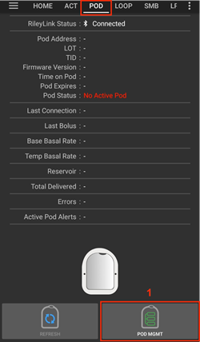 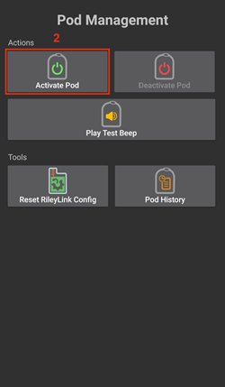 
    > 
    > ```{admonition} Older screenshot
    >     :class: note
    >     Снимки экрана выше сделаны в более ранней версии **AAPS**. В **AAPS** 4 **Активировать Pod** — это кнопка на экране помпы Omnipod, а не пункт меню **POD MGMT**.
    > ```

02. Появится экран **Заполнить Pod**. Заполните новый Pod инсулином на 3 дня и дождитесь двух звуковых сигналов. Они означают, что залит минимальный объем 80 единиц. Полностью опустошите шприц для заполнения, даже после двух звуковых сигналов. При подсчете общего количества инсулина на 3 дня, учитывайте, что первичное заполнение катетера Pod потребует 12-15 единиц инсулина. Пока не снимайте колпачок с иглы Pod.

    > 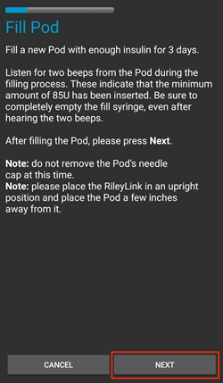
    > 
    > Убедитесь, что новый Pod и RileyLink находятся рядом друг с другом (~30 см или ближе), и нажмите **Далее**.

03. **Укажите инсулин** (показывается, только если у вас настроено больше одного инсулина): выберите инсулин, которым вы заполняете Pod, и нажмите **Далее**. После активации применяется переключение профиля с этим инсулином.

04. На экране **Инициализация Pod**, Pod начнет первичное заполнение ( вы услышите щелчок с серией последующих тикающих звуков пока заполняется под). Если RileyLink при активации находится вне диапазона, вы получите сообщение об ошибке **Нет ответа от Pod**. В этом случае [поднесите RileyLink ближе](#OmnipodEros-optimal-omnipod-and-rileylink-positioning) к Pod (~30 см или ближе), но не кладите его на Pod и не прижимайте к нему вплотную, и нажмите **Повторить попытку**.

    > 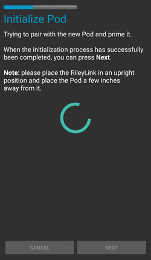 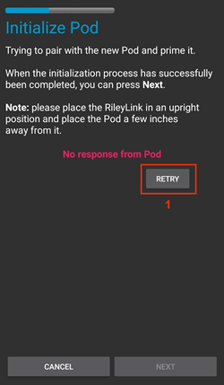

05. Когда заполнение успешно завершено, появляется зеленая галочка и кнопка **Далее** становится активной. Нажмите **Далее**.

    > 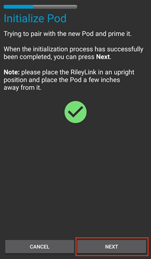

06. **Место установки** (показывается, только если включен параметр **Места установки помпы** в разделе [Места установки](#Aapsscreens-site-rotation)): выберите, где на теле вы размещаете Pod, и нажмите **Далее**.

07. Появится экран **Подключить Pod**. Подготовьте место установки нового Pod. Снимите с Pod пластиковый колпачок иглы и белую бумажную подложку с клейкого слоя и приклейте Pod на выбранное место на теле. Если катетер выступает наружу, нажмите **Отменить** и выбросьте Pod. Когда закончите, нажмите **Далее**.

    > 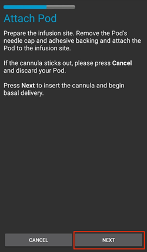

08. Появится окно подтверждения: «При нажатии OK будет установлен катетер». **Нажимайте OK, ТОЛЬКО если вы готовы ввести катетер**.

    > 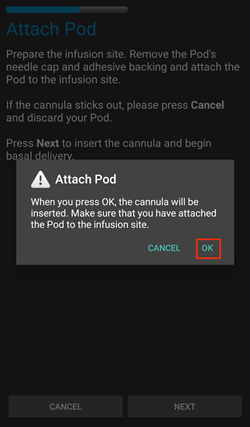

09. На экране **Вставить катетер** может пройти некоторое время, прежде чем Omnipod ответит и введет катетер (максимум 1–2 минуты), поэтому наберитесь терпения.

    > Если RileyLink при активации находится вне диапазона, вы получите сообщение об ошибке **Нет ответа от Pod**. В этом случае поднесите RileyLink ближе к Pod (~30 см или ближе), но не кладите его на Pod и не прижимайте к нему вплотную, и нажмите **Повторить попытку**.
    > 
    > Если RileyLink находится вне диапазона Bluetooth или не имеет активного подключения к телефону, вы получите сообщение об ошибке **Нет ответа от RileyLink**. В этом случае поднесите RileyLink ближе к телефону и нажмите **Повторить попытку**.
    > 
    > *ПРИМЕЧАНИЕ: Перед установкой катетера рекомендуется ущипнуть кожу рядом с местом ввода катетера. Это уменьшает болевые ощущения при вводе иглы и снижает шансы на развитие окклюзий.*
    > 
    > 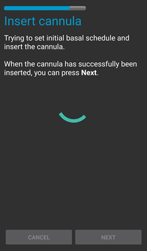
    > 
    >  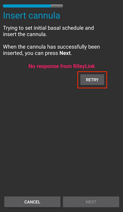

10. При успешном вводе катетера появляется зеленая галочка и активируется кнопка **Далее**. Нажмите **Далее**.

    > 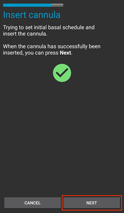

11. Появится экран **Pod активирован**. Проверьте, что катетер введен правильно. Если вы думаете, что нет, замените Pod. Нажмите **Готово**. Поздравляем! Вы начали новую активную сессию Pod.

    > 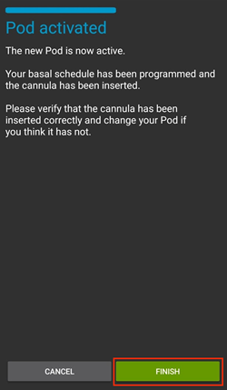 
    > 
    > ```{admonition} Older screenshot
    >     :class: note
    >     Снимки экрана на шагах 2–11 сделаны в более ранней версии **AAPS** и в **AAPS** 4 могут выглядеть иначе. Шаги **Укажите инсулин** и **Место установки** на снимках не показаны.
    > ```

12. Вы вернетесь на экран помпы Omnipod. Кнопка **Активировать Pod** заменяется кнопкой **Деактивировать Pod**, потому что нельзя активировать другой Pod, пока не деактивирован текущий.

    Теперь экран помпы показывает информацию об активном Pod: текущую базальную скорость, уровень резервуара, введенный инсулин, ошибки и оповещения Pod. Подробнее см. раздел [Экран помпы Omnipod](#OmnipodEros-omnipod-pod-tab).

    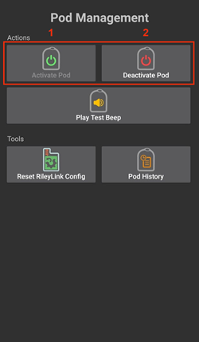 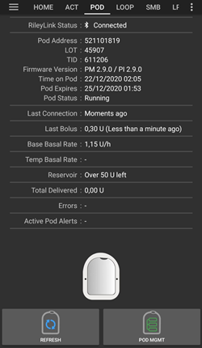

    ```{admonition} Older screenshot
    :class: note
    Снимки экрана выше сделаны в более ранней версии **AAPS**. В **AAPS** 4 нет меню управления Pod: вы сразу возвращаетесь на экран помпы Omnipod, где **Деактивировать Pod** заменяет **Активировать Pod**.
    ```

```{note}
Если активация была прервана после заполнения (например, приложение было закрыто), снова нажмите **Активировать Pod**. Мастер продолжит с шагов ввода катетера.
```

### Деактивация Pod

При нормальных условиях ожидаемое время жизни пода 3 дня (72 часа) и дополнительно 8 часов после предупреждения об истечении срока действия, в общей сложности 80 часов.

To deactivate a pod (either from expiration or from a pod failure):

1. Откройте экран помпы Omnipod (**Управление** > **Помпа**) и нажмите **Деактивировать Pod**.

   > 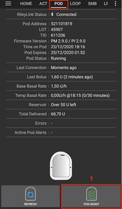 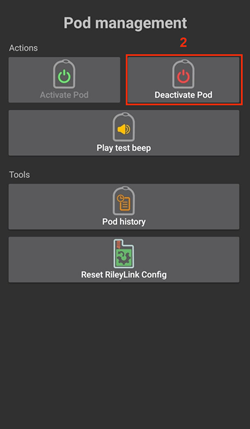 
   > 
   > ```{admonition} Older screenshot
   >    :class: note
   >    Снимки экрана выше сделаны в более ранней версии **AAPS**. В **AAPS** 4 **Деактивировать Pod** — это кнопка на экране помпы Omnipod, а не пункт меню **POD MGMT**.
   > ```

2. На экране **Деактивировать Pod** сначала убедитесь, что RileyLink находится рядом с Pod, но не лежит на нем и не прижат к нему вплотную. Затем нажмите **Далее**. Диалог спрашивает: *Деактивированный Pod нельзя использовать снова. Деактивировать этот Pod сейчас?* Нажмите **OK**, чтобы начать деактивацию Pod, или **Отменить**, чтобы его оставить. Деактивация останавливает всю подачу инсулина, и ее нельзя отменить.

   > 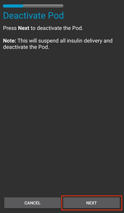

3. Появится экран **Pod деактивируется**, и Pod подаст звуковой сигнал, подтверждающий успешную деактивацию.

   > 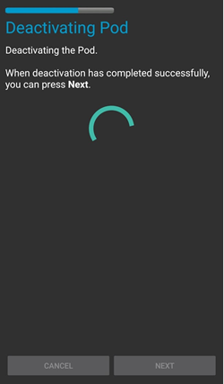
   > 
   > **ЕСЛИ деактивация не удалась** и вы не услышали сигнал подтверждения, может появиться сообщение **Нет ответа от RileyLink** или **Нет ответа от Pod**. Нажмите **Повторить попытку**, чтобы снова попробовать деактивацию. Если деактивация так и не проходит, нажмите **Завершить пользование Pod'ом** и подтвердите. После этого **AAPS** забывает этот Pod. Подача инсулина при этом **не** приостановлена, поэтому снимите Pod с тела. Если Pod издает непрерывный сигнал тревоги, возможно, его придется заглушить вручную (булавкой или скрепкой), потому что **Завершить пользование Pod'ом** его не заглушает.
   > 
   > > 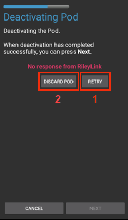  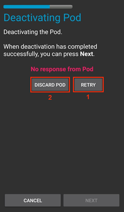

4. При успешной деактивации появляется зеленая галочка. Нажмите **Далее**, чтобы открыть экран **Pod деактивирован**. Теперь вы можете удалить свой pod так как активная сессия завершена.

   > 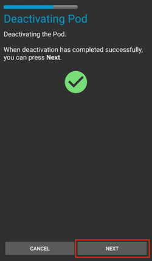

5. Нажмите **Готово**, чтобы вернуться на экран помпы Omnipod.

   > 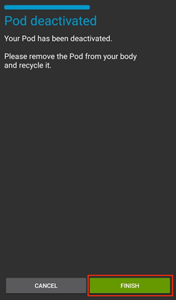 
   > 
   > ```{admonition} Older screenshot
   >    :class: note
   >    Снимки экрана на шагах 2–5 сделаны в более ранней версии **AAPS** и в **AAPS** 4 могут выглядеть иначе.
   > ```

6. На экране помпы Omnipod проверьте, что в поле **Статус RileyLink** указано **Соединение установлено**, а в поле **Статус помпы** — **Нет активных Pod**.

   > 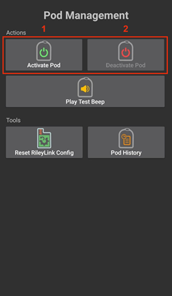   
   > 
   > ```{admonition} Older screenshot
   >    :class: note
   >    Снимки экрана выше сделаны в более ранней версии **AAPS**. В **AAPS** 4 кнопка **Готово** сразу возвращает вас на экран помпы Omnipod; меню управления Pod и вкладки **Omnipod (POD)** нет.
   > ```

### Приостановка и возобновление подачи инсулина

Ниже показано, как приостановить и возобновить подачу инсулина.

*ПРИМЕЧАНИЕ: если вы не видите кнопку **Останов***, значит, она скрыта (так по умолчанию). Enable **Show Suspend Delivery button on the pump screen** in the [Omnipod settings](#OmnipodEros-omnipod-settings) under **Other**.

#### Приостановка подачи инсулина

Используйте эту команду, чтобы перевести активный Pod в приостановленное состояние. В этом приостановленном состоянии Pod больше не подает инсулин. Эта команда имитирует функцию приостановки, которую подает оригинальный пульт Omnipod PDM на активный Pod.

1. Откройте экран помпы Omnipod (**Управление** > **Помпа**) и нажмите **Останов**. Команда приостановки отправляется через RileyLink на активный Pod.

2. Когда Pod остановит всю подачу инсулина, в поле **Статус помпы** появится **Приостановлено**, а кнопка **Останов** заменится кнопкой **Возобновить подачу**.

   > 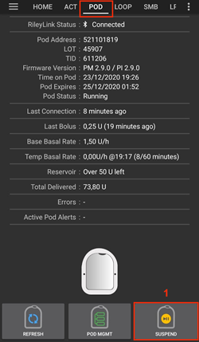 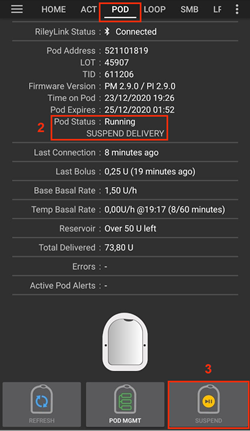
   > 
   > 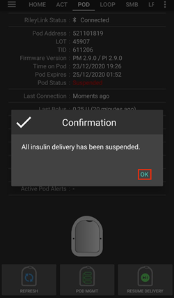
   > 
   > 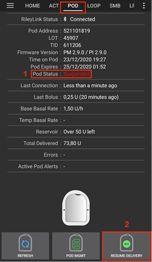 
   > 
   > ```{admonition} Older screenshot
   >    :class: note
   >    Снимки экрана выше сделаны в более ранней версии **AAPS**. В **AAPS** 4 эти шаги выполняются на экране помпы Omnipod, а не на вкладке **Omnipod (POD)**, а результат показывается в поле **Статус помпы**.
   > ```

Если команда не выполнена, появится окно **Внимание** с текстом «Не удалось приостановить подачу» и причиной. Проверьте подключение RileyLink и повторите попытку.

#### Resuming Insulin Delivery

Используйте эту команду, чтобы приостановленный Pod возобновил подачу инсулина. После успешной обработки команды, нормальная подача инсулина возобновится в соответствии с текущим активным профилем базала. Pod снова будет принимать команды на болюс, TBR и SMB.

1. Откройте экран помпы Omnipod и проверьте, что в поле **Статус помпы** указано **Приостановлено**. Нажмите **Возобновить подачу**.

2. Когда команда выполнена, в поле **Статус помпы** снова будет **Выполняется**, а кнопка **Возобновить подачу** исчезнет (кнопка **Останов** снова появится, если вы ее включили).

   > 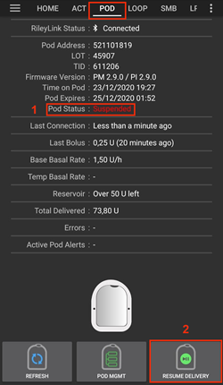 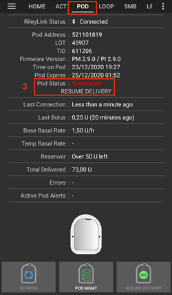
   > 
   > 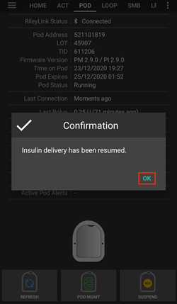
   > 
   > 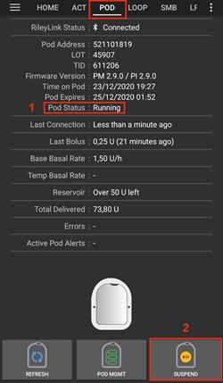 
   > 
   > ```{admonition} Older screenshot
   >    :class: note
   >    Снимки экрана выше сделаны в более ранней версии **AAPS**. В **AAPS** 4 эти шаги выполняются на экране помпы Omnipod, а не на вкладке **Omnipod (POD)**, а результат показывается в поле **Статус помпы**.
   > ```

Если команда не выполнена, появится окно **Внимание** с текстом «Не удалось возобновить подачу» и причиной. Проверьте подключение RileyLink и повторите попытку.

### Отключение звуковых оповещений пода

*ПРИМЕЧАНИЕ: кнопка **Заглушить** показывается на экране помпы Omnipod, только пока у Pod есть активное оповещение (например, об истечении срока работы Pod или о низком уровне резервуара) и только если параметр **Автоматически заглушать прочитанные оповещения** выключен.*

Ниже показано, как заглушить звуковые сигналы Pod, которые начинаются, когда Pod доходит до времени предупреждения перед окончанием срока работы. Это время предупреждения задается параметром **Оповещение за... часов до выключения (80 часов)** в разделе настроек Omnipod **Оповещения**. Максимальная продолжительность работы Pod составляет 80 часов (3‑е суток + 8 часов), однако производитель (Insulet) рекомендует не превышать 72 часа (3‑х суток).

*ПРИМЕЧАНИЕ: если в разделе настроек Omnipod **Оповещения** включен параметр **Автоматически заглушать прочитанные оповещения**, **AAPS** сам заглушает оповещение при следующей связи с Pod, и делать это вручную НЕ нужно.*

1. Когда наступает время предупреждения, Pod подает звуковые сигналы: его срок работы скоро закончится, и его нужно заменить. На экране помпы Omnipod в поле **Срок действия Пода истекает** показано точное время окончания срока работы Pod (72 часа после активации); за 4 часа до него поле становится **желтым**. Поле **Окончательное отключение Pod** показывает, когда Pod прекратит подачу инсулина. В поле **Активные оповещения помпы** появляется **Срок работы Pod'a истекает**, и появляется кнопка **Заглушить**. **AAPS** также показывает уведомление о скором окончании срока работы Pod.

   > 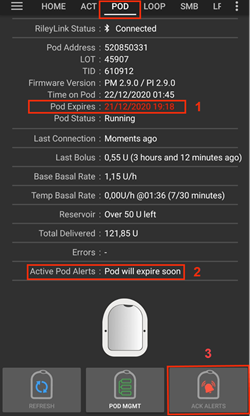 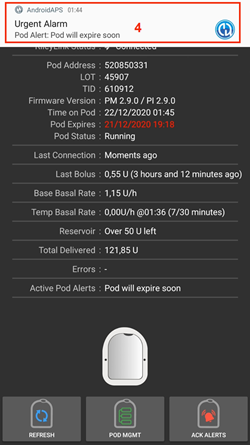 
   > 
   > ```{admonition} Older screenshot
   >    :class: note
   >    Снимки экрана выше сделаны в более ранней версии **AAPS**. В **AAPS** 4 кнопка **ACK ALERTS** называется **Заглушить** и находится на экране помпы Omnipod.
   > ```

2. Нажмите **Заглушить**. RileyLink отправляет на Pod команду остановить звуковые сигналы об окончании срока работы.

   > 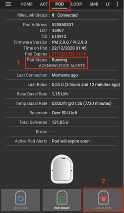 
   > 
   > ```{admonition} Older screenshot
   >    :class: note
   >    Скриншот выше сделан в более ранней версии **AAPS**. В **AAPS** 4 эта кнопка называется **Заглушить**.
   > ```

3. Когда оповещения заглушены, Pod подает два звуковых сигнала. В поле **Активные оповещения помпы** предупреждения больше нет, кнопка **Заглушить** исчезает, и Pod перестает подавать сигналы об окончании срока работы.

   > 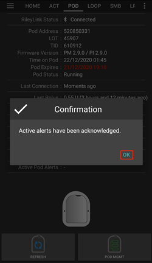 
   > 
   > ```{admonition} Older screenshot
   >    :class: note
   >    Скриншот выше сделан в более ранней версии **AAPS**. В **AAPS** 4 результат показывается на экране помпы Omnipod: предупреждение исчезает из поля **Активные оповещения помпы**.
   > ```

Если команда не выполнена (например, RileyLink слишком далеко от Pod), появится окно **Внимание** с текстом «Не удалось заглушить оповещения» и причиной. Поднесите RileyLink ближе к Pod и повторите попытку.

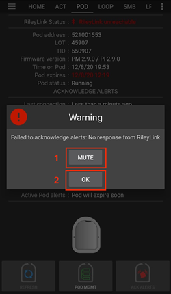

```{admonition} Older screenshot
:class: note
Скриншот выше сделан в более ранней версии **AAPS**. В **AAPS** 4 окно **Внимание** показывает текст «Не удалось заглушить оповещения» и причину.
```

(OmnipodEros-view-pod-history)=

### View Pod History

В этом разделе показано, как просмотреть историю активного пода и отфильтровать ее по различным категориям. Инструмент истории пода позволяет просматривать действия текущего активного пода за трое суток его жизни (72 - 80 часов).

Эта функция полезна для проверки болюсов, TBR, изменений базала, но без уверенности в завершении. Остальные категории полезны для решения проблем, а также для определения хода событий, приводящих к сбою.

*ПРИМЕЧАНИЕ:* В логах Pod появятся **Не подтверждено**, однако из-за характера таких сообщений невозможно опредилить их точность.

1. Откройте экран помпы Omnipod (**Управление** > **Помпа**) и нажмите **Журнал Pod**.

   > 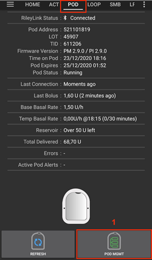 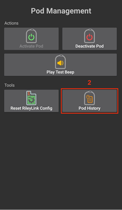 
   > 
   > ```{admonition} Older screenshot
   >    :class: note
   >    Снимки экрана выше сделаны в более ранней версии **AAPS**. В **AAPS** 4 **Журнал Pod** — это кнопка на экране помпы Omnipod, а не пункт меню **POD MGMT**.
   > ```

2. Экран **Журнал Pod** показывает все действия Pod и их результаты, сначала самые новые, по дням. По умолчанию выбрано **Все**. Нажмите одну из кнопок фильтра вверху, чтобы показать только одну категорию. Стрелкой «Назад» в левом верхнем углу вернитесь на экран помпы Omnipod.

   > 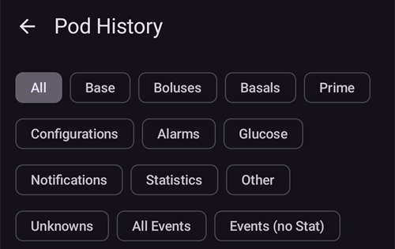

   >  
   > 
   > ```{admonition} Older screenshot
   >    :class: note
   >    Второй снимок экрана сделан в более ранней версии **AAPS** и в **AAPS** 4 может выглядеть иначе.
   > ```

### Просмотр настроек и журнала RileyLink

Экран **Статистика RileyLink** показывает настройки RileyLink и активного Pod, а также историю связи обоих устройств. На нем две вкладки: **Настройки** и **История**.

Кнопка **Статистика RileyLink** по умолчанию скрыта. Чтобы показать ее на экране помпы Omnipod, включите **Показывать кнопку статуса RileyLink в меню управления подом** в [настройках Omnipod](#OmnipodEros-omnipod-settings) в разделе **Другое**.

#### Восстановление передачи данных с устройства Bluetooth

Если устройство связи с Pod какое-то время было вне зоны действия Bluetooth телефона, в поле **Статус RileyLink** на экране помпы Omnipod может быть **RileyLink недоступен**. Обычно **AAPS** сам восстанавливает соединение, когда устройство снова в зоне действия. Если этого не происходит:

1. Убедитесь, что RileyLink включен, заряжен и находится рядом с телефоном.

2. На экране помпы Omnipod нажмите **Перезагрузить RileyLink**. Появится сообщение **Конфигурация RileyLink сброшена**. См. [примечания о перезагрузке RileyLink](#OmnipodEros-reset-rileylink-config-notes) ниже.

3. Если **Соединение Bluetooth** не восстановится, попробуйте вручную **выключить** и затем **включить** функцию Bluetooth в телефоне.

4. Если соединение все еще не восстановилось, нажмите **Привязать RileyLink** и снова выберите свой RileyLink.

5. После успешного повторного подключения в поле **Статус RileyLink** будет **Соединение установлено**. Также можно проверить **Статус подключения** на вкладке **Настройки** экрана **Статистика RileyLink**. Поздравляем, теперь вы подключились к AAPS с настроенными устройствами!

 


```{admonition} Older screenshot
:class: note
Снимки экрана выше сделаны в более ранней версии **AAPS**. В **AAPS** 4 соединение восстанавливается кнопками **Перезагрузить RileyLink** или **Привязать RileyLink** на экране помпы Omnipod, а не кнопкой обновления на экране настроек RileyLink.
```

#### Коммуникационное устройство Pod и активные настройки Pod

Этот экран показывает информацию и состояние привязанного сейчас устройства связи с Pod и текущего активного Pod Omnipod Eros. Информация обновляется автоматически.

1. Откройте экран помпы Omnipod (**Управление** > **Помпа**) и нажмите **Статистика RileyLink**. На вкладке **Настройки** показаны привязанный сейчас **RileyLink** и активный Pod (**Устройство**).

   >   
   > 
   > ```{admonition} Older screenshot
   >    :class: note
   >    Снимки экрана выше сделаны в более ранней версии **AAPS**. В **AAPS** 4 **Статистика RileyLink** — это кнопка на экране помпы Omnipod, а не пункт меню **POD MGMT**.
   > ```

   > 

##### Поля RileyLink

> - **Адрес:** MAC-адрес привязанного устройства связи с Pod.
> - **Имя:** имя Bluetooth привязанного устройства связи с Pod.
> - **Уровень заряда:** текущий уровень заряда батареи подключенного устройства связи с Pod. Показывается, только если включен параметр **Показать уровень батареи от OrangeLink/EmaLink/DiaLink**.
> - **Статус соединения**: Текущий статус соединения Bluetooth с устройством коммуникации Pod.
> - **Ошибка подключения:** если есть ошибка Bluetooth-соединения с устройством связи с Pod, подробности показаны здесь.
> - **Версия прошивки:** Текущая версия прошивки на подключенном устройстве связи.

##### Поля устройства — при активном Pod

> - **Тип устройства:** тип устройства, которое связывается с устройством связи с Pod (Omnipod (Eros)).
> - **Настроенная модель устройства:** модель устройства, настроенного для связи с устройством связи с Pod.
> - **Подключенное устройство:** модель устройства, которое сейчас связывается с устройством связи с Pod.
> - **Pump Serial Number:** Serial number of the currently activated pod.
> - **Частота помпы:** радиочастота, на которой идет связь с Pod.
> - **Последняя использованная частота:** последняя известная радиочастота, на которой Pod связывался с устройством связи с Pod.
> - **Последняя Контактная запись устройства:** Дата и время последнего контакта c устройством соединения.

(omnipod-eros-rileylink-i-active-pod-history)=
#### RileyLink и журнал активного Пода

На этой вкладке перечислены, начиная с самых новых, все состояния и действия RileyLink или подключенного сейчас Pod. История доступна только для текущего активного Pod. После замены Pod эта история стирается, и записываются и показываются только события нового активированного Pod.

1. Откройте экран помпы Omnipod (**Управление** > **Помпа**), нажмите **Статистика RileyLink** и затем откройте вкладку **История**.

   >   
   > 
   > ```{admonition} Older screenshot
   >    :class: note
   >    Снимки экрана выше сделаны в более ранней версии **AAPS**. В **AAPS** 4 **Статистика RileyLink** — это кнопка на экране помпы Omnipod, а не пункт меню **POD MGMT**.
   > ```

   > 

##### Fields

Каждая запись показывает:

> - **Устройство:** устройство, к которому относится действие или состояние.
> - **Время:** время события.
> - **Состояние или действие:** состояние устройства или выполненное им действие.

(OmnipodEros-omnipod-pod-tab)=

## Экран помпы Omnipod

Ниже описаны поля состояния и кнопки на **экране помпы Omnipod** (**Управление** > **Помпа** или **Конфигурация** > **Помпа** > **Открыть модуль**).

Значок шестеренки в правом верхнем углу открывает [настройки Omnipod](#OmnipodEros-omnipod-settings).

*ПРИМЕЧАНИЕ: если в каком-либо поле состояния указано (не подтверждено), нажмите **Обновить**, чтобы обновить статус Pod и убрать эту отметку.*


```{admonition} Older screenshot
:class: note
Снимок экрана выше сделан в более ранней версии **AAPS**, где этот экран был вкладкой **Omnipod (POD)**. В **AAPS** 4 это экран помпы Omnipod, и некоторые названия полей и кнопок отличаются.
```

### Fields

- **RileyLink Status:** Displays the current connection status of the RileyLink. Ошибки показаны красным цветом.

- *Не запущено* — RileyLink еще не привязан или соединение еще не начато.
- *RileyLink недоступен* — устройство связи с Pod вне зоны действия Bluetooth телефона, выключено или неисправно, и связь по Bluetooth невозможна.
- *RileyLink готов* — устройство связи с Pod включено и устанавливает Bluetooth-соединение.
- *Подключено* - устройство связи включено, подключено и способно активно общаться через Bluetooth.

- **Уникальный ID:** показывает адрес активного Pod.

- **Номер партии:** показывает номер партии (LOT) активного Pod.

- **Порядковый номер:** показывает серийный номер (TID) Pod.

- **Версия прошивки:** Отображает версию прошивки активного POD.

- **Время на Pod:** Отображает текущее время на POD Оно выделяется, если отличается от времени телефона больше чем на 5 минут.

- **Срок действия Пода истекает:** показывает дату и время окончания срока работы активного Pod. Текст становится желтым за 4 часа до этого времени. Он никогда не становится красным, так как Pod продолжает подавать инсулин и после этого.

- **Окончательное отключение Pod:** показывает конец дополнительного периода Pod (8 часов после **Срок действия Пода истекает**, максимальный срок работы Pod — 80 часов). Текст становится желтым, когда начинается дополнительный период (в момент **Срок действия Пода истекает**), и красным за 4 часа до окончательной остановки. Во время дополнительного периода также показано оставшееся время, например *(осталось 17 мин)*. При окончательной остановке Pod прекращает подачу инсулина, и его нужно заменить.

- **Статус помпы:** показывает состояние активного Pod (например, **Нет активных Pod**, **Выполняется** или **Приостановлено**).

- **Прошлое соединение:** показывает время последней успешной связи с активным Pod. Текст становится красным, если превышен [порог недоступности помпы](#OmnipodEros-troubleshooting).

- *Только что* - меньше 20 секунд назад.
- *Менее минуты назад* - более 20, но менее 60 секунд назад.
- *1 минуту назад* - более 60, но менее 120 секунд (2 мин)
- *XX минут назад* - более 2 минут назад, определяется величиной XX

- **Прошлый болюс:** показывает дозу последнего болюса, отправленного на активный Pod, и в скобках — сколько времени назад он был подан.

- **Базовая скорость базала:** показывает базальную скорость из профиля базала для текущего времени.

- **Временная базальная скорость:** показывается, только пока работает временный базал. Отображается в следующем формате:

- Единицы / час @ время начала TBR (отработаных минут / общее время TBR)
- *Пример:* 0.00ед./ч. @18:25 ( 90/120 мин.)

- **Резервуар:** показывает **Осталось более 50 ед**, если в резервуаре больше 50 единиц. Ниже этого значения показывается приблизительное количество единиц. Текст становится красным, когда остаток ниже порога низкого уровня резервуара, заданного в [настройках оповещений](#OmnipodEros-omnipod-settings).

- **Всего подано:** показывает общее количество единиц инсулина, поданных из резервуара. *Обратите внимание, что это приблизительная величина, поскольку первичное заполнение POD не является точным процессом.*

- **Активные оповещения помпы:** здесь показаны оповещения, активные сейчас на активном Pod. Обычно используется при истечении срока действия pod последние 72 часа, а звуковые оповещения работают.

- **Ошибки:** показывает последнюю ошибку (красным цветом). Изучите [Pod history](#OmnipodEros-view-pod-history), [RileyLink history](#omnipod-eros-rileylink-and-active-pod-history) и лог-файлы для подробной информации.

### Buttons

Кнопки внизу экрана помпы меняются в зависимости от ситуации. Кнопки, которые сейчас нельзя использовать, показаны серым цветом, например пока RileyLink не подключен.

**Кнопки статуса Pod** (показываются, когда есть активный Pod):

- **Обновить:** отправляет на активный Pod команду обновления, чтобы обновить его статус. Используйте ее, чтобы обновить статус Pod и очистить поля состояния с текстом (не подтверждено). Дополнительную информацию см. в разделе [Устранение неполадок](#OmnipodEros-troubleshooting) ниже.

  

  ```{admonition} Older screenshot
  :class: note
  Снимок экрана выше сделан в более ранней версии **AAPS**. В **AAPS** 4 это текстовая кнопка **Обновить** на экране помпы Omnipod.
  ```

- **Заглушить:** заглушает звуковые сигналы и уведомления об окончании срока работы Pod и о низком уровне резервуара. Показывается, только когда у Pod есть активное оповещение и параметр **Автоматически заглушать прочитанные оповещения** выключен. После того как оповещения заглушены, кнопка исчезает.

  

  ```{admonition} Older screenshot
  :class: note
  Снимок экрана выше сделан в более ранней версии **AAPS**. В **AAPS** 4 эта кнопка называется **Заглушить**.
  ```

- **Установить время:** устанавливает на Pod текущее время вашего телефона. Показывается, только если время на Pod отличается от времени телефона больше чем на 5 минут.

  

  ```{admonition} Older screenshot
  :class: note
  Снимок экрана выше сделан в более ранней версии **AAPS**. В **AAPS** 4 это текстовая кнопка **Установить время** на экране помпы Omnipod.
  ```

- **Останов:** приостанавливает подачу инсулина на активном Pod. Only shown if enabled in the settings (**Show Suspend Delivery button on the pump screen**).

  

  ```{admonition} Older screenshot
  :class: note
  Снимок экрана выше сделан в более ранней версии **AAPS**. В **AAPS** 4 это текстовая кнопка **Останов** на экране помпы Omnipod.
  ```

- **Возобновить подачу:** возобновляет подачу инсулина на приостановленном активном Pod. Показывается, только пока Pod приостановлен.

  

  ```{admonition} Older screenshot
  :class: note
  Снимок экрана выше сделан в более ранней версии **AAPS**. В **AAPS** 4 это текстовая кнопка **Возобновить подачу** на экране помпы Omnipod.
  ```

**Кнопки управления Pod и RileyLink:**


```{admonition} Older screenshot
:class: note
Скриншот выше сделан в более ранней версии **AAPS**. В **AAPS** 4 нет меню управления Pod: эти действия — кнопки прямо на экране помпы Omnipod.
```

- **Активировать Pod:** заполняет и активирует новый Pod. Видна, когда нет активного Pod. Кнопка активна, только когда RileyLink подключен.

  

  ```{admonition} Older screenshot
  :class: note
  Снимок экрана выше сделан в более ранней версии **AAPS**. В **AAPS** 4 **Активировать Pod** — это кнопка на экране помпы Omnipod, а не пункт меню управления Pod.
  ```

- **Деактивировать Pod:** деактивирует текущий активный Pod. Показывается, как только Pod привязан, а также когда активация остановилась на полпути (например, из-за сбоя Pod во время активации). Кнопка активна, только когда RileyLink подключен. **AAPS** просит подтверждения, прежде чем деактивировать Pod.

- Используйте эту команду, чтобы деактивировать под, издающий звуковое оповещение об окончании срока работы (ошибка 49).
- Если деактивация не удалась, мастер деактивации предлагает вариант **Завершить пользование Pod'ом**.

  

  ```{admonition} Older screenshot
  :class: note
  Снимок экрана выше сделан в более ранней версии **AAPS**. В **AAPS** 4 **Деактивировать Pod** — это кнопка на экране помпы Omnipod, а не пункт меню управления Pod.
  ```

- **Воспроизвести тестовый звуковой сигнал:** при нажатии Pod подает один тестовый звуковой сигнал. Показывается, когда Pod привязан.

  

  ```{admonition} Older screenshot
  :class: note
  Снимок экрана выше сделан в более ранней версии **AAPS**. В **AAPS** 4 **Воспроизвести тестовый звуковой сигнал** — это кнопка на экране помпы Omnipod, а не пункт меню управления Pod.
  ```

- **Журнал Pod:** показывает историю действий активного Pod. См. [Просмотр журнала Pod](#OmnipodEros-view-pod-history).

  

  ```{admonition} Older screenshot
  :class: note
  Снимок экрана выше сделан в более ранней версии **AAPS**. В **AAPS** 4 **Журнал Pod** — это кнопка на экране помпы Omnipod, а не пункт меню управления Pod.
  ```

- **Привязать RileyLink:** ищет ваше устройство связи с Pod и привязывает его. См. [Настройка RileyLink](#OmnipodEros-rileylink-setup).

- **Статистика RileyLink:** открывает экран «Статистика RileyLink» с двумя вкладками. Показывается, только если включено в настройках (**Показывать кнопку статуса RileyLink в меню управления подом**).

- **Настройки** - отображает информацию о RileyLink и настройках активного Pod
- **История** - отображает историю коммуникации RileyLink и Pod

  

  ```{admonition} Older screenshot
  :class: note
  Снимок экрана выше сделан в более ранней версии **AAPS**. В **AAPS** 4 **Статистика RileyLink** — это кнопка на экране помпы Omnipod, а не пункт меню управления Pod.
  ```

- **Перезагрузить RileyLink:** сбрасывает конфигурацию подключенного сейчас устройства связи с Pod. При начале связи в RileyLink отправляются и устанавливаются определенные данные:

- Устанавливаются регистры памяти
- Устанавливаются протоколы связи
- Устанавливается настроенная радиочастота
  > 
  > См. [дополнительные примечания](#OmnipodEros-reset-rileylink-config-notes) ниже.

  

  ```{admonition} Older screenshot
  :class: note
  Снимок экрана выше сделан в более ранней версии **AAPS**. В **AAPS** 4 эта кнопка называется **Перезагрузить RileyLink** и находится на экране помпы Omnipod.
  ```

- **Завершить пользование Pod'ом:** после подтверждения удаляет данные о состоянии Pod, который не отвечает. Показывается, только когда Pod был запущен, но не полностью привязан, и правильная деактивация уже невозможна:

- **Pod не полностью сопряжен ** и поэтому игнорирует команды на деактивацию.
- **Pod завис** между шагами в процессе сопряжения.
- **Pod просто не сопрягается**
  > 
  > После того как вы завершили пользование Pod, **AAPS** больше не может с ним связаться. Снимите Pod с тела.

  

  ```{admonition} Older screenshot
  :class: note
  Снимок экрана выше сделан в более ранней версии **AAPS**. В **AAPS** 4 **Завершить пользование Pod'ом** — это кнопка на экране помпы Omnipod, а не пункт меню управления Pod.
  ```

(OmnipodEros-reset-rileylink-config-notes)=

#### *Примечания о перезагрузке RileyLink*

- Эта функция в основном требуется когда не отвечает активное устройство связи и коммуникация зависла.
- Если устройство связи с Pod было выключено и снова включено, нажмите **Перезагрузить RileyLink**, чтобы эти параметры связи снова были установлены в устройстве связи с Pod.
- Если это НЕ выполнено, то AAPS необходимо будет перезапустить после того, как перезагрузится устройство (Riley) передачи данных.
- Эту кнопку **НЕ НУЖНО** нажимать при переключении между разными устройствами связи с Pod.

(OmnipodEros-omnipod-settings)=

## Настройки Omnipod

Открыть настройки драйвера Omnipod можно так:

- нажмите значок шестеренки в правом верхнем углу экрана помпы Omnipod (**Управление** > **Помпа**) или
- откройте **меню** (☰) в левом верхнем углу > **Конфигурация** > **Помпа** и нажмите **Настройки** на карточке **Omnipod Eros**.


```{admonition} Older screenshot
:class: note
Скриншот выше сделан в более ранней версии **AAPS**. В **AAPS** 4 настройки открываются кнопкой **Настройки** на карточке **Omnipod Eros** или значком шестеренки на экране помпы Omnipod, а не шестеренкой настроек в **Конфигурации** или меню из трех точек.
```

Настройки разделены на группы, перечисленные ниже. Нажмите на группу, чтобы раскрыть ее. Большинство пунктов — переключатели, которые можно включить или выключить:


*ПРИМЕЧАНИЕ: Знак (\*) обозначает что выбрано значение по умолчанию.*

### RileyLink / РайлиЛинк

Настройки устройства связи с Pod. Само устройство привязывается кнопкой **Привязать RileyLink** на экране помпы (см. [Настройка RileyLink](#OmnipodEros-rileylink-setup)).

- **Использовать сканирование:** выполняет сканирование перед подключением к OrangeLink. Это может улучшить соединение. При необходимости это можно использовать и с другими клонами RileyLink.

- **Показать уровень батареи от OrangeLink/EmaLink/DiaLink:** показывает реальный уровень заряда батареи OrangeLink/EmaLink/DiaLink. **Настоятельно рекомендуется** всем пользователям OrangeLink/EmaLink/DiaLink активировать эту настройку.

- НЕ работает с оригинальным RileyLink.
- Может не работать с альтернативами RileyLink.
- Включено - Отображает текущий уровень заряда для поддерживаемых устройств связи.
- Отключено - Отображает значение n/a.

- **Включить учет расхода заряда батареи:** доступно, только если включен параметр показа уровня батареи выше. В некоторых устройствах связи с Pod можно использовать обычные сменные батарейки. Если этот параметр включен, можно сделать запись **Замена батареи помпы** в [Портале терапии](#aaps-screens-careportal), чтобы отметить замену и сбросить возраст батареи.

### Confirmation Beeps

Provides confirmation beeps from the pod for bolus, basal, SMB, and TBR delivery and changes.

- **Звуковой сигнал болюса включен** Включить или отключить подтверждающие сигналы при подаче болюса.
- **Basal beeps enabled:** Enable or disable confirmation beeps when a new basal rate is set, active basal rate is canceled or current basal rate is changed.
- **Звуковой сигнал микроболюсов SMB включен** Включить или отключить подтверждающие сигналы при подаче микроболюсов.
- **Звуковой сигнал временного базала TBR включен** Включить или отключить подтверждающие сигналы при установке или отмене TBR.

### Alerts

Оповещения AAPS и Nightscout об истечении срока, выключении, низком резервуаре на основе заданных пороговых значений.

*Примечание: уведомления AAPS выдаются ВСЕГДА, для любого оповещения после связи с pod с момента срабатывания оповещения. Если закрыть уведомление, оповещение НЕ будет заглушено, ЕСЛИ НЕ включен параметр **Автоматически заглушать прочитанные оповещения**. Чтобы заглушить оповещение ВРУЧНУЮ, откройте экран помпы Omnipod и нажмите **Заглушить**.*

- **\*Включено напоминание об истечении срока действия:** если включено, Pod подает звуковой сигнал, когда наступает время, заданное ниже.
- **Оповещение за... часов до выключения (80 часов):** за сколько часов до выключения Pod (80 часов после активации) срабатывает напоминание об истечении срока (от 1 до 8 часов, по умолчанию 8).
- **Предупреждение о низком уровне резервуара включено:** Включить или отключить оповещение, когда достигается нижний лимит определенный в поле Количество единиц емкости.
- **К-во единиц:** количество единиц, при котором срабатывает оповещение Pod о низком уровне резервуара (от 5 до 50, по умолчанию 20).
- **Автоматически заглушать прочитанные оповещения:** если включено, уведомление все равно появляется, но оповещение автоматически заглушается при следующей связи с Pod после начала оповещения.

### Notifications

Выдает уведомления AAPS и звуковые оповещения, когда нет уверенности в успешных TBR, SMB, болюсах или приостановленных событиях.

*ПРИМЕЧАНИЕ: Это только уведомления, звуковые оповещения об ошибках не производится.*

- **\*Звук для неопределенных уведомлений TBR включен:** включите или выключите этот параметр, чтобы получать звуковое оповещение и уведомление на экране, когда AAPS не уверен, что TBR был успешно установлен.
- **Звук для неопределенных уведомлений SMB включен:** Включите или отключите этот параметр, чтобы вызвать звуковое оповещение и визуальное уведомление, когда AAPs неизвестно, был ли успешно подан микроболюс SMB.
- **Звук для неопределенных уведомлений о болюсах включен:** Включите или отключите этот параметр, чтобы вызвать звуковое оповещение и визуальное уведомление, когда AAPs неизвестно, был ли успешно подан болюс.

### Другое

Предоставляет расширенные настройки для содействия отладке.

- **Show Suspend Delivery button on the pump screen:** Hide or display the **Suspend** button on the Omnipod pump screen.
- **Показывать кнопку Pulse Log в меню управления Pod:** этот параметр еще есть в списке, но в текущей версии экрана помпы нет кнопки **Журнал Pulse**.

- **Показывать кнопку статуса RileyLink в меню управления подом:** скрыть или показать кнопку **Статистика RileyLink** на экране помпы Omnipod.
- **\*Включено обнаружение часового пояса:** позволяет автоматически обнаруживать смену часового пояса, если телефон используется там, где переходят на летнее время.

### Переключение или удаление активного устройства связи с Pod (RileyLink)

Есть много альтернатив оригинальному RileyLink (например, OrangeLink или EmaLink), и иногда нужно несколько или запасные экземпляры одного устройства связи с Pod, поэтому вам может понадобиться перейти на другое устройство.

Чтобы перейти на другое устройство, откройте экран помпы Omnipod (**Управление** > **Помпа**), нажмите **Привязать RileyLink** и выберите новое устройство, как описано в разделе [Настройка RileyLink](#OmnipodEros-rileylink-setup). Новое устройство заменяет ранее привязанное.

 


 

```{admonition} Older screenshot
:class: note
Снимки экрана выше сделаны в более ранней версии **AAPS**. В **AAPS** 4 устройство добавляется кнопкой **Привязать RileyLink** на экране помпы Omnipod, а не через **RileyLink Configuration** в настройках Omnipod, и поиск начинается автоматически.
```

Отдельной кнопки для удаления привязанного устройства нет. Если вы перестали пользоваться RileyLink, просто привяжите новый, когда он понадобится.


```{admonition} Older screenshot
:class: note
Снимки экрана выше сделаны в более ранней версии **AAPS**. В **AAPS** 4 нет кнопки **Remove**: привязка нового RileyLink заменяет предыдущий.
```

## Строка состояния и Портал терапии

Есть несколько особенностей, которые связаны с тем, чем Pod Omnipod отличается от помп с трубкой, особенно после установки нового Pod.

Возраст **инсулина** и **катетера** в [строке состояния](#screens-sensor-level-battery) главного экрана **сбрасывается** на 0 дней и 0 часов **после каждой замены Pod**. Это происходит из-за устройства и принципа работы Omnipod. **Батарея помпы** и **резервуар инсулина** в каждом поде свои. Так как Pod вводит катетер непосредственно в кожу на месте установки, в помпах Omnipod не применяется традиционная трубка. *Поэтому после замены пода значение каждой из этих величин автоматически сбрасывается на ноль***Возраст батареи помпы**не отображается поскольку он всегда больше срока работы пода (максимум 80 часов).


### Уровни

**Insulin Level**

Информация о количестве инсулина в Omnipod Eros не является точной. Причина в том, что точно неизвестно, сколько инсулина было залито в Pod. Известно только, что при двух звуковых сигналах во время заполнения Pod залито не меньше 80 единиц. Под может вместить максимум 200 единиц. Первичное заполнение тоже может давать разброс, так как это неточный процесс. Учитывая оба этих фактора и был написан драйвер Omnipod, который дает максимально точное приближение к количеству остающегося в резервуаре инсулина.

> - **больше 50 единиц** - Pod сообщает о количестве более 50 единиц.
> - **Ниже 50 единиц** - Сообщает о приблизительно вычисленном количестве инсулина в резервуаре.
> - **SMS** - В SMS сообщается реальный остаток в ед. или 50+ед
> - **Nightscout** - при более чем 50 единиц в Nightscout выгружается значение 50 ед.(версия 14.07 и старше).  Более новые версии покажут 50 + когда более 50 единиц.

**Уровень заряда батареи**

Отчет об уровне заряда батареи - это настройка, которая может быть включена для отображения текущего уровня заряда таких устройств как OrangeLink, EmaLink или DiaLink.  Устройство RileyLink не может передавать данные об уровне заряда своей батареи.  Уровень заряда батареи указывается после каждой связи с POD, поэтому при зарядке может не наблюдаться линейное увеличение.  Ручное обновление состояния обновит текущий уровень заряда батареи.  При отключении поддерживаемого устройства связи с Pod показывается значение 0%.

> - **Устройство RileyLink НЕ может передавать данные об уровне заряда своей батареи**
> - **Настройка "Показать уровень заряда батареи OrangeLink/EmaLink/DiaLink" ДОЛЖНА быть включена в настройках Omnipod для передачи уровня заряда батареи**
> - **Уровень заряда передается ТОЛЬКО для устройств OrangeLink, EmaLink и DiaLink**
> - **Уровень заряда батареи МОЖЕТ работать для других устройств (за исключением RileyLink)**
> - **SMS** - Возвращает текущий уровень заряда батареи
> - **Nightscout** - Передается при наличии фактического уровня заряда аккумулятора

(OmnipodEros-troubleshooting)=

## Устранение неполадок

### Pod Failures

Pod иногда выходят из строя по разным причинам, в том числе из-за аппаратных проблем самого Pod. В Insulet с этим лучше не обращаться в, поскольку приложение AAPS пока не получила официального одобрения. Список ошибок можно найти [здесь](https://github.com/openaps/openomni/wiki/Fault-event-codes) для помощи в определении причины.

### Предотвращение сбоев Pod с ошибкой 49

Этот сбой связан с неверным состоянием Pod для команды или с ошибкой во время команды подачи инсулина. Мы рекомендуем настроить синхронизацию с Nightscout *только на загрузку*: держите все параметры «Получать ... из NS» выключенными в настройках синхронизации клиента Nightscout (см. [Nightscout](../SettingUpAaps/Nightscout.md)), чтобы избежать возможных сбоев.

### Pump Unreachable Alerts

Мы рекомендуем установить оповещение о недоступности помпы на **120 минут**. Нажмите значок **Настройки** (шестеренка) в правом верхнем углу главного экрана, выберите **Локальные оповещения** > **Порог недоступности помпы** и установите значение **120**.

(OmnipodEros-import-settings-from-previous-aaps)=
### Импорт настроек из предыдущих AAPS

```{admonition} Importing settings can end your active Pod
:class: warning
На телефоне, который уже работает с Pod, оставьте **Также заменить настройки помпы** без отметки: сессия Pod сохранится, а импортируются только остальные настройки. Отмечайте это только для файла, экспортированного во время ношения текущего Pod. См. [Помпы без трубки](#ExportImportSettings-tubeless-pumps).
```

Безопаснее всего переустанавливать **AAPS** между двумя Pod:

1. Деактивируйте вашу сессию пода. Проверьте, что у вас нет активного сеанса Pod.
2. Экспортируйте ваши настройки и храните копию в надежном месте.
3. Удалите предыдущую версию AAPS и перезапустите телефон.
4. Установите новую версию AAPS и убедитесь, что у вас нет активной сессии Pod.
5. Импортируйте ваши настройки и активируйте новый код.

### Omnipod driver alerts

Обратите внимание: драйвер Omnipod показывает на **главном экране** разные особые оповещения. Большинство из них информационные, и их можно закрыть, а некоторые предлагают пользователю действие, чтобы устранить причину оповещения. A summary of the main alerts that you may encounter is listed below:

#### Нет активных Pod

Активный сеанс Pod не обнаружен. Это предупреждение можно временно отклонить, нажав **УБРАТЬ**, но оно будет продолжать срабатывать до тех пор, пока не активирован новый Pod. После активации предупреждение автоматически заглушается.

#### Omnipod остановлен

Информационное оповещение, о том, что работа Pod приостановлена.

#### Настройка базального профиля не состоялась. Подача инсулина может быть приостановлена! Обновите статус Pod вручную на экране помпы и при необходимости возобновите подачу.

Информационное оповещение о том, что не удалось задать базальный профиль на Pod. Откройте экран помпы Omnipod и нажмите **Обновить**, затем при необходимости **Возобновить подачу**.

#### Не удалось проверить, успешна ли подача болюса SMB. Если вы уверены, что болюс не подан, следует вручную удалить запись о СМБ из терапии.

Оповещение о том, что не удалось проверить успешную подачу болюса SMB. Проверьте поле **Прошлый болюс** на экране помпы Omnipod, чтобы узнать, был ли подан SMB. Если нет, удалите эту запись из терапии.

#### Неопределено, если "задача bolus/TBR/SMB" завершена, пожалуйста, проверьте правильность выполнения.

Из-за специфики коммуникации RileyLink и Omnipod, могут возникнуть ситуации, когда отображается *не определено*, была ли успешно обработана команда. Было необходимо информировать пользователя об этой неопределенности.

Ниже приведены примеры, когда может быть получено такое уведомление.

- **Болюсы** - Невозможно автоматически подтвердить неопределенные болюсы. Уведомление сохраняется до следующего болюса, но команда на обновление статуса очистит сообщение. *По умолчанию для этого типа уведомлений предупреждения включены, так как пользователю необходимо их верифицировать.*
- **TBRs, Pod Statuses, Profile Switches, Time Changes** - команда на обновление вручную очистит эти сообщение.
- **Расхождение времени Pod –** если время на Pod и время на телефоне сильно отличаются, циклу AAPS трудно работать, делать точные прогнозы и рассчитывать дозы. Если время на Pod и на телефоне отличается больше чем на 5 минут, на экране помпы Omnipod появляется кнопка **Установить время**. Нажмите **Установить время**, чтобы синхронизировать время на Pod со временем телефона. Если после этого в поле **Статус помпы** указано **Приостановлено**, нажмите **Возобновить подачу**, чтобы Pod продолжил обычную работу.

## Рекомендации

(OmnipodEros-optimal-omnipod-and-rileylink-positioning)=

### Оптимальное расположение Omnipod и RileyLink

Антенна, используемая на RileyLink, для общения с Omnipod представляет собой спиралевидную антенну, работающую на частоте 433 МГц. Благодаря своим конструктивным особенностям она излучает многонаправленный сигнал, как трехмерный тор с осью z, представляющей вертикально стоящую антенну. Это означает, что для размещения RileyLink, особенно во время активации и деактивации, существуют оптимальные позиции.


> *(рис. 1. Схематическое изображение спиралевидной многонаправленной антенны*

Из соображений безопасности *активация* должна выполняться на расстоянии * ближе (~30 см или меньше)* чем другие операции, такие как введение болюса, установка TBR или просто обновление состояния Pod. В связи с характером передачи сигнала с антенны RileyLink, не рекомендуется размещать под поверх или слишком близко к RileyLink.

На рисунке ниже показан оптимальный способ размещения RileyLink в процессе активации и деактивации. В других позициях Pod также может быть активирована, но вы наилучшее положение показано на изображении ниже.

*Примечание: Если после оптимального позиционирования Pod и RileyLink не удается установить соединение, это может быть вызвано низким зарядом батареи, который уменьшает диапазон антенны RileyLink. Чтобы избежать этого, убедитесь, что RileyLink хорошо заряжен или подключен к зарядному кабелю во время этого процесса.*


## Куда обращаться за помощью

Вся работа по совершенствованию драйвера Omnipod выполняется на добровольной основе просим помнить об этом и, прежде чем запрашивать помощь, придерживаться следующих рекомендаций:

- **Уровень 0:** Прочитайте соответствующий раздел этой документации, чтобы удостовериться, что вы понимаете, как должна работать функция, с которой вы испытываете трудности.
- **Уровень 1:** Если вы все еще сталкиваетесь с проблемами, которые не можете решить, изучая документацию, перейдите в канал *#Aaps* на **Discord** с помощью [этой ссылки-приглашения](https://discord.gg/4fQUWHZ4Mw).
- **Уровень 2:** в существующих проблемах найдите аналогичный вопрос, если нет, задайте новый [ вопрос<](https://github.com/nightscout/AndroidAPS/issues) и приложите свои [лог-файлы](../GettingHelp/AccessingLogFiles.md).
- **Будьте терпеливы: большинство участников нашего сообщества — добровольцы, и решение проблем часто требует времени и терпения как от пользователей, так и от разработчиков.**
