# Что мы видим на экранах AAPS

```{contents}
:backlinks: entry
:depth: 2
```

(the-homescreen)= (AapsScreens-the-homescreen)=

## Главный экран

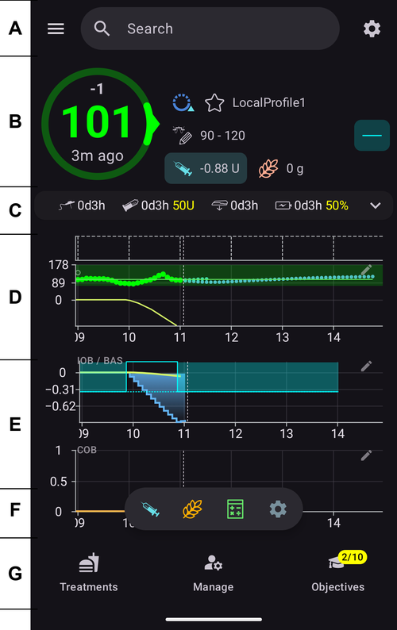

Это первый экран, который виден при открытии приложения **AAPS**. Он отображает почти всю информацию, требующуюся повседневно.

### Раздел A - Верхняя панель

* **Меню** (☰) слева открывает боковую панель навигации с пунктами **История терапии**, **Просмотр журнала**, **Статистика**, **Помощник профиля**, **Обслуживание**, **Мастер установки**, **Конфигурация** и другими.
* **Строка поиска** находит настройки, диалоги и документацию — просто начните вводить текст (см. [Глобальный поиск](../DailyLifeWithAaps/GlobalSearch.md)).
* Значок **Настройки** (шестеренка) справа открывает все [настройки](../SettingUpAaps/Preferences.md).

(aaps-screens-profile-target)=

### Раздел B - Блок состояния

#### Текущий уровень глюкозы крови

Последнее значение ГК с вашего CGM показано в большом круге слева, вместе с разницей с предыдущим значением (дельта) и возрастом этого значения.

Цвет значения ГК показывает его положение относительно заданного [диапазона](#Preferences-range-for-visualization).

* green = in range
* red = below range
* yellow = above range

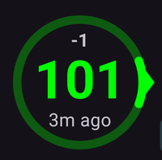 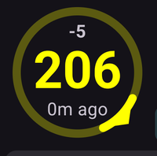 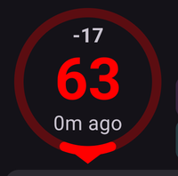

(loop-status)= (AapsScreens-loop-status)=

#### Статус контура


Рядом с кругом ГК значок показывает режим работы цикла (на рисунке сверху вниз):

1. Зеленый круг = [замкнутый цикл](#KeyAapsFeatures-ClosedLoop), цикл работает
2. Фиолетовый круг с пунктирной линией = [приостановка на низкой ГК (LGS, ЛГС)](#KeyAapsFeatures-LGS)
3. Голубой круг с пунктирной линией = [открытый цикл](#KeyAapsFeatures-OpenLoop)
4. Красный круг с крестиком = цикл деактивирован (не работает постоянно)
5. Красный значок паузы = цикл приостановлен (временно остановлен, но базальный инсулин подается) - оставшееся время показано рядом со значком
6. Серый круг с вилкой = помпа отключена (временно инсулин не подается совсем) - оставшееся время показано рядом со значком

Нажмите на значок, чтобы открыть окно цикла. Содержимое окна зависит от текущего состояния:

* Пока цикл **работает** (замкнутый, открытый или LGS), вы можете сменить режим работы (Замкнутый цикл, Приостановка помпы на низкой ГК, Открытый цикл или Деактивировать цикл), **приостановить** цикл или **отключить** помпу на выбранное время.
* Пока цикл **деактивирован**, вы можете снова включить его, выбрав режим работы, или отключить помпу.
* Пока цикл **приостановлен**, вы можете **возобновить** его, отключить помпу или выбрать новое время в разделе **Приостановить цикл**, чтобы продлить приостановку.
* Пока помпа **отключена**, вы можете **подключить** помпу снова или выбрать новое время в разделе **Отключить помпу**, чтобы продлить отключение.

Когда вы продлеваете приостановку или отключение, новое время **отсчитывается с текущего момента**: оно заменяет оставшееся время, а не добавляется к нему. Сначала возобновлять цикл или подключать помпу не нужно.

Окно, когда цикл работает в режиме замкнутого цикла:

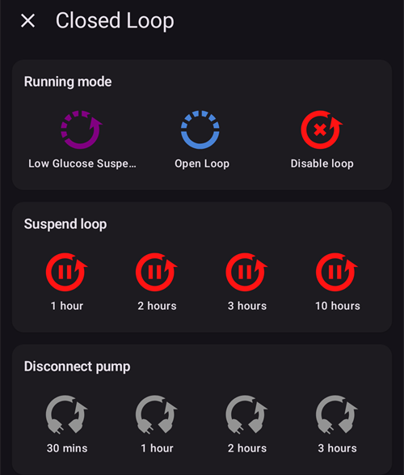

Окно, когда цикл приостановлен, с кнопкой **Возобновить** и вариантами времени для продления приостановки:

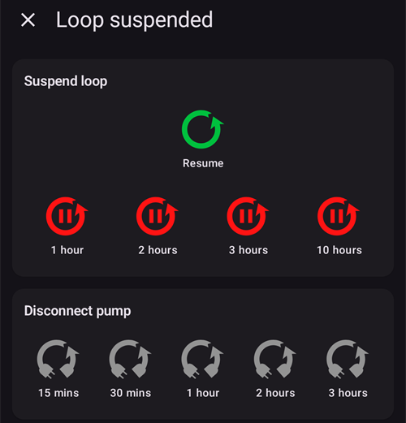

Окно, когда помпа отключена, с кнопкой **Возобновить соединение с помпой** и вариантами времени для продления отключения:

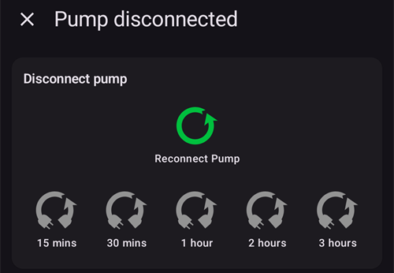

Окно в режимах приостановки на низкой ГК, открытого цикла и при деактивированном цикле отличается только предлагаемыми режимами работы:

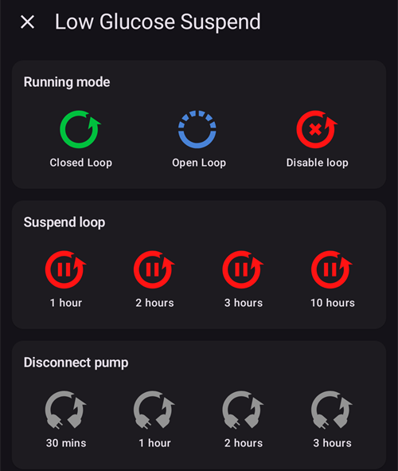

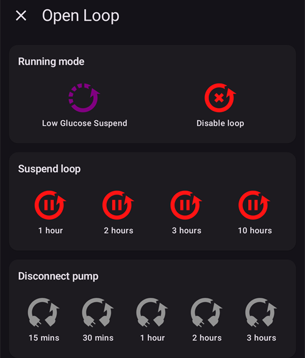

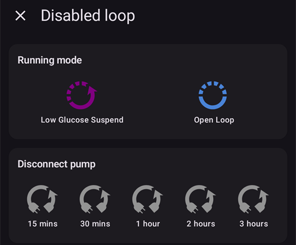

Так выглядит главный экран в каждом режиме. Цветная полоса вверху графика меняется в момент переключения.

Low Glucose Suspend:

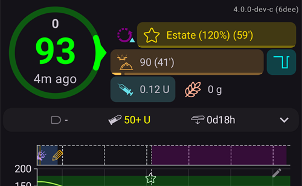

Open loop:

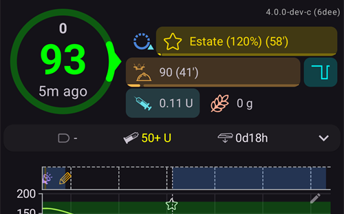

Цикл выключен:

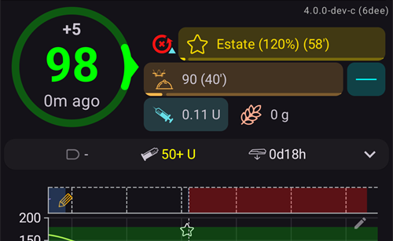

Цикл приостановлен — оставшееся время показано рядом со значком:

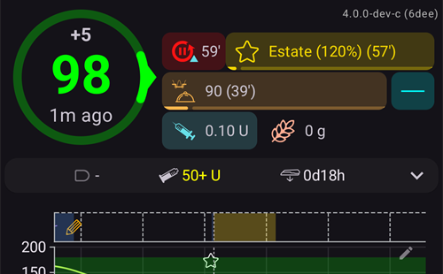

Помпа отключена — оставшееся время показано рядом со значком. Кнопки терапии остаются на панели быстрого запуска, поэтому вы по-прежнему можете записать инсулин, введенный шприц-ручкой, или углеводы:

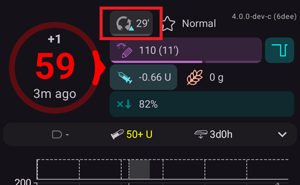

После каждого выбора нужно подтверждение.

```{admonition} Тревога: помпа не приняла нулевой временный базал :class: warning Пока помпа отключена, **AAPS** поддерживает на помпе нулевой временный базал и снова устанавливает его, если он отсутствует. Если через 10 минут это все еще не удается, **AAPS** подает срочный сигнал тревоги: *«Помпа не приняла нулевой временный базал. Она может продолжать подавать базальный инсулин. Проверьте помпу.»* Сигнал повторяется каждые 15 минут, пока нулевой временный базал не будет установлен или пока не закончится отключение. Если вы видите этот сигнал, проверьте помпу: она может подавать базальный инсулин, хотя **AAPS** показывает ее как отключенную.

    <br />Примечание: доступные режимы зависят от вашего прогресса в [Целях](../SettingUpAaps/CompletingTheObjectives.md) — замкнутый цикл и LGS становятся доступны только по мере их прохождения.
    
    (aaps-screens-bg-warning-sign)=
    #### Предупреждающий знак ГК
    
    Если **AAPS** обнаруживает проблему с полученными значениями ГК, в нижней панели главного экрана появляется ярлык вашего источника ГК (с его названием, например **xDrip+ BG**) с красным значком предупреждения. Нажмите на него, чтобы открыть [экран источника ГК](#aaps-screens-bg-source).
    
    ##### Дублированные данные ГК
    
    Красный предупреждающий знак требует от вас немедленных действий: вы получаете **дублированные данные ГК**, из-за которых цикл не может работать правильно. **AAPS** не может надежно рассчитать тренд ГК по дублированным значениям, поэтому прекращает коррекцию.
    
    Если ваш цикл был замкнутым, **AAPS** переключает его в режим [приостановки на низкой ГК (LGS)](#KeyAapsFeatures-LGS): значок цикла становится фиолетовым.
    
      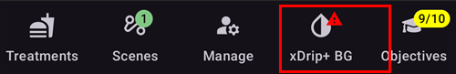
    
    Нажмите на значок цикла: карточка **Ограничения** вверху показывает причину: «BgQualityCheck: Режим LGS из-за повторяющихся значений в источнике ГК».
    
      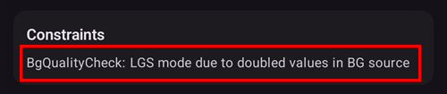
    
    ```{admonition} Ваш цикл работает в режиме приостановки на низкой ГК
    :class: note
    Цикл продолжает работать, но только для защиты от гипогликемии: **AAPS** может снижать или останавливать базал, но не даст инсулин на коррекцию, пока вы не решите эту проблему!
    

Следует выяснить, почему дублируются данные ГК:

* Активирован ли мост Dexcom на сайте NS? Отключите мост, перейдя в панель управления сайта NS, отредактируйте переменную «enable» и удалите оттуда "bridge". (Для Heroku [подробности можно найти здесь](https://nightscout.github.io/troubleshoot/troubleshoot/#heroku).)
* Данные о ГК поступают в Nightscout (NS) из нескольких источников? Если вы используете приложение BYODA, включите загрузку в **AAPS**, но не включайте ее в xDrip, если вы им пользуетесь.
* Есть ли у вас фолловеры, которые получают ваши данные ГК, но также снова загружают их на ваш сайт Nightscout?
* В крайнем случае: в [настройках клиента NS](#Preferences-nsclient) выберите настройки синхронизации и отключите параметр «Получать данные CGM из NS».

Чтобы сразу убрать предупреждение и снова включить коррекцию цикла, удалите дубликаты на экране источника ГК: нажмите на ярлык в нижней панели. Дублированное значение выделено красным. Долго нажмите на значение, чтобы начать выбор, отметьте дубликаты и нажмите значок корзины вверху справа.

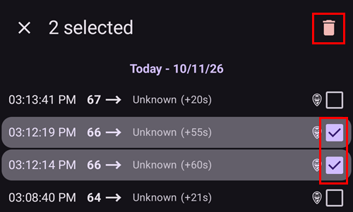

Однако если задублированных данных много, проще сделать следующее

* [сохраните настройки](../Maintenance/ExportImportSettings.md),
* сбросьте базу данных в меню обслуживания и
* [импортируйте настройки](../Maintenance/ExportImportSettings.md) заново

    {admonition} Вернитесь в замкнутый цикл сами
    :class: important
    **AAPS** не возвращается в режим **Замкнутый цикл** сам, когда дубликаты удалены. Нажмите на значок цикла на главном экране и снова выберите **Замкнутый цикл**.

##### Неизменные данные ГК

С некоторыми источниками ГК (Libre 1, AiDEX, Glutec, Medtronic и источники, которые не сообщают тип сенсора) **AAPS** также проверяет значения, которые не меняются: если ваша ГК изменилась меньше чем на 2 мг/дл (0,1 ммоль/л) за 45 минут, данные считаются неверными. Тогда на ярлыке источника ГК появляется красный значок ровного тренда, а цикл останавливает любой высокий временный базал и не дает инсулин на коррекцию, пока значения снова не начнут меняться. Проверьте сенсор и приложение, которое отправляет значения.

##### Нерегулярные данные ГК

Когда значения приходят через неравные промежутки или некоторые из них пропущены, **AAPS** заново рассчитывает 5-минутные значения из тех, что есть. Это бывает, например, после замены сенсора или с сенсорами Libre, у которых время сдвигается на минуту-две каждые несколько часов. Цикл продолжает работать, и вам ничего не нужно делать. **AAPS** 4 больше не показывает для этого желтый предупреждающий знак.

#### Текущий профиль

Текущий профиль показан рядом со значком звезды.

Нажмите на название профиля, чтобы открыть [экран профиля](#aaps-screens-profile), где можно посмотреть данные профиля и [переключаться между профилями](../DailyLifeWithAaps/ProfileSwitch-ProfilePercentage.md).

Чтобы **изменить процент профиля** (и его длительность), нажмите на название профиля, затем нажмите круглую кнопку **▶** (Активировать) внизу справа на экране профиля. В **AAPS** 3.x этот экран открывался долгим нажатием на название профиля; в **AAPS** 4 долгое нажатие ничего не делает. Пошагово: [Изменить процент профиля](#ProfileSwitch-change-percentage).


1. Обычный вид с активацией стандартного профиля.
2. Переключение профиля с процентом 90% и оставшимся временем 9 минут — название профиля становится желтым, пока работает временное переключение профиля.
3. Переключение профиля со сдвигом по времени на 1 час и оставшимся временем 9 минут.

#### Целевое значение ГК (Цель)


Текущее целевое значение ГК показано под названием профиля.

Коротко нажмите на цель, чтобы открыть экран **[Временная цель](../DailyLifeWithAaps/TempTargets.md)**.

1. Обычный вид: целевой диапазон, заданный в вашем профиле.
2. Если установлена временная цель, цель становится желто-оранжевой со значком использованной предустановки, а оставшееся время в минутах показано в скобках.

(Визуализация динамического изменения цели)=

#### Визуализация динамического изменения цели

При использовании алгоритма [микроболюсов SMB](#Config-Builder-aps) и [Autosens](#Open-APS-features-autosens) **AAPS** может динамически настроить цель на основе чувствительности.

Включите один или оба следующих параметра в [настройках OpenAPS SMB](#Preferences-openaps-smb-settings):

* "Sensitivity raises target" and/or
* "Resistance lowers target"

Если **AAPS** обнаруживает резистентность или чувствительность, цель будет отличаться от заданной в профиле, а показанная цель меняет цвет, чтобы показать это изменение.

(aaps-screens-iob-cob-basal-sens)=

#### IOB, COB, базал и чувствительность


1. **Шприц**: активный инсулин (IOB) - количество активного инсулина в вашем организме  
    Значение активного инсулина было бы равно нулю, если бы работал только ваш стандартный базал и не осталось инсулина от предыдущих болюсов. 
    * IOB может быть отрицательным если был период с пониженным относительно текущего профиля базалом.
    * Нажмите на плашку, чтобы увидеть разделение на болюсный и базальный инсулин (первое окно на рисунке — здесь с отрицательным IOB после периода сниженного базала)
2. **Зерно**: [активные углеводы (COB)](../DailyLifeWithAaps/CobCalculation.md) - еще не усвоенные углеводы, которые вы съели ранее
3. Бирюзовая кнопка справа показывает **текущую подачу базала**: ровная линия, когда работает базал профиля, и другой значок, пока активна временная базальная скорость
4. **Строка процентов** показывает текущую чувствительность ([Autosens](#Open-APS-features-autosens) / [DynamicISF](../DailyLifeWithAaps/DynamicISF.md)). Когда цикл меняет ваш ISF, в строке также видны ISF профиля, стрелка и ISF, который цикл использует сейчас, например «80% 2,0 ↗ 2,5». Нажмите на нее, чтобы увидеть значение Autosens и эффективный ISF (второе окно на рисунке). Если цикл работает с другим значением, чем последний результат Autosens (например, потому что временная цель меняет вашу чувствительность), окно также показывает это значение как **Autosens в алгоритме**. Когда Autosens выключен, цикл использует ISF вашего профиля, и эффективный ISF не показывается.

Окно IOB, которое открывается нажатием на плашку IOB:

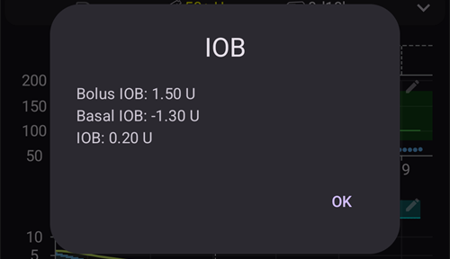

Нажмите на бирюзовую кнопку, чтобы увидеть работающую временную базальную скорость, когда она началась и сколько времени уже работает:

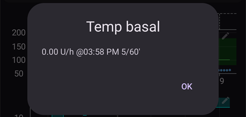

(aaps-screens-carbs-requirement)=

#### Требуются углеводы


Требование углеводов появляется, когда расчеты определяют их недостаток.

Это происходит, когда алгоритм Oref решает, что не сможет помочь простым отключением подачи инсулина и во избежание гипогликемии необходимы углеводы.

Уведомления об углеводах значительно сложнее, чем уведомления калькулятора болюса. Вы можете увидеть предложение углеводов, даже если калькулятор болюса не показывает недостающих углеводов.

При желании уведомления о нужных углеводах можно отправлять в Nightscout. В этом случае будет показано и разослано оповещение.

### Раздел C - Строка состояния


Строка состояния показывает визуальное предупреждение для

* сколько времени прошло с момента установки канюли
* Возраст инсулина (сколько дней используется резервуар) и уровень в резервуаре (единицы)
* сколько времени отработал сенсор
* Возраст и уровень заряда батареи помпы (%)

Если превышено пороговое значение, данные показываются желтым цветом.

Если превышено критическое пороговое значение, значения будут показаны красным цветом.

Возраст всегда показывается в краткой форме, независимо от размера экрана: *4ч* в первый день, *3д4ч* позже.

Пороги можно изменить с помощью маленького значка **Настройки**, который виден, когда строка состояния **развернута** (шеврон справа) — см. [Индикаторы состояния](#Preferences-status-lights).

В развернутой панели состояния в конце некоторых строк также есть кнопка для записи замены, которая сбрасывает соответствующий возраст: **Добавить** в строке **Сенсор** записывает установку сенсора. Если ваша помпа это поддерживает, **Прайм/заполнение** появляется в строках **Катетер помпы** (или **Патч-помпа**) и **Инсулин**, а **Добавить** — в строке **Батарея помпы**.


В зависимости от помпы у вас могут отсутствовать некоторые пиктограммы.

(снимки экрана-сенсор-уровень-заряд батареи)

#### Уровень заряда сенсора (батарея)

Работает в мониторинге с дополнительным передатчиком, например MiaoMiao 2. (Технически сенсор должен передавать в xDrip информацию об уровне заряда батареи.)

Пороги можно задать в разделе [Индикаторы состояния](#Preferences-status-lights).

(aaps-screens-main-graph)=

### Раздел D - Главный график

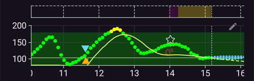

График показывает уровень глюкозы в крови (ГК) считываемый с мониторинга глюкозы (CGM).

Прокручивайте график и меняйте масштаб двумя пальцами, чтобы изменить видимый период времени.

Зеленая область отражает ваш целевой диапазон.

На этом графике также отображается:

* Ручные болюсы: синий треугольник прямо над кривой ГК, направленный вниз на значение в этот момент, с количеством инсулина
* Записи углеводов: оранжевый треугольник прямо под кривой ГК, направленный вверх на значение, с количеством углеводов. Прием пищи, введенный вместе с болюсом, выглядит как один маркер, разделенный значением ГК.
* Треугольники бывают трех размеров (маленький, средний, большой) в зависимости от количества по сравнению с самым большим за день. Если в это время нет значения ГК (пропуск сенсора), треугольник рисуется внизу графика.
* Проверки ГК и калибровки: рисуются на уровне своего измеренного значения, чтобы вы могли сравнить их с кривой сенсора
* Целевая ГК из профиля или временная цель: зеленая линия
* Переключения профиля: значки звезды вверху графика
* Статус цикла: цветная полоса вверху графика, когда [режим работы](#AapsScreens-loop-status) не является замкнутым циклом: синий = открытый цикл, фиолетовый = LGS, красный = цикл деактивирован, желтый = цикл приостановлен, серый = помпа отключена, оранжевый = суперболюс (на снимке экрана: фиолетовый, затем желтый). История этих изменений показана в разделе [Режим работы](#AapsScreens-running-mode)
* [SMB](#Open-APS-features-super-micro-bolus-smb) не рисуются на графике ГК (их было бы по одному каждые несколько минут): они показаны на [графике IOB](#aaps-screens-iob).

Нажмите на **Проверку ГК** на графике, чтобы увидеть ее значение и примечание, если вы его написали.

(aaps-screens-graph-press-and-hold)=

#### Значения в выбранный момент

**Нажмите и удерживайте** график ГК, чтобы увидеть значения в одной точке. Точка отмечает ближайшее значение, пунктирная линия проходит в это время через все графики, а всплывающее окно вверху графика показывает:

* время и значение ГК
* IOB, COB (только если больше 0 г) и базальную скорость в это время — значок базала показывает, работала ли временная базальная скорость, как на главном экране
* болюсы, SMB или углеводы в это время, с теми же треугольниками, что и на графиках

Не отпуская палец, ведите его влево или вправо, чтобы переходить от одного значения к другому. На каждом значении вы чувствуете легкую вибрацию, и график при этом не прокручивается. Всплывающее окно остается на экране 2 секунды после того, как вы уберете палец.

Так же это работает на [дополнительных графиках](#aaps-screens-additional-graphs) под графиком ГК (IOB, COB...): нажмите и удерживайте любой из них.

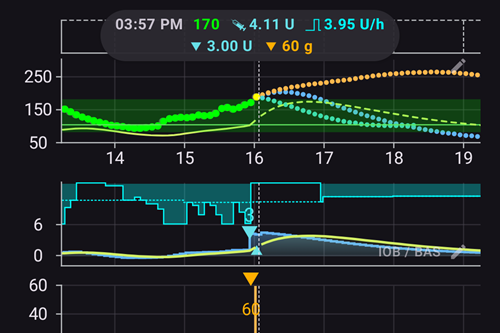

(aaps-screens-graph-clock-change)=

#### Перевод часов

Когда часы телефона переводятся, при переходе на летнее/зимнее время или в новом часовом поясе, этот момент на графике ГК отмечается вертикальной пунктирной линией с маленьким значком часов внизу. Та же пунктирная линия проходит через [дополнительные графики](#aaps-screens-additional-graphs) ниже.

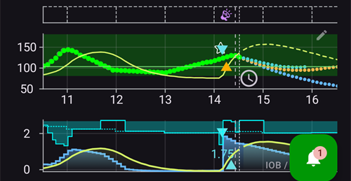

(AapsScreens-activate-optional-information)=

#### Активация дополнительной информации

Нажмите значок **карандаша** в правом верхнем углу графика, чтобы открыть настройки графика:


* **Высота графика** задает высоту, с которой рисуется график.
* **АКТ** накладывает кривую активности инсулина: сплошная желто-зеленая линия <span style="background:#141218;color:#D3F166;padding:0 0.3em;border:1px solid #141218;border-radius:4px">━━━━</span> (не путать с пунктирной желтой линией прогноза UAM)
* **ПРОГН** накладывает [линии прогнозирования](#aaps-screens-prediction-lines) (см. ниже)

(aaps-screens-prediction-lines)=

#### Линии прогнозирования

Когда **ПРОГН** включен, AAPS рисует свои прогнозы **пунктирными линиями** справа от линии «сейчас». У каждого прогноза свой цвет. В темной теме используются более светлые оттенки тех же цветов, а линия внутри зеленого целевого диапазона может выглядеть немного более зеленой.

| Линия                       | Light theme                                                                                                                       | Dark theme                                                                                                                         | Что прогнозирует                             |
| --------------------------- | --------------------------------------------------------------------------------------------------------------------------------- | ---------------------------------------------------------------------------------------------------------------------------------- | -------------------------------------------- |
| **IOB** (синий)             | <span style="background:#FFFFFF;color:#1E88E5;padding:0 0.3em;border:1px solid #CCCCCC;border-radius:4px">●●●●</span>             | <span style="background:#141218;color:#64B5F6;padding:0 0.3em;border:1px solid #141218;border-radius:4px">●●●●</span>              | только инсулин                               |
| **COB** (оранжевый)         | <span style="background:#FFFFFF;color:#FB8C00;padding:0 0.3em;border:1px solid #CCCCCC;border-radius:4px">●●●●</span>             | <span style="background:#141218;color:#FFB74D;padding:0 0.3em;border:1px solid #141218;border-radius:4px">●●●●</span>              | активные углеводы                            |
| **UAM** (желтый)            | <span style="background:#FFFFFF;color:#C9BD60;padding:0 0.3em;border:1px solid #CCCCCC;border-radius:4px">●●●●</span>             | <span style="background:#141218;color:#E6D39A;padding:0 0.3em;border:1px solid #141218;border-radius:4px">●●●●</span>              | непредвиденный прием пищи                    |
| **ZT** (голубой)            | <span style="background:#FFFFFF;color:#00D2D2;padding:0 0.3em;border:1px solid #CCCCCC;border-radius:4px">●●●●</span>             | <span style="background:#141218;color:#4DD4D4;padding:0 0.3em;border:1px solid #141218;border-radius:4px">●●●●</span>              | нулевой временный базал (инсулин остановлен) |
| **aCOB** (бледно-оранжевый) | <span style="background:#FFFFFF;color:rgba(251,140,0,0.5);padding:0 0.3em;border:1px solid #CCCCCC;border-radius:4px">●●●●</span> | <span style="background:#141218;color:rgba(255,183,77,0.5);padding:0 0.3em;border:1px solid #141218;border-radius:4px">●●●●</span> | только старый алгоритм AMA                   |

Когда два прогноза дают одинаковые значения, их точки накладываются, и вы видите только один из цветов (например, UAM поверх IOB, когда ГК стабильна).

* Линия **COB** (оранжевая): [активные углеводы](CobCalculation.md) (оранжевый цвет используется во всем AAPS для COB и углеводов)
    
    Эта линия прогнозирования показывает, где будет ГК (а не сами активные углеводы COB) на основе текущих настроек **Профиля** с учетом того, что отклонения из-за усвоения углеводов останутся постоянными. Эта линия появляется только при известном наличии активных углеводов COB.

* Линия **IOB** (синяя): активный инсулин (синий цвет используется во всем AAPS для IOB и инсулина)
    
    Эта линия прогнозирования показывает, что будет происходить только под воздействием инсулина. Например, если ввести инсулин, а потом не есть никаких углеводов.

* Линия **ZT** (голубая): нулевой временный базал (прогноз ГК, если бы была установлена временная базальная скорость 0%)
    
    Эта линия прогнозирования показывает, как изменится траектория ГК, если помпа прекратит введение инсулина (0% временной базальной скорости TBR). Линия заканчивается, как только поднимается выше вашей цели.
    
    *Эта линия появляется только при использовании алгоритма [SMB](#Config-Builder-aps).*

* Линия **UAM** (желтая): [непредвиденный прием пищи](#SensitivityDetectionAndCob-sensitivity-oref1)
    
    Незапланированный прием пищи - обнаружение значительного повышения уровня глюкозы, как следствие приема пищи, выброса адреналина или других факторов. Линия прогнозирования аналогична **оранжевой линии активных углеводов COB**, но предполагает, что отклонения будут понижаться с постоянной скоростью (за счет продления текущей скорости понижения).
    
    *Эта линия появляется, только если используется алгоритм [SMB](#Config-Builder-aps), в настройках OpenAPS SMB включен параметр **Включить UAM** и ГК растет сильнее, чем можно объяснить одним инсулином.*

* Линия **aCOB** (бледная, полупрозрачная оранжевая): ускоренное усвоение углеводов
    
    Похожа на COB, но предполагает постоянную скорость усвоения углеводов 10 мг/дл за 5 мин (0,555 ммоль/л за 5 мин). Устарело и имеет ограниченную полезность.
    
    *Эта линия появляется только при использовании более старого алгоритма [AMA](#Config-Builder-aps).*

Обычно реальная кривая глюкозы находится где-то между этих линий, или близка к той, которая ближе всего описывает вашу текущую ситуацию.

(aaps-screens-how-predictions-become-a-dosing-decision)=

#### Как AAPS превращает прогнозы в решение о дозе

AAPS не дозирует инсулин только по текущей ГК — в каждом цикле (примерно каждые 5 минут) он смотрит на все линии прогнозирования выше вместе и выбирает самый безопасный вариант действий.

Главное правило — **безопасность прежде всего**: если *любая* линия прогнозирования в любой момент опускается ниже вашего нижнего порога безопасности, AAPS устанавливает нулевой временный базал (временная базальная скорость 0%) и больше не дает инсулин, даже если ваша текущая ГК высокая. Только когда каждая линия прогнозирования остается выше этого порога, AAPS рассматривает подачу дополнительного инсулина.

Когда дополнительный инсулин давать безопасно, AAPS смотрит, где в итоге окажется ГК по объединенным прогнозам (**итоговая ГК**), и рассчитывает, сколько коррекции нужно, чтобы вернуть эту итоговую ГК к цели — в виде повышенной временной базальной скорости или (если включен алгоритм oref1/[SMB](#Open-APS-features-super-micro-bolus-smb)) в виде небольшого немедленного болюса. Если ГК сейчас высокая, но уже сама достаточно снижается, AAPS подождет или даже может снизить базальную скорость, а не добавит инсулин, который только сделал бы будущую гипогликемию еще глубже.

Примеры такой логики решений с настоящими снимками экрана см. в разделе [сценарии дозирования в руководстве для врачей](#clinicianguide-dosing-scenarios) — он написан для врачей, но подходит любому пользователю AAPS.

*Полное техническое описание того, как рассчитываются эти прогнозы и решение о дозе, см. в [документации OpenAPS по determine-basal](https://openaps.readthedocs.io/en/latest/docs/While%20You%20Wait%20For%20Gear/Understand-determine-basal.html).*

#### Базал

**Сплошная синяя** линия показывает базальную скорость помпы и отражает фактическую подачу инсулина с течением времени.

**Пунктирная синяя** линия - это базальная скорость из профиля, если бы не было временных изменений базальной скорости (ВБС).

При стандартной базальной скорости область под линией показывается в темно-синем цвете. Когда базальная скорость временно изменяется (увеличивается или уменьшается), область под линией отображается в светло-синем цвете.

#### Нагрузка

**Тонкая желтая** линия отображает активность инсулина.

Она основана на ожидаемом падении ГК из-за действия инсулина в системе, если не присутствуют другие факторы (например, углеводы).

(AapsScreens-section-g-additional-graphs)= (aaps-screens-additional-graphs)=

### Раздел E - Дополнительные графики

Под главным графиком можно включить дополнительные графики. В [Простом режиме](#preferences-simple-mode) дополнительные графики заданы заранее и не могут быть изменены. Выключите **Простой режим**, если хотите установить собственную конфигурацию дополнительных графиков.

Дополнительные графики следуют за главным графиком: когда вы прокручиваете или масштабируете график ГК, они двигаются вместе с ним. Движение пальцем вбок по дополнительному графику тоже прокручивает все графики. У них нет своих меток времени — смотрите время на графике ГК.

Чтобы настроить дополнительный график, нажмите значок **карандаша** в его правом верхнем углу:


Выберите плашки с данными, которые вы хотите видеть на этом графике; кнопка **Удалить** удаляет график.

Чтобы создать еще один график, нажмите **Добавить график** под последним графиком и выберите его плашки так же:

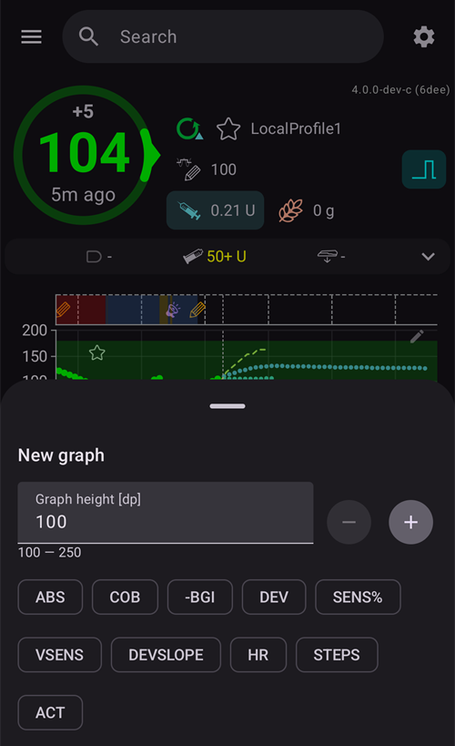

Новый график добавляется под остальными — здесь второй дополнительный график с **ЧУВСТ%** и **DEV**:

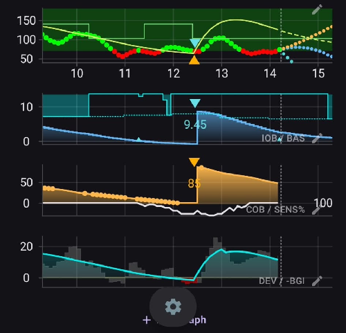

Большинство пользователей считают достаточной следующую конфигурацию дополнительных графиков:

* График 1 с IOB, БАЗА
* График 2 с COB, изменением чувствительности
* График 3 с отклонениями и BGI.

#### Абсолютный инсулин (АБС)

Активный инсулин, включая болюсный **и базальный**.

(aaps-screens-iob)=

#### Insulin on board (IOB)

Показывает инсулин, который вы имеете "на борту" (= активный инсулин в вашем теле). Он включает инсулин болюсов и временного базала (**но исключает базальную скорость, установленную в вашем профиле**).

Если бы не было болюсов, микроболюсов [SMB](#Open-APS-features-super-micro-bolus-smb), временных базалов TBR во время действия инсулина DIA, он равнялся бы нулю.

SMB показаны на этом графике синими треугольниками трех размеров в зависимости от количества по сравнению с самым большим SMB за день.

IOB может быть отрицательным, если у вас не осталось болюсного инсулина, а нулевой или низкий временный базал работал долгое время.

Усвоение зависит от ваших [настроек DIA и типа инсулина](#Config-Builder-insulin-dia).

#### Активные углеводы (COB)

Показывает активные углеводы в организме (= еще не усвоенные углеводы).

Усвоение углеводов зависит от [отклонений, которые обнаруживает алгоритм](../DailyLifeWithAaps/CobCalculation.md).

Если обнаружится более быстрое усвоение углеводов, чем ожидалось, будет подан инсулин, и это увеличит количество активного инсулина IOB (с учетом настроек безопасности).

#### Изменение чувствительности (ЧУВСТ%)

Показывает чувствительность, обнаруженную алгоритмом [Autosens](#Open-APS-features-autosens).

Чувствительность - это расчет чувствительности к инсулину в результате нагрузки, гормонов и т.д.

Обратите внимание: чтобы определение чувствительности/[Autosens](#Open-APS-features-autosens) могло автоматически менять количество подаваемого инсулина, вы должны быть на [Цели 8](#objectives-objective8). До достижения этой цели линия Autosens на диаграмме отображается только для информации.

### Переменная чувствительность (VSENS)

Показывает чувствительность, рассчитанную при помощи [DynamicISF](../DailyLifeWithAaps/DynamicISF.md). Заполняется только если используется эта функция.

(screen-heart-rate-steps)=

#### Пульс (HR) и шаги

Эти данные доступны при использовании [смарт-часов на Wear](../WearOS/WearOsSmartwatch.md). Включите их в приложении **AAPS** Wear и предоставьте доступ к данным о здоровье.

Шаги рисуются столбцами, а пульс — кривой линией, которая прерывается там, где часы не передавали данные.

#### Отклонения (DEV)

* **Серые** столбцы показывают отклонения, вызванные углеводами.
* **Зеленые** столбцы показывают, что ГК превышает уровень, ожидаемый алгоритмом. Зеленые столбцы используются для увеличения сопротивляемости в [Autosens](#Open-APS-features-autosens).
* **Красные** столбцы показывают, что ГК ниже величины, ожидаемой алгоритмом. Красные столбцы используются для увеличения чувствительности в [Autosens](#Open-APS-features-autosens).
* **Желтые** столбцы показывают отклонение, вызванное непредвиденным приемом пищи UAM.
* **Черные** столбцы показывают небольшие отклонения, не принятые во внимание при расчете чувствительности

#### Влияние на ГК (-BGI)

Эта линия показывает, в какой степени ГК "должна" подниматься или падать, только на основании активности инсулина.

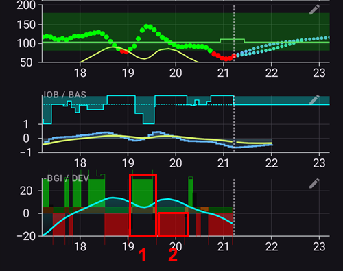

Эту линию стоит вывести вместе со столбцами отклонения. У них одна шкала, но она отличается от шкалы других дополнительных данных, поэтому лучше показывать их на отдельном графике, как показано выше. Сравнение линии влияния ГК и шкалы отклонений -еще один способ понять флуктуации **ГК**. Здесь в момент, отмеченный **1**, столбцы отклонений намного выше линии BGI: ГК растет сильнее, чем объясняет одна активность инсулина (например, после углеводов). В момент, отмеченный **2**, столбцы отклонений ниже нуля (красные): ГК ниже, чем ожидал алгоритм.

### Раздел F - Панель быстрого запуска


Плавающая панель внизу экрана содержит ваши действия **[Быстрого запуска](../DailyLifeWithAaps/QuickLaunch.md)**. Маленькая **шестеренка** открывает настройку быстрого запуска, где вы выбираете, какие кнопки показывать (терапия, записи портала терапии, действия CGM, экраны панели **Управление**, кнопки [Мастера быстрых настроек](../DailyLifeWithAaps/QuickWizards.md), [Сценарии](../DailyLifeWithAaps/Scenes.md) и другое).

Типичная настройка показана выше: **Инсулин**, **Углеводы** и **Мастер Болюса**.

Пока помпа **отключена**, кнопки терапии остаются на панели, например чтобы записать инсулин, введенный шприц-ручкой (см. [Инсулин](#aaps-screens-buttons-insulin) ниже). Те же действия есть и на панели [Терапия](#aaps-screens-treatments-sheet) в нижней навигации.

(aaps-screens-buttons-insulin)=

#### Инсулин


Чтобы ввести нужное количество инсулина без использования [калькулятора болюса](#aaps-screens-bolus-wizard).

Если включить **Включить ВЦ Ожидаемый прием пищи**, можно автоматически запустить [временную цель «Ожидаемый прием пищи»](#TempTargets-eating-soon-temp-target).

Если вы не хотите давать болюс через помпу, а хотите записать количество инсулина (например, введенного шприц-ручкой), включите «**Болюс будет только записан (без подачи помпой)**». Дополнительная строка **Время** со значением **Сейчас** позволяет записать инъекцию инсулина, сделанную в прошлом: используйте **-** / **+**, чтобы изменить время, или нажмите на шеврон, чтобы ввести минуты или выбрать дату и время.

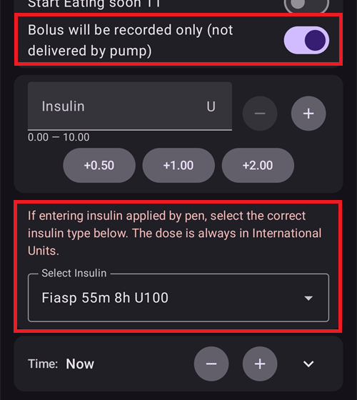 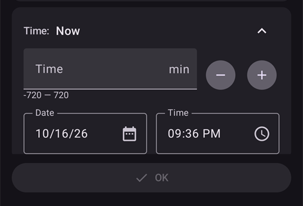

Кнопки **+0.5 / +1.0 / +2.0** позволяют быстро увеличить количество инсулина. Шаги увеличения можно изменить в [настройках Мастера болюса](#Preferences-deliver-this-part-of-bolus-wizard-result).

Окно инсулина можно использовать и когда помпа приостановлена или отключена, например чтобы записать инсулин, введенный шприц-ручкой. В этом случае «**Болюс будет только записан (без подачи помпой)**» включен принудительно (показан красным), и появляются дополнительные поля для выбора типа инсулина и сдвига **Время** для инъекции, сделанной в прошлом:

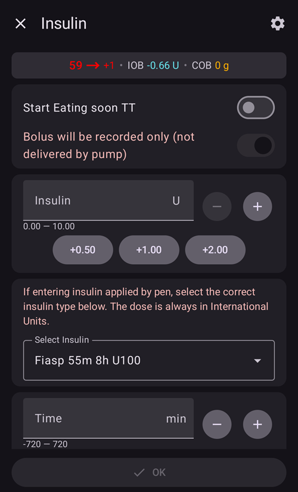

#### Углеводы


Для записи углеводов без подачи болюса.

Некоторые [заданные временные цели](#TempTargets-hypo-temp-target) (Гипо, Ожидаемый прием пищи, Нагрузка) можно запустить прямо переключателями вверху.

**Время приема углеводов**: когда вы будете есть или ели углеводы.

**Продолжительность**: используется для [«растянутых углеводов»](ExtendedCarbs.md). Эта строка свернута, чтобы вы по ошибке не ввели в нее граммы: используйте **-** / **+**, чтобы изменить значение, или нажмите на шеврон, чтобы открыть строку и ввести значение.

Кнопки **+5 / +10 / +20** позволяют быстро увеличить количество углеводов.

#### Мастер быстрых настроек

Легко вводите количество углеводов и задавайте основу расчета одной заранее настроенной кнопкой.

Подробности настраиваются в [Мастере быстрых настроек](../DailyLifeWithAaps/QuickWizards.md).

(aaps-screens-treatments-sheet)=

### Раздел G - Нижняя навигация

Нижняя панель навигации дает доступ к:

* **Терапия** — панель быстрых действий с вашими действиями терапии:
    
    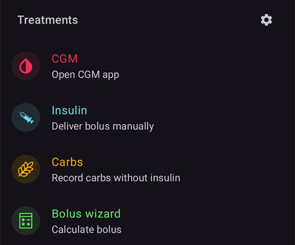

* **Сценарии** — показываются, только если у вас есть хотя бы один [сценарий](../DailyLifeWithAaps/Scenes.md) или правило **Автоматизации**, отмеченное как **Действия пользователя**. It opens a sheet from which you can start them; items that cannot start right now are dimmed, with the reason. **Карандаш** вверху панели открывает **Управление → Сценарии**.

* **Управление** — центр для всего, чем вы управляете в **AAPS**: Профиль, Настройки инсулина, Временная цель, Мастер быстрых настроек, Сценарии, Автоматизация, Еда, Места установки, Помпа и Авторизованные клиенты. Под ними находятся действия с устройствами и базалом, например Установка сенсора и Временный базал. Некоторые пункты появляются, только если они подходят к вашей системе — например, Прайм/заполнение и замена батареи зависят от помпы, а Временный базал, Пролонгированный болюс и записи Портала терапии скрыты в [Простом режиме](#preferences-simple-mode):
    
    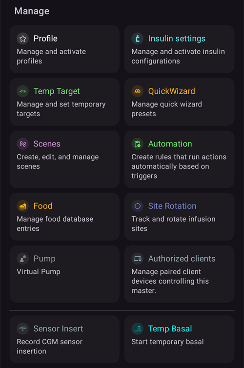

* **Цели** — ваш прогресс в [Целях](../SettingUpAaps/CompletingTheObjectives.md); значок с числом показывает, сколько из них выполнено. Этот пункт исчезает, когда все цели выполнены, и его нет в **AAPSClient**.

(aaps-screens-notifications)=

#### Notifications

Над нижней панелью справа может появиться **пузырь уведомлений**. Он собирает активные уведомления **AAPS**; маленькое число показывает, сколько их. Его цвет соответствует самому важному уведомлению: красный для срочного сообщения, зеленый для простой информации.

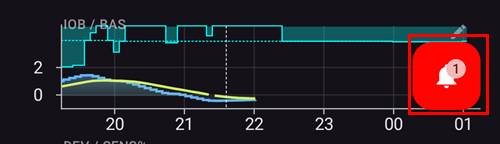

Нажмите на пузырь, чтобы открыть панель **Уведомление**. У каждого сообщения показано время, когда оно появилось. Нажмите **Закрыть** под сообщением, чтобы убрать его; у некоторых сообщений вместо этого есть другая кнопка, которая открывает настройку, требующую вашего внимания.

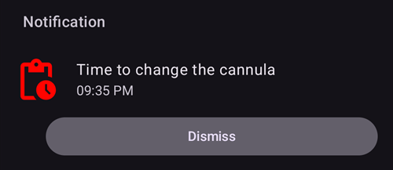

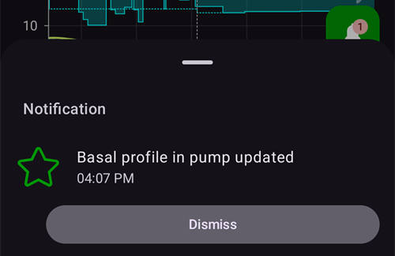

(bolus-wizard)= (aaps-screens-bolus-wizard)=

## Мастер Болюса


Чаще всего болюс на еду вводят отсюда.

### Раздел I

Заголовок **Расчет** показывает рассчитанный болюс. Если количество активного инсулина превышает рассчитанный болюс, то оно просто покажет количество углеводов, которые еще требуются.

Калькулятором болюса можно пользоваться при любой текущей **ГК**, в том числе когда она слишком высокая или слишком низкая. Если **ГК** выше цели, к болюсу на еду добавляется коррекция. Если **ГК** ниже цели, болюс уменьшается, а если активного инсулина уже больше, чем нужно, калькулятор вместо инсулина показывает, сколько углеводов еще требуется.

Строка значков под заголовком показывает, какие данные входят в расчет (ГК, тренд, IOB, временная цель, COB). Нажатие на значок включает / исключает эти данные из расчета; значок **(i)** показывает подробные числа, на которых основан расчет.

#### Комбинации активных углеводов COB и активного инсулина IOB и что они означают

* Из соображений безопасности IOB нельзя отключить, когда включены COB, иначе есть риск получить слишком много инсулина, так как **AAPS** не будет учитывать уже введенный инсулин.
* Если включить COB и IOB, будут учтены неусвоенные углеводы, еще не покрытые инсулином, и весь инсулин, поданный как временный базал или SMB.
* Если включить IOB без COB, **AAPS** учитывает уже введенный инсулин, но не сопоставляет его с углеводами, которые еще будут усваиваться. Это приводит к уведомлению о "недостатке углеводов".
* Если вы даете болюс на **дополнительную еду** вскоре после болюса на еду (например, на десерт), бывает полезно **отключить все данные**. Таким образом, добавляются только новые углеводы а поскольку основная еда не еще не усвоена, то IOB не будет точно соответствовать углеводам COB вскоре после болюса на еду.
* Из соображений безопасности **временная цель** учитывается в расчете, только если вы включите эти данные вручную.

(AapsScreens-section-j)=

### Раздел J - Поля ввода

В поле **Углеводы** вы вводите оценку количества углеводов **в граммах**, на которое хотите дать болюс; кнопки **+** под ним быстро добавляют углеводы. **AAPS** работает только с граммами: если вы считаете в хлебных единицах (ХЕ) или единицах обмена (*например*, DAFNE «CHO»), переведите их в граммы перед вводом. См. [примечание о хлебных единицах](#your-aaps-profile-insulin-to-carbs-ratio) на странице профиля.

#### Тип углеводов: хлеб, торт или пицца

Под полем **Углеводы** кнопки **Хлеб**, **Торт** и **Пицца** сообщают **AAPS**, как быстро усваивается еда. С **Тортом** и **Пиццей** болюс сейчас покрывает только часть углеводов, а остальное добавляется позже как eCarbs. Проценты и время см. в разделе [Тип углеводов: хлеб, торт или пицца](#AapsScreens-carbs-type) на странице «Растянутые углеводы (eCarbs)».

Строка **Коррекция** нужна, если вы хотите по какой-то причине изменить итоговую дозу.

Всегда открыто только поле **Углеводы**. Остальные строки (**Коррекция**, **Время приема углеводов**, **ГК** и **Использовать процент**) свернуты: они показывают свое значение с кнопками **-** / **+**, чтобы его можно было менять небольшими шагами. Нажмите на шеврон, чтобы открыть строку и ввести значение, и нажмите на него снова, чтобы закрыть строку. Так вы не введете граммы в поле **Коррекция** по ошибке.

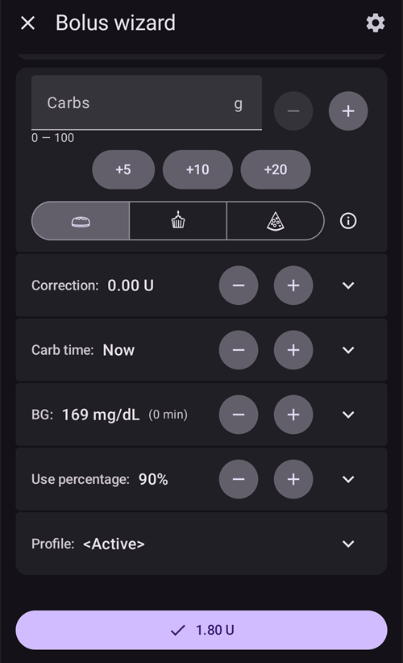

Нажмите в любом месте строки **Профиль**, чтобы открыть список ваших профилей, затем нажмите на название, чтобы использовать этот профиль для этого расчета.

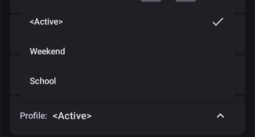

Поле **Время приема углеводов** предназначено для преболюса, чтобы сообщить системе о задержке в появлении углеводов. Вы можете добавить отрицательное число в это поле, если даете болюс на прошлые углеводы.

**Установить сигнал** (напоминание о еде): когда введено время приема углеводов в будущем, появляется переключатель «**Установить сигнал**», чтобы в указанное время вам напомнили съесть углеводы, которые вы ввели в **AAPS**:


Напоминание начинается, когда болюс подан. Пока оно работает, на главном экране идет обратный отсчет на полосе **Пора есть** с кнопками **Стоп** и **+5 мин**. **+5 мин** сдвигает конец ожидания на пять минут позже, а полоса показывает общее время ожидания. Когда время пришло, напоминание звучит своим звуком — тихим кухонным таймером. Кроме **Выключить звук** (экран остается открытым) и **Выключить звук и закрыть**, на экране сигнала есть кнопка **+5 мин**, которая запускает новое ожидание на пять минут. После сигнала на полосе написано *Время вышло* с кнопками **+5 мин** и **Закрыть**; **Выключить звук и закрыть** тоже убирает полосу. While it runs, a notification on the phone says when the reminder rings, for example *Rings at 19:25*, and shows the time left in its header; the watch does not show this notification a second time. Полоса и сигнал также показываются в **AAPSClient** и на [часах](#WearOsSmartwatch-wizard-carb-time). Напоминание не создает таймер в приложении «Часы» на телефоне. Если Android не разрешает **AAPS** устанавливать будильники, мастер просит вас разрешить *Будильники и напоминания* для **AAPS** в настройках Android. Колокольчик не предлагается, если время приема углеводов в прошлом.

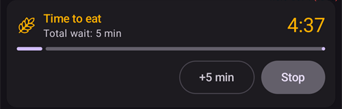

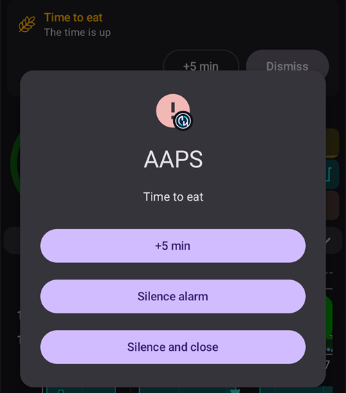

Поле **ГК** обычно уже заполнено последним значением с вашего CGM. Если мониторинг ГК не работает, то поле будет пустым. Когда значение свежее, строка **ГК** остается свернутой. Поле следует за новыми значениями, пока мастер открыт, до тех пор, пока вы не измените его сами.

Кнопка результата внизу показывает предлагаемый болюс; при нажатии на нее запрашивается подтверждение, прежде чем будет подан инсулин. Пока подтверждение ожидает, цикл не дает SMB, поэтому болюс, который вы подтверждаете, остается правильным. Если в этот момент подается SMB, **OK** ждет, пока подача закончится.

Полезно знать:

* Если рассчитанный болюс больше вашего **[Максимального болюса](#Preferences-maximum-bolus)**, он уменьшается до максимального болюса, а в подтверждении показывается предупреждение «Применено ограничение болюса». [Мастер быстрых настроек](../DailyLifeWithAaps/QuickWizards.md) в этом случае отклоняется.
* Когда болюс только записывается (например, пока помпа отключена), предупреждение «**Болюс будет только записан (без подачи помпой)**» остается вверху окна, даже когда вы прокручиваете его.
* Болюс, который вы даете вручную, имеет приоритет над [SMB](#Open-APS-features-super-micro-bolus-smb), который ждет подачи: SMB отменяется, и цикл выполняет расчет заново. Если SMB подается прямо сейчас, ваш болюс отклоняется с сообщением «Сейчас подается SMB. Повторите попытку, когда подача закончится.» Инсулин не подается, и углеводы, введенные с этим болюсом, не сохраняются: подождите немного и введите их снова.

(AapsScreens-wrong-cob-detection)=

#### Неверное обнаружение активных углеводов COB


Если после применения мастера болюса появляется вышеприведенное сообщение, то **AAPS** обнаружил, что расчет активных углеводов может быть неправильным. Так что, если вы хотите повторно ввести болюс после предшествуещей еды с активными углеводами, учитывайте возможность передозировки!

Подробнее см. в подсказках на странице расчета активных углеводов [COB](#CobCalculation-detection-of-wrong-cob-values).

Ищете вкладку **Действия** из **AAPS** 3.x? Ее функции перенесены на главный экран, в панель **Управление** и на панель быстрого запуска: см. [Куда делась вкладка «Действия»?](#screens-action-tab).

(aaps-screens-careportal)=

## Записи портала терапии

Возраст и уровни, показанные в [строке состояния](#screens-sensor-level-battery) (сенсор, инсулин, катетер, батарея помпы), основаны на записях портала терапии: **Прайм/заполнение** (записывает смену места катетера и замену картриджа с инсулином), **Установка сенсора** и **Замена батареи помпы**.

Их можно записать из развернутой панели состояния на главном экране, из панели **Управление** или кнопками [Быстрого запуска](../DailyLifeWithAaps/QuickLaunch.md).

**Прайм/заполнение** записывает смену места катетера и/или замену картриджа с инсулином и может подать количество инсулина для заполнения:

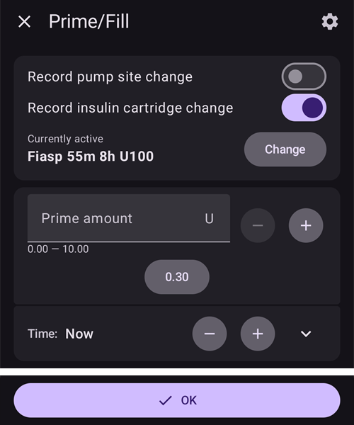

**Установка сенсора** и **Замена батареи помпы** запрашивают только время события:

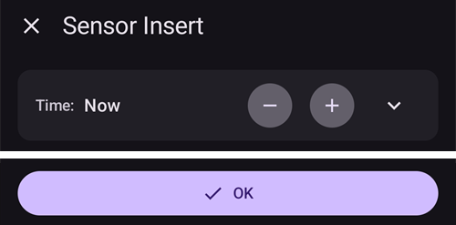

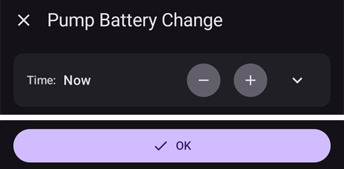 Записи нагрузки, оповещения, вопроса и примечания соответствуют порталу терапии Nightscout и являются особыми видами примечаний.

В панели **Управление** прокрутите вниз и нажмите **Портал терапии**, чтобы показать эти записи: **Проверка ГК**, **Примечание**, **Нагрузка**, **Вопрос** и **Оповещение**.

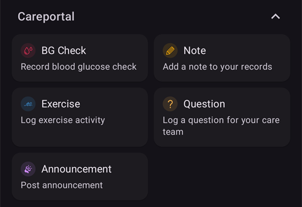

**Проверка ГК**, **Вопрос** и **Оповещение** позволяют ввести значение глюкозы (с глюкометра, сенсора или из другого источника), примечание и время события. В записях **Вопрос** и **Оповещение** строка глюкозы свернута и показывает тип измерения рядом со значением: если вы меняете значение, тип меняется с **Сенсор** на **Глюкометр**.

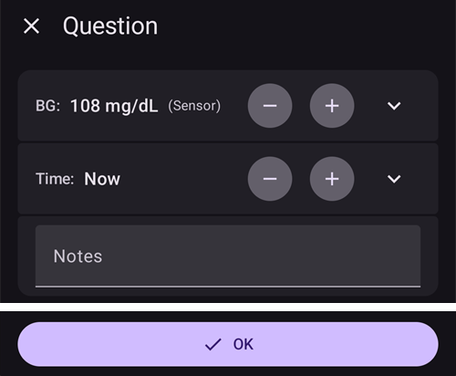

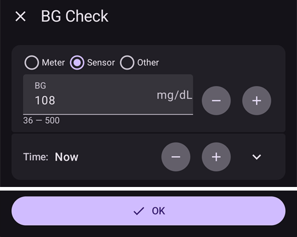

**Примечание** и **Нагрузка** позволяют ввести продолжительность (свернутая строка: используйте **-** / **+** или нажмите на шеврон, чтобы ввести ее), примечание и время события:

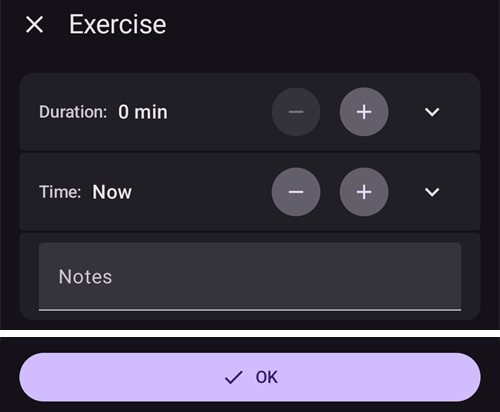

Во всех этих окнах (**Прайм/заполнение**, **Установка сенсора**, **Замена батареи помпы** и записи портала терапии) для времени события используется та же строка **Время**, что и в [окне инсулина](#aaps-screens-buttons-insulin) и Мастере болюса: используйте **-** / **+**, чтобы сдвигать время шагами по 5 минут (до одной недели назад и на 12 часов вперед), или нажмите на шеврон, чтобы выбрать любую дату и время.

## Смена мест установки

**Управление → Места установки** записывает на схеме тела, где был установлен каждый катетер и сенсор, чтобы вы могли чередовать места: см. [Места установки](#Aapsscreens-site-rotation) на странице «Помпы и катетеры».

**TDD** (суммарная суточная доза) и простое правило соотношения базал/болюс объясняются на [вкладке «Инсулин» в Статистике](#reviewing-tdd).

(AapsScreens-insulin-profile)=

## Инсулин


**Управление → Настройки инсулина** показывает ваши настройки инсулина и позволяет управлять ими. Каждая настройка показана на карточке с **временем пика** и **[DIA](#Config-Builder-insulin-dia)**; используемая отмечена как **АКТИВНЫЙ**. Под карточкой видна кривая активности. Вы можете изменить название, пик и DIA любой настройки, кроме активной: чтобы сменить используемый инсулин, [добавьте новую настройку и активируйте ее](#Config-Builder-insulin-change-active).

Подробнее о том, что это такое и как это задать, см. [Продолжительность действия инсулина](#Config-Builder-insulin-dia).

## Статус помпы

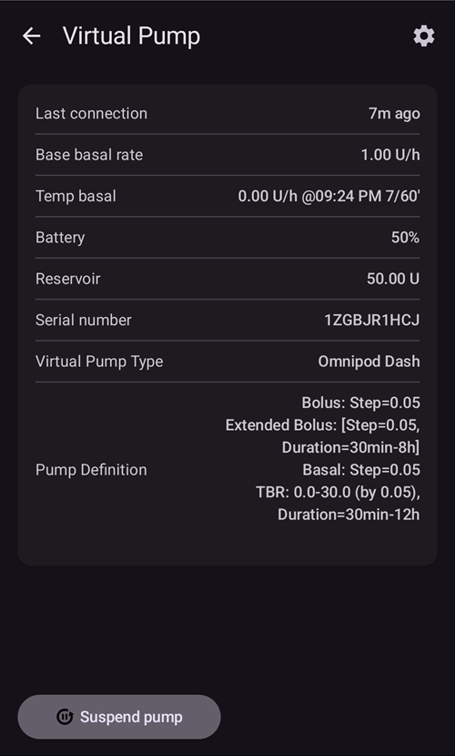

**Управление → Помпа** (или **Конфигурация → Помпа → Открыть модуль**) показывает состояние вашей помпы: последнее подключение, базовую базальную скорость, батарею, резервуар...

* Отображаемая информация зависит от модели помпы.
* Подробнее см страницу [помпы](../Getting-Started/CompatiblePumps.md).

## Замкнутый цикл, помощник болюса AMA / микроболюсы SMB

**Конфигурация → Замкнутый цикл → Открыть модуль** (и **Конфигурация → APS → Открыть модуль**) показывают подробности расчетов алгоритма и почему **AAPS** действует именно так: последний запуск, итоговый запрос и ограничения. Экран **Замкнутый цикл** показывает только ограничения, которые действительно ограничили поданную временную базальную скорость или SMB (и почему замкнутый цикл не разрешен, если это так); экран **APS** показывает все ограничения, которые вошли в расчет.

Расчеты производятся каждый раз, когда система получает свежие данные мониторинга CGM.

Подробнее см. [раздел APS на странице «Конфигурация»](#Config-Builder-aps).

(aaps-screens-profile)=

## Профиль

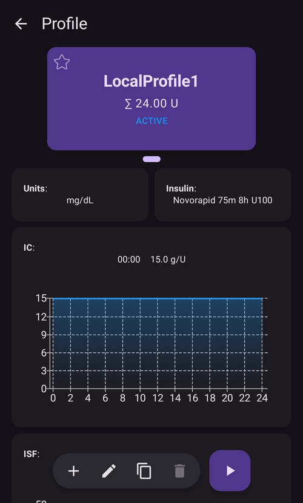

**Управление → Профиль** (или нажатие на название профиля на главном экране) открывает экран профиля: ваши профили в виде карусели карточек, которые можно листать, с кнопками, чтобы добавить, изменить, клонировать, удалить и **активировать** профиль.

Профиль содержит информацию о ваших индивидуальных параметрах диабета, дополнительную информацию см на стр **[профиль](../SettingUpAaps/YourAapsProfile.md)**.

## Автоматизация

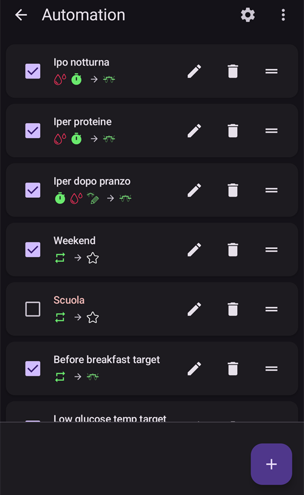

**Управление → Автоматизация** показывает список ваших правил автоматизации. Смотрите специальную страницу, посвященную этому вопросу [здесь](../DailyLifeWithAaps/Automations.md).

## клиент NS

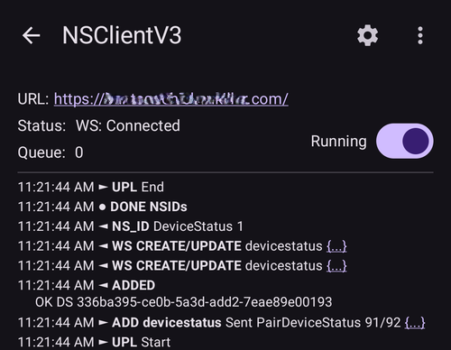

**Конфигурация → Связь → NSClientV3 → Открыть модуль** показывает состояние соединения с вашим сайтом Nightscout: URL, состояние websocket, очередь и журнал синхронизации.

Настройки можно изменить в [настройках клиента NS](#Preferences-nsclient).

Для устранения неполадок см [эту страницу ](../GettingHelp/TroubleshootingNsClient.md).

(aaps-screens-bg-source)=

## Источник ГК - xDrip, BYODA...

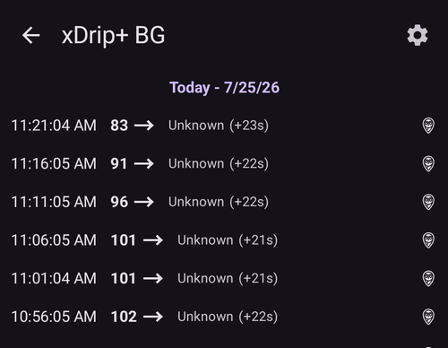

**Конфигурация → Источник ГК → Открыть модуль** показывает историю значений CGM и позволяет удалить значения при сбое (например, ложно низкие значения при сдавливании сенсора) или дублированные значения.

## Treatments history

Откройте **меню** (☰) и выберите **История терапии**, чтобы просмотреть, проверить и исправить все, что записал **AAPS**: углеводы и болюсы, временные базалы, временные цели, переключения профиля, записи портала терапии, смены режима цикла и действия пользователя. См. [История терапии](#aaps-screens-treatments) на странице «Анализ ваших данных».

## Просмотр истории


Откройте **меню** (☰) и выберите **Просмотр журнала**.

Позволяет перемещаться по журналу **AAPS**. См. отдельную страницу [Анализ ваших данных > Просмотр журнала](../Maintenance/Reviewing.md).

(aaps-screens-statistics)=

## Статистика


Откройте **меню** (☰) и выберите **Статистика**.

Показывает статистику по суммарной суточной дозе, времени в диапазоне, вашему профилю глюкозы в течение дня (AGP) и картине циклов инсулина, на четырех вкладках. См. отдельную страницу [Анализ ваших данных > Статистика](#reviewing-statistics).

(aaps-screens-profile-helper)=

## Помощник профиля

Откройте **меню** (☰) и выберите **Помощник профиля**.


Помощник профиля позволяет сравнивать профили и создавать начальные профили для детей. См. [Ваш профиль AAPS](../SettingUpAaps/YourAapsProfile.md) — разделы [Создание профиля для ребенка с нуля](#your-aaps-profile-profile-from-scratch-for-a-kid) и [Сравнение двух профилей](#your-aaps-profile-compare-profiles).

(aaps-screens-widgets)=

## Виджеты на главном экране

**AAPS** предлагает пять виджетов, которые можно добавить на главный экран телефона, чтобы видеть данные, не открывая приложение. См. отдельную страницу [Виджеты на главном экране телефона](../DailyLifeWithAaps/Widgets.md).

