# Автоматизация

```{contents} In this page
:backlinks: entry
:depth: 2
```

## Что такое автоматизация?

"**Automation**" is a feature which can automate tasks in AAPS.

Automation performs specific actions based on one or more conditions or triggers. Триггерами могут быть нерегулярные события, например низкий или высокий уровень глюкозы крови (ГК) или заданное количество отрицательного активного инсулина (IOB). Automations can also handle recurring events, such as meals or exercise at certain times of day, or when the user is within a specific distance of a GPS location or a Wi-Fi SSID area. Автоматизация может создавать резервные копии настроек AAPS по расписанию или при каждой смене Pod.

Automation rules are created and modified from the **Automation** screen (**Manage → Automation**). Каждое правило задается двумя свойствами:

- Одно или несколько условий, или «триггеров», которые запускают действие.

    Например, определенное расписание, событие или значение параметра в AAPS

- Одно или несколько действий, которые нужно выполнить.

    Such as an alarm or setting a profile percentage or exporting the AAPS settings on Pod change.


There are a wide range of Automation options, and users are encouraged to study these within the AAPS app, in the Automation section. Примеры автоматизаций от других пользователей можно также найти в группах пользователей AAPS в [**Facebook**](https://www.facebook.com/groups/AndroidAPSUsers) и [**Discord**](https://discord.gg/4fQUWHZ4Mw).

## Как может помочь автоматизация

1. **Automate recurring tasks:** Automatically executing programmed actions without user interaction.

1. **Уменьшить стресс при принятии решений:** Основное преимущество **автоматизаций** заключается в освобождении пользователя от необходимости ручной корректировки работы **AAPS**. [Исследования](https://www.ncbi.nlm.nih.gov/pmc/articles/PMC6286423/#ref4) показывают, что людям с сахарным диабетом 1 типа, приходится принимать в среднем 180 дополнительных решений в день. **Автоматизация** может уменьшить эту нагрузку, высвобождая умственную энергию пользователя для других аспектов жизни.

1. **Потенциально улучшить контроль ГК:** например, **автоматизация** может обеспечить установку **временных целей** при необходимости, даже в напряженный день или в моменты забывчивости. Для примера, если ребенок-диабетик имеет запланированные занятия спортом в школе по вторникам в 10:00 и четвергам в 14:00, имея необходимость в высокой **временной цели** за 30 минут перед активностью, то данную потребность покроет **автоматизация**.

1. **Enabling AAPS to be highly customized** to be more or less aggressive in specific situations, according to a user's preference. Например, срабатывание временно уменьшенного процента **профиля** на установленный период времени при появлении отрицательного активного инсулина **(IOB)** посреди ночи, показывающего возможную чрезмерную агрессивность установленного **профиля**.

Приводимый ниже пример показывает, как **автоматизация** может помочь устранить лишние ручные действия.

Пользователь упражняется каждое утро в 6 утра: ему необходимо каждый раз помнить об установке за час до этого временной цели для активности.

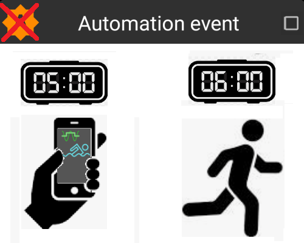

Пользователь настроил **автоматизацию**, которая в 5 утра включает временную цель «Нагрузка», чтобы его **ГК** и активный инсулин **(IOB)** были оптимальными для упражнений в 6 утра:

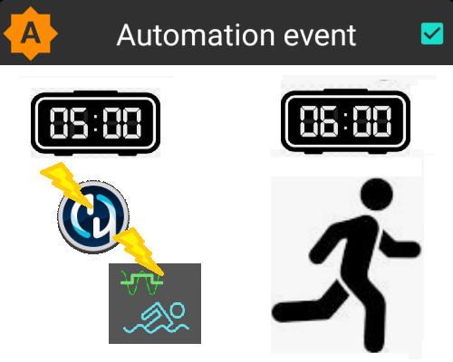

## Основные соображения перед началом применения автоматизации

1. Прежде чем настраивать некоторые автоматизации, вы должны достаточно хорошо контролировать **ГК** с помощью **AAPS**. Автоматизации не следует использовать, чтобы компенсировать неоптимальные настройки базала, **ISF** или **CR** (подробнее об этом ниже). Избегайте автоматизации **смены профиля** для компенсации вылетов **ГК** вследствие, _например_, приема пищи, для этого лучше использовать другие методы (микроболюсы SMB и т.д.).

1. Как и любая техника, **CGM**, **помпы** и телефоны могут давать сбои: технические проблемы или ошибки сенсора могут нарушить действия **автоматизации**, и может понадобиться ручное вмешательство.

1. **Requirements for Automations are likely to change as routines change**. При смене периодов работы/учебы/отдыха, устанавливайте себе напоминание о проверке того, какие **автоматизации** у вас на данный момент активны (их легко включить и выключить). For example, if you go on holiday, and no longer need an Automation set up for school sports or daily exercise, or need to adjust the timings.

1. **Автоматизации** могут конфликтовать друг с другом. Новые настройки **Автоматизации** лучше внимательно проверять в безопасной обстановке и понимать, почему **Автоматизация** сработала или не сработала так, как вы ожидали.

1. Если вы используете Autosens, то попробуйте использовать **временные цели** вместо **смены профилей**. **Временные цели TT** не сбрасывают Autosens на 0. Любые **смены профиля** сбрасывают Autosens.

1. Большинство **автоматизаций** следует устанавливать лишь на **определенный промежуток времени**, после которого **AAPS** сможет снова, если потребуется, повторить **автоматизацию**. For example, "start temp target of 7.0 mmol/L for 30 min" or "start **Profile** 110% for 10 min" _and_ "start temp target of 5.0 mmol/L for 10 min". Использование **автоматизаций** для внесения постоянных изменений (например, смены профиля) влечет за собой риск гипогликемии.

## Когда начать применять Автоматизацию?

**Автоматизации** могут быть созданы в **цели 10**.

## Где находятся настройки автоматизации в AAPS?

Open **Manage** in the bottom navigation of the main screen and select **Automation**.

## Как настроить автоматизацию?

To set up an **Automation**, press the **+** button on the Automation screen to create a ‘rule’:


* give your ‘rule’ a title (Task name);
* press "**EDIT**" under **Condition**. On the **Condition** screen, choose how the triggers are combined (**And**, **Or**, **Exclusive or**) and press "**Add trigger**":

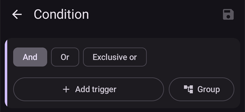

* add at least one trigger:

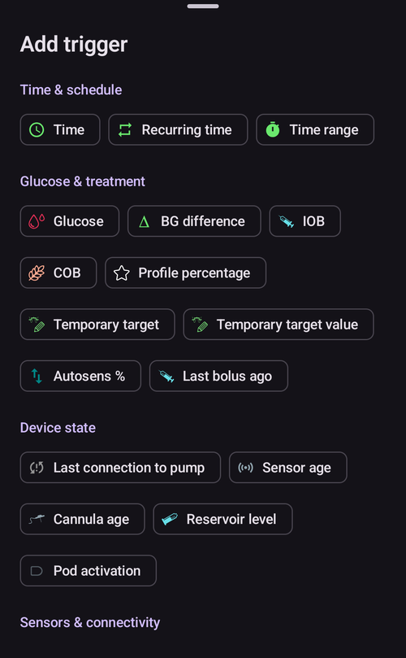

* press "**ADD**" under **Action** and select one action:

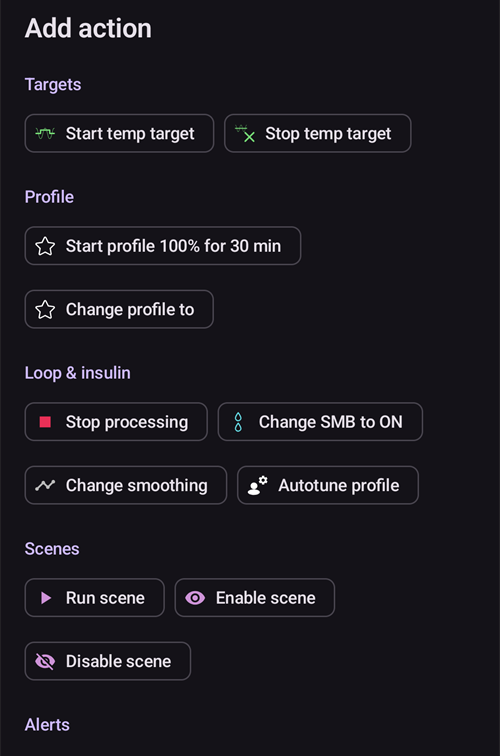

* save the rule with the **Save** button, and make sure the checkbox left of the rule name is ‘ticked’ to activate the **Automation**:


Чтобы отключить правило **Автоматизации**, снимите галочку слева от названия правила **Автоматизации**. The example below shows an **Automation** as either activated (‘ticked') or deactivated (‘unticked’):


При настройке **автоматизации**, вы можете cначала проверить ее, используя действие "уведомление" внутри нее. Это заставляет**AAPS** сначала вывести уведомление, а не автоматизировать действие. Когда вы убедитесь, что уведомление запущено в правильное время/ при правильных условиях, правило **Автоматизации** может быть обновлено, с заменой "Уведомления" на ‘Действие’.

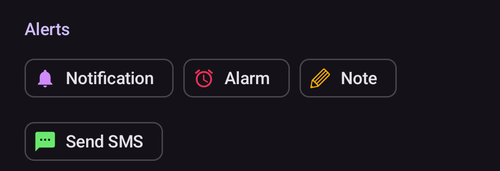

```{admonition} Important note
:class: note

**Автоматизации** активны даже при отключенном цикле!
```


## When rules are checked

**AAPS** checks all **Automation** rules each time a new glucose reading has been processed, so rules are evaluated at the pace of your CGM, also while the phone screen is off. Rules are also checked when the phone starts charging, when the network or location changes, and when a Bluetooth device connects. Only one check runs at a time, so a rule whose actions take a while (for example a pump command) cannot be executed twice.

## Ограничения безопасности

Для **Автоматизации** установлены ограничения безопасности:

* A **Temp Target** set by an **Automation** has to be between 72 and 180 mg/dL (or 4 and 10 mmol/L).
* The **Profile Percentage** has to be between 50% and 130%.
* There is a 5 minute time limit between executions of **Automation** (and first execution).

## Правильное использование отрицательных значений

```{admonition} Warning
:class: warning

Будьте осторожны при установке отрицательного значения в **автоматизации**
```

Будьте осторожны, когда выбираете «отрицательное значение» в «Условии», например «меньше чем», в **Автоматизации**. Например:

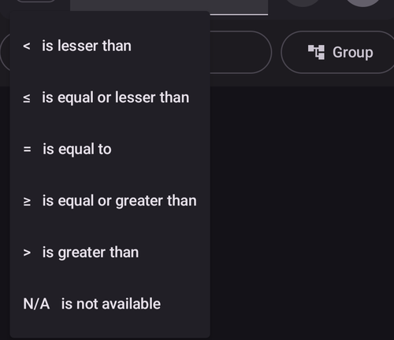

**Example 1:** Creating a Condition **"is lesser than"** "-0.1mmol/L" (or "-2mg/dL") will:

Запустит **автоматизацию** для любого числа, которое **строго меньше, чем** -0,1 (-2). Сюда входят такие числа, как -0,2, -0,3, -0,4 (-4, -6, -8) и так далее. Помните, что само -0,1 (-2) **не** включено в это условие. (The condition "is equal or lesser than -0.1mmol/L (-2 mg/dL)" _would_ include -0.1 mmol/L or -2 mg/dL).

**Example 2:** Creating a Condition "is greater than" -0.1mmol/L (-2mg/dL) will:

Trigger an **Automation** for any number which is **greater than** -0.1mmol/L (-2mg/dL). This includes numbers like 0, 0.2, 0.4mmol/L, (0, 4, 8mg/dL) and any other positive number.

Важно тщательно учитывать точное назначение **автоматизации** при выборе этих условий и значений.

(automations-automation-triggers)=
## Триггеры автоматизации


Scroll down to see the rest of the list:

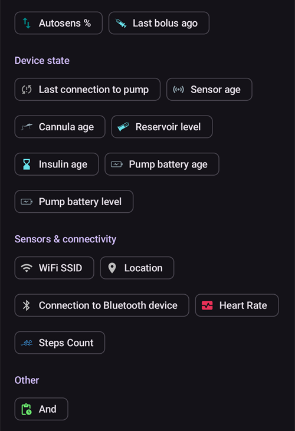

Пользователь может выбрать разные «Триггеры». Триггеры — это условия, которые должны быть выполнены, чтобы автоматизация сработала. Приводимый ниже перечень не исчерпывающий:

**Триггер:** объединение условий

**Варианты:**

Несколько условий могут быть связаны при помощи
* “И”
* “Или”
* “Исключая или” (это значит, что действие (действия) выполнится, если выполняется одно — и только одно — из условий)

**Триггер:** время и время повторения

**Варианты:**

* время = одно событие времени
* периодическое время = то, что происходит регулярно (т.е. раз в неделю, каждый рабочий день и т. д.)

**Триггер:** местоположение

**Варианты:**

* in [Settings > Automation](#preferences-maintenance-settings), the user can select their required location service.

**Триггер:** служба определения местоположения

**Варианты:**

* Использовать пассивное расположение: **AAPS** принимает локацию только в том случае, если ее запрашивают другие приложения.
* Использовать сетевую геолокацию: расположение вашего Wi-Fi.
* Используйте локатор GPS (Внимание! Может привести к чрезмерной разрядке аккумулятора!)

**Триггеры**: данные помпы и сенсора

* Триггер «Время, отработанное катетером помпы»: доступен для всех помп
* Триггер «Инсулин проработал»: доступен для поддерживаемых помп
* Триггер «Время отработанное батареей помпы»: доступен для поддерживаемых помп
* Триггер «Время, отработанное сенсором»: доступен всегда
* Триггер «Активация Pod'а»: доступен для патч-помп

Обратите внимание: для всех триггеров времени работы сравнение «равно» вряд ли сработает, поэтому в этом случае нужны два триггера, чтобы задать диапазон

* Триггер «Уровень резервуара»: доступен для всех помп; сравнение "NOT\_AVAILABLE" для этого триггера не работает, так как значение в **AAPS** всегда заполнено
* Триггер «Уровень заряда батареи помпы»: доступен для поддерживаемых помп; сравнение "NOT\_AVAILABLE" для этого триггера не работает, так как значение в **AAPS** всегда заполнено

(automations-automation-action)=
## Действие


Scroll down to see the rest of the list:

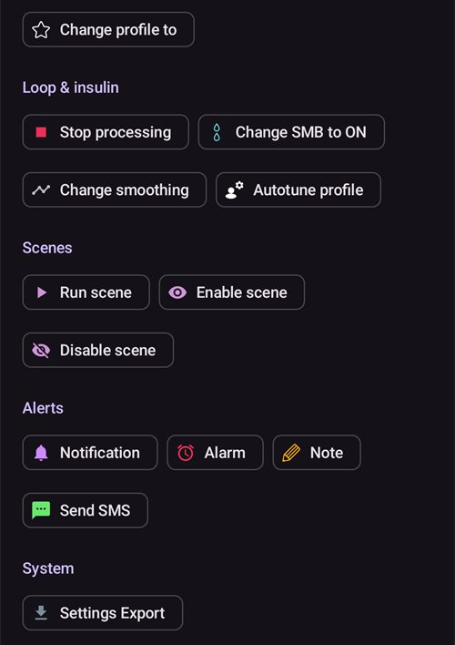

**Действия:** начать **Временную цель**

**Варианты:**

* **BG** must be between 72 mg/dL and 180 mg/dL (4 mmol/L and 10 mmol/L)
* **TT** works only if there is no previous Temp Target — **AAPS** adds this automatically as a "**Preconditions: Temp target not exists**" line to the rule

**Действия:** остановить **временную цель**

**Варианты:**

отсутствуют

**Действия:** **Установить процент профиля**

**Варианты:**

* **Profile** must be between 50% and 130%
* Работает только в том случае, если предыдущий процент составляет 100%

**Actions:** **Change smoothing** (in the **Loop & insulin** group)

**Варианты:**

* select the [smoothing method](../CompatibleCgms/SmoothingBloodGlucoseData.md) to switch to. The list is the same as under **Configuration** > **Smoothing**, and the action does exactly what a change there does: the new method is saved, synced to paired clients, and the BG data is smoothed again right away.
* runs only if that smoothing method is not already active — **AAPS** adds this automatically as a "**Preconditions: Smoothing … is not active**" line to the rule. Once the selected smoothing is active, the rule is skipped silently.
* Example: a new sensor is often noisy during its first day. Two rules with the **Sensor age** trigger give stronger filtering while the sensor settles, and lag-free smoothing after that:
  * **Sensor age** less than 24 h: **Change smoothing** to **Unscented Kalman Filter**
  * **Sensor age** more than 24 h: **Change smoothing** to **Average smoothing**

**Actions:** **Note** (in the **Alerts** group of the list)

**Варианты:**

* select the event to record: **Note**, **Exercise**, **Question**, **Announcement** or **Pump Site Change**, and an optional note. The name of the action changes to the event you select.
* **Duration**: used for **Note**, **Exercise** and **Pump Site Change**. **Question** and **Announcement** have no duration: they record your current BG instead.
* **Pump Site Change** resets the cannula age, as if you had recorded a site change by hand. Example: some pumps (like the Combo) record a reservoir change by themselves, but not the site change. If you always change both together, a rule with **Insulin age** less than 1 hour and **Cannula age** more than 24 hours can record the site change for you.

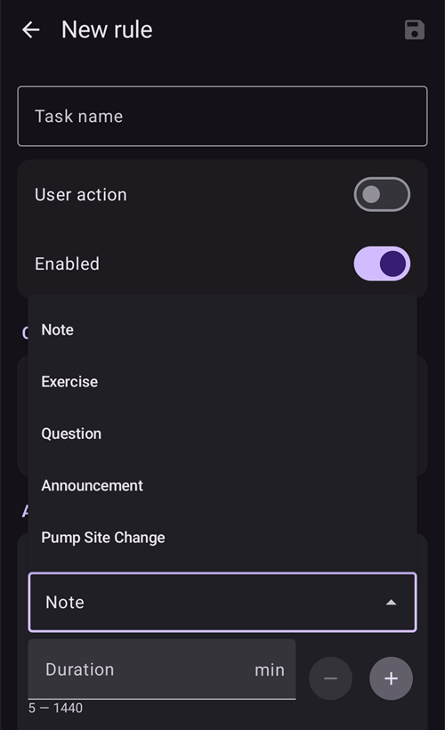 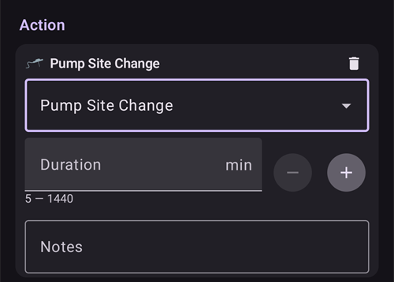

**Actions:** **Send SMS to all numbers** (in the **Alerts** group)

**Варианты:**

* enter the text of the message. It is sent to all the phone numbers allowed in the [SMS Communicator](../RemoteFeatures/SMSCommands.md) settings. The SMS Communicator plugin must be enabled.

**Actions:** **Change profile to** (in the **Profile** group)

**Варианты:**

* select the **Profile** to activate. It is activated at 100%, without timeshift. If this profile is already active, the action does nothing.

**Actions:** **Enable/disable SMB** (in the **Loop & insulin** group)

**Варианты:**

* choose **On** or **Off**. This changes the **Enable SMB** setting of OpenAPS SMB, exactly as if you had changed it in **Settings**, and stays until you or another rule change it back.

**Actions:** **Run Autotune** (in the **Loop & insulin** group)

**Варианты:**

* select the profile to tune and the number of days: see [Run Autotune with an automation rule](#autotune-run-autotune-with-an-automation-rule).

**Actions:** **Stop processing** (in the **Loop & insulin** group)

**Варианты:**

* none. While the conditions of a rule with this action are true, **AAPS** does not check the rules below it in the list. As soon as its conditions are false again, the rules below are checked as usual. Add it to a rule that must take priority over the rules below it (see [the order of the Automations](#Automations-the-order-of-the-automations-in-the-list-matters)).

**Actions:** **Run scene**, **Enable scene**, **Disable scene** (in the **Scenes** group)

**Варианты:**

* select the [scene](Scenes.md) to run, enable or disable.

После добавления «Действия» значения по умолчанию должны быть изменены на желаемую величину путем нажатия и изменения значения по умолчанию.


(Automations-the-order-of-the-automations-in-the-list-matters)=
## Порядок **автоматизаций** в списке играет роль
 **AAPS** выполняет созданные правила по порядку, начиная с верхней части списка **Автоматизации**. For example, if the ‘Low’ **Automation** is the most important **Automation**, above all other rules, then this **Automation** should appear at the top of the user’s **Automation** list as demonstrated below:


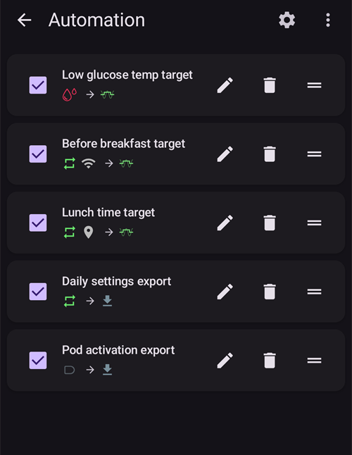

To reprioritize the **Automation** rules, touch and hold the **=** handle on the right side of the rule. Reorder the **Automations** by moving the rules up or down.

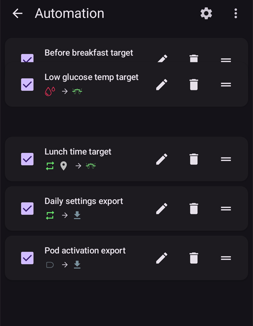

## Как удалить правила автоматизации

Для удаления правила **автоматизации** нажмите на значок корзины.


## Examples of Automations

Ниже приведены примеры **Автоматизаций**. Further discussion on **Automations** and how users have individualised their **Automation** can be found in Facebook discussions groups or on Discord. Приведенные ниже примеры не следует воспроизводить без хорошего понимания пользователем того, как будет работать **Автоматизация**.

(automations-low-glucose-temp-target)=
### Временная цель при низкой ГК

This **Automation** triggers an automatic **Temp Target** when **BG** falls below a certain threshold — here, when glucose is lesser than 70 mg/dL, a target of 110 mg/dL is started for 30 minutes:


### Временная цель Обеденный перерыв (с "Локацией")

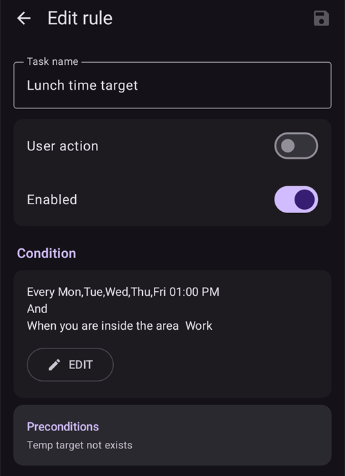

Эта **Автоматизация** была создана для пользователя, который обедает на работе примерно в одно и то же время каждый будний день, но запускается только в том случае, если пользователь находится в пределах заданного ‘местоположения’.  So if the user is not at work one day, this **Automation** will not activate.

This **Automation** will set a low **Temp Target** (Eating Soon) at 13:00 to drive BG to 90 mg/dL (or 5 mmol/L) in preparation for lunch.

The ‘Trigger’ location has a name, a position (tap **Pick from map**, or use your current location) and a radius in metres, and fires when you are inside (or outside) the area:

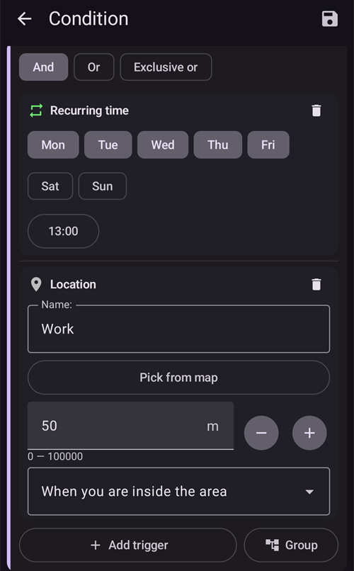

Из-за союза "И" **Автоматизация** происходит только в "выбранное" время при нахождении пользователя на предопределенном месте.

The **Automation** will not be triggered on any other time at this location or at this time outside the 50-metre radius around the chosen position.

### Wi-Fi SSID Location Automation

Using a Wi-Fi SSID is a good option to trigger an **Automation** while within range of a specific Wi-Fi network (compared with GPS): it is fairly precise, uses less battery, and works in enclosed spaces where GPS and other location services might not be available.

Here is another example of setting up a **Temp Target** for work days only before breakfast (1).


The **Automation** will trigger at 05:30am only on Monday-Friday (2)  
and while being connected to a home Wi-Fi network (3).


It will then set a **Temp Target** of 75 mg/dL for 30 minutes (4). One of the advantages of including the location is that it will not trigger if the user is traveling on vacation, for instance.

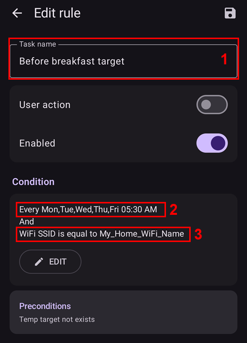

Scroll down to see the action: a **Temp Target** of 75 mg/dL for 30 minutes (4).

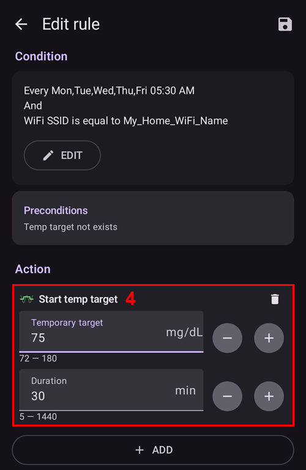

Ниже приведен скриншот с подробным описанием триггеров **автоматизации**:

1) Under the main “AND” (both conditions need to be met to trigger) 1) Recurring time = M,T,W,T,F At 5:30am  
1) Wi-Fi SSID = My_Home_WiFi_Name


(automating-preference-settings-export)=

## Автоматизация экспорта настроек

### Автоматический экспорт: по расписанию (ежедневно)

Скриншоты с триггерами автоматизации:

1) Условие: Время повторения = Пн, Вт, Ср, Чт, Пт в 8:00 1) Действие: Экспорт настроек (в поле «Текст в терапии» введите «Daily»)


Примечание: выполнение экспорта записывается в Портал терапии

### Автоматический экспорт: активация Pod (только для патч-помп)

Скриншоты с триггерами автоматизации:

1) Условие: Активация Pod'а 1) Действие: Экспорт настроек (в поле «Текст в терапии» введите «Pod Activation: settings export»)

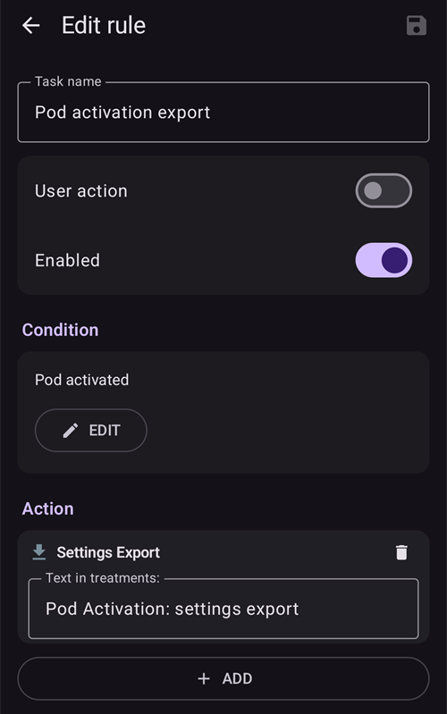

Примечание: выполнение экспорта записывается в Портал терапии. Примечание: автоматизация **вообще не сработает**, если вы еще ни разу не экспортировали настройки вручную. See [Settings → Maintenance](#preferences-maintenance-settings) for proper activation of unattended settings export.


## Automation Logs

**AAPS** shows a log of the most recent **Automation** events at the bottom of the **Automation** screen, below the rules. Use it to verify that your rules triggered when you expected them to.

In the example below, the **Low glucose temp target** rule (1) (see [Low Glucose Temp Target](#automations-low-glucose-temp-target) above) is enabled. The log (2) shows that at 03:09 PM, glucose fell below 70 mg/dL and the rule triggered:
* the action was "Start temp target: 110mg/dL@30 min": a **Temp Target** of 110 mg/dL for 30 minutes;
* **OK** at the end means that the action was carried out successfully.

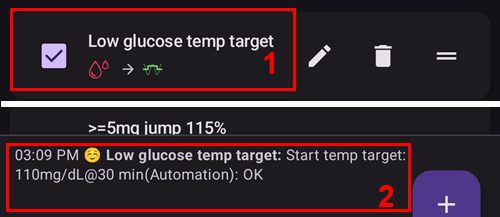

(automations-troubleshooting)=

## Устранение неполадок

* Проблема: __Мои автоматизации не запускаются в AAPS__

Check that the box left of the **Automation** name is ‘ticked’ to ensure the rule is activated:


* Проблема: __ Мои автоматизации запускаются в неправильном порядке.__

Check your rule prioritization order as discussed above here.

* Problem: __A condition shows "Unknown trigger … - never true".__

The rule contains a trigger that this version of **AAPS** cannot read, for example after you went back to an older version or imported settings from a newer one. Such a trigger is never true, so the rule does not run. It is kept unchanged, so a newer version can still use it. Edit the rule and replace the trigger, or update **AAPS**.

## Alternatives to Automations

Для опытных пользователей есть и другие возможности автоматизации задач с помощью IFTTT или приложения других разработчиков Android под названием Automate. 
