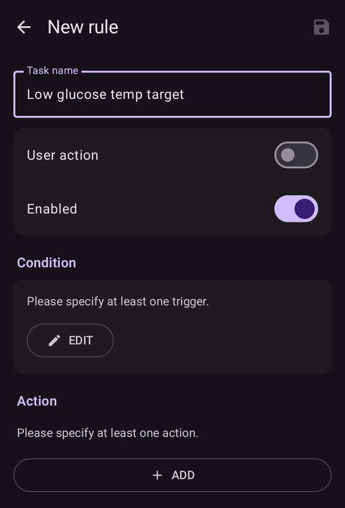
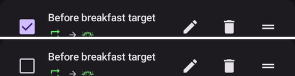
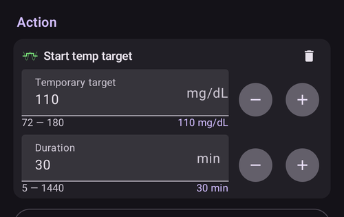
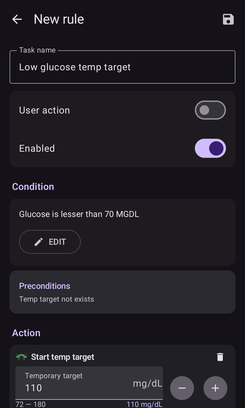
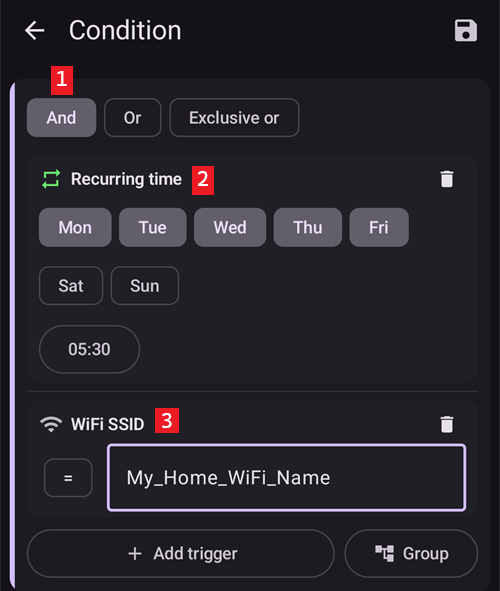
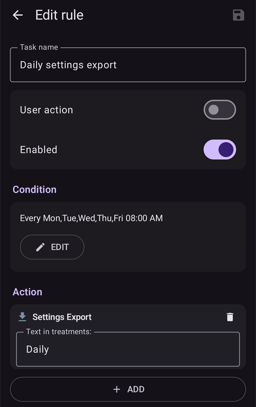

# Автоматизация

```{contents} In this page
:backlinks: entry
:depth: 2
```

## Что такое автоматизация?

«**Автоматизация**» — это функция, которая может автоматически выполнять задачи в AAPS.

Автоматизация выполняет определенные действия на основе одного или нескольких условий, или триггеров. Триггерами могут быть нерегулярные события, например низкий или высокий уровень глюкозы крови (ГК) или заданное количество отрицательного активного инсулина (IOB). Автоматизации могут также обрабатывать повторяющиеся события, например приемы пищи или нагрузку в определенное время дня, или срабатывать, когда пользователь находится на определенном расстоянии от места по GPS или в зоне Wi-Fi с определенным SSID. Автоматизация может создавать резервные копии настроек AAPS по расписанию или при каждой смене Pod.

Правила автоматизации создаются и изменяются на экране **Автоматизация** (**Управление → Автоматизация**). Каждое правило задается двумя свойствами:

- Одно или несколько условий, или «триггеров», которые запускают действие.

    Например, определенное расписание, событие или значение параметра в AAPS

- Одно или несколько действий, которые нужно выполнить.

    Например, сигнал тревоги, установка процента профиля или экспорт настроек AAPS при смене Pod.


There are a wide range of Automation options, and users are encouraged to study these within the AAPS app, in the Automation section. Примеры автоматизаций от других пользователей можно также найти в группах пользователей AAPS в [**Facebook**](https://www.facebook.com/groups/AndroidAPSUsers) и [**Discord**](https://discord.gg/4fQUWHZ4Mw).

## Как может помочь автоматизация

1. **Автоматизировать повторяющиеся задачи:** заданные действия выполняются автоматически, без участия пользователя.

1. **Уменьшить стресс при принятии решений:** Основное преимущество **автоматизаций** заключается в освобождении пользователя от необходимости ручной корректировки работы **AAPS**. [Исследования](https://www.ncbi.nlm.nih.gov/pmc/articles/PMC6286423/#ref4) показывают, что людям с сахарным диабетом 1 типа, приходится принимать в среднем 180 дополнительных решений в день. **Автоматизация** может уменьшить эту нагрузку, высвобождая умственную энергию пользователя для других аспектов жизни.

1. **Потенциально улучшить контроль ГК:** например, **автоматизация** может обеспечить установку **временных целей** при необходимости, даже в напряженный день или в моменты забывчивости. Для примера, если ребенок-диабетик имеет запланированные занятия спортом в школе по вторникам в 10:00 и четвергам в 14:00, имея необходимость в высокой **временной цели** за 30 минут перед активностью, то данную потребность покроет **автоматизация**.

1. **Гибко настроить AAPS**, чтобы в определенных ситуациях система работала более или менее агрессивно, как хочет пользователь. Например, срабатывание временно уменьшенного процента **профиля** на установленный период времени при появлении отрицательного активного инсулина **(IOB)** посреди ночи, показывающего возможную чрезмерную агрессивность установленного **профиля**.

Приводимый ниже пример показывает, как **автоматизация** может помочь устранить лишние ручные действия.

Пользователь упражняется каждое утро в 6 утра: ему необходимо каждый раз помнить об установке за час до этого временной цели для активности.


Пользователь настроил **автоматизацию**, которая в 5 утра включает временную цель «Нагрузка», чтобы его **ГК** и активный инсулин **(IOB)** были оптимальными для упражнений в 6 утра:


## Основные соображения перед началом применения автоматизации

1. Прежде чем настраивать некоторые автоматизации, вы должны достаточно хорошо контролировать **ГК** с помощью **AAPS**. Автоматизации не следует использовать, чтобы компенсировать неоптимальные настройки базала, **ISF** или **CR** (подробнее об этом ниже). Избегайте автоматизации **смены профиля** для компенсации вылетов **ГК** вследствие, _например_, приема пищи, для этого лучше использовать другие методы (микроболюсы SMB и т.д.).

1. Как и любая техника, **CGM**, **помпы** и телефоны могут давать сбои: технические проблемы или ошибки сенсора могут нарушить действия **автоматизации**, и может понадобиться ручное вмешательство.

1. **Требования к автоматизациям, скорее всего, будут меняться вместе с изменением распорядка дня**. При смене периодов работы/учебы/отдыха, устанавливайте себе напоминание о проверке того, какие **автоматизации** у вас на данный момент активны (их легко включить и выключить). Например, если вы уехали в отпуск, и вам больше не нужна автоматизация для школьного спорта или ежедневной нагрузки, или нужно изменить время.

1. **Автоматизации** могут конфликтовать друг с другом. Новые настройки **Автоматизации** лучше внимательно проверять в безопасной обстановке и понимать, почему **Автоматизация** сработала или не сработала так, как вы ожидали.

1. Если вы используете Autosens, то попробуйте использовать **временные цели** вместо **смены профилей**. **Временные цели TT** не сбрасывают Autosens на 0. Любые **смены профиля** сбрасывают Autosens.

1. Большинство **автоматизаций** следует устанавливать лишь на **определенный промежуток времени**, после которого **AAPS** сможет снова, если потребуется, повторить **автоматизацию**. Например, «начать временную цель 7,0 ммоль/л на 30 мин» или «начать **профиль** 110% на 10 мин» _и_ «начать временную цель 5,0 ммоль/л на 10 мин». Использование **автоматизаций** для внесения постоянных изменений (например, смены профиля) влечет за собой риск гипогликемии.

## Когда начать применять Автоматизацию?

**Автоматизации** могут быть созданы в **цели 10**.

## Где находятся настройки автоматизации в AAPS?

Откройте **Управление** в нижней панели навигации на главном экране и выберите **Автоматизация**.

## Как настроить автоматизацию?

Чтобы настроить **Автоматизацию**, нажмите кнопку **+** на экране автоматизации и создайте «правило»:



* дайте «правилу» название (Название задачи);
* нажмите «**РЕДАКТ**» под **Условием**. На экране **Условие** выберите, как объединяются триггеры (**И**, **Или**, **Исключая или**), и нажмите «**Добавить триггер**»:


* добавьте хотя бы один триггер:


* нажмите «**ДОБАВИТЬ**» под **Действием** и выберите одно действие:


* сохраните правило кнопкой **Сохранить** и проверьте, что галочка слева от названия правила «отмечена», чтобы включить **Автоматизацию**:


Чтобы отключить правило **Автоматизации**, снимите галочку слева от названия правила **Автоматизации**. В примере ниже показана **Автоматизация**, включенная («отмечена») или выключенная («не отмечена»):




При настройке **автоматизации**, вы можете cначала проверить ее, используя действие "уведомление" внутри нее. Это заставляет**AAPS** сначала вывести уведомление, а не автоматизировать действие. Когда вы убедитесь, что уведомление запущено в правильное время/ при правильных условиях, правило **Автоматизации** может быть обновлено, с заменой "Уведомления" на ‘Действие’.


```{admonition} Important note
:class: note

**Автоматизации** активны даже при отключенном цикле!
```


## Когда проверяются правила

**AAPS** проверяет все правила **Автоматизации** каждый раз после обработки нового значения глюкозы, поэтому правила проверяются с частотой вашего CGM, также при выключенном экране телефона. Правила также проверяются, когда телефон начинает заряжаться, когда меняется сеть или местоположение и когда подключается устройство Bluetooth. Одновременно выполняется только одна проверка, поэтому правило, действия которого занимают время (например, команда помпе), не может выполниться дважды.

## Ограничения безопасности

Для **Автоматизации** установлены ограничения безопасности:

* **Временная цель**, заданная **Автоматизацией**, должна быть от 72 до 180 мг/дл (или от 4 до 10 ммоль/л).
* The **Profile Percentage** has to be between 50% and 130%.
* Между выполнениями **Автоматизации** (и до первого выполнения) действует ограничение в 5 минут.

## Правильное использование отрицательных значений

```{admonition} Warning
:class: warning

Будьте осторожны при установке отрицательного значения в **автоматизации**
```

Будьте осторожны, когда выбираете «отрицательное значение» в «Условии», например «меньше чем», в **Автоматизации**. Например:


**Пример 1:** Условие **«меньше чем»** «-0,1 ммоль/л» (или «-2 мг/дл»):

Запустит **автоматизацию** для любого числа, которое **строго меньше, чем** -0,1 (-2). Сюда входят такие числа, как -0,2, -0,3, -0,4 (-4, -6, -8) и так далее. Помните, что само -0,1 (-2) **не** включено в это условие. (Условие «равно или меньше чем -0,1 ммоль/л (-2 мг/дл)» _включало бы_ -0,1 ммоль/л или -2 мг/дл).

**Пример 2:** Условие «больше чем» -0,1 ммоль/л (-2 мг/дл):

Запустит **Автоматизацию** для любого числа, которое **больше чем** -0,1 ммоль/л (-2 мг/дл). Сюда входят такие числа, как 0; 0,2; 0,4 ммоль/л (0, 4, 8 мг/дл) и любое другое положительное число.

Важно тщательно учитывать точное назначение **автоматизации** при выборе этих условий и значений.

(automations-automation-triggers)=
## Триггеры автоматизации


Прокрутите вниз, чтобы увидеть остальную часть списка:


Пользователь может выбрать разные «Триггеры». Триггеры — это условия, которые должны быть выполнены, чтобы автоматизация сработала. Приводимый ниже перечень не исчерпывающий:

**Триггер:** объединение условий

**Варианты:**

Несколько условий могут быть связаны при помощи
* “И”
* “Или”
* “Исключая или” (это значит, что действие (действия) выполнится, если выполняется одно — и только одно — из условий)

**Триггер:** время и время повторения

**Варианты:**

* время = одно событие времени
* периодическое время = то, что происходит регулярно (т.е. раз в неделю, каждый рабочий день и т. д.)

**Триггер:** местоположение

**Варианты:**

* в [Настройки > Автоматизация](#preferences-maintenance-settings) пользователь может выбрать нужную службу определения местоположения.

**Триггер:** служба определения местоположения

**Варианты:**

* Использовать пассивное расположение: **AAPS** принимает локацию только в том случае, если ее запрашивают другие приложения.
* Использовать сетевую геолокацию: расположение вашего Wi-Fi.
* Используйте локатор GPS (Внимание! Может привести к чрезмерной разрядке аккумулятора!)

**Триггеры**: данные помпы и сенсора

* Триггер «Время, отработанное катетером помпы»: доступен для всех помп
* Триггер «Инсулин проработал»: доступен для поддерживаемых помп
* Триггер «Время отработанное батареей помпы»: доступен для поддерживаемых помп
* Триггер «Время, отработанное сенсором»: доступен всегда
* Триггер «Активация Pod'а»: доступен для патч-помп

Обратите внимание: для всех триггеров времени работы сравнение «равно» вряд ли сработает, поэтому в этом случае нужны два триггера, чтобы задать диапазон

* Триггер «Уровень резервуара»: доступен для всех помп; сравнение "NOT\_AVAILABLE" для этого триггера не работает, так как значение в **AAPS** всегда заполнено
* Триггер «Уровень заряда батареи помпы»: доступен для поддерживаемых помп; сравнение "NOT\_AVAILABLE" для этого триггера не работает, так как значение в **AAPS** всегда заполнено

(automations-automation-action)=
## Действие


Прокрутите вниз, чтобы увидеть остальную часть списка:


**Действия:** начать **Временную цель**

**Варианты:**

* **ГК** должна быть от 72 мг/дл до 180 мг/дл (от 4 ммоль/л до 10 ммоль/л)
* **ВЦ** работает, только если нет предыдущей временной цели — **AAPS** автоматически добавляет к правилу строку «**Предусловия: Временная цель не существует**»

**Действия:** остановить **временную цель**

**Варианты:**

отсутствуют

**Действия:** **Установить процент профиля**

**Варианты:**

* **Profile** must be between 50% and 130%
* Работает только в том случае, если предыдущий процент составляет 100%

**Действия:** **Изменить сглаживание** (в группе **Цикл и инсулин**)

**Варианты:**

* выберите [метод сглаживания](../CompatibleCgms/SmoothingBloodGlucoseData.md), на который нужно переключиться. Список тот же, что в **Конфигурация** > **Сглаживание**, и действие делает то же самое, что изменение там: новый метод сохраняется, синхронизируется со связанными клиентами, и данные ГК сразу сглаживаются заново.
* выполняется, только если этот метод сглаживания еще не активен — **AAPS** автоматически добавляет к правилу строку «**Предусловия: Сглаживание … не активно**». Когда выбранное сглаживание уже активно, правило молча пропускается.
* Пример: новый сенсор часто дает шумные данные в первый день. Два правила с триггером **Время, отработанное сенсором** дают более сильную фильтрацию, пока сенсор стабилизируется, и сглаживание без задержки после этого:
  * **Время, отработанное сенсором** меньше 24 ч: **Изменить сглаживание** на **Фильтр Калмана**
  * **Время, отработанное сенсором** больше 24 ч: **Изменить сглаживание** на **Среднее сглаживание**

**Действия:** **Примечание** (в группе **Оповещения** списка)

**Варианты:**

* выберите событие для записи: **Примечание**, **Нагрузка**, **Вопрос**, **Оповещение** или **Смена места катетера помпы**, и при желании добавьте примечание. Название действия меняется на выбранное событие.
* **Продолжительность**: используется для **Примечания**, **Нагрузки** и **Смены места катетера помпы**. У **Вопроса** и **Оповещения** нет продолжительности: вместо нее записывается ваша текущая ГК.
* **Смена места катетера помпы** сбрасывает время работы катетера, как если бы вы записали смену места катетера вручную. Пример: некоторые помпы (например, Combo) сами записывают замену резервуара, но не смену места катетера. Если вы всегда меняете их вместе, правило с условиями **Инсулин проработал** меньше 1 часа и **Время, отработанное катетером помпы** больше 24 часов может записывать смену места катетера за вас.

 

**Действия:** **Отправить SMS на все номера** (в группе **Оповещения**)

**Варианты:**

* введите текст сообщения. Оно отправляется на все номера телефонов, разрешенные в настройках [SMS коммуникатора](../RemoteFeatures/SMSCommands.md). Модуль SMS коммуникатор должен быть включен.

**Действия:** **Изменить профиль на** (в группе **Профиль**)

**Варианты:**

* выберите **Профиль**, который нужно включить. Он включается на 100%, без сдвига по времени. Если этот профиль уже активен, действие ничего не делает.

**Действия:** **Включить/выключить SMB** (в группе **Цикл и инсулин**)

**Варианты:**

* выберите **Вкл.** или **Выкл.** Это меняет настройку **Включить супер микро болюсы SMB** модуля OpenAPS SMB точно так же, как если бы вы изменили ее в **Настройках**, и она остается такой, пока вы или другое правило не измените ее обратно.

**Действия:** **Выполнить Autotune** (в группе **Цикл и инсулин**)

**Варианты:**

* выберите профиль для настройки и количество дней: см. [Запуск Autotune с помощью правила автоматизации](#autotune-run-autotune-with-an-automation-rule).

**Действия:** **Остановить обработку** (в группе **Цикл и инсулин**)

**Варианты:**

* none. Пока условия правила с этим действием выполняются, **AAPS** не проверяет правила ниже него в списке. Как только его условия снова перестают выполняться, правила ниже проверяются как обычно. Добавьте его в правило, которое должно иметь приоритет над правилами ниже (см. [порядок автоматизаций](#Automations-the-order-of-the-automations-in-the-list-matters)).

**Действия:** **Запустить сценарий**, **Включить сценарий**, **Отключить сценарий** (в группе **Сценарии**)

**Варианты:**

* выберите [сценарий](Scenes.md), который нужно запустить, включить или отключить.

После добавления «Действия» значения по умолчанию должны быть изменены на желаемую величину путем нажатия и изменения значения по умолчанию.



(Automations-the-order-of-the-automations-in-the-list-matters)=
## Порядок **автоматизаций** в списке играет роль
 **AAPS** выполняет созданные правила по порядку, начиная с верхней части списка **Автоматизации**. Например, если **Автоматизация** «Low» — самая важная **Автоматизация**, важнее всех других правил, то эта **Автоматизация** должна быть вверху списка **Автоматизации** пользователя, как показано ниже:


Чтобы изменить порядок правил **Автоматизации**, нажмите и удерживайте значок **=** справа от правила. Измените порядок **Автоматизаций**, перемещая правила вверх или вниз.


## Как удалить правила автоматизации

Для удаления правила **автоматизации** нажмите на значок корзины.


## Examples of Automations

Ниже приведены примеры **Автоматизаций**. Дальнейшее обсуждение **Автоматизаций** и того, как пользователи настраивают свои **Автоматизации**, можно найти в группах Facebook или в Discord. Приведенные ниже примеры не следует воспроизводить без хорошего понимания пользователем того, как будет работать **Автоматизация**.

(automations-low-glucose-temp-target)=
### Временная цель при низкой ГК

Эта **Автоматизация** автоматически включает **Временную цель**, когда **ГК** опускается ниже заданного порога: здесь, когда глюкоза меньше 70 мг/дл, включается цель 110 мг/дл на 30 минут:



### Временная цель Обеденный перерыв (с "Локацией")


Эта **Автоматизация** была создана для пользователя, который обедает на работе примерно в одно и то же время каждый будний день, но запускается только в том случае, если пользователь находится в пределах заданного ‘местоположения’.  Поэтому, если однажды пользователь не на работе, эта **Автоматизация** не сработает.

Эта **Автоматизация** установит низкую **Временную цель** («Ожидаемый прием пищи») в 13:00, чтобы привести ГК к 90 мг/дл (или 5 ммоль/л) перед обедом.

У «Триггера» местоположения есть название, позиция (нажмите **Выбрать на карте** или используйте текущее местоположение) и радиус в метрах; он срабатывает, когда вы находитесь внутри (или вне) этой зоны:


Из-за союза "И" **Автоматизация** происходит только в "выбранное" время при нахождении пользователя на предопределенном месте.

**Автоматизация** не сработает в этом месте в другое время, а также в это время вне радиуса 50 метров вокруг выбранной позиции.

### Автоматизация по местоположению Wi-Fi SSID

Wi-Fi SSID — хороший способ запускать **Автоматизацию**, когда вы в зоне действия определенной сети Wi-Fi (по сравнению с GPS): он довольно точный, тратит меньше заряда батареи и работает в помещениях, где GPS и другие службы определения местоположения могут быть недоступны.

Вот еще один пример: **Временная цель** только в рабочие дни перед завтраком (1).


**Автоматизация** сработает в 05:30 только с понедельника по пятницу (2)  
и только при подключении к домашней сети Wi-Fi (3).


Затем она установит **Временную цель** 75 мг/дл на 30 минут (4). Одно из преимуществ условия по местоположению: правило не сработает, например, если пользователь уехал в отпуск.


Прокрутите вниз, чтобы увидеть действие: **Временная цель** 75 мг/дл на 30 минут (4).


Ниже приведен скриншот с подробным описанием триггеров **автоматизации**:

1) Под главным “И” (для срабатывания должны выполняться оба условия) 1) Время повторения = Пн, Вт, Ср, Чт, Пт в 5:30  
1) Wi-Fi SSID = My_Home_WiFi_Name



(automating-preference-settings-export)=

## Автоматизация экспорта настроек

### Автоматический экспорт: по расписанию (ежедневно)

Скриншоты с триггерами автоматизации:

1) Условие: Время повторения = Пн, Вт, Ср, Чт, Пт в 8:00 1) Действие: Экспорт настроек (в поле «Текст в терапии» введите «Daily»)



Примечание: выполнение экспорта записывается в Портал терапии

### Автоматический экспорт: активация Pod (только для патч-помп)

Скриншоты с триггерами автоматизации:

1) Условие: Активация Pod'а 1) Действие: Экспорт настроек (в поле «Текст в терапии» введите «Pod Activation: settings export»)


Примечание: выполнение экспорта записывается в Портал терапии. Примечание: автоматизация **вообще не сработает**, если вы еще ни разу не экспортировали настройки вручную. Как правильно включить автоматический экспорт настроек, см. в [Настройки → Обслуживание](#preferences-maintenance-settings).


## Automation Logs

**AAPS** показывает журнал последних событий **Автоматизации** внизу экрана **Автоматизация**, под правилами. По нему можно проверить, сработали ли ваши правила тогда, когда вы ожидали.

В примере ниже включено правило **Временная цель при низкой ГК** (1) (см. [Временная цель при низкой ГК](#automations-low-glucose-temp-target) выше). Журнал (2) показывает, что в 15:09 глюкоза опустилась ниже 70 мг/дл и правило сработало:
* действие было «Начать врем цель: 110mg/dL@30 min»: **Временная цель** 110 мг/дл на 30 минут;
* **OK** в конце означает, что действие успешно выполнено.


(automations-troubleshooting)=

## Устранение неполадок

* Проблема: __Мои автоматизации не запускаются в AAPS__

Проверьте, что галочка слева от названия **Автоматизации** «отмечена», чтобы правило было включено:


* Проблема: __ Мои автоматизации запускаются в неправильном порядке.__

Проверьте порядок приоритета правил, как описано выше.

* Проблема: __Условие показывает «Неизвестный триггер … - никогда не выполняется».__

Правило содержит триггер, который эта версия **AAPS** не может прочитать, например после возврата к более старой версии или после импорта настроек из более новой. Такой триггер никогда не выполняется, поэтому правило не срабатывает. Он сохраняется без изменений, чтобы более новая версия могла его использовать. Отредактируйте правило и замените триггер или обновите **AAPS**.

## Alternatives to Automations

Для опытных пользователей есть и другие возможности автоматизации задач с помощью IFTTT или приложения других разработчиков Android под названием Automate. 
