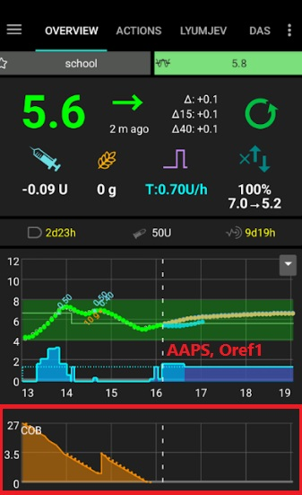

# Подсчет активных углеводов COB

## Как AAPS вычисляет значение COB?

Когда пользователь вводит углеводы во время приема пищи или при коррекции, **AAPS** добавляет это значение к текущему количеству активных углеводов (**COB**). После этого **AAPS** рассчитывает усвоение углеводов на основе наблюдаемых отклонений от значений **ГК пользователя**. Скорость усвоения зависит от фактора чувствительности к углеводам (**CSF**). Это не параметр **профиля** пользователя. **AAPS** рассчитывает его по настройкам **ISF/I:C**: он показывает, на сколько мг/дл 1 г углеводов поднимет **ГК** пользователя.

## Фактор чувствительности к углеводам

Подсчет в **AAPS** ведется по следующей формуле:

- усвоенные углеводы = отклонение * углеводный коэффициент ic / фактор чувствительности к инсулину isf.

При этом на ** Профиль ** пользователя происходит следующее воздействие:

- _повышение_ **IC** – увеличивает количество углеводов, усваиваемых каждые 5 минут, и тем самым сокращает общее время усвоения;

- _повышение _ **ISF**- уменьшение усваиваемых каждые 5 минут углеводов тем самым продлевает общее время усвоения

- _изменение_ **процента профиля** – увеличивает или уменьшает оба значения, поэтому не влияет на время усвоения углеводов.

Например, если в **профиле** пользователя **ISF** равен 100, а **I:C** равен 5, то фактор чувствительности к углеводам будет 20. На каждые 20 мг/дл роста **ГК** пользователя **AAPS** будет считать усвоенным 1 г углеводов. Положительное значение активного инсулина **IOB** также влияет на расчет **COB**. Например, если **AAPS** прогнозирует снижение **ГК** пользователя на 20 мг/дл из-за **IOB**, а ГК осталась на месте, то **AAPS** также будет считать усвоенным 1 г углеводов.

Усвоение углеводов также будет рассчитываться с помощью методов, описанных ниже, в зависимости от выбора алгоритма чувствительности в настройках **AAPS**.

## Чувствительность к углеводам - Oref1

Непоглощенные углеводы отбрасываются после указанного времени:




```{admonition} Older screenshot
:class: note
Снимок экрана выше сделан в более ранней версии **AAPS**. В **AAPS** 4 графики выглядят немного иначе, но график **COB** показывает ту же информацию.
```


## Чувствительность к углеводам - средневзвешенная

Усвоение принимается из рассчета, что активные углеводы COB = 0 по истечении указанного времени:


Если вместо значения, рассчитанного на основе отклонений **ГК**, используется минимальное поглощение углеводов (min_5m_carbimpact), на графике **COB** появится оранжевая точка.

(CobCalculation-detection-of-wrong-cob-values)=
## Обнаружение неправильного значения COB

**AAPS** предупредит пользователя, если он собирается ввести болюс с учетом **COB** от предыдущего приема пищи, а алгоритм считает текущий расчет **COB** неверным. В этом случае пользователь получит дополнительную подсказку на экране подтверждения калькулятора болюса.

### Как AndroidAPS обнаруживает неправильные значения активных углеводов COB?

В обычных расчетах __AAPS__ определяет усвоение углеводов по отклонениям **ГК**. В случае, если пользователь ввел углеводы, а **AAPS** не может рассчитать их предполагаемое усвоение по отклонениям **ГК**, то алгоритмом применяется метод [min_5m_carbimpact](#Preferences-min_5m_carbimpact) (так называемый "запасной вариант"). Поскольку этот метод вычисляет только минимальное усвоение углеводов, без учета отклонений **ГК**, то в этом случае возможны некорректные значения активных углеводов COB.


На снимке экрана выше 66% времени усвоение углеводов рассчитывалось методом min_5m_carbimpact, а не по значению, полученному из отклонений. Это означает, что на самом деле у пользователя может быть меньше активных углеводов **COB**, чем рассчитывает алгоритм.

### Как относиться к этому предупреждению?

- Подумайте об отмене терапевтического действия - нажмите «Отмена» вместо ОК.
- -Заново рассчитайте свой предстоящий прием пищи с помощью калькулятора болюса, сняв галочку с активных углеводов **COB**.
- Если требуется болюс на коррекцию, введите его вручную.
- Будьте осторожны, чтобы не ввести слишком много инсулина и не допустить его накопления!


### Почему алгоритм неправильно распознает активные углеводы COB?

Это может быть вызвано тем, что:
- Пользователь мог переоценить количество углеводов при вводе записи.
- После предыдущего приема пищи происходила физическая активность или нагрузка.
- -Углеводный коэффициент I:C нуждается в корректировке.
- Значение для min_5m_carbimpact неверно (рекомендуется 8 для алгоритма SMB, 3 для OpenAPS AMA).


## Ручная коррекция введенных углеводов

Если количество углеводов было введено больше или меньше реального, это можно исправить на экране **История терапии**, как описано [здесь](#screens-bolus-carbs).


## Коррекция количества углеводов - как удалить запись из Терапии


На экране **История терапии** можно исправить ошибочную запись углеводов, удалив ее. Это может произойти из-за того, что пользователь переоценил или недооценил количество вводимых углеводов:


1. Проверьте и запомните текущие значения **COB** и **IOB** на главном экране **AAPS**.
2. Откройте **История терапии** (боковое меню → *История терапии*), вкладка **Углеводы и болюсы**. В зависимости от помпы углеводы могут быть показаны вместе с инсулином в одной строке или отдельной записью (например, с Dana RS).
3. **Нажмите и удерживайте** ошибочную запись углеводов. Список переходит в **режим выбора** с флажком в каждой строке, и эта запись отмечена (метка **1** выше). Отметьте и другие записи, которые вы тоже хотите удалить.
4. Нажмите значок **🗑 Удалить** на верхней панели (метка **2**) и подтвердите. В окне подтверждения точно указано, что будет удалено.
5. Убедитесь, что углеводы удалены: снова проверьте **COB** на главном экране **AAPS**.
6. Сделайте то же самое для **IOB**, если углеводы и инсулин были в одной строке.
7. Если углеводы не удалить как нужно, а дополнительные углеводы добавить, как описано в этом разделе, значение **COB** будет слишком высоким, и **AAPS** может ввести слишком много инсулина.
8. Введите правильное количество углеводов в окне **Углеводы** (**Терапия** → **Углеводы**) и укажите правильное время события.
9. Если углеводы и инсулин были в одной строке, пользователю нужно также снова ввести количество инсулина. Обязательно укажите правильное время события и проверьте **IOB** на главном экране после подтверждения новой записи.

