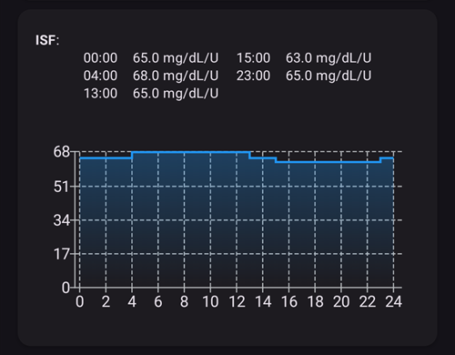
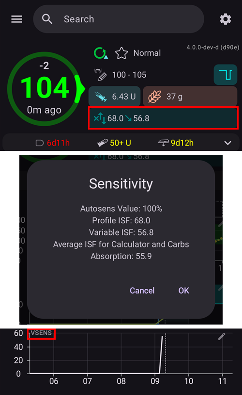
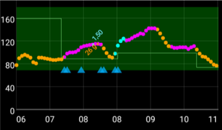
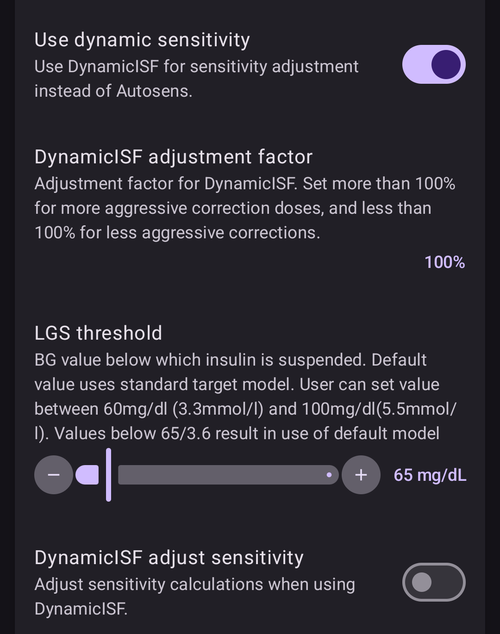

(возможности_Open-APS-DynamicISF)=
# Динамический ISF (DynISF)

До недавнего времени, фактор чувствительности к инсулину **ISF** в алгоритмах **AMA** и **SMB**, задавался в ** профиле** и был статичным для каждого конкретного времени суток. Но на самом деле **ISF** человека не такой постоянный и зависит от уровня **ГК**: при высокой ГК пользователю нужно больше инсулина, чтобы снизить **ГК** на 50 мг/дл / 3 ммоль/л, чем при более низкой **ГК**. Первый алгоритм, который попытался устранить эту сложность был [Autosens](#Open-APS-features-autosens) который корректировал **ISF** вне времени приема пищи.

Алгоритм **Динамической чувствительности к инсулину** (также сокращенно именуемый **DynISF**) служит этой же цели, но более совершенен, т. к. работает в любое время. Рекомендуется для опытных пользователей, которые хорошо разбираются в элементах управления и мониторинга своих **AAPS**. Ознакомьтесь с документом [ Что следует учитывать при работе с динамическим ISF](#dyn-isf-things-to-consider-when-activating-dynamicisf), приводимом ниже, прежде чем начать пользоваться этим алгоритмом.

```{admonition} CAUTION - Automations or Profile Percentage change
:class: warning

**Автоматизацию** всегда следует использовать с осторожностью. Это особенно касается **Dynamic ISF**.

При использовании **Динамического ISF** отключите все правила **Автоматизации**, которые временно меняют **профиль**, потому что из-за них **Динамический ISF** будет слишком агрессивно вводить корректирующие болюсы, и это приведет к гипогликемии. Именно для этого и нужен **Динамический ISF**, поэтому не нужно с помощью автоматизации указывать **AAPS** вводить дополнительный инсулин при высокой **ГК**.

```

Для работы **Динамического ISF** базе данных **AAPS** нужны данные **AAPS** пользователя минимум за 7 дней.

## What does Dynamic ISF do?

**Динамический ISF** оперативно адаптирует коэффициент чувствительности к инсулину (**ISF**) в зависимости от потребностей пользователя:

- Суммарной суточной дозы инсулина (**TDD**) и
- текущего и прогнозируемого значения ГК.

При использовании **Динамического ISF** значения **ISF**, введенные в **профиле**, больше совсем не используются, кроме случая, когда в базе данных **AAPS** недостаточно данных TDD (*например*, после новой установки приложения).

**SMB/AMA** – пример **профиля** пользователя со статическим **ISF**, который задан пользователем и используется алгоритмами **SMB** и **AMA**.



**Динамический ISF** – пример **ISF** пользователя, который меняется по расчетам **Динамического ISF**.



Участок, обведенный красным кружком, показывает: `ISF профиля` -> `ISF, рассчитанный с помощью DynISF`. <br/> Если нажать на этот раздел, откроется окно с дополнительной информацией, например с **ISF**, который используется для калькулятора и для усвоения углеводов (см. [Другие примеры использования ISF](#dynisf-other-usages-of-isf) ниже).

Значение **DynISF** можно также показать на графике: нажмите **Добавить график** под графиками на главном экране и выберите **VSENS** (переменная чувствительность). Оно показано белой линией (внизу изображения выше).

## Как рассчитывается Динамический ISF?

**Dynamic ISF, Динамический ISF** использует модель Криса Уилсона для определения коэффициента чувствительности **ISF** вместо статического **ISF,** задаваемого пользователями в **Профиле**. Подробное объяснение можно найти здесь: [Крис Уилсон о чувствительности к инсулину (Коэффициент коррекции) в замкнутом цикле, 2/6/2022](https://www.youtube.com/watch?v=oL49FhOts3c).

Используется следующее уравнение **Динамического ISF**: `ISF = 1800 / ((TDD * DynISF Adjust Factor) * Ln (( current BG / insulin divisor) + 1 ))`

Переменные, используемые в этом уравнении, приведены ниже.<br/> Примечание : `Ln` означает натуральный логарифм, математическую функцию.

Приведенное выше уравнение применяется для расчета текущего **ISF** и прогнозов oref1 [ относительно активного инсулина **IOB**, **ZT** (нулевого временного базала) и **непредвиденного приема пищи UAM**](#aaps-screens-prediction-lines). Оно используется и для расчета активных улеводов **COB**, а также в калькуляторе болюса (см. [Другие применения ISF](#dynisf-other-usages-of-isf) ниже).

### TDD (Общая суточная доза)
TDD использует комбинацию следующих значений:
1.  среднее значение **TDD** за 7 дней;
2.  **TDD **предыдущего дня; и
3.  средневзвешенное значение за последние восемь (8) часов применения инсулина, экстраполированное на 24 часа.

В приведенном уравнении значение **TDD**, взвешено на одну треть от каждого из приведенных выше значений.

### Настройка Коэффициента динамического диапазона чувствительности ISF

Он задается в **Настройках** пользователя и делает **Динамический ISF** более или менее агрессивным. См. раздел [Настройки](#dyn-isf-preferences) ниже.

### Величина делителя Инсулина
Величина делителя инсулина зависит от пика используемого инсулина и обратно пропорциональна времени до пика. Для Люмжева его значение 75, для Фиаспа 65 и для обычных быстрых инсулинов 55.

### Коэффициент чувствительности инсулина ISF, основанный на прогнозируемой гликемии при принятии решений о дозировке

Динамическая чувствительность вычисляется с использованием текущего значения ** ГК** и отображается как текущий коэффициент чувствительности ISF в **AAPS**. Но при вычислении дозировок вместо этого алгоритм oref1 использует параметр **Future ISF**.

Это делается для того, чтобы предотвратить избыточные дозировки, когда **ГК** низка или прогнозируется низкой.

**Future ISF** использует ту же формулу, что и описанная выше, за исключением того, что в ней применяется **минимальная прогнозируемая гликемия** вместо **текущей ГК**. **Минимальная прогнозируемая ГК**, [рассчитанная в oref1](#aaps-screens-how-predictions-become-a-dosing-decision), – это самое низкое значение, до которого, по прогнозу, опустится ваша ГК за весь период прогноза.

* Если текущая **ГК** выше цели<br/> **и** уровень **ГК** стабилен, в пределах +/- 3 мг/дл:<br/>ГК используется в формуле так: `average(minimum predicted BG, current BG)`.
* Если конечная **ГК** выше цели и уровень глюкозы растет,<br/> **или** конечная **ГК** выше текущей **ГК**:<br/>ГК используется в формуле так: `current BG`.
* В иных случаях: <br/>ГК используется в формуле следующим образом: `минимальная прогнозируемая ГК`.

Для упрощения приводим снимок экрана, который иллюстрирует описанную выше ситуацию. Оранжевые точки отображают ** прогнозируемое значение ГК**, фиолетовые точки - **среднее значение (прогнозируемое значение ГК, текущее значение ГК)**, а синие точки **текущее значение ГК**.



(dynisf-other-usages-of-isf)=
## Другие примеры использования ISF

### ISF и усвоение активных углеводов COB

Как описано на странице [ Расчет активных углеводов COB](../DailyLifeWithAaps/CobCalculation.md), обычно поглощение углеводов рассчитывается по следующей формуле :   
`поглощенные_углеводы = отклонение * ic / isf`  
В алгоритме **Dynamic ISF**, **ISF** здесь - среднее значением динамического ISF за последние 24 часа.

### ISF в Калькуляторе болюса

В [ Калькуляторе болюса ](#aaps-screens-bolus-wizard) **ISF** применяется для коррекции, если **ГК** превышает целевое значение.

Алгоритм **Dynamic ISF** берет среднее значение динамического **ISF** за последние 24 часа.

(dyn-isf-preferences)=
## Настройки

Чтобы включить, отметьте **Использовать динамическую чувствительность** в [Настройки > OpenAPS SMB](#Preferences-openaps-smb-settings). После того как выбор сделан, становятся доступными новые настройки.



(dyn-isf-adjustment-factor)=
### Коэффициент регулировки динамического диапазона чувствительности ISF
**Dynamic ISF** работает на основе единого правила, которое подразумевает, что люди, имеющие одинаковую суточную дозу **TDD**, будут иметь одинаковую чувствительность. Поскольку у каждого пользователя своя чувствительность, **корректирующий коэффициент** позволяет указать, более или менее чувствителен пользователь к инсулину, чем «обычный» человек.

Коэффициент **Adjustment Factor** есть величина между 1 и 300%. Он действует как множитель относительно суточной дозы **TDD**.

* Увеличение этого значения выше 100 % делает **DynISF** более агрессивным: значения **ISF** становятся * меньше* (_т.е._ требуется больше инсулина для снижения уровня **ГК** на небольшую величину)
* Понижение этого значения ниже 100% делает **DynISF** менее агрессивным: величина **ISF** растет (_, т.е. _ требуется меньше инсулина для небольшого понижения **ГК**).

**Корректирующий коэффициент ** также изменяется при активации [**Переключателя профиля ** в процентах](../DailyLifeWithAaps/ProfileSwitch-ProfilePercentage.md). Более низкий ** процент профиля** приведет к снижению ** корректирующего коэффициента**, а при более высоком ** проценте профиля**, наоборот.

Например, если ваш **корректирующий коэффициент** равен 80% и выполнено **переключение профиля** на 80%, итоговый **корректирующий коэффициент** будет `0.8*0.8=0.64`.

Это означает, что при работе алгоритма **DynISF** можно использовать **Процент профиля** для временной точной настройки чувствительности вручную. Может быть полезно при физической активности (более низкий процент), болезнях (более высокий процент) и т. д.

### Порог LGS

Значение **ГК**, ниже которого подача инсулина приостанавливается (приостановка на низкой ГК). По умолчанию используется стандартная целевая модель. Пользователь может задать это значение от 60 мг/дл (3,3 ммоль/л) до 100 мг/дл (5,5 ммоль/л). Значения ниже 65/3.6 приводят к использованию модели по умолчанию.

### DynamicISF корректирует чувствительность

Эта настройка (*«Корректировать расчет чувствительности при использовании DynamicISF»*) заменяет Autosens и использует отношение **TDD** за последние 24 ч к **TDD** за 7 дней как основу для повышения и снижения базальной скорости, так же как это делает обычный Autosens. Эта вычисляемая величина также применяется для подстройки цели, если включены опции подстройки целей в зависимости от чувствительности. В отличие от Autosens, она не корректирует значения **ISF**.

(dyn-isf-things-to consider-when-activating-dynamicisf)=
## Что нужно учитывать при активации Dynamic ISF

* **Dynamic ISF** рекомендуется для опытных пользователей, которые хорошо разбираются в элементах управления и мониторинге своих **AAPS.**. В идеале, прежде чем переходить на **Dynamic ISF**, следует добиться хорошего контроля при помощи алгоритма **SMB**.
* Как отмечалось выше, отключите все [** настройки Автоматизации**](../DailyLifeWithAaps/Automations.md), которые активируют ** Процентное изменение профиля** относительно **ГК**, поскольку они агрессивны и могут привести к переизбытку инсулина! Они уже являются частью алгоритма **Dynamic ISF**.
* [Процент профиля](../DailyLifeWithAaps/ProfileSwitch-ProfilePercentage.md) учитывается в Dynamic ISF (см. [Корректирующий коэффициент Dynamic ISF](#dyn-isf-adjustment-factor) выше). Не рекомендуется менять **Процент Профиля** на отличный от 100% на длительное время. Если вы определите, что ваш ** профиль** изменился, создайте новый ** профиль** с измененными значениями, чтобы воспроизвести ** профиль** в определенном процентном соотношении.
* **Dynamic ISF** может кому-то не подойти. В частности, возможны неожиданные результаты, если возникнет одна из следующих ситуаций:
  * Непостоянный образ жизни (непоследовательный режим питания или физической активности)
  * Непостоянная суммарная суточная потребность TDD в инсулине или переменчивая чувствительность.
* Не существует точного руководства по установке начального значения ** Корректирующего коэффициента**. Однако, в качестве отправной точки: предполагая, что начальные параметры **Профиля** верны, когда вы в диапазоне и уровни **ГК** стабильны, значение **DynISF** должно быть примерно таким же, как у вас было в **Профиле** ранее.<br/>Если вы видите, что **Dynamic ISF** слишком агрессивен, уменьшите ** Корректирующий коэффициент**, и наоборот.
* Несмотря на то, что **DynISF** не использует **ISF** из Профиля, если ваша новая чувствительность сильно отличается от ранее сохраненной в **Профиле**, следует подумать о том, чтобы поддерживать ее в актуальном состоянии. Это может пригодиться, если вы потеряете данные **AAPS** (_например_, новый телефон, новая версия **AAPS**…), так как в следующие 7 дней в качестве запасного варианта будет использоваться **ISF профиля**.