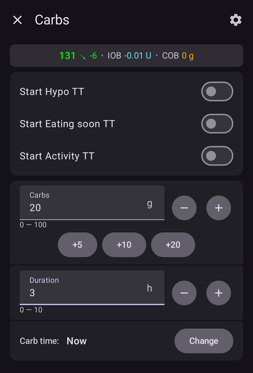
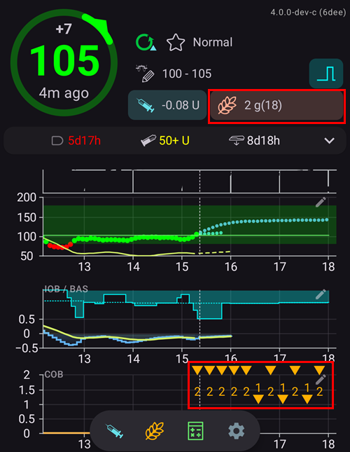
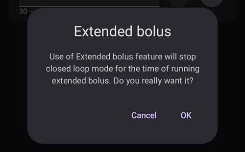
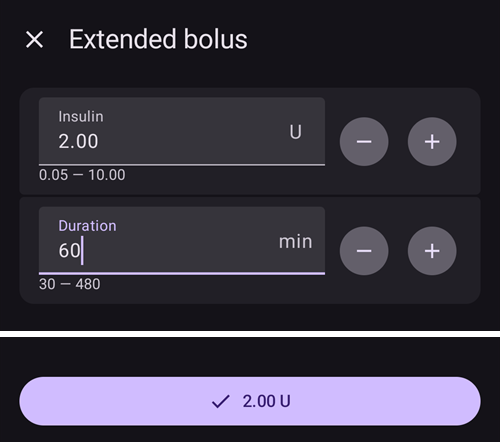
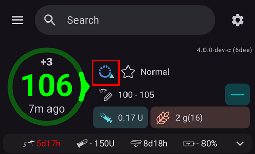
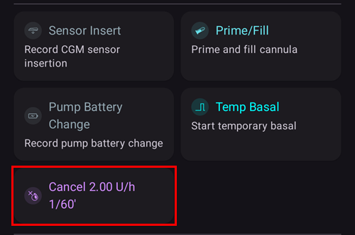

(Extended-Carbs-extended-carbs-ecarbs)=
# Растянутые углеводы / "eCarbs"

## Что такое eCarbs и когда они полезны?

При обычной помповой терапии пролонгированные болюсы — хороший способ справиться с жирной или медленно усваиваемой пищей, которая повышает уровень глюкозы в крови дольше, чем действует инсулин. Однако в контексте алгоритма ИПЖ пролонгированные болюсы не имеют большого смысла (и создают технические трудности), поскольку они представляют собой по сути, фиксированную высокую временную базальную скорость, которая идет вразрез с тем, как работает цикл ИПЖ, который должен динамически корректировать базальную скорость. Подробнее см [пролонгированный болюс](#extended-bolus-and-why-they-wont-work-in-closed-loop-environment) ниже.

Однако необходимость работать с такой едой все же существует. Поэтому AAPS поддерживает так называемые растянутые углеводы, или eCarbs.

eCarbs — это углеводы, распределенные на несколько часов. Для стандартного питания с бОльшим содержанием углеводов, чем жира/белка, введение углеводов заранее (и при необходимости уменьшение начального болюса), как правило, достаточно для предотвращения преждевременной подачи инсулина.  Но для медленно поглощающейся еды, при которой предварительное введение углеводов приводит к слишком большой величине активного инсулина IOB из-за микроболюсов SMB, eCarbs могут применяться для более точного моделирования того, как усваиваются углеводы и влияют на уровень глюкозы в крови. С помощью этой информации алгоритм может управлять микроболюсами SMB которые выступают как пролонгированный болюс на такие углеводы ( должно работать и без SMB, но, возможно, менее эффективно).

**Примечание:** eCarbs подходят не только для жирной или белковой пищи: их также можно использовать в любой ситуации, где что-то повышает уровень сахара в крови, например другие лекарства, такие как кортикостероиды.

## Механизмы использования eCarbs

Чтобы ввести eCarbs, откройте диалог **Углеводы** (**Терапия** → **Углеводы**), введите общее количество углеводов, задайте **Длительность действия** и при необходимости сдвиньте начало с помощью **Время приема углеводов** (*числа ниже — только примеры, вам нужно подобрать собственные значения, чтобы получить удовлетворительную реакцию глюкозы в ваших ситуациях*):

eCarbs на главном экране: число в скобках в поле **COB** показывает углеводы, которые еще будут учтены, а график **COB** показывает каждую будущую запись eCarbs оранжевой меткой. Если вы не видите график **COB**, добавьте его кнопкой **Добавить график** под графиками (см. [Экраны AAPS](../DailyLifeWithAaps/AapsScreens.md)).

(AapsScreens-carbs-type)=
## Тип углеводов в мастере болюса: хлеб, торт или пицца

В [Мастере болюса](#aaps-screens-bolus-wizard) три кнопки под полем **Углеводы** позволяют выбрать, как быстро усваивается ваша еда. Выберите одну из них перед подтверждением. В зависимости от типа **AAPS** берет часть введенных углеводов как обычные углеводы и добавляет [растянутые углеводы («eCarbs»)](#Extended-Carbs-extended-carbs-ecarbs) позже для медленной, сытной еды. Нажмите значок **(i)** рядом с кнопками, чтобы увидеть типичные продукты для выбранного типа и как он меняет ваши углеводы.

| Type                    | Типичные продукты (примеры из приложения)                                                                                              | Углеводы сейчас, учитываются в болюсе | Добавленные eCarbs                                   |
| ----------------------- | -------------------------------------------------------------------------------------------------------------------------------------- | ------------------------------------- | ---------------------------------------------------- |
| **Хлеб** (по умолчанию) | Хлеб, несладкая выпечка, йогурт, фрукты, картофель, рис, овсянка, овощи                                                                | 100 %                                 | Отсутствует                                          |
| **Торт**                | Пельмени, макароны, азиатские блюда с большим содержанием углеводов и жиров, сладкая и дрожжевая выпечка, сухие завтраки, мед, варенье | 90 %                                  | 20 %, начиная через 60 минут, распределены на 2 часа |
| **Пицца**               | Лазанья, пицца, гамбургеры, картофель фри, печеный картофель, чипсы                                                                    | 80 %                                  | 35 %, начиная через 60 минут, распределены на 3 часа |

**Пример**: вы вводите 100 г и выбираете тип **Пицца**. Болюс рассчитывается на 80 г, которые записываются сейчас. 35 г eCarbs начинаются через 1 час и распределяются на 3 часа.

Полезно знать:
* Это не простое деление: с типами **Торт** и **Пицца** в сумме записывается **больше углеводов, чем вы ввели** (110 % и 115 %). Дополнительные углеводы есть только в eCarbs.
* Болюс покрывает только углеводы, принятые сейчас. **AAPS** не вводит болюс на eCarbs заранее: цикл учитывает их, когда они начинаются, как и любые другие [eCarbs](#Extended-Carbs-extended-carbs-ecarbs).
* Если вы задали **Время приема углеводов**, eCarbs начинаются через 60 минут после этого времени.
* Диалог подтверждения показывает eCarbs отдельной строкой, _например_, "eCarbs 35g / 3h (+60min)".
* Граммы округляются вниз до целых чисел.
* Проценты, задержки и длительности фиксированы; их нельзя изменить в настройках.
* Выбор не запоминается: мастер каждый раз открывается с типом **Хлеб**.

______________________________________________________________________

Способ компенсации жиров и белков при помощи этой функции описан здесь: [https://adriansloop.blogspot.com/2018/04/page-margin-0.html](https://adriansloop.blogspot.com/2018/04/page-margin-0.html)

______________________________________________________________________

## Рекомендуемая настройка, пример сценария и важные заметки

Рекомендуется использовать модуль OpenAPS SMB APS, с поддержкой SMB, а также включенным параметром *разрешить микроболюсы SMB при активных углеводах COB*.

Например, для пиццы можно ввести (частичный) болюс заранее через *Мастер болюса*, а затем в диалоге *Углеводы* ввести оставшиеся углеводы с длительностью 4–6 часов и началом через 1 или 2 часа.

Для более быстрого начала *Мастер болюса* может добавить eCarbs за вас: выберите [тип углеводов](#AapsScreens-carbs-type) **Торт** или **Пицца** под полем **Углеводы** (см. выше). Количество и время фиксированы, поэтому, если вам нужны другие значения, используйте вместо этого диалог *Углеводы*.

**Важное замечание:** Нужно попробовать и посмотреть, какие конкретные значения подходят именно вам, конечно. Можно также подстроить параметр *max minutes of basal для ограничения SMB*, тем самым делая алгоритм более (менее) агрессивным. При пище с низким содержанием углеводов и высоким содержанием жиров и белков может быть достаточно использовать только eCarbs без ручных болюсов (см. пост в блоге выше). При создании eCarbs в портале терапии создается также запись для документирования, упрощающая итерацию и ввод данных.

(extended-bolus-and-why-they-wont-work-in-closed-loop-environment)=
## Пролонгированные болюсы и почему они не работают в замкнутом цикле

Как упоминалось выше, пролонгированные или многоволновые болюсы не работают в замкнутом цикле. [See below](#why-extended-boluses-won-t-work-in-a-closed-loop-environment) for details

(Extended-Carbs-extended-bolus-and-switch-to-open-loop-dana-and-insight-pump-only)=
### Пролонгированный болюс и переключение на открытый цикл - только для помп Dana и Insight

Некоторые пользователи просили все же дать возможность использовать пролонгированный болюс в AAPS, так как хотели бы компенсировать специфические продукты питания привычным для себя образом.

Поэтому **AAPS** предлагает пролонгированный болюс пользователям помп Dana и Insight: откройте **Управление** и выберите **Пролонгированный болюс**.

Сначала **AAPS** предупреждает, что замкнутый цикл будет остановлен, пока идет пролонгированный болюс. Нажмите **OK**, чтобы продолжить:

Введите количество в поле **Инсулин** и **Длительность действия**, затем нажмите кнопку подтверждения внизу и **OK**:

На помпе Insight пролонгированный болюс *недоступен*, если используется [эмуляция TBR](#Accu-Chek-Insight-Pump-settings-in-aaps).

Пока идет пролонгированный болюс, цикл работает в режиме **Открытый цикл** (значок цикла на главном экране меняется), а замкнутый цикл снова включается автоматически, когда пролонгированный болюс заканчивается:

В меню **Управление** появляется кнопка **Отменить** со скоростью и прошедшим / общим временем (например, **Отменить 2,00 ед/ч 1/60'**). Нажмите ее, чтобы остановить пролонгированный болюс раньше:

(почемуextended-boluses-won-t-work-in-a-closed-loop-environment)=
### Почему пролонгированные болюсы не будут работать в среде замкнутого цикла

1. Цикл определяет, что скорость базала должна быть 1.55 ед/ч. Для алгоритма неважно, подается при этом пролонгированный болюс или обычный временный базал TBR. На самом деле, на некоторых помпах возможен пролонгированный болюс. Что должно произойти в этом случае? Большинство драйверов помп останавливает пролонгированный болюс-> Можно было даже не пытаться его запустить.

2. Если в качестве входных данных задан пролонгированный болюс, что должно произойти?

   1. Будет ли алгоритм считать базу нейтральной и работать невзирая на нее? Должен ли он также уметь уменьшать болюс, например, при низкой ГК, когда "нейтральный" инсулин уже израсходован?
   2. Следует ли просто добавить пролонгированный болюс? То есть циклу нужно просто позволить продолжать? Даже при жесточайшей гипо? Не думаю, что это правильно: предвидится гипогликемия, но не предотвращается?

3. Активный инсулин IOB, который создается пролонгированным болюсом, материализуется через 5 минут при следующем прохождении. Соответственно, цикл снизил бы базал. Поэтому мало что меняется... кроме того, что исчезает возможность избежать гипо.
