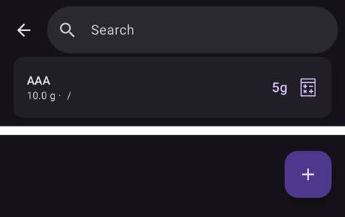
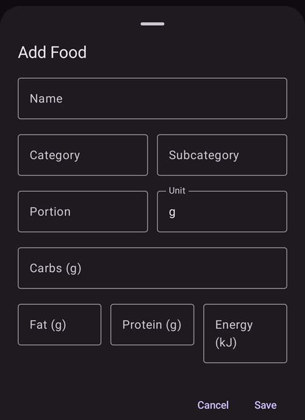

(food)=
# Продукты (ваша база продуктов)

База **Продукты** – это ваш личный список сохраненных продуктов. Каждая запись хранит **углеводы** продукта (и, если нужно, жиры, белки, энергию и категорию). Так продукты, которые вы часто едите, собраны в одном месте, и вы можете начать болюс с сохраненного продукта, где углеводы уже заполнены.

```{contents} Table of contents
:depth: 2
:local: true
```

---

## Как открыть базу продуктов

Откройте экран **Управление** (нижняя навигация) и выберите **Продукты** (*«Управление записями базы продуктов»*). В **AAPS** v4 Продукты **больше не модуль** – включать ничего не нужно. Это отдельный экран, который открывается с [панели «Управление»](#v4changes-manage).

---

## Список продуктов

Ваши продукты показаны в виде прокручиваемого списка. В каждой строке показаны **название** продукта, его **порция / единица / категория** и его **углеводы**:



- **🔍 Поиск** (вверху) – фильтр списка по **названию** (без учета регистра).
- **Фильтр категорий** – с помощью кнопок-фильтров можно оставить в списке только одну **категорию**. Когда категория выбрана, появляются кнопки ее **подкатегорий**. (Нажмите на выбранную кнопку еще раз, чтобы снять фильтр.)
- **➕** (внизу справа) – добавить новый продукт (см. ниже).
- Нажмите на строку, чтобы **редактировать** этот продукт.

Если в списке (или в текущем фильтре) нет записей, на экране показано **Нет данных**.

---

## Добавление и редактирование продукта

Нажмите **➕**, чтобы добавить продукт, или нажмите на строку, чтобы его редактировать. Редактор открывается в нижней панели (**Добавить продукт** / **Редактировать продукт**):



Поля:

- **Название** – обязательно (без него сохранить нельзя).
- **Категория** и **Подкатегория** – необязательно, служат для группировки и фильтрации продуктов.
- **Порция** и **Единица** – обычный размер порции. По умолчанию **Единица** – **g**.
- **Углеводы (г)** – количество углеводов в продукте.
- **Жиры (г)**, **Белки (г)**, **Энергия (кДж)** – необязательные данные о пищевой ценности.

Нажмите **Сохранить**, чтобы сохранить продукт, или **Отменить**, чтобы отказаться от изменений. При редактировании существующего продукта в редакторе есть еще кнопка **Удалить**.

```{admonition} Deleting is undoable
:class: note
После удаления продукта появляется сообщение **«Продукт удален»** с действием **Отменить**, поэтому случайное удаление легко вернуть.
```

---

## Как использовать продукт для болюса

В каждой строке продукта есть кнопка **калькулятора**. Нажатие на нее открывает **мастер болюса**, где уже заполнены **углеводы** этого продукта, а **название** продукта добавлено как примечание к терапии. Вам остается только подтвердить и ввести болюс, не набирая углеводы заново.

```{admonition} The carbs value is used as-is
:class: note
Сохраненное число **углеводов** продукта передается в мастер без изменений – **AAPS** не умножает его на порцию или на то, сколько вы съели. Если количество другое, измените углеводы в мастере перед подтверждением. (*Внутри* мастера болюса или диалога углеводов выбора продукта нет. Вы начинаете с этой строки продукта.)
```

---

## Откуда берутся продукты (синхронизация с Nightscout)

База продуктов передается через **Nightscout**, но **только в одну сторону**:

- **Скачивание:** **AAPS** **читает** продукты из **базы продуктов** вашего сайта Nightscout и синхронизирует с ней локальный список. Это происходит при синхронизации клиента NS, поэтому подключенный **клиент/фолловер** тоже получает те же продукты.
- **Загрузка:** **AAPS** **не** отправляет продукты **в** Nightscout – NSClient не поддерживает загрузку записей о продуктах. Поэтому продукты, которые вы создаете или меняете **в AAPS**, остаются **на этом устройстве** и не передаются в Nightscout или на ваши другие устройства.

```{admonition} Maintain your shared list in Nightscout
:class: important
Продукты только **скачиваются**. Поэтому, чтобы один список продуктов был на телефоне, у фолловера/[клиента](../RemoteFeatures/ClientMasterControl.md) и в остальной системе, ведите его в **Nightscout** (во встроенном редакторе продуктов). **AAPS** скачает эти записи. Продукт, добавленный только в **AAPS**, есть только на этом устройстве – и там остается: при скачивании записи сравниваются по их Nightscout ID, поэтому скачивание добавляет и обновляет эти записи, но никогда не перезаписывает и не удаляет продукт, созданный локально (продукт удаляется, только когда его копию удаляют в Nightscout).

Обратите внимание: база продуктов также **не** входит в подписанный канал управления «основной телефон ↔ клиент» – она передается только как данные Nightscout.
```

---

## Нет на часах

База продуктов – это функция **телефона**. На **часах Wear OS** нет просмотра продуктов, плитки или меню.

---


<!-- =====================================================================
     Screenshots captured from a real master device:
       - food_list.png    (Manage → Food: list row, search, add button)
       - food_editor.png  ("Add Food" editor: name/category/subcategory/portion/unit/carbs/fat/protein/energy)
     No food was created or deleted (the editor was cancelled).
     Sync facts code-verified: download via LoadFoodsWorker.getFoods(); upload disabled
     (DataSyncSelectorV3 processChangedFoods() commented out — "NSCv3 doesn't support food update").
     Maintainers: relocate page + images and fix cross-links as needed.
     ===================================================================== -->
