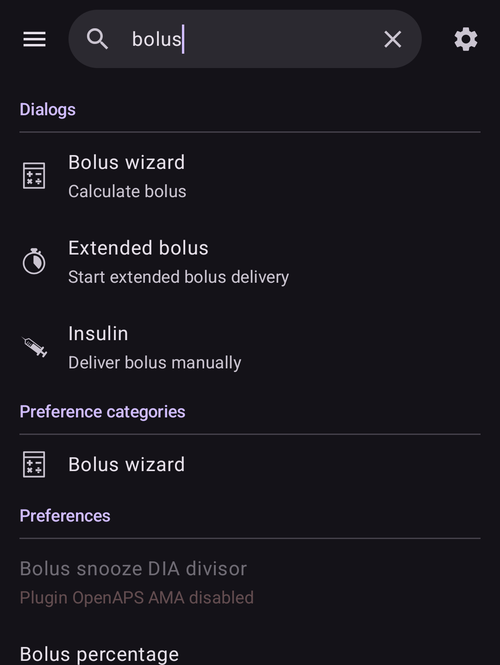
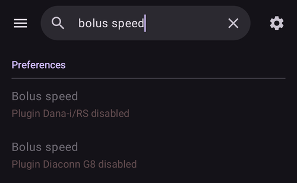
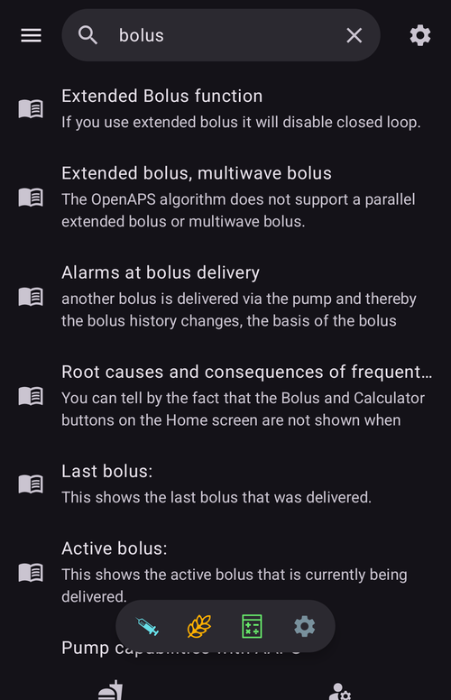

(global-search)=
# Глобальный поиск

В **AAPS** v4 вверху главного экрана есть поле **глобального поиска**. Введите слово, и поиск сразу проверит все приложение — модули, диалоги, экраны настроек, отдельные параметры — а если вы в сети, то и **документацию AndroidAPS**. Это самый быстрый способ перейти к настройке или экрану, не вспоминая, где они находятся.

```{contents} Table of contents
:depth: 2
:local: true
```

---

## Как открыть поиск

Нажмите на поле **🔍 Поиск** вверху **главного экрана** (рядом с меню ☰). Начните вводить текст, и результаты появятся по ходу ввода (после короткой паузы), сгруппированные по категориям:



Очистите поле кнопкой **✕** или закройте поиск кнопкой **Назад** на устройстве.

---

## Поиск на английском *или* на вашем языке

Это важно знать: поиск ищет совпадения **и** в тексте на **выбранном вами языке**, **и** в исходном **английском** тексте.

- Если ваше приложение, например, на немецком или чешском языке, вы можете ввести **переведенное** слово **или** **английское** слово — в обоих случаях настройка найдется.
- Выше всего ставится совпадение в **переведенном** заголовке, затем в **английском** заголовке, затем в переведенных и английских **описаниях**.
- Поиск не учитывает **надстрочные знаки (диакритику)** (поэтому *ů* совпадает с *u*, *é* совпадает с *e*) и **не различает заглавные и строчные буквы**.

Поэтому руководство или сообщение на форуме на английском языке все равно приведет вас к нужной настройке, даже если телефон показывает все в переводе.

---

## Что охватывает поиск

Результаты группируются по следующим категориям:

- **Модули** — все модули, видимые в вашей сборке (те же, что перечислены в разделе [Конфигурация](../SettingUpAaps/ConfigBuilder.md)). В каждой строке модуля есть его **переключатель включения**, поэтому вы можете включить или отключить модуль прямо из результатов — нажатие на строку отключенного (переключаемого) модуля включает его.
- **Диалоги** — экраны терапии/действий и управления (Мастер болюса, Инсулин, Пролонгированный болюс, Калибровка, Временная цель, Профиль, …). Экраны, которые не относятся к вашей сборке, не показываются (например, *Сопряжение с основным телефоном* на основном телефоне, *Авторизованные клиенты* на клиенте).
- **Категории настроек** — **экраны** и подэкраны настроек, как встроенные (Общее, Внешний вид, Защита, Оповещения, Обслуживание, …), так и от модулей, а также небольшие группы настроек, доступные из диалогов (кнопки заполнения, шаги кнопок инсулина/углеводов, пороги индикаторов состояния, настройки мастера, …).
- **Настройки** — каждый **отдельный параметр**, у которого есть название. Они отфильтрованы по вашей сборке/режиму, поэтому вы видите только настройки, которые действительно применимы (APS / NSClient / управление помпой).
- **Документация** — страницы онлайн-**документации AndroidAPS** (см. ниже).

```{admonition} Settings that belong to a disabled plugin
:class: note
Параметр, модуль которого сейчас **отключен**, все равно показывается — **серым** и без возможности нажать — с примечанием *«Модуль … отключен»*. Так вы видите, что настройка существует и какой модуль нужно включить, чтобы до нее добраться.


```

---

## Результаты из документации (онлайн)

Пока идет локальный поиск, **AAPS** параллельно отправляет запрос в официальную **документацию AndroidAPS** (размещенную на ReadTheDocs). Подходящие страницы появляются внизу в группе **Документация**, каждая со значком 📖, названием раздела и коротким фрагментом текста:



- Если документация переведена на язык вашего приложения, **AAPS** одновременно ищет в переведенных и в английских страницах. Сначала идут страницы на вашем языке, затем английские страницы, которые еще не были найдены.
- Нажатие на результат из документации открывает эту страницу в вашем **браузере**.
- Для поиска в документации нужен **интернет** — без подключения вы увидите вместо результатов примечание *«Для поиска в документации нужно подключение к интернету»*, а локальные результаты (в приложении) по-прежнему работают как обычно.

---

## Как открыть результат

Нажмите на результат, чтобы сразу перейти к нему:

- **Модуль** → открывает этот модуль.
- **Диалог** → открывает этот экран или диалог.
- **Категория настроек** → открывает этот экран настроек.
- **Параметр** → открывает настройку **на ее месте** (переходит к ней на ее экране).
- **Документация** → открывает страницу в вашем браузере.

Открытие настроек и защищенных действий по-прежнему учитывает вашу **[защиту](#Preferences-protection)** (PIN/пароль), точно так же, как если бы вы перешли туда вручную. После действия с результатом можно нажать **Назад**, чтобы вернуться к результатам поиска.

---

## Быстрые приемы для опытных пользователей

Два специальных запроса сразу показывают всю категорию:

- `%PLUGINS%` — показать **все** модули.
- `%DIALOGS%` — показать **все** диалоги/экраны действий.

---

```{admonition} The index stays current
:class: note
Поисковый индекс создается при первом поиске и потом хранится наготове. Он автоматически создается заново, когда вы **включаете/отключаете модуль** или **меняете язык приложения**, поэтому результаты всегда соответствуют вашей текущей настройке.
```

---


<!-- =====================================================================
     Screenshots captured from a real master device (query "bolus"):
       - search_results.png        (categorized local results: Dialogs / Preference categories / Preferences)
       - search_disabled_plugin.png (greyed-out preference from a disabled plugin)
       - search_documentation.png   (online ReadTheDocs results with 📖 icon + snippets)
     Maintainers: relocate page + images and fix cross-links as needed.
     ===================================================================== -->
