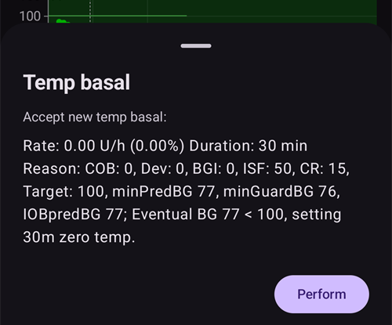
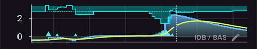

# Основной функционал AAPS

## Режим цикла

Состояние цикла показано на главном экране одним из значков ниже.

**AAPS** предлагает несколько режимов цикла: замкнутый цикл (1), приостановка на низкой ГК (LGS - 2) и открытый цикл (3).

Как выбрать режим цикла и что значат другие значки на рисунке (4–6), см. [Экраны AAPS > Главный экран > Состояние цикла](#AapsScreens-loop-status).

(KeyAapsFeatures-OpenLoop)=

### Open Loop

**AAPS** постоянно оценивает все доступные данные (IOB, COB, ГК...) и предлагает терапию (временные базалы), если нужно изменить вашу терапию.

Предложения не выполняются автоматически (как в замкнутом цикле). Пользователь должен выполнить предложения вручную на помпе (если используется виртуальная помпа) или нажатием кнопки, если **AAPS** подключен к настоящей помпе.

Когда у **AAPS** есть предложение, в нижней навигации главного экрана появляется пункт **Цикл** со значком-счетчиком. Нажмите на него, чтобы прочитать предложение («Принять новый временный базал») со скоростью, длительностью и причиной, затем нажмите **Выполнить**, чтобы выполнить его:

Предложение действует только несколько минут. Если оно старше примерно 9 минут или если за это время цикл был приостановлен или помпа отключена, **AAPS** отклоняет его, и на помпу ничего не отправляется (*«Это предложение слишком старое. На помпу ничего не отправлено. Дождитесь следующего.»*). Дождитесь следующего предложения.

Этот вариант нужен, чтобы познакомиться с работой **AAPS**, или если вы используете неподдерживаемую помпу. До конца **[Цели 5](#objectives-objective5)** вы будете в открытом цикле, что бы вы здесь ни выбрали.

(KeyAapsFeatures-LGS)=

### Приостановка помпы на низкой ГК (LGS)

В этом режиме [maxIOB](#Open-APS-features-maximum-total-iob-openaps-cant-go-over) равен нулю.

Это значит, что если ГК падает, **AAPS** может снизить для вас базал. Но если ГК растет, автоматическая коррекция не выполняется. Ваши базальные скорости остаются такими, как задано в текущем **профиле**. Только если IOB отрицательный (после предыдущей приостановки на низкой ГК), будет подан дополнительный инсулин, чтобы снизить **ГК**.

Этот режим доступен начиная с **[Цели 6](#objectives-objective6)**.

Кроме того, что вы можете выбрать этот режим сами, **AAPS** может переключиться в него и самостоятельно: пока вы проходите **[Цель 6](#objectives-objective6)** и всякий раз, когда он обнаруживает повторяющиеся значения ГК (см. [Предупреждающий знак ГК](#aaps-screens-bg-warning-sign)).

(KeyAapsFeatures-ClosedLoop)=

### Closed Loop

**AAPS** постоянно оценивает все доступные данные (IOB, COB, ГК...) и при необходимости автоматически корректирует терапию (*т. е.* без вашего участия), чтобы достичь заданного [целевого диапазона или значения](#profile-glucose-targets) (подача болюса, временный базал, отключение подачи инсулина, чтобы избежать гипо, и т. д.).

Замкнутый цикл работает в рамках многих ограничений безопасности, которые можно настроить индивидуально.

Замкнутый цикл возможен, только если вы проходите **[Цель 7](#objectives-objective7)** или выше и используете поддерживаемую помпу.

(autosens)= (Open-APS-features-autosens)=

## Autosens

- Autosens — это алгоритм, который отслеживает отклонения ГК (положительные/отрицательные/нейтральные).
- На основе этих отклонений он определяет чувствительность/резистентность пользователя.
- Реализация алгоритма oref в ** OpenAPS ** выполняется на основе комбинации данных за 24 и 8 часов. Алгоритм применяет наиболее чувствительный из них.
- Если пользователи перешли с алгоритма oref1, они, вероятно, заметят, что система менее динамично реагирует на изменения из-за различий в чувствительности за 24 или 8 часов.
- Замена канюли или изменение профиля сбросит Autosens назад на 100% (переключение профиля по процентам с установкой продолжительности не сбрасывает Autosens).
- Autosens настраивает базал и ISF ( примерно так же как изменение профиля в процентах).
- Если вы постоянно едите углеводы в течение долгого времени, Autosens в этот период будет менее эффективен, так как углеводы исключаются из расчета дельты **ГК**.
- Отклонения переводятся в **коэффициент чувствительности** (в процентах): коэффициент ниже 100% значит, что AAPS считает вас более чувствительным к инсулину, чем предполагает ваш **профиль** (поэтому он снижает действующий базал и повышает значение ISF), а коэффициент выше 100% значит, что вы более резистентны (поэтому он повышает базал и снижает значение ISF).
- По умолчанию этот коэффициент удерживается между 0,7 (70%, выше чувствительность) и 1,2 (120%, выше резистентность), чтобы период необычных данных не мог слишком сильно увести дозирование от вашего **профиля**. Эти границы можно изменить в дополнительных настройках модуля чувствительности.
- Autosens и [Autotune](../AdvancedOptions/Autotune.md) решают одну и ту же задачу в разных масштабах времени: Autosens поминутно немного корректирует ваше *текущее* дозирование по данным за последние 8–24 ч, а Autotune медленно переписывает сам ваш *профиль* по истории за несколько недель. Использовать оба — нормально и ожидаемо: они дополняют, а не дублируют друг друга.

*Полное техническое описание алгоритма autosens см. в [документации OpenAPS по Autosens](https://openaps.readthedocs.io/en/latest/docs/Customize-Iterate/autosens.html).*

(Open-APS-features-super-micro-bolus-smb)=

## Super Micro Bolus (SMB)

**SMB**, сокращение от **Super micro bolus**— это функция OpenAPS, вошедшая в алгоритм Oref1 с 2018 года. В отличие от помощника болюса **AMA**, для контроля уровня глюкозы алгоритм **SMB** использует небольшие **микроболюсы**, а не временную базальную скорость. Там, где алгоритм мастера болюса **AMA** добавит 1,0 ед. инсулина при помощи временной базальной скорости, **SMB** подает несколько супер микроболюсов маленькими шажками с **пятиминутным** интервалом, например 0,4; 0,3; 0,2; и 0,1 ед. Одновременно (по соображениям безопасности и чтобы предотвратить передозировку), на определенный период фактический базал устанавливается на 0 ед/ч, (т. н. **"нулевой базал"**). Это позволяет системе регулировать гликемию быстрее, чем временным повышением скорости базала в **AMA**.

Благодаря микроболюсам SMB при компенсации блюд, содержащих только "медленные" углеводы, системе достаточно сообщить только о запланированном количестве углеводов, в остальном положившись на **AAPS**. Однако это может дать более высокие постпрандиальные (после приема пищи) пики, поскольку преболюс не вводился. Или, при необходимости, можно предварительно ввести **преболюс**, который ** только частично** покрывает углеводы (например, 2/3 от предполагаемого количества), и позволить алгоритму **SMB** ввести оставшуюся часть инсулина.

SMB показаны на [графике IOB](#aaps-screens-iob) синими треугольниками. [Нажмите и удерживайте](#aaps-screens-graph-press-and-hold) график на треугольнике, чтобы увидеть, сколько инсулина было подано, или используйте [Историю терапии](#aaps-screens-treatments).

Алгоритм **SMB** имеет встроенные механизмы безопасности:

1. **Самая большая отдельная доза SMB**  
  самая большая разовая доза SMB имеет наименьшее значение из:
  
        * значение, соответствующее текущей базальной скорости (с поправкой autosens) за время, заданное в "Макс. минут базала для ограничения SMB", например количество базала на следующие 30 минут, или
        * половина количества инсулина, которое требуется сейчас, или
        * оставшаяся часть значения maxIOB в настройках.
      

2. **Низкая скорость временной базы**  
  Низкая скорость временного базала (называемая "низким временным базалом") или временная базальная скорость равная 0 Ед/ч (называемая "нулевым временным базалом") преимущественно активируются в режиме алгоритма **супермикроболюс SMB**. Это сделано специально по соображениям безопасности и не имеет негативных последствий, если **профиль** настроен правильно. На основном графике кривая активного инсулина IOB (желтая тонкая линия) имеет большее значение, чем динамика временных скоростей базала.

3. **Непредвиденный прием пищи**  
  Дополнительные расчеты для прогнозирования уровня ГК, например, по **UAM** (непредвиденные приемы пищи). Даже без ручного ввода углеводов пользователем **UAM** может автоматически обнаружить значительное повышение гликемии из-за приема пищи, выброса адреналина или других факторов и попытаться скорректировать это при помощи **микроболюсов SMB**. Для безопасности, эта функция работает и в обратном направлении и может остановить подачу супер микроболюса при неожиданном понижении ГК. Поэтому функция UAM должна всегда быть активирована в режиме алгоритма SMB.

SMB не решает сам, что нужен инсулин: он опирается на те же объединенные прогнозы ГК (eventual BG, zero-temp, COB, UAM), которые описаны в разделе [как AAPS превращает прогнозы в решение о дозировании](#aaps-screens-how-predictions-become-a-dosing-decision). SMB и нулевой временный базал — это просто два инструмента, которыми AAPS выполняет это решение.

**Чтобы использовать SMB, нужно начать [цель 9](#objectives-objective9).**

См. также [документацию OpenAPS по oref1/SMB](https://openaps.readthedocs.io/en/latest/docs/Customize-Iterate/oref1.html#understanding-super-micro-bolus-smb) с полным техническим описанием или [статью Тима о SMB](https://www.diabettech.com/artificial-pancreas/understanding-smb-and-oref1/), написанную для сообщества.

Ниже описаны настройки алгоритма SMB из OpenAPS.

(Open-APS-features-max-u-h-a-temp-basal-can-be-set-to)=

### Максимальная базальная скорость

Эта настройка безопасности определяет максимальную скорость временного базала помпы. Она также известна как **max-basal**.

Значение задается в единицах в час (ед./ч). Рекомендуется установить какое-то разумное значение. Рекомендуемое значение для этого параметра:

**MAX-BASAL = НАИВЫСШАЯ БАЗАЛЬНАЯ СКОРОСТЬ x 4**

Например, если максимальная скорость базала в профиле была 0,5 ед./ч, то, умножив ее на 4, получаем 2 ед./ч.

**AAPS** ограничивает это значение «жестким пределом» в зависимости от [Настройки > Безопасность > Возраст пациента](#preferences-patient-type). Ниже приводятся жесткие пределы:

- Ребенок: 2
- Подросток: 5
- Взрослый: 10
- Инсулинорезистентный взрослый: 12
- Беременная: 25

*См. также [обзор программно закодированных жестких пределов](#Open-APS-features-overview-of-hard-coded-limits).*

(Open-APS-features-maximum-total-iob-openaps-cant-go-over)=

### Макс. IOB для SMB

Это значение определяет максимальный **активный инсулин** (базальный и болюсный IOB), ниже которого **AAPS** будет оставаться при работе в режиме замкнутого цикла. Оно также именуется **maxIOB**.

Если текущий активный инсулин IOB (например, после болюса на еду) превышает определенную величину, то алгоритм останавливает подачу инсулина до тех пор, пока предел IOB не будет ниже заданного значения.

Для начала рекомендуется задать эту величину как:

      maxIOB = средний болюс на еду + троекратный максимальный базал
    

Будьте внимательны и осторожны при настройке **max-IOB**. Эта величина для каждого своя, а также зависит от средней общей суточной дозы (TDD).

**AAPS** ограничивает это значение «жестким пределом» в зависимости от [Настройки > Безопасность > Возраст пациента](#preferences-patient-type). Ниже приводятся жесткие пределы:

- Child: 7
- Teenager: 13
- Adult: 22
- Insulin resistant adult: 30
- Pregnant: 70

*См. также [обзор программно закодированных жестких пределов](#Open-APS-features-overview-of-hard-coded-limits).*

Примечание : При использовании **SMB** **max-IOB** рассчитывается иначе, чем алгоритмом помощника болюса AMA. В алгоритме помощника болюса **AMA** maxIOB является параметром безопасности для активного базального инсулина **IOB**, а в SMB-режиме, он, помимо этого, включает в себя активный болюсный инсулин.

### Use dynamic sensitivity

Эта функция называется [DynamicISF](../DailyLifeWithAaps/DynamicISF.md). При ее включении становятся доступными новые настройки. Эти настройки подробно описаны на странице [DynamicISF](#dyn-isf-preferences).

### Use Autosens

Это функция [Autosens](#Open-APS-features-autosens). При использовании DynamicISF нельзя использовать Autosens, так как это два разных алгоритма, которые меняют одну и ту же переменную (чувствительность).

Autosens отслеживает отклонения гликемии в крови (положительные / отрицательные / нейтральные). На основе отклонений он пытается выяснить, насколько вы чувствительны/резистентны к инсулину и корректирует базальную скорость и коэффициент чувствительности к инсулину ISF.

При ее включении становятся доступными новые настройки.

#### Sensitivity raises target

Если эта опция включена, функция определения чувствительности (autosens) может поднять цель при обнаружении чувствительности ниже 100%. В этом случае цель будет увеличена на процент обнаруженной чувствительности.

Если цель изменена из-за определения чувствительности, она показывается на главном экране на зеленом фоне.

Эта настройка доступна, когда включен один из параметров "Использовать динамическую чувствительность" или "Использовать Autosens".

#### Resistance lowers target

Если включена эта опция, функция определения чувствительности (autosens) может снизить целевое значение при обнаружении резистентности (выше 100%). В этом случае цель будет снижена на процент обнаруженной резистентности.

Эта настройка доступна, когда включен один из параметров "Использовать динамическую чувствительность" или "Использовать Autosens".

### Включить супер микро болюсы SMB

Включите, чтобы использовать функционал SMB. Если этот параметр выключен, **SMB** не подаются.

При ее включении становятся доступными новые настройки.

(Open-APS-features-enable-smb-with-high-temp-targets)=

#### Включить SMB при высокой временной цели

Если эта настройка включена, **SMB** все равно подаются, даже если пользователь выбрал высокую **временную цель** (100 мг/дл или 5,6 ммоль/л и выше, независимо от цели **профиля**). Включайте ее осторожно: **SMB** могут стать слишком агрессивными, если ваши настройки плохо подобраны или если ваш **профиль** часто меняется (например, у детей).

Когда эта настройка выключена, высокая **временная цель** выключает **SMB**. Например, если этот параметр выключен, **SMB** можно отключить, установив **временную цель** 100 мг/дл или 5,6 ммоль/л и выше. Этот параметр также отключает **SMB** независимо от того, какое другое условие пытается включить SMB, — кроме низкой **временной цели**, например **Ожидаемый прием пищи** (или любой **временной цели** 98 мг/дл или 5,4 ммоль/л и ниже), при которой **SMB** все еще могут подаваться, чтобы привести **ГК** к цели.

Эта настройка сама по себе не включает **SMB**. При высокой временной цели **SMB** подается, только если это также разрешает одна из других настроек ниже (например, **Всегда включать супер микро болюс SMB** или **Включать SMB при активных углеводах COB**).

(Open-APS-функции-включать-микроболюсы-всегда)=

#### Enable SMB always

Если эта настройка включена, SMB включены всегда (независимо от COB, временных целей или болюсов). Если этот параметр включен, остальные параметры включения не будут иметь эффекта. Однако, если отключена настройка **Включить SMB с высокими временными целями** и задается высокая временная цель, SMB будут отключены.

Эта настройка доступна только в том случае, если **AAPS** определяет, что вы используете [ надежный источник ГК](#GettingStarted-TrustedBGSource) с хорошей фильтрацией. FreeStyle Libre 1 не считается надежным источником из-за риска бесконечно повторяющихся старых данных ГК в случае сбоя датчика.

Зашумленные данные могут привести к тому, что **AAPS** поверит, что ГК растет очень быстро, что в свою очередь приведет к подаче ненужных микроболюсов. Для получения дополнительной информации о шуме и сглаживании данных смотрите [ здесь](../CompatibleCgms/SmoothingBloodGlucoseData.md).

#### Включать SMB при активных углеводах COB

Если этот параметр включен, SMB включаются при активных углеводах COB больше 0.

Этот параметр не отображается, если включен параметр "Всегда включать супер микро болюс SMB".

#### Включить SMB при низкой временной цели

Если эта настройка включена, SMB включаются, когда установлена временная цель (ожидаемый прием пищи, нагрузка, гипо, своя). Если эта настройка включена, а **Включить SMB при высокой временной цели** выключена, SMB будут включены при низкой временной цели (98 мг/дл или 5,4 ммоль/л и ниже), но выключены при высокой временной цели.

Этот параметр не отображается, если включен параметр "Всегда включать супер микро болюс SMB".

#### Включать SMB после углеводов

Если включена эта настройка, то микроболюсы SMB работают в течение 6 часов после внесения углеводов, даже если значение COB достигло 0.

По соображениям безопасности эта настройка доступна только в том случае, если **AAPS** обнаруживает, что используется надежный источник ГК. Настройка не видна, если включен параметр "Всегда включать супер микро болюс SMB".

Эта настройка доступна только в том случае, если **AAPS** определяет, что вы используете [ надежный источник ГК](#GettingStarted-TrustedBGSource) с хорошей фильтрацией. FreeStyle Libre 1 не считается надежным источником из-за риска бесконечно повторяющихся старых данных ГК в случае сбоя датчика.

Зашумленные данные могут привести к тому, что **AAPS** поверит, что ГК растет очень быстро, что в свою очередь приведет к подаче ненужных микроболюсов. Дополнительная информация о шуме и сглаживании данных находится [здесь](../CompatibleCgms/SmoothingBloodGlucoseData.md).  
Эта настройка не отображается, если включен параметр "Всегда включать супер микро болюс SMB".

#### Интервал SMB

Этот параметр ограничивает частоту микроболюсов. Его значение определяет минимальное время между микроболюсами. Напоминаем, что цикл запускается каждый раз, когда алгоритм получает данные гликемии (обычно каждые 5 минут). Вычтите 2 минуты, чтобы дать циклу дополнительное время на завершение. То есть, если требуется чтобы SMB работали при каждом запуске цикла, установите это значение на 3 минуты.

Значение по умолчанию: 3 мин.

(Open-APS-функции-макс-минут-базала-для-ограничения)=

#### Макс. минут базала для ограничения SMB

Это важный элемент в настройках безопасности. На основе количества базального инсулина в данный отрезок времени эта величина определяет объем микроболюсов SMB при наличии активных углеводов COB.

Его увеличение позволяет микроболюсам SMB вести себя более агрессивно. Начать следует со значения по умолчанию в 30 минут. Набравшись опыта, увеличивайте это значение приращениями по 15 минут и наблюдайте результат при многократном приеме пищи.

Рекомендуется не задавать это значение выше 90 минут, так как существует вероятность достижения точки, после которой алгоритм не сможет контролировать снижающуюся гликемию при нулевом временном базале 0 ед/ч ('zero-temp'). Также настройте оповещения, особенно пока вы еще тестируете новые настройки: они предупредят вас задолго до гипо.

Значение по умолчанию: 30 мин.

#### Макс. минут базала для ограничения SMB при UAM

Эта настройка позволяет менять силу SMB во время UAM, когда углеводов больше нет.

Значение по умолчанию: такое же, как **Макс. минут базала для ограничения SMB**.

Эта настройка видна, только если включены "Включить супер микро болюсы SMB" и "Включить непредвиденный прием пищи UAM".

(enable-uam)=

### Enable UAM

При включении этой опции алгоритм SMB может распознать непредвиденный прием пищи. Этот параметр полезен, если вы забыли ввести в **AAPS** потребляемые углеводы или неправильно рассчитали количество углеводов, или если пища с большим количеством жира и белка усваивается дольше, чем ожидалось. Без ввода углеводов UAM может распознать быстрое повышение уровня глюкозы, вызванное углеводами, адреналином и т. д., и пытается скорректировать его с помощью SMB. И наоборот: если гликемия падает быстро, то настройка поможет досрочно прекратить SMB.

**Поэтому при использовании микроболюсов SMB всегда следует активировать непредвиденный прием пищи UAM.**

(key-aaps-features-minimal-carbs-required-for-suggestion)=

### Порог необходимых углеводов

Минимальное количество граммов углеводов для отображения предупреждения о рекомендуемых углеводах. Если алгоритм обнаруживает, что организму требуются дополнительные углеводы, об этом появится сообщение. Вы получите уведомление, которое можно отложить на 5, 15 или 30 минут.

При желании уведомления о нужных углеводах можно отправлять в Nightscout. В этом случае будет показано и разослано оповещение.

В любом случае необходимые углеводы будут показаны в разделе COB на главном экране.

### Advanced Settings

Полный справочник параметров (включая настройки, которые здесь не описаны) см. в [документации OpenAPS по настройкам и параметрам безопасности](https://openaps.readthedocs.io/en/latest/docs/While%20You%20Wait%20For%20Gear/preferences-and-safety-settings.html).

**Всегда использовать короткую среднюю дельту вместо простой дельты** Если включить эту функцию, **AAPS** использует короткую среднюю дельту ГК за последние 15 минут, обычно это среднее из трех последних значений. Это помогает **AAPS** работать стабильнее с источниками данных с шумом, такими как xDrip и Libre.

**Максимальный ежедневный множитель безопасности** Это важный ограничитель безопасности. Настройка по умолчанию (которая вряд ли потребует корректировки) равна 3. Это означает, что **AAPS** никогда не сможет установить временную базальную скорость, которая более чем в 3 раза превышает максимальный часовой базал, запрограммированный в помпе и/или профиле пользователя. Пример: если ваша максимальная базальная скорость составляет 1,0 Ед/ч, а максимальный коэффициент суточной безопасности равен 3, то **AAPS** может установить максимальную временную базальную скорость в 3,0 Ед/ч (= 3 х 1,0 Ед/ч).

Значение по умолчанию: 3 (не следует изменять, если нет настоящей потребности и вы не уверены в том, что делаете)

**Текущий множитель безопасности базала** Это важный ограничитель безопасности. Настройка по умолчанию (которая вряд ли потребует корректировки) равна 4. Это означает, что **AAPS** никогда не сможет установить временную базальную скорость, которая более чем в 4 раза превышает текущий часовой базал, запрограммированный в помпе и/или профиле пользователя.

Значение по умолчанию: 4 (не следует изменять, если нет настоящей потребности и вы не понимаете, что делаете)

* * *

(Open-APS-features-auto-isf)=

## Auto ISF

**Auto ISF** — это **экспериментальный** алгоритм для опытных пользователей. Он основан на OpenAPS SMB и добавляет правила, которые делают фактор чувствительности к инсулину (ISF) сильнее или слабее в зависимости от поведения вашей глюкозы.

Это функция для разработки: ее можно включить только в [dev-сборке](../AdvancedOptions/DevBranch.md) с включенным **Режимом отладки**. В обычной выпускной сборке она принудительно выключена и поэтому не показана в **Конфигурация → APS**. Прохождение [Целей](../SettingUpAaps/CompletingTheObjectives.md) ее не разблокирует.

После ее выбора в ее **Настройках** есть настройки OpenAPS SMB и группа **Настройки AutoISF**:

- **Включить AutoISF**: включает корректировки ISF. Без него алгоритм работает как OpenAPS SMB.
- **AutoISF min** и **AutoISF max**: насколько слабым и насколько сильным может стать ISF, так же как пределы Autosens. При значении по умолчанию 1,0 эффект выключен.
- **Веса**: каждый вес управляет одним правилом, а значение по умолчанию 0,0 выключает это правило. 
  - пока глюкоза **ускоряется**, ISF усиливается (больше инсулина);
  - пока глюкоза **замедляется**, ISF ослабляется (меньше инсулина);
  - пока глюкоза **ниже цели**, ISF ослабляется;
  - пока глюкоза **выше цели**, ISF усиливается;
  - вес **после еды** и вес **длительности** действуют после еды и когда глюкоза долго остается высокой.
- **Коэффициент подачи SMB** (с минимумом, максимумом и диапазоном ГК): какую долю требуемого инсулина можно подать как SMB.
- **Расширение макс. диапазона SMB**: во сколько раз можно превысить обычный предел размера SMB ([макс. минут базала](#Open-APS-features-max-minutes-of-basal-to-limit-smb-to), по умолчанию 30 минут). Значение по умолчанию 1 ничего не меняет; возможно до 5. Повышайте это экспериментальное значение медленно и осторожно.
- **Порог IOB в процентах**: процент от макс. IOB, выше которого SMB отключаются.

    {admonition} Только для опытных пользователей
    :class: danger
    Со значениями по умолчанию Auto ISF ничего не меняет. Каждое значение, которое вы повышаете, делает **AAPS** агрессивнее. Меняйте одно значение за раз, маленькими шагами, и следите за результатом несколько дней. Будьте очень осторожны с **AutoISF max** выше 2,5.

(Open-APS-функции-расширенный-помощник-болюса-ama)=

## Усовершенствованный помощник болюса (AMA)

AMA, сокращение от "advanced meal assist", усовершенствованный помощник болюса, включен в функционал OpenAPS с 2017 года (oref0). Помощник болюса OpenAPS Advanced Meal Assist (AMA) позволяет системе быстрее установить высокий временный базал после болюса на еду, если вы правильно ввели углеводы.

Подробнее см в [ Документации OpenAPS](https://newer-docs.readthedocs.io/en/latest/docs/walkthrough/phase-4/advanced-features.html#advanced-meal-assist-or-ama).

### Максимальная базальная скорость (в OpenAPS "max-basal")

Эта настройка безопасности помогает **AAPS** никогда не задавать опасно высокую базальную скорость и ограничивает временный базал до x ед./ч. Рекомендуется установить какое-то разумное значение. Хороший совет – умножить наивысшую скорость базала в вашем профиле на 4 или по меньшей мере на 3. Например, если максимальная скорость базала в вашем профиле установлена на 1 ед./ч, то, умножив ее на 4, вы получите значение 4 ед./ч. и зададите эту величину в качестве параметра безопасности.

Здесь нельзя просто задать любое значение: по причине безопасности есть "жесткий предел", который зависит от возраста пациента. "Жесткий предел" максимального активного инсулина maxIOB в алгоритме помощника болюса AMA ниже, чем в алгоритме SMB. Для детей эта величина самая низкая, а для инсулинорезистентных взрослых — самая большая.

Жестко заданными параметрами в **AAPS** являются:

- Ребенок: 2
- Подросток: 5
- Взрослый: 10
- Инсулинорезистентный взрослый: 12
- Беременная: 25

*См. также [обзор программно закодированных жестких пределов](#Open-APS-features-overview-of-hard-coded-limits).*

### Макс. IOB для AMA

Этот параметр ограничивает максимальный базальный IOB, при котором **AAPS** еще работает. Если активный инсулин IOB выше, то алгоритм AAPS перестает подавать дополнительный базальный инсулин до тех пор, пока базальный IOB не окажется в заданных пределах.

Значение по умолчанию 2, но повышайте этот параметр медленно, чтобы увидеть, как он на вас влияет и какое значение подходит лучше всего. Это значение у каждого свое и также зависит от средней суммарной суточной дозы (TDD). For safety reason, there is a limit, which depends on the patient age. "Жесткий предел" максимального активного инсулина maxIOB в алгоритме помощника болюса AMA ниже, чем в алгоритме SMB.

- Ребенок: 3
- Подросток: 5
- Взрослый: 7
- Инсулинорезистентный взрослый: 12
- Беременная: 25

*См. также [обзор программно закодированных жестких пределов](#Open-APS-features-overview-of-hard-coded-limits).*

### Использовать Autosens (AMA)

Здесь можно выбрать, использовать функцию [автоматического определения чувствительности ](../DailyLifeWithAaps/SensitivityDetectionAndCob.md) или нет.

### Autosens корректирует цели

Если эта опция включена, Autosens может скорректировать цели (наряду с базой и ISF). Это позволяет **AAPS** работать более или менее "агрессивно". При этом фактическая цель может быть достигнута быстрее.

### Advanced Settings

- Обычно менять настройки в этом окне не нужно!
- Если вы все же хотите их изменить, убедитесь, что понимаете, что делаете: см. полный справочник параметров в [документации OpenAPS по настройкам и параметрам безопасности](https://openaps.readthedocs.io/en/latest/docs/While%20You%20Wait%20For%20Gear/preferences-and-safety-settings.html).

**Всегда использовать короткую среднюю дельту вместо простой дельты** Если включить эту функцию, **AAPS** использует короткую среднюю дельту ГК за последние 15 минут, обычно это среднее из трех последних значений. Это помогает **AAPS** работать стабильнее с источниками данных с шумом, такими как xDrip и Libre.

**Максимальный ежедневный множитель безопасности** Это важный ограничитель безопасности. Настройка по умолчанию (которая вряд ли потребует корректировки) равна 3. Это означает, что алгоритму **AAPS** ни при каких условиях не будет разрешено устанавливать временный базал, который более чем в 3 раза выше самого высокого почасового базала, запрограммированного в помпе. Пример: если ваша максимальная базальная скорость составляет 1,0 Ед/ч, а максимальный коэффициент суточной безопасности равен 3, то **AAPS** может установить максимальную временную базальную скорость в 3,0 Ед/ч (= 3 х 1,0 Ед/ч).

Значение по умолчанию: 3 (не следует изменять, если нет настоящей потребности и вы не уверены в том, что делаете)

**Текущий множитель безопасности базала** Это важный ограничитель безопасности. Настройка по умолчанию (которая вряд ли потребует корректировки) равна 4. Это означает, что алгоритму **AAPS** ни при каких условиях не будет разрешено устанавливать временный базал, который более чем в 4 раза выше текущего почасового базала, запрограммированного в помпе.

Значение по умолчанию: 4 (не следует изменять, если нет настоящей потребности и вы не понимаете, что делаете)

**Делитель приостановки болюса** Функция «приостановка болюса» работает после болюса на еду. **AAPS** не устанавливает низкие временные базалы после еды в течение времени действия инсулина DIA, поделенного на параметр «делитель приостановки болюса». Значение по умолчанию 2. Это означает, что при продолжительности действия инсулина DIA 5 часов "приостановка болюса" продлится 5ч. : 2 = 2,5 часа.

Значение по умолчанию: 2

* * *

(Функции-Open-APS-обзор-жестких-ограничений)=

## Overview of hard-coded limits

|            | ребенок | Подросток | взрослый | Инсулинорезистентный взрослый | Беременная |
| ---------- | ------- | --------- | -------- | ----------------------------- | ---------- |
| MAXBOLUS   | 5       | 10        | 17       | 25                            | 60         |
| MINDIA     | 5       | 5         | 5        | 5                             | 5          |
| MAXDIA     | 9       | 9         | 9        | 9                             | 10         |
| MINIC      | 2       | 2         | 2        | 2                             | 0.3        |
| MAXIC      | 100     | 100       | 100      | 100                           | 100        |
| MAXIOB_AMA | 3       | 5         | 7        | 12                            | 25         |
| MAXIOB_SMB | 7       | 13        | 22       | 30                            | 70         |
| MAXBASAL   | 2       | 5         | 10       | 12                            | 25         |