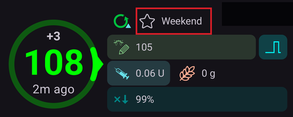
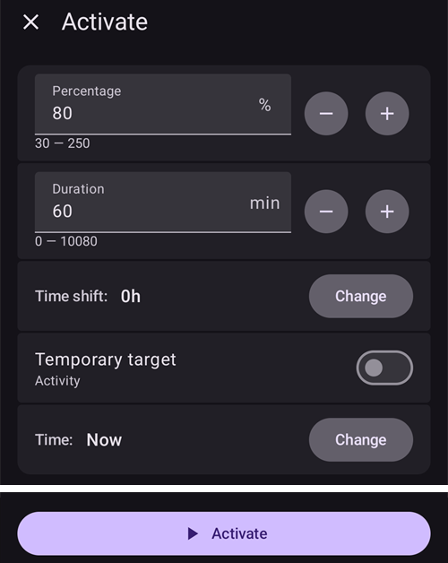
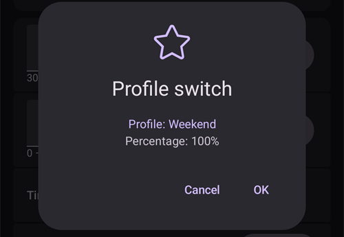
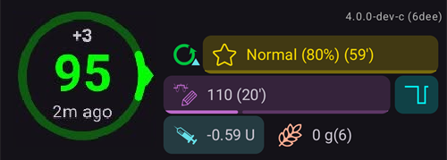
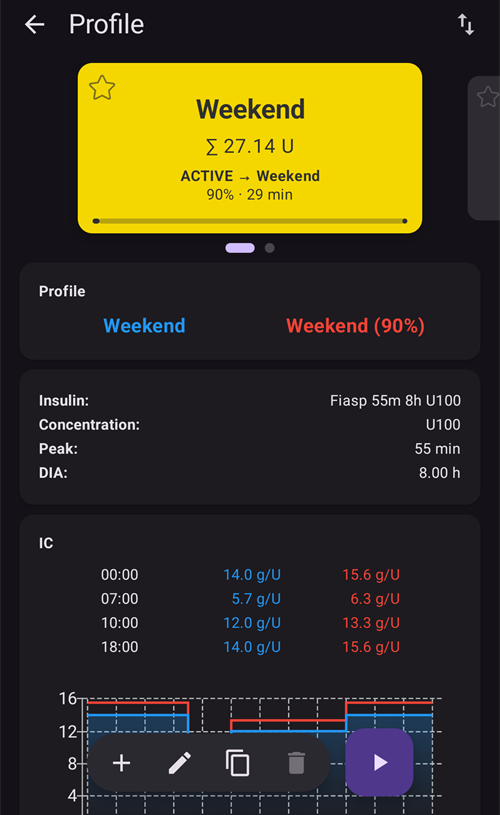
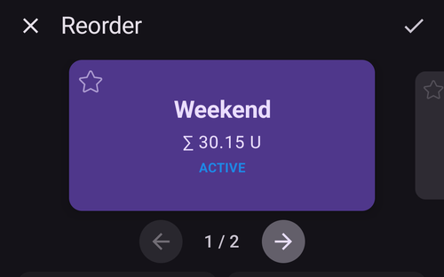
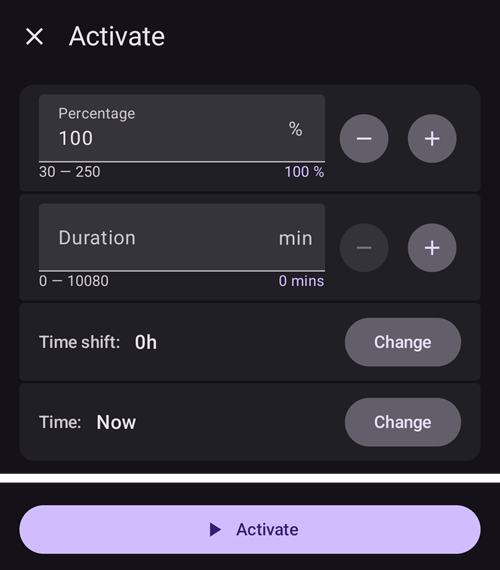
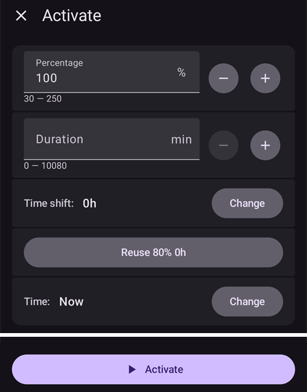
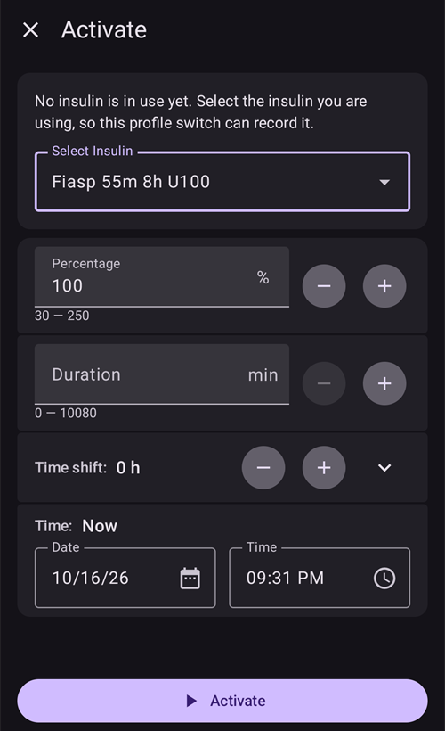
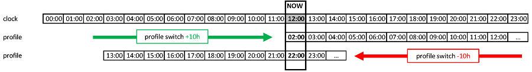

# Переключение профиля и процент профиля

В этом разделе объясняется, что такое **Смена профиля** и **Процент профиля**. Как создать **Профиль**, вы узнаете на странице [Ваш профиль AAPS](#your-aaps-profile-create-and-edit-profiles).

Когда мы вступаем в жизнь с использованием **AAPS**, нам следует создать диабетический **Профиль**, понять, как он работает, как выполнять **Смену Профиля**, а также изучить влияние ** Процентного содержания Профиля** на алгоритмы **AAPS**. Функции **Переключения профиля** и **Процента профиля** могут быть особенно полезны для:

- принятия в расчет менструального цикла - процентная корректировка в пределах ** Профиля** может быть настроена в **Автоматизации**, чтобы позволить **AAPS** адаптироваться к различным стадиям гормонального цикла и прогнозируемой резистентности к инсулину.

- учета физических нагрузок - процентная корректировка в ** профиле** может быть настроена в ** Автоматизациях** при физических нагрузках, чтобы снизить расход базала.

- людей, работающих по сменам или ночью: в **Профиле** можно задать сдвиг по времени, изменив число часов в **Профиле** на столько, насколько позже или раньше пользователь ляжет спать или проснется.

Почему лучше использовать **Процент профиля**, а не временную корректировку базала? Чтобы действовать эффективнее, **Процент профиля** пропорционально уменьшает или увеличивает сразу базал, ISF и I:C. Это гарантирует, что при назначении дозы инсулина **AAPS** обеспечит сбалансированный подход. За счет уменьшения базальной скорости в **Профиле** можно добиться незначительных результатов, если алгоритм **AAPS** сохраняет прежние соотношения ISF и I:C.

(ProfileSwitch-change-percentage)=

## Изменение процента профиля на главном экране

Нужен хотя бы один сохраненный **Профиль**. **Процент профиля** всегда применяется через **Переключение профиля**: вы снова активируете **Профиль**, на этот раз с процентом.

```{admonition} Переходите с AAPS 3? :class: note Долгое нажатие на название профиля больше не открывает диалог переключения профиля. **Нажмите** на название профиля, затем нажмите круглую кнопку **▶** внизу справа: она открывает те же настройки (процент, длительность, временная цель «Нагрузка»).

    <br />1. На главном экране **нажмите на название профиля** (рядом со значком звездочки). Откроется [экран профиля](#ProfileSwitch-manage-v4) на карточке текущего **Профиля** с отметкой **АКТИВНЫЙ**.
    
       
    
    2. Чтобы оставить тот же **Профиль**, оставьте выбранной карточку **АКТИВНЫЙ**. Чтобы одновременно сменить **Профиль**, проведите пальцем к другой карточке.
    3. Нажмите круглую кнопку **▶** (**Активировать**) внизу справа. Откроется экран **Активировать**.
    4. Задайте **В процентах** кнопками **−** / **+** (шаг 5%) или введите значение (от 30 до 250%). Поле всегда начинается со **100%**: оно не показывает процент, который действует сейчас. Например, введите **80**, чтобы получить на 20% меньше инсулина, или **120**, чтобы получить на 20% больше.
    5. Задайте **Продолжительность** в минутах:
       * **0** оставляет новый процент, пока вы не сделаете другое **Переключение профиля**;
       * любое другое значение завершает переключение через это время, и **AAPS** возвращается к **Профилю**, который действовал до этого.
    
       
    
    6. Нажмите **▶ Активировать** внизу экрана. Проверьте сводку в диалоге **Смена профиля** и нажмите **OK**.
    
       
    
    На главном экране рядом с названием профиля появятся процент и оставшееся время, например *Normal (80%) (59')*, а пока действует переключение с длительностью, название выделено желтым. Звездочка отмечает переключение на графике глюкозы. См. [главный экран](#aaps-screens-profile--target).
    
    
    
    Чтобы **вернуться к 100%** раньше времени, повторите шаги и оставьте **В процентах** на 100, а **Продолжительность** на 0.
    
    ```{admonition} Процент одним нажатием
    :class: tip
    Если вы часто используете один и тот же процент (спорт, болезнь), добавьте [ярлык профиля](#profile-shortcuts) на панель быстрого запуска или создайте [сценарий](Scenes.md). Оба способа применяют профиль с заранее заданным процентом и длительностью одним нажатием.
    

(ProfileSwitch-manage-v4)=

## Управление профилями и их активация (Управление → Профиль)

В **AAPS** v4 профили управляются и активируются на экране **Управление** (нижняя панель навигации) → **Профиль** (*«Управление профилями и их активация»*).

Экран профиля показывает ваши профили в виде **карусели карточек, которые можно пролистывать**. Карточка текущего профиля отмечена **АКТИВНЫЙ** и показывает его суммарный суточный базал (например, *∑ 30,15 ед*). Под выбранной карточкой видны подробности профиля — тип **Инсулина** и графики **IC**, **ISF**, **базала** и **цели** с диаграммами.

Когда действует временное переключение, карточка **АКТИВНЫЙ** показывает его процент и сдвиг по времени с оставшимся временем, например *110% +2 ч · 2 ч 40 мин*, над индикатором выполнения. Оба значения обновляются каждые 30 секунд. Тогда подробности ниже показаны в двух столбцах: значения профиля синим цветом и значения, которые действуют с учетом процента, красным.



Кнопки внизу действуют на **выбранный** профиль: **➕ Добавить**, **✏️ Редактировать**, **⧉ Клонировать** и **‘️ Удалить**, а также круглая кнопка **▶ Активировать** справа. Как заполнить четыре графика в редакторе (IC / ISF / БАЗА / ЦЕЛЬ), см. [Создание и редактирование профилей](#your-aaps-profile-create-and-edit-profiles).

**⧉ Клонировать** использует значок из двух квадратов, который часто означает *копирование*, но вставлять ничего не нужно: копия создается за один шаг. Подтвердите *Клонировать профиль "Normal"?*, и новый профиль с названием *Normal копия* добавится в конец карусели и будет выбран, готовый к **✏️ Редактированию** (там же его можно переименовать). Это не то же самое, что клонировать прошлое **Переключение профиля** из истории терапии: так создается новый профиль *с уже примененными процентом и сдвигом по времени*. См. [Сохранение переключения профиля для дальнейшего использования](#ProfileSwitch-keep-for-later).

(ProfileSwitch-read-only-mode)= **Видна только кнопка ▶ Активировать?** Ваши настройки защищены, поэтому экран открывается только для чтения. Нажмите на **✏️ карандаш** в верхней панели и введите пароль настроек. См. [Защита настроек теперь блокирует и экраны управления](#v4changes-read-only-management).

### Изменение порядка профилей

Если у вас больше одного профиля, вы можете выбрать их порядок в карусели: нажмите значок **Изменить порядок** (⇅, две стрелки вверх и вниз) в верхней панели. Вместо индикатора страниц появятся **кнопки перемещения ◀ / ▶** и надпись *позиция / всего* — переместите карточку в центре раньше или позже, затем подтвердите кнопкой **✓** (или отмените кнопкой **✕**). Новый порядок сохраняется один раз, когда вы подтверждаете.



### Активация профиля

Выберите профиль и нажмите **▶ Активировать**. Экран **Активировать** позволяет настроить, как применяется **Переключение профиля**:



- **В процентах** (30–250%, каждый раз начинается со 100%) — масштабирует весь профиль. 100% использует профиль без изменений; например, 70% уменьшает базал и рассчитанную дозу инсулина (и болюсы на еду, и коррекции) на 30%. Это не меняет ваши целевые значения ГК и усвоение углеводов. Полный эффект см. в разделе [Процент профиля](#ProfileSwitch-profile-percentage).
- **Продолжительность** (0–10080 минут, то есть до 7 дней) — сколько длится переключение. **0 = без ограничения** (пока вы снова не переключите профиль); значение больше нуля возвращает предыдущий профиль, когда время заканчивается.
- **Временная цель / Нагрузка** — появляется, только если вы задали **Продолжительность** и **В процентах** меньше 100%. Включите ее, чтобы одновременно запустить [временную цель «Нагрузка»](#TempTargets-activity-temp-target) на то же время, как вы сделали бы перед физической нагрузкой.
- **Сдвиг по времени** — показывает *0ч*; нажмите **Изменить**, чтобы сдвинуть график вперед или назад максимум на 23 часа (полезно при сменной работе или в поездке). См. [Сдвиг по времени](#ProfileSwitch-ProfilePercentage-time-shift-of-the-circadian-percentage-profile).
- **Переиспользовать** — появляется, если у текущего переключения процент не равен 100% или есть сдвиг по времени, например **Переиспользовать 80% 0ч**. Нажмите эту кнопку, чтобы подставить тот же процент и сдвиг по времени, например чтобы продлить переключение, которое скоро закончится.
    
    

- **Время** — по умолчанию *Сейчас*. Можно выбрать другое время, максимум на 24 часа раньше или позже текущего. Переключение, заданное на будущее время, начнется в это время; временная цель «Нагрузка», заданная вместе с ним, тоже начнется в это время.
    
    

- **Заметки** — показываются, только если включена настройка [Показывать заметки в диалогах](#Preferences-show-notes-field-in-treatments-dialogs).

Если базальные скорости с выбранным процентом не подходят для вашей помпы, вверху появится предупреждение, а кнопка **▶ Активировать** останется неактивной: выберите другой процент.

Нажмите **▶ Активировать**, затем **OK** в диалоге подтверждения. После этого на карточке текущего профиля будет отметка **АКТИВНЫЙ**.

```{admonition} Ваша помпа может округлять базальные скорости :class: note Каждая помпа может подавать базал только своими шагами (например, 0,05 ед/ч), поэтому она округляет скорости вашего **Профиля**. Затем **AAPS** использует базал, который помпа подает на самом деле, поэтому IOB и TDD остаются правильными. Если помпа подает за сутки немного больше или меньше инсулина, чем указано в вашем **Профиле**, уведомление *«базальный профиль помпы обновлен»* сообщает, на сколько, например *«она подает 10,00 ед в сутки вместо 10,12 ед»*.

Если помпа сообщает базал, который сильно отличается от вашего **Профиля**, **AAPS** сохраняет базал из **Профиля** и просит вас проверить базальные скорости в помпе.

    <br />```{admonition} Процент и сдвиг по времени позволяют обойтись одним профилем
    :class: note
    Вместо того чтобы создавать много похожих профилей, держите один основной профиль и применяйте его с другим **процентом** или **сдвигом по времени** в повторяющихся ситуациях (болезнь, нагрузка, поездки). Именно это автоматизируют [сценарии](Scenes.md).
    

Переключение профиля доступно не только на этом экране. То же переключение можно запустить со **смарт-часов Wear OS**, с подключенного **клиента** (см. [Управление «основной телефон ↔ клиент»](../RemoteFeatures/ClientMasterControl.md)), из **[сценария](Scenes.md)** или правилом **Автоматизации**.

(ProfileSwitch-profile-percentage)=

## Процент профиля

Важно, чтобы пользователь понимал основные характеристики ** процентного содержания профилей**. При процентном увеличении или уменьшении в **Переключении профиля** на тот же процент увеличиваются или уменьшаются параметры, заданные пользователем в **Профиле**.

Например: **Смена профиля ** на 130% (т. е. резистентность к инсулину у пользователя на 30% выше) заставит алгоритм **AAPS** выполнить такие действия:

- **Увеличить** скорость подачи базального инсулина на 30%; 
- **Понизить** ** Фактор чувствительности к инсулину ISF** разделив его на 1,3;
- **Понизить** ** Углеводный коэффициент I:C** разделив его на 1,3.

Помните, что снижение **ISF** или **I:C** означает более агрессивную подачу инсулина. Новички **AAPS** могут легко упустить это из виду.

После выбора **AAPS** изменяет базальную скорость по умолчанию, и **AAPS** (в открытом или замкнутом цикле) продолжает работать на основе выбранного процентного **Профиля**.

Влияние процентного изменения ** Профиля ** можно увидеть в таблице ниже:

| Смена Профиля   
Процент |    Эффект    |    I:C  
г/ед     | Пример  
15 г |        ISF  
ммоль/л/ед  
мг/дл/ед         | Ед для снижения на  
2 ммоль/л  
40 мг/дл |
|:------------------------:|:------------:|:-----------------:|:-------------:|:------------------------------------------:|:-----------------------------------------:|
|           90%            |    Слабее    | 5/0.9  
=**5.55** |    2,7 ед     | 2.2/0.9  
=**2.4**  
  
40/0.9  
=**44.4** |                  0,8 ед                   |
|         **100%**         | **Стандарт** |       **5**       |   **3 ед**    |                **2.2  
40**                |                **0,9** ед                 |
|           130%           |   Сильнее    | 5/1.3  
=**3.85** |    3,9 ед     | 2.2/1.3  
=**2.4**  
  
40/1.3  
=**30.8** |                  1,2 ед                   |

(ProfileSwitch-ProfilePercentage-time-shift-the-circadian-percentage-profile)=

## Временной сдвиг циркадного процентного Профиля

Функция "сдвиг по времени" в **Профиле ** переместит настройки ** Профиля ** пользователя в соответствии с суточным (циркадным) часовым ритмом на введенное количество часов. Это полезно для:

- **людей, работающих в ночную смену или по сменному графику**: в **Профиле** можно задать, на сколько часов позже или раньше пользователь ляжет спать или проснется; 
- **пользователей, меняющих часовые пояса во время путешествия**; или
- **Детей с диабетом 1 типа**: у которых есть установленный режим отхода ко сну и резистентность к инсулину, указанные в **Профиле**. Если по какой-либо причине ребенок ляжет спать позже, родители могут применить «сдвиг по времени» к **Профилю** ребенка, чтобы **AAPS** реагировал на резистентность к инсулину в нужный период времени, заданный пользователем.

Всегда возникает вопрос о том, настройки **Профиля ** какого времени должны замениться настройками текущего времени. Это время должно быть сдвинуто на х часов. Поэтому, внимательно отнеситесь к инструкциям, описанным в следующем примере:

- Текущее время: 12:00
- **Сдвиг в сторону увеличения** времени 
    - 2:00 ** + 10 ч **-> 12:00
    - Вместо параметров, обычно используемых в 12:00, из-за положительного сдвига времени будут использоваться параметры от 2:00.
- **Сдвиг в сторону уменьшения ** времени 
    - 22:00 ** -10 ч **-> 12:00
    - Вместо параметров, обычно используемых в 12:00, из-за отрицательного сдвига времени будут использоваться параметры от 22:00.



Этот механизм снимков **Профиля** позволяет гораздо точнее рассчитывать прошлое и отслеживать изменения **Профиля**.

(ProfileSwitch-keep-for-later)=

## Сохраняйте изменения в профиле для последующего использования

После того, как выполнена Смену профиля с помощью процентного и/или временного сдвига, можно скопировать этот временный профиль в новый профиль.

Для этого откройте меню (☰) → **Терапия** и перейдите на вкладку **Смена профиля**, см. [Клонирование переключения профиля в новый профиль](#your-aaps-profile-clone-profile-switch).