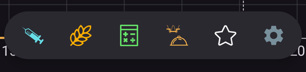
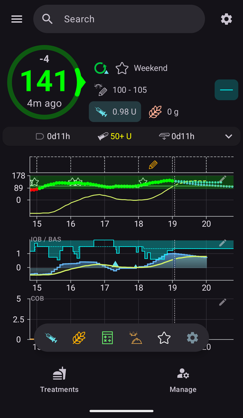
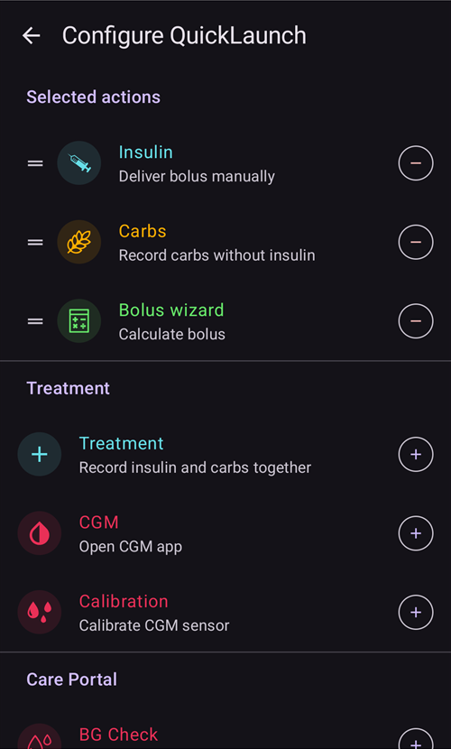
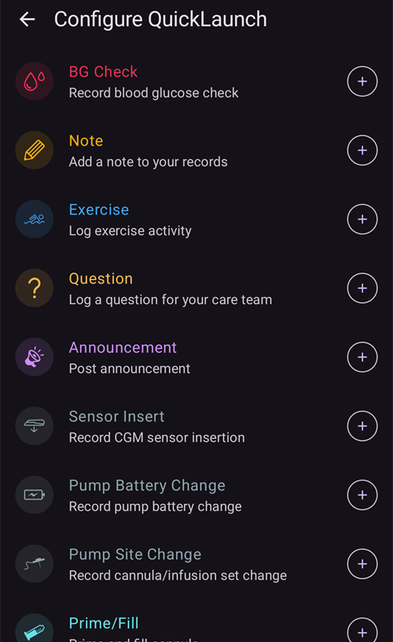
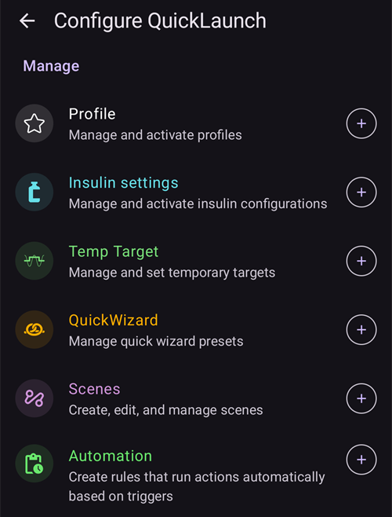
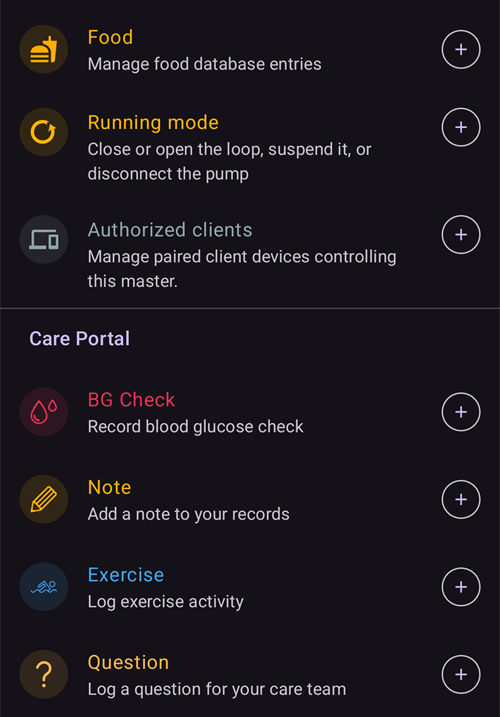
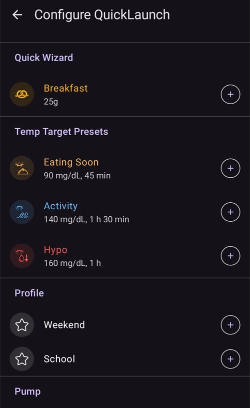
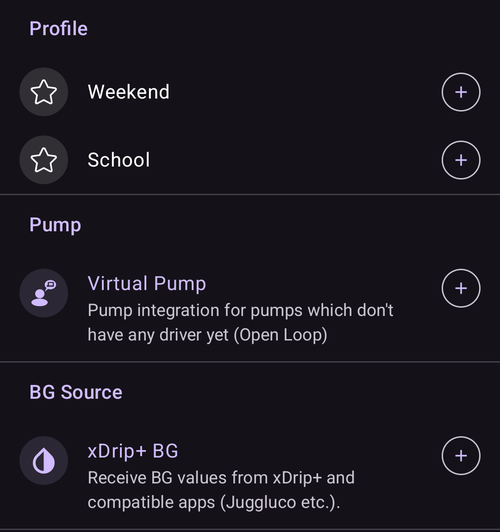
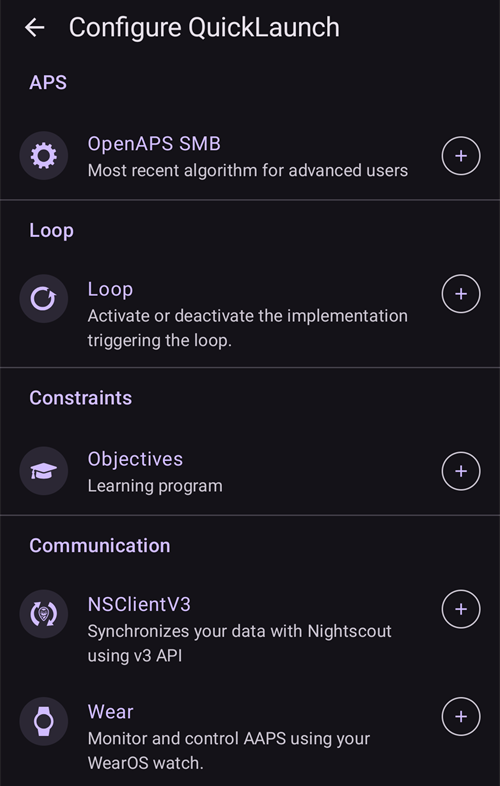

(quicklaunch)=
# Быстрый запуск (панель быстрых действий на главном экране)

**Быстрый запуск** — это небольшая **панель быстрых действий** внизу главного экрана **AAPS**, прямо над нижней навигацией. Это настраиваемый ряд кнопок, которые срабатывают одним нажатием: вы сами решаете, какие действия на ней будут и в каком порядке, чтобы то, что вы делаете чаще всего, всегда было в одном нажатии на главном экране.

```{contents} Table of contents
:depth: 2
:local: true
```



---

## Как пользоваться панелью

Панель находится на **главном экране**, между графиками и нижней навигацией:



- **Нажмите** на значок, чтобы выполнить его действие — точно так же, как если бы вы открыли его с обычного экрана (болюс или терапия, как обычно, сначала показывает подтверждение).
- **Нажмите и удерживайте** значок, чтобы увидеть **подсказку** с названием действия и коротким описанием.
- Если вы добавите **больше кнопок, чем помещается** на экране, лишние перейдут в **дополнительное меню** (кнопка **⋮** в конце панели).
- Каждый значок сохраняет **цвет** своего действия (например, инсулин, углеводы, временная цель), поэтому его легко узнать с первого взгляда.

```{admonition} The toolbar is always there
:class: note
Последняя кнопка — всегда **Настроить быстрый запуск** (шестеренка **⚙️**). Ее нельзя удалить, поэтому вы всегда можете открыть экран настройки прямо с панели. По умолчанию на панели только две кнопки — **Мастер болюса** и эта шестеренка.
```

---

## Настройка быстрого запуска

Нажмите на шестеренку **⚙️** на панели (или откройте **[Конфигурация](../SettingUpAaps/ConfigBuilder.md) → … → Настроить быстрый запуск**), чтобы открыть экран **Настроить быстрый запуск** (*«Настройка кнопок быстрых действий на главном экране»*).



Экран состоит из двух частей:

- **Выбранные действия** (вверху) — кнопки, которые сейчас есть на вашей панели, в порядке панели.
- **Каталог** под ними — все действия, которые можно добавить, сгруппированные по категориям. У каждой записи каталога есть кнопка **➕**, чтобы ее добавить.

### Выбранные действия — изменить порядок, редактировать, удалить

У каждого выбранного действия есть:

- **⠿ маркер перетаскивания** — нажмите и перетащите, чтобы **изменить порядок** кнопок (порядок здесь — это порядок на панели),
- кнопка **−** — **удалить** его с панели,
- и только у ярлыка **Профиль** — кнопка **✏️**, чтобы изменить его процент/длительность (см. [Ярлыки профилей](#profile-shortcuts)).

Изменения действуют **сразу** — отдельной кнопки *Сохранить* нет. Добавленное действие встает в конец панели; оттуда вы можете переместить его.

---

## Категории действий

Каталог группирует все, что можно добавить, в следующие категории, в этом порядке. Категории, в которых нечего предложить (например, у вас нет сценариев), просто не показаны.

### Treatment

Обычные окна терапии и CGM:

- **Инсулин** — подать болюс вручную.
- **Углеводы** — записать углеводы без инсулина.
- **Мастер болюса** — открыть калькулятор болюса.
- **Терапия** — записать инсулин и углеводы вместе.
- **CGM** — открыть приложение CGM (например, xDrip).
- **Калибровка** — откалибровать сенсор CGM.

### Care Portal

События портала терапии и записи об обслуживании устройств:

- **Проверка ГК**, **Примечание**, **Нагрузка**, **Вопрос**, **Оповещение**,
- **Установка сенсора**, **Замена батареи помпы**, **Смена места катетера помпы**, **Прайм/заполнение**, **Места установки**.

**Прайм/заполнение** и **Замена батареи помпы** предлагаются, только если ваша помпа их использует. Например, патч-помпы заполняются и меняют батарею во время своих шагов активации, поэтому для них эти записи не показаны (как и в панели **Управление**).



Это те же записи, которые иначе открываются через панели **[Терапия](#v4changes-treatments)** и **[Управление](#v4changes-manage)** — быстрый запуск просто выносит на главный экран те из них, которыми вы пользуетесь.

### Управление

Экраны панели **[Управление](#v4changes-manage)**, в том же порядке, чтобы с панели можно было открыть тот, которым вы пользуетесь чаще всего:

- **Профиль**, **Настройки инсулина** (управление настройками инсулина и их активация — название специально отличается от **Инсулин**, потому что та кнопка подает болюс), **Временная цель**, **Мастер быстрых настроек**, **Сценарии**, **Автоматизация**, **Еда**,
- **Режим работы** — замкнуть или разомкнуть цикл, приостановить его или отключить помпу,
- **Авторизованные клиенты** — только на основном телефоне или на сопряженном клиенте.

Эти кнопки открывают экран; сами по себе они ничего не запускают. Чтобы запускать сценарий или Мастер быстрых настроек одним нажатием, добавьте его из категории **Сценарии** или **Мастер быстрых настроек** ниже.

 

### Мастер быстрых настроек

Каждую предустановку **[Мастера быстрых настроек](QuickWizards.md)** можно добавить как кнопку, чтобы регулярный прием пищи был в одном нажатии от главного экрана. На кнопке стоит название предустановки и количество углеводов/инсулина; нажатие запускает Мастер быстрых настроек с обычным подтверждением.

Записи Мастера быстрых настроек, которые показываются только на часах, не предлагаются. Кнопка Мастера быстрых настроек на панели следует тем же правилам, что и в панели **Терапия**: она скрыта вне своего [допустимого интервала времени](#quickwizard_validity) и на короткое время после использования. Она остается в настройке вашей панели и появляется снова, когда Мастер быстрых настроек снова можно использовать.

### Сценарии

Каждый включенный **[сценарий](Scenes.md)** можно добавить как кнопку. При нажатии AAPS просит подтверждение, затем активирует сценарий (тот же набор действий, что и с экрана «Сценарии»). Эта категория появляется, только если у вас есть хотя бы один сценарий.

Подсказка и каталог показывают ту же сводку, что и **Управление → Сценарии**, например *«3 действия, 2 ч → Cooldown»*, где название после стрелки — следующий сценарий.

### Автоматизация

Ваши правила автоматизации типа **действие пользователя** (те, которые вы запускаете вручную) можно добавить как кнопки. При нажатии AAPS просит подтверждение, затем выполняет действия этого правила.

```{admonition} Automation buttons run on the master
:class: note
Автоматизация выполняется на **основном телефоне**, поэтому ярлыки автоматизации предлагаются и работают только на основном телефоне. Они недоступны на сопряженном **[клиенте](../RemoteFeatures/ClientMasterControl.md)**.
```

### Temp Target Presets

Каждую предустановку **[временной цели](TempTargets.md)** можно добавить как кнопку (показаны ее название, цель и длительность, например *«Ожидаемый прием пищи — 5,0 ммоль/л, 45 мин»*). При нажатии AAPS просит подтверждение, затем запускает эту временную цель.



(profile-shortcuts)=
### Профиль

Каждый **[профиль](ProfileSwitch-ProfilePercentage.md)** можно добавить как **ярлык**, который выполняет **переключение профиля** одним нажатием. В отличие от большинства ярлыков, у ярлыка профиля есть свои **процент** и **длительность**, которые вы задаете после добавления кнопкой **✏️**:

- **Процент** (30–250%, с шагом 5%) — масштабирует профиль при его применении. 100% — профиль применяется без изменений.
- **Длительность** (0–10080 мин, то есть до 7 дней, с шагом 10 мин) — сколько длится переключение. **0 = Постоянно** (пока вы снова не переключите профиль).



Так можно держать несколько кнопок для **одного и того же** профиля с разной силой — например *«Профиль 100%»* и *«Профиль 70% на 2 ч»* — и применять любую одним нажатием. (Один и тот же профиль можно добавить несколько раз с разными настройками.)

### Модули



Наконец, любой **включенный модуль** со своим экраном можно добавить как ярлык, чтобы открывать этот экран напрямую. Они сгруппированы по типу модуля — **Помпа**, **Источник ГК**, **APS**, **Замкнутый цикл**, **Модули чувствительности**, **Сглаживание**, **Калибровка**, **Ограничения**, **Связь** и **Общее** — так вы можете, например, сразу перейти с главного экрана к экрану помпы или цикла.

---

## Быстрый запуск и основной телефон/клиент

В отличие от большинства ваших настроек, **панель быстрого запуска настраивается на каждом устройстве отдельно** — она хранится **локально и не синхронизируется** между основным телефоном и сопряженными клиентами, поэтому у каждого устройства свой набор кнопок. (Она *входит* в **резервную копию/экспорт** настроек, поэтому при восстановлении она вернется на том же устройстве.)

Что устройство может поставить на свою панель, все равно зависит от того, что на нем есть: Мастер быстрых настроек, сценарии, предустановки временных целей и профили синхронизируются, поэтому каталог клиента предлагает те же элементы — вы просто выбираете их на каждом устройстве. Несколько деталей:

- Кнопки, цель которых больше не существует (удаленная запись Мастера быстрых настроек, сценарий или предустановка, выключенное правило), **пропускаются автоматически**.
- Ярлыки **Автоматизации** предлагаются и работают только на **основном телефоне** (автоматизация выполняется на основном телефоне). Кнопки сценариев, Мастера быстрых настроек, временных целей и профилей доступны на клиенте.
- Когда вы нажимаете на клиенте кнопку, которая должна выполняться на основном телефоне (болюс, временная цель, переключение профиля или сценарий), ее выполняет **основной телефон**, и он же создает подтверждение. См. [Управление «основной телефон ↔ клиент» (подписанное удаленное управление)](../RemoteFeatures/ClientMasterControl.md).

---


<!-- =====================================================================
     Screenshots captured from a real master device:
       - quicklaunch_toolbar.png    (cropped close-up of the overview toolbar pill)
       - quicklaunch_overview.png   (full overview showing the toolbar in place)
       - quicklaunch_config.png     (Configure QuickLaunch: Selected actions + Treatment + start of Manage)
       - quicklaunch_dynamic.png    (catalog: Quick Wizard / Scenes / Automation / Temp Target Presets)
       - quicklaunch_categories.png (catalog: Profile shortcuts + plugin categories)
     No QuickLaunch action was actually run (nothing delivered; only scrolled).
     Maintainers: relocate page + images and fix cross-links as needed.
     ===================================================================== -->
