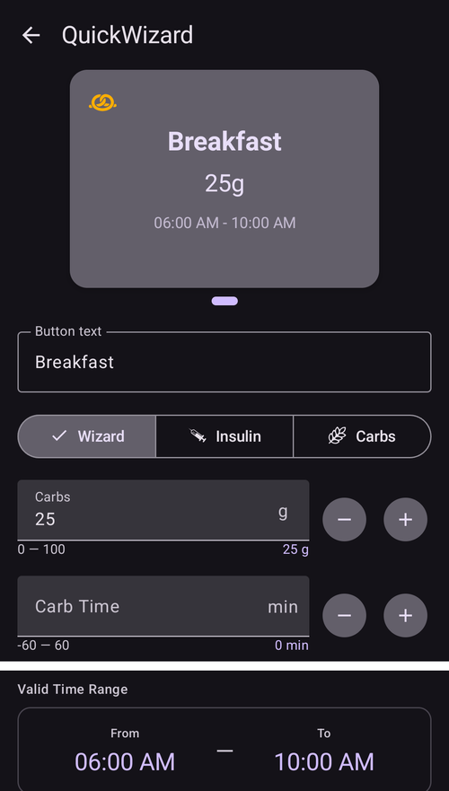
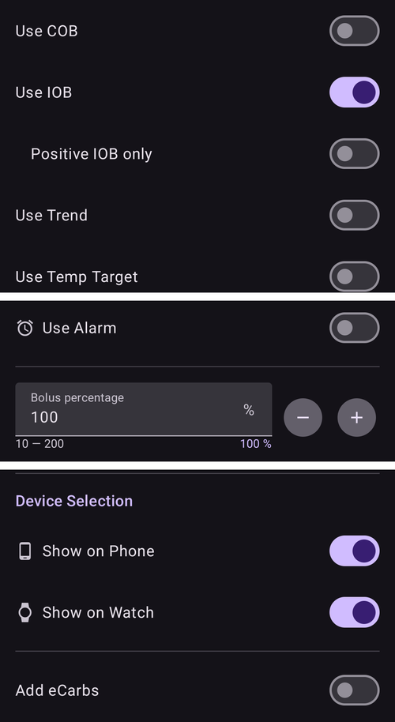
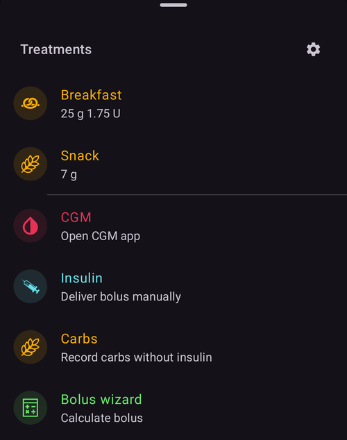
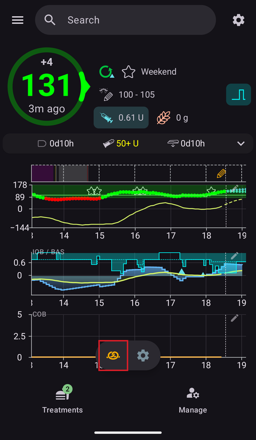
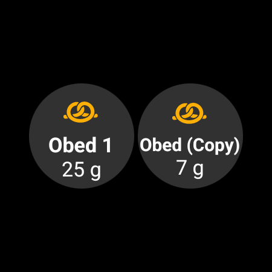

(quickwizards)=
# Мастер быстрых настроек (болюс одним нажатием)

**Мастер быстрых настроек** — это сохраненная кнопка для частого приема пищи или ситуации, которая срабатывает одним нажатием. В ней задано фиксированное количество **углеводов** (и способ расчета дозы на них). Поэтому вы можете ввести болюс — или только записать углеводы — одним нажатием и подтверждением, не открывая каждый раз полный калькулятор болюса.

```{contents} Table of contents
:depth: 2
:local: true
```

---

## Как открыть мастер быстрых настроек

Откройте экран **Управление** (нижняя панель навигации) и выберите **Мастер быстрых настроек** (*«Управление предустановками мастера быстрых настроек»*).

---

## Управление кнопками мастера быстрых настроек

Ваши кнопки мастера быстрых настроек показаны в виде **карусели карточек, которые можно листать** (на каждой карточке видны текст кнопки, углеводы и действующий временной диапазон). Редактор ниже настраивает **выбранную** кнопку; на нижней панели действий есть кнопки **➕ добавить**, **⧉ клонировать**, **🗑️ удалить** и кнопка **▶**, которая запускает выбранную кнопку мастера быстрых настроек.



Основные поля редактора:

- **Текст на кнопке** — надпись, которая видна на кнопке.
- **Углеводы** и **Время приема углеводов** — количество углеводов и их сдвиг по времени.
- **Действующий временной диапазон** — см. [Срок действия](#quickwizard_validity).
- **Настройки калькулятора** и **Выбор устройства** — см. ниже.

---

## Три режима

Переключатель вверху редактора — **Помощник / Инсулин / Углеводы** — определяет, **что делает кнопка** при нажатии:

- **Помощник** — запускает полный **калькулятор болюса** для заданных углеводов с учетом ваших текущих **ГК, IOB, COB и тренда** (согласно *настройкам калькулятора* ниже). Он вводит *рассчитанный* болюс и записывает углеводы. Это классический мастер быстрых настроек.
- **Инсулин** — вводит **фиксированное, заранее заданное количество инсулина**, которое вы установили, — без расчета.
- **Углеводы** — записывает **только заданные углеводы**,**без болюса**.

---

## Настройки калькулятора (режим «Помощник»)

Для кнопки в режиме **Помощник** вы выбираете, какие данные использует расчет:

- **Использовать ГК**, **Использовать COB**, **Использовать IOB** (с вариантом *Только положительный активный инсулин IOB*), **Использовать тренд** (*Все / Только положительный / Только отрицательный*), **Использовать временную цель**, **Использовать будильник**.
- **Процент болюса** — изменяет рассчитанный болюс в процентах.
- **Добавить eCarbs** — дополнительно планирует растянутые углеводы.



---

## Срок действия — когда кнопка видна

(quickwizard_validity)= **Действующий временной диапазон** (*С / До*) определяет, **когда** кнопка мастера быстрых настроек видна и доступна. Кнопка, настроенная, например, на **06:00–10:00**, видна только утром — поэтому кнопка *Завтрак* не загромождает экран (и ее нельзя случайно нажать) во время ужина. Вне своего временного окна кнопка скрыта из панели **Терапия** и из [панели быстрого запуска](QuickLaunch.md). Кнопка на панели не удаляется: она снова появляется, когда окно снова открывается.

Если действующий временной диапазон короче 4 часов, кнопка также скрывается на 30 минут после использования, чтобы один и тот же прием пищи не был введен дважды по ошибке.

---

## Где запускать кнопку

Переключатели в разделе **Выбор устройства** определяют, где появляется каждая кнопка мастера быстрых настроек:

- **Показать на телефоне** — кнопка появляется на **панели [Терапия](../Maintenance/V4Changes.md)** (рассчитанная доза видна прямо на кнопке). Кнопку мастера быстрых настроек, которая видна на телефоне, также можно **закрепить как кнопку быстрого действия на главном экране**: откройте *Настроить быстрый запуск* (значок ⚙ на панели [Быстрый запуск](QuickLaunch.md)) и добавьте ее из категории **Мастер быстрых настроек**.
- **Показать на часах** — кнопка появляется на **плитке мастера быстрых настроек Wear OS** (пролистайте до нее в карусели плиток часов и нажмите кнопку, чтобы запустить ее, — так же, как на [плитке сценариев](#scenes-from-watch)).

```{admonition} Don't see Device Selection?
:class: note
Раздел **Выбор устройства** появляется в редакторе, только если модуль **Смарт-часы Wear** включен и в его настройках включен параметр **Управление с Wear**. Без этого каждая кнопка мастера быстрых настроек просто показывается на телефоне.
```

На телефоне кнопки мастера быстрых настроек видны вверху нижней панели **Терапия**:



…и как кнопка быстрого действия на главном экране:





Сопряженный **клиент** (**AAPSClient**) также может запустить кнопку мастера быстрых настроек — **основной телефон** рассчитывает и вводит болюс (см. [Управление «основной телефон ↔ клиент»](../RemoteFeatures/ClientMasterControl.md)).

Откуда бы ни была запущена кнопка мастера быстрых настроек, при нажатии всегда сначала показывается **подтверждение** (при запуске с клиента или часов — подтверждение, составленное основным телефоном), и только потом что-то вводится.

Кнопка мастера быстрых настроек отклоняется, если ее доза больше вашего максимального болюса или если ее углеводы или eCarbs больше вашего максимума углеводов (например, после того как вы снизили ограничение). Если углеводы больше ограничения, кнопка на панели **Терапия** неактивна. Измените кнопку мастера быстрых настроек или ограничение.

---

## Добавление и удаление

- **➕ Добавить** — создать новую кнопку мастера быстрых настроек.
- **⧉ Клонировать** — сделать копию кнопки как отправную точку.
- **🗑️ Удалить** — удалить кнопку.

Если у вас две кнопки мастера быстрых настроек или больше, вы также можете изменить их порядок в карусели: нажмите значок **Изменить порядок** (⇅) на верхней панели, перемещайте центральную карточку **кнопками перемещения ◀ / ▶**, затем подтвердите нажатием **✓**. (Элементы управления выглядят так же, как при [изменении порядка профилей](ProfileSwitch-ProfilePercentage.md).)

Кнопки мастера быстрых настроек входят в синхронизируемую конфигурацию, поэтому они общие для основного телефона и сопряженных клиентов.

---


<!-- =====================================================================
     Screenshots captured from a real master device:
       - quickwizard_editor.png   (Manage → QuickWizard: carousel, mode, carbs, carb time, valid time range)
       - quickwizard_options.png  (Calculator Options, Bolus percentage, Device Selection)
       - quickwizard_overview.png (the QuickWizard quick-action button on the overview)
       - quickwizard_watch_tile.png (the Wear OS QuickWizard tile)
     No QuickWizard was actually run (no bolus delivered).
     Maintainers: relocate page + images and fix cross-links as needed.
     ===================================================================== -->
