(scenes)=
# Сценарии (предустановки для разных ситуаций)

**Сценарий** – это именованная предустановка, которая применяет **набор действий сразу**. Например, предустановка *Сон*, *Нагрузка* или *День болезни*, которая одним нажатием переключает ваш профиль, устанавливает временную цель, включает или отключает SMB и добавляет запись в портал терапии, при желании на заданное время.

```{contents} Table of contents
:depth: 2
:local: true
```

---

## Что такое сценарий

Вместо того чтобы каждый раз менять вручную несколько вещей, когда повторяется знакомая ситуация, вы один раз настраиваете их как сценарий и активируете его одним нажатием. Сценарий может объединять любые из этих действий:

- **Смена профиля** – переключить профиль и/или изменить его в процентах (например, 70%).
- **Временная цель** – установить временную цель (например, *Нагрузка*, *Ожидаемый прием пищи* или собственное значение).
- **SMB вкл/выкл** – включить или отключить супер микроболюсы, пока сценарий активен.
- **Режим работы** – изменить режим работы цикла (например, на более осторожный режим).
- **Запись в портале терапии** – записать событие (например, *Нагрузка*, *Болезнь*), чтобы оно было видно на графике и в Nightscout.

У сценария также есть **продолжительность** – фиксированное время (минуты/часы/дни) или *Бессрочно (завершение вручную)* – и **действие при завершении**, которое выполняется, когда он заканчивается: либо **уведомление**, либо **переход** к другому сценарию (например, *День болезни → Нагрузка*).

---

## Управление сценариями

Откройте **Управление → Сценарии**, чтобы просматривать, создавать, редактировать, включать/отключать сценарии и менять их порядок.

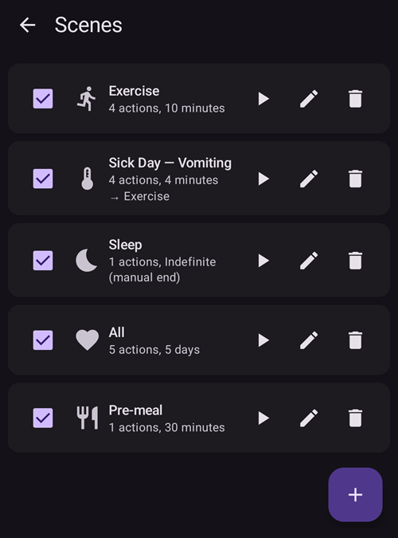

На каждой карточке сценария есть:

- **флажок**, чтобы включить/отключить сценарий,
- **значок** и **название**,
- краткое описание – *«Действий: N, продолжительность»* и **→ следующий сценарий**, если после этого сценария запускается другой,
- и три кнопки: **▶ активировать**, **✏️ редактировать**, **🗑️ удалить**.

Нажмите кнопку **+**, чтобы создать новый сценарий.

---

## Создание и редактирование сценария

### Начните с шаблона

Чтобы **создать** сценарий, нажмите кнопку **+** на экране «Сценарии». Первый шаг – **Начать с шаблона**: выберите готовый сценарий для частой ситуации – *Нагрузка*, *День болезни*, *День болезни — рвота*, *Сон*, *Ночь после нагрузки*, *Перед едой*, *Алкоголь*, *Вождение*, *Купание*, *Лютеиновая фаза*, *Жаркая погода*, *Медицинская процедура* – или начните с *Пустого* сценария. Каждый шаблон **заранее заполняет рекомендуемые действия**, и на следующих шагах вы можете изменить все.

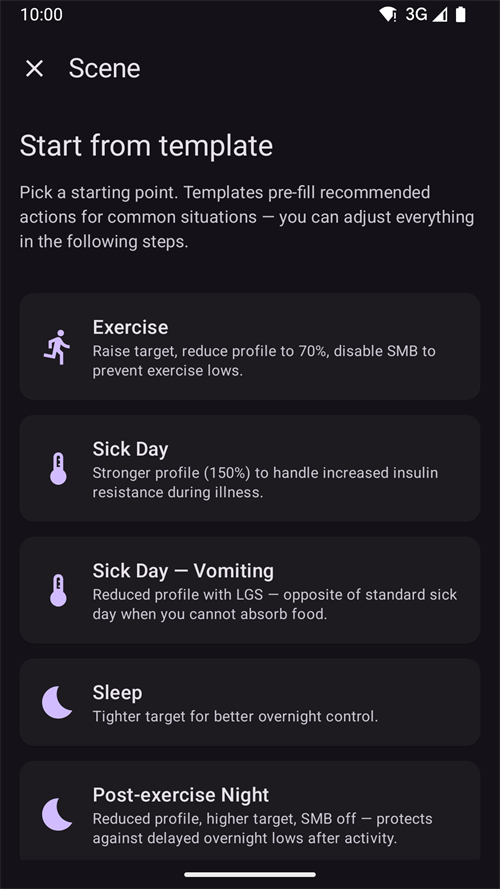

Когда вы выбрали шаблон, перед продолжением объясняется его назначение – *когда* и *зачем* его использовать:

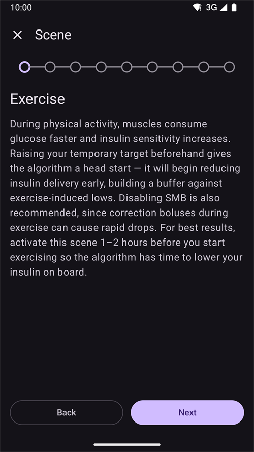

### Пройдите по действиям

Остальная часть редактора – это короткий **пошаговый** мастер. Каждый шаг – это один тип действия с переключателем *«Добавить в сценарий: …»*. Включайте его только для тех действий, которые должен выполнять этот сценарий, а остальные оставьте выключенными.

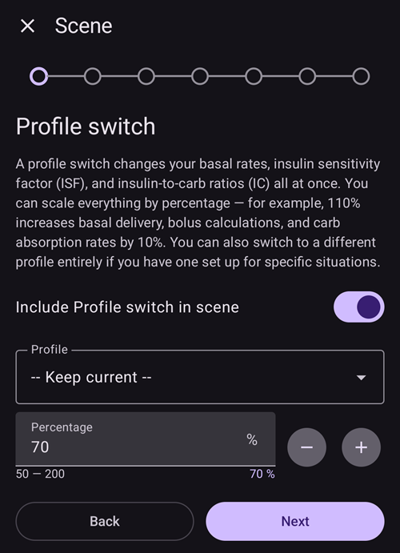

Проходите шаги кнопками **Далее**/**Назад**: *Смена профиля*, *Временная цель*, *SMB*, *Режим работы*, *Запись в портале терапии*, затем **продолжительность**, **действие при завершении** (уведомить или перейти к другому сценарию) и, наконец, **название и значок** сценария. Когда закончите, сохраните. (Чтобы **редактировать** существующий сценарий, нажмите его кнопку **✏️** – вы сразу попадете в эти шаги.)

Каждый шаг начинается с короткого объяснения, что делает это действие. Шаги выглядят так, здесь на примере шаблона *Нагрузка*:

**Временная цель** – выберите одну из ваших предустановок временной цели:

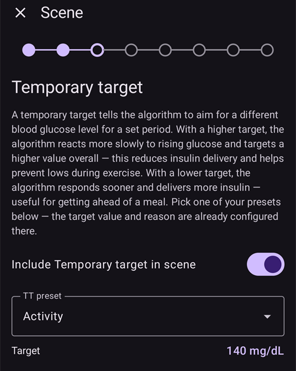

**SMB** – включить или отключить SMB, пока сценарий активен:

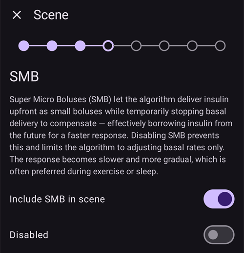

**Режим работы** – при желании изменить режим работы цикла:

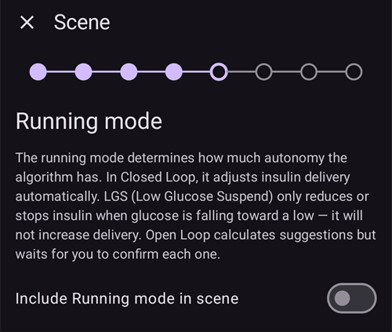

**Портал терапии** – тип события и примечание для записи:

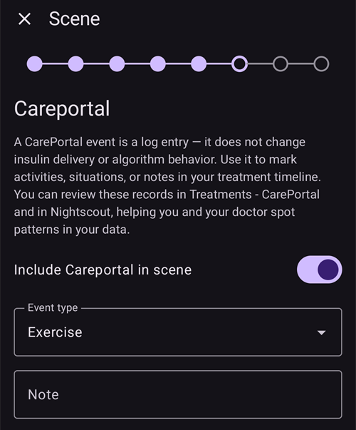

**Продолжительность** – как долго сценарий остается активным; 0 означает, пока вы сами его не завершите:

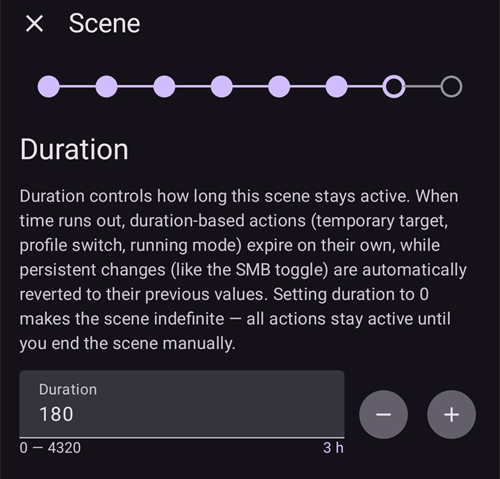

**Следующий сценарий** – при желании сценарий, который начнется, когда закончится этот:

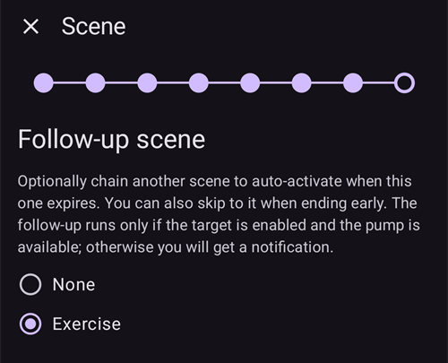

**Сценарий** – название и значок. Нажмите **Готово**, чтобы сохранить:

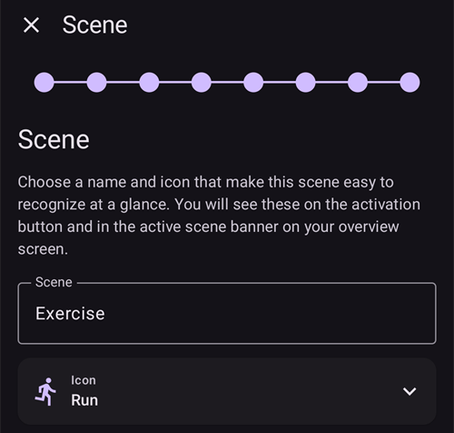

---

## Активация сценария

Активируйте сценарий из списка **Сценарии** (кнопка **▶**) или из пункта **Сценарии** на нижней панели навигации. На панели **Сценарии** нижней навигации у каждого сценария то же краткое описание, что и в списке сценариев, а **карандаш** вверху панели открывает **Управление → Сценарии**, где можно создать или редактировать сценарии.

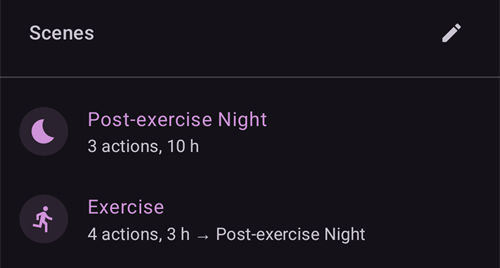

Если включена [защита болюсов](#Preferences-protection), **AAPS** запрашивает ее перед тем, как сценарий начнется или закончится. Для изменения сценария вместо этого нужна [защита настроек](#Preferences-settings-protection).

Перед тем как что-либо применить, вы получите **подтверждение** с точным списком того, что сделает сценарий, чтобы вы могли это проверить:

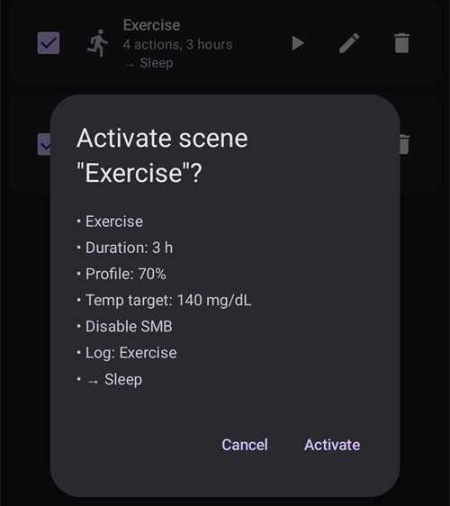

Если после этого сценария запускается другой, подтверждение заканчивается знаком **→** и названием следующего сценария, так же, как это показано в списке сценариев.

Если вы запускаете сценарий из пункта **Сценарии** на нижней панели навигации, подтверждение – это более простой диалог с тем же списком действий. Нажмите **OK**, чтобы активировать:

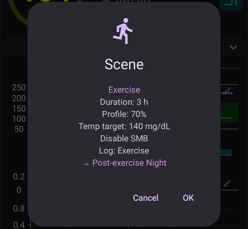

После подтверждения действия применяются, а **активный сценарий** показывается вверху главного экрана с кнопкой **Завершить сценарий**. Если после сценария запускается другой, в баннере также указано название следующего сценария:

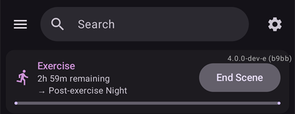

Действия сценария остаются в силе, пока:

- не закончится его **продолжительность** (выполняется **действие при завершении** – уведомление или переход к следующему сценарию), или
- вы не нажмете **Завершить сценарий**, чтобы завершить его вручную. Если после сценария запускается другой, у вас есть два варианта: **Перейти к** следующему сценарию (активный сценарий заканчивается, а следующий начинается сейчас) или **Завершить сценарий** (активный сценарий заканчивается, а следующий не начинается).

Для сценария без следующего нужно только подтверждение:

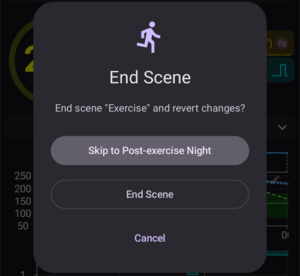

Завершение сценария **отменяет** изменения, которые он сделал (например, смену профиля и временную цель, которые он запустил).

Пока сценарий активен, профиль и цель на главном экране отмечены маленьким значком сценария, если их установил сценарий. Панель **Сценарии** нижней навигации остается доступной, чтобы запустить другой сценарий:

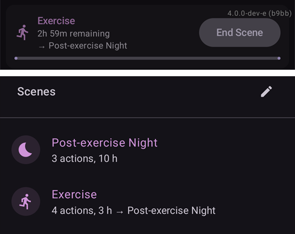

Когда продолжительность заканчивается сама, изменения сразу отменяются, а баннер меняется на **Сценарий завершен** с кнопкой **Закрыть**. Закрытие только убирает баннер с экрана: сам сценарий уже закончился, поэтому правила автоматизации и следующий сценарий продолжают работу, не дожидаясь этого.

---

## Запуск сценариев из автоматизации

Сценарий не обязательно запускать вручную – **Автоматизация** может запустить его за вас. Когда вы добавляете действие в правило автоматизации (**Управление → Автоматизация**), в выборе действий есть категория **Сценарии**:

- **Запустить сценарий** – активировать сценарий, когда срабатывают триггеры правила (например, в заданное время, когда вы куда-то приходите или когда глюкоза пересекает порог).
- **Включить сценарий** / **Отключить сценарий** – сделать сценарий доступным (или недоступным) без его активации.

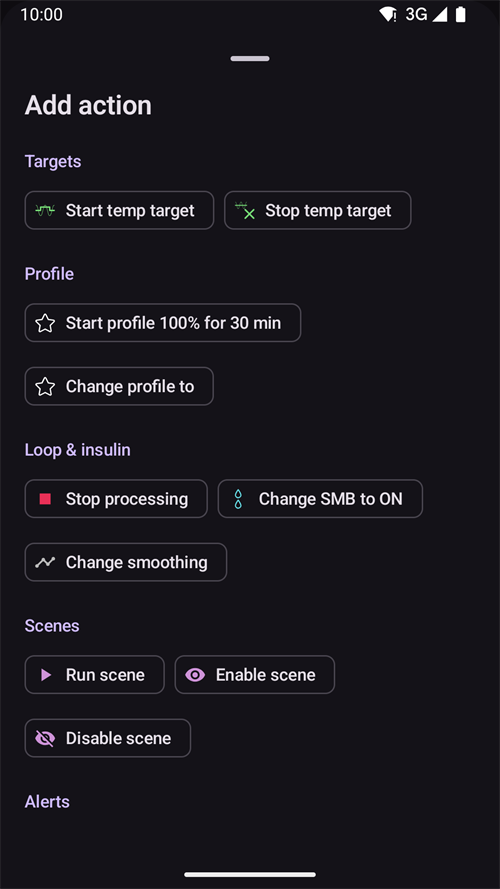

Автоматизация также может **реагировать на** сценарий: в списке триггеров есть триггер **Сценарий**, поэтому правило может работать только пока активен определенный сценарий. Вместе с **действием при завершении** сценария (отмена изменений, уведомление или переход к другому сценарию) это позволяет сценариям запускаться, сменять друг друга и завершаться автоматически.

---

## Сценарии с основным телефоном/клиентом и смарт-часами

**Текущий активный сценарий синхронизируется** на всех ваших сопряженных устройствах: активируйте его на одном телефоне, и другие тоже его покажут.

Сопряженный **клиент** (**AAPSClient**) также может активировать или завершить сценарий: запрос отправляется на **основной телефон**, который формирует подтверждение и применяет сценарий к своему состоянию. Как это работает, смотрите в разделе [Управление «основной телефон ↔ клиент» (подписанное удаленное управление)](../RemoteFeatures/ClientMasterControl.md).

(scenes-from-watch)=
### Со смарт-часов Wear OS

Сценарии доступны на **смарт-часах Wear OS** в виде **плитки «Сценарий»**. Пролистайте до плитки **Сценарий** в карусели плиток часов (если ее там еще нет, сначала добавьте ее из списка плиток карусели) и нажмите сценарий, который хотите запустить:

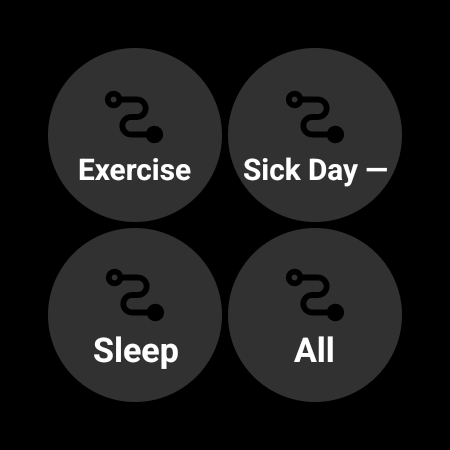

У плитки четыре ячейки. По умолчанию каждая ячейка заполняется **автоматически** следующим из ваших включенных сценариев, в том порядке, в каком они стоят на телефоне. Чтобы выбрать самостоятельно, **нажмите на плитку и удерживайте** и откройте ее настройки: для каждой из четырех ячеек можно оставить **Автоматически**, закрепить **определенный сценарий** или выбрать **Отсутствует**, чтобы оставить ячейку пустой. Ячейка, закрепленная за сценарием, который потом был удален или отключен, показывает **Недоступно** – выберите для нее другой сценарий.

Затем часы показывают подтверждение: нажмите **✓**, чтобы активировать, или проведите назад, чтобы отменить:

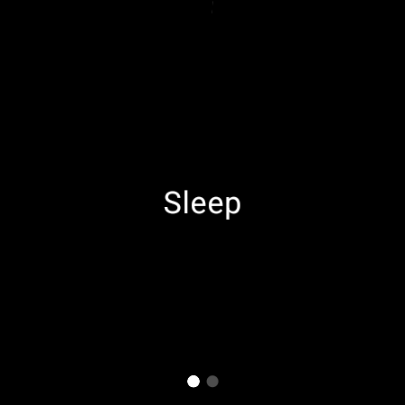

Так же, как и с клиентом, **подтверждение формирует и сценарий выполняет основной телефон**; часы только передают запрос (через телефон-клиент, если часы сопряжены с клиентом).

Пока сценарий работает – или на телефоне еще показан его баннер **Сценарий завершен** – плитка показывает кнопку **Завершить** с названием сценария под ней. Нажмите ее, чтобы завершить активный сценарий или убрать оставшийся баннер прямо с запястья.

Если после работающего сценария запускается другой, плитка также показывает кнопку **Пропустить** с названием следующего сценария под ней. Это те же два варианта, что и на телефоне:

- **Завершить** – активный сценарий заканчивается. Подтверждение сообщает, что следующий сценарий не начнется.
- **Пропустить** – активный сценарий заканчивается, а следующий сценарий начинается сейчас. В подтверждении указаны оба сценария.

[Экран «Статус цикла»](#WearOsSmartwatch-loop-status) на часах также показывает активный сценарий, оставшееся время и следующий сценарий.

---


<!-- =====================================================================
     Screenshots captured from a real master device:
       - scenes_list.png        (Manage → Scenes management list)
       - templates_picker.png   (create: "Start from template" picker)
       - template_explanation.png (create: chosen template's explanation)
       - scene_editor.png       (scene editor, Profile switch step)
       - scene_confirmation.png (scene activation confirmation — also used on the Client/Master page)
       - scene_active_banner.png (overview active-scene banner with the End Scene button)
       - automation_scene_action.png (Automation action picker — Scenes category)
       - scene_watch_tile.png    (Wear OS Scene tile)
       - scene_watch_confirm.png (Wear OS scene confirmation)
     Maintainers: relocate page + images and fix cross-links as needed.
     ===================================================================== -->
