# Временные цели

## Что такое временные цели, где их можно задать и сконфигурировать?

**Временная цель** (или сокращенно **ВЦ**) – это функция **AAPS**, которая позволяет изменять [**целевой диапазон ГК**](#profile-glucose-targets) для запланированных действий. Это достигается за счет того, что **AAPS** вносит корректировки в расходование инсулина пользователем.

Цель гликемии, особенно если она краткосрочна (менее 4 часов), не должна быть *конкретным значением*, которого вы добиваетесь. Скорее, это способ заставить алгоритм **AAPS** быть более или менее агрессивным, при этом сохраняя уровни ГК в целевом диапазоне.

Временные цели можно задать в таких границах:

|          | Временная цель           |
| -------- | ------------------------ |
| Минимум  | 4 ммоль/л или 72 мг/дл   |
| Максимум | 10 ммоль/л или 180 мг/дл |

**AAPS** имеет три встроенные предустановки **временной цели**: для физической нагрузки (**Нагрузка**), для еды (**Ожидаемый прием пищи**) и для прогнозируемой гипогликемии (**Гипо**). Они находятся на экране **Временная цель** (**Управление** → **Временная цель**), который также можно открыть простым нажатием на **плашку цели** на главном экране.

Пользователи должны иметь реалистичные ожидания при выборе **Временной цели** в **AAPS**. Успех достижения желаемого целевого показателя **ГК** будет зависеть от множества факторов: точности настроек **AAPS**, общего контроля уровня **ГК**, **количества активного инсулина IOB**, параметра чувствительности к инсулину, резистентности к инсулину, интенсивности нагрузок и т. д.

Для достижения желаемого значения **ГК** может потребоваться около 30 минут или больше с момента активации **Временной Цели**. **AAPS** не в состоянии достичь целевой **ГК** немедленно, и пользователи должны помнить об этом при выборе **Временной цели**.

В разделах ниже кратко описаны функции **Временной цели Нагрузка**, **Временной цели Ожидаемый прием пищи** и **Временной цели Гипо**. Показанные значения – это заводские значения по умолчанию: вы можете [настроить каждую предустановку](#TempTargets-change-preset-defaults) под свои потребности.

### ВЦ - Нагрузка

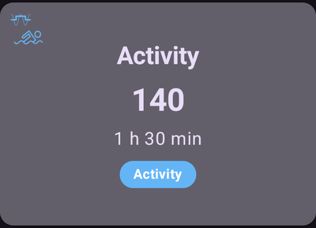

**Целевая ГК (предустановка по умолчанию, можно изменить)**

AAPS будет стремиться к 140 мг/дл или 7,8 ммоль/л в течение 1 ч 30 мин

**Другие соображения, которые пользователи могут учесть при выборе**:

В зависимости от уровня **ГК**, **AAPS** «уменьшит» расход инсулина для достижения целевой **ГК**. Если целевая **ГК** не находится в нужном диапазоне (напр. выше выбранного целевого значения **ГК** в **профиле** пользователя), тогда **AAPS** может не отключать базал.

В замкнутом цикле микроболюсы **SMB**:

- *могут* быть отключены (обсуждается в дальнейшем); и/или
- basal may be activated if **AAPS** is in negative **IOB** or < 0.

Пользователи, возможно, также захотят:

- *выбрать* эту **ВЦ** за 1-2 часа до планируемой нагрузки, чтобы обеспечить уменьшение активного инсулина IOB (правильное время для этой ВЦ индивидуально); и
- *выбрать* временный Профиль (пониженный) на время запланированного мероприятия для обеспечения понижения активного инсулина **IOB**;
- *убедиться*, что **ВЦ** будет *отключена* незадолго до нагрузки, потому что **IOB** уже уменьшен, а у некоторых пользователей после нагрузки **ГК** быстро растет.

### ВЦ - Ожидаемый прием пищи

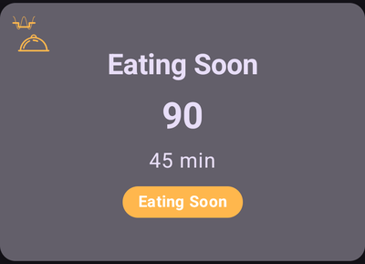

**Целевая ГК (предустановка по умолчанию, можно изменить)**

AAPS будет стремиться к 90 мг/дл или 5,0 ммоль/л в течение 45 минут

**Другие соображения, которые пользователи могут учесть при выборе**:

В замкнутом цикле микроболюсы **SMB**:

- останется активированным; и/или
- базал также может быть активирован в зависимости от настроек **профиля** пользователя.

В зависимости от уровня **ГК**, **AAPS** «увеличит» подачу инсулина в пределах параметров настроек **AAPS** пользователя, чтобы достичь желаемой целевой **ГК**.

### ВЦ - Гипо

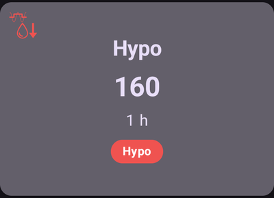

**Целевая ГК (предустановка по умолчанию, можно изменить)**

AAPS будет стремиться к 160 мг/дл или 8,9 ммоль/л в течение 1 часа

**Другие соображения, которые пользователи могут учесть при выборе**:

В замкнутом цикле микроболюсы **SMB**:

- *могут* быть отключены (обсуждается в дальнейшем); и/или
- basal may be activated if **AAPS** is in negative **IOB** or < 0.

(TempTargets-manage-v4)=

## Установка временных целей и управление ими (Управление → Временная цель)

В **AAPS** v4 вы управляете **предустановками** ВЦ и запускаете временную цель с экрана **Управление** (нижняя панель навигации) → **Временная цель** (*«Управление и установка временных целей»*).

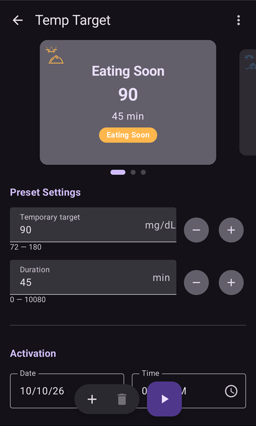

Экран состоит из трех частей:

1. **Карусель предустановок** (вверху) – листайте свои предустановки ВЦ. На каждой карточке показаны **название**, **цель** и **продолжительность** предустановки; текущая работающая ВЦ выделена.
2. **Редактор** (в середине) – **Временная цель** и **Продолжительность**, которые будут фактически применены, а также дата и время **Активации**.
3. **Action bar** (bottom) — **➕ add**, **delete** and the **▶ activate** button.

Выбор карточки предустановки загружает ее **цель** и **продолжительность** в редактор.

```{admonition} Встроенные и собственные предустановки :class: note Встроенные предустановки – **Ожидаемый прием пищи**, **Нагрузка** и **Гипо** – есть всегда, и их **нельзя удалить** (но можно изменить их значения и сохранить). Все предустановки, которые вы создаете сами, являются **собственными**, их можно свободно редактировать или удалять.

    <br />### Активация временной цели
    
    Пролистайте до нужной предустановки (ее значения загрузятся в редактор), при необходимости измените **цель**/**продолжительность** в редакторе, затем нажмите **▶ Активировать**. Перед запуском появится подтверждение с точной целью, продолжительностью и причиной:
    
    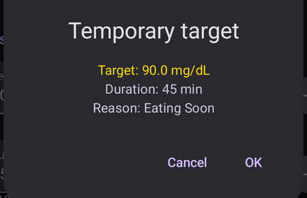
    
    После подтверждения временная цель начинается сразу (или в выбранное время **Активации**) и действует заданную **продолжительность**.
    
    ```{admonition} Изменение чисел действует один раз – предустановка не меняется
    :class: important
    **Цель** и **продолжительность** в редакторе – это значения, которые **Активировать** применит *прямо сейчас*. Если вы их измените, это изменение **временное**: оно действует только для этой активации и **не меняет сохраненную предустановку**. Так можно «подправить и активировать» разовую ВЦ (например, сегодня активировать *Нагрузку* с немного другой целью), не меняя предустановку навсегда.
    

### Сохранение изменений в предустановке

Если вы *хотите* сохранить измененное значение, нажмите **Сохранить**: когда значения в редакторе отличаются от выбранной предустановки, на верхней панели инструментов появляется значок **Сохранить**. Нажатие на него записывает текущие **цель** и **продолжительность** (и название, для собственных предустановок) в выбранную предустановку. Для встроенных предустановок на панели действий также появляется кнопка **Вернуть значения по умолчанию** (↺): она возвращает значения предустановки по умолчанию.

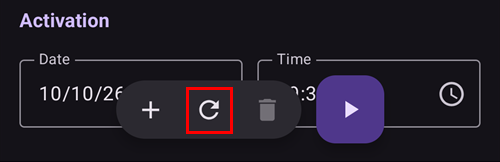

Итак, простое правило:

- **Активировать** → использовать числа **один раз** (предустановка не меняется).
- **Сохранить** → сделать числа **новыми значениями по умолчанию** предустановки.

Чтобы вернуть встроенную предустановку к заводскому виду, выберите ее и нажмите кнопку **↺ Вернуть** – она появляется на панели действий только для **встроенной** предустановки, значения которой сейчас отличаются от заводских, и восстанавливает исходные **цель** и **продолжительность** этой предустановки.

### Добавление и удаление предустановок

- **➕ Добавить** – создать **новую собственную предустановку** из текущих значений редактора. Новая карточка появится в карусели.
- **Delete** — remove the selected **custom** preset. Встроенные предустановки (*Ожидаемый прием пищи*, *Нагрузка*, *Гипо*) удалить нельзя.

Когда у вас есть хотя бы две **собственные** предустановки, можно также изменить их порядок в карусели: нажмите значок **Изменить порядок** (⇅) на верхней панели, перемещайте центральную карточку **кнопками ◀ / ▶**, затем подтвердите нажатием **✓**. Встроенные предустановки остаются на своих местах – перемещать можно только собственные предустановки. (Элементы управления выглядят так же, как при [изменении порядка профилей](ProfileSwitch-ProfilePercentage.md).)

Ваши предустановки входят в синхронизируемую конфигурацию, поэтому они общие для основного телефона и сопряженных клиентов.

### Другие способы установить временную цель

Временную цель можно установить и без открытия этого экрана:

- **переключателями ВЦ в диалоге «Углеводы»** – см. [ниже](#TempTargets-carbs-dialog),
- **кнопкой предустановки на [панели быстрого запуска](QuickLaunch.md)** – категория *Предустановки временных целей* в *Настроить быстрый запуск* дает кнопку для каждой вашей предустановки, которая срабатывает одним нажатием,
- со **смарт-часов Wear OS** (пункт меню / плитка **Временная цель**),
- с сопряженного **клиента** – см. [Управление «основной телефон ↔ клиент» (подписанное удаленное управление)](../RemoteFeatures/ClientMasterControl.md),
- как часть **[сценария](Scenes.md)** (действие *Временная цель*), или
- правилом **Автоматизации** (*Начать врем цель* / *Остановить врем цель*).

* * *

(TempTargets-where-can-i-select-a-temp-target)=

## Как выбрать временную цель?

Самый быстрый способ – нажать на **плашку цели** на главном экране (она показывает ваш текущий целевой диапазон):

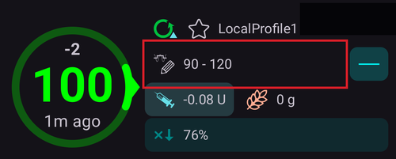

Откроется экран **Временная цель**, описанный выше: пролистайте до предустановки и нажмите **▶ Активировать**. Этот же экран доступен через **Управление** → **Временная цель**.

(TempTargets-carbs-dialog)= При вводе углеводов не нужно открывать экран **Временная цель**: в **диалоге «Углеводы»** (**Терапия** → **Углеводы**) вверху есть переключатели **Включить ВЦ Гипо**, **Включить ВЦ Ожидаемый прием пищи** и **Включить ВЦ Нагрузка**. Включите один из них, и соответствующая предустановка будет активирована вместе с вводом углеводов:

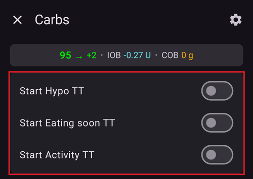

    {admonition} Автоматическая ВЦ Гипо
    :class: note
    Если вы открываете **диалог «Углеводы»**, когда ваша глюкоза ниже 72 мг/дл (4 ммоль/л), **AAPS** сам заранее включает переключатель **Включить ВЦ Гипо** (если только уже не работает более высокая временная цель с более долгим оставшимся временем).

(TempTargets-change-preset-defaults)=

## Как изменить временную цель по умолчанию и переопределить её своими собственными значениями?

**Цель** и **продолжительность** каждой предустановки редактируются прямо на экране **Временная цель** – отдельного пункта в настройках для этого больше нет:

1. Откройте экран **Временная цель** (нажмите на плашку цели или **Управление** → **Временная цель**).
2. Пролистайте до предустановки, которую хотите изменить.
3. Измените **Временная цель** и/или **Продолжительность** в редакторе.
4. Нажмите значок **Сохранить**, который появится на верхней панели инструментов.

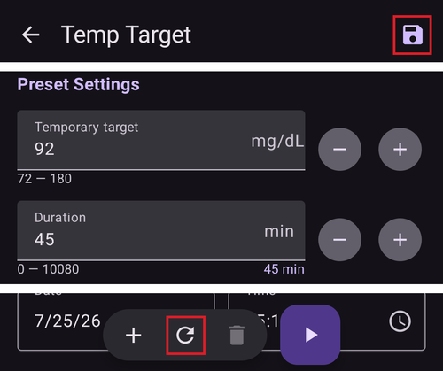

Пока значения в редакторе отличаются от заводских значений встроенной предустановки, на панели действий также появляется кнопка **↺ Вернуть** – нажмите ее, чтобы восстановить исходные цель и продолжительность предустановки.

## Как отменить временную цель?

Пока работает временная цель, плашка цели на главном экране показывает цель и оставшееся время. Нажмите на нее – на экране **Временная цель** работающая предустановка отмечена как **АКТИВНЫЙ**, а в конце нижней панели инструментов, слева от кнопки **▶ Активировать**, появляется красная кнопка **✗ Отмена**. Нажмите ее и подтвердите:

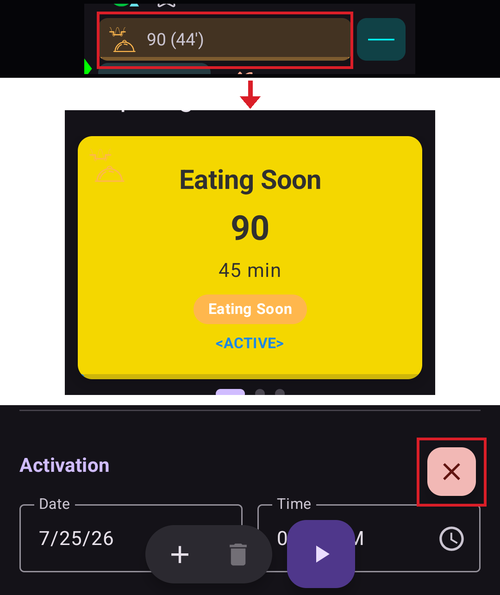

Работающую временную цель можно также остановить со **смарт-часов Wear OS**, с сопряженного **клиента** или правилом **Автоматизации** (*Остановить врем цель*).

(TempTargets-hypo-temp-target)=

## Временная цель Гипо 

**Временная цель Гипо** позволяет **AAPS** предотвратить низкий сахар крови у пользователя за счет уменьшения подачи инсулина. Если пользователь прогнозирует, что его **ГК** снизится: обычно система **AAPS** должна самостоятельно справиться с этим, но многое будет зависеть от правильности настроек пользователя **AAPS**. **Временная цель Гипо** позволяет пользователю опередить прогнозируемую гипогликемию и сообщить **AAPS**, что нужно уменьшить подачу инсулина.

Иногда, при потреблении углеводов на купирование гипогликемии, может быстро повыситься **ГК** пользователя, и **AAPS** скорректирует быстрорастущую **ГК**, включив **SMB**.

Некоторые пользователи не хотят, чтобы во время **Временной цели Гипо** подавались **SMB**. Для этого отключите *«Включить SMB при высокой временной цели»* в **Настройки** → **OpenAPS SMB** (см. ниже):

- Расширенная настройка, цель 9: пользователь может включить *«Высокая временная цель повышает чувствительность»* для **временных целей** 100 мг/дл (5,6 ммоль/л) или выше в OpenAPS SMB, тогда **AAPS** будет более чувствительным.

- Расширенная настройка, цель 9: пользователь может отключить *«Включить SMB при высокой временной цели»*, тогда даже если у **AAPS** COB > 0, включены «Включить SMB при низкой временной цели» или «Всегда включать супер микро болюс SMB» и активен OpenAPS SMB, **AAPS** не будет подавать SMB, пока активны высокие временные цели.

Примечание: если вы открываете **диалог «Углеводы»**, когда ваша глюкоза крови ниже 72 мг/дл или 4 ммоль/л, **AAPS** автоматически заранее включает переключатель **Включить ВЦ Гипо**.

(TempTargets-activity-temp-target) =

## Временная цель Нагрузка

До и во время физических нагрузок пользователю может потребоваться более высокая цель, чтобы предотвратить гипогликемию во время тренировки.

Чтобы упростить управление временной целью **Нагрузка**, пользователь может настроить цель по умолчанию **Временная Цель Нагрузка** для повышения уровня **ГК** за счет снижения использования инсулина, чтобы замедлить падение **ГК** и избежать гипогликемии.

Новым пользователям **AAPS** может понадобиться поэкспериментировать и подобрать под себя настройки по умолчанию для **Временной цели Нагрузка**, чтобы эта функция работала для них наилучшим образом. Все люди разные, когда речь идет о достижении стабильного контроля уровня глюкозы во время тренировки. См. также [Раздел Спорт](#FAQ-sports) в Часто задаваемых вопросах.

Некоторые пользователи также предпочитают активировать **Смену профиля** (уменьшение профиля < 100%, чтобы **AAPS** подавал меньше инсулина) до и во время **Временной цели Нагрузка**. Можно запустить и то и другое за один шаг: нажмите на название профиля на главном экране, нажмите круглую кнопку **▶**, задайте **В процентах** меньше 100% и **Продолжительность**, затем включите **Временная цель / Нагрузка**. См. [Изменение процента профиля](#ProfileSwitch-change-percentage).

Расширенная настройка, цель 9: пользователи могут включить *«Высокая временная цель повышает чувствительность»* для **временных целей** 100 мг/дл (5,6 ммоль/л) или выше в OpenAPS **SMB**. Цель 99 мг/дл (5,5 ммоль/л) – это обычная цель, ни высокая, ни низкая. В этом случае **AAPS** будет более чувствительным.

Кроме того, если *«Включить SMB при высокой временной цели»* отключено, **AAPS** не будет подавать **SMB**, даже при COB > 0, включенных *«Включить SMB при низкой временной цели»* или *«Всегда включать супер микро болюс SMB»* и активном OpenAPS **SMB**.

(TempTargets-eating-soon-temp-target)=

## Временная цель Ожидаемый прием пищи

**Временная цель Ожидаемый прием пищи** помогает плавно снизить **ГК** и обеспечить достаточно **IOB** перед едой.

Это может быть важным инструментом для пользователей, которые не делают предварительный болюс, однако эффективность **Временной цели Ожидаемый прием пищи** зависит от ряда факторов, в том числе: от настроек пользователя, от того, придерживается ли он низкоуглеводной диеты, и от того, использует ли он быстрый инсулин (например, Fiasp или Lyumjev), чтобы не делать предварительный болюс. Обычно, пока у пользователей нет опыта работы с **AAPS**, им следует делать предварительный болюс при использовании **Временной цели Ожидаемый прием пищи**, особенно если они едят много углеводов.

Подробнее о режиме «Ожидаемый прием пищи» можно прочитать в статье [Как пользоваться режимом «Ожидаемый прием пищи»](https://diyps.org/2015/03/26/how-to-do-eating-soon-mode-diyps-lessons-learned/) или [здесь](https://diyps.org/tag/eating-soon-mode/).

В настройках OpenAps SMB, дополнительно, [по достижении цели 9](#objectives-objective9) если включен режим *'Низкая ВЦ снижает чувствительность'*, **AAPS** работает немного более агрессивно. Для этой опции **временная цель** должна быть 98 мг/дл (5,4 ммоль/л) или ниже.

## Как отключить SMB во время активной временной цели?

Для этого откройте **Настройки** → **OpenAPS SMB** и отключите *«Включить SMB при высокой временной цели»*.

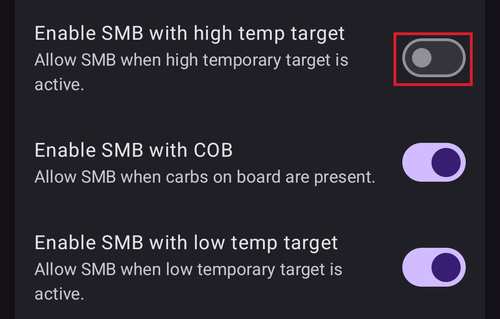

Так **AAPS** не будет подавать **SMB**, даже при COB > 0, включенных *«Включить SMB при низкой временной цели»* или *«Всегда включать супер микро болюс SMB»* и активном OpenAPS SMB.