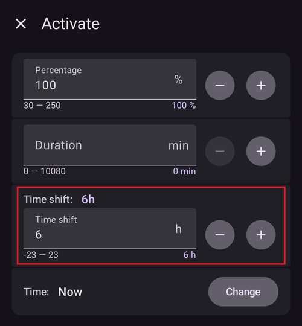

# Смена часового пояса и переход на летнее время

Когда часовой пояс телефона меняется, **AAPS** примерно через 10 секунд после изменения заново рассчитывает **IOB**, базал и чувствительность за прошлое время. Пока идет расчет, графики и значения на главном экране могут обновиться не сразу.

(timezone-traveling-with-pumps)=

## Смена часового пояса для Omnipod Dash

* Обновите состояние помпы в разделе **Управление → Помпа**
* Временно выберите другой **профиль**, а затем переключитесь обратно на исходный или нужный **профиль**

## Смена часового пояса для DanaR, корейской DanaR

Нет проблем с изменением часового пояса в телефоне, так как в помпе не отслеживается история

(timezone-traveling-danarv2-danars)=

## Смена часового пояса для DanaRv2, DanaRS, Dana-i

Эти помпы требуют особого внимания, потому что **AAPS** использует историю помпы, а записи в помпе не содержат часового пояса. **Это значит, что если вы смените часовой пояс в телефоне, записи будут прочитаны с другим часовым поясом и задвоятся.**

Во избежание этого существует две возможности:

### Вариант 1: продолжать пользоваться домашним временем и специально созданным профилем сдвига по времени

* В настройках телефона отключите 'Автоматический выбор даты и времени' (смена часового пояса вручную).

* Ваш телефон должен сохранять ваше обычное домашнее время в течение всей поездки.

* Сдвиньте по времени ваш **профиль** на разницу между домашним временем и временем в месте назначения.
   
   * Нажмите на название **профиля** на главном экране, чтобы открыть [экран профилей](#ProfileSwitch-manage-v4)
   * Выберите свой **профиль** и нажмите **▶ Активировать**
   * Установите '**Сдвиг по времени**' в соответствии с местом назначения и нажмите **Активировать**.
   
   
   
   * например, Вена -> Нью-Йорк: **Смена профиля** +6 часов
   * например, Вена -> Сидней: **Смена профиля** -8 часов

### Вариант 2: Удалить историю работы помпы

* В настройках телефона отключите 'Автоматический выбор даты и времени' (изменение часового пояса вручную)

Когда вы выйдете из самолета:

* выключите помпу
* измените часовой пояс на телефоне
* выключите телефон, включите помпу
* выполните очистку истории на помпе
* измените время на помпе
* включите телефон
* позвольте телефону подключиться к помпе и точно подстроить время

(timezone-traveling-insight)=

## Смена часового пояса для Insight

Драйвер автоматически подстраивает время помпы под время телефона.

Insight также записывает в историю, в какой момент было изменено время и с какого (старого) на какое (новое) время. Поэтому **AAPS** может определить правильное время, несмотря на изменение времени.

Это может вызвать неточности в **TDD**. Однако это не должно быть проблемой.

Поэтому пользователю Insight не нужно беспокоиться об изменениях часового пояса и изменении времени. Из этого правила есть одно исключение: у помпы Insight есть маленькая внутренняя батарея, которая питает часы и т. п. во время замены "настоящей" батареи. Если замена батареи длится слишком долго, эта внутренняя батарея разряжается, часы сбрасываются, и после установки новой батареи нужно ввести время и дату. В этом случае все записи до замены батареи пропускаются в расчётах в AAPS, так как правильное время должным образом не может быть определено.

## Смена часового пояса для Accu-Chek Combo

[Драйвер Combo](../CompatiblePumps/Accu-Chek-Combo-Pump-v2.md) автоматически подстраивает время помпы под время телефона. Combo не может хранить часовые пояса, только местное время, и именно его драйвер записывает в помпу. Кроме того, драйвер хранит часовой пояс в локальных настройках AAPS, чтобы преобразовать местное время помпы в полную метку времени со смещением часового пояса. Пользователю не надо ничего делать; если время в Combo слишком сильно отклоняется от текущего времени телефона, время помпы регулируется автоматически.

Заметьте, что это занимает некоторое время, так как происходит в режиме дистанционного терминала, который работает медленно. Это ограничение Combo не может быть преодолено.

## Смена часового пояса для Medtrum

Драйвер автоматически подстраивает время помпы под время телефона.

При смене часового пояса история сохраняется полностью, затронута может быть только TDD. Ручное изменение времени на телефоне может вызвать проблемы с историей и **IOB**. Если вы меняете время вручную, дважды проверьте **IOB**.

Когда меняется часовой пояс или время, текущие **временные базалы** останавливаются.

(time-adjustment-daylight-savings-time-dst)=

## ЛЕТНЕЕ ВРЕМЯ (DST)

Перевод времени на летнее время.

В зависимости от вашей помпы и CGM скачки времени могут мешать правильной работе **AAPS**. Для некоторых помп лучше сменить часовой пояс до перехода на летнее время, пока вы не спите, а не ночью.

### Автоматическая подстройка к летнему времени для большинства помп

* Однако **Замкнутый цикл** будет отключен на 3 часа ПОСЛЕ перехода на летнее время (обычно с 1 часа ночи), и **AAPS** вернется к фоновому базалу, заданному в вашем **профиле**. Это сделано из соображений безопасности: **IOB** может оказаться слишком высоким из-за болюса, задвоенного перед переходом на летнее время.
* После перехода на летнее время выполните **смену профиля** на нужный **профиль**, чтобы включить **Замкнутый цикл**: нажмите на название профиля на главном экране, затем на круглую кнопку **▶** (см. [Активация профиля](#ProfileSwitch-manage-v4)).
* Перед переходом на летнее время вы также получите уведомление на главном экране **AAPS** о том, что **Замкнутый цикл** временно отключен. Это сообщение появится без звукового сигнала, вибрации или похожего звука.

Если вы вводите болюс с помощью калькулятора **AAPS**, не используйте данные **COB** и **IOB**, если вы не уверены, что эти данные абсолютно верны. Будьте осторожны и не используйте эту функцию несколько часов после перехода на летнее время.

### Летнее время для Accu-Chek Insight

* Переключение на DST производится автоматически. Никаких действий не требуется.

### Летнее время для Accu-Chek Combo

* Переключение на DST производится автоматически. Никаких действий не требуется.

### Летнее время для Medtrum

* Переключение на DST производится автоматически. Никаких действий не требуется.

### Летнее время для Omnipod Dash

* Либо позвольте **AAPS** после перехода на летнее время временно вернуться к фоновому базалу, как описано выше.
* Либо, если вы не хотите, чтобы **AAPS** ночью временно возвращался к фоновому базалу, смените часовой пояс за день до перехода на летнее время, чтобы избежать сбоев ночью. ОБРАТИТЕ ВНИМАНИЕ: ЭТОТ ВАРИАНТ МОЖЕТ ПРИВЕСТИ К ПРЕЖДЕВРЕМЕННОМУ ИСТЕЧЕНИЮ СРОКА РАБОТЫ POD. ЕСЛИ ВЫ ВЫБИРАЕТЕ ФУНКЦИЮ НИЖЕ, ВОЗЬМИТЕ С СОБОЙ РАСХОДНЫЕ МАТЕРИАЛЫ.

#### Действия перед переводом времени

1. Отключите в телефоне все настройки, которые автоматически устанавливают часовой пояс телефона, чтобы вы могли выбрать нужный часовой пояс без перехода на летнее время. Как это включить, зависит от вашего смартфона и версии Android.
   
   * В некоторых телефонах есть две настройки: одна для автоматической установки времени (ее лучше оставить включенной) и одна для автоматической установки часового пояса (ее нужно ОТКЛЮЧИТЬ: **Устанавливать автоматически** в разделе **Часовой пояс** на снимке экрана ниже).
   * К сожалению, в некоторых версиях Android есть только один переключатель, который включает автоматическую установку и времени, и часового пояса. Его надо пока что отключить.

2. Найдите часовой пояс, в котором время такое же, как в вашем текущем месте, но который не переходит на летнее время.
   
   * Список таких стран здесь [https://greenwichmeantime.com/countries](https://greenwichmeantime.com/countries/)
   * Для центральноевропейского времени (CET) это может быть «Браззавиль» (Конго). Смените часовой пояс телефона на Конго.

3. В **AAPS** обновите состояние помпы и переключитесь на нужный **профиль**.

4. Проверьте **IOB** и **COB** в **AAPS**. Если они неточны, отключите **Замкнутый цикл** как минимум на один DIA или на максимальное время усвоения углеводов (**Максимальное время усвоения**), смотря что дольше.

5. Actions to take after the clock change. Вернуться к местному часовому поясу лучше всего при низком **IOB**. Например, за час до еды, скажем, до завтрака. В идеале и **COB**, и **IOB** должны быть близки к нулю.