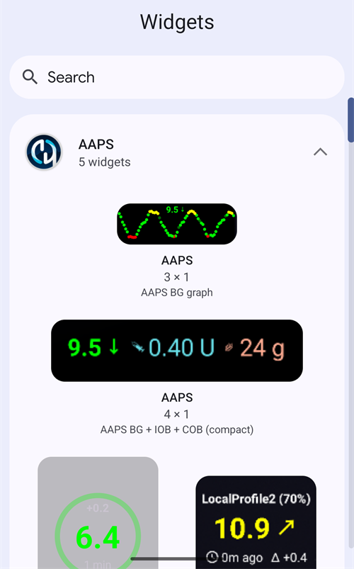
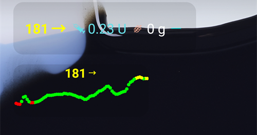
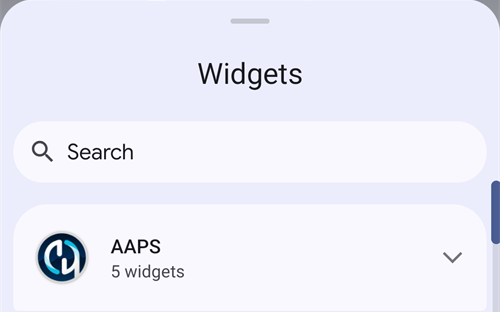
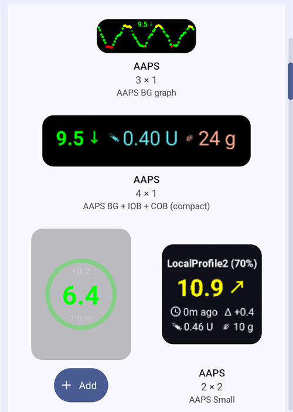
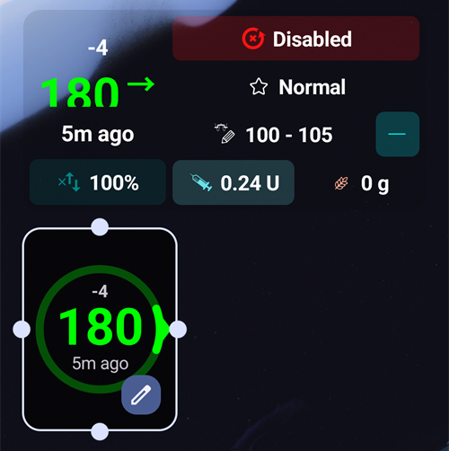
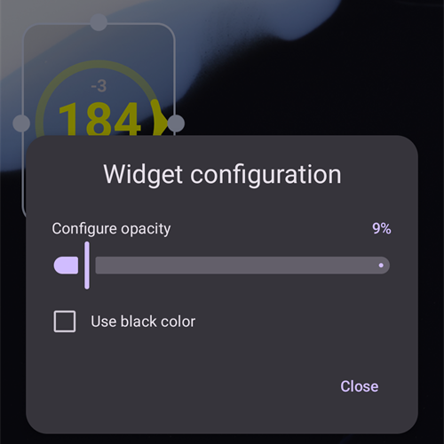

(widgets)=
# Виджеты на главном экране

**AAPS** предлагает виджеты, которые можно добавить на главный экран телефона. Виджет показывает текущие данные без открытия приложения. Нажмите на виджет, чтобы открыть **AAPS**.

```{contents} Table of contents
:depth: 2
:local: true
```

---

## Доступные виджеты

Доступно пять виджетов. Они находятся в разделе **AAPS** в списке виджетов Android:



| Виджет                            | Размер по умолчанию | Что показывает                                                                                                                                                                                                                   |
| --------------------------------- | ------------------- | -------------------------------------------------------------------------------------------------------------------------------------------------------------------------------------------------------------------------------- |
| **AAPS widget**                   | 5 × 2               | Блок состояния с главного экрана: ГК с трендом и дельтой, режим цикла в виде значка рядом с названием профиля, цель, чувствительность (как на главном экране), IOB и COB. Текст уменьшается под размер виджета, а не обрезается. |
| **AAPS glucose circle**           | 2 × 2               | Круг ГК с главного экрана: кольцо в цвете ГК, дуга тренда, дельта, значение ГК и время с последнего показания.                                                                                                                   |
| **AAPS Small**                    | 2 × 2               | Название профиля, ГК со стрелкой тренда, время с последнего показания, дельта, IOB и COB.                                                                                                                                        |
| **AAPS BG + IOB + COB (compact)** | 4 × 1               | Одна строка с ГК и стрелкой тренда, IOB и COB.                                                                                                                                                                                   |
| **AAPS BG graph**                 | 3 × 1               | Значение ГК с небольшим графиком последних показаний.                                                                                                                                                                            |

**Виджет AAPS**, **Круг глюкозы** и виджет **Маленький** на главном экране:


Виджет **компактный** и виджет **График ГК**:



Значения ГК показаны теми же цветами, что и в **AAPS**: зеленый — в диапазоне, желтый — выше диапазона, красный — ниже диапазона.

---

## Добавление виджета

Точные шаги зависят от телефона и его лаунчера. На большинстве телефонов:

1. Нажмите и удерживайте пустое место на главном экране и выберите **Виджеты**.

   

2. Откройте **AAPS** в списке и нажмите нужный виджет.
3. Нажмите **Добавить** (или перетащите виджет в нужное место).

   

Виджет появится на главном экране. Сразу после добавления у него видны маркеры: потяните маркер, чтобы **изменить размер** виджета, или перетащите виджет, чтобы переместить его. Размер круга глюкозы можно менять как угодно.



Если страница главного экрана заполнена, телефон поместит виджет на новую страницу.

---

## Widget configuration

Нажмите кнопку с **карандашом**, которая видна на виджете сразу после добавления. Позже нажмите и удерживайте виджет, чтобы снова увидеть маркеры и карандаш.

В окне **Настройки виджета** два параметра:

- **Настроить прозрачность** — насколько непрозрачен фон виджета. При низком значении сквозь виджет видны обои.
- **Использовать черный цвет** — черный фон вместо фона по умолчанию.



У каждого виджета свои настройки.

---

## Полезно знать

- Виджет только **показывает** данные. С виджета нельзя ввести болюс или что-либо изменить.
- Виджет обновляет **AAPS**. Если **AAPS** не работает или Android ограничивает его работу в фоне, виджет может показывать старые данные. Проверяйте время с последнего показания и убедитесь, что **AAPS** исключен из [оптимизации батареи](#SetupWizard-StoragePermission).
- В **AAPSClient**, **AAPSClient2** и **AAPSClient3** фон виджета желтый, синий или зеленый, чтобы приложения можно было различить. Если цвет плохо видно, увеличьте непрозрачность в настройках виджета. См. [Об AAPSClient, AAPSClient2 и AAPSClient3](#remotecontrol-aapsclient-versions).
