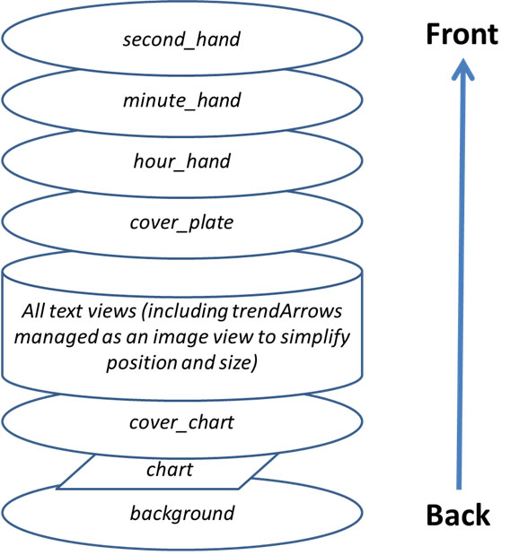
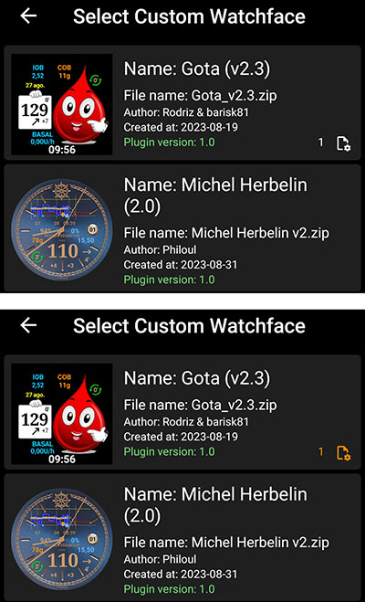
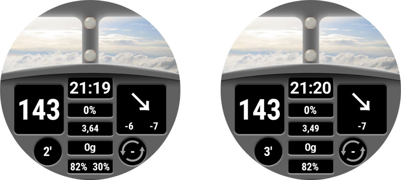
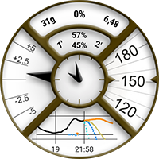
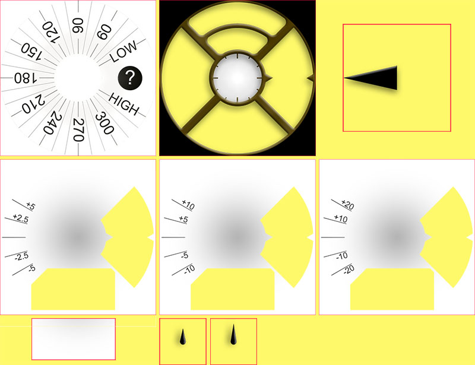
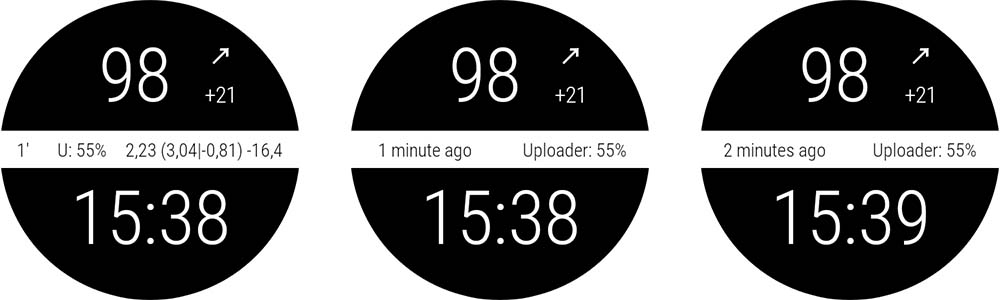
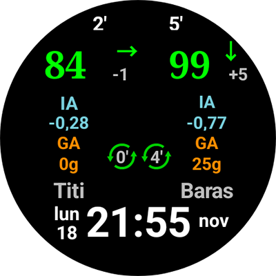

# Справочник по собственным циферблатам

Эта страница предназначена для создателей новых циферблатов. Здесь будут перечислены все ключевые моменты и функции, доступные при создании или анимировании новых циферблатов.

- Новые функции и ключи, доступные в Custom Watchface V2 (Wear apk 3.3.0 или новее), описаны [здесь](#cwf-reference-new-v2-features)

## Формат настраиваемых циферблатов

Настраиваемый циферблат - это открытый формат, разработанный для AAPS и связанный с новым интерфейсом "AAPS (Custom)", доступным на часах.

Файл циферблата - это простой zip-файл, но он должен распознаваться как файл Watchface и должен содержать следующие файлы:

- Один файл изображения под названием CustomWatchface (пользовательский циферблат) (это может быть растровый файл `CustomWatchface.jpg`, `CustomWatchface.png` или векторный `CustomWatchface.svg`). Этот файл представляет собой маленькую иконку, используемую для выбора циферблата часов, когда вы нажимаете на кнопку "Загрузить циферблат", а также изображение, видимое из модуля расширения AAPS Wear.
- Один файл с именем `CustomWatchface.json` (см. [Структура JSON](#cwf-reference-json-structure) ниже). Этот второй файл является главным файлом, который будет содержать всю информацию, необходимую для создания циферблата часов. Этот json-файл должен быть правильным (это, наверное, самое сложное место, когда вы правите файл вручную в текстовом редакторе: одной лишней или пропущенной запятой достаточно, чтобы сломать формат json). Этот JSON-файл также должен содержать блок `"metadata"` с ключом `"name"`, значение которого не пустое. Это будет название вашего собственного циферблата (см. [Настройки метаданных](#cwf-reference-metadata-settings) ниже)
- размер этого zip-файла должен быть как можно меньше (менее 500 кб). Если этот файл слишком большой, он будет заблокирован и не будет передан на часы.

Zip-файл может также содержать дополнительные файлы ресурсов:

- Жестко заданные имена файлов изображений, которые используются в стандартных представлениях циферблата (например, `Background`, `CoverChart`... см. [Список жестко заданных файлов ресурсов](#cwf-reference-list-of-hardcoded-resource-files) ниже). Все эти файлы могут быть в формате `jpg`, `png` или `svg`. но для большинства из них следует использовать `png` или `svg`, которые управляют прозрачностью (jpg меньше по размеру по сравнению с png, но без прозрачности). Обратите внимание, что наилучшее качество, связанное с наименьшим размером, обычно имеют svg файлы (векторный формат).
- Дополнительные файлы ресурсов с любыми именами. Эти дополнительные файлы могут быть либо файлами изображений, либо файлами шрифтов (для шрифтов возможны форматы `ttf` и `otf`). Учтите, что для этих дополнительных файлов `имя файла` (без расширения) будет использоваться в качестве значения ключа keyValue в файле JSON, чтобы указать, где или когда должны использоваться эти файлы.
  - файлы изображений часто используются в качестве фона для текстов или для динамической анимации (например, уровень заряда батареи от 0% до 100%).
  - файлы шрифтов позволяют использовать специальные шрифты на циферблате часов

(cwf-reference-json-structure)=

## JSON Structure

JSON-файлы можно редактировать в текстовом редакторе Notepad (или notepad++) (лучше notepad++, он распознает JSON и выделяет его цветом)

- it contains string keys `"string_key":` and key values that can be strings like `"key value"`, integer, boolean like `true`or `false` or block of data.
- каждое значение отделяется запятой `,`
- Блок данных начинается `{`  и заканчивается `}`
- json-файл — это один целый блок, поэтому он начинается с `{` и заканчивается `}`, а внутри файла все вложенные блоки связаны с ключом `"key"`, который должен быть уникальным внутри блока
- Чтобы json-файл было легче читать, в нем обычно делают отступы (каждый новый ключ — на новой строке, каждый новый блок сдвинут вправо на 4 пробела)

(cwf-reference-metadata-settings)=

### Настройки метаданных

Этот блок первым включается в файл json, и является обязательным. Он содержит всю информацию об этом циферблате: название, автора, дату создания или обновления, версию автора или версию модуля.

Ниже приведен пример блока метаданных:

```text
"метаданные": {
""имя": "Циферблат часов по умолчанию",
"автор": "myName",
"created_at": "07\/10\/2023",
" author_version": "1.0",
"cwf_version": "1.0",
"комментарий": "Циферблат по умолчанию, вы можете нажать на кнопку ЭКСПОРТ циферблата, чтобы сгенерировать шаблон"
},
```

Обратите внимание, что `/`, используемый для обозначения даты, является специальным символом, поэтому для правильного распознавания в файле json перед ним следует поставить символ "escape" `\`

В некоторых json-файлах можно увидеть дополнительный ключ `"filename"`. Этот ключ создается или обновляется автоматически, когда собственный циферблат загружается в AAPS (он показывает пользователю имя zip-файла в папке exports), поэтому этот ключ можно удалить из блока метаданных.

(cwf-reference-general-parameter-settings)=

### Общие настройки параметров

После первого блока с метаданными задаются некоторые общие параметры (см. [Список общих параметров](#cwf-reference-list-of-general-parameters) ниже). Так можно задать цвета графика (углеводы, болюс, значения ГК...), а также цвета по умолчанию для значений в диапазоне, гипергликемии и гипогликемии (цвета по умолчанию для значения ГК и стрелок)

Ниже представлен пример общих параметров

```text
""цвет высоких": "#FFFF00",
""цвет средних": "#00FF00",
""цвет низких": "#FF0000",
""Цвет низкого заряда батареи": "#E53935",
""цвет углеводов": "#FB8C00",
""цвет фона базала": "#0000FF",
""цвет базального центра": "#64B5F6",
""цвет сетки": "#FFFFFF",
"Размер точки": 2,
""включить секунды": true,
```
(cwf-reference-imageview-settings)=

### Настройки ImageView

Нужное изображение можно настроить, используя правильное имя файла, привязанное к каждому ImageView, включенному в пользовательский макет циферблата, в этом случае блок json здесь только для определения позиции, размера, видимости/невидимости, и при необходимости настройки цвета:

См. ниже пример блока изображения для секундной стрелки (в данном случае изображение не включено в zip-файл, поэтому будет использовано стандартное изображение, но настроенное с пользовательским цветом.

```text
"second_hand": {
    "width": 400,
    "height": 400,
    "topmargin": 0,
    "leftmargin": 0,
    "visibility": "visible",
    "color": "#BC906A"
}
```
Чтобы second_hand была окрашена цветом ГК по умолчанию (lowRange, midRange или highRange), просто измените последнюю строку на значение ключа `bgColor`

```json
    "color": "bgColor"
```

(cwf-reference-textview-settings)=

### Настройки TextView

TextView have more available parameters compare to ImageView: you can tune rotation (integer value in degrees), textsize (integer value in pixel), gravity (to define if text value will be centered (default value), or aligned left or right), set the font, fontStyle and fontColor, and also background color of the TextView

```text
"basalRate": {
    "width": 91,
    "height": 32,
    "topmargin": 133,
    "leftmargin": 249,
    "rotation": 0,
    "visibility": "visible",
    "textsize": 23,
    "gravity": "center",
    "font": "default",
    "fontStyle": "bold",
    "fontColor": "#BDBDBD"
},
```
Учтите, что если вы не хотите использовать какое-то представление на своем циферблате, задайте ключу `"visibility"` значение `"gone"`, а также задайте размер и положение вне видимой области, например так:

```text
"second": {
    "width": 0,
    "height": 0,
    "topmargin": 0,
    "leftmargin": 0,
    "rotation": 0,
    "visibility": "gone",
    "textsize": 46,
    "gravity": "center",
    "font": "default",
    "fontStyle": "bold",
    "fontColor": "#BDBDBD"
},
```
Если размер и положение находятся в видимой области, при обновлении циферблата скрытое значение может на миг «мелькнуть».

Если вы хотите изменить фоновое изображение текстового представления, используйте ключ `"background":` и укажите в качестве значения ключа имя файла изображения из zip-файла. Также можно просто изменить цвет фона ключом `"color:"`.

```json
"background": "fileName"
```

Также есть 4 особых textView (с именами от freetext1 до freetext4). У них есть особый параметр `"textvalue":`, который можно использовать, например, чтобы задать подпись

(cwf-reference-chartview-settings)=

### Настройки ChartView

Chart view (график) — это очень особое представление, которое может иметь общие параметры с ImageView или с TextView...

Стандартные настройки этого представления очень простые:

```text
"chart": {
    "width": 400,
    "height": 170,
    "topmargin": 230,
    "leftmargin": 0,
    "visibility": "visible"
},
```
Для Chart view можно добавить 2 дополнительных параметра: цвет фона (по умолчанию прозрачный) с ключом `"color"` или фоновое изображение с ключом `"background"`.

(cwf-reference-how-to-build-watchface)=

## Как создать свой первый циферблат

### Нужные инструменты

- Текстовый редактор: я советую NotePad++ (или похожий). Это простой текстовый редактор, но в нем текст выделяется цветом, поэтому ошибки легче найти. подойдет любой простой текстовый редактор. Ведь задача — настроить информацию в json.
- Графический редактор (растровый и/или векторный)
  - Если вы используете растровую графику
    - Графический редактор должен поддерживать прозрачность (нужна для всех изображений поверх фона) и формат png (если вы используете растровые изображения)
    - Фоновое изображение может быть в формате jpg (он меньше, чем png)
    - Графический редактор должен позволять измерять графические объекты в пикселях (это может быть простой квадрат) (top, left, width, height)
    - Image editor should be able to show you colors with RRGGBB code in hexadecimal
    - Графический редактор должен уметь менять размер изображения до 400px x 400px (очень важно работать с этим разрешением)
  - Если вы используете векторную графику
    - Векторное изображение нужно экспортировать в формате svg

### Возьмите шаблон, чтобы не начинать с нуля

Когда вы создаете свой первый циферблат, лучше всего начать с циферблата по умолчанию (так у вас будет последняя версия со всеми доступными представлениями в правильном порядке)

- Чтобы получить zip-файл, нажмите кнопку «Экспортировать шаблон» в модуле Wear. Zip-файл появится в папке AAPS/exports
- Учтите, что кнопки собственного циферблата видны, только если к AAPS подключены часы (но часы и так нужны, чтобы проверить, протестировать и настроить ваш собственный циферблат)

Циферблат по умолчанию очень простой, и zip-файл будет содержать только 2 файла:

- CustomWatchface.png (изображение циферблата по умолчанию для выбора циферблата)
- CustomWatchface.json

### Организуйте файлы на своем компьютере

The easiest way to work is to have phone connected to the computer, and work with two specific folders:

- одно окно проводника открыто в отдельной папке, где лежат все файлы (json, растровые изображения, векторные изображения, шрифты) и файл CustomWatchface.zip
- второе окно проводника (или настроенное дерево папок) открыто так, чтобы была доступна папка Phone/AAPS/exports

Так работать очень легко: каждый раз, когда вы меняете json-файл в текстовом редакторе или изображение в графическом редакторе (растровом или векторном), нужно только:

1. сохранить изменения в каждом приложении
2. перетащить все файлы в файл CustomWatchface.zip
3. перетащить CustomWatchface.zip в папку AAPS/exports на телефоне
4. отправить CustomWatchface на часы, чтобы проверить результат

### Начало настройки циферблата

Сначала нужно задать название циферблата (оно нужно, чтобы легко выбрать его для проверки), и начать настраивать ключи метаданных в начале json-файла

Затем нужно решить, какую информацию вы хотите показывать, то есть какие представления должны быть видимыми, а какие скрытыми.

- будут ли показываться секунды?
- вы хотите создать стрелочные или цифровые часы (или и те, и другие...)?

Теперь можно начать менять json-файл: для каждого представления задайте ключ `"visibility":` со значением `"visible"` или `"gone"` (если вы хотите оставить или убрать это представление)

You can also start to tune approximately top, left margin and width height values to start organizing the watchface (these values will be tuned later using image editor)

Примечание: все создается внутри **прямоугольника 400px x 400px**. Поэтому все располагается в абсолютных координатах внутри этого размера.

Когда вы создаете свой первый циферблат, нужно знать, что все устроено слоями от заднего к переднему, поэтому каждое представление (ImageView или TextView) может закрыть то, что находится за ним...





Поэтому в json-файле все представления расположены от заднего к переднему (это поможет вам помнить, что за чем находится...)

Если вы создаете или настраиваете свой первый собственный циферблат, начните с простого: измените видимость некоторых представлений, добавьте свое фоновое изображение, не меняя json-файл...

### Управление цветами

В json-файле есть несколько ключей для задания цветов: `"color"`, `"fontColor"` для представлений, а также `"highColor"`, `"midColor"`, `"lowColor"`, ... (см. [Список общих параметров](#cwf-reference-list-of-general-parameters))

Цвета задаются текстовым полем, которое начинается с `#`, за ним идут значения RRGGBB (красный, зеленый, синий) в шестнадцатеричном формате:

- `"#FFFFFF"` — белый, `"#000000"` — черный, `"#FF0000"` — красный...

Также можно добавить 2 дополнительные цифры для альфа-канала и задать уровень прозрачности (AARRGGBB):

- `"#00000000"` полностью прозрачный, а `"#FF000000"` полностью непрозрачный (поэтому `"#FF000000"` — то же самое, что `"#000000"`)

Также можно использовать особое значение ключа `"bgColor"`, чтобы автоматически использовать цвета `"highColor"`, `"midColor"`, `"lowColor"`, заданные в общих параметрах, в зависимости от значения ГК:

- `"fontColor": "bgColor",` автоматически задает цвет шрифта представления в зависимости от значения ГК
- Учтите, что представления `sgv` (значение ГК) и `direction` (стрелка тренда) автоматически используют цвета ГК, заданные в общих параметрах (если вы хотите другие цвета для этих 2 представлений, нужно использовать расширенную функцию [dynData](#cwf-reference-dyndata-feature) с цветом в один шаг...)

Подробнее об ImageView и ключе `"color":` см. отдельную главу [Настройка цвета изображения](#cwf-reference-tune-image-color) ниже.

### Добавление жестко заданных изображений

самый простой способ начать настройку циферблата — добавить в zip-файл несколько изображений с особыми именами (см. [Список жестко заданных файлов ресурсов](#cwf-reference-list-of-hardcoded-resource-files))

- Изображение должно быть в формате `.jpg`, `.png` или `.svg`. но будьте осторожны: jpg не поддерживает прозрачность, поэтому его нужно использовать только для слоя фона. Для всех промежуточных слоев (cover_chart, cover_plate, стрелки) используйте изображения `.png` или `.svg`

- Если у вас есть векторный графический редактор (например, Illustrator), лучше используйте этот формат: он дает небольшие текстовые файлы с расширением `.svg` и лучшее качество.
- Точно соблюдайте имя файла (включая заглавные и строчные буквы)

Now if you want a dedicated background image, you only have to include within the zip file a file named `Background.jpg` (without changing anything else). Send the zip file to the watch and check the result!

Если вы хотите настроить hour_hand, minute_hand или second_hand для стрелочных часов, просто добавьте `HourHand.png` (или `HourHand.svg`), `MinuteHand.png` и `SecondHand.png`.

- эти изображения автоматически вращаются вокруг центра изображения, поэтому на изображениях стрелки должны показывать 00:00:00 (а для стрелочных часов «на весь экран» используйте размер 400 x 400 px с положением top 0, left 0)

В [Списке жестко заданных файлов ресурсов](#cwf-reference-list-of-hardcoded-resource-files) также видно, что для каждого представления изображения есть два дополнительных жестко заданных имени файла: `High` и `Low` (например, можно добавить в zip-файл изображения с именами `BackgroundHigh.jpg` и `BackgroundLow.jpg`). тогда изображение будет автоматически меняться в зависимости от уровня ГК (в диапазоне, гипергликемия или гипогликемия). Пример — циферблат AIMICO.

(cwf-reference-tune-image-color)=

### Настройка цвета изображения

Ключ `"color"` можно использовать, чтобы изменить цвет изображения по умолчанию:

- для фонового представления он задает цвет фона (по умолчанию черный)
- для cover_plate (простой циферблат) или стрелок он заменяет цвет изображения по умолчанию (белый) на заданный цвет (включая `"bgColor"`)

Если применить ключ `"color"` к растровому изображению (`.jpg` или `.png`), цвет даст интересный эффект на насыщенность цвета. Так ваше растровое изображение останется узнаваемым.

И наконец, для файлов изображений `.svg` ключ `"color"` не работает: цвет векторных файлов считается жестко заданным в самом изображении. Если вы хотите менять цвета, нужно добавить несколько файлов `svg` и использовать для этого расширенную функцию [dynData](#cwf-reference-dyndata-feature)

### Дополнительные шрифты для TextView

В wear apk уже есть несколько шрифтов по умолчанию (см. ключи шрифтов в главе [Значения ключей](#cwf-reference-key-values)). Но если вы хотите использовать дополнительные шрифты, которых нет по умолчанию, можно добавить их в zip-файл:

- поддерживаются 2 формата шрифтов: файлы `.ttf` и `.otf`
- если вы добавили в zip-файл свой шрифт, например файл с именем `myCustomFont.ttf`, то в json-файле для TextView нужно указать имя этого файла:

```
"font": "myCustomFont",
```

Помните, что некоторые шрифты занимают большие файлы (а размер zip-файла ограничен). Поэтому если вы используете очень мало символов (цифры, `.`, `,`), можно удалить ненужные символы бесплатными инструментами (например, [здесь](https://products.aspose.app/font/generator/ttf-to-ttf)) и так уменьшить размер шрифта.

(cwf-reference-advanced-features)=

## Дополнительные функции

(cwf-reference-preference-feature)=

### Функция настроек

Собственный циферблат может автоматически менять некоторые настройки часов, чтобы циферблат выглядел правильно (если пользователь дал на это разрешение в настройках Wear).

Но эту функцию нужно использовать осторожно. Настройки общие для всех циферблатов. Поэтому для этой функции есть несколько правил:

- никогда не задавайте настройки для скрытых представлений
- старайтесь показывать как можно больше представлений
- можно смело делать некоторые представления шире, чем нужно:
  - Временный базал можно показывать в процентах (узко), а также в абсолютных значениях (намного шире)
  - дельта или средняя дельта с подробной информацией могут быть широкими
  - то же для iob2: это представление может показывать общий IOB, но если выбран подробный IOB, текст может быть очень длинным

Если для правильного отображения вам все же нужны очень особые настройки (в примере ниже, если места для подробного IOB не хватает, можно «принудительно» установить этот параметр часов в `false`), вы можете добавить в блок метаданных ограничения настроек, например так

```text
"metadata": {
    "name": "Default Watchface",
    "author": "myName",
    "created_at": "07\/10\/2023",
    "author_version": "1.0",
    "cwf_version": "1.0",
    "comment": "Default watchface, you can click on EXPORT WATCHFACE button to generate a template",
    "key_show_detailed_iob": false
},
```

Если пользователь разрешил собственному циферблату менять параметры часов (настройка в модуле Wear), то «Отображать IOB подробно» будет выключено и заблокировано в выключенном состоянии (этот параметр нельзя изменить, пока разрешение не будет выключено в настройках модуля Wear или пока не будет выбран другой циферблат)

- Учтите, что при выборе циферблата пользователь видит число «обязательных параметров»

В примере ниже у циферблата Gota один обязательный параметр. Если разрешение не дано, число показывается белым цветом. Если разрешение дано, этот параметр будет установлен и заблокирован на часах (в этом случае число оранжевого цвета)




(cwf-reference-twinview-feature)=

### Функция TwinView

Парные представления (twin views) дают простой способ менять положение представления в зависимости от того, какие представления видимы. Это не так мощно, как макет, полностью построенный на LinearLayout, но подходит для многих обычных случаев.

В примере ниже показан циферблат AAPS (Cockpit) со всеми представлениями, включенными в настройках, и тот же циферблат с отключенными настройками «Отображать заряд батареи системы» и «Отображать среднюю дельту»



Видно, что когда одно из парных представлений скрыто, другое сдвигается в центр

в этом примере видно, что в блок `"uploader_battery"` добавлен ключ `"twinView":`, который задает представление `"rig_battery"`, а в блоке `"rig_battery"` ключ `"twinView":` задает `"uploader_battery"` как парное. Затем дополнительный ключ `"leftOffsetTwinHidden":` задает, на сколько пикселей сдвинуть представление, когда парное скрыто.

Чтобы вычислить это число, посмотрите на разницу leftMargin двух парных представлений: она равна 50 пикселям, поэтому, чтобы остаться в центре, сдвиг равен половине в одну или в другую сторону.

Если парные представления расположены по вертикали, в этом случае нужно использовать ключ `"topOffsetTwinHidden":`

```text
"uploader_battery": {
    "width": 49,
    "height": 30,
    "topmargin": 354,
    "leftmargin": 150,
    "rotation": 0,
    "visibility": "visible",
    "textsize": 23,
    "gravity": "center",
    "font": "roboto_condensed_bold",
    "fontStyle": "bold",
    "fontColor": "#FFFFFF",
    "twinView": "rig_battery",
    "leftOffsetTwinHidden": 25
},
"rig_battery": {
    "width": 49,
    "height": 30,
    "topmargin": 354,
    "leftmargin": 200,
    "rotation": 0,
    "visibility": "visible",
    "textsize": 23,
    "gravity": "center",
    "font": "roboto_condensed_bold",
    "fontStyle": "bold",
    "fontColor": "#FFFFFF",
    "twinView": "uploader_battery",
    "leftOffsetTwinHidden": -25
},
```
(cwf-reference-dyndata-feature)=

### Функция DynData

DynData — самая мощная функция, если вы хотите добавить анимацию на циферблат в зависимости от внутренних значений (например, значение ГК, уровень ГК, дельта, % заряда батареи... список доступных данных см. [здесь](#cwf-reference-dyndata-key-values))

Чтобы показать эту функцию, я возьму в качестве примера циферблат AAPS (SteamPunk):



На этом циферблате нужно управлять [поворотом значения ГК](#cwf-reference-background-management) (от 30 до 330 градусов) справа, [динамическим диапазоном avg_delta](#cwf-reference-avg-delta-management) (шкала до 5 мг/дл, 10 мг/дл или 20 мг/дл в зависимости от значения), [поворотом стрелки](#cwf-reference-dynamic-rotation-management), который должен совпадать со шкалой, а также разными слоями представлений...

Чтобы управлять этим циферблатом, посмотрите ниже все изображения, включенные в zip-файл:

Примечание: чтобы была видна прозрачность, все эти изображения показаны на желтом фоне и обведены красным квадратом



- В первом ряду Background.jpg и CoverPlate.png будут автоматически связаны с соответствующими представлениями (имена файлов представлений по умолчанию), а steampunk_pointer.png будет управляться через dynData
- Во втором ряду видны 3 шкалы динамического диапазона для avg_delta, которые тоже будут управляться через dynData
- В третьем ряду chartBackground.jpg будет связан вручную в представлении chart, а файлы HourHand.png и MinuteHand.png будут автоматически связаны с соответствующими представлениями

(cwf-reference-background-management)=

#### Background management

Во-первых, изображение со значением ГК может быть только в слое фона, другого выбора нет (иначе оно будет перед графиком, и график не будет виден!). Итак, нужно связать значение ГК с фоном, а затем поворачивать фоновое изображение в зависимости от значения ГК.

В блок `"background"` мы добавим 2 специальных ключа для этого поворота:

```text
"background": {
    "width": 400,
    "height": 400,
    "topmargin": 0,
    "leftmargin": 0,
    "dynData": "rotateSgv",
    "rotationOffset": true,
    "visibility": "visible"
},
```
Ключ `"dynData":` задает, какой блок используется для анимации (значение, диапазон, преобразование...). Здесь этот блок назван "rotateSgv" (выбирайте понятное имя, когда используете эту функцию),

`"rotationOffset": true,` задает, что ожидаемая анимация в зависимости от значения — это поворот. (другие доступные ключи — `"leftOffset"` и `"topOffset"`, если вы хотите сделать ползунок)

Теперь перейдем в конец файла, после последнего представления:

```text
"second_hand": {
    "width": 120,
    "height": 120,
    "topmargin": 140,
    "leftmargin": 140,
    "visibility": "gone"
},
"dynData": {
    "rotateSgv": {
        "valueKey": "sgv",
        "minData": 30,
        "maxData": 330
    },
```
Видно, что после последнего представления (`"second_hand"`) мы добавили новый блок `"dynData": { ... }`, который будет содержать всю анимацию:

Блок, заданный в представлении `"background"`, называется `"rotateSgv"`. Это первый блок, который вы найдете в `"dynData"`!

Этот блок простой: первый ключ `"valueKey":` задает, какое значение нужно использовать. в этом случае `"sgv"` — это «keyValue» (значение ключа), которое обозначает значение ГК (учтите, что в большинстве случаев keyValue имеет то же имя, что и представление, которое показывает эту информацию).

Для значения ГК минимальное значение данных по умолчанию равно 39 мг/дл, а максимальное — 400 мг/дл (все доступные значения ключей и соответствующие min/max значения данных см. ниже в [Значения ключей DynData](#cwf-reference-dyndata-key-values)).

В блоке `"rotateSgv"` два дополнительных ключа (`"minData":` и `"maxData":`) задают минимальное и максимальное значение данных: 30 и 330. С этими минимальным и максимальным значениями можно напрямую использовать значение данных (без преобразования), чтобы поворачивать фон в градусах. В этом случае все значения ГК выше 330 мг/дл будут ограничены значением 330 — верхней границей изображения.

#### Chart management

По умолчанию фон графика прозрачный, поэтому, чтобы скрыть шкалу ГК, которая есть на фоновом изображении, нужно добавить отдельное фоновое изображение (на нем будут общие тени циферблата Steampunk). The link to chartBackground.jpg file is done with `"background":` key

Конечно, размер и положение представления нужно задать с точностью до пикселя!

```text
"chart": {
    "width": 216,
    "height": 107,
    "topmargin": 280,
    "leftmargin": 80,
    "visibility": "visible",
    "background": "chartBackground"
},
```
(cwf-reference-avg-delta-management)=

#### Avg delta management

Чтобы управлять динамическим диапазоном средней дельты, мы используем четыре представления freetext. freetext1 будет управлять изображением шкалы, а freetext2–freetext4 будут управлять поворотом стрелки в зависимости от шкалы.

**freetext1**

Как сказано выше, представления freetext находятся перед графиком и перед фоном, поэтому мы добавили прозрачную область, чтобы были видны эти изображения (правая и нижняя часть изображения)

Учтите, что удаленная нижняя часть этих изображений использована как фон графика, чтобы все идеально совпадало.

```text
"freetext1": {
    "width": 400,
    "height": 400,
    "topmargin": 0,
    "leftmargin": 0,
    "rotation": 0,
    "visibility": "visible",
    "dynData": "avgDeltaBackground"
},
```
Для этого представления мы добавляем ссылку на другой блок `"dynData"` с именем `avgDeltaBackground`. Этот блок будет управлять шкалой avgDelta в зависимости от значения avgDelta.

```text
"avgDeltaBackground": {
    "valueKey": "avg_delta",
    "minData": -20,
    "maxData": 20,
    "invalidImage": "steampunk_gauge_mgdl_5",
    "image1": "steampunk_gauge_mgdl_20",
    "image2": "steampunk_gauge_mgdl_20",
    "image3": "steampunk_gauge_mgdl_10",
    "image4": "steampunk_gauge_mgdl_5",
    "image5": "steampunk_gauge_mgdl_5",
    "image6": "steampunk_gauge_mgdl_10",
    "image7": "steampunk_gauge_mgdl_20",
    "image8": "steampunk_gauge_mgdl_20"
},
```
- `"valueKey":` связывает блок со значением `"avg_delta"`
- min и max Data также ограничат диапазон максимальным значением, доступным на этом циферблате (от -20 мг/дл до 20 мг/дл). Пользователи ммоль/л, помните, что внутри AAPS все значения всегда хранятся в мг/дл.

Теперь посмотрим, как управлять динамическим фоновым изображением в зависимости от значения.

`"invalidImage":` — это ключ, который задает изображение для неверных (или отсутствующих) данных. Здесь мы ссылаемся на дополнительное изображение-ресурс из zip-файла со шкалой 5 мг/дл

Затем используем ряд изображений, от `"image1":` до `"image8":`. Число заданных изображений определяет число шагов между `minData` и `maxData`.

- `image1` задает изображение, которое показывается, когда avg_delta равна или близка к `minData`, а изображение с самым большим номером (здесь `image8`) задает изображение, которое показывается, когда avg_delta равна или близка к `maxData`
- от -20 мг/дл до 20 мг/дл весь диапазон равен 40 мг/дл; если разделить на 8 (число изображений), получится 8 шагов по 5 мг/дл
- Теперь можно связать фоновые изображения со значением avg_delta, начиная с самых низких значений: от -20 до -15, а также от -15 до -10 мы используем для шкалы `steampunk_gauge_mgdl_20`, затем от -10 до -5 — `steampunk_gauge_mgdl_10`, и так далее до диапазона от +15 до +20, где снова используется фоновое изображение `steampunk_gauge_mgdl_20`

(cwf-reference-dynamic-rotation-management)=

**от freetext2 до freetext4**

For these views we will combine dynamic images and rotation feature explained before:

```text
"freetext2": {
    "width": 276,
    "height": 276,
    "topmargin": 64,
    "leftmargin": 64,
    "rotation": 0,
    "visibility": "visible",
    "dynData": "avgDelta5",
    "rotationOffset": true
},
"freetext3": {
    "width": 276,
    "height": 276,
    "topmargin": 64,
    "leftmargin": 64,
    "rotation": 0,
    "visibility": "visible",
    "dynData": "avgDelta10",
    "rotationOffset": true
},
"freetext4": {
    "width": 276,
    "height": 276,
    "topmargin": 64,
    "leftmargin": 64,
    "rotation": 0,
    "visibility": "visible",
    "dynData": "avgDelta20",
    "rotationOffset": true
},
```
Здесь каждое представление отвечает за свою шкалу (поэтому связано со своим блоком dynData). Также видно, что для этих 3 представлений включен ключ `"rotationOffset":`. Теперь посмотрим на первый блок dynData:

```text
"avgDelta5": {
    "valueKey": "avg_delta",
    "minData": -20,
    "maxData": 20,
    "rotationOffset": {
        "minValue": -120,
        "maxValue": 120
    },
    "invalidImage": "null",
    "image1": "null",
    "image2": "null",
    "image3": "null",
    "image4": "steampunk_pointer",
    "image5": "steampunk_pointer",
    "image6": "null",
    "image7": "null",
    "image8": "null"
},
```
Здесь, хотя динамический диапазон используется только для данных avg_delta от -5 до +5, важно сохранить весь диапазон от -20 до +20 мг/дл, чтобы стрелка совпадала с фоном при смене шкалы. Поэтому мы оставляем тот же общий диапазон, что и для `avgDeltaBackground`, и то же число шагов (8 изображений).

Видно, что у `"invalidImage"` и у нескольких `"imagexx"` значение ключа `"null"` (это может быть любая строка, которой нет среди имен файлов в zip-файле). Если файл с таким именем не найден, фоновое изображение представления будет прозрачным. Так эта настройка гарантирует, что стрелка будет видна только на шагах 4 и 5 (средняя дельта от -5 мг/дл до +5 мг/дл) и не будет видна вне этого диапазона.

Теперь мы видим новый блок `"rotationOffset":`, внутри которого два ключа: `"minValue":` и `"maxValue":`. Эти значения используются для преобразования внутренних данных (в мг/дл) в нужный угол поворота.

- Циферблат Steampunk рассчитан на поворот стрелки максимум от -30 до 30 градусов. Поэтому по шкале (здесь от -5 мг/дл до 5 мг/дл) для этих значений нужен поворот на 30 градусов. Так как `minData` и `maxData` в 4 раза больше, соответствующие minValue и maxValue равны 4 * 30 градусов, то есть -120 и +120 градусов. Но при любом повороте больше +-30 градусов стрелка будет скрыта (изображение не видно), и стрелка будет видна только для значений от -5 до +5 мг/дл... Это именно то, что здесь нужно.

The other dynData blocks are defined the same way to tune `"avgDelta10"`and `"avgDelta20"`

#### представление loop

на циферблате Steampunk зеленые и красные стрелки цикла (статус) выключены. Это тоже делается отдельным блоком dynData, связанным с представлением loop.

```text
    "loopArrows": {
        "invalidImage": "greyArrows",
        "image1": "greenArrows",
        "image2": "redArrows"
    }
```
Так как этот блок вызывает только представление loop, а данные по умолчанию для этого представления — это информация о цикле, ключ `"valueKey":` необязателен.

По умолчанию `minData` и `maxData` для loop равны 0 мин и 28 мин, поэтому при двух изображениях все значения меньше 14 мин будут показаны с фоном `image1`, а все значения больше 14 мин — с `image2`. 14 мин — это как раз порог, при котором зеленая стрелка меняется на красную.

В этом примере файлов `greyArrows`, `greenArrows` и `redArrows` нет в zip-файле, поэтому эти стрелки просто убраны (невидимы). Но вы можете использовать этот блок «как есть», если хотите настроить стрелки статуса своими фоновыми изображениями.

#### представления rig_battery и uploader_battery

Чтобы закончить обзор функции dynData, посмотрим, как работает батарея. Идея в том, чтобы менять цвет текста в зависимости от уровня заряда батареи (от 0 до 100%)

```text
"uploader_battery": {
    "width": 60,
    "height": 28,
    "topmargin": 100,
    "leftmargin": 170,
    "rotation": 0,
    "visibility": "visible",
    "textsize": 20,
    "gravity": "center",
    "font": "default",
    "fontStyle": "bold",
    "fontColor": "#00000000",
    "dynData": "batteryIcons",
    "twinView": "rig_battery",
    "topOffsetTwinHidden": -13
},
"rig_battery": {
    "width": 60,
    "height": 28,
    "topmargin": 74,
    "leftmargin": 170,
    "rotation": 0,
    "visibility": "visible",
    "textsize": 20,
    "gravity": "center",
    "font": "default",
    "fontStyle": "bold",
    "fontColor": "#00000000",
    "dynData": "batteryIcons",
    "twinView": "uploader_battery",
    "topOffsetTwinHidden": 13
},
```
Здесь видно, что оба представления используют один и тот же блок `dynData` с именем `batteryIcons`. Это возможно, потому что по умолчанию используются данные самого представления (поэтому без ключа `"valueKey":` в блоке `batteryIcons` он применяется к данным `uploader_battery` или `rig_battery`, в зависимости от представления).

Учтите, что эти два представления также используют функцию TwinView, описанную [здесь](#cwf-reference-twinview-feature).

Теперь посмотрим на блок dynData:

```text
"batteryIcons": {
    "invalidFontColor": "#00000000",
    "fontColor1": "#A00000",
    "fontColor2": "#000000",
    "fontColor3": "#000000",
    "fontColor4": "#000000",
    "fontColor5": "#000000"        
},
```
Здесь используется точно та же логика, что и для динамического фонового изображения, но с отдельными ключами (`"invalidFontColor"` и с `"fontColor1"` по `"fontColor5"`, чтобы задать 5 шагов по 20% каждый).

- `"fontColor1"` (темно-красный) используется для всех значений ниже 20%, а белый — для всех значений выше этого порога.
- Если вы хотите снизить порог до «ниже 10%», просто добавьте 5 ключей с `"fontColor6"` по `"fontColor10"`. Также можно настроить каждый цвет, если вы хотите плавный переход от зеленого к желтому, оранжевому и красному...

(cwf-reference-dynpref-feature)=

### Функция DynPref

Прежде чем читать эту главу, нужно понять, как работает [dynData](#cwf-reference-dyndata-feature), потому что DynPref — это расширенное использование DynData: теперь можно менять каждый блок DynData в зависимости от настроек, которые выбрал пользователь:

Чтобы показать функцию DynPref, мы используем два примера:

- Циферблат Steampunk (простое использование: в одном циферблате есть версии для мг/дл и для ммоль/л, циферблат переключается автоматически по единицам, выбранным в AAPS).
- Циферблат AAPS V2 будет сочетать разные настройки, чтобы менять цвет текста и фон по настройкам «Тёмная» и «Соответствующий разделитель».

#### Простое использование dynPref в циферблате Steampunk

Within Steampunk, we have two sets of images according to units: `background` image that will have BG scale and will turn according to BG value. и `freeText1`, который содержит динамическую шкалу по значению avgDelta. Чтобы один циферблат автоматически показывал правильные единицы, нужно выбирать изображение по выбранным единицам.

Для этого заменим в блоке представления ключ `dynData` на ключ `dynPref`:

```text
 "background": {
    "width": 400,
    "height": 400,
    "topmargin": 0,
    "leftmargin": 0,
    "dynPref": "rotateSgv",
    "rotationOffset": true,
    "visibility": "visible"
},
```
Ключи `dynPref` используются почти так же, как ключи `dynData`, описанные в предыдущей главе

Теперь посмотрим на конец json-файла, после блока `dynData`:

```text
"dynData": {
    ...
},
"dynPref": {
    "rotateSgv": {
        "prefKey": "key_units",
        "true": {
            "valueKey": "sgv",
            "minData": 30,
            "maxData": 330,
            "invalidImage": "Background_mgdl",
            "image1": "Background_mgdl"
        },
        "false": {
            "valueKey": "sgv",
            "minData": 30,
            "maxData": 330,
            "invalidImage": "Background_mmol",
            "image1": "Background_mmol"
        }
    },
    ...
}
```
Видно, что ключ dynpref, заданный в блоке представления `background` (`"dynPref": "rotateSgv"`), есть в json-блоке `dynPref` в конце json-файла:

Этот блок должен содержать ключ `"prefKey"`, который задает, какую настройку использовать. В этом примере ключ `"key_units"` связан с единицами, выбранными в AAPS на телефоне. Значение равно `"true"`, если выбраны мг/дл, и `"false"`, если выбраны ммоль/л.

Затем идут два json-блока в формате «dynData», которые используются в зависимости от выбранной настройки

Note that the "HardCoded" file name for Background image is now replaced by a dynamic image that will be the same whatever the BG value (`Background_mgdl.png`file if key_units is "true", `Background_mmol.png` if key_units is false), and we also include an `"invalidImage"` key to always have a background image even if no data has been received from the phone.

#### Сочетание разных настроек в dynPref на примере AAPS V2

Most of the time, when you set a preference, it's not to get "dynamic behavior", but only the results according to what you select, but within dynPref, it's considered as a dynamic feature...

- если в `dynData` вы задаете один полный блок параметров (с изображениями, fontColor, Color, ...), то с `dynPref` можно сочетать каждый параметр по одной отдельной настройке.
- Здесь мы увидим, как настройка «Соответствующий разделитель» сочетается с настройкой «Тёмная»: когда она включена (true), белый текст на черном фоне на темном циферблате (dark = true) или черный текст на белом фоне на светлом циферблате (dark = false)...

Сначала посмотрим на начало json-файла:

```text
"dynPrefColor": "prefColorDark",
"pointSize": 2,
"enableSecond": false,
"background": {
    "width": 400,
    "height": 400,
    "topmargin": 0,
    "leftmargin": 0,
    "visibility": "visible",
    "dynPref": "dark"
},
```
`"dynPrefColor": "prefColorDark"` задает блок dynPref для всех цветов по умолчанию вне представлений. Эти цвета будут меняться по настройке «Тёмная» в `"prefColorDark"`:

А в конце, в блоке `dynPref`, есть особый блок dynPref для цветов по умолчанию:

```text
"prefColorDark": {
    "prefKey": "key_dark",
    "true": {
        "highColor": "#FFFF00",
        "midColor": "#00FF00",
        "lowColor": "#FF0000",
        "lowBatColor": "#E53935",
        "carbColor": "#FB8C00",
        "basalBackgroundColor": "#0000FF",
        "basalCenterColor": "#64B5F6",
        "gridColor": "#FFFFFF"
    },
    "false": {
        "highColor": "#A0A000",
        "midColor": "#00A000",
        "lowColor": "#A00000",
        "lowBatColor": "#E53935",
        "carbColor": "#D07C00",
        "basalBackgroundColor": "#0000A0",
        "basalCenterColor": "#64B5F6",
        "gridColor": "#303030"
    }
}
```
Этот блок dynPref отличается от обычных блоков dynPref для представлений тем, что здесь нет блока dynData для каждого значения параметра `"key_dark"`, а есть только список основных цветов (`highColor`, `midColor` , ...)

Lets now take a look on items included into the "divider banner" (in example below `"basalRate"` view linked to `"matchDivider"` dynPref view):

```text
"basalRate": {
    "width": 90,
    "height": 32,
    "topmargin": 127,
    "leftmargin": 242,
    "rotation": 0,
    ...
    "leftOffsetTwinHidden": 33,
    "dynPref": "matchDivider"
},
```
Затем в блоке dynPref видно, что параметр «Соответствующий разделитель» (ключ `key_match_divider`) содержит 2 блока "true" и "false". Но эти два блока только задают, будет ли представление использовать dynBlock "dark" (точно такие же цвета фона и текста, как у других представлений вне полосы) или dynBlock "white", который задает противоположные цвета фона и текста...

```text
"matchDivider": {
    "prefKey": "key_match_divider",
    "true": {
        "dynPref": "dark"
    },
    "false": {
        "dynPref": "white"
    }
},
"dark": {
    "prefKey": "key_dark",
    "true": {
        "color1": "#000000",
        "fontColor1": "#FFFFFF"
    },
    "false": {
        "color1": "#FFFFFF",
        "fontColor1": "#000000"
    }
},
```
Учтите, что здесь вы находитесь внутри блока «dynData», поэтому, чтобы задать color или fontColor, используется dynData (здесь не указан) и один шаг (используются `"color1"` и `'fontColor1'`)

- для всех параметров, кроме `image`, «неверное значение» по умолчанию (если оно не задано отдельно ключом `"invalidColor"` или `"invalidFontColor"`) будет `"color1"` и `"fontColor1"`.


Затем посмотрим третий пример с представлениями IOB (`iob1` и `iob2`), где для подробного IOB используется более мелкий текст, а для общего IOB — более крупный:

```text
"iob1": {
    "width": 125,
    "height": 33,
    "topmargin": 168,
    "leftmargin": 275,
    "rotation": 0,
    "visibility": "visible",
    "textsize": 19,
    ...
    "dynPref": "prefIob1"
},
"iob2": {
    "width": 125,
    "height": 33,
    "topmargin": 196,
    "leftmargin": 275,
    "rotation": 0,
    "visibility": "visible",
    "textsize": 24,
    ...
    "leftOffsetTwinHidden": -10,
    "dynPref": "prefIob2"
},
```
В настройках представления по умолчанию видны размер текста (19 для `iob1` и 24 для `iob2`) и два разных блока `dynPref`, которые меняют textsize (по параметру подробного IOB) и цвета (по параметру темной темы)

```text
"prefIob1": {
    "prefKey": "key_show_detailed_iob",
    "true": {
        "dynPref": "dark",
        "textsize1": 24
    },
    "false": {
        "dynPref": "dark"
    }
},
"prefIob2": {
    "prefKey": "key_show_detailed_iob",
    "true": {
        "dynPref": "dark",
        "textsize1": 19
    },
    "false": {
        "dynPref": "dark"
    }
},
```
Здесь видно, что в зависимости от параметра подробного IOB (ключ `"key_show_detailed_iob"`), когда он равен «true», textsize задается постоянным значением больше значения по умолчанию (24 вместо 19). Это делается функцией «шагов» textsize, но с одним значением, то есть с одним шагом... (учтите, что для всех параметров, кроме изображений, если invalidTextSize не задан, для неверных данных используется textsize1)

Then "dark" dynPref block will be used to set color and fontColor

В этом примере для представления iob1 при включенном подробном IOB и включенной темной теме используется такой блок dynData:

```text
{
    "color1": "#000000",
    "fontColor1": "#FFFFFF",
    "textsize1": 24
},
```

So the text will be in white on black background and the size 24 will replace default size of 19 set into the view

Для того же представления iob1 при выключенном подробном IOB и выключенной темной теме используется такой блок dynData:

```text
{
    "color1": "#FFFFFF",
    "fontColor1": "#000000"
},
```

Теперь текст будет черным на белом фоне, размер 19

#### Советы и приемы для dynPref

- Можно сочетать сколько угодно настроек, но будьте осторожны: число блоков, которые нужно описать, растет очень быстро (экспоненциально). Если вы объединяете 3 параметра и хотите задать все случаи, нужно описать 8 блоков, даже если у каждого параметра только 2 значения...
- Не создавайте «бесконечный цикл» (например, если блок dynpref1 дополняется блоком dynpref2, а тот дополняется блоком dynpref1...). В этом случае блоки dynpref будут считаться неверными...
- Do not forget to include the numeric index after the key (when you use for example `"textsize"`key within a view, you will have to use `"textsize1"`within the dynPref  value block, because it's a "dynData" format, so linked to value with a single step in this case)
- Для одного представления можно задать только один ключ `"valueKey"`, поэтому если итоговый блок `dynData` собирается из нескольких блоков `dynPref`, не добавляйте несколько `"valueKey"` (и связанных `"minData"`, `"maxData"`, ...)

(cwf-reference-new-v2-features)=

### Новые функции в CustomWatchface V2 (AAPS V3.3.0 или новее)

Учтите, что циферблатам, которые используют эти новые функции или представления, нужен последний wear apk, собранный из AAPS версии 3.3.0 или новее.

If you use a zip "v2" with a watch that includes CustomWatchface V1, you will have missing information or wrong content into the watchface.

CustomWatchface V2 включает такие новые функции:

- [Новое представление Status](#cwf-reference-new-status-feature)
- [Новое представление TempTarget](#cwf-reference-new-temp-target-feature)
- [Новое представление Reservoir Level](#cwf-reference-new-reservoir-level-feature)
- [Новая функция форматирования](#cwf-reference-new-formating-feature)
- [Показ внешних данных для фолловера](#cwf-reference-show-external-datas) (до 3 наборов данных на одном циферблате: для AAPS, AAPSCLIENT и AAPSCLIENT2)

(cwf-reference-new-status-feature)=

#### Новое представление Status

Ключ этого представления — `"status"`, а связанный блок автоматически включается в шаблон, экспортированный из wear apk «Custom Watchface V2» (собранного из AAPS версии 3.3.0 или новее)

Это представление уже было в прежних циферблатах AAPS (NoChart), AAPS (BigChart) и AAPS (Large) и содержит строковое значение (формируется в wear apk).

These previous watchfaces have been removed and replaced by 3 new custom watchfaces in AAPS 3.3.0.

- минимальная информация — значение IOB (видно всегда, независимо от параметра IOB на часах)
- затем подробные значения IOB (BolusIOB|BasalIOB), если они включены в настройках
- и значение BGI (тоже если включено в настройках)

Видимостью представления `"status"` управляет ключ `"key_show_loop_status"` (в dynPref).

В V1 это представление можно было сделать из существующих представлений `"iob1"`, `"iob2"` и `"bgi"`, но для этого были нужны сложные настройки dynPref, чтобы управлять отступами между данными при разных настройках на часах.

(cwf-reference-new-temp-target-feature)=

#### Новое представление TempTarget

Ключ этого представления — `"tempTarget"`, а связанный блок автоматически включается в шаблон, экспортированный из wear apk «Custom Watchface V2» (собранного из AAPS версии 3.3.0 или новее).

Оно показывает на циферблате:

- Цель профиля (одно значение или диапазон min-max) (цвет по умолчанию белый)
- Цель, измененная циклом (цвет по умолчанию зеленый)
- Временная цель, заданная пользователем (цвет по умолчанию желтый)

Видимостью представления `"tempTarget"` управляет ключ `"key_show_temp_target"` (в dynPref).

Ключ DynData (связан с информацией о цвете) — `"tempTarget"` (ключ DynData по умолчанию для представления TempTarget)

Значение DynData равно:

- 0 (цель профиля),
- 1 (цель цикла) или
- 2 (временная цель пользователя)

Учтите, что это представление доступно и для внешних данных (см. [ниже](#cwf-reference-show-external-datas)) с ключами `"tempTarget_Ext1"` и `"tempTarget_Ext2"` (представление и DynData)

(cwf-reference-new-reservoir-level-feature)=

#### Новое представление Reservoir Level

Ключ этого представления — `"reservoir"`, а связанный блок автоматически включается в шаблон, экспортированный из wear apk «Custom Watchface V2» (собранного из AAPS версии 3.3.0 или новее).

Это представление показывает уровень резервуара (в `U`): по умолчанию белым цветом, желтым при уровне предупреждения, красным при критическом уровне

Видимостью представления `"reservoir"` управляет ключ `"key_show_reservoir_level"` (в dynPref).

Ключи DynData для уровня резервуара:

-  `"reservoir"` (ключ DynData по умолчанию для представления Reservoir Level) связан с количеством инсулина в `U`
  - Минимальное значение 0,0 ед
  - Максимальное значение 500,0 ед
-  `"reservoirLevel"`
  - 0 (обычный уровень, по умолчанию белый цвет)
  - 1 (уровень предупреждения, по умолчанию желтый цвет)
  - 2 (критический уровень, по умолчанию красный цвет)

Учтите, что это представление доступно и для внешних данных (см. [ниже](#cwf-reference-show-external-datas)) с ключами `"reservoir_Ext1"`, `"reservoir_Ext2"`, `"reservoirLevel_Ext1"` и `"reservoirLevel_Ext2"` (представление и DynData).

(cwf-reference-new-formating-feature)=

#### Новая функция форматирования для DynData или DynPref

Теперь можно задать собственное форматирование исходных значений, которые получают часы и которые перечислены в [таблице значений ключей DynData](#cwf-reference-dyndata-key-values) ниже.

Чтобы показать, как работает эта функция, возьмем для примера циферблат AAPS (Large) и посмотрим на результат в зависимости от «времени назад» и того, видно ли новое представление «status»:



- На первом снимке экрана слева представление status видно (с IOB, подробным IOB и BGI), поэтому для timestamp доступна только 1/3 строки (очень компактно: `1'`, а для батареи загрузчика `U: 55%`)
- На втором снимке представление `status` скрыто в параметрах часов, поэтому места много и можно показать полную подпись для timestamp и батареи загрузчика (`1 minute ago` и `Uploader : 55%`)
- На третьем снимке справа на часах точно те же настройки, но timestamp изменился и больше «1». теперь собственный циферблат может показывать обновленную подпись с учетом множественного числа (`2 minutes ago`)

Я не буду объяснять ниже, как устроены все представления в zip-файле (положение каждого представления при разных настройках), а расскажу только о том, как работает функция форматирования и связанное с ней динамическое значение в циферблате AAPS (Large).


**Этой функции нужен «динамический блок»** (это может быть блок `dynData` или блок `dynPref`)

- Для циферблата AAPS (Large) мы хотели менять формат по параметрам (короткий или длинный формат в зависимости от видимости представления `status`), поэтому использовали для этого блок `dynPref`.

Сначала начнем с представлений:

```text
"uploader_battery": {
    "width": 200,
    "height": 50,
    "topmargin": 175,
    "leftmargin": 0,
    "rotation": 0,
    "visibility": "visible",
    "textsize": 25,
    "gravity": "center",
    "font": "roboto_condensed_light",
    "fontStyle": "normal",
    "dynPref": "uploader",
    "dynValue": false,
    "fontColor": "#BDBDBD"
},

"timestamp": {
    "width": 200,
    "height": 50,
    "topmargin": 175,
    "leftmargin": 0,
    "rotation": 0,
    "visibility": "visible",
    "textsize": 25,
    "gravity": "center",
    "font": "roboto_condensed_light",
    "fontStyle": "normal",
    "dynPref": "timestamp",
    "dynValue": false,
    "fontColor": "#FFFFFF"
},
```
здесь самый важный ключ — `"dynValue"`: этот ключ включает динамическую обработку исходного значения. логическое значение после него (true или false) задает, нужно ли «преобразовывать» значение

- `false`: исходное значение используется как есть, без ограничений и преобразования
- `true`: исходное значение будет преобразовано (с помощью ключей `minData` и `maxData` в блоке dynData и значений `minValue` и `maxValue`, заданных в dynData)

На этом циферблате исходные значения используются без преобразования, поэтому для обоих представлений ключ `"dynValue"` равен `false`.


Теперь посмотрим на блок `"uploader"`, заданный в `"dynPref"`:

```text
"uploader": {
    "prefKey": "key_show_loop_status",
    "true": {
        "dynPref": "uploader_true_ago",
        "invalidTextvalue": "U: --",
        "textvalue1": "U: %.0f%%"
    },
    "false": {
        "dynPref": "uploader_false_ago",
        "invalidTextvalue": "Uploader: --",
        "textvalue1": "Uploader: %.0f%%"
    }
},
```
По умолчанию представление `"uploader_battery"` связано с `"uploader_battery"`, поэтому не нужно добавлять явную строку

`"valueKey": "uploader_battery"` (минимальное значение 0, максимальное 100, исходное значение — процент заряда батареи телефона)

Строка формата находится в ключе `"textvalue1"` (ключи `"textvalue1"`, `"textvalue2"` и т. д. связаны с ключом `"textvalue"`, который может быть в блоке `view`)

- Ключ `"textvalue"` можно использовать с информацией о формате в блоке представления (в этом случае формат будет постоянным, независимо от значения или настроек)
- If you want to modify formatting information according to settings or values, then all dynData feature can be applied, and the dedicated keys are `"invalidTextValue"` key (without "formatting information" because value is not valid) and `"textvalue1"`, `"textvalue2"`... (and as many values that you want to manage steps between minData and maxData)
- дополнительные ключи `"dynPref"` задают другие блоки для изменения положения и цвета в зависимости от видимых представлений и настроек «Тёмная» и matchDivider

Теперь о строке формата. Синтаксис такой: `%[flags][width][.precision]f`

- `%` — начало формата, `f` — конец; его нужно использовать для преобразования значения Double.
  - Учтите, что если вы хотите использовать в строке символ `%`, нужно написать `%%`, чтобы показать, что это не строка формата, а знак процента.
- `[flag]` необязателен, в основном это `+`, если знак перед числом нужен всегда, или `(`, если отрицательные значения нужны в скобках
- `[width]` необязателен, задает минимальное число выводимых символов
- `[.precision]` задает число цифр после десятичной точки.
  - Учтите, что значения имеют тип Double, поэтому лучше всегда задавать точность (иначе из-за точности kotlin после десятичной точки может быть много цифр)

Поэтому в примере выше `%.0f` покажет значение Double как целое число


Теперь посмотрим на блок dynPref для timestamp, который управляет множественным числом:

```text
"timestamp": {
    "prefKey": "key_show_loop_status",
    "true": {
        "dynPref": "timestamp_true_uploader",
        "invalidTextvalue": "U: --",
        "textvalue1": "%.0f'"
    },
    "false": {
        "dynPref": "timestamp_false_uploader",
        "minData": 0,
        "maxData": 3,
        "invalidTextvalue": "-- minute ago",
        "textvalue1": "%.0f minute ago",
        "textvalue2": "%.0f minutes ago"
    }
},
```
- here if `status` view is visible (so  `"key_show_loop_status"` key is `true`), a single format is used (`"textvalue1"`), with `'`  as "unit"
- если представление `status` скрыто, используются 2 разных формата: один для 0 или 1 в единственном числе, а другой для значений от 2 во множественном числе
  - `"minData"` и `"maxData"` задают диапазон, чтобы переход от единственного числа к множественному был между значениями 1 и 2
  - Учтите, что `"maxData"` (целое число) равно 3, а не 2, потому что данные Double в системе не целые. Значение чуть больше или чуть меньше 1 может получить формат единственного или множественного числа, даже если после округления до целого оно равно 1.

- Для представления `timestamp` важно задать ключу `"dynValue"` значение `false`, иначе из-за форматирования (единственное/множественное число) все значения больше 3 будут ограничены значением `3 minutes ago` при преобразовании через `maxData`...


**Дополнительные замечания о функции форматирования**

- помните, что доступны только те динамические значения, которые перечислены [здесь](#cwf-reference-dyndata-key-values)
- Все значения `BG` хранятся в мг/дл. Если вы хотите с помощью форматирования показывать значения в ммоль/л, нужно самим сделать преобразование из мг/дл в ммоль/л. В блоке `dynData` или `dynPref` ключ, который называет блок с `"minValue"` и `"maxValue"` для преобразования значения, должен называться `"dynValue": { ...  }`. (см. [Ключи DynData](#cwf-reference-dyndata-keys))
- Если в представлении вы хотите использовать постоянную строку формата с ключом `"textvalue"` для формата и ключом `"dynValue"` для использования динамического значения, то нужно также использовать блок `"dynData"` или `"dynPref"` (даже пустой), чтобы функция форматирования работала.
- `"textvalue1"`, `"textvalue2"` до textvalue*n* можно использовать без функции форматирования, чтобы заменить шаг значения double своей текстовой подписью (например, со значением ключа `"day_name"` и семью шагами, чтобы задать свои названия дней недели, ... )

- Полную документацию см. в [Class Formatter](https://docs.oracle.com/javase/8/docs/api/java/util/Formatter.html)

(cwf-reference-show-external-datas)=

#### Показ внешних данных для фолловера

Теперь собственный циферблат может показывать на одном циферблате до 3 наборов данных: AAPS, AAPSCLIENT и AAPSCLIENT2

Чтобы использовать эту функцию, нужно:

- на телефоне должны быть установлены как минимум 2 из 3 приложений (AAPS, AAPSCLIENT, AAPSCLIENT2)
- включить трансляцию данных (Broadcast data) в AAPSCLIENT и/или AAPSCLIENT2, чтобы передавать данные в основное приложение, которое синхронизируется с собственным циферблатом (AAPS или AAPSCLIENT)
- Используйте собственный циферблат, в котором есть представления с ключами, содержащими `_Ext1` или `_Ext2` (см. [Справочник ключей и значений ключей](#cwf-reference-key-and-keyvalue-reference) ниже)

Учтите, что если основное приложение на телефоне — AAPSCLIENT, а второе приложение, которое транслирует данные, — AAPSCLIENT2, нужно включить параметр `Switch external data in watchface` в настройках собственного циферблата, если вы используете циферблат со стандартными представлениями и дополнительными представлениями Ext1 (Ext1 связан с AAPSCLIENT, а Ext2 — с AAPSCLIENT2)

Additionally three new views (`"patient_name"` , `"patient_name_Ext1"`  and `"patient_name_Ext2"` *) have been added to be able to automatically include patient name (set within AAPS preferences) within watchface (see example below)



(cwf-reference-key-and-keyvalue-reference)=

## Справочник ключей и значений ключей

(cwf-reference-list-of-metadata-keys)=

### Список ключей метаданных

(cwf-reference-list-of-standard-metadata-keys)=

#### Список стандартных информационных ключей метаданных

| Ключ               | Comment                                                                                                                               |
| ------------------ | ------------------------------------------------------------------------------------------------------------------------------------- |
| `"name"`           | Название собственного циферблата                                                                                                      |
| `"author"`         | Имя или псевдоним автора (авторов)                                                                                                    |
| `"created_at"`     | Дата создания (или обновления). Будьте осторожны: `/` — особый символ, поэтому если вы используете его в дате, ставьте перед ним `\` |
| `"cwf_version"`    | Модуль циферблата, совместимый с дизайном вашего циферблата                                                                           |
| `"author_version"` | Здесь автор может указать версию своего циферблата                                                                                    |
| `"comment"`        | Свободный текст, в котором можно дать информацию или ограничения этого циферблата                                                     |

(cwf-reference-preference-keys)=

#### Ключи настроек

| Ключ                          | Значение по умолчанию и комментарий                                                                                                                                                                                                                                                                   |
| ----------------------------- | ----------------------------------------------------------------------------------------------------------------------------------------------------------------------------------------------------------------------------------------------------------------------------------------------------- |
| `"key_show_detailed_iob"`     | true заблокирует подробные данные IOB в представлении `iob2`, тогда `iob1` (если видимо и не заменено значком) будет показывать общий IOB.<br />false заблокирует общий IOB в представлении `iob2`. можно использовать, если ширина `iob2` слишком мала, чтобы правильно показать подробный IOB |
| `"key_show_detailed_delta"`   | false (только если дизайн не подходит для ширины подробной дельты в представлениях `delta` и `avg_delta`)                                                                                                                                                                                             |
| `"key_show_bgi"`              | true, если вашему дизайну нужна информация `bgi`                                                                                                                                                                                                                                                      |
| `"key_show_iob"`              | true, если вашему дизайну нужны представления `iob1` или `iob2`                                                                                                                                                                                                                                       |
| `"key_show_cob"`              | true, если вашему дизайну нужны представления `cob1` или `cob2`                                                                                                                                                                                                                                       |
| `"key_show_delta"`            | true, если вашему дизайну нужна информация `delta`                                                                                                                                                                                                                                                    |
| `"key_show_avg_delta"`        | true, если вашему дизайну нужна информация `avg_delta`                                                                                                                                                                                                                                                |
| `"key_show_temp_target"`      | true, если вашему дизайну нужна информация `tempTarget`                                                                                                                                                                                                                                               |
| `"key_show_reservoir_level"`  | true, если вашему дизайну нужна информация `reservoir`                                                                                                                                                                                                                                                |
| `"key_show_uploader_battery"` | true, если вашему дизайну нужна информация `uploader_battery` (батарея телефона)                                                                                                                                                                                                                      |
| `"key_show_rig_battery"`      | true, если вашему дизайну нужна информация `rig_battery`                                                                                                                                                                                                                                              |
| `"key_show_temp_basal"`       | true, если вашему дизайну нужна информация `basalRate`                                                                                                                                                                                                                                                |
| `"key_show_direction"`        | true, если вашему дизайну нужна информация `direction` (стрелки изменения ГК)                                                                                                                                                                                                                         |
| `"key_show_ago"`              | true, если вашему дизайну нужна информация `timestamp` (сколько минут назад получено последнее значение ГК)                                                                                                                                                                                           |
| `"key_show_bg"`               | true, если вашему дизайну нужна информация `sgv` (значение ГК)                                                                                                                                                                                                                                        |
| `"key_show_loop_status"`      | true, если вашему дизайну нужна информация `loop` (статус цикла и время с последнего запуска)                                                                                                                                                                                                         |
| `"key_show_week_number"`      | true if your design requires `week_number` information                                                                                                                                                                                                                                                |
| `"key_show_date"`             | true, если вашему дизайну нужна информация `Date`, `Month` или `Day of the week`                                                                                                                                                                                                                      |

#### Внутренние ключи

| Ключ                  | Comment                                                                                                                                                                    |
| --------------------- | -------------------------------------------------------------------------------------------------------------------------------------------------------------------------- |
| `"filename"`          | Этот ключ создается (или обновляется) автоматически при загрузке циферблата и содержит имя локального zip-файла в папке exports                                            |
| `"cwf_authorization"` | этот ключ создается (при загрузке циферблата) и обновляется каждый раз, когда в настройках Wear меняется настройка разрешения. Он нужен, чтобы передать разрешение на часы |

(cwf-reference-list-of-general-parameters)=

### Список общих параметров

| Ключ                     | Comment                                                                                                                                                                                                                                                |
| ------------------------ | ------------------------------------------------------------------------------------------------------------------------------------------------------------------------------------------------------------------------------------------------------ |
| `"highColor"`            | `"#FFFF00"` (по умолчанию желтый): цвет значения ГК, стрелок тренда и значений ГК на графике, если ГК выше верхней границы (гипергликемия)                                                                                                             |
| `"midColor"`             | `"#00FF00"` (по умолчанию зеленый): цвет значения ГК, стрелок тренда и значений ГК на графике, если ГК в целевом диапазоне                                                                                                                             |
| `"lowColor"`             | `"#FF0000"` (по умолчанию красный): цвет значения ГК, стрелок тренда и значений ГК на графике, если ГК ниже нижней границы (гипогликемия)                                                                                                              |
| `"lowBatColor"`          | `"#E53935"`(default Dark Red): Color of `uploader_battery` when value is low (below 30%)                                                                                                                                                               |
| `"carbColor"`            | `"#FB8C00"` (по умолчанию оранжевый): цвет точек углеводов на графике                                                                                                                                                                                  |
| `"basalBackgroundColor"` | `"#0000FF"` (по умолчанию темно-синий): цвет кривой временного базала на графике                                                                                                                                                                       |
| `"basalCenterColor"`     | `"#64B5F6"` (по умолчанию голубой): цвет точек болюсов или SMB на графике                                                                                                                                                                              |
| `"gridColor"`            | `"#FFFFFF"` (по умолчанию белый): цвет линий и шкалы текста на графике                                                                                                                                                                                 |
| `"pointSize"`            | 2 (по умолчанию): размер точек на графике (1 — маленькие точки, 2 — большие точки)                                                                                                                                                                     |
| `"enableSecond"`         | false (по умолчанию): задает, будет ли циферблат показывать секунды в представлениях `time`, `second` или `second_hand`. важно, чтобы видимость представлений соответствовала этой общей настройке, которая включает обновление времени каждую секунду |
| `"dayNameFormat"`        | "E" (default): from "E" to "EEEE" specify dayname format (number, short name, full name)                                                                                                                                                               |
| `"monthFormat"`          | "MMM" (по умолчанию): от "M" до "MMMM" задает формат месяца (номер, краткое название, полное название)                                                                                                                                                 |

(cwf-reference-list-of-hardcoded-resource-files)=

### Список жестко заданных файлов ресурсов

Для большинства изображений суффиксы High и Low позволяют настроить изображение в зависимости от уровня ГК (в диапазоне, гипергликемия или гипогликемия)

| Имена файлов                                                    | Comment                                                                                                                                                                                 |
| --------------------------------------------------------------- | --------------------------------------------------------------------------------------------------------------------------------------------------------------------------------------- |
| CustomWatchface                                                 | Изображение для выбора циферблата и для модуля Wear                                                                                                                                     |
| Background,<br />BackgroundHigh,<br />BackgroundLow | нет (по умолчанию черный): фоновое изображение. фон виден всегда; если изображения нет, цвет по умолчанию черный. Цвет можно изменить под дизайн циферблата                             |
| CoverChart,<br />CoverChartHigh,<br />CoverChartLow | нет (по умолчанию): изображение перед графиком (нужна прозрачность, чтобы был виден график за ним). Можно использовать, чтобы ограничить границы графика                                |
| CoverPlate,<br />CoverPlateHigh,<br />CoverPlateLow | простой циферблат (по умолчанию): изображение перед всеми текстовыми значениями. прозрачность обязательна, чтобы были видны все значения за ним                                         |
| HourHand,<br />HourHandHigh,<br />HourHandLow       | hour_hand (по умолчанию): изображение часовой стрелки. изображение по умолчанию есть, его можно перекрасить под стрелочный дизайн. Учтите, что ось поворота — это центр изображения     |
| MinuteHand,<br />MinuteHandHigh,<br />MinuteHandLow | minute_hand (по умолчанию): изображение минутной стрелки. изображение по умолчанию есть, его можно перекрасить под стрелочный дизайн. Учтите, что ось поворота — это центр изображения  |
| SecondHand,<br />SecondHandHigh,<br />SecondHandLow | second_hand (по умолчанию): изображение секундной стрелки. изображение по умолчанию есть, его можно перекрасить под стрелочный дизайн. Учтите, что ось поворота — это центр изображения |
| ArrowNone                                                       | ?? (по умолчанию): изображение, когда нет правильной стрелки.                                                                                                                           |
| ArrowDoubleUp                                                   | ↑↑ (по умолчанию): изображение двойной стрелки вверх                                                                                                                                    |
| ArrowSingleUp                                                   | ↑ (по умолчанию): изображение одинарной стрелки вверх                                                                                                                                   |
| Arrow45Up                                                       | ↗ (по умолчанию): изображение стрелки вверх под 45 градусов                                                                                                                             |
| ArrowFlat                                                       | → (по умолчанию): изображение горизонтальной стрелки                                                                                                                                    |
| Arrow45Down                                                     | ↘ (по умолчанию): изображение стрелки вниз под 45 градусов                                                                                                                              |
| ArrowSingleDown                                                 | ↓ (по умолчанию): изображение одинарной стрелки вниз                                                                                                                                    |
| ArrowDoubleDown                                                 | ↓↓ (по умолчанию): изображение двойной стрелки вниз                                                                                                                                     |

Для каждого из этих имен файлов расширение может быть `.jpg`, `.png` или `.svg`. Но будьте осторожны: `.jpg` не поддерживает прозрачность (поэтому большинство файлов должны быть .png или .svg, чтобы не закрывать представления, которые находятся за ними...)

(cwf-reference-list-of-view-keys)=

### Список ключей представлений

Этот список отсортирован от фона к переднему плану. Этот порядок очень важно знать, когда вы организуете циферблат, потому что одни изображения или текст могут закрывать другие.

Примечание: все ключи с `_Ext1` или `_Ext2` в конце — новые и нужны для циферблатов с несколькими пользователями.

| Ключ                                                                                   | Тип представления               | Связанные данные                                                                                                            | Ключ DynData                                                                                                                                     |
| -------------------------------------------------------------------------------------- | ------------------------------- | --------------------------------------------------------------------------------------------------------------------------- | ------------------------------------------------------------------------------------------------------------------------------------------------ |
| `"background"`                                                                         | Image View                      |                                                                                                                             |                                                                                                                                                  |
| `"chart"`                                                                              | Особое представление Chart View | Графические кривые                                                                                                          |                                                                                                                                                  |
| `"cover_chart"`                                                                        | Image View                      |                                                                                                                             |                                                                                                                                                  |
| `"freetext1"`                                                                          | Text View                       |                                                                                                                             |                                                                                                                                                  |
| `"freetext2"`                                                                          | Text View                       |                                                                                                                             |                                                                                                                                                  |
| `"freetext3"`                                                                          | Text View                       |                                                                                                                             |                                                                                                                                                  |
| `"freetext4"`                                                                          | Text View                       |                                                                                                                             |                                                                                                                                                  |
| `"patient_name"` *<br/>`"patient_name_Ext1"` *<br/>`"patient_name_Ext2"` * | Text View                       | Patient Name                                                                                                                |                                                                                                                                                  |
| `"iob1"`<br/>`"iob1_Ext1"` *<br/>`"iob1_Ext2"` *                           | Text View                       | Подпись IOB или общий IOB                                                                                                   |                                                                                                                                                  |
| `"iob2"`<br/>`"iob2_Ext1"` *<br/>`"iob2_Ext2"` *                           | Text View                       | Общий IOB или подробный IOB                                                                                                 |                                                                                                                                                  |
| `"cob1"`<br/>`"cob1_Ext1"` *<br/>`"cob1_Ext2"` *                           | Text View                       | Подпись углеводов                                                                                                           |                                                                                                                                                  |
| `"cob2"`<br/>`"cob2_Ext1"` *<br/>`"cob2_Ext2"` *                           | Text View                       | Значение COB                                                                                                                |                                                                                                                                                  |
| `"delta"`<br/>`"delta_Ext1"` *<br/>`"delta_Ext2"` *                        | Text View                       | Короткая дельта (5 мин)                                                                                                     | delta<br/>delta_Ext1<br/>delta_Ext2                                                                                                  |
| `"avg_delta"`<br/>`"avg_delta_Ext1"` *<br/>`"avg_delta_Ext2"` *            | Text View                       | Средняя дельта (15 мин)                                                                                                     | avg_delta<br/>avg_delta_Ext1<br/>avg_delta_Ext2                                                                                  |
| `"tempTarget"`*<br/>`"tempTarget_Ext1"` *<br/>`"tempTarget_Ext2"` *        | Text View                       | Целевая ГК (одно значение или диапазон min - max)                                                                           | tempTarget<br/>tempTarget_Ext1<br/>tempTarget_Ext2                                                                                   |
| `"reservoir"`*<br/>`"reservoir_Ext1"` *<br/>`"reservoir_Ext2"` *           | Text View                       | Reservoir level                                                                                                             | reservoir<br/>reservoirLevel<br/>reservoir_Ext1<br/>reservoirLevel_Ext1<br/>reservoir_Ext2<br/>reservoirLevel_Ext2 |
| `"uploader_battery"`                                                                   | Text View                       | уровень заряда батареи телефона (%)                                                                                         | uploader_battery                                                                                                                                 |
| `"rig_battery"`<br/>`"rig_battery_Ext1"` *<br/>`"rig_battery_Ext2"` *      | Text View                       | уровень заряда батареи системы (%)                                                                                          | rig_battery<br/>rig_battery_Ext1<br/>rig_battery_Ext2                                                                            |
| `"basalRate"`<br/>`"basalRate_Ext1"` *<br/>`"basalRate_Ext2"` *            | Text View                       | % или абсолютное значение                                                                                                   |                                                                                                                                                  |
| `"bgi"`<br/>`"bgi_Ext1"` *<br/>`"bgi_Ext2"` *                              | Text View                       | мг/дл/(5 мин) или ммоль/л/(5 мин)                                                                                           |                                                                                                                                                  |
| `"status"` *<br/>`"status_Ext1"` *<br/>`"status_Ext2"` *                   | Text View                       | Сводка: IOB (независимо от настройки IOB на часах), подробный IOB (по настройке на часах) и BGI (по настройке на часах)     |                                                                                                                                                  |
| `"time"`                                                                               | Text View                       | ЧЧ:ММ или ЧЧ:ММ:СС                                                                                                          |                                                                                                                                                  |
| `"hour"`                                                                               | Text View                       | HH                                                                                                                          |                                                                                                                                                  |
| `"minute"`                                                                             | Text View                       | MM                                                                                                                          |                                                                                                                                                  |
| `"second"`                                                                             | Text View                       | SS                                                                                                                          |                                                                                                                                                  |
| `"timePeriod"`                                                                         | Text View                       | AM or PM                                                                                                                    |                                                                                                                                                  |
| `"day_name"`                                                                           | Text View                       | название дня (см. dayNameFormat)                                                                                            | day_name                                                                                                                                         |
| `"day"`                                                                                | Text View                       | DD — число месяца                                                                                                           | day                                                                                                                                              |
| `"week_number"`                                                                        | Text View                       | (WW) номер недели                                                                                                           | week_number                                                                                                                                      |
| `"month"`                                                                              | Text View                       | название месяца (см. monthFormat)                                                                                           |                                                                                                                                                  |
| `"loop"`<br/>`"loop_Ext1"` *<br/>`"loop_Ext2"` *                           | Text View                       | сколько минут прошло с последнего запуска и статус (цветные стрелки на фоне), цветные стрелки можно настроить через DynData | loop                                                                                                                                             |
| `"direction"`<br/>`"direction_Ext1"` *<br/>`"direction_Ext2"` *            | Image View                      | TrendArrows                                                                                                                 | direction                                                                                                                                        |
| `"timestamp"`<br/>`"timestamp_Ext1"` *<br/>`"timestamp_Ext2"` *            | Text View                       | целое число (минут назад)                                                                                                   | timestamp                                                                                                                                        |
| `"sgv"`<br/>`"sgv_Ext1"` *<br/>`"sgv_Ext2"` *                              | Text View                       | значение sgv (мг/дл или ммоль/л)                                                                                            | sgv<br />sgvLevel<br/>sgv_Ext1<br />sgvLevel_Ext1<br/>sgv_Ext2<br />sgvLevel_Ext2                                  |
| `"cover_plate"`                                                                        | Image View                      |                                                                                                                             |                                                                                                                                                  |
| `"hour_hand"`                                                                          | Image View                      |                                                                                                                             |                                                                                                                                                  |
| `"minute_hand"`                                                                        | Image View                      |                                                                                                                             |                                                                                                                                                  |
| `"second_hand"`                                                                        | Image View                      |                                                                                                                             |                                                                                                                                                  |

**Представление добавлено в Custom Watchface V2.0 или новее (доступно в wear apk AAPS 3.3.0 или новее)*

(cwf-reference-list-of-json-keys)=

### Список ключей Json

(cwf-reference-common-keys)=

#### Общие ключи

 которые можно использовать во всех типах представлений (Text View, Image View, график)

| Ключ                     | type    | комментарий / значение                                                                                                                                                                                                |
| ------------------------ | ------- | --------------------------------------------------------------------------------------------------------------------------------------------------------------------------------------------------------------------- |
| `"width"`                | int     | ширина представления в пикселях                                                                                                                                                                                       |
| `"height"`               | int     | высота представления в пикселях                                                                                                                                                                                       |
| `"topmargin"`            | int     | верхний отступ в пикселях                                                                                                                                                                                             |
| `"leftmargin"`           | int     | левый отступ в пикселях                                                                                                                                                                                               |
| `"rotation"`             | int     | угол поворота в градусах                                                                                                                                                                                              |
| `"visibility"`           | string  | см. таблицу значений ключей                                                                                                                                                                                           |
| `"dynData"`              | string  | имя блока, которое задает связанные динамические данные и анимацию (цвета, изображение, сдвиг, поворот)<br />`"dynData": "customName",` (см. ниже)                                                              |
| `"leftOffset"`           | boolean | добавьте этот ключ со значением true, чтобы включить горизонтальный сдвиг (положительный или отрицательный) по значению dynData                                                                                       |
| `"topOffset"`            | boolean | добавьте этот ключ со значением true, чтобы включить вертикальный сдвиг (положительный или отрицательный) по значению dynData                                                                                         |
| `"rotationOffset"`       | boolean | добавьте этот ключ со значением true, чтобы включить поворот (положительный или отрицательный) по значению dynData                                                                                                    |
| `"twinView"`             | string  | ключ другого представления (обычно другое представление тоже содержит параметр twinView с ключом этого представления)                                                                                                 |
| `"topOffsetTwinHidden"`  | int     | на сколько пикселей сдвинуть представление по вертикали, если парное представление скрыто (положительное или отрицательное значение)<br />topOffsetTwinHidden = (topOffset twinView - topOffset thisView)/2     |
| `"leftOffsetTwinHidden"` | int     | на сколько пикселей сдвинуть представление по горизонтали, если парное представление скрыто (положительное или отрицательное значение)<br />leftOffsetTwinHidden= (leftOffset twinView - leftOffset thisView)/2 |
| `"dynPref"`              | string  | имя блока, которое задает связанную динамическую настройку и анимацию (цвета, изображение, сдвиг, поворот)<br />`"dynPref": "customName",` (см. ниже)                                                           |

(cwf-reference-textview-keys)=

#### Ключи TextView

| Ключ           | type    | comment                                                                                                                                                                                                                                                                                                                                                                                                                                                                                                                                                                                                                                                                                                                                                                                                      |
| -------------- | ------- | ------------------------------------------------------------------------------------------------------------------------------------------------------------------------------------------------------------------------------------------------------------------------------------------------------------------------------------------------------------------------------------------------------------------------------------------------------------------------------------------------------------------------------------------------------------------------------------------------------------------------------------------------------------------------------------------------------------------------------------------------------------------------------------------------------------ |
| `"textsize"`   | int     | размер шрифта в пикселях (помните, что шрифт может включать верхний и нижний отступ, поэтому реальный размер текста обычно меньше заданного числа пикселей). Учтите, что размер должен быть меньше высоты представления, иначе текст будет обрезан                                                                                                                                                                                                                                                                                                                                                                                                                                                                                                                                                           |
| `"gravity"`    | string  | см. таблицу значений ключей                                                                                                                                                                                                                                                                                                                                                                                                                                                                                                                                                                                                                                                                                                                                                                                  |
| `"font"`       | string  | доступные шрифты см. в таблице значений ключей.<br />Также можно указать имя файла шрифта (без расширения) для шрифтов, включенных в zip-файл                                                                                                                                                                                                                                                                                                                                                                                                                                                                                                                                                                                                                                                          |
| `"fontStyle"`  | string  | см. таблицу значений ключей                                                                                                                                                                                                                                                                                                                                                                                                                                                                                                                                                                                                                                                                                                                                                                                  |
| `"fontColor"`  | string  | Manage color of the font<br />`"#RRGGBB"`: color code in RGB format, hexadecimal values #FF0000 is red<br />`"#AARRGGBB"`: AA include Alpha information (transparency), 00 is transparent, FF is opaque<br />`"bgColor"`: keyValue bgColor is an easy way to use highColor, midColor or lowColor according to BG value                                                                                                                                                                                                                                                                                                                                                                                                                                                                     |
| `"allCaps"`    | boolean | true, если вы хотите текст заглавными буквами (в основном название дня или месяца)                                                                                                                                                                                                                                                                                                                                                                                                                                                                                                                                                                                                                                                                                                                           |
| `"background"` | string  | `resource_filename`: можно добавить изображение-ресурс как фон текстового представления (файл ресурса будет растянут под высоту и ширину текстового представления с сохранением пропорций изображения). текстовое значение будет перед фоновым изображением.<br />- Учтите, что этот ключ можно использовать и для представления `chart`, чтобы задать свой фон графика перед фоновым изображением                                                                                                                                                                                                                                                                                                                                                                                                     |
| `"color"`      | string  | Manage the color of view Background or tune color of image (if bitmap only)<br />`"#RRGGBB"`: color code in RGB format, hexadecimal values #FF0000 is red<br />`"#AARRGGBB"`: AA include Alpha information (transparency), 00 is transparent, FF is opaque<br />`"bgColor"`: keyValue bgColor is an easy way to use highColor, midColor or lowColor according to BG value<br />- For default embedded image (hand, dial) color will be applied directly, for bitmap image (jpg or png) this will apply a saturation gradient filter on image<br />- For svg this parameter will have no effect (color of svg files cannot be modified)<br />- Note that this key can also be used for `chart` view to set a custom background to the chart, in front of background image |
| `"textvalue"`  | string  | Ключ только для 4 представлений свободного текста в макете (от freetext1 до freetext4). Он задает текст, который нужно показать (это может быть подпись или просто `:`, если вы хотите добавить разделитель между представлением часов и представлением минут...)  
Начиная с модуля Custom Watchface v2 (AAPS 3.3), textvalue можно использовать, чтобы задать строку формата для других textView (вместе с ключом `dynValue` и `dynData` или `dynPref`). for example                                                                                                                                                                                                                                                                                                                                       |
| `"dynValue"`*  | boolean | true, если вы хотите добавить исходное значение (double). Useful with `textvalue` key if you want a dedicated format to show value                                                                                                                                                                                                                                                                                                                                                                                                                                                                                                                                                                                                                                                                           |

**Ключ добавлен в Custom Watchface V2.0 или новее (доступно в wear apk AAPS 3.3.0 или новее)*

(cwf-reference-imageview-keys)=

#### Ключи ImageView

| Ключ      | type   | comment                                                                                                                                                                                                                                                                                                                                                                                                                                                                                                                                                                                                                                                                                                                                                                                                      |
| --------- | ------ | ------------------------------------------------------------------------------------------------------------------------------------------------------------------------------------------------------------------------------------------------------------------------------------------------------------------------------------------------------------------------------------------------------------------------------------------------------------------------------------------------------------------------------------------------------------------------------------------------------------------------------------------------------------------------------------------------------------------------------------------------------------------------------------------------------------ |
| `"color"` | string | Manage the color of view Background or tune color of image (if bitmap only)<br />`"#RRGGBB"`: color code in RGB format, hexadecimal values #FF0000 is red<br />`"#AARRGGBB"`: AA include Alpha information (transparency), 00 is transparent, FF is opaque<br />`"bgColor"`: keyValue bgColor is an easy way to use highColor, midColor or lowColor according to BG value<br />- For default embedded image (hand, dial) color will be applied directly, for bitmap image (jpg or png) this will apply a saturation gradient filter on image<br />- For svg this parameter will have no effect (color of svg files cannot be modified)<br />- Note that this key can also be used for `chart` view to set a custom background to the chart, in front of background image |

(cwf-reference-chartview-keys)=

#### Ключи ChartView

| Ключ           | type   | comment                                                                                                                                                                                                                                                                                                                                                                                                                                                                                                                                                                                                                                                                                                                                                                                                      |
| -------------- | ------ | ------------------------------------------------------------------------------------------------------------------------------------------------------------------------------------------------------------------------------------------------------------------------------------------------------------------------------------------------------------------------------------------------------------------------------------------------------------------------------------------------------------------------------------------------------------------------------------------------------------------------------------------------------------------------------------------------------------------------------------------------------------------------------------------------------------ |
| `"color"`      | string | Manage the color of view Background or tune color of image (if bitmap only)<br />`"#RRGGBB"`: color code in RGB format, hexadecimal values #FF0000 is red<br />`"#AARRGGBB"`: AA include Alpha information (transparency), 00 is transparent, FF is opaque<br />`"bgColor"`: keyValue bgColor is an easy way to use highColor, midColor or lowColor according to BG value<br />- For default embedded image (hand, dial) color will be applied directly, for bitmap image (jpg or png) this will apply a saturation gradient filter on image<br />- For svg this parameter will have no effect (color of svg files cannot be modified)<br />- Note that this key can also be used for `chart` view to set a custom background to the chart, in front of background image |
| `"background"` | string | `resource_filename`: можно добавить изображение-ресурс как фон текстового представления (файл ресурса будет растянут под высоту и ширину текстового представления с сохранением пропорций изображения). текстовое значение будет перед фоновым изображением.<br />- Учтите, что этот ключ можно использовать и для представления `chart`, чтобы задать свой фон графика перед фоновым изображением                                                                                                                                                                                                                                                                                                                                                                                                     |

(cwf-reference-key-values)=

### Значения ключей

| Значение ключа               | ключ       | comment                                                                                    |
| ---------------------------- | ---------- | ------------------------------------------------------------------------------------------ |
| `"gone"`                     | visibility | представление скрыто                                                                       |
| `"visible"`                  | visibility | представление видно на циферблате (но видимость можно включить или выключить в настройках) |
| `"center"`                   | gravity    | текст выровнен по центру по вертикали и по горизонтали внутри представления                |
| `"left"`                     | gravity    | текст выровнен по центру по вертикали и по левому краю внутри представления                |
| `"right"`                    | gravity    | текст выровнен по центру по вертикали и по правому краю внутри представления               |
| `"sans_serif"`               | font       |                                                                                            |
| `"default"`                  | font       |                                                                                            |
| `"default_bold"`             | font       |                                                                                            |
| `"monospace"`                | font       |                                                                                            |
| `"serif"`                    | font       |                                                                                            |
| `"roboto_condensed_bold"`    | font       |                                                                                            |
| `"roboto_condensed_light"`   | font       |                                                                                            |
| `"roboto_condensed_regular"` | font       |                                                                                            |
| `"roboto_slab_light"`        | font       |                                                                                            |
| `"normal"`                   | fontStyle  |                                                                                            |
| `"bold"`                     | fontStyle  |                                                                                            |
| `"bold_italic"`              | fontStyle  |                                                                                            |
| `"italic"`                   | fontStyle  |                                                                                            |

(cwf-reference-dyndata-keys)=

### Ключи DynData

| Ключ                      | type   | comment                                                                                                                                                                                                                                                                                                                                                                                                                                                                                                       |
| ------------------------- | ------ | ------------------------------------------------------------------------------------------------------------------------------------------------------------------------------------------------------------------------------------------------------------------------------------------------------------------------------------------------------------------------------------------------------------------------------------------------------------------------------------------------------------- |
| `"dynData"`               | block  | задает блок со всеми блоками динамических данных, которые используются для представлений. обычно после последнего представления.<br />Все ключи, заданные в этом блоке, используются как значения ключей в блоке представления:<br />`"dynData": { dynData blocks }`<br />а каждый блок задается своим именем и несколькими ключами внутри:<br />`"customName": { one dynData block }`                                                                                                |
| `"valueKey"`              | string | имя динамических данных, которые нужно использовать (обычно совпадает с ключом связанного представления).<br />Если ключа нет, по умолчанию используются значения представления, которое использует этот блок. <br />например, можно задать один блок для настройки процента заряда батареи без valueKey, а затем использовать этот же блок для настройки uploader_battery и rig_battery                                                                                                        |
| `"minData"`               | int    | задает минимальное значение данных AAPS, которое учитывается: например, если значение — sgv (внутри в мг/дл) и minData равно 50, то все значения ГК ниже 50 мг/дл будут равны 50.<br />- Учтите, что minData и maxData используются для расчета динамических значений (в пикселях или в градусах).                                                                                                                                                                                                      |
| `"maxData"`               | int    | задает максимальное значение данных AAPS, которое учитывается: например, если значение — sgv (внутри в мг/дл) и maxData равно 330, то все значения ГК выше 330 мг/дл будут равны 330.                                                                                                                                                                                                                                                                                                                         |
| `"leftOffset"`            | block  | Specify the horizontal shift of the view according to min and max values in pixels.<br />- It includes `minValue` key, `maxValue` key and `invalidValue` key (optional)<br />- If data is below or equal minData, then the view will be shifted to minValue pixels, and if data is above or equal to maxData, then the view will be shifted to maxValue pixels<br />Note that to apply this shift, `leftOffset` should be set to true within the view                                       |
| `"topOffset"`             | block  | Specify the vertical shift of the view according to min and max values in pixels.<br />- It includes `minValue` key, `maxValue` key and `invalidValue` key (optional)<br />- If data is below or equal minData, then the view will be shifted to minValue pixels, and if data is above or equal to maxData, then the view will be shifted to maxValue pixels<br />Note that to apply this shift topOffset should be set to true within the view                                             |
| `"rotationOffset"`        | block  | Specify the rotation angle in degrees of the view according to min and max values.<br />- It includes `minValue` key, `maxValue` Key and `invalidValue` key (optional)<br />- If data is below or equal `minData`, then the view will rotate by `minValue` degrees, and if data is above or equal to `maxData`, then the view will rotate by `maxValue` degrees<br />Note that to apply this rotation, `rotationOffset` should be set to true within the view                               |
| `"dynValue"`*             | block  | Specify the dynValue conversion from min and max range to min and max values.<br />- It includes `minValue` key, `maxValue` Key and `invalidValue` key (optional)<br />- If data is below or equal `minData`, then the dynValue sent will be minValue (converted to double) , and if data is above or equal to `maxData`, then the dynValue calculated will be maxValue (converted to double)<br />Note that to apply this conversion, `dynValue` key should be set to true within the view |
| `"minValue"`              | int    | итоговое значение, которое применяется к представлению (ключ работает только в блоке leftOffset, topOffset или rotationOffset)                                                                                                                                                                                                                                                                                                                                                                                |
| `"maxValue"`              | int    | итоговое значение, которое применяется к представлению (ключ работает только в блоке leftOffset, topOffset или rotationOffset)                                                                                                                                                                                                                                                                                                                                                                                |
| `"invalidValue"`          | int    | итоговое значение, которое применяется к представлению, если данные неверны (ключ работает только в блоке leftOffset, topOffset или rotationOffset)                                                                                                                                                                                                                                                                                                                                                           |
| `"invalidImage"`          | string | `resource_filename` для ImageView или для фона TextView, если данные неверны                                                                                                                                                                                                                                                                                                                                                                                                                                  |
| image*1_to_n*           | string | изображение `resource_filename` для каждого шага между minData (или близко к minData) с `"image1"` и maxData (или близко к maxData) с image*n*<br />Если, например, вы добавили 5 изображений (от image1 до image5), диапазон между minData и maxData будет разделен на 5 шагов, и в зависимости от значения данных будет показано соответствующее изображение                                                                                                                                          |
| `"invalidFontColor"`      | string | Manage fontColor steps if the data is invalid<br />`"#RRGGBB"` or `"#AARRGGBB"`: Color to use if an invalid data is received (can be transparent if AA=00)                                                                                                                                                                                                                                                                                                                                              |
| fontColor*1_to_n*       | string | Manage fontColor steps<br />`"#RRGGBB"` or `"#AARRGGBB"`: color to use for each step between minData (or close to minData) with `"fontColor1"` and maxData (or close to maxData) with fontColor*n*                                                                                                                                                                                                                                                                                                      |
| `"invalidColor"`          | string | Manage background color or image color steps if the data is invalid<br />`"#RRGGBB"` or `"#AARRGGBB"`: Color to use if an invalid data is received (can be transparent if AA=00)                                                                                                                                                                                                                                                                                                                        |
| color*1_to_n*           | string | Manage background color or image Color steps<br />`"#RRGGBB"` or `"#AARRGGBB"`: color to use for each step between minData (or close to minData) with `"color1"` and maxData (or close to maxData) with color*n*                                                                                                                                                                                                                                                                                        |
| `"invalidTextSize"`       | int    | Задает шаги размера текста, если данные неверны                                                                                                                                                                                                                                                                                                                                                                                                                                                               |
| textsize*1_to_n*        | int    | Задает размер текста для каждого шага между minData (или близко к minData) с `"textsize1"` и maxData (или близко к maxData) с textsize*n*                                                                                                                                                                                                                                                                                                                                                                     |
| `"invalidLeftOffset"`     | int    | Задает шаги leftOffset, если данные неверны                                                                                                                                                                                                                                                                                                                                                                                                                                                                   |
| leftOffset*1_to_n*      | int    | Задает leftOffset для каждого шага между minData (или близко к minData) с `"leftOffset1"` и maxData (или близко к maxData) с leftOffset*n*<br />Примечание: можно использовать с dynPref, чтобы сдвинуть представление, когда другое скрыто...                                                                                                                                                                                                                                                          |
| `"invalidTopOffset"`      | int    | Задает шаги topOffset, если данные неверны                                                                                                                                                                                                                                                                                                                                                                                                                                                                    |
| topOffset*1_to_n*       | int    | Задает topOffset для каждого шага между minData (или близко к minData) с topOffset1 и maxData (или близко к maxData) с topOffset*n*<br />Примечание: можно использовать с dynPref, чтобы сдвинуть представление, когда другое скрыто...                                                                                                                                                                                                                                                                 |
| `"invalidRotationOffset"` | int    | Задает шаги rotationOffset, если данные неверны                                                                                                                                                                                                                                                                                                                                                                                                                                                               |
| rotationOffset*1_to_n*  | int    | Задает rotationOffset для каждого шага между minData (или близко к minData) с rotationOffset1 и maxData (или близко к maxData) с rotationOffset*n*                                                                                                                                                                                                                                                                                                                                                            |
| `"invalidTextvalue"`*     | string | Задает textvalue, если данные неверны                                                                                                                                                                                                                                                                                                                                                                                                                                                                         |
| textvalue*1_to_n* *     | string | Manage textvalue to use for each step between minData (or close to minData) with textvalue1 and maxData (or close to maxData) with textvalue*n*<br />Note, can include formatting string if `"dynValue"` is set to true within view                                                                                                                                                                                                                                                                     |

**Ключ добавлен в Custom Watchface V2.0 или новее (доступно в wear apk AAPS 3.3.0 или новее)*

(cwf-reference-dyndata-key-values)=

### Значения ключей DynData

| Значение ключа                                                                              | ключ     | comment                                                                                                                                                                                                                                                                            |
| ------------------------------------------------------------------------------------------- | -------- | ---------------------------------------------------------------------------------------------------------------------------------------------------------------------------------------------------------------------------------------------------------------------------------- |
| `"sgv"`<br/>`"sgv_Ext1"` *<br>`"sgv_Ext2"` *                                    | valueKey | minData по умолчанию = 39 мг/дл<br />maxData по умолчанию = 400 мг/дл<br />- Учтите, что реальный maxData зависит от вашего сенсора, а внутренние значения всегда в мг/дл                                                                                              |
| `"sgvLevel"`<br/>`"sgvLevel_Ext1"` *<br/>`"sgvLevel_Ext2"` *                    | valueKey | minData по умолчанию = -1 (гипо)<br />maxData по умолчанию = 1 (гипер)<br />если ГК в диапазоне = 0                                                                                                                                                                    |
| `"direction"`<br/>`"direction_Ext1"` *<br/>`"direction_Ext2"` *                 | valueKey | default minData = 1 (double Down)<br />default maxData = 7 (double Up)<br />flat arrow data = 4<br />Error or missing data = 0                                                                                                                                   |
| `"delta"`<br/>`"delta_Ext1"` *<br/>`"delta_Ext2"` *                             | valueKey | minData по умолчанию = -25 мг/дл<br />maxData по умолчанию = 25 мг/дл<br />- Учтите, что реальные min и maxData могут быть больше, а внутренние значения всегда в мг/дл                                                                                                |
| `"avg_delta"`<br/>`"avg_delta_Ext1"` *<br/>`"avg_delta_Ext2"` *                 | valueKey | minData по умолчанию = -25 мг/дл<br />maxData по умолчанию = 25 мг/дл<br />- Учтите, что реальные min и maxData могут быть больше, а внутренние значения всегда в мг/дл                                                                                                |
| `"tempTarget"`*<br/>`"tempTarget_Ext1"` *<br/>`"tempTarget_Ext2"` *             | valueKey | default minData = 0 (Profile Target)<br />default maxData = 2 (Temp Target)<br />Target is adjusted by the loop = 1<br/>Default or missing information = 0                                                                                                       |
| `"reservoir"`*<br/>`"reservoir_Ext1"` *<br/>`"reservoir_Ext2"` *                | valueKey | minData по умолчанию = 0 ед<br />maxData по умолчанию = 500 ед                                                                                                                                                                                                               |
| `"reservoirLevel"`*<br/>`"reservoirLevel_Ext1"` *<br/>`"reservoirLevel_Ext2"` * | valueKey | minData по умолчанию = 0 (обычный цвет)<br/>maxData по умолчанию = 2 (цвет критического уровня)<br/>цвет предупреждения = 1                                                                                                                                            |
| `"uploader_battery"`                                                                        | valueKey | minData по умолчанию = 0%<br />maxData по умолчанию = 100%                                                                                                                                                                                                                   |
| `"rig_battery"`<br/>`"rig_battery_Ext1"` *<br/>`"rig_battery_Ext2"` *           | valueKey | minData по умолчанию = 0%<br />maxData по умолчанию = 100%                                                                                                                                                                                                                   |
| `"timestamp"`<br/>`"timestamp_Ext1"` *<br/>`"timestamp_Ext2"` *                 | valueKey | minData по умолчанию = 0 мин<br />maxData по умолчанию = 60 мин                                                                                                                                                                                                              |
| `"loop"`<br/>`"loop_Ext1"` *<br/>`"loop_Ext2"` *                                | valueKey | minData по умолчанию = 0 мин<br />maxData по умолчанию = 28 мин<br />- Учтите, что стрелки статуса зеленые до 14 мин и красные после 14 мин, поэтому если вы добавите 2 изображения, то сможете заменить фон статуса своими изображениями с min и maxData по умолчанию |
| `"day"`                                                                                     | valueKey | minData по умолчанию = 1<br />maxData по умолчанию = 31                                                                                                                                                                                                                      |
| `"day_name"`                                                                                | valueKey | minData по умолчанию = 1<br />maxData по умолчанию = 7                                                                                                                                                                                                                       |
| `"month"`                                                                                   | valueKey | minData по умолчанию = 1<br />maxData по умолчанию = 12                                                                                                                                                                                                                      |
| `"week_number"`                                                                             | valueKey | minData по умолчанию = 1<br />maxData по умолчанию = 53                                                                                                                                                                                                                      |

**Ключ добавлен в Custom Watchface V2.0 или новее (доступно в wear apk AAPS 3.3.0 или новее)*

(cwf-reference-dynpref-keys)=

### Ключи DynPref

| Ключ             | type   | comment                                                                                                                                                                                                                                                                                                                                                                                                                                                                                                                                        |
| ---------------- | ------ | ---------------------------------------------------------------------------------------------------------------------------------------------------------------------------------------------------------------------------------------------------------------------------------------------------------------------------------------------------------------------------------------------------------------------------------------------------------------------------------------------------------------------------------------------- |
| `"dynPref"`      | block  | задает блок со всеми блоками динамических настроек, которые используются для представлений. Обычно после последнего представления или после блока dynData.<br />Все ключи, заданные в этом блоке, используются как значения ключей в блоке представления:<br />`"dynPref": { dynPref blocks }`<br />а каждый блок задается своим именем и несколькими ключами внутри:<br />`"customName": { one dynPref block }`                                                                                                       |
| `"dynPref"`      | string | *Внутри блока представления*<br />имя блока dynPref, который нужно использовать (обычно совпадает с ключом связанного представления или связанной настройки).                                                                                                                                                                                                                                                                                                                                                                            |
| `"dynPref"`      | string | *Внутри частичного блока dynData, включенного в блок dynPref*<br />имя блока dynPref, который используется, чтобы дополнить блок dynData. Так можно настроить блок dynData по нескольким настройкам                                                                                                                                                                                                                                                                                                                                      |
| `"dynPrefColor"` | string | этот ключ есть только у главного блока со всеми основными цветами (highColor, midColor, lowColor, цвета графика...). используйте его, если хотите менять основные цвета по настройкам                                                                                                                                                                                                                                                                                                                                                          |
| `"prefKey"`      | string | задает значение ключа настройки, по которому берутся настройки пользователя (см. [Значения PrefKey](#cwf-reference-prefkey-values) ниже). Этот ключ нужно использовать внутри блока `dynPref`.<br />Тогда, в зависимости от ключа настройки, блок `dynPref` должен содержать столько ключей, сколько значений у prefKey.<br />Учтите, что чаще всего настройки логические («Boolean»), поэтому в блоке dynPref должны быть эти два блока dynData: <br />`"true": { dynData Block },`<br />`"false": { dynData Block }` |
| `"true"`         | block  | большинство настроек задают логическое значение `"true"` или `"false"`. Здесь задается блок dynData, который используется, если настройка, выбранная пользователем, равна true.<br />Учтите, что если блок также содержит ключ `"dynPref":`, блок dynData будет объединен с другим блоком. Так можно, например, менять цвет по одной настройке, а размер текста по другой                                                                                                                                                                |
| `"false"`        | block  | большинство настроек задают логическое значение `"true"` или `"false"`. Здесь задается блок dynData, который используется, если настройка, выбранная пользователем, равна false.<br />Учтите, что если блок также содержит ключ `"dynPref":`, блок dynData будет объединен с другим блоком. Так можно, например, менять цвет по одной настройке, а размер текста по другой                                                                                                                                                               |

(cwf-reference-prefkey-values)=

### Значения PrefKey

Все ключи из главы [Ключи настроек](#cwf-reference-preference-keys) выше можно использовать для настройки параметров представлений

You can also use these additional keys below included into AAPS (Custom) specific parameters:

| Ключ                  | type    | comment                                                                                                                                                                                                                                                                                                                                                                                    |
| --------------------- | ------- | ------------------------------------------------------------------------------------------------------------------------------------------------------------------------------------------------------------------------------------------------------------------------------------------------------------------------------------------------------------------------------------------ |
| `"key_units"`         | boolean | *true*: если в AAPS выбраны единицы мг/дл<br />*false*: если в AAPS выбраны единицы ммоль/л                                                                                                                                                                                                                                                                                          |
| `"key_dark"`          | boolean | *true*: to use a dark background<br />*false*: to use a light background<br />Note: this parameter is often used in previous AAPS watchfaces (AAPS, AAPS V2...)                                                                                                                                                                                                                |
| `"key_match_divider"` | boolean | *true*: разделитель, включенный в циферблаты AAPS и AAPS v2, не будет виден<br />*false*: разделитель, включенный в циферблаты AAPS и AAPS v2, будет виден<br />Примечание: эту настройку часто сочетают с настройкой темной темы (ключом `dynPref` в блоке `dynData`), чтобы задать цвет текста (и фона) того же или противоположного цвета, что и в параметре темной темы... |
