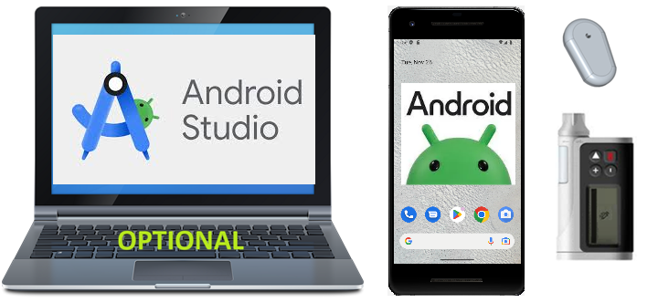

# Обзор компонентов

**AAPS** — это не просто (самостоятельно собранное) приложение; это один из нескольких модулей вашей системы замкнутого цикла. Прежде чем выбирать компоненты, полезно посмотреть их документацию.



```{admonition} IMPORTANT SAFETY NOTICE
:class: important

Основа функций безопасности **AAPS**, описанных в данной документации, построена на базе функций безопасности ваших устройств, использованных для сборки системы. Для закрытия автоматизированного цикла подачи инсулина чрезвычайно важно использовать только протестированные, полностью рабочие и одобренные медицинскими регуляторами вашей страны системы НМГ и инсулиновые помпы. Внесение аппаратных или программных технических изменений в это оборудование может стать причиной неконтролируемого введения инсулина, что может повлечь опасные последствия для пациента. Если вы найдете или вам предложат сломанные, модифицированные или самодельные инсулиновые помпы или трансмиттеры НМГ, **не используйте их** для создания системы на базе **AAPS**.

Допустимо использовать только оригинальные, сертифицированные производителем расходные материалы, такие как инсулиновые картриджи, инфузионные наборы, пристреливатели к ним и т. п. Использование непроверенных или модифицированных материалов может вызвать неточность мониторинга и ошибки дозировки инсулина. Инсулин опасен при неверной дозировке - не рискуйте жизнью, пользуясь неумело переделанными компонентами.

Наконец, что не менее важно, запрещается принимать SGLT-2 ингибиторы (глифлозины), поскольку они непредсказуемо снижают уровень ГК. Сочетание с системой, которая снижает базальную скорость для повышения ГК является особенно опасным, поскольку из-за глифлозинов этот подъем ГК может не произойти и возникнет нехватка инсулина. [Подробнее](#PreparingForAaps-no-sglt-2-inhibitors).
```

## Необходимые модули

### Хорошо подобранные дозы и коэффициенты для компенсации

Этот «модуль» нельзя создать или купить, и его, наверное, недооценивают больше всего — но он обязателен. Если вы доверяете алгоритму помогать управлять диабетом, ему нужны правильные настройки, чтобы он не совершал серьезных ошибок. Даже если у вас все еще нет других модулей, можно проверить и отредактировать свой **профиль** вместе с эндокринологом.

**Профиль** включает в себя:

- BR (уровни базала): обеспечивают фоновый (базальный) инсулин;
- ISF (рус: ФЧИ, фактор чувствительности к инсулину): насколько ваш уровень ГК понижается от 1 единицы инсулина;
- CR (carb ratio): how many grams of carbohydrate are covered by one unit of insulin.

Большинство пользователей систем ИПЖ используют циклические суточные величины скорости базала (BR), гормональную чувствительность к инсулину ISF и углеводный коэффициент CR.

Кроме **профиля** нужно также настроить **инсулин** в **Управление → Настройки инсулина**, включая его DIA (время действия инсулина) — см. [Настройки инсулина](#Config-Builder-insulin-dia).

More information about your **Profile** [on the dedicated page](../SettingUpAaps/YourAapsProfile.md).

### Телефон

See the dedicated page [Phones](../Getting-Started/Phones.md).

### Инсулиновая помпа

See the dedicated page [Compatible Pumps](../Getting-Started/CompatiblePumps.md).

**Advantages and disadvantages of some pump models**

The Combo, the Insight and the older Medtronic are solid pumps, and loopable. The Combo has the advantage of many more infusion set types to choose from as it has a standard Luer-Lock. И батарея у нее стандартная: ее можно купить на любой заправке или в круглосуточном магазине, а если она очень нужна, можно «одолжить» ее из пульта в гостиничном номере ;-).

The advantages of the DanaR/RS and Dana-i vs. the Combo as the pump of choice however are:

- Первоначальное сопряжение проходит проще с Dana-i/RS. Но обычно это делается только один раз, так что это свойство важно, если хотите проверить новую функцию на других помпах.
- На данный момент Combo работает с экранным анализом (для обратного инжиниринга). В целом, это неплохо, но этот процесс идет медленно. Для цикла ИПЖ это не имеет значения, так как он работает в фоновом режиме. Still there is much more time you need to be connected so more time when the BT connection might break, which isn't so easy if you walk away from your phone whilst bolusing & cooking.
- Combo вибрирует по завершении временных базалов TBR, Dana вибрирует (или пищит) на микроболюсах SMB. At nighttime, you are likely to be using TBRs more than SMB.  The Dana-i/RS is configurable so that it does neither beep nor vibrate.
- С Dana-i/RS история вместе с углеводами читается за несколько секунд. Поэтому можно легко сменить телефон без интернета и продолжить работу цикла, как только поступят первые значения CGM.
- All pumps **AAPS** can talk with are waterproof on delivery. Но только помпы Dana также "гарантированно водонепроницаемы" благодаря изолированным отсекам батареи и системы наполнения резервуара.

### Источник данных гликемии

См. отдельную страницу [Совместимые CGM](../Getting-Started/CompatiblesCgms.md).

### **AAPS**-.apk file

The main component of the system. In order to install the app, you have to build the apk-file yourself first. Instructions are [here](../SettingUpAaps/BuildingAaps.md).

### Reporting server

Сервер отчетов показывает ваши данные о глюкозе и терапии и создает отчеты для подробного анализа. Сейчас с AAPS можно использовать два сервера отчетов: [Nightscout](#SettingUpTheReportingServer-nightscout) и [Tidepool](#SettingUpTheReportingServer-tidepool). Оба позволяют наглядно видеть данные о диабете за период времени и дают статистику по **времени в диапазоне** (TIR) и другим показателям.

Сервер отчетов не зависит от других модулей. Если вы не хотите пользоваться сервером отчетов, знайте, что для долгосрочной работы **AAPS** он не обязателен. Но настроить его все равно нужно, так как он требуется для выполнения [**Цели 1**](#objectives-objective1).

Подробнее о настройке сервера отчетов можно прочитать [здесь](../SettingUpAaps/SettingUpTheReportingServer.md).

## Дополнительные модули

### Смарт-часы

Можно выбрать любые смарт-часы с **Wear OS 3** или новее. Подробнее см. [Смарт-часы и AAPS](../Getting-Started/Watches.md).

Пользователи составляют [список проверенных телефонов и часов](#Phones-list-of-tested-phones). Для **AAPS** есть разные циферблаты, их можно найти [здесь](../WearOS/WearOsSmartwatch.md).

### xDrip

Даже если приложение xDrip вам не нужно как **Источник ГК**, им все равно можно пользоваться, например для сигналов тревоги или другого показа уровня глюкозы. Сигналов тревоги может быть сколько угодно: можно задать время, когда сигнал активен, выбрать, может ли он звучать в беззвучном режиме, и т. д. Немного информации о xDrip можно найти [здесь](../CompatibleCgms/xDrip.md). Учтите, что документация этого приложения не всегда актуальна, так как оно быстро меняется.

## Что делать во время ожидания модулей

Иногда получение всех модулей для замыкания цикла занимает какое-то время. But no worries, there are a lot of things you can do while waiting. It is **necessary** to check and (where appropriate) adapt basal rates (BR), insulin-carb ratio (IC), insulin-sensitivity-factors (ISF) etc. Кроме того, открытый цикл может быть хорошим способом проверить систему и познакомиться с **AAPS**. В этом режиме **AAPS** дает рекомендации по терапии, которые вы выполняете вручную.

Можно продолжать читать документацию, общаться с другими пользователями ИПЖ онлайн или вживую, [читать](../UsefulLinks/BackgroundReading.md) документацию или то, что пишут другие пользователи (но будьте осторожны: не все верно или подходит для повторения).

**Готово?** Если у вас собраны все компоненты **AAPS** (поздравляем!) или хотя бы достаточно для начала работы в режиме открытого цикла, сначала прочитайте [описание Целей](../SettingUpAaps/CompletingTheObjectives.md) перед каждой новой Целью и настройте свое оборудование.
