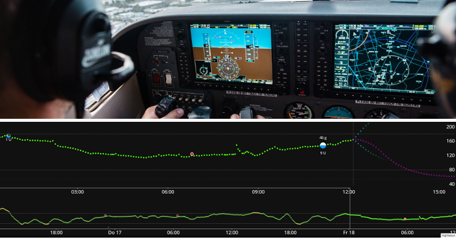
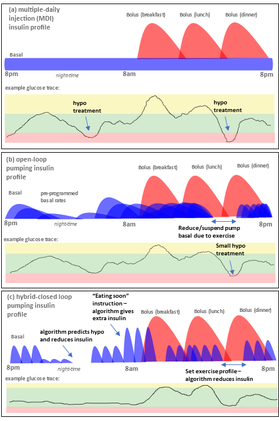
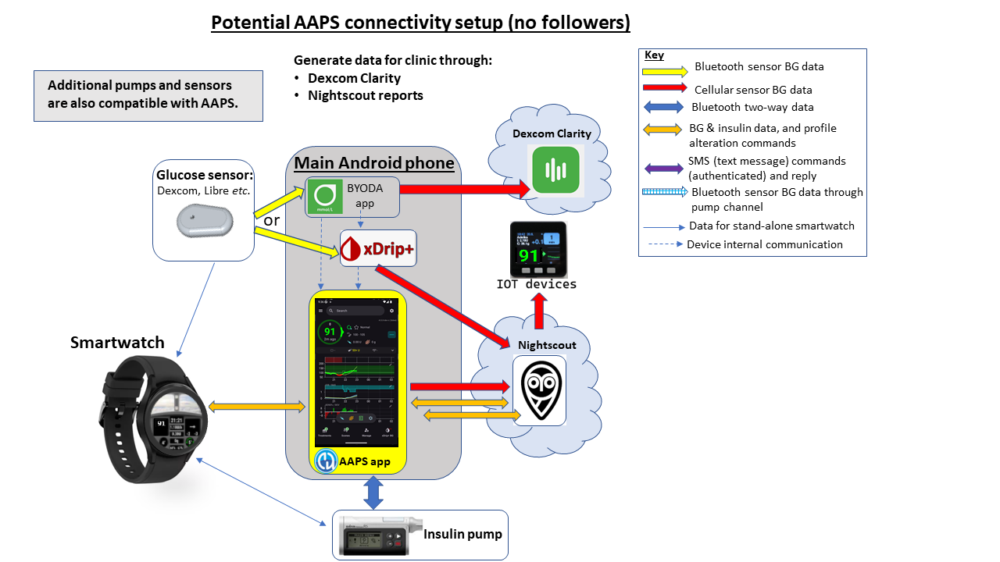
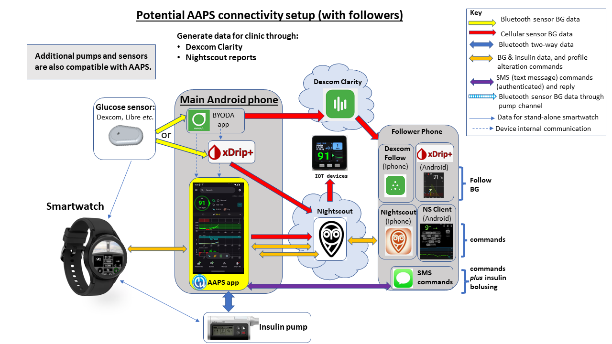

# Введение в APS и AAPS

```{contents} In this page
:backlinks: entry
:depth: 2
```

## Что такое «система искусственной поджелудочной железы»?

Человеческая поджелудочная железа делает много, помимо регулирования содержания сахара в крови. Однако, термин **«Система Искусственной Поджелудочной Железы» (APS)** обычно относится к системе, которая работает для автоматического поддержания уровня сахара в крови в здоровых пределах.

Основным способом поддерживать этот уровень является определение **уровней гликемии**, выполнение **расчетов** и подачи (прогнозируемого) корректного количества **инсулина** в организм. Система производит эти расчеты каждые несколько минут, 24/7. Она подает **звуковые сигналы** и **оповещения** для информирования пользователя о необходимости вмешательства или для привлечения его внимания. Такая система обычно состоит из **сенсора глюкозы**, **инсулиновой помпы** и **контроллера**, который выполняет расчеты. В **AAPS** и других системах с открытым кодом контроллер – это приложение на телефоне. В большинстве коммерческих систем это программа внутри самой помпы, а приложение на телефоне используется в основном для просмотра данных и управления.

Чтобы узнать, как развивались системы замкнутого цикла и как они работают, хорошо начать с этой обзорной статьи 2022 года. Учтите, что она написана раньше большинства систем, доступных сегодня, поэтому она не описывает то, что сейчас есть на рынке:

 [Closed-Loop Insulin Delivery Systems: Past, Present, and Future Directions](https://www.frontiersin.org/journals/endocrinology/articles/10.3389/fendo.2022.919942/full) (Templer, _Frontiers in Endocrinology_, 2022).

Так называемые «двухгормональные» системы вводят вместе с инсулином глюкагон, чтобы предотвращать тяжелые гипогликемии и держать ГК в еще более узких пределах. Первая такая система одобрена в Европе, но ее выдают только в рамках исследований и проектов, а другие еще в разработке. В свободной продаже пока нет ни одной.

Считается, что искусственная поджелудочная железа может быть представлена в виде [«автопилота для вашего диабета»](https://www.artificialpancreasbook.com/). Что это означает?

В самолете автопилот не выполняет всю работу за человека, пилот не может спать на протяжении всего полета. Автопилот помогает работе пилота. Он снимает с пилота необходимость постоянно управлять самолетом, и пилот может сосредоточиться на общем контроле. Автопилот получает сигналы от разных датчиков, компьютер оценивает эти данные вместе с заданиями пилота, затем делает нужные корректировки и предупреждает пилота о любых проблемах. Пилоту больше не нужно постоянно принимать решения, и эту аналогию можно применить к **AAPS**.



(Introduction-what-does-hybrid-closed-loop-mean)=
## Что значит гибридный замкнутый цикл?

Лучшим решением для диабета первого типа было бы «функциональное лекарство» (возможно, имплант поджелудочных клеток, защищенных от иммунной системы). Пока сообщество людей с диабетом 1 типа (СД1) ждет этого, искусственная поджелудочная железа с «полностью замкнутым циклом», вероятно, лучший вариант из возможных. Это технологическая система, которая не нуждается в усилиях пользователя (например для подачи болюсов на еду или предупреждение о физических упражнениях), с хорошей регуляцией уровней глюкозы в крови. Почти все системы в повседневном использовании – это «гибридный» замкнутый цикл, потому что они сочетают автоматику и действия пользователя. Первые системы полностью замкнутого цикла были одобрены в Европе в 2026 году, но пока ни одна из них не доступна широко.

## Как и почему появились системы ИПЖ?

Развитие коммерческих технологий для людей с диабетом первого типа движется очень медленно. В 2013 году люди, объединенные желанием помочь больным Сд 1 типа, основали движение #WeAreNotWaiting (Мы не ждем). Они сами разработали системы ИПЖ на основе существующих одобренных технологий (инсулиновых помп и систем мониторинга ГК) для улучшения контроля гликемии, безопасности и качества жизни. Их называют системами OS-AID (Open-Source Automated Insulin Delivery – автоматическая подача инсулина с открытым кодом), ранее – системами DIY («сделай сам»), потому что они официально не одобрены органами здравоохранения (FDA, NHS и т. д.). Доступны четыре основные системы OS-AID: [OpenAPS](https://openaps.org/what-is-openaps/), **AAPS**, [Loop](https://loopkit.github.io/loopdocs/#what-is-loop) и [Trio](https://triodocs.org).

Хороший способ понять основы цикла OS-AID – прочитать книгу Даны Льюис «Automated Insulin Delivery». Ее можно бесплатно прочитать [здесь](https://www.artificialpancreasbook.com/) (или купить печатную версию книги). Если хотите узнать больше об [OpenAPS](https://openaps.org/what-is-openaps/), который был источником **AAPS** - переходите на сайт [OpenAPS](https://openaps.org/what-is-openaps/).

Также вышло несколько коммерческих гибридных систем замкнутого цикла. Они сильно отличаются от систем OS-AID, в основном потому, что многие из них содержат «обучающийся алгоритм», который меняет количество подаваемого инсулина по вашей потребности в инсулине за прошлые дни. Многие люди из сообщества OS-AID уже попробовали коммерческие системы и сравнили их со своей системой OS-AID. Чтобы узнать больше о том, чем отличаются разные системы, задайте вопрос в группах Facebook по этим системам, в [группе AAPS на Facebook](https://www.facebook.com/groups/AndroidAPSUsers/) или в [Discord](https://discord.com/invite/4fQUWHZ4Mw).

## Что такое Android APS (AAPS)?


**Рисунок 1**. Принципиальная схема Android APS (Artificial Pancreas System), AAPS.

Android APS (**AAPS**) – это гибридная система замкнутого цикла, или система искусственной поджелудочной железы (APS). Для расчета доз инсулина она использует проверенные алгоритмы [OpenAPS](https://openaps.org/) (набор правил), которые разработало сообщество людей с СД1 #WeAreNotWaiting.

Поскольку OpenAPS совместим только с некоторыми старыми инсулиновыми помпами, **AAPS** (который работает с более широким выбором помп) был впервые разработан в 2016 году для члена семьи с диабетом 1 типа. С тех пор **AAPS** постоянно развивается и усовершенствуется командой добровольцев компьютерных разработчиков и других энтузиастов, которые имеют связь с миром сахарного диабета первого типа. Сегодня **AAPS** пользуются многие тысячи людей по всему миру. Это очень гибкая и универсальная система с множеством настроек, и благодаря открытому исходному коду она легко совместима со многими другими программами и платформами для диабета с открытым кодом. Основные компоненты нынешней системы **AAPS** представлены на **рисунке 1** выше.


## Основные компоненты AAPS

"Мозгом" AAPS является **приложение**, которое вы должны собрать сами. Для этого существует подробная пошаговая инструкция. Затем **AAPS ** устанавливается на [совместимый](../Getting-Started/Phones.md) **телефон на ОС Android** (**1**). Многие пользователи предпочитают иметь отдельный телефон для AAPS в дополнение к основному телефону. Таким образом, отдельный телефон на Android может предназначаться только для AAPS.

На **телефоне Android** кроме **AAPS** нужно установить еще одно приложение. Это [дополнительное приложение](../Getting-Started/CompatiblesCgms.md) получает данные глюкозы от сенсора (**2**) по Bluetooth и затем передает их внутри телефона в **приложение AAPS**.

Приложение **AAPS** использует процесс принятия решений (**алгоритм**), созданный на базе OpenAPS. Новички начинают с базового алгоритма **oref0**, но по мере освоения AAPS можно перейти на более новый алгоритм **oref1**. Какой алгоритм использовать (oref0 или oref1), зависит от того, что лучше подходит именно вам.  В обоих случаях алгоритм учитывает множество факторов и выполняет быстрые вычисления каждый раз, когда поступает новые данные с сенсора. Затем алгоритм по Bluetooth отправляет инсулиновой помпе (**3**) команды, сколько инсулина подать. Всю информацию можно отправлять в интернет (**4**) через мобильные данные или Wi-Fi. По желанию эти данные могут также передаваться наблюдателям(фоллоуерам) и/или собираться для анализа. При желании можно также подключить к телефону [смарт-часы](../Getting-Started/Watches.md) (**5**), чтобы быстро видеть свои данные, а с некоторыми часами – отправлять в **AAPS** простые команды.

## Преимущества системы AAPS

Алгоритм OpenAPS, используемый **AAPS** контролирует уровни сахара в крови при отсутствии вводимых пользователем данных, в соответствии с заданными параметрами (наиболее важные из них базальная скорость, коэффициент чувствительности к инсулину ISF, углеводный коэффициент IC, продолжительность действия инсулина и т. д.), реагируя каждые 5 минут на новые данные от сенсора.

Пользователи называют такие преимущества **AAPS**: множество точных настроек, **автоматизация** и большая прозрачность системы для пациента или опекуна. Это может дать лучший контроль над вашим диабетом (или диабетом человека, о котором вы заботитесь), а значит, лучшее качество жизни и больше спокойствия.

Если вы готовы потратить свое время, **AAPS** поможет вам:

- смягчить стресс и бремя диабета 1 типа;

- сократить множество повседневных решений, которые связаны с диабетом 1 типа;

- получить персонализированные динамические дозировки инсулина на основе данных, получаемых в режиме реального времени, которые могут сократить потребность в купировании эпизодов гипо- и гипергликемии;

- повысить знания об управлении инсулинотерапией и уверенность в настройке ваших параметров;

- научиться создавать сценарии **автоматизации**, подходящие вашему стилю жизни;

- улучшить качество сна и в целом реже вмешиваться ночью;

- осуществлять дистанционный мониторинг и подачу инсулинов при уходе за лицами с диабетом; и

- рационализировать свое переносное диабетическое оборудование путем замены его на телефон с системой **AAPS**.


В конечном счете,**AAPS** поможет пользователям лучше управлять диабетом, что приведет к стабильному сахару крови и благоприятным перспективам для здоровья.

### К практическим преимуществам относятся:

#### 1) Встроенная безопасность
Для того чтобы ознакомиться с защитными функциями алгоритмов, известных как oref0 и oref1, [нажмите здесь ](https://openaps.org/reference-design/). Пользователь контролирует свои собственные ограничения безопасности.

#### 2) Гибкость в выборе оборудования

**AAPS** работает с широким выбором инсулиновых помп и сенсоров и остается гибким, когда меняется жизнь. Например, если у вас аллергия на пластырь сенсора Dexcom, можно перейти на Libre. Чтобы сменить оборудование, не нужно заново собирать или переустанавливать приложение **AAPS**: просто выберите другую помпу или другой источник ГК в разделе **Конфигурация**. **AAPS** не зависит от конкретных драйверов помп, а также содержит «виртуальную помпу», чтобы пользователи могли безопасно поэкспериментировать, прежде чем применять систему на себе.

#### 3) Highly customisable, with wide parameters

Пользователи могут легко добавлять/удалять модули и функциональность, а **AAPS** может работать как в режиме открытого, так и закрытого цикла. Вот примеры возможностей с системой **AAPS**:

 a) Можно установить более низкую цель **ГК** за 30 мин до еды; цель можно поставить даже 72 мг/дл (4,0 ммоль/л).

 b) Если у вас инсулинорезистентность и из-за нее высокая ГК, **AAPS** позволяет создать правило **автоматизации**, которое срабатывает, когда ГК поднимается выше 8 ммоль/л (144 мг/дл), и переключает, например, на профиль 120% (это дает увеличение базала на 20% и усиление других факторов по сравнению с вашим обычным **профилем**). Автоматизация продлится согласно запланированному вами времени. Такая автоматизация может срабатывать в определенные дни недели, в определенное время суток, и даже в определенных местах.

 c) Если ваш ребенок без предупреждения прыгает на батуте, **AAPS** позволяет приостановить подачу инсулина на заданное время прямо с телефона.

 d) После повторного подключения помпы с трубкой, которую отключали для плавания, **AAPS** рассчитает базальный инсулин, пропущенный во время отключения, и осторожно подаст его с учетом текущей ГК. Любой лишний инсулин может быть переопределен простой "отменой" пропущенной базы.

 e) **AAPS** дает возможность настраивать различные профили для различных ситуаций и легко переключаться между ними. Например, функции, которые помогают алгоритму быстрее снижать высокую ГК (такие как супер микроболюсы («**SMB**») и непредвиденные приемы пищи («**UAM**»)), можно настроить так, чтобы они работали только днем, если вы боитесь ночных гипогликемий.

Это лишь примеры. Все возможности системы дают большую гибкость в повседневной жизни, включая спорт, болезнь, гормональные циклы _и т. д._ В конечном счете, пользователь сам должен решить, как использовать эти возможности, универсальной автоматизации для всех не существует.

#### 4) Удаленный мониторинг
Есть много способов мониторинга (Sugarmate, Dexcom Follow, xDrip, Android Auto _и т. д._), которые полезны родителям/опекунам и взрослым в некоторых ситуациях (сон/вождение), когда нужны настраиваемые оповещения. В некоторых приложениях (xDrip) сигналы тревоги можно полностью выключить. Это удобно, если новый сенсор еще «замачивается» или стабилизируется и вы пока не хотите использовать его в цикле.

#### 5) Удаленное управление
Важное преимущество **AAPS** перед коммерческими системами: фолловеры могут отправлять в систему **AAPS** множество команд с помощью защищенных текстовых команд (SMS) или подключенного приложения **AAPSClient**. Эту функцию активно используют родители детей с диабетом 1 типа, которые пользуются **AAPS**.

Функции удаленного управления бывают очень полезны: например, на детской площадке, если вы хотите заранее подать болюс на перекус со своего телефона, а ребенок занят игрой. Также можно следить за системой со смарт-часов (_например,_ Garmin) или отправлять с них простые команды (_например,_ с часов Wear OS, таких как Samsung Galaxy Watch).

#### 6) Нет коммерческих ограничений благодаря открытым программным интерфейсам
Отсутствие коммерческих ограничений из-за открытого интерфейса приложений: помимо возможности в любое время просматривать исходный код **AAPS**, принцип открытого интерфейса программирования дает другим разработчикам возможность вносить новые идеи. **AAPS** тесно интегрирован с Nightscout. Это ускоряет разработку и позволяет добавлять новые функции, упрощающие жизнь с диабетом. Хорошие примеры такой интеграции – [Nightscout](https://nightscout.github.io/), [Nightscout Reporter](https://nightscout-reporter.zreptil.de/), xDrip, [M5 stack](https://github.com/mlukasek/M5_NightscoutMon/wiki) и т. д. Идет обмен мнениями между разработчиками с открытым исходным кодом и разработчиками коммерческих систем. Многие нововведения OS-AID постепенно перенимают коммерческие системы, где разработка, понятно, идет медленнее, отчасти потому, что интерфейсы между системами разных компаний (помпы, приложения, сенсоры _и т. д._) нужно тщательно согласовывать и лицензировать. Это обстоятельство также замедляет внедрение инноваций, удобных для пациента (или небольшой группы пациентов, которые имеют очень специфические потребности), но не приносящих существенной прибыли.

#### 7) Detailed app interface
При помощи **AAPS** легко контролировать такие вещи, как: уровень инсулина в помпе, возраст катетера, возраст сенсора, возраст батареи помпы, активный инсулин _и т. д._ Многие действия можно выполнять в приложении **AAPS** (заполнение помпы, отключение помпы _и т. д._), а не на самой помпе. Значит, помпа может оставаться в кармане или на поясе (у вас или у человека, о котором вы заботитесь).

#### 8) Accessibility and affordability
**AAPS** дает людям, которые не могут оплатить лечение сами или не имеют финансирования/страховки, доступ к гибридной системе замкнутого цикла, которая по концепции на годы опережает коммерческие системы. Сейчас для настройки **AAPS** нужен сервер отчетности (Nightscout или Tidepool), хотя для ежедневной работы цикла **AAPS** он не обязателен. Многие продолжают использовать Nightscout для сбора данных и для удаленного мониторинга. Хотя сам **AAPS** бесплатен, настройка Nightscout на одной из платформ может стоить денег (0–12 €), в зависимости от нужного вам уровня поддержки (см. таблицу сравнения) и от того, хотите ли вы пользоваться Nightscout и после настройки. **AAPS** работает с широким выбором недорогих (примерно от 150 €) [телефонов Android](https://docs.google.com/spreadsheets/u/1/d/e/2PACX-1vScCNaIguEZVTVFAgpv1kXHdsHl3fs6xT6RB2Z1CeVJ561AvvqGwxMhlmSHk4J056gMCAQE02sAWJvT/pubhtml?gid=683363241&single=true). Для разных языков и локаций доступны разные версии, системой AAPS также могут пользоваться [незрячие](#accessibility-for-users-aaps-who-are-partially-or-completely-blind).

#### 9) Поддержка
Ни одна из автоматизированных систем введения инсулина не является совершенной. Коммерческие системы и системы с открытым исходным кодом имеют много общих недоработок как в коммуникациях, так и в оборудовании. Существует сообщество пользователей AAPS на Facebook, на Discord и на Github, которые создали, доработали и в настоящее время используют **AAPS** по всему миру. Существуют также группы поддержки Facebook и помощь от коммерческих компаний для коммерческих систем APS - можно общаться с пользователями или бывшими пользователями этих систем на темы общих неполадок, качестве обучающих программ и уровня поддержки.

#### 10) Предсказуемость, прозрачность и безопасность
**AAPS** прозрачен, логичен и предсказуем. Поэтому легче понять, когда настройка неверна, и исправить ее. Вы всегда точно видите, что делает система, почему она это делает, задаете свои ограничения, которые оставляют контроль (и ответственность) в ваших руках. А это, в свою очередь, обеспечивает уверенность и здоровый сон пользователя.

#### 11) Доступ к расширенным функциям через версии для разработчиков (dev), включая автономный замкнутый цикл
Эта документация **AAPS** фокусируется на основной ветке **“master”** **AAPS**. Однако научные исследования и разработки продолжаются все время. Более опытные пользователи могут захотеть изучить экспериментальные функции ветки **разработчиков**. Инновации в области развития сосредоточены на стратегиях полного замкнутого цикла (без подколок на еду _и т. д._), и, как правило, стремятся сделать качество жизни с диабетом 1 типа как можно выше.

#### 12) Ability to contribute yourself to further improvements
Диабет 1 типа может создавать чувство незащищенности и одиночества. Контролируя собственные технологии преодоления диабета, имея возможность внести свой вклад в эти усилия, вы почувствуете удовлетворение от пользы, которую приносите другим. Вы можете получать новые знания, преодолевать трудности и вносить вклад в новые разработки и документацию. Идущие по этому пути будут обмениваться с вами идеями и совместно преодолевать трудности. Смысл движения #WeAreNotWaiting именно в этом.

## Как выглядит AAPS в сопоставлении с традиционными инъекциями и открытым циклом?

Контроль диабета при помощи множественных инъекций (MDI), a) **на рисунке 2** ниже обычно состоит из сочетания уколов инсулина длительного действия (_напр._ Тресиба) один раз в сутки, с инъекциями более быстрого инсулина (_например_, Новорапид, Фиасп) при питании или для коррекции. Контроль диабета при помощи помпы в открытом цикле (b) состоит из применения помпы для создания базового уровня инсулина при запрограмированной скорости подачи быстродействующего инсулина, а также введения инсулина помпой в виде болюсов на еду или на коррекцию. Основа циклической системы состоит в том, что приложение использует данные о гликемии, чтобы дать помпе команду прекратить подачу инсулина, когда расчеты предполагают приближение к низкому уровню, и дать дополнительный инсулин, если уровень глюкозы повышается и прогнозируется как слишком высокий (с). Хотя эта схема чрезмерно упрощена по сравнению с реальной жизнью, она направлен на то, чтобы продемонстрировать основные различия в подходах. С помощью любого из этих трех подходов можно добиться исключительно хорошего контроля над гликемией.




**Рисунок 2**. Сравнение компенсации за счет (а) одноразовых инъекций, (b) систем открытого цикла, (с) гибридных систем замкнутого цикла.

## Сравнение AAPS с другими системами ИПЖ

На 25 июня 2023 года доступны четыре основные системы замкнутого цикла с открытым кодом: [OpenAPS](https://openaps.readthedocs.io/), **AAPS**, [Loop](https://loopkit.github.io/loopdocs/#what-is-loop) и [Trio](https://triodocs.org) (ранее FreeAPS X). Характеристики различных систем приведены в таблице:


| Тип устройства | Имя                                                                    | [AAPS / ИПЖ](https://wiki.aaps.app)       | [Замкнутый цикл](https://loopkit.github.io/loopdocs/) | [ИПЖ с открытым кодом](https://openaps.readthedocs.io/en/latest/) | [Trio](https://triodocs.org)              |
| -------------- | ---------------------------------------------------------------------- | ----------------------------------------- | ----------------------------------------------------- | ----------------------------------------------------------------- | ----------------------------------------- |
| Телефон        | Android                                                                |      |              |                          |  |
| Телефон        | iPhone                                                                 |  |                  |                          |      |
| Платформа      | микрокомпьютер (1)                                                     |  |              |                              |  |
| PUMP           | [Dana I](../CompatiblePumps/DanaRS-Insulin-Pump.md)                    |      |                  |                          |      |
| PUMP           | [Dana RS](../CompatiblePumps/DanaRS-Insulin-Pump.md)                   |      |                  |                          |      |
| PUMP           | [Dana R](../CompatiblePumps/DanaR-Insulin-Pump.md)                     |      |              |                          |  |
| PUMP           | [Omnipod (Dash)](../CompatiblePumps/OmnipodDASH.md)                    |      |                  |                          |      |
| PUMP           | [Omnompod (Eros)](../CompatiblePumps/OmnipodEros.md)                   |      |                  |                          |      |
| PUMP           | [Diaconn G8](../CompatiblePumps/DiaconnG8.md)                          |      |              |                          |  |
| PUMP           | [EOPatch 2](../CompatiblePumps/EOPatch2.md)                            |      |              |                          |  |
| PUMP           | [Medtrum TouchCare Nano 200U](../CompatiblePumps/MedtrumNano.md)       |      |                  |                          |      |
| PUMP           | [Medtrum TouchCare 300U](../CompatiblePumps/MedtrumNano.md)            |      |                  |                          |      |
| PUMP           | [Roche Combo](../CompatiblePumps/Accu-Chek-Combo-Pump-v2.md)           |      |              |                          |  |
| PUMP           | [Roche Insight](../CompatiblePumps/Accu-Chek-Insight-Pump.md)          |      |              |                          |  |
| PUMP           | [Старые Medtronic](../CompatiblePumps/MedtronicPump.md)                |      |                  |                              |      |
| PUMP           | [Equil 5.3](../CompatiblePumps/Equil5.3.md)                            |      |              |                          |  |
| PUMP           | [CareLevo](../CompatiblePumps/CareLevo.md)                             |      |              |                          |  |
| PUMP           | [AP550](../CompatiblePumps/AP550-Insulin-Pump.md)                      |      |              |                          |  |
| CGM /  НМГ     | [Dexcom G7/One+/Stelo](../CompatibleCgms/DexcomG7.md)                  |      |                  |                          |      |
| CGM /  НМГ     | [Dexcom One](../CompatibleCgms/DexcomG6.md)                            |      |                  |                          |      |
| CGM /  НМГ     | [Dexcom G6](../CompatibleCgms/DexcomG6.md)                             |      |                  |                              |      |
| CGM /  НМГ     | [Libre 3/3+](../CompatibleCgms/Libre3.md)                              |      |                  |                          |      |
| CGM /  НМГ     | [Libre 2/2+](../CompatibleCgms/Libre2.md)                              |      |                  |                          |      |
| CGM /  НМГ     | [Libre 1](../CompatibleCgms/Libre1.md)                                 |      |                  |                          |      |
| CGM /  НМГ     | [Eversense](../CompatibleCgms/Eversense.md)                            |      |                  |                          |      |
| CGM /  НМГ     | [MM640g/MM630g](../CompatibleCgms/MM640g.md)                           |      |              |                          |  |
| CGM /  НМГ     | [Poctech](../CompatibleCgms/PocTech.md)                                |      |              |                          |  |
| CGM /  НМГ     | [Ottai](../CompatibleCgms/OttaiM8.md)                                  |      |              |                          |  |
| CGM /  НМГ     | [Syai Tag](../CompatibleCgms/SyaiTagX1.md)                             |      |              |                          |  |
| CGM /  НМГ     | [Nightscout как источник ГК](../CompatibleCgms/CgmNightscoutUpload.md) |      |                  |                              |      |

_Примечания к таблице:_
1. **Платформа** (rig) – это небольшой компьютер без монитора, который вы носите с собой. Один из поддерживаемых типов устройств - Intel Edison + Explorer Board а также Raspberry Pi + Explorer HAT или Adafruit RFM69HCW Bonnet. Первые системы APS были построены на такой платформе, так как мобильные телефоны не могли выполнять нужные алгоритмы. Использование этих систем снизилось, поскольку настройка на мобильных телефонах стала проще, к тому же на телефонах есть дисплей. Intel также перестал продавать Intel Edison. Отличные алгоритмы OpenAPS **oref0** и **oref1** теперь встроены в AAPS и Trio.


Заявление экспертов, содержащее практические рекомендации по системам с открытыми исходными кодами, было подготовлено медицинскими работниками и специалистами по вопросам здравоохранения, и опубликован в ведущем журнале медицины в 2022: [_Lancet Diabetes Endocrinol_, 2022; 10: 58–74](https://www.ncbi.nlm.nih.gov/pmc/articles/PMC8720075/)(_1_). Ее стоит прочитать (в том числе вашей диабетологической клинике): она кратко описывает основные технические различия между разными гибридными системами замкнутого цикла с открытым кодом.

Трудно "почувствовать" любую систему, не используя ее, или не поговорив с другими пользователями, поэтому обращайтесь с ними на Facebook/Discord и задавайте интересующие вас вопросы. Большинство людей считают, что **AAPS** намного сложнее других гибридных систем замкнутого цикла (особенно коммерческих): в нем огромное количество настроек и функций, о которых говорилось выше. Вначале это может немного пугать, но не нужно спешить и изучать все возможности сразу. Вы можете двигаться так медленно или так быстро, как хотите, и на каждом шаге вам доступна помощь.


## Использует ли AAPS искусственный интеллект или какой-либо обучающий алгоритм?

Текущая версия **AAPS** (4.0) не содержит алгоритмов машинного обучения, многопараметрических моделей реакции на инсулин или искусственного интеллекта. Сама по себе система открыта и прозрачна в своей работе, и может быть понятной не только специалистам, но и медработникам широкого профиля и пациентам. Это также значит, что если ваш график резко меняется (например, после напряженной рабочей недели начинается спокойный отпуск) и вам, скорее всего, нужно заметно другое количество инсулина, вы можете сразу переключить **AAPS** на более слабый или более сильный собственный профиль. «Обучающаяся система» делает эту подстройку за вас автоматически, но, скорее всего, ей нужно больше времени, чтобы подстроить подачу инсулина.

(which-system-is-right-for-me-or-my-dependent)=
## Какая система подходит мне или человеку, о котором я забочусь?

На практике выбор системы часто ограничивается тем, какая у вас имеется помпа, или какую помпу вам может предоставить ваша медицинская организация, а также тем, каким телефоном вы пользуетесь (Apple или Android). Если у вас еще нет помпы, у вас самый большой выбор систем. Технология постоянно развивается, помпы снимаются с производства, выпускаются новые помпы и сенсоры. Большинство систем с открытым исходным кодом работают с основными сенсорами (Libre и Dexcom) или быстро адаптируются к новым сенсорам, примерно через год после их выпуска (с небольшой задержкой для проверки безопасности и стабильности).

Большинство пользователей **AAPS** сообщают об увеличении времени в целевом диапазоне, снижении HbA1c, а также об улучшении качества жизни благодаря системе, которая может автоматически регулировать базальную скорость ночью во время сна. Это верно и для большинства гибридных систем замкнутого цикла. Одни люди предпочитают очень простую систему с малым числом настроек (тогда вам может больше подойти коммерческая система), а других такая нехватка контроля очень раздражает (тогда вам может больше подойти система с открытым кодом). Если диабет у вас (или у человека, о котором вы заботитесь) выявлен недавно, обычный путь такой: сначала привыкнуть к MDI вместе с сенсором глюкозы, затем перейти на помпу, которая поддерживает цикл, а затем – на **AAPS**. Но некоторые (особенно маленькие дети) могут сразу перейти на помпу.

Важно отметить, что для устранения неполадок пользователь **AAPS** должен сам проявлять инициативу в устранении проблем, а также обращаться за помощью к сообществу пользователей и разработчиков. Такой подход радикально отличается от пользования коммерческими системами. С **AAPS** пользователь имеет больше контроля, но и больше ответственности и должен быть готов к этому.

## Безопасно ли пользование системами с открытым исходным кодом, такими как AAPS?

### Безопасность системы AAPS
Более точный вопрос, вероятно, такой: «безопасно ли это **по сравнению** с моей нынешней системой введения инсулина?», поскольку любой метод введения инсулина связан с риском. Система **AAPS** имеет множество сдержек и противовесов для достижения максимальной безопасности. В одной недавней [статье](https://www.liebertpub.com/doi/epub/10.1089/dia.2019.0375) изучали работу **AAPS** в компьютерной модели. Это хороший способ объективно проверить, насколько система безопасна и эффективна. В целом многие тысячи людей по всему миру пользуются системами автоматической подачи инсулина с открытым кодом, и их число в мире продолжает расти.

Любое устройство, использующее радиосвязь, может быть взломано, и это относится и к обычным инсулиновым помпам. В настоящее время нам неизвестны случаи взлома медицинского оборудования, связанного с диабетом, с целью причинения вреда. Однако существует множество способов защититься от таких рисков:

1.  В настройках помпы ограничьте и максимальный допустимый болюс, и максимальный временный базал значениями, которые вы считаете самыми безопасными. Это — жесткие ограничения, которые, по нашему мнению, не сможет обойти какой-нибудь хакер-злоумышленник.

2.  Установите сигналы оповещения вашего мониторинга для высоких и низких уровней ГК.

3.  Отслеживайте подачу инсулина через интернет. Пользователи Nightscout могут установить дополнительные сигналы тревоги для различных ситуаций, включая условия, которые имеют гораздо больше вероятности, чем атаки злоумышленника. Помимо высоких и низких сахаров, Nightscout отображает диагностические данные, полезные для проверки работы помпы, включая активный инсулин IOB, историю болюсов и временной базальной скорости помпы. Он также может быть настроен на оповещение о нежелательных условиях, таких как прогнозируемые высокие и низкие уровни гликемии, запасах инсулина в резервуаре и низкий заряд батареи в помпе.

Если на вашу инсулиновую помпу будет произведена атака злоумышленника, выше приведенные стратегии значительно снизят риски. Каждый потенциальный пользователь **AAPS** должен взвесить риски, связанные с использованием **AAPS**, по сравнению с рисками использования другой системы.

#### Соображения о безопасности слишком быстрого улучшения контроля гликемии крови

Быстрое снижение HbA1c и улучшение контроля глюкозы в крови кажется привлекательным. Однако _слишком быстрое_ снижение среднего уровня глюкозы в крови путем запуска любой системы с замкнутым контуром может привести к необратимым нарушениям, включая повреждение глаз, и болезненную непроходящую нейропатию. Этого можно избежать просто путем более медленного снижения уровней ГК. Если у вас сейчас высокий HbA1c и вы переходите на AAPS (или любую другую систему замкнутого цикла), обсудите этот возможный риск с вашими врачами до начала и согласуйте с ними план по времени. Более общая информация о том, как безопасно снижать уровень глюкозы, включая ссылки на медицинскую литературу, приведена в разделе о безопасности [здесь](#preparing-safety-first).

#### Безопасность устройств, расходных материалов и других медицинских средств

Для системы ИПЖ используйте проверенные, полностью исправные инсулиновую помпу и CGM, одобренные FDA или CE. Внесение аппаратных или программных технических изменений в это оборудование может стать причиной неконтролируемого введения инсулина, что может повлечь опасные последствия для пациента. Не пользуйтесь переделанными, самодельными или сломанными инсулиновыми помпами и/или устройствами мониторинга для создания системы AAPS.

Пользуйтесь оригинальными поставками манипуляторов, катетеров и резервуаров, допущенных производителем помпы и системы мониторинга. Использование непроверенных или модифицированных материалов может вызвать неточность мониторинга и ошибки дозировки инсулина. Инсулин опасен при неверной дозировке - не рискуйте жизнью, пользуясь неумело переделанными компонентами.

Не принимайте ингибиторы SGLT-2 (глифлозины) при использовании **AAPS**, поскольку они непредсказуемо снижают уровни сахара в крови. Сочетание этого эффекта с системой, которая снижает базальные дозы с целью повышения ГК, опасно, более подробно об этом можно прочитать в основном разделе [безопасность](#preparing-safety-first).

(введение-how-can-i-approach-discussing-aaps-s-s-my-clinical-team)=
## Как мне подойти к обсуждению AAPS с врачами?

Пользователям рекомендуется говорить со своими эндокринологами о намерении использовать **AAPS**. Не бойтесь честно поговорить с вашими врачами, если вы собираетесь пользоваться **AAPS** (или любым другим циклом OS-AID). Прозрачность и доверие между пациентом и врачом имеют первостепенное значение.

### Предлагаемый подход:
Начните разговор с врачом, чтобы определить его знакомство и отношение к таким технологии диабета как мониторинг, помповая терапия, гибридные и коммерческие системы замкнутого цикла. Ваш врач/эндокринолог должен знать о базовых технологиях и быть готовым обсудить с Вами достижения в области коммерческих систем замкнутого цикла в регионе.

#### Местные прецеденты

Узнайте мнение ваших врачей/эндокринологов о цикле OS-AID _в сравнении с_ коммерческими системами и оцените их знания в этой области. Знакомы ли они с **AAPS** и могут ли поделиться полезным опытом работы с пациентами, которые используют цикл OS-AID?

Спросите, есть ли среди пациентов ваших врачей те, кто уже пользуется циклом OS-AID. Из-за врачебной тайны врачи не могут передать вам данные других пациентов без их согласия. Но если хотите, вы **можете** попросить врача передать **ваши** контактные данные пациенту с циклом OS-AID, с которым, по мнению врача, вы можете найти общий язык, и сообщить, что вы будете рады, если этот пациент свяжется с вами, чтобы обсудить цикл OS-AID. Врачи не обязаны это делать, но некоторые охотно помогают, так как понимают важность поддержки «равный – равному» при диабете 1 типа. Также может быть полезно познакомиться с доброжелательными пользователями OS-AID в вашем городе. Это, конечно, целиком на ваше усмотрение.

#### Национальные и международные прецеденты

Если вы чувствуете, что ваш эндокринолог не поддерживает применение **AAPS**, может помочь следующая аргументация:

a) Система **AAPS** разработана ПАЦИЕНТАМИ и их опекунами. Она разработана в конечном счете для обеспечения безопасности, но также и опираясь на глубокое изучение опыта пациента. В мире многие тысячи пользователей **AAPS**. Поэтому, скорее всего, среди пациентов вашей клиники есть и другие люди, которые пользуются циклом OS-AID (знают об этом врачи или нет).

b) Недавние рецензируемые рекомендации в ведущем международном медицинском журнале [The Lancet](https://www.ncbi.nlm.nih.gov/pmc/articles/PMC8720075/pdf/nihms-1765784.pdf)(_1_) подтвердили, что циклы OS-AID **безопасны** и **эффективно улучшают контроль диабета**, включая время в целевом диапазоне. В ведущих журналах, например [Nature](https://doi.org/10.1038/d41586-023-02648-9)(_3_), регулярно выходят статьи об успехах сообщества OS-AID.

c) Начало работы с **AAPS** предполагает _постепенный_ переход с “открытых” систем с приостановкой подачи инсулина на низких сахарах к гибридному циклу путем выполнения ряда целей. Таким образом, существует структурированная программа, требующая от пользователей демонстрации уровня компетентности на каждом этапе и доработки основных настроек (база, чувствительность ISF и углеводный коэффициент ICR), прежде чем они смогут замкнуть цикл.

d) Сообщество OS-AID оказывает вам техническую поддержку через GitHub, Discord и закрытые группы Facebook.

e) Вы сможете предоставлять **информацию о мониторинге CGM и петле/помпе** в виде объединенных отчетов на совещаниях в клинике (через Nightscout или Tidepool), либо в распечатанном виде, либо на экране (если принесете с собой ноутбук/ планшет). Рационализация данных мониторинга CGM и инсулиновой помпы позволит более эффективно использовать время врача для проверки ваших отчетов и оценки хода терапии.

f) Если у эндокринологов есть возражения, раздайте им распечатки справочных статей, ссылки на которые приведены здесь в тексте, и дайте им ссылку на раздел **AAPS** для врачей: [Для врачей – общее введение и руководство по **AAPS.**](../UsefulLinks/ClinicianGuideToAaps.md)

#### Поддержка цикла OS-AID другими врачами

Статья в журнале [Lancet Diabetes Endocrinology](https://www.ncbi.nlm.nih.gov/pmc/articles/PMC8720075/)(_1_) (подготовлена совместно King’s и Guy’s and St Thomas’ NHS Foundation Trust под руководством доктора Суфьяна Хуссейна, консультанта-диабетолога и почетного старшего преподавателя King’s в Лондоне) содержит:

a) **Подтверждение** для специалистов, что системы искусственной поджелудочной железы OS-AID / с открытым кодом являются «безопасным и эффективным вариантом лечения» диабета 1 типа, а также рекомендации по советам, обсуждениям, поддержке и документации;

b) **Признание** того, что системы автоматической подачи инсулина с открытым исходным кодом («AID») могут увеличить время в диапазоне (TIR), одновременно уменьшая вариабельность концентраций глюкозы в крови и количества эпизодов гипо- и гипергликемии в различных возрастных, гендерных группах и сообществах;

c) **Рекомендацию** работникам здравоохранения **поддерживать** пациентов с диабетом 1 типа или лиц, осуществляющих уход за ними, которые решили управлять своим диабетом с помощью систем AID (см. выше) с открытым исходным кодом;

d) Рекомендацию о том, чтобы медицинские работники старались узнать обо всех возможностях лечения, которые могут принести пользу пациентам, включая доступные системы AID с открытым исходным кодом.  Если у медицинских работников нет ресурсов для самостоятельного обучения или у них есть обеспокоенность, связанная с юридическими или нормативными вопросами, им следует рассмотреть возможность **сотрудничества или объединения с другими медицинскими работниками**, у которых такие возможности есть;

e) Заявление, что все пользователи систем мониторинга CGM должны в любое время иметь открытый доступ к ** данным о состоянии своего здоровья**

f) заявление, что системы с открытыми исходными кодами не прошли те же нормативные оценки, что и коммерчески доступные медицинские технологии, и не имеют коммерческой технической поддержки. Следует заметить при этом, что имеется **широкая поддержка от пользователей**; а также

g) рекомендацию обновить **нормативно-правовую базу** для обеспечения ясности в отношении таких систем с открытым исходным кодом.

В другой статье, опубликованной в [Medical Law International, 2021](http://pure-oai.bham.ac.uk/ws/files/120241375/0968533221997510.pdf)(_4_), подчеркивается, что Генеральный медицинский совет Великобритании в документе "руководство по согласованию" уделяет большое внимание совместному принятию решений врачом и пациентом. Врач должен объяснить возможную пользу, риски, нагрузку и побочные эффекты OS-AID APS и может рекомендовать определенный вариант, не оказывая давления на пациента.

В конечном итоге именно пациент должен взвешивать эти факторы, наряду с любыми сопутствующими неклиническими проблемами и решить, какой вариант лечения выбрать.

Если врач на приеме узнает, что его пациент использует цикл OS-AID, он не освобождается от обязанности наблюдать пациента только потому, что не назначал эту технологию; врачи должны и дальше наблюдать пациентов.

Врачам (по крайней мере в Великобритании) не запрещено назначать нелицензированные лекарства, и они могут действовать по своему клиническому усмотрению. Поэтому врачи должны по своему клиническому суждению решать, подходит ли OS-AID APS конкретному пациенту, и обсуждать с пациентом то, что они считают плюсами и минусами.

#### Ниже приводятся упомянутые выше статьи и другие полезные ссылки и заявления:

1. Автоматизированная подача инсулина с открытым исходным кодом: заявление о международном консенсусе и практическое руководство для медицинских работников [_Lancet Diabetes Endocrinol_, (2022) _10_, 58–74](https://www.ncbi.nlm.nih.gov/pmc/articles/PMC8720075/)
2. [In Silico Trials Искусственная поджелудочная железа с открытым исходным кодом на базе Android: новая парадигма для проверки безопасности и эффективности самодельных систем, 2020 г](https://www.liebertpub.com/doi/epub/10.1089/dia.2019.0375)
3. «Бионическая поджелудочная железа», сделанная своими руками, меняет подход к лечению диабета — что дальше? [_Nature_ (2023), _620_, 940-941](https://doi.org/10.1038/d41586-023-02648-9)
4. Назначают несертифицированные медицинские устройства? Случай систем искусственной поджелудочной железы «сделай сам» [_Medical law international_, (2021), _21_, 42-68](http://pure-oai.bham.ac.uk/ws/files/120241375/0968533221997510.pdf)
5. [Берлинский институт здравоохранения -заявление о позиции, 2022год](https://www.bihealth.org/en/notices/do-it-yourself-solutions-for-people-with-diabetes-are-safe-and-recommended)
6. Do-It-Yourself Automated Insulin Delivery: A Health-care Practitioner User’s Guide (позиция и руководство Diabetes Canada) [_Canadian Journal of Diabetes_ (2023), _47_, E8, 389-397](https://www.canadianjournalofdiabetes.com/article/S1499-2671(23)00138-7/fulltext)
7.  Нидерланды (EN/NL) - для медработников [как помочь людям с автоматизированной системой подачи инсулина](https://www.diabetotech.com/blog/how-to-help-people-on-open-source-automated-insulin-delivery-systems)
8. First Use of Open-Source Automated Insulin Delivery AndroidAPS in Full Closed-Loop Scenario: Pancreas4ALL Randomized Pilot Study [_Diabetes Technol. Ther._, 25, _5_, 2023](https://www.liebertpub.com/doi/pdf/10.1089/dia.2022.0562?casa_token=D13eFx5vCwwAAAAA:MYvO8hChbViXVJFgov1T11RXBPx2N_wOMThLHwl3TVUxbCuANegPrIFRC5R5VXx_S71FoQYW-qg)
9. Pre-school and school-aged children benefit from the switch from a sensor-augmented pump to an AndroidAPS hybrid closed loop: A retrospective analysis [_Pediatr. Diabetes_ 2021, _22_, 594-604. 2021](https://onlinelibrary.wiley.com/doi/epdf/10.1111/pedi.13190)
10. Результаты проекта OPEN, финансируемого ЕС проекта по изучению опыта пациентов с новой технологией искусственной поджелудочной железы «сделай сам» (Outcomes of Patient’s Evidence with Novel, Do-it-Yourself Artificial Pancreas Technology) (https://www.open-diabetes.eu/publications)


## Почему нельзя просто скачать AAPS и сразу начать им пользоваться?

Приложения **AAPS** нет в Google Play – по юридическим причинам вы должны сами собрать его из исходного кода. **AAPS** не имеет лицензии, то есть не имеет одобрения ни от одного регулирующего органа ни в одной стране. **AAPS** рассматривается как проведение медицинского эксперимента на себе, на свой страх и риск.

Создание системы требует терпения, нацеленности на результат и постепенного развития технических знаний. Вся информация и поддержка находится в этой документации или в группах поддержки в интернете. Многие тысячи людей по всему миру успешно собрали **AAPS** и пользуются им.

Разработчики **AAPS** серьезно относятся к безопасности и хотят, чтобы новые пользователи имели положительное впечатление от **AAPS**. Поэтому важно, чтобы каждый пользователь (или опекун, если пользователь является ребенком):

- самостоятельно построил систему AAPS и прошел все **цели** чтобы к началу работы «замкнутого цикла» иметь хорошие персонализированные настройки и понимание основы того, как работает **AAPS**;

- делал резервные копии своей системы: экспортировал и сохранял важные файлы (например, хранилище ключей и файл настроек .json) в надежном месте, чтобы при необходимости быстро все восстановить;

- устанавливал обновления версий master по мере их доступности; и

- обслуживал систему и следил за ней, чтобы она работала правильно.

## В: Какова структура системы AAPS?

На **рисунке 3 (ниже)** показан пример системы **AAPS** для пользователя, которому не нужны фолловеры, взаимодействующие с системой. Также могут быть интегрированы дополнительное программное обеспечение с открытым исходным кодом и не показанные здесь платформы.




На **рисунке 4 (ниже)** показаны все возможности системы **AAPS** для пользователя, у которого есть фолловеры и которому нужно удаленно следить за системой и менять ее настройки (например, ребенок с диабетом 1 типа). Также могут быть интегрированы дополнительное программное обеспечение с открытым исходным кодом и не показанные здесь платформы.



## В: Каким образом развивается и совершенствуется AAPS?

Большинство пользователей **AAPS** работают с полностью протестированной версией **master**, которую проверили на ошибки и проблемы до выпуска для сообщества. Параллельно с этим разработчики исследуют и тестируют новые улучшения в ветке "разработчиков" (**dev**) **AAPS**, наряду с теми пользователями, которые готовы проверять нововведения и сообщать о замеченных недостатках. Если улучшения работают нормально, они будут выпущены в качестве новой "master" версии **AAPS**. Каждая новая мастер-версия анонсируется в группе Facebook и основные пользователи **AAPS **получают об этом своевременную информацию.

Некоторые опытные и уверенные пользователи **AAPS** проводят эксперименты с новейшими технологиями и версиями приложения **AAPS**, о чем сообщают менее предприимчивым пользователям, которым не приходится проверять все самостоятельно! Сообщения об этих экспериментах можно найти в группе Facebook.

Подробнее о некоторых из этих экспериментов и обсуждение новых технологий можно прочитать здесь:

Tim Street [https://www.diabettech.com/](https://www.diabettech.com/)

David Burren [https://bionicwookie.com/](https://bionicwookie.com/)

## Кто может получить пользу от применения AAPS?

| Тип пользователя                                        |
| ------------------------------------------------------- |
| ✔️ люди с диабетом первого типа                         |
| ✔️ опекуны и/или родители детей с диабетом первого типа |
| ✔️ слепые пользователи с диабетом первого типа          |
| ✔️ *врачи и медицинские специалисты                     |

В таблице выше предполагается, что у пользователя есть и система непрерывного мониторинга глюкозы, и инсулиновая помпа.

*Все данные **AAPS** могут быть предоставлены медицинским специалистам через платформы обмена данными, включая NightScout, который обеспечивает журналирование и мониторинг CGM в реальном времени, включая введение инсулина, потребление углеводов, прогнозы и настройки. Записи Nightscout включают ежедневные и еженедельные отчеты, которые помогают медицинским специалистам обсуждать с пациентами с диабетом 1 типа более точные данные о контроле гликемии и особенностях поведения.

(accessibility-for-users-aaps-who-are-partially-or-completely-blind)=

### Доступность для пользователей AAPS с частичной или полной потерей зрения

#### Повседневное использование AAPS:
AAPS могут пользоваться незрячие люди. На устройствах Android в операционной системе есть программа TalkBack. Она позволяет ориентироваться в экране через голосовой вывод в составе операционной системы. Используя TalkBack, вы можете управлять как смартфоном, так и AAPS без необходимости видеть его.

#### Создание приложения AAPS:
Как пользователь вы выполните сборку приложения AAPS в Android Studio. Многие используют для этого Microsoft Windows, где есть программа чтения с экрана, похожая на TalkBack. Так как Android Studio является приложением Java, в Панели Управления должен быть включен компонент "Java Access Bridge". В противном случае, считыватель экрана на ПК не сможет говорить в Android Studio.

Как вы это делаете, зависит от вашей операционной системы, ниже описаны два метода:

1) В меню Windows Start введите «Панель управления» в поле поиска, откройте, нажав на Enter. Откроются: «Все элементы панели управления».

Откройте "Специальные возможности".

Затем откройте "Использовать компьютер без дисплея", нажмите Enter.

В разделе **Прослушивание текста вслух** выберите **Включить экранный диктор** и **Включить звуковое описание** (turn on audio display), затем нажмите **Применить**.

или:

2) Нажмите клавишу Windows и введите «Панель управления» в поле поиска, откройте, нажав Enter. Откроются: «Все элементы панели управления».

Нажмите букву E, чтобы перейти в «Центр специальных возможностей», откройте, нажав Enter.

Затем откройте "Использовать компьютер без дисплея", нажмите Enter.

В нижней части вы увидите флажок “Включить Java Access Bridge”, выберите его.

Готово, теперь закрывайте окно! Считыватель с экрана теперь должен работать.


Хотите узнать, как начать работу с AAPS? Ознакомьтесь с разделом [подготовка](../Getting-Started/PreparingForAaps.md).
